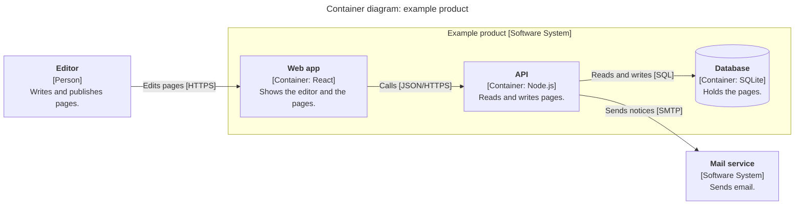

# Diagrams

This guide gives the rules for each diagram in the repository. A diagram in a temporary context is quick to write and to change. A diagram in permanent documentation has high quality and stays correct.

The [`diagrams` skill](../.claude/skills/diagrams/SKILL.md) gives the procedure to make an SVG diagram.

## The form of a diagram

| Context                                                                                                                  | Form                                |
| ------------------------------------------------------------------------------------------------------------------------ | ----------------------------------- |
| Temporary: a conversation, a scratch file, a GitHub issue, a pull request, or an OpenSpec proposal, design, or task list | Mermaid                             |
| Permanent: a `docs/` folder, web content, a user manual, and similar content                                             | A rendered SVG file of high quality |

- Use Mermaid in a temporary context. Do not make an SVG file for it.
- Use an SVG file in permanent documentation. Do not put a Mermaid block in it.
- An OpenSpec specification in `openspec/specs/` does not hold a diagram. It names the diagram as a requirement. See [The specification names each diagram](#the-specification-names-each-diagram).

## Architecture diagrams use the C4 model

Architecture diagrams use the standard [C4 model](https://c4model.com/).

### The terms

- **Person:** a human who uses the product. Give the role, not the name of a person.
- **Software system:** a product of this repository, or an external system that a product connects to. A product is the unit of `openspec/specs/<product>/`.
- **Container:** a process, a service, a deployable unit, a store of persisted data, or a package that other packages build on. A container is not a Docker container.
- **Component:** a part of one container, such as a module, a folder of modules, or a group of functions with one purpose.
- **Relationship:** a connection between two elements. It has a direction and a label.

### The diagrams of a product

| Diagram                                                      | C4 name                  | Rule                                                              |
| ------------------------------------------------------------ | ------------------------ | ----------------------------------------------------------------- |
| The users of the product and the systems that it connects to | System context (level 1) | Required                                                          |
| The runtime units, the stores, and their connections         | Container (level 2)      | Required                                                          |
| The primary path of the product                              | Dynamic diagram          | Required, one for each product                                    |
| A different flow                                             | Dynamic diagram          | Optional. The author decides.                                     |
| The parts of one container                                   | Component (level 3)      | Optional. Only for a container that a new reader must understand. |
| Classes and functions                                        | Code (level 4)           | Not drawn by hand                                                 |

A dynamic diagram shows the elements of one flow and numbers each relationship in the order of the flow.

### The notation

- Each element shows three items: its name, its type and technology in brackets (for example `[Container: Node.js]`), and a one-line description.
- Each relationship has a direction and a label. The label is a short verb phrase. Add the protocol or the technology when it helps the reader, for example `Sends snapshots [SSE]`.
- Each diagram has a title that gives its type and its scope, for example `Container diagram: <product>`.
- Each diagram has a legend. The legend explains each shape, color, and line style.
- A box that holds other elements shows the boundary of a software system or a container. Its label gives the name and the type.

### Text in a C4 diagram

The C4 notation sets the text limit of an element. An element has its name, its type and technology, and one short line of description. A relationship has one short label. Do not add more text than that. Put each other detail in the prose next to the diagram.

### C4 in a temporary context

In a temporary context, a C4 diagram is a Mermaid `flowchart` with subgraphs. A subgraph is a boundary. Each node holds the three items of the element. Put the title in the frontmatter. Do not use the Mermaid `C4Context` family of diagram types.



In Mermaid, the type in brackets on each element is the legend. Add a `Legend` subgraph when the diagram uses a color or a line style that has a meaning.

## The architecture document

### When a product needs one

- A product gets its first architecture document when it first has two containers.
- An OpenSpec change adds or updates the architecture document of its product when the change adds, removes, or moves an element or a relationship at the context level or at the container level.
- A change inside one container needs no change to the architecture document.
- `openspec/config.yaml` states these rules for OpenSpec changes.

### Where it is

The architecture document is the folder `architecture/` in the `docs/` folder of the product:

| Product                           | Folder                                 |
| --------------------------------- | -------------------------------------- |
| A package group, such as `wishem` | `nodejs/<product>/docs/architecture/`  |
| A package under `nodejs/apps/`    | `nodejs/apps/<app>/docs/architecture/` |
| `opus` (repository-wide behavior) | `docs/architecture/opus/`              |

The folder holds these files:

- `README.md`: the architecture document.
- `<diagram>-light.svg` and `<diagram>-dark.svg`: the two files of each diagram. Use the names `context`, `containers`, `dynamic-<flow>`, and `components-<container>`.
- `render.mjs`: the script that writes the SVG files.

### What the document holds

For each diagram, in the order of the C4 levels:

1. A heading with the title of the diagram.
2. The diagram, in a `picture` element that selects the file for the theme of the reader. The `alt` text says what the diagram shows.
3. Prose that carries the detail. The diagram tells the story. The prose explains it.
4. A table of the elements: the name, the type and technology, and the responsibility of each element. For a container, give the package or the folder.

At the end, the document links to the specification that names its diagrams and tells how to run `render.mjs`.

## The specification names each diagram

Each product that has an architecture document has the capability `<product>/architecture/diagrams` in `openspec/specs/`. The capability has one requirement for each diagram that a rule above requires. Thus a later change that alters the architecture must also change the diagram.

A requirement gives the C4 type, the scope, and the file of the diagram. Its scenario ties the diagram to the architecture. For example:

```markdown
### Requirement: The container diagram

The architecture document SHALL hold a C4 container diagram of the example product, in `nodejs/example/docs/architecture/containers-light.svg` and `containers-dark.svg`. The diagram SHALL show each container of the product and each relationship between the containers.

#### Scenario: A change adds a container

- **WHEN** a change adds a container to the product
- **THEN** the container diagram shows the new container and its relationships
```

## The quality of an SVG diagram

An SVG diagram in permanent documentation obeys these rules. The [`diagrams` skill](../.claude/skills/diagrams/SKILL.md) gives the procedure and the checks.

- **One description.** A script writes each diagram from one description. The script writes a light file and a dark file from the same description. Do not edit an SVG file by hand.
- **Colors.** The colors come from the design tokens of the product. Use one accent color with intent, for the primary path or the element in focus.
- **Fonts.** Use the system font stack. Do not embed font data.
- **Look.** Use cards with round corners on a quiet surface, soft borders, and clear space between elements. Use few text sizes. Use tinted containers for a group or a boundary. Use small, simple line icons. Put an arrow label on a small chip on the line.
- **Text.** Use only the text that the notation requires. Do not write sentences in the diagram.
- **Arrows.** Each arrow has a minimum visible line length. The minimum is larger when a label sits on the arrow. The script fails when an arrow is too short.
- **Fit.** The script fails when a label does not fit in its shape.
- **Determinism.** The script writes the same files on each run.
- **Accessibility.** Each SVG file has a `title` and a `desc`.
- **Correctness.** The direction of each arrow agrees with the code.
- **Review.** Before the work is complete, the author makes an image of each file on the page color of each theme and looks at it.
