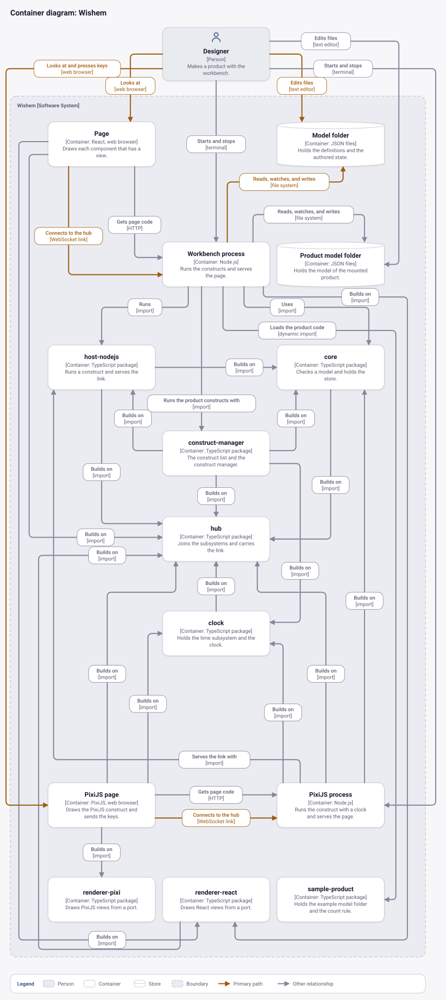

# Architecture of the workbench

> Blueprint, not a specification. See [`../README.md`](../README.md) for the status labels. The specifications in the last section override this file.

This file describes what Wishem is made of. It uses the [C4 model](https://c4model.com/): a system context diagram, a container diagram, a dynamic diagram, and a component diagram. The workbench is the one part of Wishem that runs now. The workbench draws one element: an app bar. The app bar is an entity in the authored state of the workbench, and a view draws it.

In a C4 diagram, a container is a process, a store of data, or a package that other packages build on. A container is not a Docker container. A component is a part of one container. A C4 component is not a component of an entity in the model.

## System context diagram: Wishem

<picture>
  <source media="(prefers-color-scheme: dark)" srcset="context-dark.svg">
  
</picture>

The designer is the one person who uses Wishem. Wishem connects to no external system.

| Element  | Type            | Responsibility                                                                     |
| -------- | --------------- | ---------------------------------------------------------------------------------- |
| Designer | Person          | Makes a product with the workbench. Starts it, edits files, and looks at the page. |
| Wishem   | Software System | Holds a model and draws it. The containers of Wishem are in the next diagram.      |

## Container diagram: Wishem

<picture>
  <source media="(prefers-color-scheme: dark)" srcset="containers-dark.svg">
  
</picture>

Amber arrows show the primary path: a change to the model becomes a new picture. Gray arrows show the other relationships.

The `start` script of `workbench-app` starts one Node.js process. That process holds the host and the Vite development server. The Vite development server serves the page code to the page. It passes `GET /snapshot` and `GET /snapshots` from the page to the host.

The host component of the workbench process is `host-nodejs` at run time. The `start` script calls `startHost`. The package `host-nodejs` is a container because other packages build on it. The process is a container because it runs. The diagram shows both, and the host is one thing.

The workbench process imports `ModelError` from `core` as a value. The page imports only types from `core`, so the diagram shows no relationship from the page to `core`.

`@thrashplay/wishem-workbench-app` is not a container of its own. It holds the page and the `start` script. They are in the page and in the workbench process.

To start the workbench, see [`workbench-app/README.md`](../../workbench-app/README.md).

| Element           | Type                          | Responsibility                                                                                                                                                                                                                   |
| ----------------- | ----------------------------- | -------------------------------------------------------------------------------------------------------------------------------------------------------------------------------------------------------------------------------- |
| Page              | Container: React, web browser | Draws each component that has a view. It holds the HTML renderer, the views, and the components. Package: `@thrashplay/wishem-workbench-app` (`src/main.tsx`, `src/Page.tsx`, `src/renderer/`, `src/views/`, `src/components/`). |
| Workbench process | Container: Node.js            | Runs the host and the Vite development server. It holds the core and serves the page. Package: `@thrashplay/wishem-workbench-app` (`scripts/start.ts`).                                                                          |
| Model folder      | Container: JSON files         | The one store of persisted data. It holds the definition files and `state.json`. Package: `@thrashplay/wishem-workbench` (`model/definitions/`, `model/state.json`, export `modelFolder`).                                       |
| host-nodejs       | Container: TypeScript package | `startHost` and `readModelFolder`. The host reads and watches a model folder, and serves `GET /snapshot` and `GET /snapshots`. Package: `@thrashplay/wishem-host-nodejs`.                                                        |
| core              | Container: TypeScript package | The model types, `validateModel`, `createCore`, and `ModelError`. The core has `getSnapshot` and `subscribe`. It uses no Node.js API. Package: `@thrashplay/wishem-core`.                                                        |

`@thrashplay/wishem-workbench-app` depends on the other three packages. `@thrashplay/wishem-workbench` does not depend on `@thrashplay/wishem-workbench-app`.

## Dynamic diagram: a change to the model becomes a new picture

<picture>
  <source media="(prefers-color-scheme: dark)" srcset="dynamic-change-dark.svg">
  
</picture>

The page opens the stream of snapshots one time. On that stream, the process sends each snapshot. Thus step 3 has the direction of the data.

This is the path from a saved `state.json` to a new picture.

1. The designer saves `state.json` in the model folder.
2. The host reads the model folder again (`readModelFolder`) and checks it (`validateModel`). If a file is not correct, the host prints each problem in the terminal. The page keeps the last picture.
3. The host gives the new model to the core (`setModel`). The core tells its subscribers.
4. The host sends the new snapshot on each open stream of `GET /snapshots`. The Vite development server passes the stream to the page.
5. The client of the core (`connect()` in `src/renderer/connect.ts`) parses the snapshot. It ignores a snapshot that has the same text as the last one. Then it tells its subscribers.
6. The `Renderer` reads the new snapshot. `viewWarnings` compares each sidecar with the definitions. A sidecar for a component type that is not defined, or two labels that give one prop name, gives a warning in the browser console.
7. For each entity and each component type that has a view, the `Renderer` gives the view one prop for each field of the definition, with the name that the label of the field gives. It mounts the view as a React component.
8. The `Renderer` puts the result in a wrapper element that has `data-wishem-entity` and `data-wishem-component-type`. The wrapper is the map from a point on the screen to an entity.
9. React updates the page. The app bar shows the new title.

Steps 2 and 3 of the list are step 2 of the diagram. Step 4 of the list is step 3 of the diagram. Steps 5 to 9 of the list are step 4 of the diagram.

After a change to a definition file that the core accepts, or to a sidecar, the `start` script runs the generator (`generateViewTypes`). The generator writes the generated types, and the script prints one line for each file that changed. This step is inside the workbench process, so the diagram does not show it.

| Element           | Type                          | Responsibility                                              |
| ----------------- | ----------------------------- | ----------------------------------------------------------- |
| Designer          | Person                        | Saves the model file and looks at the new picture.          |
| Model folder      | Container: JSON files         | Holds the file that the designer saves.                     |
| Workbench process | Container: Node.js            | Reads the folder after the watch event. Sends the snapshot. |
| Page              | Container: React, web browser | Shows the new picture.                                      |

## Component diagram: the page of the workbench

<picture>
  <source media="(prefers-color-scheme: dark)" srcset="components-page-dark.svg">
  
</picture>

Amber arrows show the path of a snapshot to a view. Gray arrows show where the table of views gets its content.

`src/main.tsx` connects the client of the core and passes the table of views and the core to the page. The `Renderer` mounts each view in a wrapper element that has `data-wishem-entity` and `data-wishem-component-type`.

The sidecars are source files of `workbench-app`. Each sidecar sits beside the view that it describes. `src/views/AppBar.view.gen.ts` has the type `Props` of the view, with one member for each field of the component type. The `generate` script of `workbench-app` writes it from the definition file and the sidecar. The type check reads it. The page does not.

The `Page` shows the zero state (`ZeroState`) when it has no core yet. The diagram shows only the app bar of the catalog, which a view draws.

| Element            | Type                      | Responsibility                                                                                                                                                           |
| ------------------ | ------------------------- | ------------------------------------------------------------------------------------------------------------------------------------------------------------------------ |
| Client of the core | Component: `connect`      | `connect()` in `src/renderer/connect.ts`. It opens `GET /snapshots` and gives the newest snapshot.                                                                       |
| Renderer           | Component: React          | `Renderer` in `src/renderer/Renderer.tsx`. It gives each view one prop for each field of the definition, and mounts the view in a marked element.                        |
| Table of views     | Component: `collectViews` | `collectViews` in `src/renderer/collect-views.ts`. It pairs each sidecar of `src/views/*.view.json` with its view file and makes a table from component type ID to view. |
| Sidecars           | Component: JSON files     | `src/views/*.view.json`. Each one holds the kind of the view (`react`) and the ID of its component type. It attaches the view to the component type.                     |
| Views              | Component: React          | `src/views/*.tsx`. Each view has a React component as its default export. The file states no ID.                                                                         |
| Catalog            | Component: React          | `src/components/`. It holds the components of the workbench, such as `AppBar` and `ZeroState`.                                                                           |

The HTML renderer is a folder of modules in `workbench-app`. It is not a package. `src/renderer/` holds `collectViews`, `viewWarnings`, the rule for the names of props, the parser of a sidecar, `connect`, and `Renderer`.

## The specifications

- [`wishem/architecture/diagrams`](../../../../openspec/specs/wishem/architecture/diagrams/spec.md): the diagrams of this document.
- [`wishem/renderer-html/views`](../../../../openspec/specs/wishem/renderer-html/views/spec.md): the view files, the sidecars, and the table of views.
- [`wishem/renderer-html/page`](../../../../openspec/specs/wishem/renderer-html/page/spec.md): the page, the client of the core, and the marked element.
- [`wishem/workbench/start`](../../../../openspec/specs/wishem/workbench/start/spec.md): the `start` script of the workbench.
- [`wishem/core/snapshot`](../../../../openspec/specs/wishem/core/snapshot/spec.md): the snapshot and the read interface of the core.

## Change the diagrams

`render.mjs` writes the SVG files of the diagrams. It describes each diagram one time and writes one file for each theme. It reads the colors from `workbench-app/src/styles/tokens.css`.

```
node nodejs/wishem/docs/architecture/render.mjs
```

Commit the SVG files that change. Run the script two times. The second run changes no file.

The diagrams use the standard typefaces of the system of the reader and the colors of the role tokens. The `picture` element selects the file for the theme. Do not edit an SVG file by hand. See [`docs/diagrams.md`](../../../../docs/diagrams.md) for the rules.
