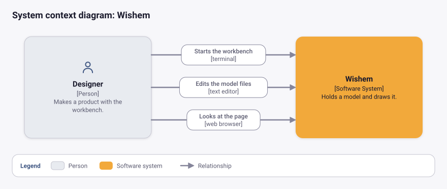
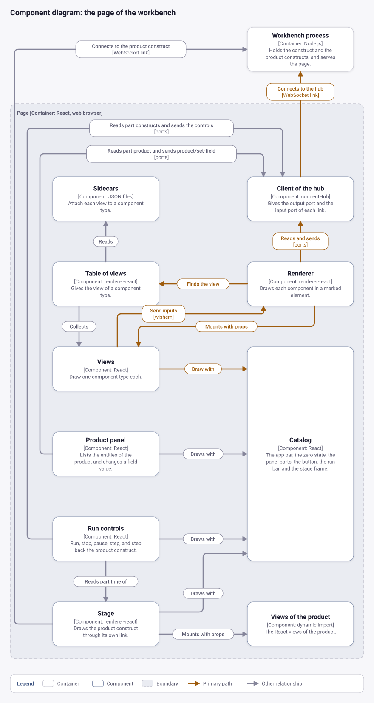

# Architecture of the workbench

> Blueprint, not a specification. See [`../README.md`](../README.md) for the status labels. The specifications in the last section override this file.

This file describes what Wishem is made of. It uses the [C4 model](https://c4model.com/): a system context diagram, a container diagram, a dynamic diagram, and a component diagram. It also has an entity diagram of the model folder. The workbench is the one part of Wishem that runs now. The workbench draws one element: an app bar. The app bar is an entity in the authored state of the workbench, and a view draws it.

In a C4 diagram, a container is a process, a store of data, or a package that other packages build on. A container is not a Docker container. A component is a part of one container. A C4 component is not a component of an entity in the model.

## System context diagram: Wishem

<picture>
  <source media="(prefers-color-scheme: dark)" srcset="context-dark.svg">
  
</picture>

The designer is the one person who uses Wishem. Wishem connects to no external system.

| Element  | Type            | Responsibility                                                                     |
| -------- | --------------- | ---------------------------------------------------------------------------------- |
| Designer | Person          | Makes a product with the workbench. Starts it, edits files, and looks at the page. |
| Wishem   | Software System | Holds a model and draws it. The containers of Wishem are in the next diagram.      |

## Container diagram: Wishem

<picture>
  <source media="(prefers-color-scheme: dark)" srcset="containers-dark.svg">
  
</picture>

Amber arrows show the primary path: a change to the model becomes a new picture. Gray arrows show the other relationships.

The `start` script of `workbench-app` starts one Node.js process. That process holds the construct and the Vite development server. The Vite development server serves the page code to the page. It passes the WebSocket at `/link` from the page to the server of the construct, with the `Origin` header of the page, and it passes no other path.

The construct of the workbench process is `host-nodejs` at run time. The `start` script calls `startConstruct`. The package `host-nodejs` is a container because other packages build on it. The process is a container because it runs. The diagram shows both, and the construct is one thing.

The workbench process imports `ModelError` from `core` as a value. The page imports only types from `core`, so the diagram shows no relationship from the page to `core`.

The workbench process makes its hub through `startConstruct` of `host-nodejs`, and it imports only types from `hub`. The diagram shows no relationship from the process to `hub`. The page imports `openLink` and `webSocketChannel` from `hub`, so the diagram shows the relationship from the page to `hub`. The page connects to the workbench process, not to the package `hub`. The arrow from the page to `hub` shows an import.

`@thrashplay/wishem-workbench-app` is not a container of its own. It holds the page and the `start` script. They are in the page and in the workbench process.

The package `renderer-react` is a container because `workbench-app` builds on it. The page imports `Renderer` and `collectViews` from it. The `start` and `generate` scripts of the workbench process import the generator from its entry `view-types`. The package imports only types from `core` and `hub`, so the diagram shows no relationship from it.

The package `clock` is a container because it holds the `time` subsystem and the clock. It builds on `hub`. No package or process of Wishem starts a clock at this time, so the diagram shows no other relationship for it.

To start the workbench, see [`workbench-app/README.md`](../../workbench-app/README.md).

| Element           | Type                          | Responsibility                                                                                                                                                                                                                           |
| ----------------- | ----------------------------- | ---------------------------------------------------------------------------------------------------------------------------------------------------------------------------------------------------------------------------------------- |
| Page              | Container: React, web browser | Draws each component that has a view. It holds the client of the hub, the views, and the components. Package: `@thrashplay/wishem-workbench-app` (`src/main.tsx`, `src/Page.tsx`, `src/hub-client.ts`, `src/views/`, `src/components/`). |
| Workbench process | Container: Node.js            | Runs the construct and the Vite development server, and serves the page. Package: `@thrashplay/wishem-workbench-app` (`scripts/start.ts`).                                                                                               |
| Model folder      | Container: JSON files         | The one store of persisted data. It holds the definition files and `state.json`. Package: `@thrashplay/wishem-workbench` (`model/definitions/`, `model/state.json`, export `modelFolder`).                                               |
| host-nodejs       | Container: TypeScript package | `startConstruct` and `readModelFolder`. A construct holds a hub and the store, reads, watches, and writes a model folder, and serves the link at `/link`. Package: `@thrashplay/wishem-host-nodejs`.                                     |
| core              | Container: TypeScript package | The model types, `validateModel`, `ModelError`, `isEqual`, and the store (`createStore`, `storeInputs`). The store is a model subsystem of the hub. It uses no Node.js API. Package: `@thrashplay/wishem-core`.                          |
| hub               | Container: TypeScript package | The hub of a construct: `createHub`, the ports, the record of inputs, the joined state, and the hub events. The link: `serveLink`, `openLink`, and `webSocketChannel`. It uses no Node.js API. Package: `@thrashplay/wishem-hub`.        |
| clock             | Container: TypeScript package | The `time` subsystem and the clock of a construct. It builds on the hub. It uses no Node.js API. Package: `@thrashplay/wishem-clock`.                                                                                                    |
| renderer-react    | Container: TypeScript package | The React renderer: `Renderer`, `collectViews`, the names of props, and the generator of the types of the props. `Renderer` draws from a port. The root entry uses no Node.js API. Package: `@thrashplay/wishem-renderer-react`.         |

- `@thrashplay/wishem-workbench-app` depends on `@thrashplay/wishem-core`, `@thrashplay/wishem-hub`, `@thrashplay/wishem-host-nodejs`, `@thrashplay/wishem-renderer-react`, and `@thrashplay/wishem-workbench`.
- `@thrashplay/wishem-workbench` depends on `@thrashplay/wishem-core` and `@thrashplay/wishem-host-nodejs`. It does not depend on `@thrashplay/wishem-workbench-app`.
- `@thrashplay/wishem-host-nodejs` depends on `@thrashplay/wishem-core` and `@thrashplay/wishem-hub`.
- `@thrashplay/wishem-core` depends on `@thrashplay/wishem-hub`.
- `@thrashplay/wishem-renderer-react` depends on `@thrashplay/wishem-core` and `@thrashplay/wishem-hub` for types only. It has `react` as a peer dependency.
- `@thrashplay/wishem-clock` depends on `@thrashplay/wishem-hub`. No other package of Wishem depends on it. `@thrashplay/wishem-core` is a development dependency of it, for a test.
- `@thrashplay/wishem-hub` depends on no other package of Wishem.

The package `host-nodejs` also provides the `wishem` command. The command starts a construct for a model folder, with no page. The `start` script of `@thrashplay/wishem-workbench` uses it (`wishem start ./model`).

## Dynamic diagram: a change to the model becomes a new picture

<picture>
  <source media="(prefers-color-scheme: dark)" srcset="dynamic-change-dark.svg">
  
</picture>

The page opens one link to the hub. On that link, the process sends each changed part of the joined state. Step 3 shows the direction of the data, from the workbench process to the page. The container diagram shows the page as the client of the link.

This is the path from a saved `state.json` to a new picture.

1. The designer saves `state.json` in the model folder.
2. The storage subsystem of the construct reads the model folder again (`readModelFolder`) and checks it (`validateModel`). If a file is not correct, it prints each problem in the terminal. The page keeps the last picture.
3. The storage subsystem sends the input `store/replace-model` to the hub. The store applies it. When the model is equal to the old one, the store keeps the same part.
4. The hub sends the `applied` message with the new part `store` on each open link. The Vite development server passes the WebSocket to the page.
5. The port of the link tells its subscribers about the `applied` event. The client of the hub (`connectHub()` in `src/hub-client.ts`) gave this port to the page after the `welcome` message.
6. The `Renderer` of `renderer-react` reads the part `store` of the port and compares it with the last one by identity. For a new part, it reads the new model. `viewWarnings` compares each sidecar with the definitions. A sidecar for a component type that is not defined, or two labels that give one prop name, gives a warning in the browser console.
7. For each entity and each component type that has a view, the `Renderer` gives the view one prop for each field of the definition, with the name that the label of the field gives. It mounts the view as a React component.
8. The `Renderer` puts the result in a wrapper element that has `data-wishem-entity` and `data-wishem-component-type`. The wrapper is the map from a point on the screen to an entity.
9. React updates the page. The app bar shows the new title.

Steps 2 and 3 of the list are step 2 of the diagram. Step 4 of the list is step 3 of the diagram. Steps 5 to 9 of the list are step 4 of the diagram.

After a change to a definition file that the hub accepts, or to a sidecar, the `start` script runs the generator (`generateViewTypes`). The generator writes the generated types, and the script prints one line for each file that changed. This step is inside the workbench process, so the diagram does not show it.

| Element           | Type                          | Responsibility                                        |
| ----------------- | ----------------------------- | ----------------------------------------------------- |
| Designer          | Person                        | Saves the model file and looks at the new picture.    |
| Model folder      | Container: JSON files         | Holds the file that the designer saves.               |
| Workbench process | Container: Node.js            | Reads after the watch event. Sends the changed parts. |
| Page              | Container: React, web browser | Shows the new picture.                                |

## Component diagram: the page of the workbench

<picture>
  <source media="(prefers-color-scheme: dark)" srcset="components-page-dark.svg">
  
</picture>

Amber arrows show the primary path inside the page: how the changed parts of step 3 of the dynamic diagram become the picture of step 4. Gray arrows show where the table of views gets its content.

`src/main.tsx` connects the client of the hub. After each `welcome` message, it draws the `Page` with the port of the new link and the table of views. The `Renderer` mounts each view in a wrapper element that has `data-wishem-entity` and `data-wishem-component-type`.

The sidecars are source files of `workbench-app`. Each sidecar sits beside the view that it describes. `src/views/AppBar.view.gen.ts` has the type `Props` of the view, with one member for each field of the component type. The `generate` script of `workbench-app` writes it from the definition file and the sidecar. The type check reads it. The page does not.

The `Page` shows the zero state (`ZeroState`) of the catalog in the space below the pictures, with or without a port. The diagram does not show the `Page` module.

| Element           | Type                        | Responsibility                                                                                                                                                                |
| ----------------- | --------------------------- | ----------------------------------------------------------------------------------------------------------------------------------------------------------------------------- |
| Client of the hub | Component: `connectHub`     | `connectHub()` in `src/hub-client.ts`. It opens the link at `/link` as one output subsystem and gives the port of each link to the page.                                      |
| Renderer          | Component: `renderer-react` | `Renderer` in `renderer-react`. It reads the part `store` of the port. It gives each view one prop for each field of the definition, and mounts the view in a marked element. |
| Table of views    | Component: `renderer-react` | `collectViews` in `renderer-react`. It pairs each sidecar of `src/views/*.view.json` with its view file and makes a table from component type ID to view.                     |
| Sidecars          | Component: JSON files       | `src/views/*.view.json`. Each one holds the kind of the view (`react`) and the ID of its component type. It attaches the view to the component type.                          |
| Views             | Component: React            | `src/views/*.tsx`. Each view has a React component as its default export. The file states no ID.                                                                              |
| Catalog           | Component: React            | `src/components/`. It holds the components of the workbench, such as `AppBar` and `ZeroState`.                                                                                |

The React renderer is the package `renderer-react`. It holds `Renderer`, `collectViews`, `viewWarnings`, the rule for the names of props, the parser of a sidecar, and the generator. The page keeps `connectHub`, the views, and the sidecars.

## Entity diagram: the model folder

<picture>
  <source media="(prefers-color-scheme: dark)" srcset="entities-model-folder-dark.svg">
  
</picture>

The model folder is the one store of persisted data. The sidecars are source files of `workbench-app`, so the diagram shows no entity for them.

The schema has the names `ComponentTypeDefinition`, `FieldDefinition`, `Entity`, and `FieldValue`. The schema has no type name for a component. A component is one record in `components` of an entity, and the ID of its component type is the key of the record. The diagram uses the name `Component` for it, as the glossary does. A field value is one entry of that record, and the ID of its field is the key of the entry. The diagram uses the schema name `FieldValue`.

The keys of a `FieldDefinition`, a `Component`, and a `FieldValue` include the IDs of their parents. A `FieldDefinition` has the ID of its component type and its own `id`. The `id` of a `FieldDefinition` is unique in its component type only. A `Component` has no fields of its own. It holds the values. A `FieldValue` has the ID of its entity, the ID of its component type, and the ID of its field.

The diagram does not show these fields:

- `ComponentTypeDefinition` has a `label` and a list of `fields`.
- `FieldDefinition` has a `label` and a `type`. The only `type` is `string`.

The model has these rules, and the diagram does not show them. The field of a `FieldValue` must be a field of the component type of its `Component`. A value is a string. An entity has at most one component of each component type. A component can have no value for a field.

| Entity                    | Purpose                                                                  | Schema                                                                    |
| ------------------------- | ------------------------------------------------------------------------ | ------------------------------------------------------------------------- |
| `ComponentTypeDefinition` | Declares a component type: its ID, its label, and its fields.            | [`model.ts`](../../core/src/model.ts) (`ComponentTypeDefinition`)         |
| `FieldDefinition`         | Declares one field of a component type: its ID, its label, and its type. | [`model.ts`](../../core/src/model.ts) (`FieldDefinition`)                 |
| `Entity`                  | A thing in the model. It holds its components.                           | [`model.ts`](../../core/src/model.ts) (`Entity`)                          |
| `Component`               | The data of one component type in one entity.                            | [`model.ts`](../../core/src/model.ts) (`Entity.components`)               |
| `FieldValue`              | The value of one field in one component.                                 | [`model.ts`](../../core/src/model.ts) (`FieldValue`, `Entity.components`) |

The files of the model folder are `definitions/*.json` for the component types and `state.json` for the entities. [`validate-model.ts`](../../core/src/validate-model.ts) checks the relationships.

## The specifications

- [`wishem/architecture/diagrams`](../../../../openspec/specs/wishem/architecture/diagrams/spec.md): the diagrams of this document.
- [`wishem/renderer-html/views`](../../../../openspec/specs/wishem/renderer-html/views/spec.md): the view files, the sidecars, and the table of views.
- [`wishem/renderer-html/page`](../../../../openspec/specs/wishem/renderer-html/page/spec.md): the page, the client of the hub, and the marked element.
- [`wishem/workbench/start`](../../../../openspec/specs/wishem/workbench/start/spec.md): the `start` script of the workbench.
- [`wishem/core/store`](../../../../openspec/specs/wishem/core/store/spec.md): the store.
- [`wishem/clock/time`](../../../../openspec/specs/wishem/clock/time/spec.md): the `time` subsystem and the clock.
- [`wishem/hub/construct`](../../../../openspec/specs/wishem/hub/construct/spec.md): the hub, the ports, and the record.
- [`wishem/hub/link`](../../../../openspec/specs/wishem/hub/link/spec.md): the link between two processes.
- [`wishem/hub/record`](../../../../openspec/specs/wishem/hub/record/spec.md): the record, the checkpoints, the rewind, and the replay.

## Change the diagrams

`render.mjs` writes the SVG files of the diagrams. It describes each diagram one time and writes one file for each theme. It reads the colors from `workbench-app/src/styles/tokens.css`.

```
node nodejs/wishem/docs/architecture/render.mjs
```

Commit the SVG files that change. Run the script two times. The second run changes no file.

The diagrams use the standard typefaces of the system of the reader and the colors of the role tokens. The `picture` element selects the file for the theme. Do not edit an SVG file by hand. See [`docs/diagrams.md`](../../../../docs/diagrams.md) for the rules.
