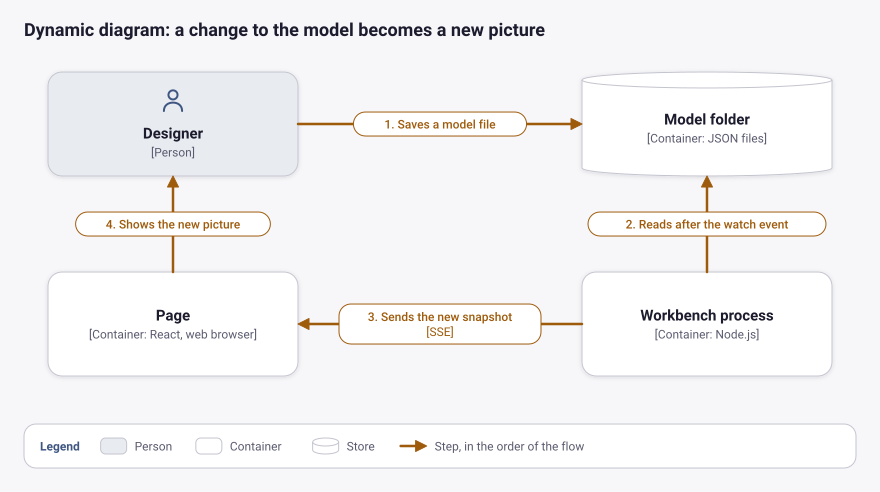
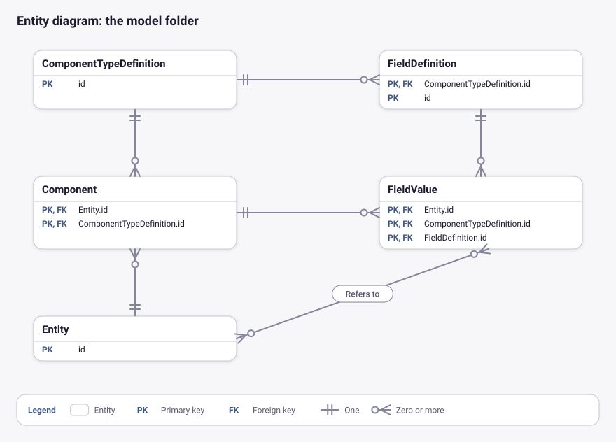

# Architecture of the workbench

> Blueprint, not a specification. See [`../README.md`](../README.md) for the status labels. The specifications in the last section override this file.

This file describes what Wishem is made of. It uses the [C4 model](https://c4model.com/): a system context diagram, a container diagram, a dynamic diagram, and a component diagram. It also has an entity diagram of the model folder. Three parts of Wishem run now. The workbench draws one element: an app bar. The app bar is an entity in the authored state of the workbench, and a view draws it. The PixiJS page and the Godot application each draw one color that a construct with a clock changes two times each second.

In a C4 diagram, a container is a process, a store of data, or a package that other packages build on. A container is not a Docker container. A component is a part of one container. A C4 component is not a component of an entity in the model.

## System context diagram: Wishem

<picture>
  <source media="(prefers-color-scheme: dark)" srcset="context-dark.svg">
  
</picture>

The designer is the one person who uses Wishem. Wishem connects to no external system.

| Element  | Type            | Responsibility                                                                     |
| -------- | --------------- | ---------------------------------------------------------------------------------- |
| Designer | Person          | Makes a product with the workbench. Starts it, edits files, and looks at the page. |
| Wishem   | Software System | Holds a model and draws it. The containers of Wishem are in the next diagram.      |

## Container diagram: Wishem

<picture>
  <source media="(prefers-color-scheme: dark)" srcset="containers-dark.svg">
  
</picture>

Amber arrows show the primary path: a change to the model becomes a new picture. Gray arrows show the other relationships.

The `start` script of `workbench-app` starts one Node.js process. That process holds the construct and the Vite development server. The Vite development server serves the page code to the page. It passes the WebSocket at `/link` from the page to the server of the construct, with the `Origin` header of the page, and it passes no other path.

The construct of the workbench process is `host-nodejs` at run time. The `start` script calls `startConstruct`. The package `host-nodejs` is a container because other packages build on it. The process is a container because it runs. The diagram shows both, and the construct is one thing.

The workbench process imports `ModelError` from `core` as a value. The page imports only types from `core`, so the diagram shows no relationship from the page to `core`.

The workbench process makes its hub through `startConstruct` of `host-nodejs`, and it imports only types from `hub`. The diagram shows no relationship from the process to `hub`. The page imports `connectLink` from `hub`, so the diagram shows the relationship from the page to `hub`. The page connects to the workbench process, not to the package `hub`. The arrow from the page to `hub` shows an import.

`@thrashplay/wishem-workbench-app` is not a container of its own. It holds the page and the `start` script. They are in the page and in the workbench process.

The package `renderer-react` is a container because `workbench-app` builds on it. The page imports `Renderer` and `collectViews` from it. The `start` and `generate` scripts of the workbench process import the generator from its entry `view-types`. The package imports only types from `core` and `hub`, so the diagram shows no relationship from it.

The package `clock` is a container because it holds the `time` subsystem and the clock. It builds on `hub`. The PixiJS process starts the clock, and the PixiJS page imports `timeInputs` from it.

The `start` script of `pixi-page` starts one Node.js process, the PixiJS process. That process holds the PixiJS construct (`startPixiConstruct`) and a Vite development server, with no HMR. The construct is a hub with the `time` subsystem, a store with a color rule, and the clock. It serves the link at `/link` through `serveHub` of `host-nodejs`. The Vite development server serves the PixiJS page and passes the WebSocket at `/link` to the construct, as the workbench process does.

The PixiJS process imports `serveHub` from `host-nodejs`, `createTime` and `startClock` from `clock`, `createStore` from `core`, and `createHub` and `InputRefusedError` from `hub`. The PixiJS page imports `startRenderer` and `collectViews` from `renderer-pixi`, `connectLink` from `hub`, and `timeInputs` from `clock`. The package `renderer-pixi` imports only types from `core` and `hub`, so the diagram shows no relationship from it. `@thrashplay/wishem-pixi-page` is not a container of its own. It holds the PixiJS page and the PixiJS process.

The product model folder is a second folder that the workbench process mounts. The option `--product <folder>` of the `start` script gives it. The construct holds its model as the store `product`, with a storage subsystem of its own, and the page ignores it. With no option, the workbench process mounts no product. `@thrashplay/wishem-sample-product` (`model/`) is the example folder.

The package `sample-product` is a container because it holds the example product model folder. It holds the model folder `model/` and the count rule `withCountRule`, which wraps a store and adds 1 to each count at each tick of the clock. The count rule is a native behavior in a first form. It stands in for the behavior feature ([#481](https://github.com/twin-digital/opus/issues/481)). The package imports only types from `core` and `hub`, so the diagram shows no relationship from it. It uses `clock` in its tests. `workbench-app` uses it as a development dependency, for a test, so the diagram shows no relationship to it.

The `start` script of `renderer-godot` starts one Node.js process, the Godot process. That process holds the construct of the Godot application (`startGodotConstruct`): a hub with the `time` subsystem, a store with a color rule, and the clock. It serves the link at `ws://127.0.0.1:4749/link` through `serveHub` of `host-nodejs`. It serves no page.

The `godot` script starts the Godot runner, a second Node.js process. The runner starts the Godot application in a Docker container. The container cannot reach `127.0.0.1` of the computer of the runner, so the runner carries the bytes of the link. A relay in the container (`docker exec`) accepts the connection of the application. The runner connects to the Godot process over TCP and carries the bytes in both directions. The application writes a PNG file for each new picture, and the runner copies each file to `shots/` of the package. The designer looks at these files. No part of Wishem reads them, so the diagram shows no store for them.

The Godot process imports `serveHub` from `host-nodejs`, `createTime`, `startClock`, and `TIME_ID` from `clock`, `createStore` from `core`, and `createHub` and `InputRefusedError` from `hub`. The Godot application is GDScript and imports no TypeScript package. The Godot runner imports no package of Wishem. `@thrashplay/wishem-renderer-godot` is not a container of its own: no other package builds on it, and its parts are in the Godot process, the Godot runner, and the Godot application.

To start the workbench, see [`workbench-app/README.md`](../../workbench-app/README.md). To start the PixiJS page, see [`pixi-page/README.md`](../../pixi-page/README.md). To start the Godot construct and the Godot application, see [`renderer-godot/README.md`](../../renderer-godot/README.md).

This is the path of a tick from the clock in the PixiJS process to the picture in the PixiJS page.

1. The clock sends `time/advance` of 500 milliseconds to the hub, through its input subsystem `clock`.
2. The part `time` counts the tick. The color rule of the store sets the `Color` field to the color at the position `ticks` modulo 4.
3. The hub sends the `applied` message with the new parts on each open link. The Vite development server passes the WebSocket to the PixiJS page.
4. The remote port of the PixiJS page tells its subscribers about the `applied` event.
5. `startRenderer` reads the part `store`, calls `update` of the `ClearColor` view, and the view sets the tint of its sprite.
6. PixiJS draws the sprite on the canvas in the next frame.

| Element              | Type                           | Responsibility                                                                                                                                                                                                                                                                               |
| -------------------- | ------------------------------ | -------------------------------------------------------------------------------------------------------------------------------------------------------------------------------------------------------------------------------------------------------------------------------------------- |
| Page                 | Container: React, web browser  | Draws each component that has a view. It holds the client of the hub, the views, and the components. Package: `@thrashplay/wishem-workbench-app` (`src/main.tsx`, `src/Page.tsx`, `src/hub-client.ts`, `src/views/`, `src/components/`).                                                     |
| Workbench process    | Container: Node.js             | Runs the construct and the Vite development server, and serves the page. With `--product`, it mounts a product model folder. Package: `@thrashplay/wishem-workbench-app` (`scripts/start.ts`).                                                                                               |
| Model folder         | Container: JSON files          | The folder of the model of the workbench. It holds the definition files and `state.json`. Package: `@thrashplay/wishem-workbench` (`model/definitions/`, `model/state.json`, export `modelFolder`).                                                                                          |
| Product model folder | Container: JSON files          | The folder of the model of the mounted product. It has the same layout as the model folder. Example: `@thrashplay/wishem-sample-product` (`model/`).                                                                                                                                         |
| host-nodejs          | Container: TypeScript package  | `startConstruct`, `serveHub`, and `readModelFolder`. A construct holds a hub and the store, reads, watches, and writes a model folder, and serves the link at `/link`. Package: `@thrashplay/wishem-host-nodejs`.                                                                            |
| core                 | Container: TypeScript package  | The model types, `validateModel`, `ModelError`, `isEqual`, and the store (`createStore`, `storeInputs`). The store is a model subsystem of the hub. It uses no Node.js API. Package: `@thrashplay/wishem-core`.                                                                              |
| hub                  | Container: TypeScript package  | The hub of a construct: `createHub`, the ports, the record of inputs, the joined state, and the hub events. The link: `serveLink`, `openLink`, `webSocketChannel`, and `connectLink`. It uses no Node.js API. Package: `@thrashplay/wishem-hub`.                                             |
| clock                | Container: TypeScript package  | The `time` subsystem and the clock of a construct. It builds on the hub. It uses no Node.js API. Package: `@thrashplay/wishem-clock`.                                                                                                                                                        |
| PixiJS page          | Container: PixiJS, web browser | Draws the color of the construct on a canvas, shows the state of the link, and sends the keys as inputs. Package: `@thrashplay/wishem-pixi-page` (`src/main.ts`, `src/page.ts`, `src/keys.ts`, `src/views/`).                                                                                |
| PixiJS process       | Container: Node.js             | Runs the PixiJS construct with its clock and the Vite development server, and serves the PixiJS page. Package: `@thrashplay/wishem-pixi-page` (`scripts/start.ts`, `src/construct/`).                                                                                                        |
| Godot process        | Container: Node.js             | Runs the construct of the Godot application with its clock and serves the link at `ws://127.0.0.1:4749/link`. Package: `@thrashplay/wishem-renderer-godot` (`scripts/start.ts`, `src/construct/`).                                                                                           |
| Godot runner         | Container: Node.js             | Starts the Godot application in Docker, carries the bytes of the link to the Godot process, and copies the screenshots to `shots/`. Package: `@thrashplay/wishem-renderer-godot` (`scripts/godot.ts`, `src/runner/`).                                                                        |
| Godot application    | Container: GDScript, Docker    | Draws the construct with the Godot renderer and the view `ClearColor`, and writes a screenshot for each new picture. It holds the remote port in GDScript. Package: `@thrashplay/wishem-renderer-godot` (`godot/`).                                                                          |
| renderer-pixi        | Container: TypeScript package  | The PixiJS renderer: `startRenderer` and `collectViews`. `startRenderer` draws from a port. It uses no Node.js API. Package: `@thrashplay/wishem-renderer-pixi`.                                                                                                                             |
| renderer-react       | Container: TypeScript package  | The React renderer: `Renderer`, `collectViews`, the names of props, and the generator of the types of the props. `Renderer` draws from a port. The root entry uses no Node.js API. Package: `@thrashplay/wishem-renderer-react`.                                                             |
| sample-product       | Container: TypeScript package  | The sample product: `model/`, its model folder, and `withCountRule`. `withCountRule` is a native behavior in a first form. It stands in for the behavior feature (#481). `model/` is the example product model folder. It uses no Node.js API. Package: `@thrashplay/wishem-sample-product`. |

- `@thrashplay/wishem-workbench-app` depends on `@thrashplay/wishem-core`, `@thrashplay/wishem-hub`, `@thrashplay/wishem-host-nodejs`, `@thrashplay/wishem-renderer-react`, and `@thrashplay/wishem-workbench`. `@thrashplay/wishem-sample-product` is a development dependency of it, for a test.
- `@thrashplay/wishem-workbench` depends on `@thrashplay/wishem-core` and `@thrashplay/wishem-host-nodejs`. It does not depend on `@thrashplay/wishem-workbench-app`.
- `@thrashplay/wishem-host-nodejs` depends on `@thrashplay/wishem-core` and `@thrashplay/wishem-hub`. `@thrashplay/wishem-clock` is a development dependency of it, for a test.
- `@thrashplay/wishem-core` depends on `@thrashplay/wishem-hub`.
- `@thrashplay/wishem-renderer-react` depends on `@thrashplay/wishem-core` and `@thrashplay/wishem-hub` for types only. It has `react` as a peer dependency.
- `@thrashplay/wishem-clock` depends on `@thrashplay/wishem-hub`. `@thrashplay/wishem-pixi-page` depends on it. `@thrashplay/wishem-core` is a development dependency of it, for a test.
- `@thrashplay/wishem-renderer-pixi` depends on `@thrashplay/wishem-core` and `@thrashplay/wishem-hub` for types only. It has `pixi.js` as a peer dependency.
- `@thrashplay/wishem-pixi-page` depends on `@thrashplay/wishem-clock`, `@thrashplay/wishem-core`, `@thrashplay/wishem-host-nodejs`, `@thrashplay/wishem-hub`, and `@thrashplay/wishem-renderer-pixi`.
- `@thrashplay/wishem-renderer-godot` depends on `@thrashplay/wishem-clock`, `@thrashplay/wishem-core`, `@thrashplay/wishem-host-nodejs`, and `@thrashplay/wishem-hub`. No other package depends on it.
- `@thrashplay/wishem-sample-product` depends on `@thrashplay/wishem-core` and `@thrashplay/wishem-hub`. `@thrashplay/wishem-clock` is a development dependency of it, for a test. Only the test of `workbench-app` depends on it.
- `@thrashplay/wishem-hub` depends on no other package of Wishem.

The package `host-nodejs` also provides the `wishem` command. The command starts a construct for a model folder, with no page. The option `--product <folder>` mounts a product model folder. The `start` script of `@thrashplay/wishem-workbench` uses it (`wishem start ./model`).

This is the path of a tick from the clock in the Godot process to the screenshot.

1. The clock sends `time/advance` of 500 milliseconds to the hub, through its input subsystem `clock`.
2. The part `time` counts the tick. The color rule of the store sets the `Color` field to the color at the position `ticks` modulo 4.
3. The hub sends the `applied` message with the new parts on the open link. `serveHub` sends it over the connection that the Godot runner carries.
4. The remote port in GDScript of the Godot application tells its subscribers about the `applied` event.
5. The Godot renderer reads the part `store`, calls `update` of the `ClearColor` view, and the view sets the color of its `ColorRect`.
6. The application writes the image of the viewport to a PNG file and prints the line `shot <n> ...`. The Godot runner copies the file to `shots/`.

## Dynamic diagram: a change to the model becomes a new picture

<picture>
  <source media="(prefers-color-scheme: dark)" srcset="dynamic-change-dark.svg">
  
</picture>

The page opens one link to the hub. On that link, the process sends each changed part of the joined state. Step 3 shows the direction of the data, from the workbench process to the page. The container diagram shows the page as the client of the link.

This is the path from a saved `state.json` to a new picture.

1. The designer saves `state.json` in the model folder.
2. The storage subsystem of the construct reads the model folder again (`readModelFolder`) and checks it (`validateModel`). If a file is not correct, it prints each problem in the terminal. The page keeps the last picture.
3. The storage subsystem sends the input `store/replace-model` to the hub. The store applies it. When the model is equal to the old one, the store keeps the same part.
4. The hub sends the `applied` message with the new part `store` on each open link. The Vite development server passes the WebSocket to the page.
5. The port of the link tells its subscribers about the `applied` event. The client of the hub (`connectHub()` in `src/hub-client.ts`) gave this port to the page after the `welcome` message.
6. The `Renderer` of `renderer-react` reads the part `store` of the port and compares it with the last one by identity. For a new part, it reads the new model. `viewWarnings` compares each sidecar with the definitions. A sidecar for a component type that is not defined, or two labels that give one prop name, gives a warning in the browser console.
7. For each entity and each component type that has a view, the `Renderer` gives the view one prop for each field of the definition, with the name that the label of the field gives. It mounts the view as a React component.
8. The `Renderer` puts the result in a wrapper element that has `data-wishem-entity` and `data-wishem-component-type`. The wrapper is the map from a point on the screen to an entity.
9. React updates the page. The app bar shows the new title.

Steps 2 and 3 of the list are step 2 of the diagram. Step 4 of the list is step 3 of the diagram. Steps 5 to 9 of the list are step 4 of the diagram.

After a change to a definition file that the hub accepts, or to a sidecar, the `start` script runs the generator (`generateViewTypes`). The generator writes the generated types, and the script prints one line for each file that changed. This step is inside the workbench process, so the diagram does not show it.

| Element           | Type                          | Responsibility                                        |
| ----------------- | ----------------------------- | ----------------------------------------------------- |
| Designer          | Person                        | Saves the model file and looks at the new picture.    |
| Model folder      | Container: JSON files         | Holds the file that the designer saves.               |
| Workbench process | Container: Node.js            | Reads after the watch event. Sends the changed parts. |
| Page              | Container: React, web browser | Shows the new picture.                                |

## Component diagram: the page of the workbench

<picture>
  <source media="(prefers-color-scheme: dark)" srcset="components-page-dark.svg">
  
</picture>

Amber arrows show the primary path inside the page: how the changed parts of step 3 of the dynamic diagram become the picture of step 4. Gray arrows show where the table of views gets its content.

`src/main.tsx` connects the client of the hub. After each `welcome` message, it draws the `Page` with the port of the new link and the table of views. The `Renderer` mounts each view in a wrapper element that has `data-wishem-entity` and `data-wishem-component-type`.

The sidecars are source files of `workbench-app`. Each sidecar sits beside the view that it describes. `src/views/AppBar.view.gen.ts` has the type `Props` of the view, with one member for each field of the component type. The `generate` script of `workbench-app` writes it from the definition file and the sidecar. The type check reads it. The page does not.

The `Page` shows the zero state (`ZeroState`) of the catalog in the space below the pictures, with or without a port. The diagram does not show the `Page` module.

| Element           | Type                        | Responsibility                                                                                                                                                                |
| ----------------- | --------------------------- | ----------------------------------------------------------------------------------------------------------------------------------------------------------------------------- |
| Client of the hub | Component: `connectHub`     | `connectHub()` in `src/hub-client.ts`. It opens the link at `/link` as one output subsystem and gives the port of each link to the page.                                      |
| Renderer          | Component: `renderer-react` | `Renderer` in `renderer-react`. It reads the part `store` of the port. It gives each view one prop for each field of the definition, and mounts the view in a marked element. |
| Table of views    | Component: `renderer-react` | `collectViews` in `renderer-react`. It pairs each sidecar of `src/views/*.view.json` with its view file and makes a table from component type ID to view.                     |
| Sidecars          | Component: JSON files       | `src/views/*.view.json`. Each one holds the kind of the view (`react`) and the ID of its component type. It attaches the view to the component type.                          |
| Views             | Component: React            | `src/views/*.tsx`. Each view has a React component as its default export. The file states no ID.                                                                              |
| Catalog           | Component: React            | `src/components/`. It holds the components of the workbench, such as `AppBar` and `ZeroState`.                                                                                |

The React renderer is the package `renderer-react`. It holds `Renderer`, `collectViews`, `viewWarnings`, the rule for the names of props, the parser of a sidecar, and the generator. The page keeps `connectHub`, the views, and the sidecars.

## Entity diagram: the model folder

<picture>
  <source media="(prefers-color-scheme: dark)" srcset="entities-model-folder-dark.svg">
  
</picture>

The diagram applies to each model folder: the model folder of the workbench and the product model folder have the same entities. The sidecars are source files of `workbench-app`, so the diagram shows no entity for them.

The schema has the names `ComponentTypeDefinition`, `FieldDefinition`, `Entity`, and `FieldValue`. The schema has no type name for a component. A component is one record in `components` of an entity, and the ID of its component type is the key of the record. The diagram uses the name `Component` for it, as the glossary does. A field value is one entry of that record, and the ID of its field is the key of the entry. The diagram uses the schema name `FieldValue`.

The keys of a `FieldDefinition`, a `Component`, and a `FieldValue` include the IDs of their parents. A `FieldDefinition` has the ID of its component type and its own `id`. The `id` of a `FieldDefinition` is unique in its component type only. A `Component` has no fields of its own. It holds the values. A `FieldValue` has the ID of its entity, the ID of its component type, and the ID of its field.

The diagram does not show these fields:

- `ComponentTypeDefinition` has a `label` and a list of `fields`.
- `FieldDefinition` has a `label` and a `type`. The only `type` is `string`.

The model has these rules, and the diagram does not show them. The field of a `FieldValue` must be a field of the component type of its `Component`. A value is a string. An entity has at most one component of each component type. A component can have no value for a field.

| Entity                    | Purpose                                                                  | Schema                                                                    |
| ------------------------- | ------------------------------------------------------------------------ | ------------------------------------------------------------------------- |
| `ComponentTypeDefinition` | Declares a component type: its ID, its label, and its fields.            | [`model.ts`](../../core/src/model.ts) (`ComponentTypeDefinition`)         |
| `FieldDefinition`         | Declares one field of a component type: its ID, its label, and its type. | [`model.ts`](../../core/src/model.ts) (`FieldDefinition`)                 |
| `Entity`                  | A thing in the model. It holds its components.                           | [`model.ts`](../../core/src/model.ts) (`Entity`)                          |
| `Component`               | The data of one component type in one entity.                            | [`model.ts`](../../core/src/model.ts) (`Entity.components`)               |
| `FieldValue`              | The value of one field in one component.                                 | [`model.ts`](../../core/src/model.ts) (`FieldValue`, `Entity.components`) |

The files of the model folder are `definitions/*.json` for the component types and `state.json` for the entities. [`validate-model.ts`](../../core/src/validate-model.ts) checks the relationships.

## The specifications

- [`wishem/architecture/diagrams`](../../../../openspec/specs/wishem/architecture/diagrams/spec.md): the diagrams of this document.
- [`wishem/renderer-html/views`](../../../../openspec/specs/wishem/renderer-html/views/spec.md): the view files, the sidecars, and the table of views.
- [`wishem/renderer-html/page`](../../../../openspec/specs/wishem/renderer-html/page/spec.md): the page, the client of the hub, and the marked element.
- [`wishem/renderer-pixi/renderer`](../../../../openspec/specs/wishem/renderer-pixi/renderer/spec.md): the PixiJS renderer package and the PixiJS view.
- [`wishem/renderer-pixi/construct`](../../../../openspec/specs/wishem/renderer-pixi/construct/spec.md): the construct of the PixiJS page and its `start` script.
- [`wishem/renderer-pixi/page`](../../../../openspec/specs/wishem/renderer-pixi/page/spec.md): the PixiJS page, its keys, and its status line.
- [`wishem/renderer-godot/remote-port`](../../../../openspec/specs/wishem/renderer-godot/remote-port/spec.md): the remote port in GDScript.
- [`wishem/renderer-godot/renderer`](../../../../openspec/specs/wishem/renderer-godot/renderer/spec.md): the Godot renderer and the Godot view.
- [`wishem/renderer-godot/construct`](../../../../openspec/specs/wishem/renderer-godot/construct/spec.md): the construct of the Godot application and its `start` script.
- [`wishem/renderer-godot/application`](../../../../openspec/specs/wishem/renderer-godot/application/spec.md): the Godot application, the runner, and the screenshots.
- [`wishem/workbench/start`](../../../../openspec/specs/wishem/workbench/start/spec.md): the `start` script of the workbench.
- [`wishem/workbench/mount`](../../../../openspec/specs/wishem/workbench/mount/spec.md): the mount of a product in the workbench construct.
- [`wishem/sample-product/model`](../../../../openspec/specs/wishem/sample-product/model/spec.md): the model of the sample product and its count rule.
- [`wishem/core/store`](../../../../openspec/specs/wishem/core/store/spec.md): the store.
- [`wishem/clock/time`](../../../../openspec/specs/wishem/clock/time/spec.md): the `time` subsystem and the clock.
- [`wishem/hub/construct`](../../../../openspec/specs/wishem/hub/construct/spec.md): the hub, the ports, and the record.
- [`wishem/hub/link`](../../../../openspec/specs/wishem/hub/link/spec.md): the link between two processes.
- [`wishem/hub/record`](../../../../openspec/specs/wishem/hub/record/spec.md): the record, the checkpoints, the rewind, and the replay.

## Change the diagrams

`render.mjs` writes the SVG files of the diagrams. It describes each diagram one time and writes one file for each theme. It reads the colors from `workbench-app/src/styles/tokens.css`.

```
node nodejs/wishem/docs/architecture/render.mjs
```

Commit the SVG files that change. Run the script two times. The second run changes no file.

The diagrams use the standard typefaces of the system of the reader and the colors of the role tokens. The `picture` element selects the file for the theme. Do not edit an SVG file by hand. See [`docs/diagrams.md`](../../../../docs/diagrams.md) for the rules.
