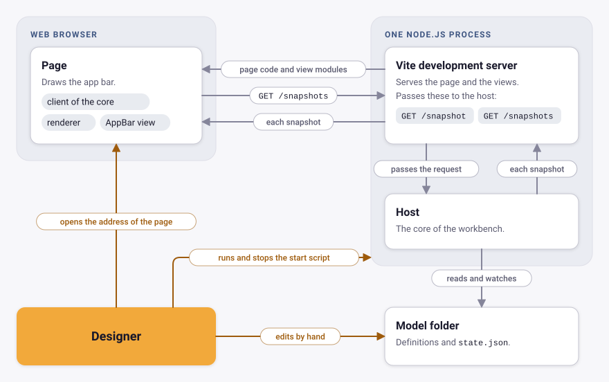
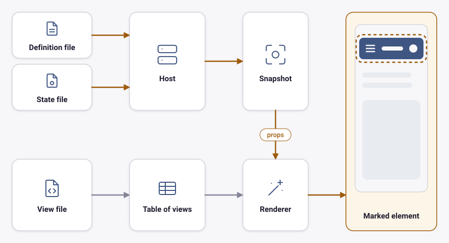

# Architecture of the workbench

> Blueprint, not a specification. See [`../README.md`](../README.md) for the status labels. The specifications in the last section override this file.

This file describes what the workbench is made of. The workbench draws one element: an app bar. The app bar is an entity in the authored state of the workbench, and a view draws it.

## The processes of the workbench

<picture>
  <source media="(prefers-color-scheme: dark)" srcset="processes-dark.svg">
  
</picture>

- The designer runs the `start` script of `workbench-app`. The script starts the host and the Vite development server in one Node.js process. Ctrl+C stops both.
- The designer opens the address of the page in a web browser.
- The Vite development server serves the page and the views. It passes `GET /snapshot` and `GET /snapshots` to the host.
- The host reads and watches the model folder. The page gets each snapshot through the Vite development server.
- The designer changes the picture by hand: edit a file in the model folder and save it.

To start the workbench, see [`workbench-app/README.md`](../../workbench-app/README.md).

## From a file to a picture

<picture>
  <source media="(prefers-color-scheme: dark)" srcset="picture-dark.svg">
  
</picture>

## The path of a change

This is the path from a saved `state.json` to a new picture.

1. The designer saves `state.json` in the model folder.
2. The host reads the model folder again (`readModelFolder`) and checks it (`validateModel`). If a file is not correct, the host prints each problem in the terminal. The page keeps the last picture.
3. The host gives the new model to the core (`setModel`). The core tells its subscribers.
4. The host sends the new snapshot on each open stream of `GET /snapshots`. The Vite development server passes the stream to the page.
5. The client of the core (`connect()` in `src/renderer/connect.ts`) parses the snapshot. It ignores a snapshot that has the same text as the last one. Then it tells its subscribers.
6. The `Renderer` reads the new snapshot. `checkViews` compares each view with the definitions. A difference gives a warning in the browser console.
7. For each entity and each component type that has a view, the `Renderer` takes the value of each field that the view declares as a prop. It calls `render` of the view.
8. The `Renderer` puts the result in a wrapper element that has `data-wishem-entity` and `data-wishem-component-type`. The wrapper is the map from a point on the screen to an entity.
9. React updates the page. The app bar shows the new title.

## What each package holds

| Package                            | Holds                                                                                                                                                                                  |
| ---------------------------------- | -------------------------------------------------------------------------------------------------------------------------------------------------------------------------------------- |
| `@thrashplay/wishem-core`          | The model types, `validateModel`, `createCore`, and `ModelError`. The core has `getSnapshot` and `subscribe`. It uses no Node.js API.                                                  |
| `@thrashplay/wishem-host-nodejs`   | `startHost` and `readModelFolder`. The host reads and watches a model folder, and serves `GET /snapshot` and `GET /snapshots`.                                                         |
| `@thrashplay/wishem-workbench`     | The model folder of the base workbench: `model/definitions/` and `model/state.json`. It exports `modelFolder`.                                                                         |
| `@thrashplay/wishem-workbench-app` | The HTML renderer (`src/renderer/`), the views (`src/views/`), the components (`src/components/`), the page (`src/Page.tsx`, `src/main.tsx`), `scripts/start.ts`, and the style guide. |

`@thrashplay/wishem-workbench-app` depends on the other three packages. `@thrashplay/wishem-workbench` does not depend on `@thrashplay/wishem-workbench-app`.

The HTML renderer is a folder of modules in `workbench-app`. It is not a package. `src/renderer/` holds `defineView`, `collectViews`, `checkViews`, `connect`, and `Renderer`.

## The specifications

- [`wishem/renderer-html/views`](../../../../openspec/specs/wishem/renderer-html/views/spec.md): the view files, `defineView`, and the table of views.
- [`wishem/renderer-html/page`](../../../../openspec/specs/wishem/renderer-html/page/spec.md): the page, the client of the core, and the marked element.
- [`wishem/workbench/start`](../../../../openspec/specs/wishem/workbench/start/spec.md): the `start` script of the workbench.
- [`wishem/core/snapshot`](../../../../openspec/specs/wishem/core/snapshot/spec.md): the snapshot and the read interface of the core.

## Change the diagrams

`render.mjs` writes the four SVG files. It describes each diagram one time and writes one file for each theme. It reads the colors from `workbench-app/src/styles/tokens.css`. Each SVG file holds the three typefaces of the brand as data.

```
node nodejs/wishem/docs/architecture/render.mjs
```

Run `pnpm install` first. The script reads the font files from `nodejs/wishem/workbench-app/node_modules`. Commit the SVG files that change.
