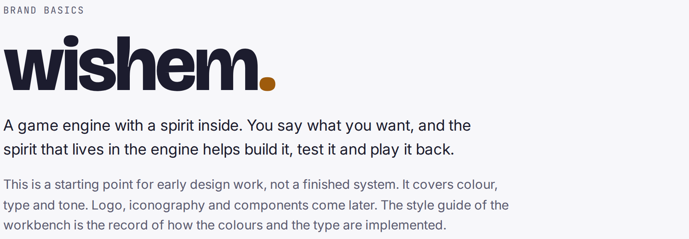
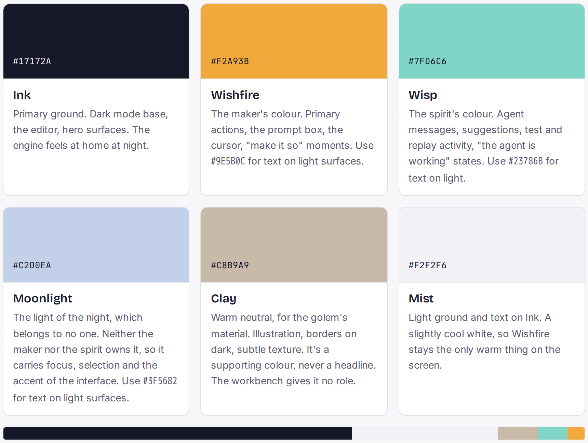
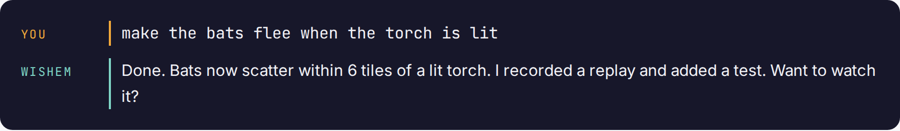
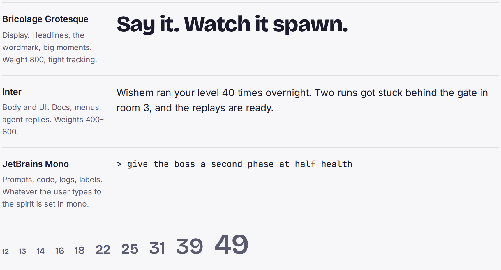
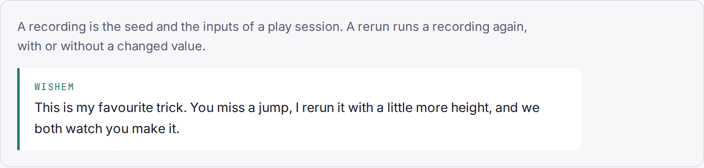

# Wishem brand basics

> Confirmed by the owner. This file is written in the brand's own voice, not in the plain technical style of the rest of the blueprint, and it has no status labels.

<picture>
  <source media="(prefers-color-scheme: dark)" srcset="brand/header-dark.png">
  
</picture>

This file connects how Wishem looks and sounds to what Wishem is. Each colour, typeface and phrase traces back to the same idea: a maker who wishes things into being, and a spirit that grants those wishes. When a design choice isn't covered here, make the choice that tells that story.

It is also the input for Wishem's in-app style guide (see [`docs/ui-style-guide.md`](../../../docs/ui-style-guide.md)). The colours and type below are the design tokens of the workbench, and its style guide is the record of how they are implemented. This file stays the source of truth for why they look that way. Logo, iconography and components come later.

The images here are rendered from [`brand/brand-basics.html`](brand/brand-basics.html), which shows the whole guide as a page. If you change a colour, a typeface or a sample, change it in both files, then run `node nodejs/wishem/workbench-app/scripts/browser-server.js node ../docs/brand/render.mjs` to update the images.

## Colour: ink, fire and wisp

The palette tells a story about who is acting. **Wishfire** belongs to the maker: their wishes, their actions, their game. **Wisp** belongs to the spirit: whatever the agent is saying, doing or suggesting. Ink is the night they work in.

<picture>
  <source media="(prefers-color-scheme: dark)" srcset="brand/palette-dark.png">
  
</picture>

| Colour        | Hex       | Role                                                                                                                                                                                                 |
| ------------- | --------- | ---------------------------------------------------------------------------------------------------------------------------------------------------------------------------------------------------- |
| **Ink**       | `#17172A` | Primary ground. Dark mode base, the editor, hero surfaces. The engine feels at home at night.                                                                                                        |
| **Wishfire**  | `#F2A93B` | The maker's colour. Primary actions, the prompt box, the cursor, "make it so" moments. Use `#9E5B0C` for text on light surfaces.                                                                     |
| **Wisp**      | `#7FD6C6` | The spirit's colour. Agent messages, suggestions, test and replay activity, "the agent is working" states. Use `#23786B` for text on light surfaces.                                                 |
| **Moonlight** | `#C2D0EA` | The light of the night, which belongs to no one. Neither the maker nor the spirit owns it, so it carries focus, selection and the accent of the interface. Use `#3F5682` for text on light surfaces. |
| **Clay**      | `#C8B9A9` | Warm neutral, for the golem's material. Illustration, borders on dark, subtle texture. It's a supporting colour, never a headline. The workbench gives it no role.                                   |
| **Mist**      | `#F2F2F6` | Light ground and text on Ink. A slightly cool white, so Wishfire stays the only warm thing on the screen.                                                                                            |

Roughly how much of each: Ink 60%, Mist 25%, Clay 7%, Wisp 5%, Wishfire 3%.

- Moonlight is cool and quiet, so it never competes with the maker's fire or the spirit's wisp.
- Wishfire is scarce on purpose. If everything glows, nothing feels granted.
- Never let Wishfire and Wisp swap roles. A user button in Wisp, or an agent message in Wishfire, breaks the "who did this?" signal.
- Keep success, warning and error colours separate from the brand pair. Don't use Wishfire as a warning colour.
- Avoid purple-to-blue gradients, sparkle emoji and generic "AI magic" glows. The spirit is a warm presence, not a light show.

What the colour roles look like in the editor, with the maker's line in Wishfire and the spirit's reply in Wisp:

<picture>
  <source media="(prefers-color-scheme: dark)" srcset="brand/editor-dark.png">
  
</picture>

## Typography: three voices

The brand uses one face for presence, one for clarity and one for the words you speak to the engine. All three are free on Google Fonts.

<picture>
  <source media="(prefers-color-scheme: dark)" srcset="brand/type-dark.png">
  
</picture>

| Typeface                | Role                                                                               | Sample                                                                                                             |
| ----------------------- | ---------------------------------------------------------------------------------- | ------------------------------------------------------------------------------------------------------------------ |
| **Bricolage Grotesque** | Display. Headlines, the wordmark, big moments. Weight 800, tight tracking.         | Say it. Watch it spawn.                                                                                            |
| **Inter**               | Body and UI. Docs, menus, agent replies. Weights 400–600.                          | Wishem ran your level 40 times overnight. Two runs got stuck behind the gate in room 3, and the replays are ready. |
| **JetBrains Mono**      | Prompts, code, logs, labels. Whatever the user types to the spirit is set in mono. | `> give the boss a second phase at half health`                                                                    |

Type scale, in pixels: 12, 13, 14, 16, 18, 22, 25, 31, 39, 49.

- Keep display sizes for headings, the wordmark and hero lines. In UI, Inter does almost all the work.
- Write the wordmark in lowercase: _wishem_. Its spark is a Wishfire full stop or the dot of the i. Don't split it to show "shem." The hidden meaning stays hidden.
- Use sentence case everywhere. Uppercase is for small mono labels only, with letter spacing.

## Tone: how Wishem sounds

The agent is the brand, so the product's voice and the brand's voice are the same voice. Think of a capable familiar: it's on your side, a little playful, and it gets the job done.

- **Warm, not cute.** Friendly and encouraging, but never baby talk or exclamation-mark spam. It respects people who are building real games.
- **Magic in moments, precision everywhere else.** Allow one touch of wonder where it lands, like the first spawn or a granted wish. Status, errors and docs stay plain and exact.
- **Shows its work.** The spirit says what it changed, what it tested, and what it isn't sure about. Trust comes from receipts, not from mystique.
- **Mischief, lightly.** A wink is allowed, such as "Wish granted. The bats are not happy about it." Use it once, not in every sentence.

| Moment        | Say                                                                                                                     | Avoid                                                 |
| ------------- | ----------------------------------------------------------------------------------------------------------------------- | ----------------------------------------------------- |
| Task done     | Done. The door now locks after the cutscene. I added a test for it.                                                     | ✨ Your wish is my command, master! ✨                |
| Unsure        | I can do this two ways. A is faster to build, B handles co-op. Which one?                                               | The spirits are uncertain…                            |
| Error         | The build failed: `player.ts` references a sprite that no longer exists. Restore it, or should I swap in a placeholder? | Oops! Something went wrong 😅                         |
| Empty project | What are we making? Describe a game, a level or a single mechanic.                                                      | Welcome to the future of AI-powered game development. |

### Vocabulary

- **Wish** can be used as a verb sparingly, for example on the prompt button ("Make a wish") or in onboarding. Don't rename every feature after it.
- Use the plain dev words for features: build, test, replay, scene, asset. The mythic layer sits on top of real tools and doesn't replace them.
- The agent refers to itself as "I." Users call it Wishem, or 'shem and 'shemmy for short. Avoid "AI-powered," "revolutionary" and "unleash."

## Wishem speaks up

Wishem lives inside the engine, so it lives in the pages about the engine too. Now and then it steps out of a document's formal or simplified tone to add an aside, a comment or an addendum in its own voice. It's the spirit leaning over your shoulder while you read.

<picture>
  <source media="(prefers-color-scheme: dark)" srcset="brand/aside-dark.png">
  
</picture>

- **The look.** A Wisp left border and the agent's reply styling, the same as Wishem's messages in the editor, so it reads as the spirit talking. In Markdown, where colour isn't available, the signature carries the signal: a block quote that opens with `**Wishem:**`.
- **The name.** Always sign with the full name, Wishem. Nicknames are for conversation; a signature is a signature.
- **The voice.** The tone rules above apply. Warm, shows its work, a little mischief.
- **How often.** At most one per page, and only where it adds something. The same rule that keeps Wishfire scarce applies here: if Wishem chimes in everywhere, it stops being charming.
- **What it can't do.** An aside never carries the point. A reader who skips every aside misses nothing they need, and nothing in an aside is a rule, a requirement or a decision. [`README.md`](README.md#asides-from-wishem) lists the documents that may hold one.

In Markdown, it looks like this:

> **Wishem:** This is my favourite trick. You miss a jump, I rerun it with a little more height, and we both watch you make it.

## Where the name comes from

Say it out loud and you hear the main meaning: _wish 'em_. You wish game elements into existence, and Wishem makes them real.

There's a second meaning hidden inside. In golem folklore, a _shem_ (Hebrew for "name") is a word placed in a creation that brings it to life. In Wishem, your words do the same: what you say becomes the game.

How to tell it:

- Lead with "wish 'em." The shem is a story for people who ask, not a pun to explain on every page.
- Frame it as "a word that brings things to life." Don't describe it as a holy or divine name. Golems are welcome. Theology isn't.

The same story is in [`vision.md`](vision.md#the-name), with the rule for how to tell it.

## Still to decide

The logo mark (a spark, a lantern or a little clay figure?), the illustration style and the motion language for agent activity.
