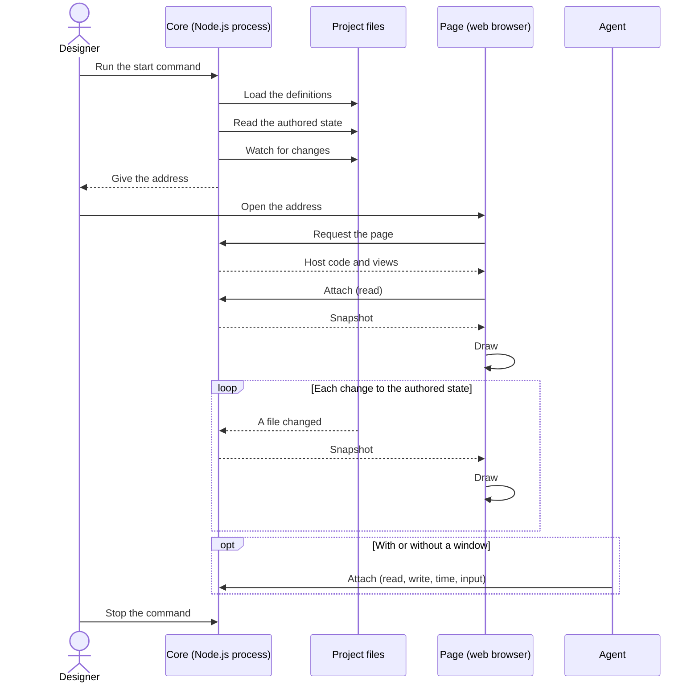
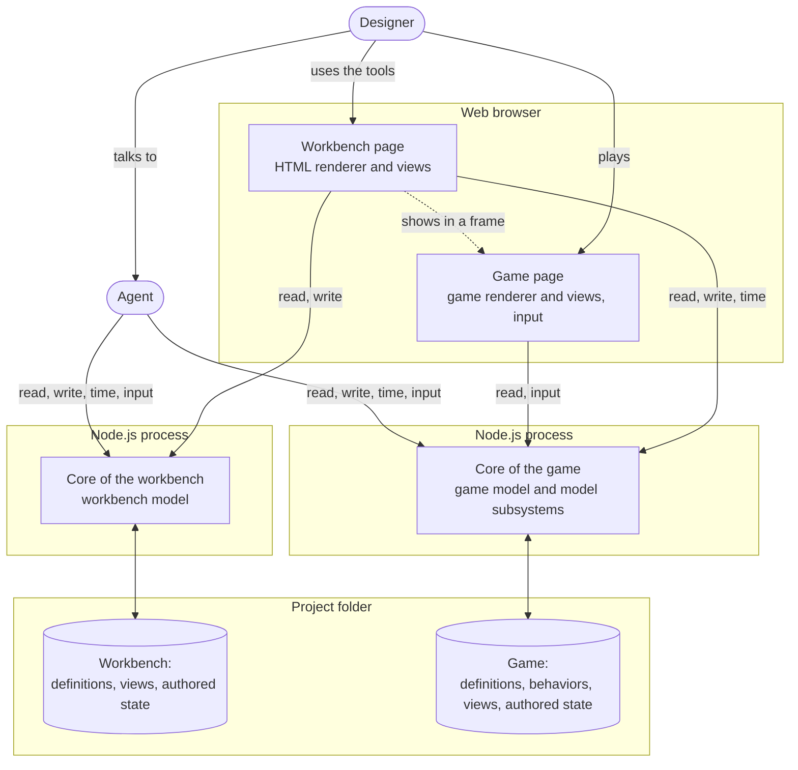

# Core and host

> Planning seed, not a specification. It collects what the blueprint knows about this topic, as the start of its brainstorm. The folder name is the expected name of the OpenSpec change. See `../../README.md` for the status labels.

## Goal

This topic is how a game starts and how its parts connect. It covers the process that runs the core, the host that assembles a core and its subsystems, the connection of an I/O subsystem to a core, and the relation between the core of a game and the core of its workbench.

The [first workbench UI slice](../477-first-workbench-ui-slice/README.md) needs a thin part of this design.

## Depends on

The blueprint only.

## What is agreed

- In development, one core runs for each project. The core lives longer than a window. A window or an agent can attach to the core and detach from it, and the core continues.
- The agent can work on a core when no window is open.
- The workbench and the game do not share one game model.

Rejected: a window that owns the core, such as a desktop application that starts the core and stops it. An agent with no window has no core to attach to.

Rejected: one game model for the game and the workbench. The state of the tools would be in each snapshot of the game, a rewind of the game would change the tools, and the tools would have to be removed before the game ships.

## What is proposed

### The host

- A subsystem connects to a core through an interface in the same process. A boundary between processes is a transport over that interface.
- A **host** assembles one core and its subsystems in one arrangement. Three arrangements are known:

| Arrangement | Where the core runs  | Where the renderer runs |
| ----------- | -------------------- | ----------------------- |
| Development | A Node.js process    | A page in a web browser |
| No window   | A Node.js process    | Nowhere                 |
| Shipped     | The page of the game | The same page           |

- A shipped game has no Node.js process. Thus the core must be able to run in the same process as the renderer.

### The start of a game in development

1. The designer runs one command in the project folder.
2. The core starts. It loads the definitions, reads the authored state from its files, and watches those files.
3. The same process serves the presentation part of the game on a local port and gives the address.
4. A web browser opens the address. The page loads the host code and the views. The page connects to the address that served it and attaches as an output subsystem. It gets a snapshot and draws.
5. An agent attaches to the same process in the same way. It needs no window.
6. The core stops when the designer stops the command.

The page does not search for the core, because the core served the page.

### Two cores

- The game has a core, and the workbench has a core. Each core runs one game model.
- The core of the game holds only the game model. It serves the running game at its own address.
- The core of the workbench holds the workbench model, such as the panels and their layout. It serves the workbench at a second address.
- The **subject** of a workbench is the game that the workbench shows and changes.
- The workbench reads and changes its subject through the same interface that the agent uses. The workbench has no private way into the game. See [Agent access](../480-add-agent-access/README.md).
- A view of the workbench draws from two sources: the state of the workbench, and the state of the subject. The page of the workbench connects directly to the two cores. The workbench model holds no copy of game data.
- A rewind of the workbench shows the earlier layout of the tools over the current game.
- A panel of the workbench can show the address of the running game in a frame.
- The interface to query and change a game across processes is not the wire protocol that rule R17 delays. Rule R17 is about a renderer in another engine.

Reasons:

- The core stays simple, because it runs one game model.
- Each thing that the workbench can do, the agent can do, and the reverse.
- A game runs code that the agent wrote and replaced during the run. When that code fails, the workbench continues, and it can show the failure, rewind the game, or start the game again.
- The shipped game is the core of the game only.

Rejected: one core that runs two game models. It is the same design with no boundary between processes. A failure in the game stops the tools.

Rejected: the page of the workbench reads the game through the core of the workbench. The workbench would hold copies of game data that can go out of date.

### Attachment

- A model subsystem is in the process of the core. The core steps it, and its state is part of each snapshot.
- Each other thing attaches to the core from outside: a renderer, an input device, an agent, and a workbench.
- One attachment interface serves all of them. It has four groups of operations:

| Group | Operations                                          |
| ----- | --------------------------------------------------- |
| Read  | Query the game. Get each change as it occurs.       |
| Write | Change the definitions and the state.               |
| Time  | Pause, step, and rewind.                            |
| Input | Send inputs to a simulation. The core records them. |

- An attachment uses only the groups that it needs. A renderer reads. A gamepad sends inputs. The agent and the workbench use the four groups.
- The [first workbench UI slice](../477-first-workbench-ui-slice/README.md) builds the read group as a snapshot. [Workbench panels](../478-add-workbench-panels/README.md) builds the first part of the write group.

Rejected: a different interface for each kind of attachment, such as one for renderers and one for agents. A view of the workbench reads and writes, so the workbench would need the two interfaces immediately.

- A renderer holds no state. More than one window can show the same simulation with no conflict.
- The conflict to solve is two sources of input for one simulation. It cannot occur before inputs exist.

### How the parts connect

The diagram shows a project in development, with the two cores. Each arrow from a page or from the agent to a core is an attachment. The label gives the groups of operations that the attachment uses.

- The game is the subject of the workbench. The workbench page attaches to the two cores. The two cores do not connect to each other.
- The game page and the workbench page get their views from the core that serves them.
- Where the designer talks to the agent is an open question. See [Agent access](../480-add-agent-access/README.md).

## Open questions

1. **What are the exact operations of the attachment interface?** The four groups are proposed. The operations in each group are not designed.
2. **How do the two cores start?** One command can start the two cores, or each core can have its own command. It is not settled how the workbench learns the address of its subject.
3. **What does the host do, exactly?** The host loads the views and connects to the core. It is not settled what else belongs to the host and what belongs to a subsystem.
4. **What is the rule when two sources of input attach to one simulation?**
5. **What form does the workbench take?** A page in a web browser is the proposal for development. A desktop application can hold the same page.
6. **Does one agent work on the two cores?** The designer talks to one agent. It is not settled how that agent attaches to the game and to the workbench.

## Notes

- The first workbench UI slice has one core and no subject. In [Workbench panels](../478-add-workbench-panels/README.md), the subject of the workbench is the workbench, and the two addresses of the page are the same address.
- The glossary tells writers not to use "client and server", because no wire protocol exists. This topic needs terms for the two sides of an attachment. "Host" and "subject" are proposed terms and are not in the glossary.
