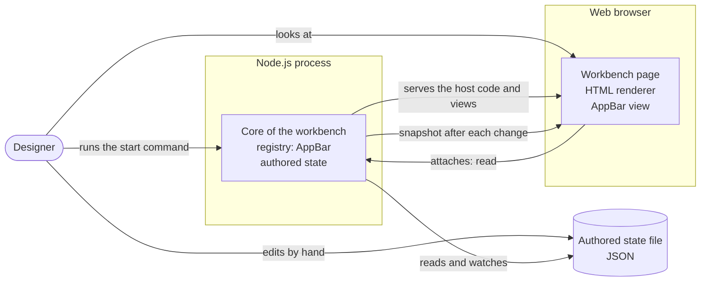

# First workbench UI slice

> Planning seed, not a specification. It collects what the blueprint knows about this topic, as the start of its brainstorm. The folder name is the expected name of the OpenSpec change. See `../../README.md` for the status labels.

## Goal

This topic is the first slice of the workbench: the application in which the designer uses the tools. The workbench is itself a game that is made with Wishem. The slice shows that an element on the screen is a picture of the definitions and the authored state of the workbench.

The slice is a tracer bullet. It is as thin as possible. It draws one element: an app bar that shows the identity of the application.

## Result

- One command that starts the core of the workbench.
- One component type for the app bar, and one entity in the authored state that has that component.
- A page that attaches to the core and draws the app bar from the game model.
- A change to the authored state file changes the picture.
- A first HTML renderer.
- The first packages of Wishem, with their names, their folders in `nodejs/wishem/`, and their npm scope.
- The design system of the workbench: the design tokens, a `wishem/design-system/component-catalog` specification, and the style guide in the application with its tests.

## Depends on

- The blueprint.
- [Core and host](../476-add-core-and-host/README.md): how a game starts, and how a renderer attaches to a core.

## Relation to other seeds

This slice builds thin parts of other projects before those projects start. The brainstorm for each of those projects starts from what this slice built. (**Agreed**)

- [Core model](../479-add-core-model/README.md): the registry, declared component types, entities, components, and the storage of authored state.
- [Core and host](../476-add-core-and-host/README.md): the start of a core, and the read group of the attachment interface.
- [Workbench panels](../478-add-workbench-panels/README.md): the next slice. It adds panels and a way to add and change them.

## What is agreed

### Scope

- The workbench is a game that is made with Wishem. Its state is in its game model, and a renderer draws it.
- The slice draws one element: an app bar, or a similar element that shows the identity of the application.
- The app bar is an entity in the authored state, with a component for the app bar. The app bar is not fixed content of the page.
- The slice draws authored state only. The picture changes only when the authored state changes.
- The authored state is in files on disk.
- The change for this slice decides the package layout and the npm scope of Wishem. Each later project builds on that layout.
- The change for this slice makes the design system of the workbench. The colors and the type in [`brand.md`](../../brand.md) are the input. The workbench follows [`docs/ui-style-guide.md`](../../../../../docs/ui-style-guide.md).
- These things are not in the slice: panels, a way to change the authored state from the page, live state, steps, time, recorded inputs, rewind, interaction through the game model, the agent, and a second core.

### How a component becomes a picture

- The game model says what a thing is. It does not say how the thing looks.
- A renderer holds views. A **view** is code that changes the components of an entity into the objects of that renderer. A view is found by the name of its component type.
- A renderer imports the game model. The game model never imports a renderer. See rule R1 in [`rules.md`](../../rules.md).
- A view is written in the language of its renderer. Wishem does not define one set of visual components for all renderers.
- A game can declare a visual component type, such as `Sprite`, with a view for it. That component type belongs to the game.

Rejected: a behavior that draws on a graphics context from the renderer. The game model would depend on a renderer, and one drawing interface would hide different libraries.

Rejected: a fixed set of visual component types, such as `Box`, `Text`, and `Stack`, that each renderer knows. It is a toolkit for user interfaces in the core, built before a design needs it.

### The HTML renderer

- The renderer of the workbench draws with HTML elements and CSS layout.
- A view is a React component. The fields of the Wishem component are the props of the React component.
- The file name of a view is the name of its component type. A view needs no other registration.
- A view is a pure function of the game state. A view keeps no state of its own. React local state is outside the game model, so a snapshot does not contain it.
- This is the convention of the HTML renderer only. A different renderer, such as one for PixiJS, has its own way to map a component to its objects.

The interface of the HTML renderer in this slice:

| Part                  | Purpose                                                           |
| --------------------- | ----------------------------------------------------------------- |
| `views/` folder       | Holds one React component for each component type that has a view |
| `ViewProps<typeof X>` | Gives the type of the props from the declaration of `X`           |
| Root                  | Draws each entity with the view of its component                  |

Example:

```tsx
// Game model
export const AppBar = defineComponent('AppBar', { title: 'string' })

// HTML renderer: views/AppBar.tsx
export default ({ title }: ViewProps<typeof AppBar>) => (
  <header>
    <h1>{title}</h1>
  </header>
)
```

The names in the table and the example are illustrations. They are not requirements.

Rejected: a canvas, or PixiJS, for the user interface of the workbench. The workbench is mostly text. Text layout, text input, selection, scrolling, and focus would be built again. An accessibility test has nothing to inspect on a canvas.

Rejected: elements with absolute positions. CSS layout does the same work. Absolute positions are useful only when the position of an element is a field in the game model.

## What is proposed

- The component type of the app bar is `AppBar`, with the field `title`.
- A hand edit to the authored state file is the only way to change the picture in this slice. Three edits show the result: a change to `title`, the removal of the entity, and the addition of the entity.
- The page shows a zero state in the space that the app bar does not use. The zero state is fixed content of the page.
- The authored state of the workbench is one JSON file.
- The renderer marks each element that it draws with the ID of its entity. This gives the map from a point on the screen to an entity. See the renderer contract in [`concepts.md`](../../concepts.md#the-renderer-contract).
- A game has two parts. The model part is the definitions, the behaviors, and the authored state. The presentation part is the views for one output subsystem. The presentation part is code of the game, and it is not part of the game model.
- The I/O rule is the test for a view: the game gives the same result when the output subsystem is removed.
- Two different things go to the renderer. Data goes as one JSON snapshot of the definitions and the authored state, sent again after each change. The code of the views is loaded as modules, in the same way as the source of a web application. No wire protocol is designed. See rule R17.

## The parts of the slice



The sequence of the start is in [Core and host](../476-add-core-and-host/README.md#the-start-of-a-game-in-development). This slice has no agent.

## Open questions

1. **Which packages exist, and where are they?** The known parts are the core, the HTML renderer, and the workbench. It is not settled which parts are separate packages and which folders they use in `nodejs/wishem/`.
2. **What npm scope do the packages use?** This repository uses `@twin-digital/*` for most products and `@thrashplay/*` for Farwatch. This slice answers question 10 in [Core model](../479-add-core-model/README.md).
3. **Which components and states does the first component catalog hold?** The slice has an app bar and a zero state. The style guide shows each one in light mode and in dark mode.
4. **How does the renderer give a screenshot?** The renderer contract requires a screenshot on request. HTML elements have no built-in screenshot.
5. **How does a view stay correct when the game model changes?** A view is current code. After a rewind or a change to a definition, a view can disagree with older state. See question 7 in [Core model](../479-add-core-model/README.md).

## Open questions in other seeds

- What form does the workbench take? See [Core and host](../476-add-core-and-host/README.md).
- How does the workbench change to fit a game? See [Tools](../484-add-designer-tools/README.md).

## Notes

- A view that is a pure function can also run with no window, to give its HTML as text. This is a possible way for the agent to learn what a renderer showed. See the output rule in [`concepts.md`](../../concepts.md#io-subsystems).
- When interaction is added, an event in a view sends an input to the simulation. The view does not change state.
- This repository has two applications that use React and Vite: `nodejs/grinbox/web` and `nodejs/dolmenwood/refbash`.
- In Unity, a component such as `SpriteRenderer` holds data and does not draw. The render pipeline of the engine collects those components and draws them. The view of a renderer has the same role as that pipeline.
