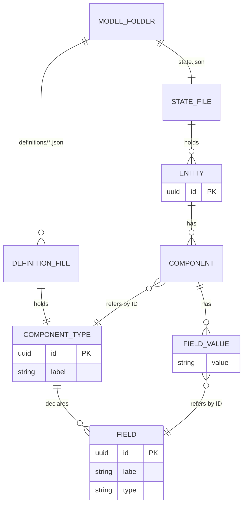
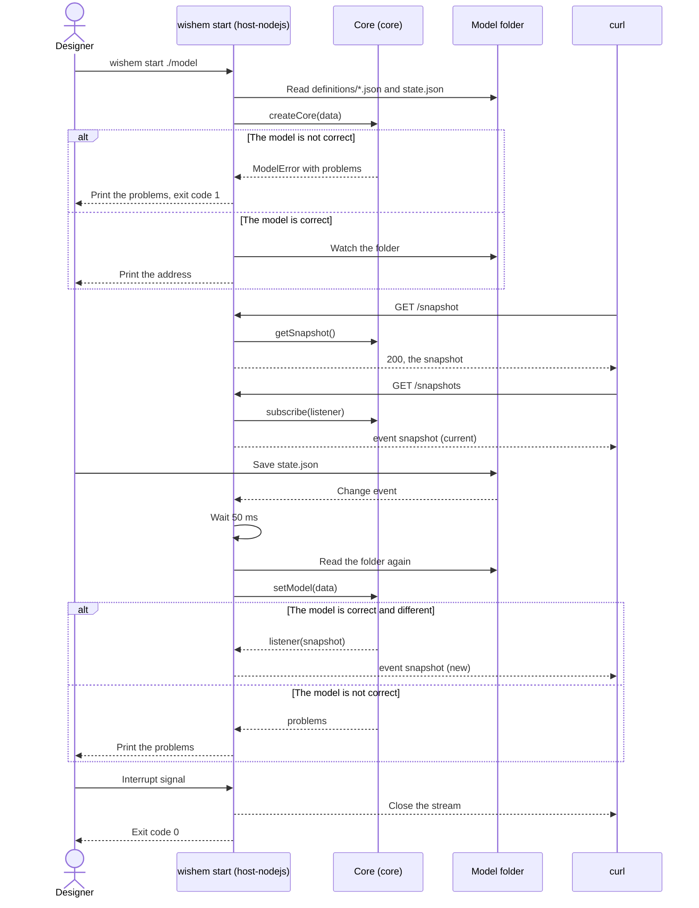

# Design

## Context

See `proposal.md` for the motivation. The owner settled the decisions in this file in the brainstorm for issue #476, unless a decision has the mark "(call of the agent)".

Constraints from the blueprint:

- A shipped product has no Node.js process. The core must run in the page of the product.
- The model never depends on a renderer (rule R1).
- Nothing is built before a design needs it (rule R7).
- A project has two parts, the product and the workbench. Each part is a model with its own core. This change builds one core for one model: the model of the base workbench, which is a project with no product.

`nodejs/wishem/` holds only the blueprint. `openspec/specs/wishem/` does not exist.

## Goals / Non-Goals

**Goals:**

- These steps work with no web browser: start the core, get the snapshot from the local port, change `state.json` by hand, get the snapshot again and see the change.
- A package boundary that keeps Node.js APIs out of the core.
- A file format in which a change to a label changes one line in one file.

**Non-Goals:**

- A page, a renderer, a view, and the link between a view and a component type. See issue #477.
- The write, time, and input operations of the interface of the core.
- Live state, steps, the clock, recordings, and behaviors. See issue #479.
- A persisted lookup file. The core builds its lookup when it gets a model.
- Problems that a thing outside the core can read. See the note in issue #480.
- A command that starts a full project with two cores.

## Decisions

### D1. Three packages, with the Node.js boundary between them

| Package                          | Folder                      | Content                                                                |
| -------------------------------- | --------------------------- | ---------------------------------------------------------------------- |
| `@thrashplay/wishem-core`        | `nodejs/wishem/core`        | Model data types, `validateModel`, `createCore`. No Node.js API.       |
| `@thrashplay/wishem-host-nodejs` | `nodejs/wishem/host-nodejs` | `readModelFolder`, `startHost`, the `wishem` command.                  |
| `@thrashplay/wishem-workbench`   | `nodejs/wishem/workbench`   | The `model/` folder of the base workbench, a `start` script, one test. |

The name `host-nodejs` shows that other hosts can exist, such as the page of a product. "nodejs" is used, not "node", because "node" has other meanings.

Rejected: one package with subpath exports. Nothing stops an import of a Node.js API into the core.

To hold the boundary, the `tsconfig` of the core does not include the Node.js types (call of the agent). Thus an import of `node:fs` in the core is a type error.

### D2. The npm scope is `@thrashplay`

Each package name starts with `wishem-`.

Rejected: `@twin-digital`. Wishem is part of the game work, and that work uses `@thrashplay`.
Rejected: a new `@wishem` scope. "Wishem" is a working name.

The three packages are private in this change (call of the agent). No consumer outside this repository exists. A later change removes `private` when a consumer needs a published package.

### D3. Definitions are data

A component type is a JSON file. Most component types are only a shape of data. Some will have behaviors, and some will have a view. How a behavior or a view is linked to a component type is not in this change. A component type with no linked view is not drawn.

Rejected: definitions as TypeScript code, such as `defineComponent('AppBar', { title: 'string' })`. The host would need a TypeScript loader, and a changed definition would need a module reload.

### D4. IDs and labels

- A component type, a field, and an entity each have an `id`. The ID is a UUID from `crypto.randomUUID()`, which Node.js and a web browser both have. The ID does not change.
- A component type and a field each have a `label`. The label can change.
- The authored state refers to a component type and to a field by ID. Thus a change to a label does not change `state.json`.
- An entity has no label in this change. Nothing needs to name an entity.
- A definition file has the name `<id>.json` by convention. The core does not read the file name. The `id` in the file is the source (call of the agent).
- Two component types with the same label are a warning, not an error (call of the agent).

Rejected: fields keyed by name in the authored state. A change to the name of a field would change each entity that has the field.
Rejected: a file name that is the name of the component type. A change to the name would rename the file, and two names can collide.

Cost: `state.json` is not easy to read. A person finds a line by its value, not by its key.

### D5. The interface of the core has two read operations

`getSnapshot()` and `subscribe()`. The core does not know what kind of thing is connected. No "attachment" object exists.

The host gives a new model to the core with `setModel()`. This operation is for the host that owns the storage. It is not a write operation of the interface for things outside the core. Issue #478 designs the write operations.

### D6. HTTP and Server-Sent Events

`GET /snapshot` returns the current snapshot. `GET /snapshots` is a stream that sends the full snapshot at the start and after each change. The host uses `node:http`.

Rejected: WebSocket. It needs a dependency and a client program for the test. Its two-way channel is for operations that do not exist now.
Rejected: polling only. The core must send a new snapshot after each change.
Rejected: a diff in each event. The model is small.

### D7. One watch, and a full read after each change

The host watches the model folder with `fs.watch` in recursive mode. After an event, the host waits 50 ms for more events. Then it reads the full folder again and calls `setModel()`. The core compares the new model with the current model and sends a snapshot only when they are different. (Call of the agent.)

A full read is correct for a small model and needs no per-file state. A watch library is added only if `fs.watch` is not reliable in the tests.

### D8. Problems go to the terminal

- At the start, a model that is not correct stops the command with exit code 1.
- During a run, the core keeps the last correct model. The host prints each problem with its file.
- A warning is printed, and the model is accepted.

Rejected for this change: problems as a part of the snapshot. Nothing reads them now. Issue #480 has a note to add this, because an agent with no window cannot read the terminal.

### D9. The command line

`wishem start <folder> [--port <number>]`. The default port is 4747. The host listens only on `127.0.0.1`. The command uses `parseArgs` from `node:util` (call of the agent). The repository has `@twin-digital/cli-lib` for oclif, but one command with one option does not need it.

## Interfaces

Owner: `@thrashplay/wishem-core`.

```ts
export type Id = string // a UUID in lowercase

export type FieldType = 'string'
export type FieldValue = string

export interface FieldDefinition {
  id: Id
  label: string
  type: FieldType
}

export interface ComponentTypeDefinition {
  id: Id
  label: string
  fields: FieldDefinition[]
}

export interface Entity {
  id: Id
  /** Component type ID to a record of field ID to value. */
  components: Record<Id, Record<Id, FieldValue>>
}

export interface Model {
  definitions: ComponentTypeDefinition[]
  entities: Entity[]
}

/** A snapshot has the same shape as a model. */
export type Snapshot = Model

export interface Problem {
  severity: 'error' | 'warning'
  message: string
  /** Where the problem is in the model data, such as `['definitions', 0, 'fields', 1, 'type']`. */
  path: (string | number)[]
  /** The file that has the problem. The host sets it. The core does not. */
  source?: string
}

export type ValidationResult = { ok: true; model: Model; warnings: Problem[] } | { ok: false; problems: Problem[] }

/** Checks data of an unknown shape against the rules of the `wishem/core/model` specification. */
export const validateModel: (data: unknown) => ValidationResult

export interface Core {
  getSnapshot(): Snapshot
  /** Returns a function that stops the registration. */
  subscribe(listener: (snapshot: Snapshot) => void): () => void
  /** For the host. Keeps the current model when the result is not ok. */
  setModel(data: unknown): ValidationResult
}

/** Throws a `ModelError` that holds the problems when the model is not correct. */
export const createCore: (data: unknown) => Core

export class ModelError extends Error {
  readonly problems: Problem[]
}
```

Owner: `@thrashplay/wishem-host-nodejs`.

```ts
export interface ModelFolderResult {
  /** The data to give to the core. Absent when a file cannot be read or parsed. */
  data?: unknown
  /** Problems of files: a missing `state.json`, or text that is not valid JSON. */
  problems: Problem[]
}

export const readModelFolder: (folder: string) => Promise<ModelFolderResult>

export interface HostOptions {
  folder: string
  /** Default 4747. Use 0 to let the system select a port. */
  port?: number
  /** Default: write to the terminal. */
  log?: (line: string) => void
}

export interface Host {
  /** For example `http://127.0.0.1:4747`. */
  url: string
  core: Core
  close(): Promise<void>
}

/** Rejects with a `ModelError` when the model is not correct at the start. */
export const startHost: (options: HostOptions) => Promise<Host>
```

Owner: `@thrashplay/wishem-workbench`.

```ts
/** The absolute path of the model folder of the base workbench. */
export const modelFolder: string
```

## Data Model

New persisted schema: the model folder. All entities in the diagram are new.



The files of the base workbench:

```
nodejs/wishem/workbench/model/
  definitions/
    3f2a9c1e-8b47-4d0a-9e51-6c2f7a1b0d34.json
  state.json
```

```json
{
  "id": "3f2a9c1e-8b47-4d0a-9e51-6c2f7a1b0d34",
  "label": "AppBar",
  "fields": [{ "id": "b81d04e7-2c6f-4a39-8d15-0e9a7f3c5b62", "label": "title", "type": "string" }]
}
```

```json
{
  "entities": [
    {
      "id": "c0d5e6f1-7a82-4b93-a104-5d6e7f8091a2",
      "components": {
        "3f2a9c1e-8b47-4d0a-9e51-6c2f7a1b0d34": { "b81d04e7-2c6f-4a39-8d15-0e9a7f3c5b62": "Wishem" }
      }
    }
  ]
}
```

The host puts the content of each definition file into `definitions` and the `entities` of `state.json` into `entities`. That value is the data that the core checks. The host keeps the file of each item of `definitions`. When the core gives a problem, the host uses the `path` of the problem to set its `source`: a path in `definitions` gives the definition file of that item, and a path in `entities` gives `state.json`.

## Main flow



## Failure Modes

Each operation is a read of the full folder followed by a replacement of the full model in memory. Each operation is idempotent: the same files give the same model, and an equal model sends no snapshot.

| Failure                                                       | Behavior                                                                                      | Recovery                                                 |
| ------------------------------------------------------------- | --------------------------------------------------------------------------------------------- | -------------------------------------------------------- |
| The folder is absent or the model is not correct at the start | The command prints the problems, opens no port, and stops with exit code 1.                   | Correct the files and start the command again.           |
| The port is in use                                            | The command prints the reason and stops with exit code 1.                                     | Use `--port`.                                            |
| A file is saved in part during a run                          | The host prints the problem. The core keeps the last correct model.                           | The next save starts a new read.                         |
| Many change events for one save                               | The 50 ms wait joins them into one read.                                                      | None is necessary.                                       |
| A file changes during the read                                | The read can give a mixed model. The change makes a new event, and the next read corrects it. | None is necessary.                                       |
| A stream connection closes                                    | The host stops the registration of that connection. The other connections continue.           | The client connects again and gets the current snapshot. |
| The watch stops with an error                                 | The host prints the error and stops with exit code 1.                                         | Start the command again.                                 |

## Examples

A terminal session:

```
$ pnpm --filter @thrashplay/wishem-workbench start
wishem: model /workspace/opus/nodejs/wishem/workbench/model
wishem: 1 component type, 1 entity
wishem: snapshot at http://127.0.0.1:4747/snapshot
wishem: problem in state.json: the text is not valid JSON (line 6)
wishem: the last correct snapshot stays
wishem: the model is correct: 1 component type, 1 entity
^C
$
```

A start with a model that is not correct:

```
$ wishem start ./model
wishem: model /workspace/opus/nodejs/wishem/workbench/model
wishem: problem in state.json: entity c0d5e6f1-7a82-4b93-a104-5d6e7f8091a2 has a component of the type 9a9a9a9a-0000-4000-8000-000000000000, which is not defined
wishem: the model is not correct, so the core did not start
$ echo $?
1
```

A request and its response:

```
$ curl -s http://127.0.0.1:4747/snapshot
{"definitions":[{"id":"3f2a9c1e-8b47-4d0a-9e51-6c2f7a1b0d34","label":"AppBar","fields":[{"id":"b81d04e7-2c6f-4a39-8d15-0e9a7f3c5b62","label":"title","type":"string"}]}],"entities":[{"id":"c0d5e6f1-7a82-4b93-a104-5d6e7f8091a2","components":{"3f2a9c1e-8b47-4d0a-9e51-6c2f7a1b0d34":{"b81d04e7-2c6f-4a39-8d15-0e9a7f3c5b62":"Wishem"}}}]}

$ curl -s -i http://127.0.0.1:4747/panels
HTTP/1.1 404 Not Found
Content-Type: application/json

{"error":"No such path: /panels"}
```

The stream:

```
$ curl -N http://127.0.0.1:4747/snapshots
event: snapshot
data: {"definitions":[...],"entities":[...]}

```

## Package Impact

| Package                          | Published or private | Bump  | Why                                             |
| -------------------------------- | -------------------- | ----- | ----------------------------------------------- |
| `@thrashplay/wishem-core`        | Private              | minor | New package: model types, validation, the core. |
| `@thrashplay/wishem-host-nodejs` | Private              | minor | New package: the `wishem start` command.        |
| `@thrashplay/wishem-workbench`   | Private              | minor | New package: the model of the base workbench.   |

No package that exists depends on these packages. No published package has a breaking change.

## Blueprint updates

This change settles these items, so the same change updates the blueprint:

- `glossary.md`: **ID** and **Label** are **Agreed** for a component type and a field, and the ID is a UUID. **Component type** says that the declaration is data. **Host** is added as a **Proposed** term.
- `concepts.md`: the declaration of a component type is data in the model folder, and the authored state refers to component types and fields by ID. The "IDs and labels" paragraph gets the new status.
- `rules.md`: no rule changes. Rule R6 stays as it is.

## Risks / Trade-offs

- [`fs.watch` in recursive mode behaves differently on each platform, and some editors save through a rename] → The host reads the full folder after each event and does not use the file name of the event. The tests save files in the two ways. If the tests are not reliable, add a watch library in this change.
- [`state.json` is hard to read because its keys are UUIDs] → Accepted. The snapshot holds the definitions, so a tool can show labels. Issue #478 adds a form.
- [A typed view in issue #477 cannot get its prop types from a JSON definition] → Recorded as open question 5 in issue #477.
- [The blueprint says that time belongs to the core, and issue #479 has an open option to move the clock out] → This change builds no time, so it does not limit that decision.
- [`setModel` is public on the core, and a thing outside the core could call it] → Accepted for this change. The write operations of issue #478 decide the final shape.

## Open Questions

- Does the `id` in a definition file have to agree with the file name? The convention is `<id>.json`. No check exists now.
- Is 4747 the correct default port when a project runs two cores? Issue #476 leaves "how do the two cores start" open.
