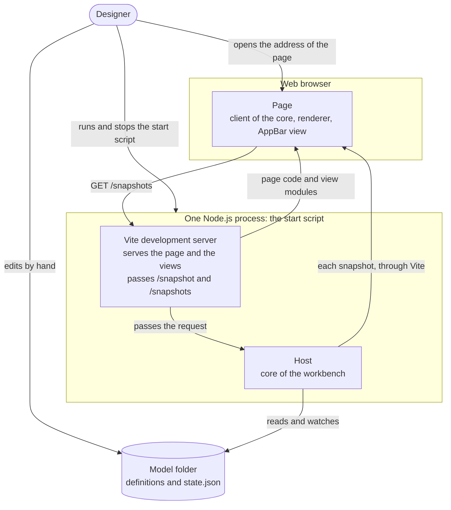
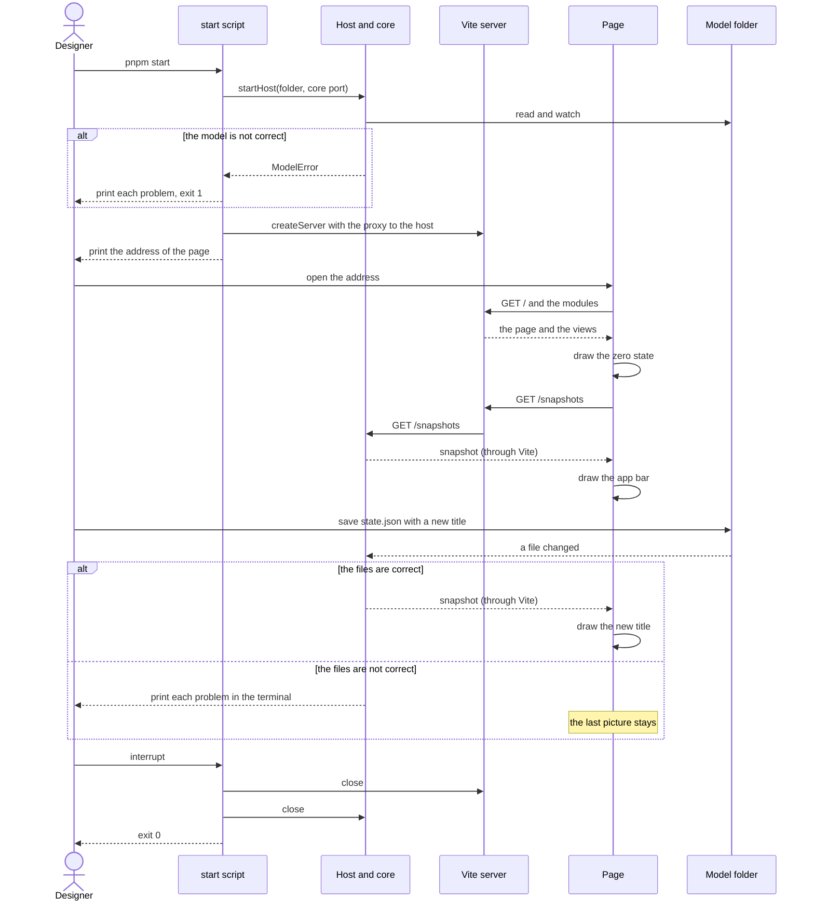
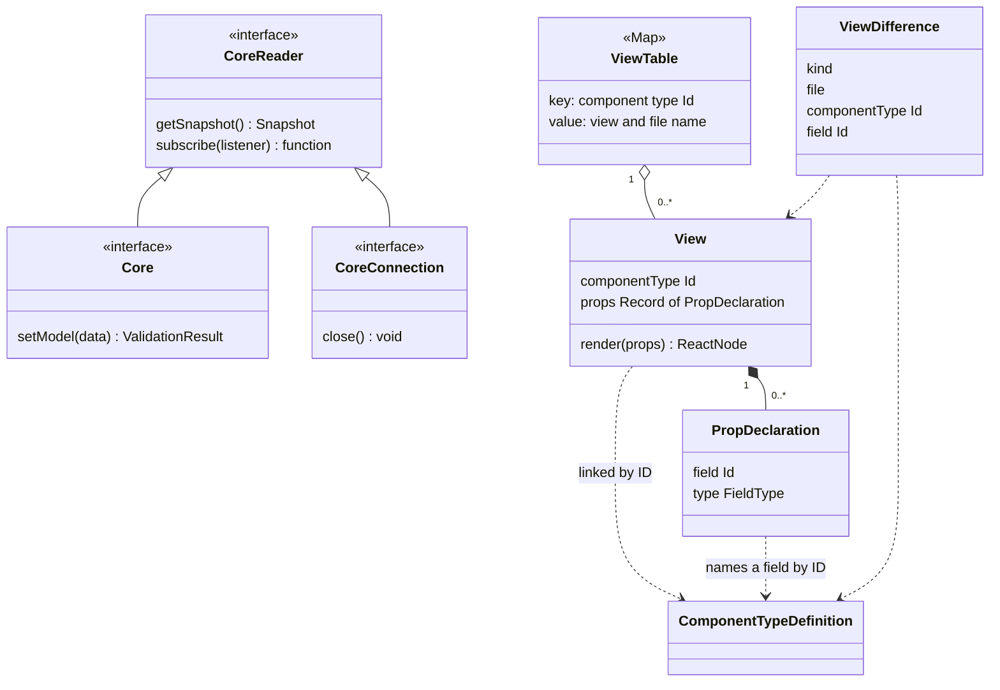

# Design

## Context

See `proposal.md` for the reason for this change. The decisions of the brainstorm are in [First workbench UI slice](https://github.com/twin-digital/opus/issues/477): the issue body, and the comments that it links to. This document records how the change builds them. Where this document and the issue disagree, tell the owner. Do not select one silently.

Facts that shape the approach:

- `@thrashplay/wishem-core` has `createCore`, which gives an object with `getSnapshot`, `subscribe`, and `setModel`. The core uses no Node.js API.
- `@thrashplay/wishem-host-nodejs` has `startHost({ folder, port, log })`. It reads and watches a model folder, and it serves `GET /snapshot` and `GET /snapshots` on `127.0.0.1`. The stream sends the current snapshot when a connection opens, and one `snapshot` event for each new snapshot. The package has a `./*` export, so `@thrashplay/wishem-host-nodejs/format` gives `formatProblem`.
- `@thrashplay/wishem-workbench` exports `modelFolder`, the absolute path of the model folder of the base workbench. The model has the component type `AppBar` (`ct_3f2a9c1e-8b47-4d0a-9e51-6c2f7a1b0d34`) with the field `title` (`fld_b81d04e7-2c6f-4a39-8d15-0e9a7f3c5b62`), and one entity (`e_c0d5e6f1-7a82-4b93-a104-5d6e7f8091a2`) with the title `Wishem`.
- [Workbench design system](https://github.com/twin-digital/opus/issues/496) makes `nodejs/wishem/workbench-app`: Vite, React, and Tailwind 4, the components `AppBar` and `ZeroState`, a shell page (`index.html` and `src/main.tsx`) that shows the zero state, the style guide, and Playwright tests in a pinned browser image. This change builds on that package. That change must be merged and archived first.
- The Playwright tests of that change run the web browser in a container from a pinned image, on a development computer and in the pull request checks. `scripts/browser-server.ts` makes a test build, copies it into the container, and serves it there with `scripts/static-server.ts` on `127.0.0.1:4173`. The test runner is outside the container and connects to the browser server. The browser container has no network path to the development computer, and no file is mounted. `playwright.config.ts` uses one worker.
- A package that another package imports at run time from Node.js is loaded from its `dist` folder. The `wishem` command already needs a build of `host-nodejs` before its first start.
- The only field type is `string`. A component can omit a field. The core refuses authored state that has a component type or a field that is not defined.

## Goals / Non-Goals

**Goals:**

- A change to `state.json` changes the picture, with no reload and no restart.
- The renderer reads the core through one small interface. Only one module knows about HTTP.
- A new view is one new file.
- Each rule of the renderer is a pure function that a unit test can call with no web browser: the collection of the views, the comparison with the definitions, and the values of the props.
- One command starts the workbench, and one signal stops it.

**Non-Goals:**

- A way to give a view a position on the page. See [the open question in Workbench panels](https://github.com/twin-digital/opus/issues/478#issuecomment-7167134490).
- A message on the page for a problem. The slice adds no component to the catalog.
- A protocol with a promise between the page and the core.
- A check of the snapshot in the page. The core gives only a correct model.
- A build of the workbench page for a release.

## Decisions

### D1. The HTML renderer is a folder of modules in `workbench-app`

```
nodejs/wishem/workbench-app/
  index.html                     the workbench page
  scripts/
    start.ts                     starts the core and the page server
    e2e-server.ts                starts the workbench on a copy of the model, for the tests
  src/
    main.tsx                     entry: collects the views, connects, mounts the page
    Page.tsx                     the layout of the page: the renderer and the zero state
    views.ts                     the one place that names the views folder
    views/
      AppBar.tsx                 the view of the component type AppBar
    renderer/
      define-view.ts             defineView and the types of a view
      collect-views.ts           the table from component type IDs to views
      check-views.ts             the comparison of the views with the definitions
      connect.ts                 the client of the core. The only module that knows HTTP
      Renderer.tsx               draws a snapshot with a table of views
      index.ts                   the surface that views and the page import
  tests/
    workbench.spec.ts            end-to-end tests of the page
```

`src/renderer/` imports nothing from `src/views/`, `src/components/`, or `src/Page.tsx`. A later change can move the folder to a package with no change to its content.

Reason: rule R7. No second product uses the renderer. See [the five answers of the second pass](https://github.com/twin-digital/opus/issues/477#issuecomment-7167019505).

Rejected: a package for the HTML renderer now.

### D2. `defineView` returns its argument, and the types do the work

`defineView` is an identity function with a `const` type parameter. The type of the props of `render` is computed from the `props` declaration: each prop is the value type of its field type, or `undefined`. The map from a field type to a value type has one entry, `string`.

`defineView` checks nothing at run time. The collection (D3) and the comparison (D5) make the checks, because only they know the file names and the definitions.

Reason: no code is generated, and a prop that is not declared is a type error. The declaration is plain data, so [Renderer component registration](https://github.com/twin-digital/opus/issues/501) can read it.

### D3. One module names the views folder, and a pure function builds the table

`src/views.ts` exports `collectAppViews`. It holds the one call to `import.meta.glob(['./views/*.tsx', '!./views/*.test.tsx'], { eager: true })` and gives the result to `collectViews`. The pattern excludes the test files, because an eager import of a test file puts the test in the page. `collectViews` takes a record from a file path to a module and returns the table, or throws a `ViewCollectionError`.

- The table is a map from a component type ID to the view and its file name.
- Two files with the same component type ID give one error that names the two files and the ID.
- A file whose default export is not a view object gives an error that names the file. A view object is an object with a string `componentType`, an object `props`, and a function `render`.
- A file whose name ends with `.test.tsx` is not collected.

`main.tsx` catches a `ViewCollectionError`. It writes the message to the browser console with `console.error`, and it mounts the page with an empty table. Thus the page shows its fixed content and no view.

Reason: Vite needs a literal path in `import.meta.glob`, so the call cannot be in a general module of the renderer. A pure function gets unit tests with no web browser.

### D4. The client is an `EventSource` behind the read interface of the core

`@thrashplay/wishem-core` gets the type `CoreReader`: `getSnapshot` and `subscribe`. `Core` extends it. No behavior of the core changes.

`connect()` in `src/renderer/connect.ts` opens an `EventSource` on `/snapshots` at the address of the page. The promise resolves after the first `snapshot` event. The result is a `CoreReader` with a `close` function.

- `getSnapshot` returns the last snapshot that arrived. The object is the same object until a different snapshot arrives. `useSyncExternalStore` needs this.
- The client compares the text of each event with the text of the last event. Equal text gives no new object and no call of a listener. The stream sends the current snapshot again after each new connection, so this rule prevents a redraw with no change.
- `EventSource` connects again by itself. On an `error` event, the client writes one message to the browser console with `console.warn`. It writes no second message until a snapshot arrives.
- The client does not use `GET /snapshot`. The stream gives the current snapshot when it opens.
- The client does not check the snapshot with `validateModel`. The core gives only a correct model, and the transport has no promise to an outside client.

`main.tsx` mounts the page before `connect()` resolves, with no core. The page then shows the zero state only. When the promise resolves, `main.tsx` gives the core to the page.

Reason: see [the five answers of the second pass](https://github.com/twin-digital/opus/issues/477#issuecomment-7167019505). The shape of `CoreReader` is the shape that `useSyncExternalStore` takes.

Rejected: a `getSnapshot` that returns a promise. A core in the same process could not be given to the renderer as it is.

### D5. The renderer draws with one wrapper element for each component

`Renderer` takes a `CoreReader` and a table of views. It reads the snapshot with `useSyncExternalStore`.

For each entity, in the order of the snapshot, and for each definition, in the order of `definitions`, the renderer draws the component of that type when the entity has one and the table has a view. The key of the element is the entity ID with the component type ID.

Each picture is in one wrapper element:

```html
<div data-wishem-entity="e_c0d5e6f1-…" data-wishem-component-type="ct_3f2a9c1e-…" style="display: contents">
  <!-- the elements that the view returns -->
</div>
```

- `display: contents` gives the wrapper no box. The layout is the same as with no wrapper.
- A program finds the entity of an element with `element.closest('[data-wishem-entity]')`. This is the map from a point on the screen to an entity, with `document.elementFromPoint`.
- The renderer builds the props of a view from the `props` declaration: for each prop, the value of the field in the component, or `undefined`.

On each snapshot, the renderer calls `checkViews` with the table and the definitions. It keeps the list of differences as text. When the text is different from the last text, it writes each difference with `console.warn`. Each message names the view file, the component type ID, and the field ID when the difference is about a field.

Reason: see [the answer about the position of a view](https://github.com/twin-digital/opus/issues/477#issuecomment-7167138285) and the mark of an entity in [the five answers](https://github.com/twin-digital/opus/issues/477#issuecomment-7167019505).

Rejected: an attribute that the renderer adds to the first element of the view. A view can return text or more than one element.

### D6. The page is a column

`Page.tsx` draws one column with the full height of the viewport. The `Renderer` is first. A `main` element with the `ZeroState` follows and takes the space that remains. The label is `Workbench` and the text is `Nothing to show yet.`, as in the shell page.

The `header` element of the app bar is not in a `section`, an `article`, or the `main` element. Thus it is the banner landmark of the page.

The page has no state. `Page` gets the core and the table as props.

### D7. The `start` script runs the core and the page server in one Node.js process

`scripts/start.ts` exports `startWorkbench(options)` and runs it when the file is the entry of the process.

1. It calls `startHost` of `@thrashplay/wishem-host-nodejs` with the model folder and the port of the core.
2. It calls `createServer` of Vite with the root of the package. It adds `server.proxy` for `/snapshot` and `/snapshots` to the address of the host, and it sets the port and `strictPort`. The page server listens on `127.0.0.1` only.
3. It prints the model folder, the address of the core, and the address of the page.
4. On `SIGINT` or `SIGTERM`, it closes the Vite server, then the host, and exits with code 0.

If step 1 fails with a `ModelError`, the script prints each problem with `formatProblem` and exits with code 1. If step 2 fails, the script closes the host, prints the reason, and exits with code 1.

| Option        | Default                                         | Meaning                                        |
| ------------- | ----------------------------------------------- | ---------------------------------------------- |
| `--model`     | `modelFolder` of `@thrashplay/wishem-workbench` | The model folder                               |
| `--port`      | `5173`                                          | The port of the page. `0`: the system selects. |
| `--core-port` | `4747`                                          | The port of the core. `0`: the system selects. |

The script is a TypeScript file in `scripts/` that Node.js runs by type stripping, as `browser-server.ts` is. It uses erasable syntax only. It imports `host-nodejs` and `workbench` from their built files. The README says that a build is necessary before the first start.

Reason: one process stops as one. No code must watch a child process. This also answers the note in the issue: the host and the Vite development server are in one Node.js process. The slice has two processes, Node.js and the web browser.

Rejected: a shell command that runs `wishem start` and `vite` together. The two do not share the port of the core, and a failure of one does not stop the other.

Rejected: the proxy in `vite.config.d/`. The style guide and the build need no core, and the port of the core is known only after the host starts.

`@thrashplay/wishem-workbench` keeps its own `start` script, which starts a core with no page. The `wishem/host-nodejs/cli` specification requires it.

### D8. The browser tests run against the real start script, through the network of the test runner

The web browser of the tests runs in a container that has no network path to the development computer. See "Context". The tests of the page must reach a page server and a core.

The owner selected this order on 2026-11-25:

1. **First: the real `start` script.** The connection of Playwright to the browser server gets the option `exposeNetwork: '<loopback>'`. The browser in the container then sends its requests through the control connection to the computer of the test runner. The page server and the core run there, from the real `start` script.
2. **Fallback: the real host in the container**, if the proof of step 4.1 of the tasks fails.

Reason: the workbench has no production form. The `start` script with the Vite development server is the only way that a person runs it, so the tests prove what a person runs. The fallback needs a server that only the tests use.

**Unverified**: that `exposeNetwork` works with the browser server that `scripts/browser-server.ts` starts (`playwright run-server`), and that the snapshot stream, which stays open, passes through it. The first step of the task is the proof.

#### The arrangement

- `playwright.config.ts` gets two projects. The project `style-guide` keeps the connection of today and matches `tests/style-guide.spec.ts`. The project `workbench` matches `tests/workbench.spec.ts`, and its connection has `exposeNetwork: '<loopback>'`. Thus the style guide tests still reach the static server in the container at `127.0.0.1:4173`.
- `scripts/e2e-server.ts` copies the model folder of the base workbench to `nodejs/wishem/workbench-app/.e2e-model/` and calls `startWorkbench` with that folder, core port 0, and a fixed page port that is different from 4173. The copy overwrites files. It deletes nothing. `.e2e-model/` is in `.gitignore`.
- `playwright.config.ts` starts this script as its `webServer`. The script runs on the computer of the test runner, not in the container.
- The tests change the files in `.e2e-model/` with `node:fs`.

```mermaid
flowchart LR
  subgraph Runner[Computer of the test runner]
    Tests[Playwright test runner<br/>tests/workbench.spec.ts]
    Start[e2e-server.ts<br/>the real start script:<br/>Vite server, host, and core]
    Model[(.e2e-model/)]
    Tests -- edits with node:fs --> Model
    Start -- reads and watches --> Model
  end

  subgraph Container[Browser container]
    Server[Browser server]
    Chromium[Chromium<br/>the page]
    Server --- Chromium
  end

  Tests == one connection: control, and the requests of the page ==> Server
  Chromium -. requests to 127.0.0.1, through the connection .-> Start
```

#### The tests

`tests/workbench.spec.ts` runs with one worker, as each test of the package does. Before each test, the test writes the original `state.json` and the original definition file again, and it waits until the page shows the title `Wishem`. A test waits for the picture with a web-first assertion of Playwright. A test does not wait for the network to be idle, because the stream stays open.

- The three edits of the issue: a change to the title, the removal of the entity, and the addition of the entity.
- The mark: the heading of the app bar is in an element with the entity ID.
- A file that is not valid JSON keeps the last picture, and a correct file after it gives the new picture.
- A definition with no `title` field gives one console warning that names `AppBar.tsx`, and the page continues to draw.
- Two entities with an `AppBar` component give two app bars.
- A screenshot of the page in light mode and in dark mode, with `emulateMedia`.
- An accessibility check of the page in each theme, with the same tags as the style guide tests.
- No request of the page goes to a different host.

The screenshot comes from the Vite development server, and the screenshots of the style guide come from a build. The proof checks that the baseline of the page is the same on each run, on a development computer and in the pull request checks.

#### The fallback

If the proof fails, the real host runs in the container:

- `scripts/browser-server.ts` also makes the build of the page (`dist/`) and copies these into the container: the build, the built files of `@thrashplay/wishem-core` and `@thrashplay/wishem-host-nodejs` in a `node_modules` layout, a copy of the model folder, and a test server script.
- The test server is one TypeScript file with erasable syntax. It imports only `node:` modules and `@thrashplay/wishem-host-nodejs`. It starts a host for the model copy, serves the build, and passes `/snapshot` and `/snapshots` to the host.
- A test changes a file with `docker exec`. `browser-server.ts` gives the name of the container to the test runner in the environment.
- The tests are the same list. The Vite proxy is then proved only by the test of the `start` script (Task 3).

Rejected: a fake `EventSource` in the page, with snapshots that the test gives to the page. No real core is in the browser tests, and each later operation, such as a write from the page, needs a new fake.

Rejected: `vite preview` with a proxy as the server of the tests. It is a second way to run the workbench that only the tests use.

### D9. A change to a view file reloads the page

**Unverified**: the default export of a view file is not a React component, so React Fast Refresh does not replace the module in place. Vite then sends the change to the importer, `src/views.ts`, and reloads the page when no module accepts it.

The first step of the view task checks what Vite does. A full reload meets the requirement, because a view holds no state and the page connects again. If the page does not show the change at all, add `import.meta.hot.accept` in `src/views.ts` that reloads the page.

### D10. The architecture documents

`nodejs/wishem/docs/architecture/README.md` describes what this slice builds, with two diagrams:

- **The processes of the workbench**: what the `start` script starts, what runs in the web browser, the model folder, and each connection between them.
- **From a file to a picture**: the definition file and the state file, the snapshot, the table of views, the props of the view, and the marked element.

Each diagram is two SVG files, one for light mode and one for dark mode, in `nodejs/wishem/docs/architecture/`. The Markdown file shows them with a `picture` element that has a `source` for `(prefers-color-scheme: dark)`. The colors are the values of the role tokens of the workbench. The typefaces are the standard typefaces of the system of the reader: a `system-ui` stack for text and a `ui-monospace` stack for code. The SVG files hold no font data. The owner selected this on 2026-11-25: the brand shows in the colors.

A script, `nodejs/wishem/docs/architecture/render.mjs`, writes the SVG files from one description of each diagram, so that the two themes cannot differ in content. It is a Node.js script with no dependency on a web browser.

The look of the diagrams follows the visual previews of the brainstorm: cards with round corners on a quiet surface, clear space between the parts, a small number of sizes of text, and the accent color only for the parts that the reader must see first. The owner asked for this on 2026-11-25.

The owner reviews the diagrams before the final review of the change. "High quality" is a decision of the owner, not of a test.

`design.md` has Mermaid diagrams of the same two subjects. See "The parts and the main flow".

### D11. The blueprint changes in this change

- `rules.md`, rule R17: add the text of [the answer about rule R17](https://github.com/twin-digital/opus/issues/477#issuecomment-7167020144).
- `glossary.md`: add **View** in the group "Subsystems": code of a renderer that changes one component of an entity into the objects of that renderer. Add **Model side** and **Presentation side** in the group "The project", each with the label **Proposed**.
- `concepts.md`: add a section "Views" after "The renderer contract". It says that a renderer holds views, that each renderer provides its own component types, that a view is linked to its component type by ID, that a view is a pure function of its props, and what transient state is. See [the answer about the state of a view and of a component](https://github.com/twin-digital/opus/issues/477#issuecomment-7167219475).
- `docs/README.md`: add a row to "What to read" and an item to "Files" for `architecture/`.
- `nodejs/wishem/CLAUDE.md`: `workbench-app` holds the HTML renderer, the views, and the `start` script of the workbench.

The rules that this change puts in a specification stay in the blueprint as a summary with a link, because the specification overrides the blueprint on the same topic.

## The parts and the main flow





## Domain types

New: `CoreReader`, `View`, `PropDeclaration`, `ViewTable`, `ViewDifference`, and `CoreConnection`. Modified: `Core` now extends `CoreReader`. No type has a lifecycle with states.



## Interfaces

Owner: `@thrashplay/wishem-core`. Exported from the package root.

```ts
/** The read operations of a core. */
export interface CoreReader {
  getSnapshot(): Snapshot
  /** Returns a function that stops the registration. */
  subscribe(listener: (snapshot: Snapshot) => void): () => void
}

export interface Core extends CoreReader {
  setModel(data: unknown): ValidationResult
}
```

Owner: `@thrashplay/wishem-workbench-app`. The package is a browser application and has no `exports`. These are the modules that later changes of the same package use. `src/renderer/index.ts` exports each one.

```ts
// src/renderer/define-view.ts
import type { FieldType, Id } from '@thrashplay/wishem-core'
import type { ReactNode } from 'react'

export interface PropDeclaration {
  /** The ID of a field of the component type of the view. */
  field: Id
  type: FieldType
}

export type PropDeclarations = Record<string, PropDeclaration>

/** The value type for each field type. */
interface FieldValueTypes {
  string: string
}

/** A prop has no value when the component omits the field or the definition does not have it. */
export type ViewProps<P extends PropDeclarations> = {
  readonly [Name in keyof P]: FieldValueTypes[P[Name]['type']] | undefined
}

export interface View<P extends PropDeclarations = PropDeclarations> {
  /** The ID of the component type that this view draws. */
  componentType: Id
  props: P
  render: (props: ViewProps<P>) => ReactNode
}

export const defineView: <const P extends PropDeclarations>(view: View<P>) => View<P>

// src/renderer/collect-views.ts
export interface CollectedView {
  /** The file name, for example `AppBar.tsx`. */
  file: string
  view: View
}

export type ViewTable = ReadonlyMap<Id, CollectedView>

export class ViewCollectionError extends Error {
  /** The files that the error is about. */
  readonly files: readonly string[]
}

/** `modules` is the result of `import.meta.glob` with `eager: true`. */
export const collectViews: (modules: Record<string, unknown>) => ViewTable

// src/renderer/check-views.ts
export interface ViewDifference {
  kind: 'component-type-not-defined' | 'field-not-defined' | 'field-type-different'
  file: string
  componentType: Id
  /** Set for the two kinds that are about a field. */
  field?: Id
  /** The name of the prop in code. Set with `field`. */
  prop?: string
}

export const checkViews: (views: ViewTable, definitions: readonly ComponentTypeDefinition[]) => ViewDifference[]

/** One line for the browser console. */
export const describeDifference: (difference: ViewDifference) => string

// src/renderer/connect.ts
export interface CoreConnection extends CoreReader {
  close(): void
}

export interface ConnectOptions {
  /** The address of the stream. Default: `/snapshots`. */
  url?: string
}

/** Resolves after the first snapshot. */
export const connect: (options?: ConnectOptions) => Promise<CoreConnection>

// src/renderer/Renderer.tsx
export interface RendererProps {
  core: CoreReader
  views: ViewTable
}

export const Renderer: (props: RendererProps) => React.JSX.Element

// src/Page.tsx
export interface PageProps {
  /** No value before the first snapshot. */
  core: CoreReader | undefined
  views: ViewTable
}

export const Page: (props: PageProps) => React.JSX.Element
```

Owner: `@thrashplay/wishem-workbench-app`, `scripts/start.ts`. The end-to-end server and a test use it.

```ts
export interface WorkbenchOptions {
  /** Default: the model folder of the base workbench. */
  model?: string
  /** Default 5173. Use 0 to let the system select a port. */
  port?: number
  /** Default 4747. Use 0 to let the system select a port. */
  corePort?: number
  /** Default: write to the terminal. */
  log?: (line: string) => void
}

export interface Workbench {
  /** For example `http://127.0.0.1:5173/`. */
  pageUrl: string
  /** For example `http://127.0.0.1:4747`. */
  coreUrl: string
  close(): Promise<void>
}

export const startWorkbench: (options?: WorkbenchOptions) => Promise<Workbench>
```

The view of the app bar:

```tsx
// src/views/AppBar.tsx
import { AppBar } from '../components/AppBar.js'
import { defineView } from '../renderer/index.js'

export default defineView({
  componentType: 'ct_3f2a9c1e-8b47-4d0a-9e51-6c2f7a1b0d34',
  props: {
    title: { field: 'fld_b81d04e7-2c6f-4a39-8d15-0e9a7f3c5b62', type: 'string' },
  },
  render: ({ title }) => <AppBar title={title ?? ''} />,
})
```

## Examples

Start the workbench:

```
$ pnpm build --filter "@thrashplay/wishem-*"
$ pnpm --filter @thrashplay/wishem-workbench-app start
wishem: model /workspace/opus/nodejs/wishem/workbench/model
wishem: core at http://127.0.0.1:4747
wishem: workbench at http://127.0.0.1:5173/
```

Change the picture by hand, in a second terminal. The page shows `hello.` after the save:

```
$ sed -i 's/"Wishem"/"Hello"/' nodejs/wishem/workbench/model/state.json
```

The snapshot through the address of the page:

```
$ curl http://127.0.0.1:5173/snapshot
{"definitions":[{"id":"ct_3f2a9c1e-8b47-4d0a-9e51-6c2f7a1b0d34","label":"AppBar","fields":[{"id":"fld_b81d04e7-2c6f-4a39-8d15-0e9a7f3c5b62","label":"title","type":"string"}]}],"entities":[{"id":"e_c0d5e6f1-7a82-4b93-a104-5d6e7f8091a2","components":{"ct_3f2a9c1e-8b47-4d0a-9e51-6c2f7a1b0d34":{"fld_b81d04e7-2c6f-4a39-8d15-0e9a7f3c5b62":"Hello"}}}]}
```

A file that is not correct during a run. The page keeps the last picture:

```
wishem: problem in state.json: the text is not valid JSON
wishem: the last correct snapshot stays
wishem: the model is correct: 1 component type, 1 entity
```

The model is not correct at the start:

```
$ pnpm --filter @thrashplay/wishem-workbench-app start
wishem: model /workspace/opus/nodejs/wishem/workbench/model
wishem: problem in state.json: the text is not valid JSON
wishem: the model is not correct, so the workbench did not start
$ echo $?
1
```

The port of the page is in use:

```
$ pnpm --filter @thrashplay/wishem-workbench-app start
wishem: model /workspace/opus/nodejs/wishem/workbench/model
wishem: port 5173 is in use
$ echo $?
1
```

The browser console, for a view and a definition that are different:

```
wishem: the view AppBar.tsx declares the field fld_b81d04e7-2c6f-4a39-8d15-0e9a7f3c5b62 (prop "title"),
which the component type ct_3f2a9c1e-8b47-4d0a-9e51-6c2f7a1b0d34 does not have. The prop has no value.
```

The browser console, for two views with one component type:

```
wishem: the views AppBar.tsx and Header.tsx declare the same component type
ct_3f2a9c1e-8b47-4d0a-9e51-6c2f7a1b0d34. No view is drawn.
```

## Failure Modes

| Failure                                                                                             | Result                                                                                                   | Recovery                                                   | Safe to do again |
| --------------------------------------------------------------------------------------------------- | -------------------------------------------------------------------------------------------------------- | ---------------------------------------------------------- | ---------------- |
| The model is not correct at the start                                                               | The script prints each problem and exits with code 1. No page is served.                                 | Correct the file and start again.                          | Yes              |
| The port of the core is in use                                                                      | The script prints the port and exits with code 1. No page is served.                                     | Stop the other process, or use `--core-port`.              | Yes              |
| The port of the page is in use                                                                      | The script closes the host, prints the port, and exits with code 1.                                      | Stop the other process, or use `--port`.                   | Yes              |
| `host-nodejs` or `workbench` is not built                                                           | Node.js cannot load the module. The script stops with the error of Node.js.                              | Run the build command of the README.                       | Yes              |
| A model file is not correct during a run                                                            | The terminal shows each problem. The core keeps the last correct model. The page keeps the last picture. | Correct the file. The page draws the new model.            | Yes              |
| A file is saved in two steps by an editor                                                           | The host waits 50 ms after the last change before it reads. A read in the middle gives the row above.    | None necessary.                                            | Yes              |
| The page loads before the core answers                                                              | The page shows the zero state. The browser console has one message. `EventSource` tries again.           | None necessary.                                            | Yes              |
| The stream closes during a run                                                                      | The page keeps the last picture. The browser console has one message. `EventSource` connects again.      | None necessary. Start the script again if it stopped.      | Yes              |
| The stream sends the same snapshot again after a new connection                                     | The client compares the text and calls no listener. The page does not draw again.                        | None necessary.                                            | Yes              |
| An event of the stream is not valid JSON                                                            | The client writes an error to the browser console and keeps the last snapshot.                           | Not expected. Report it as a bug of the host.              | Yes              |
| Two view files declare one component type                                                           | The browser console has one error that names the two files. The page shows the zero state and no view.   | Remove one file, or correct its ID. Vite reloads the page. | Yes              |
| A view and its definition are different                                                             | The browser console has one warning for each difference. The page draws. The prop has no value.          | Correct the view or the definition.                        | Yes              |
| The `render` function of a view throws                                                              | React removes the page content. The browser console has the error.                                       | Correct the view. Vite reloads the page.                   | Yes              |
| A test stops in the middle                                                                          | `.e2e-model/` holds changed files. The next run writes the original files again before each test.        | None necessary.                                            | Yes              |
| The browser in the container cannot reach the page server through the connection of the test runner | The first test of the page fails with a time-out.                                                        | See the fallback of D8.                                    | Yes              |

Each operation of the page only reads. The script writes no file. The end-to-end tests write only in `.e2e-model/`. No operation writes to a remote system.

## Package Impact

| Package                            | Published or private | Bump  | Why                                                                                       |
| ---------------------------------- | -------------------- | ----- | ----------------------------------------------------------------------------------------- |
| `@thrashplay/wishem-workbench-app` | private              | minor | The HTML renderer, the `AppBar` view, the client, the `start` script, and the page tests. |
| `@thrashplay/wishem-core`          | private              | minor | The new exported type `CoreReader`. `Core` extends it. No behavior changes.               |

`@thrashplay/wishem-host-nodejs` and `@thrashplay/wishem-workbench` do not change. `turbo.json`, `.gitignore`, and the documents are not in a package. No published package changes.

## UI

### The option that the owner selected

This change adds no component, no token, and no state. [Workbench design system](https://github.com/twin-digital/opus/issues/496) settled the look of the app bar and of the zero state, and the owner selected each option there. The composition of the page is from [the answer about the position of a view](https://github.com/twin-digital/opus/issues/477#issuecomment-7167138285): one column, the views first, and the zero state in the space that remains.

No look-and-feel brainstorm with options was done for this change, because no choice of look is open. The plan summary tells the owner this.

### Wireframe

The workbench page (`index.html`) with the base workbench:

```
+------------------------------------------------------------+
| wishem.                                                    |
+------------------------------------------------------------+
|                                                            |
|                                                            |
|                         WORKBENCH                          |
|                    Nothing to show yet.                    |
|                                                            |
|                                                            |
+------------------------------------------------------------+
```

With no entity, and before the first snapshot, the page is the shell page of [Workbench design system](https://github.com/twin-digital/opus/issues/496): the zero state only.

### Additions to the style guide

None. The page uses `AppBar` and `ZeroState` of the catalog as they are. A view is not a component of the catalog: it has no look of its own.

### States

| Part of the page | States                                                                                                           |
| ---------------- | ---------------------------------------------------------------------------------------------------------------- |
| The page         | No snapshot: the zero state only. A snapshot with an app bar. A snapshot with no entity. Each in the two themes. |
| The app bar view | A title. No value for the title: the app bar with an empty title.                                                |

Loading, error, and disabled have no picture of their own in this slice. See "Non-Goals".

### Narrow viewport

The column has the width of the viewport. The app bar and the zero state follow the rules of the catalog: the app bar keeps its height and cuts a long title with an ellipsis, and the text of the zero state wraps.

### Keyboard and focus

The page has no control. Nothing gets focus. The app bar is the banner landmark, with the title as heading 1. The zero state is in the main landmark. The wrapper element of a view has no role.

## Risks / Trade-offs

- [The stream does not pass through the proxy of Vite, or it arrives late because a part buffers it] → The start test of the script reads the stream through the address of the page and checks that an event arrives after a change to a file. If the proxy cannot pass a stream, the client uses the address of the core directly and the host needs a CORS header. That alternative changes `host-nodejs` and the requirement "The page uses only the address that served it", so stop and ask the owner.
- [`display: contents` on the wrapper changes the layout or the accessibility tree in the pinned browser] → The end-to-end screenshot of the page and the accessibility check prove it. The requirement "The mark does not change the layout" has a test.
- [The comparison check and the hand-written definition are replaced by [Renderer component registration](https://github.com/twin-digital/opus/issues/501)] → `checkViews` is one small pure module. The owner agreed to build it.
- [`exposeNetwork` does not work with the browser server, or the stream does not pass through it] → Step 4.1 of the tasks proves it first, with one test. On a failure, the task builds the fallback of D8.
- [A screenshot from the Vite development server is not the same on each run] → The proof makes the baseline two times on a development computer and one time in the pull request checks. If the picture is not stable, the tests of the page take their screenshots from the fallback of D8.
- [The browser tests prove the development server, and a later production form is not tested] → Accepted. When the workbench gets a production form, the browser tests move to that build and its server.
- [The end-to-end tests share one model folder] → The package uses one worker, and each test writes the original files first.
- [The `start` script needs a build of two packages] → The README and the error table say this. The `wishem` command has the same condition.
- [A view that throws removes the page] → Accepted for this slice. An error boundary needs a picture for an error, and the slice adds no component to the catalog.
- [The width of text is different on each system, because the diagrams use the standard typefaces] → Each box has spare width for its text, and the script fails when a label is longer than its limit of characters.

### Decisions that the owner confirmed for this plan

The owner confirmed each of these decisions on 2026-11-25. Each one was **Proposed** in the issue or new in this document.

- The first sentence of rule R17 stays, and it applies to the renderer of the first game. The `wishem/host-nodejs/server` specification is not a promise to an outside client.
- The page shows no message for a problem. The terminal and the browser console are the only places.
- The comparison gives one warning for each set of differences. A field that the view does not declare is not a difference.
- The type of a prop is `string | undefined`.
- The glossary gets the terms **Model side** and **Presentation side**, with the label **Proposed**.
- The parameters of the `start` script in D7, the default port 4747 for the core, and one Node.js process for the host and the Vite development server.
- The error for a view file that exports no view, and the empty table after a collection error (D3).
- The names `data-wishem-entity` and `data-wishem-component-type`, the wrapper element, and the mark for the component type (D5).
- The location and the content of the architecture documents, and two SVG files for each diagram that a script writes (D10).

## Open Questions

- Does the page of the workbench get a title in the browser tab from the model, or is it fixed text? This change keeps the fixed title of the shell page.
