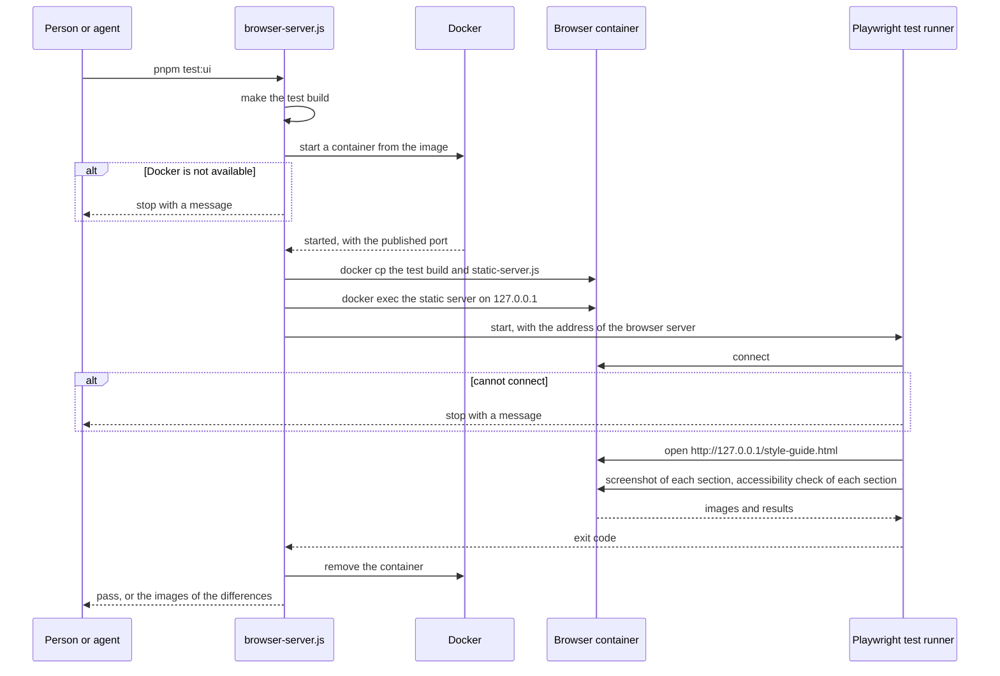

# Design

## Context

See `proposal.md` for the reason for this change. The decisions of the brainstorm are in [the brainstorm results](https://github.com/twin-digital/opus/issues/496#issuecomment-7144268115). `nodejs/wishem/docs/design-system/style-guide-preview.html` shows the agreed look. It is the reference for each value that this document does not give.

Facts that shape the approach:

- `nodejs/wishem/workbench` is a library package. It holds the model folder and a `start` script. The build script of the repository uses one build tool for each package: a package that has a `vite.config.ts` is built with Vite only.
- The Node.js host serves `/snapshot` and `/snapshots`. It serves no page.
- `repo-kit` has a `vite` feature. A package that has the `vite` dependency gets a generated `tsconfig.json` and a generated `vite.config.ts` that loads `vite.config.d/*.js`. `nodejs/grinbox/web` uses this feature with React and Tailwind 4.
- No package in the repository has Playwright tests. The pull request checks have one job, `lint-build-test`, on `ubuntu-latest`.
- Chromium does not start in the development container, because system libraries are missing.
- Docker works in the development container. A container that Docker starts from there cannot see the files of the repository, because the paths on the Docker host are different.
- The Docker daemon of the development container runs on a different computer (`DOCKER_HOST` is an `ssh://` address). The development container can reach that computer. A container on that computer cannot reach the development container.

## Goals / Non-Goals

**Goals:**

- One source for each token value.
- A style guide that needs no core and no host.
- Screenshot tests that give the same result on a development computer and in the pull request checks.
- A package layout that [First workbench UI slice](https://github.com/twin-digital/opus/issues/477) and [Workbench components](https://github.com/twin-digital/opus/issues/497) extend with no restructure.

**Non-Goals:**

- The HTML renderer, the views, and the connection to a core.
- A component that is not the app bar or the zero state.
- A change to the shared build script or to `repo-kit`.
- A required status check for the new job. The owner sets required checks in the repository settings.

## Decisions

### D1. The presentation side is a new package

`nodejs/wishem/workbench-app` (`@thrashplay/wishem-workbench-app`, private) holds the tokens, the fonts, the components, the style guide, and the tests. `nodejs/wishem/workbench` does not change.

Reason: a product has a model side and a presentation side. Two packages keep React, Tailwind, the fonts, and Playwright out of the package that holds the model, and the shared build script needs no change.

Rejected: to convert `nodejs/wishem/workbench` to a Vite package. Its library output would no longer be built.

The package gets `rules: { package-manifest: false }` in `.repo-kit.yml`, with the same reason as `@grinbox/web`: nothing imports a browser application.

```
nodejs/wishem/workbench-app/
  index.html                  the workbench page (a shell in this change)
  style-guide.html            the style guide page
  playwright.config.ts
  scripts/
    browser-server.js         starts and stops the browser container
    static-server.js          serves the test build, with no dependency
  src/
    main.tsx                  entry of index.html
    styles/
      tokens.css              the one source of each token value
      theme.css               maps the roles to Tailwind, loads the fonts
    tokens.ts                 the names and the groups of the tokens
    components/
      AppBar.tsx
      ZeroState.tsx
      ThemeScope.tsx
    style-guide/
      main.tsx                entry of style-guide.html
      sections/               Principles, Tokens, Typography, Components
  tests/
    style-guide.spec.ts       screenshot tests and accessibility tests
    __screenshots__/          the baselines
  vite.config.d/50-react.js
  vitest.config.d/50-react.ts
  eslint.config.d/50-react.js
```

### D2. The package has a shell page

`index.html` shows the zero state as fixed content. [First workbench UI slice](https://github.com/twin-digital/opus/issues/477) adds the renderer and the app bar to this page.

Reason: `vite build` needs an entry, and the style guide must not be in the build. That slice already says that the zero state is fixed content of the page.

This is a decision of the agent that wrote this document. The owner did not confirm it.

### D3. Token values are in one CSS file, with `light-dark()`

`src/styles/tokens.css` declares each palette color and each role as a CSS custom property on `:root`. A role that changes with the theme uses the CSS function `light-dark()`:

```css
:root {
  color-scheme: light dark;
  --ink: #17172a;
  --wishfire: #f2a93b;
  --wishfire-deep: #9e5b0c;
  --ground: light-dark(#f7f7fa, #121222);
  --maker-text: light-dark(var(--wishfire-deep), var(--wishfire));
}
[data-theme='light'] {
  color-scheme: light;
}
[data-theme='dark'] {
  color-scheme: dark;
}
```

- With no `data-theme` attribute, the page follows the color scheme of the system. No script is necessary.
- A `data-theme` attribute on an element forces a theme on that element and its content. The style guide and the tests use it.
- Each value is written one time.

Rejected: a `.dark` class that a script sets, as in `nodejs/grinbox/web`. It needs a script before the first paint, and each dark value is in a second rule.

Rejected: a `@media (prefers-color-scheme: dark)` rule and an attribute rule. Each dark value would be written two times.

### D4. Tailwind gets the roles only

`src/styles/theme.css` imports Tailwind, removes the default colors of Tailwind, and maps each role to a Tailwind color:

```css
@import 'tailwindcss';
@import './tokens.css';

@theme inline {
  --color-*: initial;
  --color-ground: var(--ground);
  --color-fg: var(--fg);
  --color-maker: var(--maker);
  /* one line for each role */
  --font-display: 'Bricolage Grotesque Variable', system-ui, sans-serif;
  --font-body: 'Inter Variable', system-ui, sans-serif;
  --font-mono: 'JetBrains Mono', ui-monospace, monospace;
}
```

- A component uses classes such as `bg-ground`, `text-fg-muted`, `border-control-border`, and `text-maker-text`.
- A class such as `bg-red-500` or `bg-ink` does not exist. Thus a component cannot use a default color or a palette color.
- The text sizes, the radius steps, and the shadow steps are also `@theme` values, with the names `text-h1` to `text-h4`, `text-lead`, `text-body`, `text-ui`, `text-control`, `text-small`, `text-label`, `rounded-sm`, `rounded-md`, `rounded-lg`, `shadow-sm`, and `shadow-md`.
- The spacing scale of Tailwind is not changed.

### D5. The names of the tokens are in `tokens.ts`, and tests keep the two files the same

`src/tokens.ts` gives the names of the tokens in groups. The style guide draws a swatch for each name and reads the value with `getComputedStyle`. It holds no value.

Vitest tests in the package read `tokens.css` as text:

- Each name in `tokens.ts` is declared in `tokens.css`, and each custom property in `tokens.css` is in `tokens.ts`.
- Each contrast rule of the `component-catalog` specification is true for the values in `tokens.css`, in each theme. A failure names the role.
- No file in `src/components/` contains a hexadecimal color value or the name of a palette color.

Reason: the contrast rules must fail fast, with no web browser.

This is a decision of the agent that wrote this document. The owner did not confirm it.

### D6. Fonts are packages

The fonts come from `@fontsource` packages, with the Latin subset only. `theme.css` imports them.

**Unverified**: the exact packages. Bricolage Grotesque needs the weights 600 and 800. Inter needs the weights 400, 500, and 600, and the italic of 400. JetBrains Mono needs the weights 400 and 500. Use a variable package when it exists, because the display typeface changes its shape with the size. The first step of the task checks which packages exist.

### D7. The style guide is a second HTML entry

`style-guide.html` is a file in the root of the package. The Vite development server serves it at `/style-guide.html`. The `build.rollupOptions.input` of the Vite config names `index.html` only, so the build does not contain the style guide.

The script `style-guide` of the package runs `vite --open /style-guide.html`.

The tests use a second build, the test build: `vite build --mode style-guide`. Its input is `style-guide.html` only and its output folder is `dist-style-guide/`. Git ignores that folder. The build of the workbench page does not change: its input is `index.html` and its output folder is `dist/`.

Reason: a static build is a small set of files that can be copied to the computer of the web browser (D8), and the tests load the same bytes on each computer.

Each section of the style guide is drawn two times, in a `ThemeScope` for each theme. Each copy has a `data-testid` with the name of the section and the theme, for example `tokens-dark`. A test takes a screenshot of that element.

The style guide shows a component specimen in a `section` element. An `header` element in a `section` is not a banner landmark, so the app bar specimens do not make two banners.

### D8. The web browser runs in the official Playwright image, and the page is served next to it

The image is `mcr.microsoft.com/playwright:v<version>-noble`. `<version>` is the exact version of `@playwright/test` in the pnpm catalog.

The tests load the test build of the style guide (D7). `scripts/static-server.js` serves that build. It is a Node.js script with no dependency. The static server and the web browser run on the same computer in each environment, so the web browser loads the page from `127.0.0.1`.

In the pull request checks, the job runs in the image. `browser-server.js` finds that it runs in the image, starts no container, and runs the test runner directly. The test runner starts the static server as its `webServer` and starts the web browser directly.

On a development computer, `scripts/browser-server.js` does these steps:

1. It makes the test build.
2. It removes a browser container of an earlier run, then starts a new container from the image. The container runs the browser server of Playwright. The name of the container contains a hash of the path of the package, so each working tree has its own container.
3. It copies the test build and `static-server.js` into the container with `docker cp`, and starts the static server in the container with `docker exec`.
4. It runs the command that it gets (the test runner), with the address of the browser server in the environment. The test runner connects to the browser server.
5. It removes the container when the command stops.

No file is mounted. The browser container needs no network path to the development computer. The only network path is from the test runner to the browser server.



How `browser-server.js` finds the address of the browser server:

- `DOCKER_HOST` is an `ssh://` address or a `tcp://` address: the host of that address. The port of the browser server is published on each address of the Docker host.
- `DOCKER_HOST` is not set, or is a socket: `127.0.0.1`. The port is published on `127.0.0.1` only.
- The environment variable `WISHEM_BROWSER_HOST` replaces the host in each case.

Docker selects a free port for the browser server. The script reads the port with `docker port`.

**Unverified**: that the test runner on the development computer can connect to the published port, and that a baseline from this path passes in the pull request checks. Task 1 proves the two before other work starts. If the path cannot work, Task 1 stops and the owner decides. The alternative is that the pull request checks make the baselines and a workflow commits them. That alternative changes two requirements of the `visual-tests` specification.

Rejected: the Vite development server on the development computer, with the web browser in a container that loads the pages through the network. The browser container cannot reach the development container when the Docker daemon is on a different computer.

Rejected: an SSH tunnel from the Docker host to the development computer. It is a special case for one type of Docker daemon, and it depends on the configuration of the SSH server.

Rejected: a copy of the package and its dependencies in the container, with the test runner in the container. The dependencies of a pnpm workspace are large, and the results must be copied back.

Rejected: Chromium in the development container. The development container and the runner of the pull request checks are different systems, and the fonts can be drawn differently.

Rejected: baselines that only the pull request checks make. Each visual change needs a push before a person sees a difference.

### D9. One version of Playwright, and a test that proves it

- `@playwright/test` and `@axe-core/playwright` are in the pnpm catalog. `@playwright/test` has an exact version, with no range.
- `browser-server.js` gets the tag of the image from the installed version of `@playwright/test`. Thus the two cannot be different on a development computer.
- `.github/workflows/ci.yaml` has the tag as text. A Vitest test in the package reads the workflow file and the installed version, and fails with the two versions when they are different. This test runs in the `lint-build-test` job, which needs no web browser.
- `renovate.json` gets a rule that puts `@playwright/test` and the image `mcr.microsoft.com/playwright` in one group and sets `automerge` to `false`. A new version of the browser can change each baseline, so a person makes the baselines again in that pull request.

**Unverified**: that the `github-actions` manager of Renovate updates the `container` image of a job. If it does not, the test above still fails when the versions are different, and a person changes the tag.

### D10. The tests and the job

- `playwright.config.ts` has one project, Chromium. When the environment gives the address of a browser server, it connects to that server and starts no `webServer`. If not, it starts `static-server.js` as its `webServer`. It turns off animations and waits for `document.fonts.ready` before a screenshot.
- `tests/style-guide.spec.ts` has one screenshot test and one accessibility test for each section and each theme.
- The accessibility test uses `@axe-core/playwright` with the tags `wcag2a`, `wcag2aa`, `wcag21a`, and `wcag21aa`. It does not use the best practice rules, because the style guide shows more than one heading 1.
- A test records each request of the page and fails when a request goes to a different host.
- The scripts of the package are `test:ui` and `test:ui:update`. Each script runs the test runner through `browser-server.js`. `turbo.json` gets a `test:ui` task with the inputs of the build, the `tests/**` folder, and the `scripts/**` folder.
- The job `ui-tests` in `ci.yaml` runs in the image. Its steps: checkout with full history, the shared setup action, `pnpm exec turbo run test:ui --affected`, and an upload of the Playwright report when the job fails.
- The unit tests of the package (`*.test.ts` and `*.test.tsx` in `src/`) run with Vitest in the `lint-build-test` job, as for each other package.

### D11. The brand images

`nodejs/wishem/docs/brand/render.mjs` starts Chromium directly and opens a `file:` address. Neither works in the development container. The script changes to this: it connects to the browser server when the environment gives its address, and it gives the HTML to the page as text. `browser-server.js` runs each command that it gets, so a person runs `render.mjs` through it. The fonts of `brand-basics.html` come from the network, as they do now.

## Interfaces

Owner: `@thrashplay/wishem-workbench-app`. The package is a browser application and has no `exports`. These are the modules that the later changes of the same package use.

```ts
// src/components/AppBar.tsx
export interface AppBarProps {
  /** The identity of the application. Drawn in lowercase. */
  title: string
}
export const AppBar: (props: AppBarProps) => React.JSX.Element

// src/components/ZeroState.tsx
export interface ZeroStateProps {
  /** A short mono label, for example "Workbench". */
  label: string
  /** One line of text, for example "Nothing to show yet." */
  message: string
}
export const ZeroState: (props: ZeroStateProps) => React.JSX.Element

// src/components/ThemeScope.tsx
export type Theme = 'light' | 'dark'
export interface ThemeScopeProps {
  /** Forces this theme on the content. */
  theme: Theme
  children: React.ReactNode
}
export const ThemeScope: (props: ThemeScopeProps) => React.JSX.Element

// src/tokens.ts
export interface TokenGroup {
  /** For example "Palette" or "Status". */
  name: string
  /** The kind of sample that the style guide draws. */
  kind: 'fill' | 'text' | 'radius' | 'shadow'
  /** Names of CSS custom properties, with no leading dashes. */
  tokens: readonly string[]
}
export const tokenGroups: readonly TokenGroup[]
```

## Examples

Start the style guide:

```
$ pnpm --filter @thrashplay/wishem-workbench-app style-guide

  VITE v8.0.3  ready in 412 ms

  ➜  Local:   http://localhost:5173/style-guide.html
```

Run the tests on a development computer:

```
$ pnpm --filter @thrashplay/wishem-workbench-app test:ui
browser-server: built the style guide for the tests
browser-server: started mcr.microsoft.com/playwright:v1.56.1-noble as wishem-playwright-3f9a1c
browser-server: the browser server is at ws://127.0.0.1:32771

Running 17 tests using 2 workers
  17 passed (9.4s)
```

A screenshot is different:

```
$ pnpm --filter @thrashplay/wishem-workbench-app test:ui
  1) tests/style-guide.spec.ts:21:5 › components › dark › screenshot

    Error: expect(locator).toHaveScreenshot(expected) failed
      2114 pixels (ratio 0.01 of all image pixels) are different.
    Expected: tests/__screenshots__/components-dark.png
    Received: test-results/style-guide-components-dark/components-dark-actual.png
        Diff: test-results/style-guide-components-dark/components-dark-diff.png

  1 failed
  16 passed (9.8s)
```

Docker is not available:

```
$ pnpm --filter @thrashplay/wishem-workbench-app test:ui
browser-server: Docker is not available. The screenshot tests run only in the pinned
browser image. Start Docker, or let the pull request checks run the tests.
```

Make the baselines again:

```
$ pnpm --filter @thrashplay/wishem-workbench-app test:ui:update
  2 baselines written: components-light.png, components-dark.png
```

The version numbers, the container name, and the address in these examples are illustrations.

## Failure Modes

| Failure                                                                  | Result                                                                                                                                  | Recovery                                                                                         | Safe to run again |
| ------------------------------------------------------------------------ | --------------------------------------------------------------------------------------------------------------------------------------- | ------------------------------------------------------------------------------------------------ | ----------------- |
| Docker is not available on a development computer                        | `browser-server.js` stops with a message. No test runs. No baseline changes.                                                            | Start Docker, or use the pull request checks.                                                    | Yes               |
| The image is not on the computer and the registry cannot be reached      | The start of the container fails. The script prints the error of Docker and stops.                                                      | Run the command again when the network is available.                                             | Yes               |
| A browser container of an earlier run of the same working tree remains   | The script removes that container and starts a new one from the correct image.                                                          | None necessary.                                                                                  | Yes               |
| The test build fails                                                     | The script prints the error of the build and stops. No container starts. No baseline changes.                                           | Fix the error.                                                                                   | Yes               |
| The test runner cannot connect to the browser server                     | The test runner stops with a message. The message of the script gives the address that it used.                                         | Set `WISHEM_BROWSER_HOST` to an address of the Docker host that this computer can reach. See D8. | Yes               |
| The script stops before it removes the container                         | The container stays on the Docker host.                                                                                                 | Run the command again. The next run removes the container.                                       | Yes               |
| A font is not loaded when a screenshot is taken                          | Not possible in the normal sequence: the test waits for `document.fonts.ready`. A font file that is absent fails the build of the page. | Fix the import of the font.                                                                      | Yes               |
| The version of `@playwright/test` and the tag in `ci.yaml` are different | The Vitest test of D9 fails in `lint-build-test`. In `ui-tests`, Playwright does not find its browser and fails.                        | Make the two the same, then make the baselines again.                                            | Yes               |
| The update command stops in the middle                                   | The baselines that it wrote are new files. The others are not changed.                                                                  | Run the command again, or restore the files with Git.                                            | Yes               |

Each operation only reads, or writes files in the working tree. No operation writes to a remote system.

## Package Impact

| Package                            | Published or private | Bump  | Why                                                                      |
| ---------------------------------- | -------------------- | ----- | ------------------------------------------------------------------------ |
| `@thrashplay/wishem-workbench-app` | private              | minor | New package: tokens, fonts, app bar, zero state, style guide, and tests. |

No other package changes. `.github/workflows/ci.yaml`, `turbo.json`, `renovate.json`, `.repo-kit.yml`, `pnpm-workspace.yaml`, and the documents are not in a package.

## UI

### The option that the owner selected

- App bar: the "night bar". The bar is Ink in each theme. Rejected: a bar that is a surface with a line, and a bar with no surface.
- Accent: Moonlight. Rejected: Clay, Terracotta, Rose, Peach, Plum, Dusk, Orchid, Mauve, Berry, Lilac grey, Glacier, and Pearl.
- Success: Spring. Rejected: three greens that are nearer to Wisp.
- Typeface for body text and UI text: Inter. Rejected: Instrument Sans, Geist, Hanken Grotesk, and DM Sans.
- Text sizes: body 18, UI 16, control 14, heading 4 at 22.
- The theme follows the system.

The reasons are in the brainstorm results.

### Wireframes

The shell page (`index.html`):

```
+------------------------------------------------------------+
|                                                            |
|                                                            |
|                         WORKBENCH                          |
|                    Nothing to show yet.                    |
|                                                            |
|                                                            |
+------------------------------------------------------------+
```

The style guide page (`style-guide.html`), wide viewport. Each section has a light copy and a dark copy, one next to the other:

```
+------------------------------------------------------------+
| Wishem workbench style guide                               |
| Principles: quiet, flat surfaces. Colour says who acted... |
+------------------------------------------------------------+
| Tokens                                                     |
| +--------- light ----------+ +---------- dark -----------+ |
| | Palette   [] [] [] [] [] | | Palette   [] [] [] [] []  | |
| | Surfaces  [] [] [] [] [] | | Surfaces  [] [] [] [] []  | |
| | Fills     [] [] [] [] [] | | Fills     [] [] [] [] []  | |
| | Text      Aa Aa Aa Aa Aa | | Text      Aa Aa Aa Aa Aa  | |
| | Radius    () () ()       | | Radius    () () ()        | |
| | Shadow    [] []          | | Shadow    [] []           | |
| +--------------------------+ +---------------------------+ |
+------------------------------------------------------------+
| Typography                                                 |
| +--------- light ----------+ +---------- dark -----------+ |
| | Heading 1 to heading 4   | | ...                       | |
| | Lead, body, UI, small    | |                           | |
| | Mono label, link         | |                           | |
| | Lists, code, rule        | |                           | |
| +--------------------------+ +---------------------------+ |
+------------------------------------------------------------+
| Components                                                 |
| +--------- light ----------+ +---------- dark -----------+ |
| | App bar                  | | App bar                   | |
| | [ wishem.              ] | | [ wishem.               ] | |
| | Zero state               | | Zero state                | |
| | [      WORKBENCH       ] | | [      WORKBENCH        ] | |
| | [ Nothing to show yet. ] | | [ Nothing to show yet.  ] | |
| +--------------------------+ +---------------------------+ |
+------------------------------------------------------------+
```

### Additions to the style guide

The product has no style guide before this change. Each item is an addition.

- Tokens: each palette color, each role, the text sizes, the radius steps, and the shadow steps of the `component-catalog` specification. This includes the roles that only [Workbench components](https://github.com/twin-digital/opus/issues/497) uses, such as `control-border` and the status roles.
- Typography: heading 1 to heading 4, lead paragraph, body text, UI text, small text, mono label, link, an ordered list, an unordered list, inline code, a code block, and a rule. The link has an underline in the `accent` color.
- Components: the app bar and the zero state.

### States

| Component  | States                                                                                             |
| ---------- | -------------------------------------------------------------------------------------------------- |
| App bar    | With a short title. With a title that is longer than the bar. Each in light mode and in dark mode. |
| Zero state | One state, in light mode and in dark mode.                                                         |

Loading, empty, error, and disabled do not apply: the two components get all their content as props and have no control.

### Narrow viewport

- The app bar keeps its height of 48 pixels. A title that is longer than the bar is cut with an ellipsis.
- The zero state keeps its text in the center. The text wraps.
- In the style guide, the light copy and the dark copy of a section are one below the other when the viewport is narrower than 900 pixels. The screenshot tests use one fixed viewport width of 1280 pixels.

### Keyboard and focus

- The app bar and the zero state have no control. They get no focus.
- The title of the app bar is a heading 1 in an `header` element. The full stop is a decoration and is hidden from a screen reader.
- The lowercase of the title is a style. The text of the element stays as the title was given, so a screen reader reads "Wishem".
- The style guide has no control. A person reads it and scrolls it.

## Risks / Trade-offs

- [The test runner cannot connect to the browser server on the Docker host] → Task 1 proves it first. On a failure, the task stops and the owner decides. See D8.
- [When the Docker daemon is on a different computer, the port of the browser server is open to the network of that computer while a run is in progress] → The container lives only for one run, and Docker selects the port. The development network is private.
- [The tests load a build, not the development server, so each run makes a build] → The build is small. A person looks at the style guide with the `style-guide` script, which uses the development server.
- [A baseline from a development computer does not pass in the pull request checks, although the image is the same] → Task 1 proves this with a real pull request before a component is built.
- [Text is drawn with small differences between runs] → The tests turn off animations and wait for the fonts. If a difference stays, set a small pixel limit for the comparison and record the reason in `playwright.config.ts`.
- [A person without Docker cannot run the screenshot tests] → The unit tests, the contrast tests, and the style guide need no Docker. The pull request checks run the screenshot tests.
- [The new job makes the pull request checks slower] → The job runs the tests only when the package is affected. It runs at the same time as `lint-build-test`.
- [`light-dark()` needs a current web browser] → The workbench is a development tool for current browsers. The pinned Chromium supports the function.
- [The tokens section shows roles that no component of this change uses] → This is intended. [Workbench components](https://github.com/twin-digital/opus/issues/497) uses them, and the owner wants the base to be complete.
- [The owner did not confirm D2 and D5] → They are named in the summary of this plan. They do not change the look.

## Open Questions

- Does the owner make `ui-tests` a required status check? This is a repository setting. It does not change this change.
