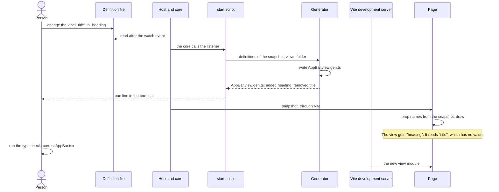
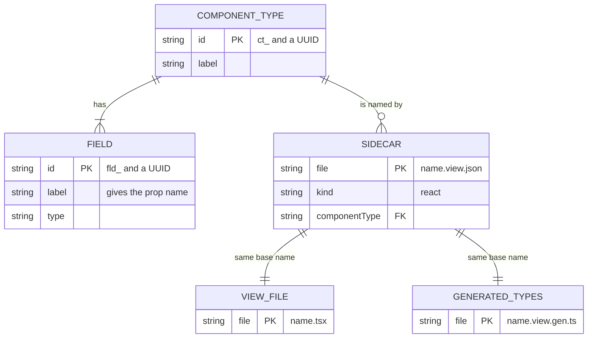

# Design

## Context

See `proposal.md` for the reason. The decisions of the owner are in [the issue](https://github.com/twin-digital/opus/issues/501), in [the comment on the new direction](https://github.com/twin-digital/opus/issues/501#issuecomment-7171211504), and in [the answers to questions 1 and 9](https://github.com/twin-digital/opus/issues/501#issuecomment-7171388184).

The state of the code after [First workbench UI slice](https://github.com/twin-digital/opus/issues/477):

- `nodejs/wishem/workbench-app/src/renderer/` holds the HTML renderer: `define-view.ts`, `collect-views.ts`, `check-views.ts`, `connect.ts`, and `Renderer.tsx`.
- `src/views/AppBar.tsx` is the one view. It calls `defineView` with the ID of the component type and of the field `title`.
- `src/views.ts` collects `./views/*.tsx` with `import.meta.glob`.
- `Renderer` calls `view.render(props)` as a plain function, inside a wrapper element that has the ID of the entity and of the component type.
- `scripts/start.ts` starts the host and the Vite development server in one Node.js process. It holds the `Core` object of the host.
- `nodejs/wishem/workbench/model/definitions/` holds one definition file. The label of the component type is `AppBar`, and the label of its field is `title`.
- `readModelFolder` of `@thrashplay/wishem-host-nodejs` reads a model folder. `validateModel` of `@thrashplay/wishem-core` gives the definitions.
- Node.js runs `scripts/*.ts` with type stripping. A script resolves a workspace package to its built files, so the packages that a script imports must be built first. The `test` task of the package already depends on `^build`.
- The pre-commit hook runs the lint of each package. The lint uses type information.

## Goals / Non-Goals

**Goals:**

- One hand-written ID for each view: the ID of the component type, in the sidecar.
- A shape for "code that is attached to a component type" that a behavior can use later with no change to a sidecar.
- A page that stays correct immediately after a label changes, before a type check runs.
- A fresh checkout that passes the lint and the type check with no generation step.

**Non-Goals:**

- A generator for a language that is not TypeScript.
- A change to the picture. This change adds no component, no token, and no state to the style guide, so this design has no UI section.
- A package for the HTML renderer.
- A folder for each kind of view. The sidecar holds the kind. A folder for each kind is added when a second kind exists.

## Decisions

### D1. The sidecar is `<name>.view.json`, beside `<name>.tsx`

The sidecar holds `kind` and `componentType`, and nothing else. The link between a view file and its sidecar is the base name. `AppBar.view.json` belongs to `AppBar.tsx`.

The views stay in `src/views/`. The issue shows `views/react/` as an illustration. A move out of `src/` changes the include rules of the type check, the tests, and the coverage, and gives nothing now. `src/views/` is already outside `src/renderer/`.

The HTML renderer uses only a sidecar whose kind is `react`. It skips each other kind with no message, so that a later renderer can keep its views in the same folder.

Alternatives: the owner rejected an import of a generated handle, a link in the definition, and one data file for all views. See the comment on the new direction.

### D2. One pure module gives the name of a prop, for the page and for the generator

`src/renderer/field-names.ts` holds the rule of the `view-types` specification. It has no relative import and uses only erasable TypeScript, so that a web browser bundle and a Node.js script can import the same file.

The page does not read a generated file at runtime. On each snapshot, the renderer gets the prop names from the definitions of that snapshot with this module. Thus, after a label changes, the page gives the value under the new name immediately, and the generated file is used only by the type check.

Alternative: the generated file also exports a table from prop name to field ID, and the page reads it. Rejected: the page is then correct only after the generator runs, and a file that is not current gives a wrong picture with no message.

The page and the generator handle a problem differently:

| Problem                                                         | Generator                                      | Page                                                  |
| --------------------------------------------------------------- | ---------------------------------------------- | ----------------------------------------------------- |
| Two labels give the same name                                   | An error. No file is written for that sidecar. | A warning. The prop has the value of the first field. |
| A label gives an empty name, or a name that starts with a digit | An error. No file is written for that sidecar. | No message. The prop is given under that name.        |
| The component type has no definition                            | A warning. The `Props` type has no member.     | A warning. Nothing is drawn for that sidecar.         |

A reserved word of JavaScript, such as `class`, is a permitted name. It is a valid member of a type. A view reads it as `props.class`.

### D3. The generated files are in the repository, and a test finds a file that is not current

Each `*.view.gen.ts` file is committed. A test of the package runs the generator in check mode against the model folder of the base workbench and `src/views/`, and it fails when a file is not current.

The issue proposes generated files that are not committed. This design changes that. Reason: the lint, the type check, and the tests of the pre-commit hook and of the pull request checks would each need a generation step before them, and a step in `turbo.json` for each task. With committed files, a fresh checkout passes each check, and no task of `turbo.json` changes.

`*.view.gen.ts` goes into `.prettierignore`, so that a format step cannot make a generated file different from the output of the generator.

Alternative: files that are not committed, with a `generate` task that the `lint`, `typecheck`, `test`, and `build` tasks depend on. Rejected for the reason above.

### D4. The generator is a library and a command in `scripts/`

- `scripts/view-types.ts` is the library. It gets the definitions as data and a `views` folder. It reads no model folder. Thus the `start` script can give it the definitions of the snapshot.
- `scripts/generate.ts` is the command. It reads the model folder with `readModelFolder` and `validateModel`, calls the library, prints the result, and sets the exit code.
- The tests are in `src/view-types.test.ts` and `src/generate.test.ts`, as `src/start.test.ts` is the test of `scripts/start.ts`.

The library writes a file only when its text changes. It finds the prop names of the old file from the lines of the members, so that it can report each name that is new or removed.

The text of a generated file:

```ts
// Generated from AppBar.view.json and the definition of its component type. Do not edit.
// To write this file again: pnpm --filter @thrashplay/wishem-workbench-app generate

/** The fields of the component type "AppBar" (ct_3f2a9c1e-8b47-4d0a-9e51-6c2f7a1b0d34). */
export interface Props {
  /** The field "title" (fld_b81d04e7-2c6f-4a39-8d15-0e9a7f3c5b62). */
  readonly title: string | undefined
}
```

For a component type with no definition, the file has `export type Props = object`. A view that reads a prop of that type fails the type check.

### D5. The `start` script runs the generator from the snapshot of the core

`startWorkbench` already holds the `Core` of the host. It subscribes to the core. When the definitions of the snapshot change, it runs the generator with those definitions. A change to the authored state only is not a change to the definitions, so the generator does not run.

For a sidecar, the script uses the file watcher of the Vite development server, which already watches `src/views/`.

One run is active at a time. A change that arrives during a run starts one more run after it.

`WorkbenchOptions` gets two entries: `views`, the folder that the generator keeps current (default `src/views`), and `viewTypes` (default `true`). The command gets `--no-view-types`. `scripts/e2e-server.ts` turns the generator off, because the end-to-end tests change a copy of the model, and they must not change files of the repository. The test of the `start` script uses a temporary `views` folder.

Alternative: a Vite plugin in `vite.config.d/`. Rejected: the plugin would need a second reader and a second watch of the model folder, and each Vite command (the build, the style guide, the tests) would load it.

### D6. The renderer mounts a view as a React component

`Renderer` creates a React element from the function of the view. It does not call the function directly.

Reason: the default export of a view file is now a React component. When React Fast Refresh replaces such a module in place, a table that holds the old function and calls it directly shows the old picture. A mounted component gets the new function from React.

The rule "a view is a pure function of its props" does not change. A view uses no React state.

This must be verified in the task: after an edit to `src/views/AppBar.tsx` while the workbench runs, the page shows the new picture. If the page shows the old picture, add `import.meta.hot.accept` in `src/views.ts` that reloads the page, as D9 of the change for #477 says.

### D7. The collector pairs sidecars with view files

`collectViews` gets two records from `import.meta.glob`: the sidecars (`./views/*.view.json`) and the view modules (`./views/*.tsx`, with no test file). It builds the table from the sidecars. A view file with no sidecar is not in the table, and that is not an error.

`src/renderer/sidecar.ts` checks the shape of a sidecar. The collector and the generator use the same module. It has no relative import, for the reason of D2.

### D8. The blueprint text

`nodejs/wishem/docs/glossary.md`:

- **View** (**Agreed**): Code that a renderer runs to draw a component type. A view is content of the product, and it is not part of the renderer. Each renderer has its own kind of view. A view is a pure function of its props. A sidecar attaches a view to its component type.
- **React view** (**Agreed**): The kind of view that the HTML renderer runs: a React component. A React view that has no sidecar is not attached to a component type.
- **Sidecar** (**Agreed**): A data file beside a view. It holds the kind of the view and the ID of its component type.
- A row in "Terms that are not used": do not use "Component, for React code". Use "View, or React view". Reason: "A component is a part of an entity in a model."

`nodejs/wishem/docs/concepts.md`, the section "Views":

- A view is content of the product. A renderer supplies the code that loads, mounts, and runs views.
- A view has the shape of a behavior: code that is attached to a component type, with the fields of the component as its inputs. A view is not a behavior: a renderer runs a view, the core never loads it, and a view changes no state.
- The fields in the component type definition are the source. The types of the props of a view are generated.
- A view gets the fields of its own component type. When the same data needs more than one view, the data is in one component type, and each view has its own component type with a field that refers to the data. References are **Open**.
- Remove the sentence that a view declares its fields.

`nodejs/wishem/docs/architecture/README.md`: replace `defineView` and `checkViews` with the sidecar, the generated types, and the generator. The path of a change gets the generator.

The diagram "From a file to a picture" (`picture-light.svg` and `picture-dark.svg`) shows the view file as the source of the table of views. After this change, the sidecar gives the link from a view to its component type, so the diagram must show the sidecar. The change is made in the description of the diagram in `render.mjs`, and the script writes the two files. No SVG file is edited by hand. The work follows [`docs/diagrams.md`](../../../docs/diagrams.md) and the `diagrams` skill: the script runs two times with no change on the second run, `check-svg.mjs` passes, and the implementer looks at an image of each file on the page color of its theme. The text of the diagram stays in the limits of the guide: the detail goes in the prose.

The diagram "The processes of the workbench" does not change. See D9.

### D9. The architecture level does not change

The rules of `openspec/config.yaml` require a C4 diagram in this design, and the capability `wishem/architecture/diagrams`, when a change alters the C4 context level or container level, or the entities of a store of persisted data. This change alters neither:

- **Containers.** The containers of the workbench are the page in the web browser, the Node.js process of the `start` script, the model folder, and the packages that other packages build on. This change adds no container. The generator and the `generate` command are code of `workbench-app`. The `start` script gets the definitions from the core that it already holds, and it writes files in its own package.
- **Relationships.** The `generate` command reads the model folder with the reader of `host-nodejs`, as the host does. It is a development command of one package, and it runs no part of the product. It is not drawn as a container.
- **Stores.** The model folder is the one store of persisted data. Its entities do not change: the model does not name a view. A sidecar is a source file of `workbench-app`, beside the view that it describes. The `erDiagram` of the Data Model section shows it because the design rules require that diagram for a persisted schema.

The diagram guidance still applies to the one diagram that this change corrects. See D8.

The architecture document of Wishem was made before the diagram guidance. It has no system context diagram, no container diagram in C4 notation, no entity diagram of the model folder, and no `wishem/architecture/diagrams` specification. That work is not part of this change. [Architecture document in C4 form](https://github.com/twin-digital/opus/issues/511) does it, after this change.

A later change makes this decision again when the views become content of a product folder, beside the model folder. The folder of the views is then a store, and the sidecar is an entity of it.

## The parts and the main flow



The error path: when the generator reports an error, the `start` script prints it and continues. The generated file of that sidecar keeps its old text. The page continues to draw, with the rule of D2.

## Data Model

The sidecar and the generated file are new. The definition file and the view file exist. Each link is by ID or by base name.



One component type has zero or one sidecar of each kind.

## Interfaces

`@thrashplay/wishem-workbench-app` owns each interface. Nothing is exported from the package.

The sidecar:

```json
{ "kind": "react", "componentType": "ct_3f2a9c1e-8b47-4d0a-9e51-6c2f7a1b0d34" }
```

A view file:

```tsx
// src/views/AppBar.tsx
import { AppBar } from '../components/AppBar.js'
import type { Props } from './AppBar.view.gen.js'

const AppBarView = ({ title }: Props) => <AppBar title={title ?? ''} />

export default AppBarView
```

`src/renderer/field-names.ts`:

```ts
import type { ComponentTypeDefinition, FieldDefinition, Id } from '@thrashplay/wishem-core'

/** The name of a prop for the label of a field. Can be empty or start with a digit. */
export const fieldName: (label: string) => string

export type NameProblem =
  | { kind: 'empty-name'; field: Id }
  | { kind: 'name-starts-with-digit'; field: Id; name: string }
  | { kind: 'same-name'; name: string; fields: [Id, Id] }

export interface PropNames {
  /** One entry for each name, in the order of the definition. For two fields with one name, the first field. */
  props: { name: string; field: FieldDefinition }[]
  problems: NameProblem[]
}

export const propNames: (definition: ComponentTypeDefinition) => PropNames
```

`src/renderer/sidecar.ts`:

```ts
import type { Id } from '@thrashplay/wishem-core'

export interface Sidecar {
  kind: string
  componentType: Id
}

export const REACT_KIND = 'react'

/** Returns no value when the data is not a sidecar. */
export const parseSidecar: (value: unknown) => Sidecar | undefined
```

`src/renderer/collect-views.ts`:

```ts
import type { FieldValue, Id } from '@thrashplay/wishem-core'
import type { ComponentType } from 'react'

export type ViewProps = Readonly<Record<string, FieldValue | undefined>>

export interface CollectedView {
  /** The file name of the sidecar, for example `AppBar.view.json`. */
  sidecar: string
  componentType: Id
  view: ComponentType<ViewProps>
}

export type ViewTable = ReadonlyMap<Id, CollectedView>

/** `files` has the names of the sidecar files that the error is about. */
export class ViewCollectionError extends Error {
  readonly files: readonly string[]
}

/** Each argument is the result of `import.meta.glob` with `eager: true`. */
export const collectViews: (sidecars: Record<string, unknown>, modules: Record<string, unknown>) => ViewTable
```

`src/renderer/view-warnings.ts`, which replaces `check-views.ts`:

```ts
export interface ViewWarning {
  kind: 'component-type-not-defined' | 'same-name'
  sidecar: string
  componentType: Id
  /** Set for `same-name`. */
  fields?: [Id, Id]
  name?: string
}

/** The result is sorted by sidecar, component type, and name. */
export const viewWarnings: (views: ViewTable, definitions: readonly ComponentTypeDefinition[]) => ViewWarning[]
export const describeWarning: (warning: ViewWarning) => string
```

`scripts/view-types.ts`:

```ts
export interface ViewTypesOptions {
  definitions: readonly ComponentTypeDefinition[]
  /** The absolute path of the `views` folder. */
  views: string
  /** Change no file. Default `false`. */
  check?: boolean
}

export interface ViewTypesFile {
  /** For example `AppBar.view.gen.ts`. */
  file: string
  status: 'written' | 'changed' | 'removed' | 'current' | 'not-current'
  addedProps: string[]
  removedProps: string[]
}

export interface ViewTypesResult {
  files: ViewTypesFile[]
  warnings: string[]
  errors: string[]
}

/** The text of a generated file. No definition gives a `Props` type with no member. */
export const renderViewTypes: (sidecarFile: string, componentType: Id, definition?: ComponentTypeDefinition) => string

export const generateViewTypes: (options: ViewTypesOptions) => Promise<ViewTypesResult>
```

`scripts/start.ts`, the additions to `WorkbenchOptions`:

```ts
export interface WorkbenchOptions {
  /** The folder whose generated files follow the model. Default: `src/views` of the package. */
  views?: string
  /** Default `true`. */
  viewTypes?: boolean
}
```

Removed: `defineView`, `View`, `PropDeclaration`, `PropDeclarations`, `checkViews`, `describeDifference`, and `ViewDifference`.

## Examples

The files are current:

```console
$ pnpm --filter @thrashplay/wishem-workbench-app generate
wishem: model /workspace/opus/nodejs/wishem/workbench/model
wishem: the generated files of 1 view are current
```

A field was added:

```console
$ pnpm --filter @thrashplay/wishem-workbench-app generate
wishem: model /workspace/opus/nodejs/wishem/workbench/model
wishem: changed AppBar.view.gen.ts: added subtitle
```

The check finds a file that is not current:

```console
$ pnpm --filter @thrashplay/wishem-workbench-app generate --check
wishem: model /workspace/opus/nodejs/wishem/workbench/model
wishem: AppBar.view.gen.ts is not current: added heading, removed title
wishem: run the generate script, then correct each view that the type check names
$ echo $?
1
```

Two labels give the same name:

```console
$ pnpm --filter @thrashplay/wishem-workbench-app generate
wishem: model /workspace/opus/nodejs/wishem/workbench/model
wishem: error: AppBar.view.json: the fields fld_b81d04e7-2c6f-4a39-8d15-0e9a7f3c5b62 and fld_0c44a1d2-6e3b-4f70-9a18-2b5d7c9e1f03 of the component type ct_3f2a9c1e-8b47-4d0a-9e51-6c2f7a1b0d34 give the same name "maxHealth"
$ echo $?
1
```

A label changes while the workbench runs:

```console
$ pnpm --filter @thrashplay/wishem-workbench-app start
wishem: model /workspace/opus/nodejs/wishem/workbench/model
wishem: core at http://127.0.0.1:4747
wishem: workbench at http://127.0.0.1:5173/
wishem: changed AppBar.view.gen.ts: added heading, removed title
```

The browser console, for a sidecar whose component type has no definition:

```text
wishem: the sidecar Header.view.json names the component type ct_9d1e…, which no definition has. No view is drawn for it.
```

## Failure Modes

The generator writes files. Each run is idempotent: the same definitions and sidecars give the same files, and a second run changes nothing.

| Failure                                                | Result                                                                                                                    | Recovery                                                                           |
| ------------------------------------------------------ | ------------------------------------------------------------------------------------------------------------------------- | ---------------------------------------------------------------------------------- |
| The model folder is not correct when the command runs  | The command prints each problem, changes no file, and stops with a non-zero exit code                                     | Correct the model file and run the command again                                   |
| The model becomes not correct while the workbench runs | The core keeps the last correct model and calls no listener. No generated file changes                                    | Correct the model file                                                             |
| A sidecar is not valid JSON, or has no `componentType` | The generator reports an error that names the file and writes no file for it. The page reports an error and draws no view | Correct the sidecar                                                                |
| A write of a generated file fails                      | The generator reports an error that names the file. The other files are written                                           | Correct the cause and run the generator again                                      |
| Two changes arrive while a run is active               | One more run starts after the active run, with the newest definitions                                                     | None                                                                               |
| The run stops in the middle                            | Some files are new and some are old                                                                                       | Run the generator again. The check and the test name each file that is not current |
| A label changed and the view still uses the old name   | The page draws the view with no value for that prop. The terminal of the `start` script names the prop                    | Run the type check and correct the view                                            |
| A person changes a generated file by hand              | The test of the package fails and names the file                                                                          | Run the generator                                                                  |

## Package Impact

| Package                            | Published or private | Bump  | Why                                                                                                                                                                                 |
| ---------------------------------- | -------------------- | ----- | ----------------------------------------------------------------------------------------------------------------------------------------------------------------------------------- |
| `@thrashplay/wishem-workbench-app` | Private              | Minor | The sidecar, the generator, the `generate` script, and the new form of a view. `defineView` and the comparison are removed. The package exports nothing, so no other package breaks |

No other package changes. `@thrashplay/wishem-core` and `@thrashplay/wishem-host-nodejs` are used as they are.

## Risks / Trade-offs

- [A label changes and the page draws an empty prop until a type check runs] → The `start` script prints each prop name that was removed. A type check on save is deferred.
- [A person edits a definition with no workbench that runs, and commits a generated file that is not current] → The test of the package fails in the pull request checks and names the file.
- [The format step or the lint changes or rejects a generated file] → `*.view.gen.ts` is in `.prettierignore`, and the first task verifies that the lint passes on the generated file as the generator writes it.
- [React Fast Refresh keeps the old function of a view] → D6, with the verification and the fallback that it gives.
- [The `start` script changes files of the repository when it runs with a different model folder] → This is correct: the views must agree with the model that the page draws. The option `--no-view-types` turns it off, and the end-to-end server uses it.
- [The names in code are links by label] → Accepted by the owner. A stored name for a field can be added later with the derived name as its default, and no view changes.
- [A generator for each language] → Accepted. The sidecar is the same for each language. Only the generator is specific.

## Migration Plan

One view exists. The change converts it in the same task that removes `defineView`:

1. Add `AppBar.view.json` and the generated `AppBar.view.gen.ts`.
2. Change `AppBar.tsx` to a default export of a function.
3. Remove `define-view.ts`, `check-views.ts`, and their tests.

To go back, revert the pull request. No stored data changes: the model folder is the same before and after.

## Open Questions

- The glossary says that "component" is not used for React code, and `src/components/`, the `wishem/design-system/component-catalog` specification, and [Workbench components](https://github.com/twin-digital/opus/issues/497) use it. The capability ID `component-catalog` is a convention of the repository for each product (`openspec/config.yaml`), so it cannot change for Wishem only. The rename of the folder and of the text is separate work, and the owner did not decide it.
