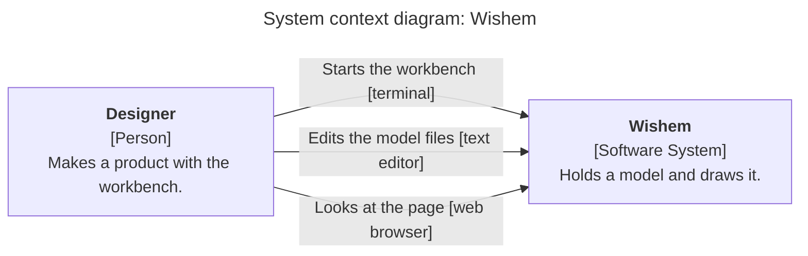
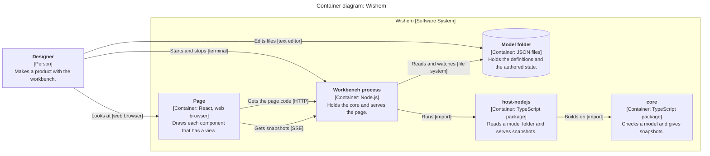
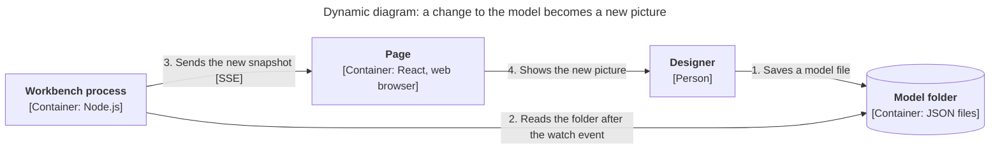
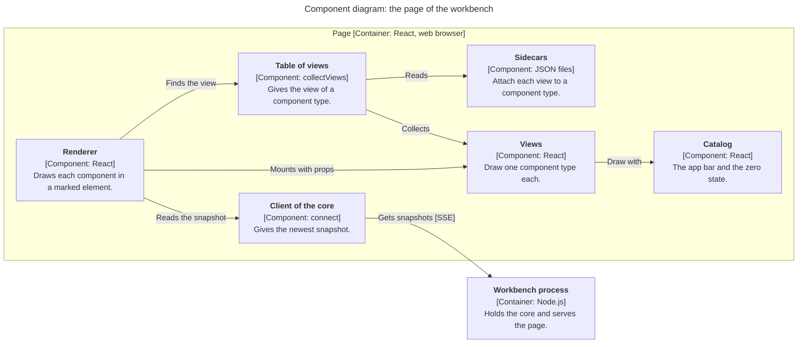
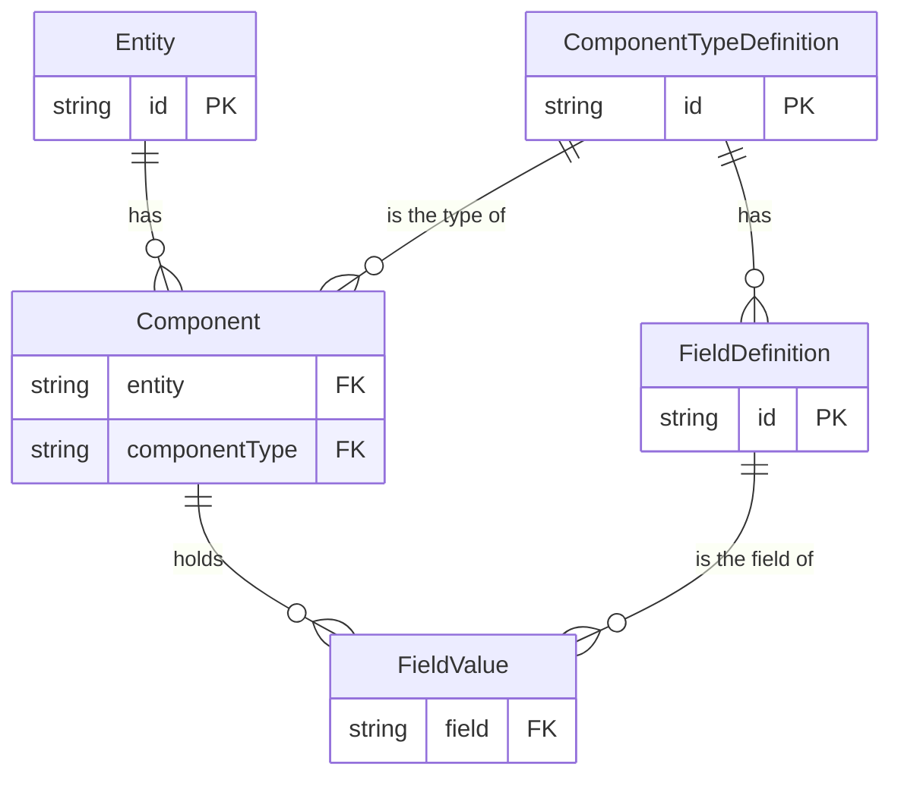

# Design

## Context

See `proposal.md` for the reason. [The issue](https://github.com/twin-digital/opus/issues/511) has the decisions of the owner.

The state of the document before this change:

- `nodejs/wishem/docs/architecture/README.md` has two diagrams: "The processes of the workbench" (`processes-light.svg`, `processes-dark.svg`) and "From a file to a picture" (`picture-light.svg`, `picture-dark.svg`). It also has a numbered list "The path of a change" and a table "What each package holds".
- `render.mjs` writes the four SVG files. It uses only `node:` modules. It reads the colors from `nodejs/wishem/workbench-app/src/styles/tokens.css` and writes one file for each theme from one description. It draws cards with a title, an optional second line, and an icon.
- No `openspec/specs/wishem/architecture/` folder exists.
- The `diagrams` skill gives `check-svg.mjs` and `rasterize.mjs`. `rasterize.mjs` needs Docker.

The state of the code that the diagrams show, after [Views of a component type](https://github.com/twin-digital/opus/issues/501):

- The `start` script of `workbench-app` starts one Node.js process with the host and the Vite development server.
- The host reads and watches the model folder. The page gets the page code and the stream of snapshots from the address of the Vite development server.
- In the page, `collectViews` builds the table of views from the sidecars and the view files, and `Renderer` mounts each view.
- The model folder holds `definitions/*.json` and `state.json`. `nodejs/wishem/core/src/model.ts` has the schema.

## Goals / Non-Goals

**Goals:**

- Each diagram that `docs/diagrams.md` requires for a product with two or more containers.
- A specification that makes a later change to the architecture also change the diagram.
- Diagrams that keep the facts of the document that exists.

**Non-Goals:**

- A component diagram of a container other than the page.
- A dynamic diagram of a second flow.
- A change to the look of the workbench. This change adds no component and no token to the style guide, so this design has no UI section.

## Decisions

### D1. Five diagrams replace the two that exist

| File name               | Type                                | Replaces                                                                    |
| ----------------------- | ----------------------------------- | --------------------------------------------------------------------------- |
| `context`               | System context diagram              | Nothing                                                                     |
| `containers`            | Container diagram                   | `processes`                                                                 |
| `dynamic-change`        | Dynamic diagram of the primary path | The amber path of `processes`, and the numbered list "The path of a change" |
| `components-page`       | Component diagram of the page       | `picture`                                                                   |
| `entities-model-folder` | Entity diagram of the model folder  | Nothing                                                                     |

The guidance makes the component diagram optional. The document has one for the page, because a new reader must understand how a view gets to the renderer, and because the diagram `picture` already showed it.

The numbered list "The path of a change" stays in the document, as the prose of the dynamic diagram. A dynamic diagram has one short label for each relationship. The list carries the detail.

Alternative: keep `processes` and `picture` and add the other three diagrams. Rejected: the guidance gives the file names and the notation of each diagram, and two diagrams of the same subject in two notations do not stay in agreement.

### D2. The software system is Wishem

A product is the unit of `openspec/specs/<product>/`, so the software system of each diagram is Wishem. The workbench is the one thing of Wishem that runs now. Each diagram shows the workbench.

Wishem connects to no external system, so the system context diagram has one person and one software system.

### D3. The containers

- **Page** `[Container: React, web browser]`.
- **Workbench process** `[Container: Node.js]`. The `start` script starts one Node.js process, which holds the host and the Vite development server. A container is a process, so the two are one container. They are components of it, and the prose of the document names them. The diagram `processes` showed them as two boxes.
- **Model folder** `[Container: JSON files]`. It is the one store of persisted data. The model folder of the base workbench is in the package `@thrashplay/wishem-workbench`.
- **core** and **host-nodejs** `[Container: TypeScript package]`. The guidance makes a package a container when other packages build on it.

The page imports only types from `core`. The diagram shows no relationship for it.

`@thrashplay/wishem-workbench-app` is not a container of its own. It holds the page and the `start` script, which are in the page and the workbench process. The table of the elements gives the package of each container.

### D4. The direction of a relationship is the direction in the code

Each arrow goes from the element that calls, reads, or sends to the element that is called, read, or receives.

- The page opens the stream of snapshots, so in the container diagram the arrow goes from the page to the workbench process ("Gets snapshots").
- In the dynamic diagram, relationship 3 shows one snapshot on that open stream, so the arrow goes from the workbench process to the page ("Sends the new snapshot").

The first step of the task records the file that proves each direction. Where the code and this design are different, the code is correct.

### D5. A sidecar is not an entity of a store

The model folder is the one store, and it has one entity diagram. A sidecar is a source file of `workbench-app`, beside the view that it describes. The component diagram of the page shows the sidecars as a component.

This decision is made again when the views become content of a product folder beside the model folder. The folder of the views is then a store, and the sidecar is an entity of it.

### D6. `render.mjs` is extended, and it stays one script with no dependency

The script gets these parts:

- An element card: a name, a type and technology in brackets, and one line of description. A person and a store have their own shape.
- A boundary box with a label, for a software system and for a container.
- A relationship with a label chip on the line.
- A title that gives the type and the scope, and a legend.
- An entity card: a name and the keys. A relationship between two entity cards has a cardinality mark at each end.

The rules of the `diagrams` skill for a render script apply: only `node:` modules, colors from the token file, the system font stack, one text function, `role="img"` with a `title` and a `desc`, the same `defs` in each theme, and numbers with two decimals. The script fails and writes no file when a label does not fit, when an arrow is too short, when a label chip is not on its line, or when a token is absent.

One accent color shows the primary path: the relationships of the dynamic diagram, and the same relationships in the container diagram.

Alternative: a shared library for C4 shapes. Rejected by the guidance: each product has its own render script.

### D7. The document has the form of the guidance

For each diagram, in the order context, containers, dynamic, components, entities:

1. A heading with the title of the diagram.
2. The `picture` element, with an `alt` text that says what the diagram shows.
3. The prose.
4. A table of the elements: the name, the type and technology, and the responsibility. A container has its package or its folder. An entity has its purpose and the file of its schema.

The table "What each package holds" becomes the table of the elements of the container diagram, with a row for each package. The document has no Mermaid block. At the end, the document links to `openspec/specs/wishem/architecture/diagrams/spec.md` and to the other specifications, and tells how to run `render.mjs`.

### D8. The owner accepts the images

The `diagrams` skill says that the work is not complete before the owner accepts each diagram. Each task gives the path of an image of each file in each theme. The acceptance is a step of the workflow after the tasks.

## The architecture diagrams

These Mermaid diagrams give the content of each SVG diagram. The implementer checks each element and the direction of each relationship against the code before the SVG file is made.

No element and no relationship is new, moved, or removed in the architecture. Each diagram is new as a diagram.

### System context

Wishem connects to no external system.

### Containers

See D3 for the reason of each container.

### The path of a change

The page opens the stream of snapshots one time. On that stream, the process sends each snapshot. Thus relationship 3 has the direction of the data.

The process also runs the generator of the view types when the definitions change. That step is inside the workbench process, so the diagram does not show it. The prose of the document does.

### The components of the page

The sidecars are source files of `workbench-app`. See D5.

### The entities of the model folder

`ComponentTypeDefinition`, `FieldDefinition`, and `Entity` are the names of the schema in `nodejs/wishem/core/src/model.ts`. A component and a field value have no type name in the schema: a component is one record of `components` of an entity, with the ID of its component type as its key, and a field value is one entry of that record, with the ID of its field as its key. The implementer reads the schema and uses its names. The design rules ask for an `erDiagram` for a persisted schema. This one shows the schema that exists: this change adds no entity and no relationship.

## Package Impact

No package changes. `nodejs/wishem/docs/` is not a package, and `render.mjs` is a script of the documents. The changeset is empty.

## Risks / Trade-offs

- [The C4 notation asks for more text in each element than the cards of the script hold now] → The task extends the card and keeps the check for the fit of a label. A description that does not fit is made shorter, and the detail goes in the prose.
- [An arrow has the wrong direction, and an image does not show the error] → The first step records the file that proves each direction, and a later step checks each arrow against that record.
- [The owner cannot judge a diagram from the SVG source] → Each task gives the path of an image of each file in each theme.
- [`rasterize.mjs` needs Docker] → The style guide tests of `workbench-app` need Docker also. If Docker is absent, the implementer stops and reports it. The implementer does not skip the look at each image.
- [A link to an old file name breaks] → The task searches `nodejs/wishem` and `openspec/specs/wishem` for `processes-` and `picture-`.
- [The code changes between this plan and the work] → The code is correct. The first step compares the code with this design and reports each difference.

## Migration Plan

The four SVG files that exist are removed in the task that adds the files that replace them. To go back, revert the pull request.

## Open Questions

- Is the model folder of a later product a second store with its own entity diagram, or the same store as the model folder of the workbench? [Workbench and product](https://github.com/twin-digital/opus/issues/491) decides how a product is mounted. The answer does not change this change.
