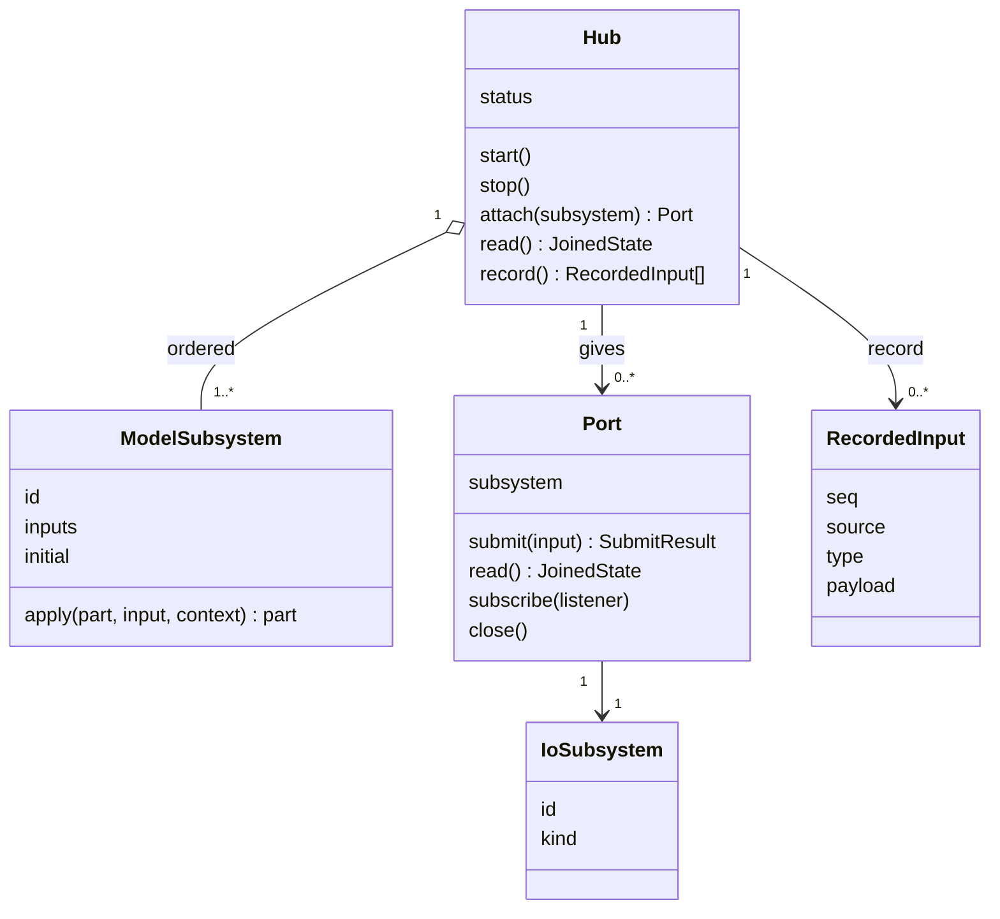
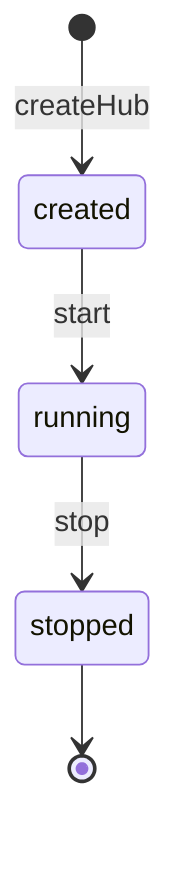
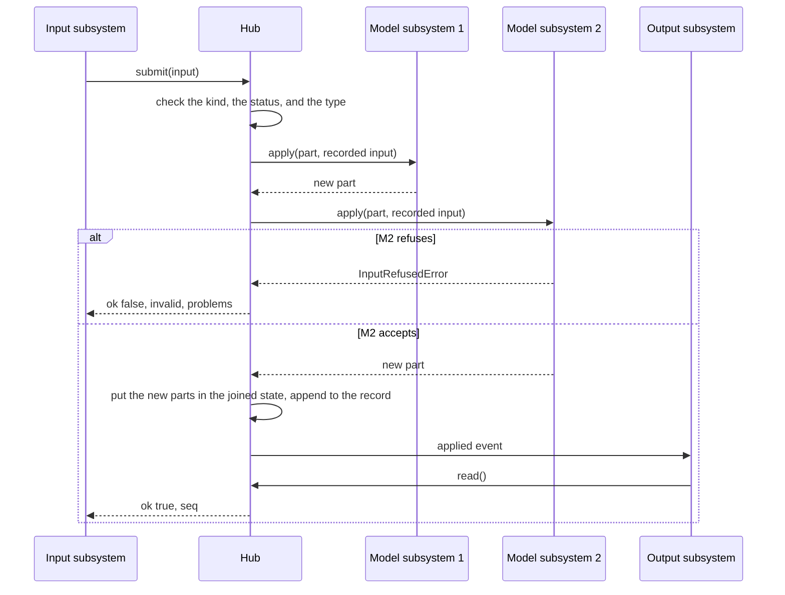

# Design

## Context

See `proposal.md` for the reason. [#527](https://github.com/twin-digital/opus/issues/527) holds the architecture of a construct, and [#522](https://github.com/twin-digital/opus/issues/522) holds the decisions of the owner.

The package `@thrashplay/wishem-core` holds one model and gives it to listeners (`createCore`, `getSnapshot`, `subscribe`, `setModel`). It has no input, no record, and no kinds of subsystem. This change does not touch it. The hub is a new package, and [#529](https://github.com/twin-digital/opus/issues/529) makes the model code a model subsystem of the hub.

Constraints from the owner:

- The hub knows each subsystem and connects them. A subsystem communicates only with the hub.
- The hub joins the model data and gives it to each subsystem that asks.
- The hub carries few events.
- The hub keeps the ordered record that rewind and replay use.
- A job belongs in the hub only if a subsystem cannot do it.
- The model is not a property of the hub.

The lead agent made each decision below alone, as `nodejs/wishem/docs/autonomous-flow.md` permits.

## Goals / Non-Goals

**Goals:**

- One hub implementation that the workbench construct and each product construct use.
- A result that depends only on the list of model subsystems and the inputs.
- A read of the joined state that costs nothing, so that a renderer can read on each frame.
- An interface that a link can carry to a different process with no change to its meaning.

**Non-Goals:**

- The link between processes, and the remote port.
- Checkpoints, rewind, and replay. This change keeps the record that they need.
- A model subsystem that a library with internal state provides.
- A change to `core`, `host-nodejs`, `workbench`, or `workbench-app`.
- A limit on the size of the record.

## Decisions

### 1. A model subsystem is a pure function on its part

A model subsystem has an ID, a list of input types, a first part, and one function: `apply(part, input, context)` returns the new part. The hub holds the parts. The subsystem holds nothing.

Reasons:

- A rejected input changes nothing with no extra code: the hub drops the new parts.
- An earlier joined state stays correct, so a reader needs no copy, and a checkpoint is one reference.
- It is rule R4 at the level of a subsystem: code keeps no state of its own.

Alternative: a model subsystem is an object that holds its state and has `snapshot` and `restore`. A library such as a physics engine needs this form. It is not built now, because no such library is in use. [#533](https://github.com/twin-digital/opus/issues/533) adds it when it adds checkpoints, as a second form of model subsystem. The pure form stays the usual form.

### 2. A subsystem only sends inputs to the hub and reads from the hub

A port has `submit`, `read`, and `subscribe`. No operation names a different subsystem, and no request with a reply exists.

- The control of an I/O subsystem is state. Example: `time/set-running` changes the part of `time`, and the clock reads that part.
- Reason: each thing that changes the result of a construct is then in the record. A direct call between subsystems is state that the record does not hold.
- Alternative: `request(subsystem, operation)` through the hub, for a screenshot or a pause. It is not necessary for the nine results of the brief. It can be added later with no change to the three operations.

### 3. The type of an input selects the model subsystems that get it

An input type has the form `<name>/<name>`. The first name is by convention the ID of the model subsystem that owns the type. The hub does not enforce the convention. More than one model subsystem can declare one type. Example: `time` and a physics subsystem declare `time/advance`.

- The hub gives the input to each model subsystem that declares the type, in the order of the list that made the hub.
- The hub rejects a type that no model subsystem declares. A mistake in a type name is thus an error at the sender, and it is not a silent loss.
- Alternative: give each input to each model subsystem. Each subsystem would then run on each tick, and an unknown type would not be an error.

### 4. Three kinds, and only an input subsystem sends

The kinds are `model`, `input`, and `output`. The model subsystems are fixed when the hub is made, because their order decides the result. An I/O subsystem attaches and closes at any time, because a page or an application connects and leaves while the construct runs.

- Each I/O subsystem can read and subscribe. Only the kind `input` can send.
- A part of a product that draws and also sends, such as a page with a form, attaches two subsystems: one output subsystem and one input subsystem. This keeps the meaning of "an output subsystem only reads", which the I/O rule of the blueprint needs.
- A model subsystem gets no port, so it cannot send an input.
- Alternative: a fourth kind `io`. It would make "output" a kind that few subsystems use, and the hub would know less about each subsystem.

### 5. `submit` gives a promise, and the hub applies in the call when it is idle

`submit` returns `Promise<SubmitResult>`. When the hub applies no input at that moment, it applies the new input before `submit` returns. When the hub is in the middle of an input, which includes the calls to listeners, the new input goes to a queue. The hub applies the queue in order after the current input and its events are complete.

- Reason for the promise: a remote port must wait for a reply. One interface for the direct port and the remote port lets a subsystem run in the process of the hub or in a different process with no change.
- Reason for the queue: a listener that sends an input must not start a second input inside the first one. Each listener sees the events in the order of the sequence numbers.
- A rejection is a result with `ok: false`. The promise is rejected only when a model subsystem throws an error that is not a refusal.

### 6. A model subsystem refuses with `InputRefusedError`

`apply` throws `InputRefusedError` with a list of problems to refuse an input. The hub drops the new parts of that input and gives the result `invalid` with the problems. Each other error is a defect of the subsystem: the hub also drops the new parts, and it rejects the promise with the error.

Alternative: `apply` returns a result object. Each `apply` would then wrap its part in each call, and the usual path would be longer.

### 7. The record holds a JSON copy of each accepted input

The hub makes a copy of the payload with `JSON.parse(JSON.stringify(payload))` and freezes the copy. The model subsystems get the recorded input, not the object of the sender.

- The sender cannot change the record.
- A payload that JSON cannot hold, such as a `bigint` or a value that refers to itself, gives the result `invalid`. A value that JSON drops, such as `undefined` in an object, is absent from the copy.
- An input with no payload has the payload `null`.
- The record is a list in memory that grows. [#533](https://github.com/twin-digital/opus/issues/533) adds checkpoints and decides how the start of the record is removed.

### 8. Few events, and the applied event holds the input

The events are `started`, `applied`, and `stopping`. The `applied` event holds the recorded input, so a listener can select by type and a link can send it. A listener that needs the state calls `read`. The hub compares no values and sends no event for one field.

The hub calls the ports in the order in which they attached, and the listeners of one port in the order of registration. An error from a listener goes to `onError` of the options. The default `onError` does nothing, because the package has no `console` type and no logger. The code that makes a hub supplies one.

### 9. The parts are immutable by contract

The hub does not freeze the parts. A deep freeze on each input costs too much for a game. `apply` must return a new object for a changed part and the same object for a part that did not change. The record is frozen, because an input is small.

### 10. The architecture document does not change now

After this change, no package depends on `@thrashplay/wishem-hub`, and no process runs it. The architecture document describes what runs. [#531](https://github.com/twin-digital/opus/issues/531) puts the hub in the container diagram when the workbench process uses it.

## Interfaces

Owner: `@thrashplay/wishem-hub`. Each name is an export of the package root.

```ts
export interface Input {
  /** For example `store/set-field`. */
  type: string
  /** JSON data. */
  payload?: unknown
}

export interface RecordedInput {
  /** Starts at 1. */
  seq: number
  /** The ID of the subsystem that sent the input. */
  source: string
  type: string
  /** A frozen JSON copy. `null` when the sender gave no payload. */
  payload: unknown
}

/** One key for each model subsystem, under its ID. */
export type JoinedState = Readonly<Record<string, unknown>>

export interface ApplyContext {
  /** Holds the new parts of the model subsystems that are earlier in the order. */
  read(): JoinedState
}

export interface ModelSubsystem<Part = unknown> {
  id: string
  /** The input types that this subsystem applies. */
  inputs: readonly string[]
  initial: Part
  /** Returns the new part, or the same object when nothing changes. Throws `InputRefusedError` to refuse. */
  apply(part: Part, input: RecordedInput, context: ApplyContext): Part
}

export interface InputProblem {
  message: string
  path?: (string | number)[]
}

export class InputRefusedError extends Error {
  readonly problems: InputProblem[]
  constructor(problems: InputProblem[])
}

export interface IoSubsystem {
  id: string
  kind: 'input' | 'output'
}

export type RejectionReason = 'not-permitted' | 'not-running' | 'unknown-type' | 'invalid'

export type SubmitResult =
  | { ok: true; seq: number }
  | { ok: false; reason: RejectionReason; problems: InputProblem[] }

export type HubEvent = { type: 'started' } | { type: 'applied'; input: RecordedInput } | { type: 'stopping' }

export interface Port {
  readonly subsystem: IoSubsystem
  submit(input: Input): Promise<SubmitResult>
  read(): JoinedState
  /** Returns a function that removes the listener. */
  subscribe(listener: (event: HubEvent) => void): () => void
  close(): void
}

export interface HubOptions {
  /** The order is the order in which the hub gives an input to the model subsystems. */
  subsystems: readonly ModelSubsystem[]
  /** Gets each error that a listener throws. */
  onError?: (error: unknown) => void
}

export type HubStatus = 'created' | 'running' | 'stopped'

export interface Hub {
  readonly status: HubStatus
  start(): void
  stop(): void
  attach(subsystem: IoSubsystem): Port
  read(): JoinedState
  record(): readonly RecordedInput[]
}

/** Throws a `HubConfigurationError` when the list of subsystems is not correct. */
export const createHub: (options: HubOptions) => Hub

export class HubConfigurationError extends Error {}
```

`start` on a hub that is not `created`, and `stop` on a hub that is not `running`, throw an `Error`. `attach` throws a `HubConfigurationError` for an ID that is in use or not correct, and an `Error` on a stopped hub.

Example:

```ts
const counter: ModelSubsystem<{ count: number }> = {
  id: 'counter',
  inputs: ['counter/add'],
  initial: { count: 0 },
  apply: (part, input) => ({ count: part.count + (input.payload as { by: number }).by }),
}

const hub = createHub({ subsystems: [counter] })
const buttons = hub.attach({ id: 'buttons', kind: 'input' })
const screen = hub.attach({ id: 'screen', kind: 'output' })
screen.subscribe((event) => {
  if (event.type === 'applied') {
    console.log(screen.read().counter)
  }
})
hub.start()
await buttons.submit({ type: 'counter/add', payload: { by: 2 } }) // { ok: true, seq: 1 }
await screen.submit({ type: 'counter/add', payload: { by: 2 } }) // { ok: false, reason: 'not-permitted', problems: [] }
```

## Domain types

Each type is new.





## The path of one input



## Package Impact

| Package | Published or private | Bump | Reason |
| --- | --- | --- | --- |
| `@thrashplay/wishem-hub` | Private | minor | New package. |

No other package changes.

## Risks / Trade-offs

- [A model subsystem changes a part in place] → The contract is in the documentation of `ModelSubsystem`, and the tests of each model subsystem compare object identity. The hub does not detect it.
- [A JSON copy of each payload costs time on each tick] → A tick has a small payload. The cost is measured when a game runs. The copy can become a check in a development mode only.
- [The record grows with no limit] → [#533](https://github.com/twin-digital/opus/issues/533) adds checkpoints and removes the start of the record.
- [Two subsystems for one page is more code for a renderer] → The renderer package makes the two attachments in one function. [#530](https://github.com/twin-digital/opus/issues/530) lets one link carry the subsystems of one process.
- [A promise for each input makes a caller in the same process wait one microtask for the result] → The hub applies the input before `submit` returns, so the state is current immediately. Only the result object comes later.
