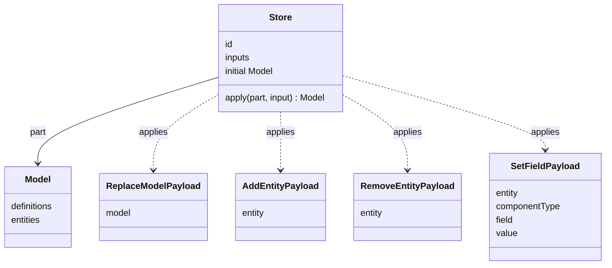

# Design

## Context

See `proposal.md` for the reason. [#527](https://github.com/twin-digital/opus/issues/527) holds the architecture. `@thrashplay/wishem-hub` gives `createHub`, `ModelSubsystem`, and `InputRefusedError`.

`@thrashplay/wishem-core` has the model types (`Model`, `Entity`, `ComponentTypeDefinition`), `validateModel`, and `createCore`. `createCore` holds one frozen model, replaces it through `setModel`, and tells its listeners. `host-nodejs`, `workbench`, and `workbench-app` use it.

Constraints:

- A model subsystem is a pure function on its part (decision 1 of the design of #528). The hub holds the part.
- The source of an input supplies the ID of a new entity (#527).
- The package uses no Node.js API.

The lead agent made each decision below alone, as `nodejs/wishem/docs/autonomous-flow.md` permits.

## Goals / Non-Goals

**Goals:**

- One store implementation for the authored state of the workbench construct and for the live state of a product construct.
- Each change of the model is an input, so the record of the hub is the record of the changes with their sources.
- The rules of `wishem/core/model` stay in one place: `validateModel`.

**Non-Goals:**

- The removal of `createCore`. The packages that use it change in [#531](https://github.com/twin-digital/opus/issues/531).
- A new name for the package or for the specifications. That is [#518](https://github.com/twin-digital/opus/issues/518).
- An input that adds, removes, or changes one component type. `replace-model` covers a change of the definitions.
- An input that removes one component from an entity.
- A fast path for a model with many entities.

## Decisions

### 1. `createStore` returns a `ModelSubsystem<Model>`

The store has no object of its own and no methods. `createStore(options)` checks the first model and returns the subsystem: an ID, the four input types, the first part, and `apply`. The part is the `Model` type that exists.

Alternative: a new part type that wraps the model, with room for more keys. No second key exists now. A wrapper would add one level to each read of each renderer.

### 2. The ID of the store is an option, and the input types follow it

The default ID is `store`. The input types are `<id>/replace-model`, `<id>/add-entity`, `<id>/remove-entity`, and `<id>/set-field`. A construct can thus hold two stores, such as one for the workbench and one for the mounted product. [#536](https://github.com/twin-digital/opus/issues/536) decides if it uses this.

`storeInputs(id)` gives four functions that make the inputs, so a sender does not write a type name as text.

### 3. Each small input makes the next model, and `validateModel` checks it

For `add-entity`, `remove-entity`, and `set-field`, `apply`:

1. Checks the form of the payload and the things that it names: the entity exists or does not exist, the component type is defined, the field is a field of the type.
2. Makes the next model with new objects only on the path of the change. Each other entity and the list of definitions are the same objects.
3. Runs `validateModel` on the next model. A problem with the severity `error` refuses the input.
4. Freezes the new objects and returns the next model.

- Reason: the rules for a correct model stay in `validateModel`. A new field type or a new rule then applies to each input with no change to the store.
- The cost of step 3 grows with the size of the model. The workbench model and the first products are small. A product with many entities that change on each tick needs a store that checks only the change. That store can replace this one behind the same inputs.
- Step 1 gives a problem that names the cause, such as "No entity has the ID …". `validateModel` alone would report the result of the fault, not its cause.

### 4. `replace-model` keeps the current part when the model is equal

`apply` runs `validateModel` on the payload. When the result is equal to the current part, by the comparison of canonical JSON that `createCore` uses, `apply` returns the current part. The hub still records the input and sends the `applied` event. The link then sends no part, because the object is the same.

Reason: the storage subsystem sends `replace-model` after each change of the files, and an editor often writes a file with no change.

### 5. A refusal is an `InputRefusedError` with the problems of the model

`Problem` of this package has `severity`, `message`, `path`, and `source`. `InputProblem` of the hub has `message` and `path`. The store gives each problem with the severity `error` as an `InputProblem` with the same message and path. For `replace-model`, the path starts at the model. For the other inputs, a problem of the payload has a path that starts with `payload`.

Warnings of `validateModel` do not refuse an input, and the store drops them. The storage subsystem of #531 reports the warnings of a file, because it knows the file.

### 6. `set-field` adds a missing component

An entity has at most one component of each type, and a component is a record of field values. When the entity has no component of the named type, `set-field` adds the component with the one value. A separate input to add an empty component would be a second step with no use, because a component with no values draws nothing.

### 7. `createCore` and the store share the helper functions

`canonical`, `deepFreeze`, and `isEqual` move from `core.ts` to a module `src/equality.ts` with no change of behavior. `createCore` and the store import them.

## Interfaces

Owner: `@thrashplay/wishem-core`. Each name is an export of the package root.

```ts
import type { Input, ModelSubsystem } from '@thrashplay/wishem-hub'

export interface StoreOptions {
  /** Default `store`. */
  id?: string
  /** The first model. Default: a model with no definitions and no entities. */
  model?: unknown
}

/** Throws a `ModelError` when the first model is not correct. */
export const createStore: (options?: StoreOptions) => ModelSubsystem<Model>

export interface ReplaceModelPayload {
  model: Model
}

export interface AddEntityPayload {
  entity: Entity
}

export interface RemoveEntityPayload {
  /** The ID of the entity. */
  entity: Id
}

export interface SetFieldPayload {
  /** The ID of the entity. */
  entity: Id
  /** The ID of the component type. */
  componentType: Id
  /** The ID of the field. */
  field: Id
  value: FieldValue
}

export interface StoreInputs {
  replaceModel(model: Model): Input
  addEntity(entity: Entity): Input
  removeEntity(entity: Id): Input
  setField(payload: SetFieldPayload): Input
}

/** The functions that make the inputs of a store. Default ID: `store`. */
export const storeInputs: (id?: string) => StoreInputs
```

Example:

```ts
const hub = createHub({ subsystems: [createStore({ model })] })
const form = hub.attach({ id: 'form', kind: 'input' })
hub.start()

const result = await form.submit(
  storeInputs().setField({
    entity: 'e_c0d5e6f1-7a82-4b93-a104-5d6e7f8091a2',
    componentType: 'ct_3f2a9c1e-8b47-4d0a-9e51-6c2f7a1b0d34',
    field: 'fld_b81d04e7-2c6f-4a39-8d15-0e9a7f3c5b62',
    value: 'Wishem workbench',
  }),
)
// { ok: true, seq: 1 }

const refused = await form.submit(storeInputs().removeEntity('e_00000000-0000-4000-8000-000000000000'))
// { ok: false, reason: 'invalid', problems: [{ message: 'No entity has the ID "e_00000000-…"', path: ['payload', 'entity'] }] }
```

## Domain types

`Model`, `Entity`, and `ComponentTypeDefinition` do not change. The payload types are new.



## Package Impact

| Package                   | Published or private | Bump  | Reason                                                              |
| ------------------------- | -------------------- | ----- | ------------------------------------------------------------------- |
| `@thrashplay/wishem-core` | Private              | minor | New exports `createStore` and `storeInputs`, and the payload types. |

`@thrashplay/wishem-host-nodejs`, `@thrashplay/wishem-workbench`, and `@thrashplay/wishem-workbench-app` depend on `@thrashplay/wishem-core`. Their behavior does not change. The changeset tool gives them a patch bump for the dependency.

## Risks / Trade-offs

- [`validateModel` on each small input costs time for a large model] → See decision 3. The inputs are the contract, and a faster store can replace this one.
- [Two ways to hold a model exist until #531: `createCore` and the store] → #531 removes `createCore` when the last package stops using it.
- [`set-field` that adds a component hides a wrong component type ID] → The store refuses a component type that is not defined, so only a defined type can be added.
