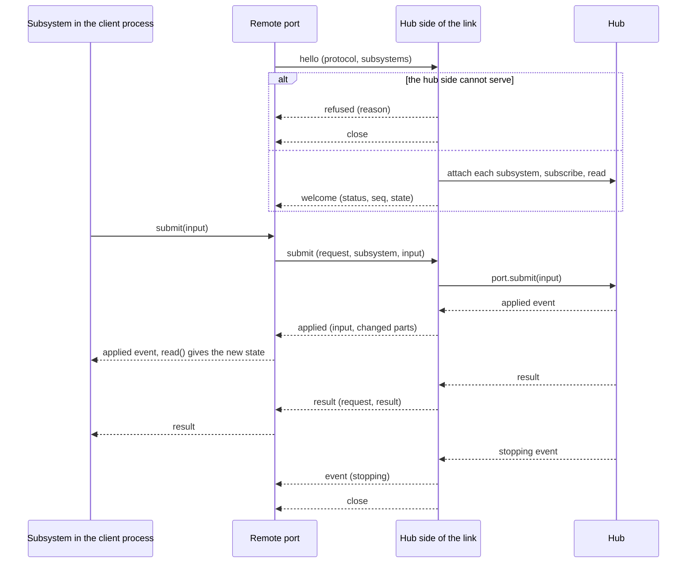

# Design

## Context

See `proposal.md` for the reason. [#527](https://github.com/twin-digital/opus/issues/527) holds the architecture. [#528](https://github.com/twin-digital/opus/issues/528) adds the hub and the `Port` interface in `@thrashplay/wishem-hub`. This change builds on the code of #528, so its branch starts from `main` after #528 is merged.

Constraints from the owner:

- A process has one language. A hub in a TypeScript process with subsystems in a process of a different language is a case that the design must cover.
- The design has a part for the communication in one process, and a part for the communication between processes.
- A hub does not connect to a hub.
- Godot is one of the clients. GDScript has a WebSocket client and a JSON parser.

The lead agent made each decision below alone, as `nodejs/wishem/docs/autonomous-flow.md` permits.

## Goals / Non-Goals

**Goals:**

- A subsystem uses a `Port` in the same way in the process of the hub and in a different process.
- A protocol that a client in GDScript can implement from the document, with no code of this package.
- A cost for each input that depends on what changed, not on the size of the joined state.
- A hub side and a remote port that a test connects with no network.

**Non-Goals:**

- A WebSocket server, a port number, and the rule for the loopback address. They belong to [#531](https://github.com/twin-digital/opus/issues/531).
- A new connection after a failure. The code that opens the link opens a new one. [#531](https://github.com/twin-digital/opus/issues/531) does this for the page.
- A model subsystem in the process of the client.
- A change inside one part. A part that changed is sent in full.
- A binary form of the messages, and compression.

## Decisions

### 1. One link carries the subsystems of one process

The `hello` message names each subsystem of the client. The hub side attaches each one to the hub and keeps one port for each. A `submit` message names its subsystem, and the hub side sends it through the port of that subsystem, so the record has the correct source.

- Reason: a page with a form is one output subsystem and one input subsystem (decision 4 of the design of #528). One connection for the two keeps their messages in one order.
- The hub side registers one listener, on the first port, and sends each event one time.
- Alternative: one connection for each subsystem. A page would then get each part two times, and the order between a draw and a send would not be defined.

### 2. The messages

Each message is a JSON object. The key `t` holds the type.

| Direction     | `t`       | Keys                                                                               |
| ------------- | --------- | ---------------------------------------------------------------------------------- |
| Client to hub | `hello`   | `protocol` (number), `subsystems` (list of `{ id, kind }`)                         |
| Client to hub | `submit`  | `request` (number), `subsystem` (ID), `input` (`{ type, payload }`)                |
| Hub to client | `welcome` | `protocol` (number), `status`, `seq` (number), `state` (the joined state)          |
| Hub to client | `refused` | `reason`, `message` (text), `supported` (list of numbers, only for `version`)      |
| Hub to client | `event`   | `event`: `started` or `stopping`                                                   |
| Hub to client | `applied` | `input` (`{ seq, source, type, payload }`), `parts` (record of ID to the new part) |
| Hub to client | `result`  | `request` (number), and `result` (the result of the hub) or `error` (text)         |

The reasons of `refused` are `malformed`, `version`, `id-in-use`, `unsupported`, and `stopped`.

Short keys are not used, apart from `t`. A message is read by a person during the work on a client, and the size of a key name is small beside a part.

### 3. The hub side finds the changed parts by identity

The hub side keeps the last joined state that it sent on the link. For an `applied` event it compares each part with the same key of that state with `!==`, and it sends the parts that differ. The contract of a model subsystem (decision 9 of the design of #528) makes this correct: a part that did not change is the same object.

- The cost of the comparison is one check for each model subsystem.
- Alternative: a deep comparison, or a patch inside a part. The first costs time on each tick. The second needs a patch format in each language. A model subsystem with a large part that changes on each tick can divide its data into more than one subsystem, or a later version of the protocol can add a patch message.

### 4. The start has no gap

The hub side handles a `hello` in one synchronous step: it attaches the subsystems, registers its listener, reads the joined state and the last sequence number, and sends `welcome`. The hub applies no input during that step, so each later event follows the `welcome` on the link.

The remote port checks that each `applied` message has the next sequence number. A difference is a defect of a side, and the remote port ends the link. The code that opened the link then starts a new one and gets the full state.

### 5. The hub accepts a link in the state `created`

A client can connect before the hub starts. The `welcome` message holds the status `created`, and the client gets the `started` event later. A hub that is stopped refuses.

### 6. The remote port keeps a local joined state

The remote port holds the joined state of the `welcome` message. For each `applied` message it makes a new record: the parts of the message replace the parts with the same keys, and each other part is the same object. Then it calls the listeners. Thus `read` is a local value with no wait, and a renderer in the page can read on each frame.

`submit` on a remote port sends a `submit` message and gives a promise for the `result` message. The remote port of an output subsystem rejects with `not-permitted` and sends no message. The hub side makes the same check, so a client that does not follow the rule cannot send.

`Port.close` on a remote port removes its listeners. It does not detach the subsystem from the hub. The subsystems detach when the link closes.

### 7. The end of a link is not a hub event

`HubEvent` keeps its three types. A connection that closes says nothing about the construct. The object that `openLink` gives has `closed`, a promise that resolves when the link ends, and `close`. After the end, `read` gives the last state, a send that waits fails with a `LinkClosedError`, and a later send gives `not-running`.

Alternative: a fourth event type. Each subsystem in the process of the hub would then handle an event that it can never get.

### 8. A channel is the only thing that the link knows about the connection

```ts
export interface Channel {
  send(text: string): void
  onMessage(listener: (text: string) => void): void
  onClose(listener: () => void): void
  close(): void
}
```

- `serveLink` and `openLink` take a channel. They do not know a WebSocket.
- `webSocketChannel` adapts a WebSocket of the web platform. The package declares the small interface `WebSocketLike` that it needs, because the package has no types of a web browser. The WebSocket of a browser, of Node.js 24, and of the `ws` package all fit it.
- `createChannelPair` gives two connected channels in memory. A message arrives in a later microtask, as on a network, so a test finds a fault of order.
- Each channel accepts one listener for messages and one for the close. A message that arrives before a listener is registered waits.

### 9. Messages that are reserved

A model subsystem in the process of the client must apply each input and give its new part before the hub continues with the next subsystem. The path of an input in the hub is synchronous, so this case needs a change to the hub. The protocol reserves the type `apply` (hub to client) and the type `part` (client to hub) for it. The hub side refuses a `hello` that has a subsystem of the kind `model` with the reason `unsupported`.

A side ignores a type that it does not know, after the start. A later version can thus add a message for one side with no failure of an older side. A change to the meaning of a message that exists needs a new version number.

### 10. The document and its examples

`nodejs/wishem/hub/LINK.md` is the document of the protocol. It has each message, the order of the messages, the reasons, and one full example of a link. The examples are in `src/link/examples.ts` as values. One test checks that each example has the type of its message. A second test, which can use `node:fs` because it is a test, checks that each JSON block of `LINK.md` is equal to one of the examples.

### 11. The architecture document does not change now

No process uses the link after this change. [#531](https://github.com/twin-digital/opus/issues/531) changes the relationship between the page and the workbench process in the container diagram.

## Interfaces

Owner: `@thrashplay/wishem-hub`. Each name is an export of the package root. `Hub`, `Port`, `Input`, `RecordedInput`, `JoinedState`, `HubStatus`, `SubmitResult`, and `IoSubsystem` are the types of #528.

```ts
export const LINK_PROTOCOL_VERSION = 1

export interface Channel {
  send(text: string): void
  onMessage(listener: (text: string) => void): void
  onClose(listener: () => void): void
  close(): void
}

/** Two connected channels in memory. */
export const createChannelPair: () => [Channel, Channel]

export interface WebSocketLike {
  readonly readyState: number
  send(data: string): void
  close(): void
  addEventListener(type: 'open' | 'message' | 'close' | 'error', listener: (event: { data?: unknown }) => void): void
}

/** Resolves when the socket is open. Rejects when the socket fails before it opens. */
export const webSocketChannel: (socket: WebSocketLike) => Promise<Channel>

export type RefusalReason = 'malformed' | 'version' | 'id-in-use' | 'unsupported' | 'stopped'

export type ClientMessage =
  | { t: 'hello'; protocol: number; subsystems: { id: string; kind: string }[] }
  | { t: 'submit'; request: number; subsystem: string; input: Input }

export type HubMessage =
  | { t: 'welcome'; protocol: number; status: HubStatus; seq: number; state: JoinedState }
  | { t: 'refused'; reason: RefusalReason; message: string; supported?: number[] }
  | { t: 'event'; event: 'started' | 'stopping' }
  | { t: 'applied'; input: RecordedInput; parts: Record<string, unknown> }
  | { t: 'result'; request: number; result?: SubmitResult; error?: string }

/** Serves one connection for a hub. Returns at once. The link ends when the channel closes. */
export const serveLink: (hub: Hub, channel: Channel) => void

export interface RemoteLink {
  /** One port for each subsystem, under its ID. */
  readonly ports: Readonly<Record<string, Port>>
  /** Resolves when the link ends. */
  readonly closed: Promise<void>
  close(): void
}

export class LinkRefusedError extends Error {
  readonly reason: RefusalReason
  readonly supported?: number[]
}

export class LinkClosedError extends Error {}

/** Rejects with a `LinkRefusedError` when the hub side refuses, and with a `LinkClosedError` when the channel closes first. */
export const openLink: (channel: Channel, subsystems: readonly IoSubsystem[]) => Promise<RemoteLink>
```

Example of a link, from the client:

```json
{ "t": "hello", "protocol": 1, "subsystems": [{ "id": "page", "kind": "output" }, { "id": "page-controls", "kind": "input" }] }
```

```json
{ "t": "welcome", "protocol": 1, "status": "running", "seq": 3, "state": { "counter": { "count": 6 } } }
```

```json
{ "t": "submit", "request": 1, "subsystem": "page-controls", "input": { "type": "counter/add", "payload": { "by": 2 } } }
```

```json
{ "t": "applied", "input": { "seq": 4, "source": "page-controls", "type": "counter/add", "payload": { "by": 2 } }, "parts": { "counter": { "count": 8 } } }
```

```json
{ "t": "result", "request": 1, "result": { "ok": true, "seq": 4 } }
```

An error case, a client with a version that the hub side does not support:

```json
{ "t": "refused", "reason": "version", "message": "The hub supports protocol version 1, not 2.", "supported": [1] }
```

## The messages of one link



## Failure Modes

| Failure                                             | Result                                                                                                  | Recovery                                                                                |
| --------------------------------------------------- | ------------------------------------------------------------------------------------------------------- | --------------------------------------------------------------------------------------- |
| The connection closes                               | The hub side closes the ports of the link. The remote port fails each send that waits.                  | The client opens a new link and gets the full state.                                    |
| A `submit` was sent and the connection closes       | The client does not know if the hub accepted the input. `submit` is not idempotent.                     | The client reads the state of the new link. It does not send the input again blindly.   |
| A message that is not correct, after the start      | The hub side sends `refused` with `malformed` and closes.                                               | A defect of the client. Correct the client.                                             |
| A sequence number that is not the next one          | The remote port closes the link.                                                                        | The client opens a new link.                                                            |
| A client is slow and messages collect in the socket | The hub does not wait for a client. The memory of the process grows.                                    | Not handled in version 1. [#531](https://github.com/twin-digital/opus/issues/531) can close a link that is too far behind. |
| Two clients use one subsystem ID                    | The second `hello` gets `refused` with `id-in-use`.                                                     | The client selects a different ID.                                                      |

## Package Impact

| Package                  | Published or private | Bump  | Reason                                    |
| ------------------------ | -------------------- | ----- | ----------------------------------------- |
| `@thrashplay/wishem-hub` | Private              | minor | New exports: the link and the remote port |

## Risks / Trade-offs

- [A large part that changes on each tick is sent in full] → The first products are small. A patch message is a later version of the protocol.
- [The hub side trusts the JSON of a client] → It checks the form of each message and the kind of each subsystem. The hub checks the input. The server of #531 listens on the loopback address only.
- [The examples of the document go out of date] → A test compares the document with the example values.
- [`JSON.stringify` of the full state on each `welcome`] → It occurs one time for each link.
