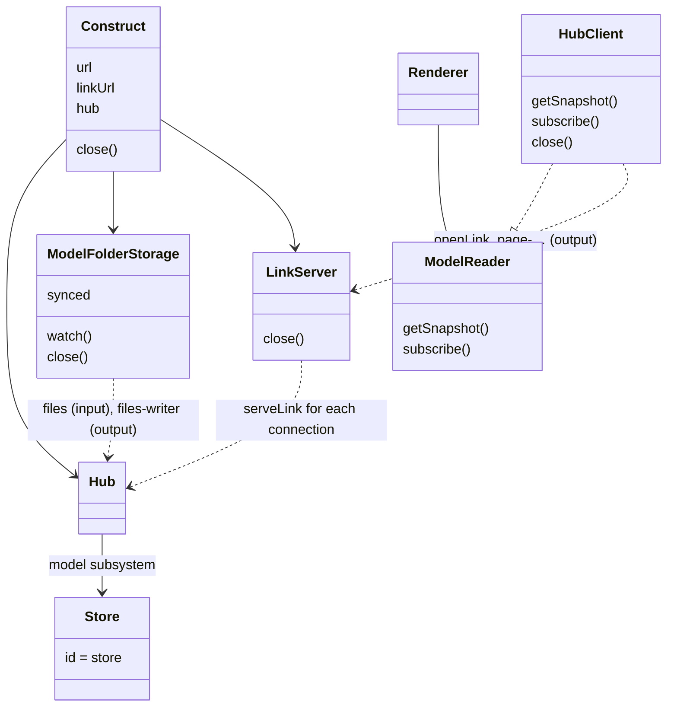
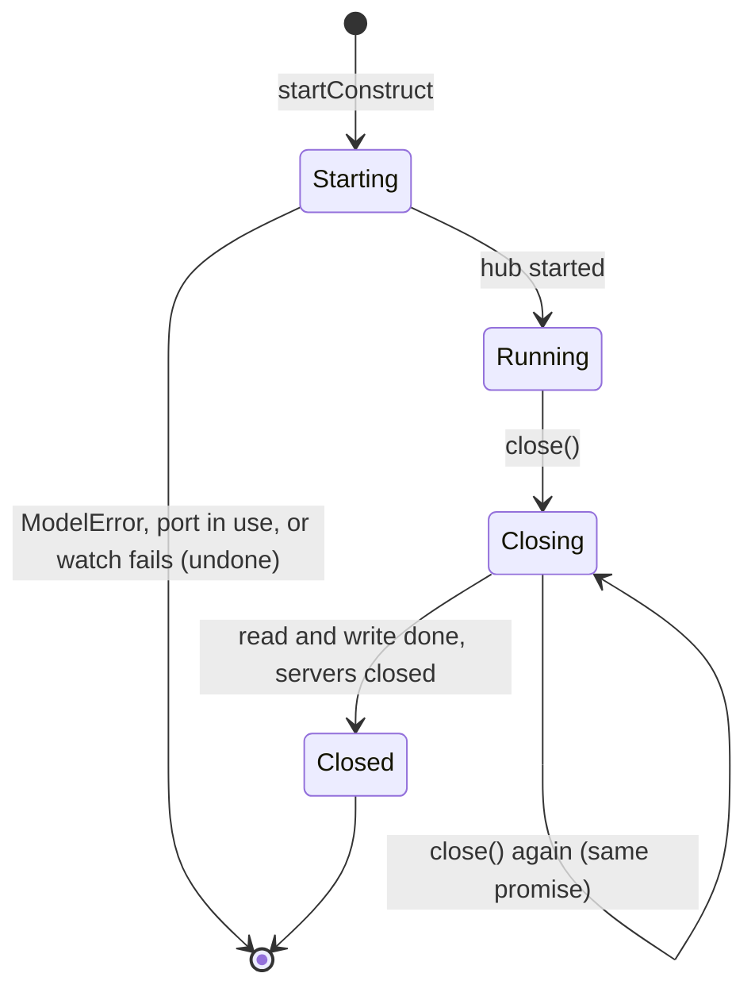
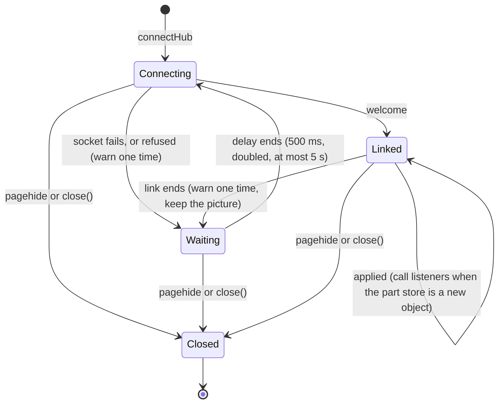
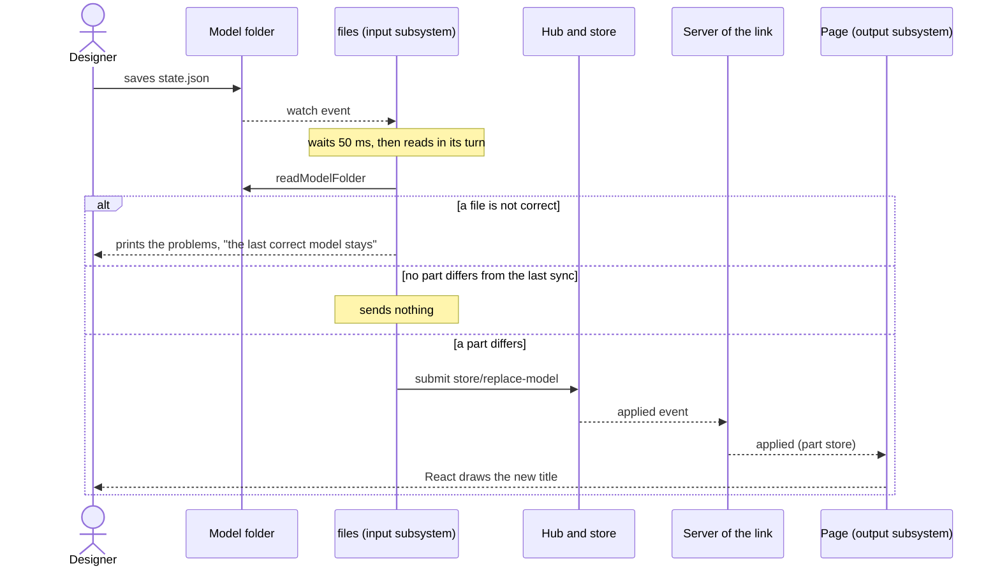
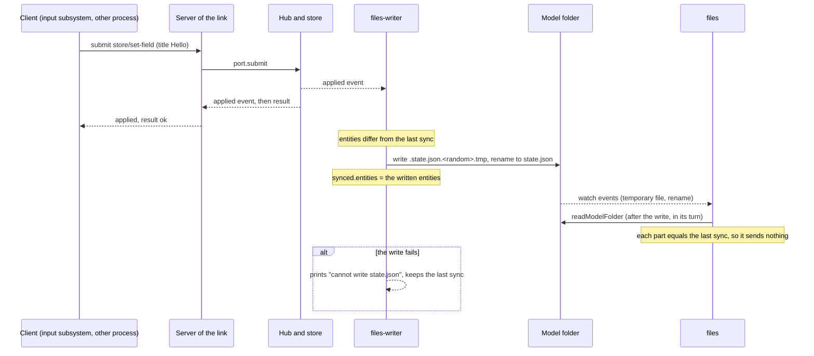
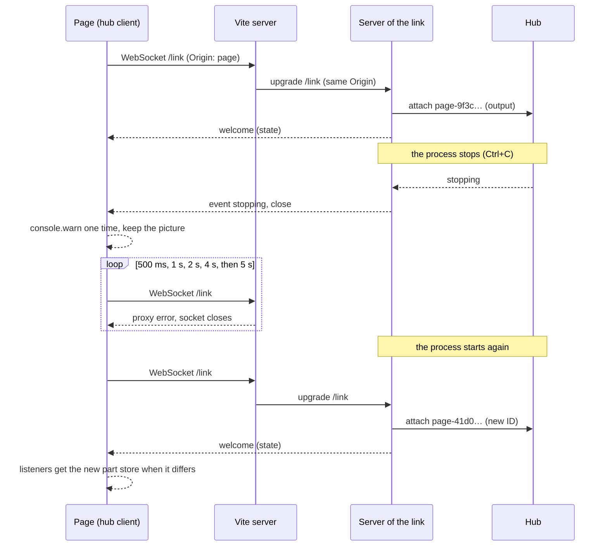
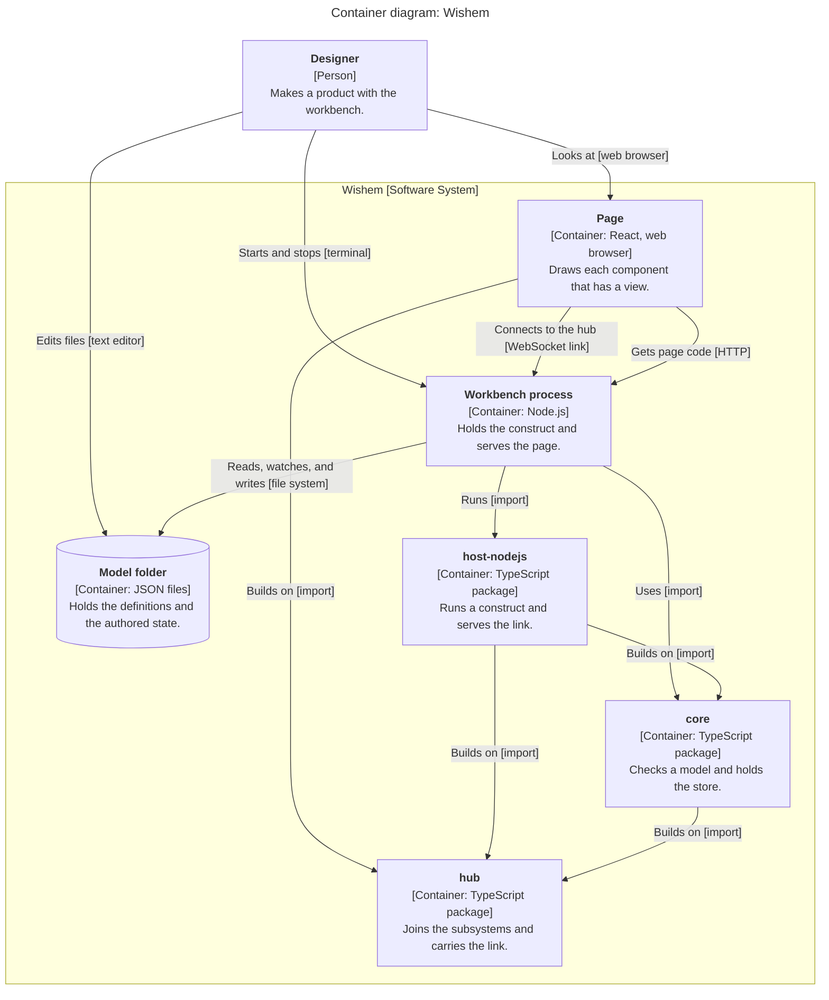
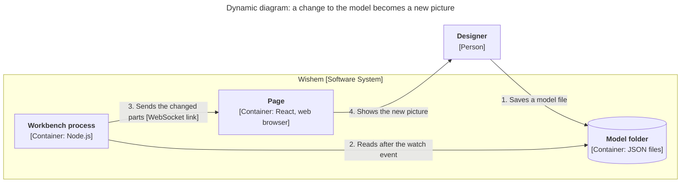
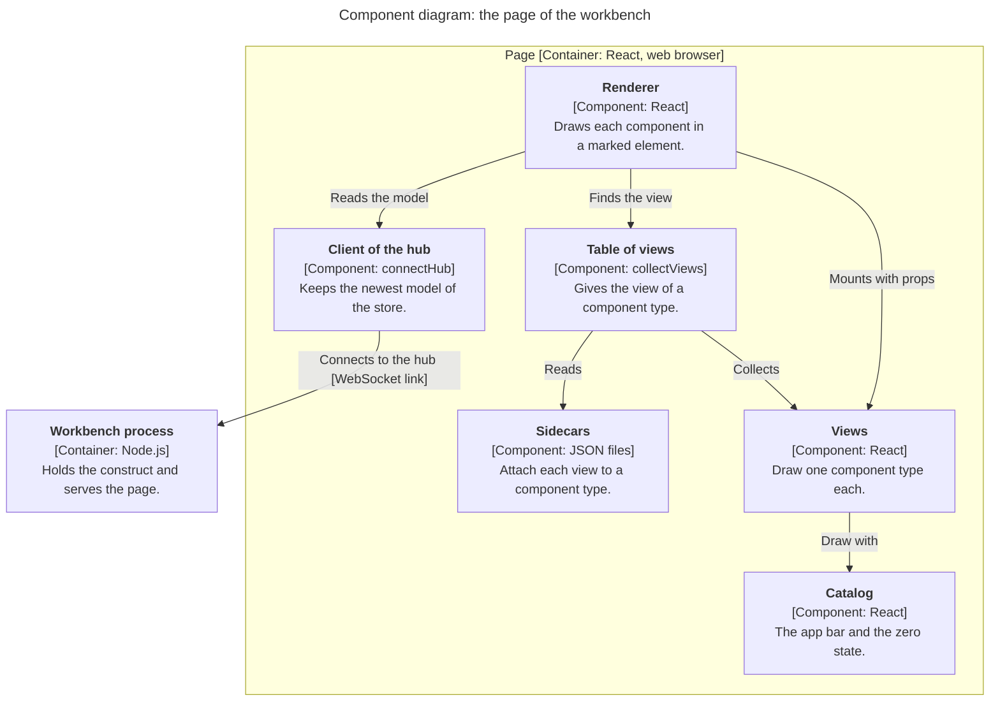

# Design

## Context

See `proposal.md` for the reason. [#527](https://github.com/twin-digital/opus/issues/527) holds the architecture. This change builds on three changes, and its branch starts from `main` after they are merged:

- `@thrashplay/wishem-hub` (#528): `createHub`, `Hub`, `Port`, `HubEvent`, `IoSubsystem`.
- The link (#530), in the same package: `serveLink(hub, channel)`, `openLink(channel, subsystems, options)`, `webSocketChannel(socket)`, `RemoteLink`, `LinkRefusedError`, `LinkClosedError`. The protocol is in `nodejs/wishem/hub/LINK.md`.
- The store (#529), in `@thrashplay/wishem-core`: `createStore({ id?, model? })`, `storeInputs(id?)`, and the inputs `store/replace-model`, `store/add-entity`, `store/remove-entity`, `store/set-field`. A `replace-model` with an equal model keeps the same part object.

Today, `startHost` in `host-nodejs` reads the model folder into `createCore`, watches the folder (a settle time of 50 ms, one read at a time, "the last correct snapshot stays"), and serves `GET /snapshot` and `GET /snapshots` (Server-Sent Events) on `127.0.0.1:4747`. The page (`workbench-app/src/renderer/connect.ts`) reads `/snapshots` through the Vite server. The `start` script of `workbench-app` calls `startHost`, passes `^/snapshots?$` to it, and keeps the generated view types current with `core.subscribe`.

Constraints:

- The names of the packages and the IDs of the specifications do not change. [#518](https://github.com/twin-digital/opus/issues/518) renames them. New code and new text use the terms hub, process, construct, port, link, store, and storage subsystem.
- A subsystem has one kind (decision 4 of the design of #528).
- The page uses no Node.js API, and `@thrashplay/wishem-hub` uses none.

The lead agent made each decision below alone, as `nodejs/wishem/docs/autonomous-flow.md` permits.

## Goals / Non-Goals

**Goals:**

- The workbench and the `wishem` command run one construct: one hub, the store, the storage subsystem for files, and the server of the link.
- Each change of the model is an input in the record of the hub, also a hand edit of a file.
- A change of the entities that a client sends through the link is kept in `state.json`.
- The page reads the model through a remote port, and it survives a restart of the process.
- No page of a different site can open a link.

**Non-Goals:**

- New names for packages and specifications (#518).
- A write of a definition file. No input of this change changes a definition, and a definition file has one component type, so the write of definitions needs a rule for file names first.
- A mounted product model (#536), views that send inputs (#535), the renderer as a package (#534), the clock.
- An authentication of a client of the link other than the origin check.
- A link that is too far behind. The design of #530 lists it.

## Decisions

### 1. `startConstruct` assembles the construct in a fixed order

`startConstruct({ folder, port?, log?, onWatchError? })`:

1. Reads the model folder and checks it. A model that is not correct rejects with `ModelError`, and nothing starts.
2. Makes `createHub({ subsystems: [createStore({ model })], onError })`. `onError` prints `wishem: a listener failed: <message>`.
3. Attaches the storage subsystem for files (decision 2). Its watch does not start yet.
4. Starts the HTTP server and the server of the link on `127.0.0.1` (decision 5).
5. Starts the hub.
6. Starts the watch, and schedules one quiet read, as `startHost` does, for a change between the first read and the start of the watch.
7. Returns `{ url, linkUrl, hub, close }`.

When a step fails, the steps before it are undone in the reverse order, and the promise rejects with the error of the step.

`close()` returns the same promise on each call. It clears the settle timer and closes the watch, stops the hub (each link gets `stopping` and closes), waits for the running read and the running write (decision 3), then closes the server of the link and the HTTP server.

- Reason for the order: the hub runs before the first read of the watch, so each input of the watch finds a running hub. A client that connects between steps 4 and 5 gets `welcome` with the status `created`, then `started` (decision 5 of the design of #530).
- Alternative: a construct object with `start` and `stop`. The command and the `start` script need only one call and one `close`, as with `startHost`.

### 2. One storage job, two attached subsystems

The storage subsystem for files is one object in `host-nodejs` that attaches two subsystems to the hub:

| ID             | Kind   | Job                                                                                            |
| -------------- | ------ | ---------------------------------------------------------------------------------------------- |
| `files`        | input  | Watches the folder. After a change, reads it and sends `store/replace-model` with a model.     |
| `files-writer` | output | Listens for `applied` events. Writes `state.json` when the entities differ from the last sync. |

- Reason: a subsystem has one kind. The two parts share the state of the last sync (decision 3), so they are one object with two ports.
- The problems of a read are printed as now, with the file of each problem (`withSource`, `formatProblem`), and then `wishem: the last correct model stays`. The read sends nothing.
- When the hub refuses the `replace-model` input (`invalid`), the subsystem prints each problem and the same line.
- Alternative: one subsystem of the kind `input` that also listens. The hub permits it, because each port can read. It hides the write job from the list of subsystems, and the record of the hub cannot show which part writes.

### 3. The last sync decides what is news, and reads and writes take turns

The storage subsystem keeps `synced`: the definitions and the entities that it last read from the folder or wrote to `state.json`. At the start, `synced` is the first read.

After a correct read, the subsystem makes the next model part by part:

- For `definitions` and for `entities`: when the value of the read is equal to the same part of `synced`, the next model takes the current part of the store. Otherwise it takes the value of the read.
- When the next model is equal to the part `store`, the subsystem sends nothing. Otherwise it sends `store/replace-model` with the next model.
- Then `synced` becomes the read. When the hub refuses the input, `synced` does not change, so a new save of the same files is read and sent again.

After an `applied` event, when the entities of the part `store` differ from `synced.entities`, the subsystem writes `state.json`, and `synced.entities` becomes the written entities.

One queue holds the reads and the writes. A read waits for a running write, and a write waits for a running read. A write reads the part `store` when it starts, not when the event arrived. A request for a write while a write runs gives one more write after it.

The equality is `isEqual` of `@thrashplay/wishem-core` (canonical JSON, the comparison of the store).

- Reason: the decision of the brief is that the equal-model shortcut of the store stops the loop write → watch → read → write. That shortcut stops the second write, but it does not stop a stale read. Example: a read starts, a client sets a title, and then the read ends with the old file. A `replace-model` with the old file then puts back the old title, and the writer writes it. The rule "a part that did not change on the disk is not news" prevents this. It also keeps `replace-model` inputs of our own writes out of the record.
- The shortcut of the store stays the second guard: a hand edit that makes `state.json` equal to the store gives a `replace-model` with an equal model, the part stays the same object, and no write follows. A test covers each guard.
- Alternative: the writer ignores each watch event for a time after a write. A time does not prove that the event came from the write, and a hand edit in that time is lost.
- Alternative: compare the modification time of the file. Editors and file systems do not agree on it.

### 4. The write is atomic and holds only the entities

The writer writes `JSON.stringify({ entities }, null, 2)` and a final newline to a temporary file in the model folder (`.state.json.<random>.tmp`), and renames it to `state.json`. On a failure it removes the temporary file, prints `wishem: cannot write state.json: <reason>`, and keeps `synced` as it was, so the next change writes again.

- The temporary file is in the same folder, because a rename is atomic only in one file system.
- The watch sees the temporary file and the rename. The read ignores the temporary file, because it reads only `state.json` and `definitions/*.json`. Decision 3 makes the read send nothing.
- `state.json` holds an object with the key `entities` by `wishem/host-nodejs/model-folder`. The read uses no other key, so the write keeps no other key.
- Alternative: write `state.json` in place. A read during the write gets part of the file, and a crash leaves a file that is not valid JSON.

### 5. The server of the link uses `ws` on the HTTP server

The HTTP server listens on `127.0.0.1`, port 4747 by default. A `WebSocketServer` of the package `ws` in the mode `noServer` handles the `upgrade` event of the HTTP server:

- The path (the part of the target before `?`) is `/link`, and the origin check passes (decision 6): `handleUpgrade`, then `serveLink(hub, await webSocketChannel(socket))`.
- The path is `/link` and the origin check fails: the response is `HTTP/1.1 403 Forbidden`, and the socket is destroyed.
- Each other path: `HTTP/1.1 404 Not Found`, and the socket is destroyed.

Each request that is not an upgrade gets status 404 with `{ "error": "No such path: /snapshot" }`, also `GET /link`.

- `ws` is the WebSocket server that most Node.js code uses. Node.js 24 has a WebSocket client and no server. The `WebSocket` of `ws` fits `WebSocketLike` of the hub (decision 8 of the design of #530), and its `addEventListener('message')` gives the text of a text message as a string.
- `ws` and `@types/ws` go in the catalog of `pnpm-workspace.yaml`. The lockfile has `ws@8.21.2` and `@types/ws@8.18.1`, so the catalog entries are `ws: ^8.21.2` and `'@types/ws': ^8.18.1`.
- Alternative: a WebSocket server written for this package. The protocol of RFC 6455 has many edge cases.

### 6. The origin check refuses a page of a different site

The server refuses the upgrade when the request has an `Origin` header and the host name of that origin is not `127.0.0.1`, `localhost`, or `[::1]`. An `Origin` that is not a URL, such as `null`, is refused. A request with no `Origin` header is accepted, because a web browser always sends the header on a WebSocket request, and a program that is not a browser cannot be stopped by the header.

- Reason: a web browser lets each page open a WebSocket to `127.0.0.1`. With no check, a page of a different site could send `store/set-field`, and the storage subsystem would write the file. The check also stops a DNS rebinding attack, because the origin then has the name of the attacker.
- The Vite server passes the `Origin` of the page (`http://127.0.0.1:5173`) with no change (`changeOrigin: false`), so the page of the workbench passes.
- Alternative: a token in the address of the link. The page would need the token from the `start` script. A later change can add it when a link leaves the computer.

### 7. The page attaches one output subsystem and keeps a small reader

`connectHub(options)` in `workbench-app/src/renderer/hub-client.ts` replaces `connect.ts`:

1. Makes the ID `page-` and 16 lowercase hexadecimal digits from `crypto.getRandomValues`.
2. Opens `new WebSocket(url)`. The default URL is `/link` on the origin of the page, with `ws:` for `http:` and `wss:` for `https:`.
3. Calls `openLink(await webSocketChannel(socket), [{ id, kind: 'output' }], { onError })`.
4. Gives `getSnapshot = () => last`, where `last` is the part `store` of the port. On each `applied` event it reads the part `store`, and when that part is a different object, it sets `last` and calls each listener with it.
5. Resolves the promise after the first `welcome`.

When the link ends (`RemoteLink.closed`) and the page did not close it, the client keeps `last`, writes `wishem: the hub is not reachable. The page tries again.` one time for each loss, and opens a new link after a delay. The delays are 500 ms, 1 s, 2 s, 4 s, then 5 s for each later attempt. A failure of an attempt (the socket does not open, or `openLink` rejects) counts as one attempt. A `LinkRefusedError` also writes its message one time with `console.error`. After a new `welcome`, the delay starts at 500 ms again, and the warning can show again. When the part `store` of the new link is equal to `last` by canonical JSON, `last` stays the same object and no listener is called. Otherwise `last` becomes the new part and each listener is called.

On `pagehide`, and on `close()`, the client closes the link, clears the timer, removes the `pagehide` listener, and opens no new link. A second `close()` does nothing. A link that opens after `close()` is closed at once, and no listener is called.

- The ID is new for each link, not only for each page. Reason: after an end that the page sees first (for example a wrong sequence number), the hub side can still hold the old ID for a short time, and the new `hello` would get `id-in-use`.
- Alternative: one fixed ID such as `page`. A second tab would get `id-in-use`.
- Alternative: let the `Renderer` use the remote port directly. The `Renderer` then depends on the hub and on the key `store`, and its tests need a hub. The reader keeps that knowledge in one module.

### 8. The type of the reader is local to the renderer

`ModelReader` (`getSnapshot(): Model` and `subscribe(listener): unsubscribe`) is declared in `workbench-app/src/renderer/Renderer.tsx` and exported from `src/renderer/index.ts`. `Renderer` and `Page` take a prop `reader: ModelReader`.

- Reason: the only code that reads through this interface is the renderer, and the only code that makes one is the client of the hub. Both are in `workbench-app`. A type in `core` would be an export that `core` itself never makes or uses. When #534 moves the renderer to its own package, the type moves with it.
- Alternative: a `ModelReader` type in `@thrashplay/wishem-core`. It is the smaller change for the imports, but it keeps a part of the removed read interface in a package that has no reader.

### 9. The `start` script of `workbench-app` uses the construct

- `startWorkbench` calls `startConstruct({ folder: model, port: hubPort, log })`. The option `hubPort` and the flag `--hub-port` replace `corePort` and `--core-port`. `Workbench.linkUrl` replaces `coreUrl`.
- The Vite server has one proxy entry: `'^/link$': { target: construct.url, ws: true, changeOrigin: false }`. No other path goes to the construct.
- The keeper of the view types attaches the output subsystem `view-types` to `construct.hub`. On each `applied` event it reads `port.read().store.definitions`, and when their JSON differs from the last JSON, it requests a run of the generator. `stop()` closes the port.
- The lines `wishem: core at …` and "the port of the core is in use" become `wishem: link at ws://127.0.0.1:4747/link` and "the port of the hub is in use".

### 10. `createCore` goes after its last user

`createCore`, `Core`, and `CoreReader` are removed from `@thrashplay/wishem-core`, with `src/core.ts` and `src/core.test.ts`. `ModelError` moves to `src/errors.ts` with no change. `Snapshot`, the model types, `validateModel`, `equality.ts`, and the store stay.

`startHost` stays in `host-nodejs`, with its tests and no change, until the `start` script of `workbench-app` uses `startConstruct`. Then `startHost`, `Host`, and `HostOptions` are removed, and `createCore` after them. Each task thus leaves each package correct (see `tasks.md`).

### 11. Where the specifications of the snapshot go

| Requirement of `wishem/core/snapshot`                          | Result                                                              |
| -------------------------------------------------------------- | ------------------------------------------------------------------- |
| A snapshot holds the definitions and the authored state        | Removed. `wishem/core/store` covers the part `store`.               |
| A core gives the current snapshot on request                   | Removed. `wishem/hub/construct` and `wishem/hub/link` cover a read. |
| A core sends each new snapshot                                 | Removed. The `applied` event and the same part object cover it.     |
| A core holds only a correct model                              | Removed. `wishem/core/store` covers it.                             |
| A core runs with no Node.js API                                | Moved to `wishem/core/store`.                                       |
| The checks of the repository keep Node.js APIs out of the core | Moved to `wishem/core/store`, for the package.                      |
| The read operations of a core are an interface of their own    | Removed. A port has the read operations.                            |

After the archive, `openspec/specs/wishem/core/snapshot/` has no requirement, and the archive step removes the folder.

### 12. The architecture document changes at the container level

The hub package is a container that other packages build on. The page and the workbench process talk through a link. The process writes the model folder. The document, `render.mjs`, and the SVG files change in the tasks that make each change (see the C4 diagrams below and `tasks.md`). The system context diagram and the entity diagram of the model folder do not change.

## Interfaces

Owner: `@thrashplay/wishem-host-nodejs`. Exports of the package root.

```ts
import type { Hub } from '@thrashplay/wishem-hub'

export interface ConstructOptions {
  folder: string
  /** Default 4747. Use 0 to let the system select a port. */
  port?: number
  /** Default: write to the terminal. */
  log?: (line: string) => void
  /** Called when the watch of the model folder fails. */
  onWatchError?: (error: Error) => void
}

export interface Construct {
  /** For example `http://127.0.0.1:4747`. */
  url: string
  /** For example `ws://127.0.0.1:4747/link`. */
  linkUrl: string
  /** The hub of the construct. Its model subsystem `store` holds the model. */
  hub: Hub
  /** Stops the hub, waits for a running read or write, and closes the servers and the watch. Gives the same promise on each call. */
  close(): Promise<void>
}

export const DEFAULT_PORT = 4747
export const LINK_PATH = '/link'

/** Rejects with a `ModelError` when the model is not correct at the start. */
export const startConstruct: (options: ConstructOptions) => Promise<Construct>

// No change:
export { readModelFolder, withSource } from './read-model-folder.js'
export type { ModelFolderResult } from './read-model-folder.js'
```

Owner: `@thrashplay/wishem-host-nodejs`. Module exports for the tests of the package, not exports of the root.

```ts
// src/model-folder-storage.ts
import type { Hub } from '@thrashplay/wishem-hub'
import type { Model } from '@thrashplay/wishem-core'

export const FILES_ID = 'files'
export const FILES_WRITER_ID = 'files-writer'

export interface ModelFolderStorageOptions {
  folder: string
  hub: Hub
  /** The model of the first read. It is the first value of the last sync. */
  first: Model
  log: (line: string) => void
  onWatchError?: (error: Error) => void
}

export interface ModelFolderStorage {
  /** Starts the watch and the quiet read. */
  watch(): void
  /** Closes the watch, and waits for the running read and write. Gives the same promise on each call. */
  close(): Promise<void>
}

/** Attaches `files` and `files-writer` to the hub. */
export const attachModelFolderStorage: (options: ModelFolderStorageOptions) => ModelFolderStorage

// src/link-server.ts
import type { Server } from 'node:http'

/** True for no origin, and for an origin whose host name is 127.0.0.1, localhost, or [::1]. */
export const isAllowedOrigin: (origin: string | undefined) => boolean

export interface LinkServer {
  /** Terminates each open socket. Gives the same promise on each call. */
  close(): Promise<void>
}

/** Handles the `upgrade` event of the server for `LINK_PATH`. */
export const attachLinkServer: (server: Server, hub: Hub) => LinkServer
```

Owner: `@thrashplay/wishem-workbench-app` (private, not a package export). `src/renderer/index.ts` exports these names.

```ts
import type { Model } from '@thrashplay/wishem-core'
import type { WebSocketLike } from '@thrashplay/wishem-hub'

/** The read operations that the renderer uses. */
export interface ModelReader {
  getSnapshot(): Model
  /** Returns a function that removes the listener. */
  subscribe(listener: (model: Model) => void): () => void
}

export interface RendererProps {
  reader: ModelReader
  views: ViewTable
}

export interface HubClient extends ModelReader {
  /** Closes the link and opens no new one. A second call does nothing. */
  close(): void
}

export interface HubClientOptions {
  /** Default: `/link` on the origin of the page, with `ws:` or `wss:`. */
  url?: string
  /** Default: `(url) => new WebSocket(url)`. */
  createSocket?: (url: string) => WebSocketLike
  /** Default 500. */
  firstDelayMs?: number
  /** Default 5000. */
  maxDelayMs?: number
}

/** Opens a link as one output subsystem. Resolves after the first `welcome`. */
export const connectHub: (options?: HubClientOptions) => Promise<HubClient>
```

`Page` takes `{ reader: ModelReader | undefined; views: ViewTable }`.

Owner: `@thrashplay/wishem-workbench-app` (`scripts/start.ts`).

```ts
export interface WorkbenchOptions {
  model?: string
  /** Default 5173. */
  port?: number
  /** Default 4747. Use 0 to let the system select a port. */
  hubPort?: number
  views?: string
  viewTypes?: boolean
  log?: (line: string) => void
}

export interface Workbench {
  /** For example `http://127.0.0.1:5173/`. */
  pageUrl: string
  /** For example `ws://127.0.0.1:4747/link`. */
  linkUrl: string
  close(): Promise<void>
}
```

Owner: `@thrashplay/wishem-core`. Removed: `createCore`, `Core`, `CoreReader`. No change to the other exports.

### The link at the HTTP level

A request of the page, through the Vite server:

```
GET /link HTTP/1.1
Host: 127.0.0.1:4747
Connection: Upgrade
Upgrade: websocket
Origin: http://127.0.0.1:5173
Sec-WebSocket-Version: 13
```

```
HTTP/1.1 101 Switching Protocols
```

```json
{ "t": "hello", "protocol": 1, "subsystems": [{ "id": "page-9f3c1a07d2b4e865", "kind": "output" }] }
```

```json
{
  "t": "welcome",
  "protocol": 1,
  "status": "running",
  "seq": 0,
  "state": {
    "store": {
      "definitions": [
        {
          "id": "ct_3f2a9c1e-8b47-4d0a-9e51-6c2f7a1b0d34",
          "label": "AppBar",
          "fields": [{ "id": "fld_b81d04e7-2c6f-4a39-8d15-0e9a7f3c5b62", "label": "title", "type": "string" }]
        }
      ],
      "entities": [
        {
          "id": "e_c0d5e6f1-7a82-4b93-a104-5d6e7f8091a2",
          "components": {
            "ct_3f2a9c1e-8b47-4d0a-9e51-6c2f7a1b0d34": { "fld_b81d04e7-2c6f-4a39-8d15-0e9a7f3c5b62": "Wishem" }
          }
        }
      ]
    }
  }
}
```

An error case, a page of a different site:

```
GET /link HTTP/1.1
Host: 127.0.0.1:4747
Connection: Upgrade
Upgrade: websocket
Origin: https://example.com
```

```
HTTP/1.1 403 Forbidden
```

A request for a removed path:

```
$ curl -i http://127.0.0.1:4747/snapshot
HTTP/1.1 404 Not Found
Content-Type: application/json

{"error":"No such path: /snapshot"}
```

## Domain types

New: `Construct`, `ModelFolderStorage`, `LinkServer`, `HubClient`, `ModelReader`. Modified: `Workbench` (`linkUrl`), `RendererProps` (`reader`). Removed: `Host`, `Core`, `CoreReader`, `CoreConnection`.



### The life of a construct



### The life of the client of the page



## The main flows

### A hand edit becomes a new picture



### The write path, and the read that the write causes



### The page connects again



## C4 diagrams

### Container diagram after the change

New: the `hub` package and its relationships. Changed: the page connects to the process through a link [WebSocket] (it got snapshots [SSE]); the process reads, watches, and writes the model folder (it read and watched); the descriptions of the process, `host-nodejs`, and `core`. Removed: no element.



### Dynamic diagram after the change

Changed: step 3 is "Sends the changed parts [WebSocket link]" (it was "Sends the new snapshot [SSE]"). The other steps and elements do not change.



### Component diagram of the page after the change

Changed: "Client of the core" [Component: connect] becomes "Client of the hub" [Component: connectHub]. It connects to the workbench process through the link, and the renderer reads the model from it. The other components do not change.



The system context diagram does not change: the designer is the one person, and Wishem connects to no external system. The entity diagram of the model folder does not change: the write uses the same schema.

## Failure Modes

| Failure                                                     | Result                                                                                                                         | Recovery                                                                                            |
| ----------------------------------------------------------- | ------------------------------------------------------------------------------------------------------------------------------ | --------------------------------------------------------------------------------------------------- |
| The model is not correct at the start                       | `startConstruct` rejects with `ModelError`. No server, no watch.                                                               | Correct the files and start again.                                                                  |
| The port is in use                                          | `startConstruct` rejects with the error `EADDRINUSE`. The storage subsystem detaches. No watch.                                | Select a different port.                                                                            |
| The watch cannot start                                      | `startConstruct` closes the server and rejects.                                                                                | As now.                                                                                             |
| A file is saved in part                                     | The read gives problems. Nothing is sent. The store keeps the model.                                                           | The next save reads again.                                                                          |
| A read starts before an input, and ends after it            | The part that did not change on the disk takes the store's value (decision 3). The input stays.                                | None needed.                                                                                        |
| The watch sees our own write                                | The read equals the last sync and sends nothing. No second write. A write is idempotent: the same entities give the same file. | None needed.                                                                                        |
| A person edits `state.json` while a write runs              | The rename replaces the edit when the edit lands first. When the edit lands after the rename, the next read sends it.          | Last write wins. The designer saves again. A lock between an editor and the process does not exist. |
| A write fails (disk full, no permission)                    | The process prints the reason. The store keeps the new state. The temporary file is removed.                                   | The next change of the entities writes again. A restart reads the old file.                         |
| The process stops during a write                            | The rename did not happen, so `state.json` is the old file. A temporary file can stay.                                         | The read ignores it. Remove it by hand.                                                             |
| Two inputs in a short time                                  | One write runs, then one more write with the newest entities.                                                                  | None needed.                                                                                        |
| A client connects during the stop                           | The hub is stopped: `refused` with `stopped`. After the server closes: the connection is refused.                              | The page tries again with its delays.                                                               |
| A page of a different site opens `/link`                    | HTTP 403. Nothing is attached.                                                                                                 | None needed.                                                                                        |
| The hub side holds the old ID of a page for a short time    | The new link uses a new ID, so it gets no `id-in-use`.                                                                         | None needed.                                                                                        |
| A `submit` through the link and then the connection is lost | The client does not know if the input was applied (#530). `set-field` with the same value is idempotent in effect.             | The client reads the new `welcome` first.                                                           |
| The hub refuses the `replace-model` of a read (`invalid`)   | The subsystem prints the problems and "the last correct model stays".                                                          | Correct the files.                                                                                  |
| `close()` is called two times, or during a read             | One stop. The second call gets the same promise. The read ends, and its `submit` gives `not-running`, which is not printed.    | None needed.                                                                                        |

## Examples

### `wishem start`, with one problem during the run

```
$ pnpm --filter @thrashplay/wishem-workbench start
wishem: model /workspace/opus/nodejs/wishem/workbench/model
wishem: 1 component type, 1 entity
wishem: link at ws://127.0.0.1:4747/link
wishem: problem in state.json: the text is not valid JSON (line 3)
wishem: the last correct model stays
wishem: the model is correct: 1 component type, 1 entity
^C
$ echo $?
0
```

Error cases:

```
$ wishem start ./model
wishem: model /home/designer/model
wishem: problem in state.json: the text is not valid JSON
wishem: the model is not correct, so the hub did not start
$ echo $?
1

$ wishem start ./model --port 4747
wishem: model /home/designer/model
wishem: port 4747 is in use
$ echo $?
1
```

A write that fails, after a client sets a title:

```
wishem: cannot write state.json: EACCES: permission denied, open '/home/designer/model/.state.json.5d1f0a3c.tmp'
```

### The `start` script of the workbench

```
$ pnpm --filter @thrashplay/wishem-workbench-app start
wishem: model /workspace/opus/nodejs/wishem/workbench/model
wishem: link at ws://127.0.0.1:4747/link
wishem: workbench at http://127.0.0.1:5173/
```

Error case, the port of the hub is in use:

```
$ pnpm --filter @thrashplay/wishem-workbench-app start --hub-port 4747
wishem: model /workspace/opus/nodejs/wishem/workbench/model
wishem: port 4747 is in use
$ echo $?
1
```

## Package Impact

| Package                            | Published or private | Bump  | Reason                                                                                                                                                                                                                 |
| ---------------------------------- | -------------------- | ----- | ---------------------------------------------------------------------------------------------------------------------------------------------------------------------------------------------------------------------- |
| `@thrashplay/wishem-host-nodejs`   | Private              | minor | **Breaking**: `startConstruct`, `Construct`, `ConstructOptions` replace `startHost`, `Host`, `HostOptions`. The link replaces `/snapshot(s)`. Writes `state.json`. New dependencies `@thrashplay/wishem-hub` and `ws`. |
| `@thrashplay/wishem-core`          | Private              | minor | **Breaking**: `createCore`, `Core`, `CoreReader` are removed.                                                                                                                                                          |
| `@thrashplay/wishem-workbench-app` | Private              | minor | **Breaking**: `--hub-port` replaces `--core-port`. The page reads through the link. New dependency `@thrashplay/wishem-hub`.                                                                                           |
| `@thrashplay/wishem-workbench`     | Private              | minor | The `start` script prints the address of the link. The test opens a link. New dev dependency `@thrashplay/wishem-hub`.                                                                                                 |

Each package is private and has the version 0.0.0, so a breaking change is a minor bump. `@thrashplay/wishem-hub` does not change.

## Risks / Trade-offs

- [The record of the hub grows with each hand edit, and with no limit] → The record of #528 has no limit, and its Non-Goals say so. A hand edit is rare. Checkpoints (#533) can trim it.
- [A write replaces a hand edit that lands in the same moment] → The window is the time of one write. The designer sees the result in the page and saves again. See Failure Modes.
- [A write formats `state.json` with `JSON.stringify`, not with Prettier] → The file in the repository then differs in form from the Prettier form. No input of the workbench changes the entities in normal use, so the committed file does not change. A test that writes uses a copy of the folder.
- [A change of the definitions through an input is not kept] → No input of this change changes them. A restart reads the definition files. The write of definitions is a later change.
- [The `WebSocket` client of Node.js sends an `Origin` header that the check refuses] → The tests that connect from Node.js (the `workbench` test and the `start` test of `workbench-app`) find this in Task 2. If it occurs, the tests use the `WebSocket` of `ws`, which sends no `Origin` header unless it is told to.
- [The browser of the end-to-end tests runs in a container and reaches the page through `exposeNetwork: '<loopback>'`] → Playwright carries a WebSocket through that connection. The first run of the end-to-end tests in Task 3 confirms it.
- [A proxy error of Vite for each attempt while the hub is away] → The hub and the page server stop together, so the page has no server to try. The errors appear only when a person runs the page server alone.

## Migration Plan

The workbench is a local tool with no deployed state. A person who used `--core-port` uses `--hub-port`. A program that read `GET /snapshot` opens a link at `/link` (see `nodejs/wishem/hub/LINK.md`).
