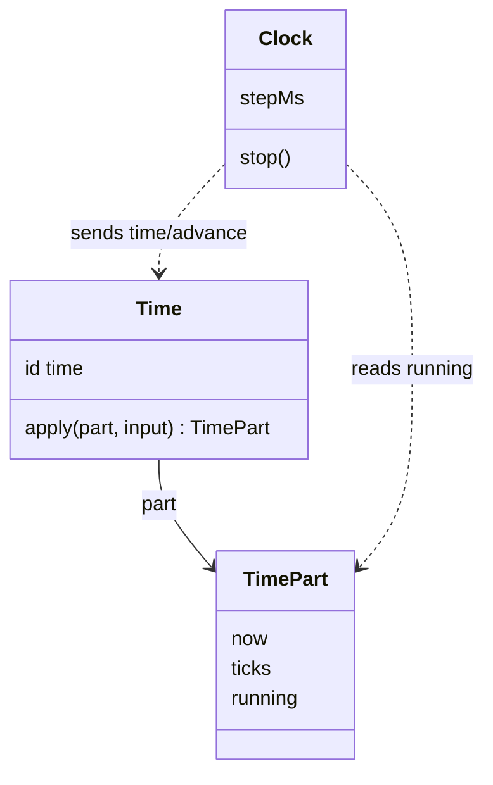
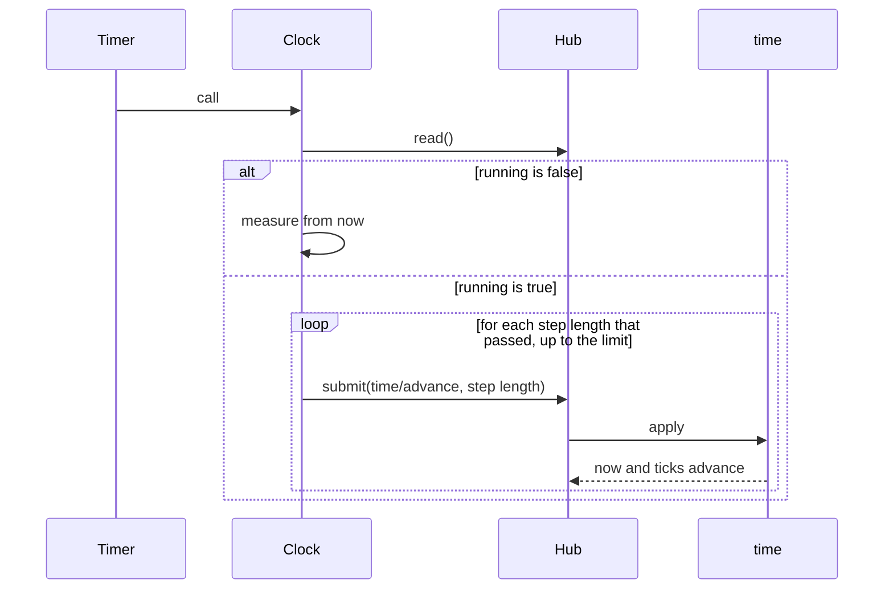

# Design

## Context

See `proposal.md` for the reason. [#527](https://github.com/twin-digital/opus/issues/527) holds the architecture. `@thrashplay/wishem-hub` gives `createHub`, `ModelSubsystem`, `Port`, and `InputRefusedError`.

Decisions of the owner that apply:

- The clock is a subsystem that sends ticks at an interval. A product that is not a game has no clock.
- A subsystem has three operations on the hub. Control is state: a pause is an input that sets `running`, and the clock reads it. A tick is the input `time/advance`.
- The clock plays at normal speed, and it has the interface for pause and step. Rewind and replay use the record of the hub ([#533](https://github.com/twin-digital/opus/issues/533)).

The lead agent made each other decision below alone, as `nodejs/wishem/docs/autonomous-flow.md` permits.

## Goals / Non-Goals

**Goals:**

- A construct gives the same result for the same ticks, at each speed of real time.
- A test of the clock needs no wait.
- The package runs in Node.js and in a web browser with no change.

**Non-Goals:**

- A speed other than normal speed. A controller that sends ticks itself can run at each speed.
- A link between the tick and the frame of a renderer. A renderer draws when it gets the `applied` event or on its own frame.
- Rewind and replay.
- A behavior that runs on each tick. The store has no behaviors now.

## Decisions

### 1. Two subsystems: `time` holds the state, and the clock is a timer

A subsystem has one kind. The time of a construct is state, so a model subsystem holds it. The timer reads no input and holds no state of the construct, so it is an input subsystem. `time` and the clock are in one package, and a construct can include `time` with no clock. A test, an agent, and a replay then advance the construct with ticks that they send.

Alternative: one clock that holds the time and also sends ticks. A subsystem that holds state and sends inputs is not possible with one kind, and the time would not be in the joined state for a behavior or a renderer.

### 2. A tick has a fixed length, and the clock sends the ticks that are due

The clock has a step length, 50 milliseconds by default. Each tick advances the time of the construct by that length. The timer of a platform is not exact, so the clock measures real time: at each call of the timer, it sends one tick for each full step length since the last tick.

- Reason for the fixed length: a behavior gets the same length on each tick, so its result does not depend on the load of the computer. The record holds the length in each input, so a replay needs no clock.
- When the process was stopped for a long time, such as a tab in the background, the clock sends at most 5 ticks in one call and drops the other time. The construct then continues at normal speed and does not run a long burst.
- The default of 50 milliseconds is 20 ticks in one second. It is sufficient to prove the architecture. A game selects its own step length.
- Alternative: a tick with the measured length. The record would still replay, but the result of a play session would depend on the timer.

### 3. A tick applies during a pause

`time/advance` always advances the time. `running` only tells the clock if it sends ticks. A step during a pause is then one `time/advance` from a controller, with no third input type.

Alternative: `time` refuses a tick while `running` is `false`. A step would then need a resume, a tick, and a pause, and a tick of the clock that arrives after a pause through a link would be a refusal.

### 4. The clock gets its port from the caller

`startClock(port, options)` gets the port of an input subsystem. The code that assembles the construct attaches the subsystem, for example with `hub.attach({ id: 'clock', kind: 'input' })`. The clock thus works with a remote port also, and the clock does not know the hub.

- `startClock` throws when the kind of the port is not `input`, or when the joined state has no part `time`.
- The clock registers one listener. On an `applied` event of the type `time/set-running`, it starts to measure real time again from that moment, so the time of a pause causes no tick. On the `stopping` event, it stops.
- The clock does not wait for the result of a tick. A tick that the hub rejects, for example after the hub stops, is dropped.

### 5. The timer and the source of real time are options

```ts
export interface ClockTimer {
  /** Calls `callback` at the interval. Returns a function that stops the calls. */
  start(callback: () => void, intervalMs: number): () => void
}
```

The default timer uses `setInterval` and `clearInterval`, and the default source of real time is `Date.now`. The package has no types of Node.js or of a web browser, so `src/globals.d.ts` declares the two timer functions with the small form that the package uses. A test gives a timer that it calls itself and a source of time that it sets.

### 6. The architecture document does not change now

No process uses the clock after this change. [#536](https://github.com/twin-digital/opus/issues/536) adds the first construct with a clock.

## Interfaces

Owner: `@thrashplay/wishem-clock`. Each name is an export of the package root.

```ts
import type { Input, ModelSubsystem, Port } from '@thrashplay/wishem-hub'

export const TIME_ID = 'time'

export interface TimePart {
  /** The time of the construct in milliseconds. */
  readonly now: number
  readonly ticks: number
  readonly running: boolean
}

export interface TimeOptions {
  /** Default `true`. */
  running?: boolean
}

export const createTime: (options?: TimeOptions) => ModelSubsystem<TimePart>

export const timeInputs: {
  /** `time/advance` */
  advance(ms: number): Input
  /** `time/set-running` */
  setRunning(running: boolean): Input
}

export interface ClockTimer {
  start(callback: () => void, intervalMs: number): () => void
}

export interface ClockOptions {
  /** The length of one tick in milliseconds. Default 50. */
  stepMs?: number
  /** Default 5. */
  maxTicksPerCall?: number
  /** Default: `setInterval`. */
  timer?: ClockTimer
  /** Real time in milliseconds. Default: `Date.now`. */
  now?: () => number
}

export interface Clock {
  stop(): void
}

/** Throws when the port is not the port of an input subsystem, or when the joined state has no part `time`. */
export const startClock: (port: Port, options?: ClockOptions) => Clock
```

Example:

```ts
const hub = createHub({ subsystems: [createTime()] })
const clock = startClock(hub.attach({ id: 'clock', kind: 'input' }))
const controls = hub.attach({ id: 'controls', kind: 'input' })
hub.start()

await controls.submit(timeInputs.setRunning(false)) // pause
await controls.submit(timeInputs.advance(50)) // one step
await controls.submit(timeInputs.setRunning(true)) // resume

hub.stop() // The clock stops.
```

## Domain types

Each type is new.



## The path of a tick



## Package Impact

| Package                    | Published or private | Bump  | Reason       |
| -------------------------- | -------------------- | ----- | ------------ |
| `@thrashplay/wishem-clock` | Private              | minor | New package. |

## Risks / Trade-offs

- [The sum of many lengths that are not whole numbers has a small error] → The default length is a whole number of milliseconds. The count of ticks is exact, and a behavior that needs an exact time uses the count.
- [A tick through a link arrives late] → The clock runs best in the process of the hub. Nothing prevents a clock on a remote port, and the order of the ticks stays correct.
- [20 ticks in one second is too slow for a game with fast movement] → The step length is an option.
