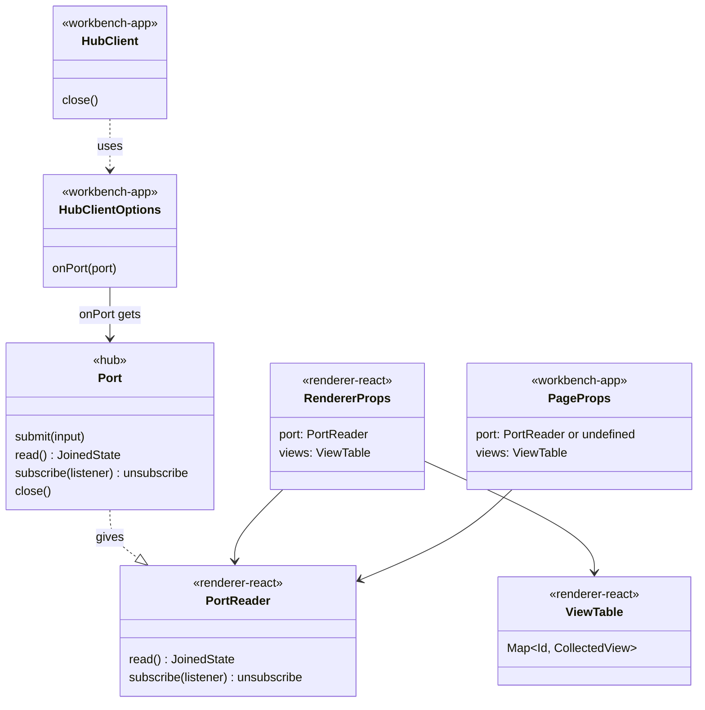
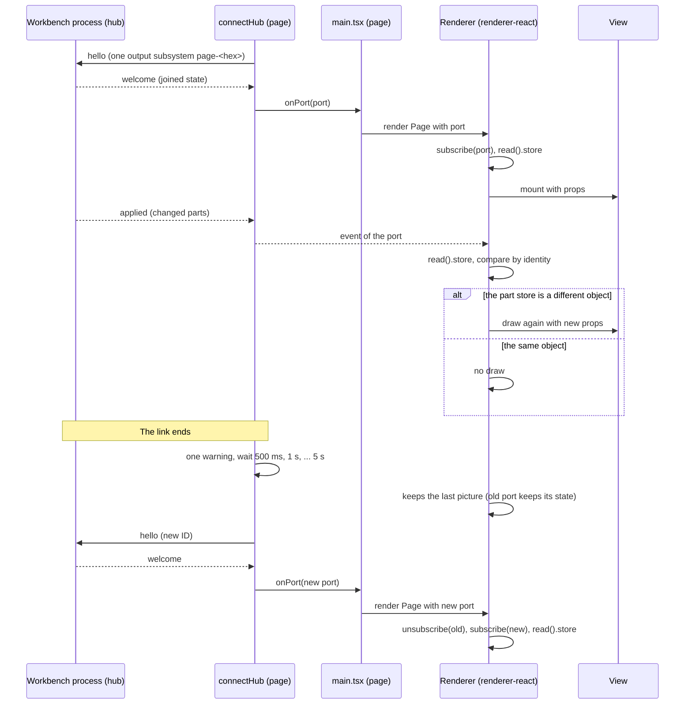
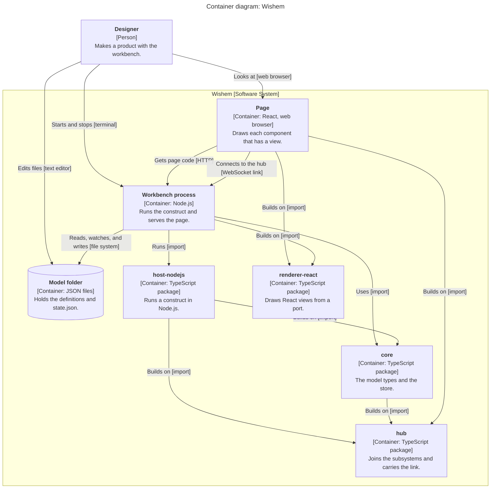

# Design

## Context

See `proposal.md` for the reason. The architecture is in [#527](https://github.com/twin-digital/opus/issues/527).

The current state:

- `workbench-app/src/renderer/` holds `collectViews`, the parser of a sidecar, the rule for the names of props (`fieldName`, `propNames`), `viewWarnings`, `Renderer`, `connectHub`, and `reloadOnRestore`.
- `Renderer` reads a `ModelReader` (`getSnapshot`, `subscribe`). Only `connectHub` gives one. `connectHub` opens the link at `/link`, reads the part `store` of the remote port, and connects again after the link ends. Its promise resolves after the first `welcome`.
- `workbench-app/scripts/view-types.ts` holds the generator. It writes a fixed command in the header of each generated file. `scripts/view-types-report.ts` gives the terminal lines. `scripts/generate.ts` and `scripts/start.ts` use both modules.
- The hub gives each I/O subsystem a `Port`. A part that did not change is the same object, in the hub and in the joined state of a remote port.

The lead agent made each decision below alone, as `nodejs/wishem/docs/autonomous-flow.md` permits. No decision meets the three conditions of "When to ask the owner": the person sees no change in the workbench, and each decision is in private code that a later change can alter.

Two changes run at the same time as this change:

- [#533](https://github.com/twin-digital/opus/issues/533) (rewind and replay) changes `hub/`, `clock/`, `host-nodejs/src/model-folder-storage.ts`, `keepViewTypesCurrent` in `workbench-app/scripts/start.ts`, `docs/concepts.md`, `docs/glossary.md`, and the requirement "The start script keeps the generated files current" of `wishem/renderer-html/view-types`. With #533, a rewind is the input `hub/rewind` with the usual `applied` event.
- [#540](https://github.com/twin-digital/opus/issues/540) (PixiJS) and [#541](https://github.com/twin-digital/opus/issues/541) (Godot) are planned while this change is built. Decision 1 gives them the boundary.

## Goals / Non-Goals

**Goals:**

- One package that a page of the workbench or of a product uses to draw React views from a port.
- The same picture from a direct port and from a remote port.
- No change that the person sees: the workbench page, its screenshots, the terminal lines, and `AppBar.view.gen.ts` stay the same.
- Few lines in common with #533.

**Non-Goals:**

- Inputs from a view, more field types, and nested views. These are [#535](https://github.com/twin-digital/opus/issues/535).
- A page of a product, and a hub in the page.
- A reconnecting remote port that a renderer other than React uses.
- A new name for the capabilities `wishem/renderer-html/*`, and one term for "HTML renderer" and "React renderer". See "Follow-up".

## Decisions

### 1. The boundary between a renderer and a page

This boundary applies to each renderer package: `renderer-react` now, and `renderer-pixi` (#540) and `renderer-godot` (#541) later.

| A renderer package does this | The page (or the application) does this |
| --- | --- |
| Draws from a port that it gets: it calls `read` and `subscribe` only. | Makes the port: it opens a link or makes a hub in the page, and attaches the output subsystem. |
| Removes its listeners when it stops. | Closes the port and the link. |
| Defines its kind of view and its kind of sidecar (`react` here). It ignores a sidecar of a different kind. | Holds the views and the sidecars, in one folder for each renderer, and loads them. |
| Builds the table of views from the loaded modules that it gets. | Gives the loaded modules (in Vite: `import.meta.glob`). |
| Marks each drawn element with its entity. | Holds the fixed content, such as the zero state, and the layout. |
| Holds the generator of the types of its views, if its views are TypeScript. | Runs the generator, and gives the definitions and the command. |
| Knows no address, no link, no folder, and no workbench. | Connects again after a link ends, and handles the events of the page, such as `pagehide` and `pageshow`. |

- The name of each package is `@thrashplay/wishem-renderer-<library>`, in `nodejs/wishem/renderer-<library>`. This change makes `@thrashplay/wishem-renderer-react` in `nodejs/wishem/renderer-react`.
- The sidecar is `<name>.view.json` with `{ "kind": "<kind>", "componentType": "ct_..." }`. Each renderer selects its own `kind`.
- A renderer sends no input. When a view must send an input, the page attaches a second subsystem of the kind `input` and gives its port to the renderer as a separate prop. This is the base for #535.
- Reason: a port is the one interface between a subsystem and the hub (rule R20). A renderer that only gets a port works in each process and with each kind of port.

### 2. The renderer gets a `PortReader`, not a model reader

`Renderer` gets `port: PortReader`, where `PortReader` is `Pick<Port, 'read' | 'subscribe'>`. After each event of the port, the renderer reads `port.read().store` with `useSyncExternalStore`. React draws again only when the part is a different object. The renderer does not look at the type of the event, so a rewind of #533 needs no new code.

- When the part `store` is not there, the renderer draws nothing. The renderer does not validate the part: the store of the hub validated it.
- The ID of the part is `store`. The store has an option for a different ID, but no construct uses it. Rule R7: the renderer gets no option for it now.
- `PortReader` is a type of `renderer-react`. Reason: `hub/src/types.ts` and `hub/src/index.ts` are files that #533 changes much. See "Follow-up".
- Alternative: keep `ModelReader`. Rejected: the issue requires a port, and only `connectHub` could give a `ModelReader`, so a direct port would need an adapter in each page.
- Alternative: give the renderer the full `Port`. Rejected: the type would permit `submit` and `close`, which a renderer must not call.

### 3. `connectHub` gives the port of each link

`connectHub({ onPort })` returns a `HubClient` with `close()`. After each `welcome`, it calls `onPort` with the remote port of the new link. `main.tsx` then draws `<Page port={port} views={views} />`. React sees a new `subscribe` function, so the renderer listens to the new port and reads it.

- The old port keeps the last joined state after its link ends, so the page keeps the last picture until the next `welcome`.
- `connectHub` stays in `workbench-app`. The address `/link`, the delays, `pagehide`, and the ID `page-<hex>` belong to the page (Decision 1).
- `connectHub` no longer returns a promise. A `close()` before the first `welcome` thus leaves no promise that never settles.
- An error that `onPort` throws goes to `console.error`. The link stays open.
- Alternative: one remote port that stays the same object across links. Rejected: it would need an event when it changes to a new link, and the hub has no such event. A made event `started` would not be true.
- Alternative: move `connectHub` to `hub`, so that the PixiJS page can use it. Rejected for now: #533 changes `hub`, and no second page needs it yet. See "Follow-up".

### 4. The generator is the entry `view-types` and gets the command

`src/view-types.ts` of the package holds `generateViewTypes`, `renderViewTypes`, and `viewTypesLines`. It uses `node:fs`. It is the only source module of the package that uses a Node.js API. The option `command` gives the text of the header line `// To write this file again: <command>`.

`workbench-app/scripts/view-types.ts` stays. It holds the command of the workbench, `pnpm --filter @thrashplay/wishem-workbench-app generate`, and exports a `generateViewTypes` that adds it. `workbench-app/scripts/view-types-report.ts` re-exports `viewTypesLines`. Thus `scripts/start.ts` and `scripts/generate.ts` do not change, and `AppBar.view.gen.ts` does not change.

- Reason: `start.ts` is a file of #533. With this design, the two changes have no line in common.
- A lint rule of the package (`eslint.config.d/`) refuses an import of `node:*` in `src/`, except in `src/view-types.ts` and in the test files.
- Alternative: the command as a constant of the package. Rejected: the package does not know the product.

### 5. What moves, and what stays

| From `workbench-app` | To |
| --- | --- |
| `src/renderer/collect-views.ts`, `field-names.ts`, `sidecar.ts`, `view-warnings.ts`, `Renderer.tsx`, and their tests | `renderer-react/src/` |
| `scripts/view-types.ts` (the generator) and `scripts/view-types-report.ts` (the lines) | `renderer-react/src/view-types.ts` |
| The tests of `generateViewTypes` and `renderViewTypes` in `src/view-types.test.ts` | `renderer-react/src/view-types.test.ts` |
| `src/renderer/hub-client.ts`, `reload-on-restore.ts`, and their tests | `workbench-app/src/` |
| `src/renderer/index.ts` | Removed. The page imports from the package. |

`src/views/`, `src/views.ts`, `src/Page.tsx`, `src/main.tsx`, the `generate` and `start` scripts, the style guide, and the test "the generated files of the repository are current" stay in `workbench-app`.

### 6. React is a peer dependency

`renderer-react` has `react` as a peer dependency and a development dependency, with the range of `workbench-app` (`^19.2.0`). It depends on `@thrashplay/wishem-core` and `@thrashplay/wishem-hub` for types only. Reason: two copies of React in one page break the hooks.

### 7. The capabilities keep the name `renderer-html`

The new capability is `wishem/renderer-html/renderer`. The requirement "Each drawn element gives its entity" moves to it from `wishem/renderer-html/page`. The other requirements of the page stay, because they describe the whole page from the files to the picture.

- Reason: #533 modifies `wishem/renderer-html/view-types`. A rename of the folder would make one of the two archives fail.

### 8. The architecture document changes

The package is a container, because `workbench-app` builds on it. The container diagram adds `renderer-react`, with "Builds on [import]" from the page and from the workbench process. `renderer-react` imports only types from `core` and `hub`, so the diagram shows no relationship from it. The component diagram of the page keeps its six components. The technology lines of the renderer and of the table of views name `renderer-react`. The client of the hub "Gives the port of each link", and the renderer "Reads the part store [port]". The dynamic diagram does not change. Its list of steps changes at steps 5 to 7.

## Interfaces

Owner: `@thrashplay/wishem-renderer-react`, root entry.

```ts
import type { ComponentType, ReactElement } from 'react'
import type { ComponentTypeDefinition, FieldDefinition, FieldValue, Id } from '@thrashplay/wishem-core'
import type { Port } from '@thrashplay/wishem-hub'

/** The two operations of a port that a renderer uses. */
export type PortReader = Pick<Port, 'read' | 'subscribe'>

export interface RendererProps {
  port: PortReader
  views: ViewTable
}
export const Renderer: (props: RendererProps) => ReactElement

export type ViewProps = Readonly<Record<string, FieldValue | undefined>>
export interface CollectedView {
  sidecar: string
  componentType: Id
  view: ComponentType<ViewProps>
}
export type ViewTable = ReadonlyMap<Id, CollectedView>
export class ViewCollectionError extends Error {
  readonly files: readonly string[]
}
/** Each argument maps the path of a file to its loaded module, as `import.meta.glob` with `eager: true` gives. */
export const collectViews: (sidecars: Record<string, unknown>, modules: Record<string, unknown>) => ViewTable

export interface ViewWarning {
  kind: 'component-type-not-defined' | 'same-name'
  sidecar: string
  componentType: Id
  fields?: [Id, Id]
  name?: string
}
export const viewWarnings: (views: ViewTable, definitions: readonly ComponentTypeDefinition[]) => ViewWarning[]
export const describeWarning: (warning: ViewWarning) => string

export const REACT_KIND = 'react'
export interface Sidecar {
  kind: string
  componentType: Id
}
export const parseSidecar: (value: unknown) => Sidecar | undefined

export const fieldName: (label: string) => string
export type NameProblem =
  | { kind: 'empty-name'; field: Id }
  | { kind: 'name-starts-with-digit'; field: Id; name: string }
  | { kind: 'same-name'; name: string; fields: [Id, Id] }
export interface PropNames {
  props: { name: string; field: FieldDefinition }[]
  problems: NameProblem[]
}
export const propNames: (definition: ComponentTypeDefinition) => PropNames
```

Owner: `@thrashplay/wishem-renderer-react`, entry `./view-types`. It runs in Node.js.

```ts
export interface ViewTypesOptions {
  definitions: readonly ComponentTypeDefinition[]
  /** The absolute path of the `views` folder. */
  views: string
  /** The command that the header of each generated file names. */
  command: string
  /** Change no file. Default `false`. */
  check?: boolean
}
export interface ViewTypesFile {
  file: string
  status: 'written' | 'changed' | 'removed' | 'current' | 'not-current'
  addedProps: string[]
  removedProps: string[]
}
export interface ViewTypesResult {
  files: ViewTypesFile[]
  warnings: string[]
  errors: string[]
}
export const renderViewTypes: (
  sidecarFile: string,
  componentType: Id,
  command: string,
  definition?: ComponentTypeDefinition,
) => string
export const generateViewTypes: (options: ViewTypesOptions) => Promise<ViewTypesResult>
export const viewTypesLines: (result: ViewTypesResult) => string[]
```

Owner: `@thrashplay/wishem-workbench-app` (not exported from the package; used by its own modules).

```ts
// src/hub-client.ts
export interface HubClientOptions {
  /** Default: `/link` on the origin of the page, with `ws:` or `wss:`. */
  url?: string
  createSocket?: (url: string) => WebSocketLike
  /** Default 500. */
  firstDelayMs?: number
  /** Default 5000. */
  maxDelayMs?: number
  /** Called after each `welcome` with the remote port of the new link. */
  onPort: (port: Port) => void
}
export interface HubClient {
  /** Closes the link and opens no new one. A second call does nothing. */
  close(): void
}
export const connectHub: (options: HubClientOptions) => HubClient

// src/Page.tsx
export interface PageProps {
  /** No value before the first link. */
  port: PortReader | undefined
  views: ViewTable
}

// scripts/view-types.ts
export const VIEW_TYPES_COMMAND = 'pnpm --filter @thrashplay/wishem-workbench-app generate'
export const generateViewTypes: (options: Omit<ViewTypesOptions, 'command'>) => Promise<ViewTypesResult>
export type { ViewTypesFile, ViewTypesResult }

// scripts/view-types-report.ts
export { viewTypesLines } from '@thrashplay/wishem-renderer-react/view-types'
```

## Data Model

No persisted schema changes. The types below are new or changed: `PortReader` and `RendererProps` (new owner, changed), `HubClient` and `HubClientOptions` (changed), and `PageProps` (changed). `Port` is the neighbour for context.



## The flow from a link to the picture



## Container diagram after the change

New: the container `renderer-react`, and the relationships from the page and from the workbench process to it. Nothing moves or is removed.



The system context diagram does not change.

## Failure Modes

| Failure | Behavior | Recovery |
| --- | --- | --- |
| The hub is not reachable at the start | `connectHub` writes one warning and tries again. `onPort` is not called. The page shows the zero state. | The next `welcome` calls `onPort`. |
| The link ends | The renderer keeps the picture of the old port. `connectHub` writes one warning and waits 500 ms, 1 s, 2 s, 4 s, then 5 s. | The next `welcome` calls `onPort` with the new port. |
| The hub refuses the link | `connectHub` writes one error for the refusal and tries again. | As above. |
| `onPort` throws | `connectHub` writes the error to `console.error`. The link stays open. | The next `welcome` calls `onPort` again. |
| `close()` runs before the first `welcome`, while a socket opens, or during a delay | No `onPort` call. The socket or the link closes. No warning. | None needed. `close()` is idempotent. |
| `close()` runs inside `onPort` | The link closes. No later `onPort` call and no warning. | None needed. |
| The joined state has no part `store` | The renderer draws nothing. | The next event with a part `store` draws it. |
| An event arrives after the renderer is removed | The listener is removed, so nothing happens. | None needed. |
| The generator cannot read the folder or write a file | Unchanged: the result holds an error, and the script prints it. | The person corrects the cause and saves again. |
| The package has no built files when a script runs | Node.js cannot load `@thrashplay/wishem-renderer-react/view-types`. | Build the Wishem packages before the start, as `workbench-app/README.md` says. |

`Renderer` and `connectHub` make no write. `close()` is idempotent. A second `onPort` with the same model draws one time, and the picture does not change.

## Example

The README of the package holds this example. `src/readme-example.test.tsx` runs the same code.

```tsx
import { createRoot } from 'react-dom/client'
import { createStore } from '@thrashplay/wishem-core'
import { createHub } from '@thrashplay/wishem-hub'
import { collectViews, Renderer } from '@thrashplay/wishem-renderer-react'

const hub = createHub({ subsystems: [createStore({ model })] })
hub.start()
const port = hub.attach({ id: 'screen', kind: 'output' })
const views = collectViews(
  import.meta.glob('./views/*.view.json', { eager: true }),
  import.meta.glob(['./views/*.tsx', '!./views/*.test.tsx'], { eager: true }),
)

createRoot(document.getElementById('root')!).render(<Renderer port={port} views={views} />)
```

The same `Renderer` takes the remote port of a link: `const link = await openLink(channel, [{ id: 'screen', kind: 'output' }])`, then `port={link.ports.screen}`.

## Package Impact

| Package | Published or private | Bump | Reason |
| --- | --- | --- | --- |
| `@thrashplay/wishem-renderer-react` | Private (new) | minor | New package: the renderer, the table of views, and the generator. |
| `@thrashplay/wishem-workbench-app` | Private | patch | Uses the package. `connectHub` and `Page` take a port. No change that the person sees. |

No other package changes. `core` and `hub` get a new dependent and no change.

## UI

This change adds no UI and changes no UI. It adds no component and no design token. The style guide does not change. The screenshot baselines of the style guide and of the workbench page (`tests/__screenshots__/`) must not change, and the browser tests of `workbench-app` prove it.

## Risks / Trade-offs

- [Two copies of React in the page] → React is a peer dependency with the range of `workbench-app`, and `pnpm-lock.yaml` must resolve one version. The page tests and the browser tests mount a view through the package renderer, so a second copy fails them. If Vite loads two copies, add `resolve.dedupe` for `react` in `workbench-app/vite.config.d/50-react.js`.
- [The build of a package with `.tsx` files] → No Wishem library package has `.tsx` files yet. The package sets `jsx: react-jsx` in `tsconfig.options.json`, as `workbench-app` does, and Task 1 verifies `pnpm build` and the files in `dist/`.
- [The scripts of `workbench-app` load the built files of the package] → The same is true of `host-nodejs` now. Turbo builds the dependencies before the tests.
- [The new capability repeats some text of the page] → The page keeps its requirements from the files to the picture. The renderer capability holds the contract of the package with tests that use ports. Only the mark moves.
- [A merge with #533] → No file of code is in common. `pnpm-lock.yaml` can conflict. Make it again after the merge of the first change.

## Migration Plan

No data and no deployment. The page and the scripts change in one pull request. Rollback is the revert of that pull request.

## Lines in common with #533

None in code. `scripts/start.ts` does not change (Decision 4). This change modifies the requirements "The generator writes the types of the props of each view" and adds one requirement in `wishem/renderer-html/view-types`. #533 modifies only "The start script keeps the generated files current", so the two archives do not overlap. This change edits one line of `docs/concepts.md` (the line "The React renderer is a package" in "The three renderers"), far from the lines of #533, and does not edit `docs/glossary.md`. `pnpm-lock.yaml` is the one file that both changes always touch.

## Items of #568 that this change closes

These items are on lines that this change must rewrite. Each other item of #568 stays open.

- `connectHub` before the first `welcome`: the promise is removed (Decision 3).
- `hub-client.test.ts`: the helper `connect()` waits with no limit. The new helper waits for `onPort` and fails by an assertion.
- `Renderer.test.tsx`: the variables with the name `core`, and the test names with "the core" and "snapshot".
- `Page.test.tsx`: the cast `as Model` with no validation. The test gets a port of a real hub whose store validates the model.

## Follow-up

- After #533 is archived: give the capabilities `wishem/renderer-html/*` the name `wishem/renderer-react/*`, and use one term ("React renderer") in the glossary, the concepts, and the specifications.
- After #533 is merged: move `PortReader` to `@thrashplay/wishem-hub`, when a second renderer (#540) needs the same type.
- When a second page needs a remote port that connects again after a link ends (#540 or a product page), move the reconnect part of `connectHub` to `@thrashplay/wishem-hub`, with no React and no Node.js API.
- The requirement "A warning is given one time for each set of differences" of `wishem/renderer-html/views` uses the word "snapshot", and the scenario "A view with no core" uses "core". #568 holds these items.
