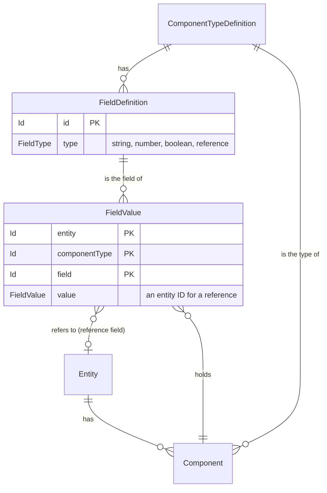
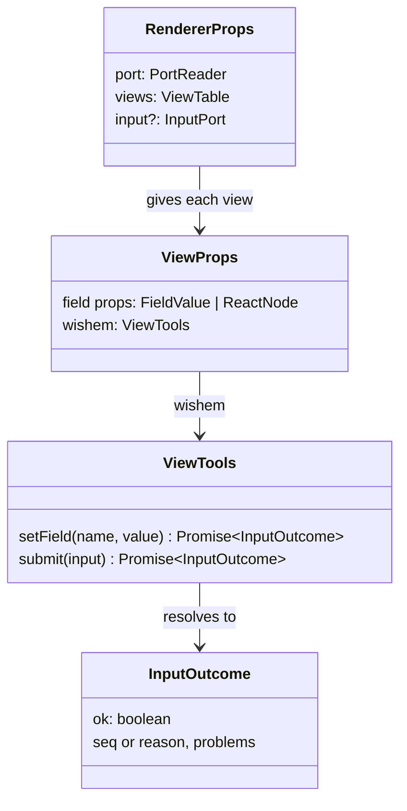
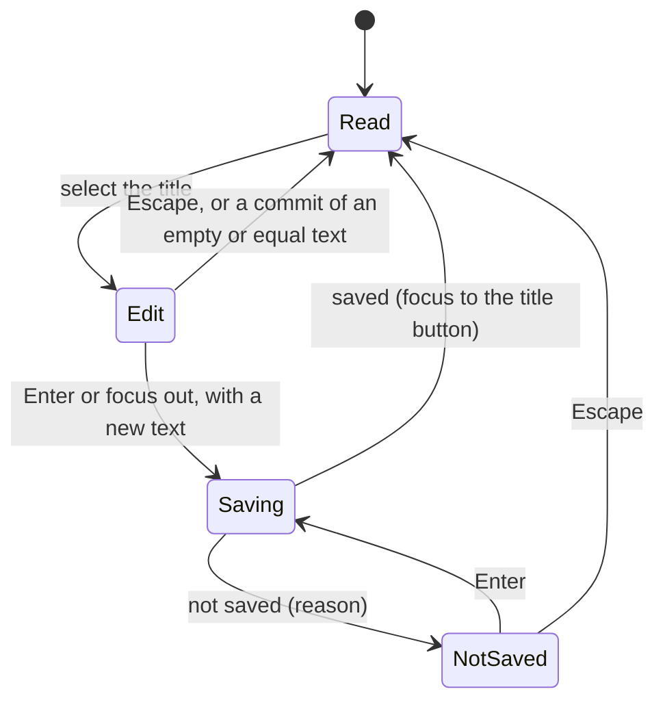
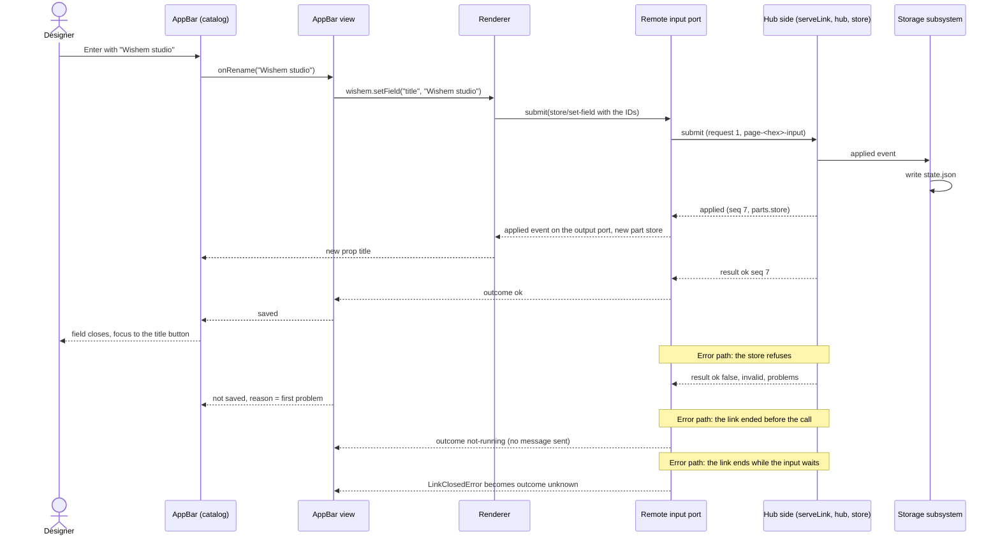

# Design

## Context

See `proposal.md` for the reason of the change. These facts of `main` shape the design:

- `Renderer` of `@thrashplay/wishem-renderer-react` gets a `PortReader` (`read` and `subscribe`). It cannot submit. It reads the part `store`, and it gives each view one prop for each field, with the name that the label gives (`propNames`).
- `connectHub` of `workbench-app` opens one link with one output subsystem `page-<16 hex>`, and makes a new ID for each link. It gives the port of each link to `onPort`.
- Version 1 of the link fixes the subsystems of a link at `hello`, and a `hello` can name more than one subsystem (`LINK.md`). An input port of a link can also read and get events.
- `core` has one field type, `string`, and `FieldValue` is `string`. `set-field` compares the old value and the new value with `===` (#557). `remove-entity` runs `validateModel` on the next model, but no rule can fail after a removal now.
- The generator writes `Props` with one member `string | undefined` for each field. `readPropNames` reads the members of `Props` back from the text of an old file.
- The workbench has one view, the app bar. The style guide shows the app bar and the zero state. The page has screenshot tests and accessibility tests in Docker.
- In flight at the same time: #536 (the sample product, a second store `product`) and #540 (the PixiJS renderer, and `connectLink` in `hub`, which `connectHub` will use). #537 (the panel of the entities of the product and its form) builds on this change.

The lead agent did the brainstorm alone, as `nodejs/wishem/docs/autonomous-flow.md` requires. Each decision below has its reason and the alternatives that the lead agent rejected.

## Goals / Non-Goals

**Goals:**

- A view sends an input with no ID in its code, and a test of a view needs no hub.
- The page attaches the input subsystem on its one link, and the source of its inputs is stable for one load of the page.
- The field types `number`, `boolean`, and `reference`, each in the validation, in the store, and in the generated types.
- A view draws the entity that a reference field of its component names.
- One real view that sends an input (the title of the app bar), so that the test guide joins the input with the storage, the hand edit, the rewind, and a new link.

**Non-Goals:**

- The panel and the form of #537, and a view that reads a part other than `store`.
- A list of references, a field that a person can clear, and an input that removes a field value.
- A control for undo, and a rule for which subsystem can send `hub/rewind` (#582).
- One root for the paths of the problems (#557). The app bar shows the message of a problem, not its path.
- The rename of the capabilities `renderer-html` and the move of `PortReader` to `hub` (#593).
- A change of the link protocol, the hub, `host-nodejs`, or `clock`.

## Decisions

### 1. One change with five tasks

The three parts of the issue stay in one change. #537 needs part 1 (inputs) in full. Its form edits field values, and a form for a product with numbers and flags needs part 2 (types). Part 3 (nested views) needs the type `reference` of part 2, and it adds one requirement set to the renderer. Each part is small enough for one implementer and one review: core types (Task 1), view tools and the generator (Task 2), nested views (Task 3), the page link (Task 4), and the title control with its style guide (Task 5). A reviewer can reject each task and approve its neighbor. No part becomes an issue of its own.

Alternative rejected: three changes. Reason: the issue is one task on the board, and the three parts change the same files of the renderer (`Renderer.tsx`, `collect-views.ts`, `view-types.ts`). Three branches would conflict in each of them.

### 2. A view gets its tools in the reserved prop `wishem`

The renderer gives each view the prop `wishem: ViewTools<Values>` with `setField(name, value)` and `submit(input)`. `setField` takes the name of a prop, not an ID, so the view file states no ID (requirement "A view file has one default export"). The generated file gives the names and the types of `setField`.

Alternatives rejected:

- **A hook of the package** (`useViewTools()` with a React context). Rejected: a view would get data that is not in its props, against the agreed rule "A view is a pure function of its props". A test would need a provider of the package.
- **Two prop objects** (`{ fields, wishem }`). Rejected: each view and each generated file changes form, and a view of the app bar gets `fields.title` in place of `title`.
- **A prop name that no label can give**, such as `$wishem`. Rejected: the name is strange in a view. The rule of names gives only letters and digits, so a reserved word is a simple check (Decision 10).

### 3. The renderer gets a second port, `input`, that can submit

`RendererProps` gets `input?: InputPort`, with `InputPort = Pick<Port, 'submit'>`. The renderer reads only from `port`, and sends only through `input`. The page makes the two ports (Decision 1 of #534). The renderer attaches no subsystem and closes no port. With no `input`, each call gives the outcome `not-permitted`, which is the reason of the hub for a subsystem that is not an input subsystem.

Alternative rejected: one `Port` for read and submit. Rejected: the concepts say that a page that draws and sends attaches two subsystems, and the output subsystem must not be able to send.

### 4. An outcome, never an error

Each call gives `Promise<InputOutcome>`, which never rejects. `InputOutcome` is the `SubmitResult` of the hub, or a rejection with the reason `unknown` (the link ended before the `result`, so the hub can have accepted the input or not) or `failed` (the `result` holds an `error`). Reason: a view calls the tools in an event handler, and an error that a handler does not catch is lost. One type with a reason lets a view show each case. The renderer never sends an input again (`LINK.md`, "The end of a link").

### 5. The renderer keeps no state of an input

The renderer does not track which input of a view waits. The view gives the promise to its catalog component, and that component holds "saving" and "not saved" as transient state (`concepts.md`, "Views": a reload loses it with no harm, no other part reads it, and the agent does not need it). Reason: a renderer status per component needs a rule for when a rejection goes away, and each view has a different rule. The app bar shows each state in the style guide through its prop `initial` (Decision 12).

### 6. One link with two subsystems, and no change of the protocol

`connectHub` sends one `hello` with the output subsystem `page-<hex>` and the input subsystem `page-<hex>-input`, and gives the two ports to `onPorts({ output, input })`. Reason: version 1 already takes a list of subsystems in `hello`. The page knows at the start that it sends inputs, so it needs no `attach` message and no second link. This settles the point of #565 for the page: the page does not open a second link. The messages `attach` and `detach` stay in #565 for a client that adds a subsystem later.

### 7. The source of the inputs of a page is the same for one load

`connectHub` makes `<hex>` one time, and uses it for each link. A refusal with `id-in-use` makes a new `<hex>`. Reason: the record is also the record of changes with their sources, which provenance and undo need. "The designer through this page" is one source, also after the process stops and starts. A new ID for each link gave one source for each link (#565). A new `<hex>` after `id-in-use` keeps the page usable when the hub side still holds the old link (Risks).

Alternative rejected: one source for the browser tab across reloads (`sessionStorage`). Rejected: a copy of a tab copies `sessionStorage`, so two tabs could have one ID and one gets `id-in-use`. A reload is a new start of the page.

### 8. The field types `number`, `boolean`, and `reference`

These are the three types that the issue names. The values are JSON values, so `state.json` holds them with no change of the storage subsystem.

- `number`: a finite JSON number. The hub copies a payload through JSON, so `NaN` becomes `null` and the store refuses it.
- `boolean`: `true` or `false`.
- `reference`: the ID of an entity of the same model, as a string. The validation checks the form `e_<uuid>`, and then checks in a second pass that an entity of the model has the ID. Thus an entity can refer to a later entity and to itself.
- `FieldValue` becomes `string | number | boolean`. A reference is a string, so `set-field` keeps its comparison with `===`: two values of different JSON types are never equal, and each value is a primitive. This answers the first point of #557. A list of references would be an object and would need `isEqual` (Follow-up).
- `remove-entity` of an entity that a different entity refers to fails the check of the next model, so the store refuses it with the problem of `validateModel`. Reason: a reference that names no entity is not a correct model. To remove the entity, the designer first changes the reference, or removes the entity that holds it. This answers the second point of #557: Task 1 adds the test.

Alternative rejected: `remove-entity` clears each reference to the entity. Rejected: an input would change a different entity with no sign in its payload, and a field that has no "clear" input yet would get a value that no input can make.

### 9. A nested view is a reference field of a component that has a view

The prop of a `reference` field is the picture of the entity that it names (a `ReactNode`). An entity is held when a reference field of a component of a different entity names it, and the component type of that component has a view. The renderer draws a held entity only in the place of its holder. A cycle draws nothing for the reference that closes it and gives one warning.

This is the smallest thing that the issue asks for: "A view can hold the views of other entities, through a field that refers to them". The model gets no new concept. The view decides where the picture goes, and the renderer keeps the marked elements, so the map from a point to an entity works in a nested picture.

Alternatives rejected:

- **A component `<EntityView id>` of the package, and the ID as the prop.** Rejected: the renderer would not know which entities are held until the views draw, so it would draw each held entity two times.
- **A list of the fields that hold in the sidecar.** Rejected: one more rule in a sidecar, and a reference field of a component with a view is a hold in each case that a React view has now.
- **A field type for a list of references.** Rejected for this change: the issue names "reference to an entity". A list needs `isEqual` in `set-field` and an input for each change of the list (Follow-up).

### 10. The reserved names `wishem` and `key`

`propNames` reports the problem `reserved-name` for a label that gives `wishem` or `key`. The generator reports an error. The renderer gives a warning and no prop for that field. Reason: `wishem` is the prop of the tools. React removes the prop `key` from the props of a component, so a field with the label `Key` never got its value. The check is the same line.

### 11. The generated file has `Values` and `Props`

`Values` holds the type that `setField` takes for each field: the ID string for a reference. `Props` holds the type that the view gets: a `ReactNode` for a reference, and the member `wishem: ViewTools<Values>`. The file imports `ReactNode` from `react` only when a reference field exists, and imports `ViewTools` from `@thrashplay/wishem-renderer-react` in each file. The lines of the terminal (`added`, `removed`) name only the members of the fields of `Props`, not `wishem` and not `Values`.

### 12. The title of the app bar is the first view that sends an input

The workbench needs one real view that sends an input, so that a person can see the input in the page, in `state.json`, and in the record. The title is the one field of the workbench model. The app bar component gets `onRename(title): Promise<RenameOutcome>` and holds the states of the edit. The view `AppBar.tsx` gives it `wishem.setField('title', …)` and changes the outcome into text with `outcomeText` of `src/views/outcome-text.ts`. Reason: the catalog component knows no outcome type of the package, and the package knows no word of the workbench. See "UI options for the owner" for the form.

### 13. The renderer sends `set-field` to the store `store`

`setField` sends `store/set-field`, because the renderer reads the part `store`. A renderer that draws a different part (the mounted product of #536) is a decision of #537. Reason: rule R7, and #537 knows which part its panel shows.

### 14. Rewind and undo

This change adds no control for undo. A rewind restores each model subsystem, and in the workbench construct it is an undo of the authored state (decision of the owner). The test guide shows that a rewind after an edit in the page returns the title and writes `state.json`. `wishem.submit` can send `hub/rewind`, as each input subsystem can now. #582 decides which subsystems can send it.

### 15. Coordination with #540

#540 plans `connectLink` in `hub`, with a new ID for each link, and a `connectHub` on it with no change that a person sees. This change changes `connectHub` (two subsystems, `onPorts`, one `<hex>` for each load). The change that merges second adapts to the first:

- When this change merges first, #540 gives `connectLink` the same rule: one ID for each subsystem for the life of the client, and a new ID only after `id-in-use`. The tests of `hub-client.test.ts` of Task 4 are the cases.
- When #540 merges first, Task 4 adds that rule to `connectLink` and changes `connectHub` to two subsystems on it. The tests of Task 4 stay the same.

## Interfaces

`@thrashplay/wishem-core` (`src/model.ts`, `src/store.ts`):

```ts
export type FieldType = 'string' | 'number' | 'boolean' | 'reference'
/** A reference is the ID of an entity. */
export type FieldValue = string | number | boolean

export const FIELD_TYPES: readonly FieldType[] // ['string', 'number', 'boolean', 'reference']

export interface SetFieldPayload {
  entity: Id
  componentType: Id
  field: Id
  value: FieldValue
}
```

`@thrashplay/wishem-renderer-react`, root entry (`src/view-tools.ts`, `src/Renderer.tsx`, `src/collect-views.ts`, `src/field-names.ts`, `src/view-warnings.ts`):

```ts
import type { FieldValue, Id, Model } from '@thrashplay/wishem-core'
import type { Input, InputProblem, Port, RejectionReason } from '@thrashplay/wishem-hub'
import type { ComponentType, ReactNode } from 'react'

/** The operation of a port that sends. */
export type InputPort = Pick<Port, 'submit'>

export type InputOutcome =
  | { readonly ok: true; readonly seq: number }
  | {
      readonly ok: false
      /** `unknown`: the link ended before the result. `failed`: the hub failed to apply the input. */
      readonly reason: RejectionReason | 'unknown' | 'failed'
      readonly problems: readonly InputProblem[]
    }

/** The prop `wishem` of a view. The promises never reject. */
export interface ViewTools<Values extends object = Readonly<Record<string, FieldValue>>> {
  /** Sends `store/set-field` for the field whose prop has this name, in the component of the view. */
  setField<Name extends keyof Values & string>(name: Name, value: Values[Name]): Promise<InputOutcome>
  submit(input: Input): Promise<InputOutcome>
}

export type ViewToolsCall =
  | { readonly kind: 'setField'; readonly name: string; readonly value: FieldValue }
  | { readonly kind: 'submit'; readonly input: Input }

export interface ViewToolsStub<Values extends object> {
  readonly tools: ViewTools<Values>
  /** Each call, in order. */
  readonly calls: readonly ViewToolsCall[]
}

/** Default outcome: `{ ok: true, seq: <number of the call> }`. A function can give a promise that never settles. */
export const stubViewTools: <Values extends object = Readonly<Record<string, FieldValue>>>(
  outcome?: InputOutcome | ((call: ViewToolsCall) => InputOutcome | Promise<InputOutcome>),
) => ViewToolsStub<Values>

export const RESERVED_PROP_NAMES: readonly ['wishem', 'key']

export type ViewProps = Readonly<Record<string, FieldValue | ReactNode>> & { readonly wishem: ViewTools }

export interface RendererProps {
  port: PortReader
  views: ViewTable
  /** With no value, each input of a view has the outcome `not-permitted`. */
  input?: InputPort
}

export type NameProblem =
  | { kind: 'empty-name'; field: Id }
  | { kind: 'name-starts-with-digit'; field: Id; name: string }
  | { kind: 'reserved-name'; field: Id; name: string }
  | { kind: 'same-name'; name: string; fields: [Id, Id] }

export interface ViewWarning {
  kind: 'component-type-not-defined' | 'same-name' | 'reserved-name' | 'reference-cycle'
  sidecar: string
  componentType: Id
  /** Set for `same-name`. One field for `reserved-name` and `reference-cycle`. */
  fields?: [Id, Id] | [Id]
  /** Set for `same-name` and `reserved-name`. */
  name?: string
  /** Set for `reference-cycle`: the entity that holds, and the entity that it names. */
  entities?: [Id, Id]
}

/** The warnings of the cycles of held entities, sorted as `viewWarnings` sorts. */
export const holdWarnings: (views: ViewTable, model: Model) => ViewWarning[]
```

`@thrashplay/wishem-renderer-react/view-types`: the signatures do not change. `renderViewTypes` writes the form of "Example: a generated file".

`@thrashplay/wishem-workbench-app` (private, not a library):

```ts
// src/hub-client.ts
export interface HubPorts {
  /** `page-<hex>`. */
  output: Port
  /** `page-<hex>-input`. */
  input: Port
}
export interface HubClientOptions {
  url?: string
  createSocket?: (url: string) => WebSocketLike
  firstDelayMs?: number
  maxDelayMs?: number
  /** Called after each `welcome` with the two ports of the new link. */
  onPorts: (ports: HubPorts) => void
}

// src/Page.tsx
export interface PageProps {
  port: PortReader | undefined
  input: InputPort | undefined
  views: ViewTable
}

// src/components/AppBar.tsx
export type RenameOutcome = { saved: true } | { saved: false; reason: string }
export interface AppBarProps {
  title: string
  /** With no value, the title is a heading and not a control. */
  onRename?: (title: string) => Promise<RenameOutcome>
  /** The first state, for the style guide and the tests. */
  initial?: { state: 'edit' | 'saving' | 'not-saved'; draft: string; reason?: string }
}

// src/views/outcome-text.ts
export const outcomeText: (outcome: Extract<InputOutcome, { ok: false }>) => string
```

## Data Model

The model folder gets no new entity. A field value of a `reference` field refers to an entity. `FieldDefinition.type` and `FieldValue` change.



The types of the renderer that change (`ViewTools` and `InputOutcome` are new):



The states of the title of the app bar:



## The flow of an input from a view



## Failure Modes

| Failure                                                              | Behavior                                                                                                             | Recovery                                                                              |
| -------------------------------------------------------------------- | -------------------------------------------------------------------------------------------------------------------- | ------------------------------------------------------------------------------------- |
| The link ended before the call                                       | The remote port gives `not-running`. The app bar shows "not saved" and keeps the text.                               | The page opens a new link. The designer presses Enter again, and the new port sends.  |
| The link ends while an input waits                                   | The outcome is `unknown`. No input is sent again.                                                                    | After the new link, the page draws the state of the hub. The designer sees the title. |
| The store refuses the input                                          | The outcome is `invalid` with problems. The app bar shows the first message.                                         | The designer changes the text, or presses Escape.                                     |
| The hub fails to apply the input (`result` with `error`)             | The outcome is `failed`.                                                                                             | As for a refusal.                                                                     |
| Two commits of one edit (Enter, then focus out)                      | The app bar calls `onRename` one time. Focus out in "saving" and "not saved" does nothing.                           | None needed.                                                                          |
| A view calls `wishem` two times quickly                              | Two inputs, in order, each with its own outcome. Inputs are not idempotent, and a second call is a second change.    | None needed. The hub gives each a sequence number.                                    |
| The app bar is removed while it saves                                | The outcome arrives, and the app bar changes no state of a removed component.                                        | None needed.                                                                          |
| A view keeps `wishem` after the renderer is removed or the link ends | The call goes to the port of its time, which gives its own outcome (`not-running` for a link that ended).            | None needed.                                                                          |
| The hub side still holds the old IDs (`id-in-use`)                   | The page writes one error, makes a new `<hex>`, and tries again after the delay. The source of later inputs changes. | Automatic.                                                                            |
| A reference names an entity that the input removes                   | The store refuses `remove-entity` with the problem of the model.                                                     | Change or remove the holder first.                                                    |
| A hand edit of `state.json` gives a wrong type or a lost reference   | The storage subsystem prints the problems. The last correct model stays.                                             | Correct the file.                                                                     |
| A cycle of references                                                | Each entity is drawn one time on its path. One warning.                                                              | Change a reference.                                                                   |

Idempotency: an input is not idempotent. No part of this change sends an input again. `connectHub().close()` stays idempotent.

## Examples

A generated file for the component type `Task` of the test guide:

```ts
// Generated from Task.view.json and the definition of its component type. Do not edit.
// To write this file again: pnpm --filter @thrashplay/wishem-workbench-app generate

import type { ViewTools } from '@thrashplay/wishem-renderer-react'

/** The values that `wishem.setField` takes for the component type "Task" (ct_8e2f3a41-5b6c-4d7e-9f80-1b2c3d4e5f60). */
export interface Values {
  /** The field "Title" (fld_4d5e6f7a-8b9c-4d0e-9f1a-3b4c5d6e7f80). */
  readonly title: string
  /** The field "Done" (fld_5e6f7a8b-9c0d-4e1f-8a2b-4c5d6e7f8091). */
  readonly done: boolean
  /** The field "Points" (fld_6f7a8b9c-0d1e-4f2a-9b3c-5d6e7f809102). */
  readonly points: number
}

/** The fields of the component type "Task" (ct_8e2f3a41-5b6c-4d7e-9f80-1b2c3d4e5f60). */
export interface Props {
  /** The field "Title" (fld_4d5e6f7a-8b9c-4d0e-9f1a-3b4c5d6e7f80). */
  readonly title: string | undefined
  /** The field "Done" (fld_5e6f7a8b-9c0d-4e1f-8a2b-4c5d6e7f8091). */
  readonly done: boolean | undefined
  /** The field "Points" (fld_6f7a8b9c-0d1e-4f2a-9b3c-5d6e7f809102). */
  readonly points: number | undefined
  /** Sends inputs for this component. */
  readonly wishem: ViewTools<Values>
}
```

The component type `List` has reference fields, so its file also has `import type { ReactNode } from 'react'`, `readonly first: string` in `Values` (an entity ID), and `readonly first: ReactNode` in `Props` with the comment "The picture of the entity that the field "First" (…) names.".

A view that sends an input, and its test with no hub:

```tsx
// src/views/AppBar.tsx
const AppBarView = ({ title, wishem }: Props) => (
  <AppBar
    title={title ?? ''}
    onRename={async (next) => {
      const outcome = await wishem.setField('title', next)
      return outcome.ok ? { saved: true } : { saved: false, reason: outcomeText(outcome) }
    }}
  />
)

// src/views/AppBar.test.tsx
const { tools, calls } = stubViewTools<Values>({ ok: false, reason: 'not-running', problems: [] })
render(<AppBarView title='Wishem' wishem={tools} />)
// select the title, type, press Enter
expect(calls).toEqual([{ kind: 'setField', name: 'title', value: 'Wishem studio' }])
expect(screen.getByRole('alert')).toHaveTextContent(
  'The title is not saved. The workbench does not run. Start it, and try again.',
)
```

The texts of `outcomeText`:

| Reason                                    | Text                                                                          |
| ----------------------------------------- | ----------------------------------------------------------------------------- |
| `not-running`                             | `The workbench does not run. Start it, and try again.`                        |
| `unknown`                                 | `The connection ended before an answer. Look at the title after it connects.` |
| `not-permitted`                           | `This page cannot send changes.`                                              |
| `invalid` with a problem                  | The message of the first problem.                                             |
| `invalid` with no problem, `unknown-type` | `The workbench refused the change.`                                           |
| `failed`                                  | `The workbench failed to apply the change.`                                   |

The warnings in the browser console:

```text
wishem: the sidecar Task.view.json: the label of the field fld_6f7a8b9c-0d1e-4f2a-9b3c-5d6e7f809102 of the component type ct_8e2f3a41-5b6c-4d7e-9f80-1b2c3d4e5f60 gives the reserved name "wishem". The view does not get the field.
wishem: the sidecar List.view.json: the entity e_c3d4e5f6-a7b8-4c9d-8e0f-2a3b4c5d6e7f holds e_a1b2c3d4-e5f6-4a7b-8c9d-0e1f2a3b4c5d through the field fld_2b3c4d5e-6f7a-4b8c-9d0e-1f2a3b4c5d6e, which holds it already. The reference draws nothing.
```

The error of the generator in the terminal:

```text
wishem: error: Task.view.json: the label of the field fld_6f7a8b9c-0d1e-4f2a-9b3c-5d6e7f809102 of the component type ct_8e2f3a41-5b6c-4d7e-9f80-1b2c3d4e5f60 gives the reserved name "wishem"
```

## Package Impact

| Package                             | Published or private | Bump  | Why                                                                                                                                                               |
| ----------------------------------- | -------------------- | ----- | ----------------------------------------------------------------------------------------------------------------------------------------------------------------- |
| `@thrashplay/wishem-core`           | private              | minor | Three field types. `FieldValue` and `FieldType` get more members, which is a breaking change of the types of a consumer that expects a string.                    |
| `@thrashplay/wishem-renderer-react` | private              | minor | `ViewTools`, the prop `wishem`, the port `input`, nested views, the new types of the generator, `holdWarnings`, `stubViewTools`. The generated files change form. |
| `@thrashplay/wishem-workbench-app`  | private              | minor | The title control, two subsystems on the link, the source of a page, the regenerated `AppBar.view.gen.ts`, the style guide.                                       |
| `@thrashplay/wishem-host-nodejs`    | private              | patch | No code change. The model folder now accepts the new types, so the behavior of the storage subsystem changes.                                                     |

No package is published. `hub`, `clock`, and `workbench` do not change.

## UI

The chosen option is A of "UI options for the owner": the title of the app bar is the control.

Read state (no change of the look; the title is a button with no border and no background):

```text
+------------------------------------------------------------------+
| wishem.                                                          |  night, h-12
+------------------------------------------------------------------+
```

Edit state (the field has the text as the designer typed it, the caret is `maker`, the focus ring is `accent`):

```text
+------------------------------------------------------------------+
| [Wishem studio|                         ]                        |
+------------------------------------------------------------------+
```

Saving state:

```text
+------------------------------------------------------------------+
| [Wishem studio                          ]  SAVING                |
+------------------------------------------------------------------+
```

Not saved state (the line is on `ground`, below the bar):

```text
+------------------------------------------------------------------+
| [Offline                                ]                        |
+------------------------------------------------------------------+
  The title is not saved. The workbench does not run. Start it, and try again.
```

- **Components.** `AppBar` changes. It is the one component. A new component for the field is not necessary: the field is a part of the app bar, and the style guide shows it in the app bar. No design token is added. The field uses `night` as its surface, `on-night` as its text, `control-border` as its border, `accent` as its focus ring, and `maker` as its caret (the designer acts). The label `SAVING` is a mono label in `on-night`. The line of the rejection uses `danger-text` on `ground`, in the UI text size.
- **The field.** The display typeface and its size, as the title, with no `lowercase` transform, so that the designer sees the case that the file gets. The full stop is not in the field.
- **States in the style guide.** "App bar", "App bar, long title" (as now), "App bar, edit", "App bar, saving", and "App bar, not saved", each in light mode and in dark mode. The app bar has no loading, empty, or disabled state: with no `onRename`, it is the read state with no button, as in the specimen "App bar". The screenshot baselines of the section `components` change. The baselines of the page (`workbench-light.png`, `workbench-dark.png`) do not change.
- **Narrow viewport.** The field takes the width of the bar less the padding and the label `SAVING`. The title in the read state is cut with an ellipsis, as now. The line of the rejection wraps.
- **Keyboard and focus.** Tab moves to the title button. Enter or Space opens the field, puts the focus in it, and selects all its text. Enter commits. Escape closes the field and puts the focus on the title button. After a saved rename, the focus goes to the title button. In "saving", Enter and Escape do nothing. The title button has the tooltip `Change the title`. The heading keeps the name of the title, so the tests that find the heading by its name do not change.

### UI options for the owner

The owner can overrule this choice in the review of the milestone.

- **A. The title is the control (chosen).** The designer selects the title, and a text field takes its place. Reason: the bar keeps its look and its screenshot, it needs no icon (`brand.md`: the iconography is not decided), and it is the pattern for the name of a document. Cost: a person must learn that the title can be selected. The tooltip and the focus ring show it.
- **B. A rename button at the right end of the bar.** A small button "Rename" opens the same field. Rejected: a text button in the bar competes with the title, and an icon needs the iconography that the brand does not have yet.
- **C. A field below the bar.** A row with the label "Title", a text field, and a button "Save". Rejected: it adds a form to the page that #537 designs, and it gives the workbench two places for one value.

## Risks / Trade-offs

- [A view sends `hub/rewind` through `wishem.submit`, and any input subsystem can send it] → #582 decides the permission. No view of this change sends it.
- [The hub side keeps old IDs after a socket closes with no `close` event] → The page makes a new `<hex>` after `id-in-use`. The source then changes one time.
- [#540 changes `connectHub` at the same time] → Decision 15 gives the rule for the second merge.
- [#536 and this change modify the same requirement of `wishem/architecture/diagrams` and the same files of the architecture document] → The change that archives second merges the scenarios of the requirement "The entity diagram of the model folder" and runs `render.mjs` again.
- [A held entity is not at the top level, also when the designer means a reference that is not a hold, such as "the target of a goat"] → For the React renderer of the workbench, a reference field of a component with a view is a hold. A game draws with the PixiJS renderer or the Godot renderer, which have their own rules. A sidecar rule can come later when a view needs a reference that does not hold.
- [`readPropNames` reads the generated text, and `Values` has members with the same form] → Task 2 reads only the block of `Props` and skips `wishem`, with a test.
- [The generated files of each product change form] → The workbench has one view. Task 2 regenerates it, and the test "the generated files of the repository are current" proves it.

## Migration Plan

No data migration. Each model folder that is correct now stays correct: each field is `string`. Task 2 regenerates `AppBar.view.gen.ts`. Rollback: revert the branch. A model folder that uses a new type is then not correct, and the process prints its problems.

## The test guide

The final reviewer does these steps on the branch with real processes, real files, and a real web browser, and reports the real result of each step. Run each command from the root of the repository. Terminal 1 runs the workbench. Terminal 2 runs commands. Terminal 3 runs a listener.

### 0. Prepare

```sh
pnpm install
pnpm build --filter "@thrashplay/wishem-*"
rm -rf /tmp/a3-model
cp -r nodejs/wishem/workbench/model /tmp/a3-model
```

Result: the build ends with each task successful, and `/tmp/a3-model` has `state.json` and one definition file.

### 1. Start the workbench and a listener

Terminal 1:

```sh
pnpm --filter @thrashplay/wishem-workbench-app start --model /tmp/a3-model
```

Result: `wishem: model /tmp/a3-model`, `wishem: link at ws://127.0.0.1:4747/link`, and `wishem: workbench at http://127.0.0.1:5173/`.

Terminal 3:

```sh
node nodejs/wishem/docs/milestones/a1-construct/link-client.mjs --url ws://127.0.0.1:5173/link
```

Result: `state: types: AppBar | entities: e_c0d5e6f1 AppBar{title="Wishem"}`.

### 2. Change the title in the page

Open `http://127.0.0.1:5173/`. Select the title `wishem.`. Result: a text field shows `Wishem`, with all the text selected. Type `Wishem studio`, and press Enter.

Result:

- The bar shows `wishem studio.`, and the focus is on the title.
- Terminal 3: `applied #1 store/set-field from page-<16 hex>-input`. Write down the source `S`.
- `grep -c '"Wishem studio"' /tmp/a3-model/state.json` prints `1`.

### 3. A hand edit after the edit in the page, and a second edit

Terminal 2:

```sh
sed -i 's/"Wishem studio"/"Hand edit"/' /tmp/a3-model/state.json
```

Result: the bar shows `hand edit.` with no reload. Terminal 3: `applied #2 store/replace-model from files`.

In the page, change the title to `Wishem`. Result: terminal 3 prints `applied #3 store/set-field from S` (the same source as in step 2), and `state.json` holds `"Wishem"`.

### 4. A rewind is an undo of the edit in the page

Terminal 2:

```sh
node nodejs/wishem/docs/milestones/a2-time/rewind-client.mjs --seq 2 --url ws://127.0.0.1:5173/link
```

Result: `result: {"ok":true,"seq":4}` and `title now: "Hand edit"`. The bar shows `hand edit.`. `grep -c '"Hand edit"' /tmp/a3-model/state.json` prints `1`.

### 5. An edit while the workbench does not run

Press Ctrl+C in terminal 1. Terminal 3 prints `link closed`. In the page, select the title, type `Offline`, and press Enter.

Result: the field stays with `Offline`, and the line below the bar shows `The title is not saved. The workbench does not run. Start it, and try again.` Press Escape. Result: the field closes, and the bar shows `hand edit.`.

### 6. The same source after a new link

Run the command of terminal 1 of step 1 again. Within 5 seconds, the page connects again with no reload. Run the command of terminal 3 again. In the page, change the title to `Back`.

Result: terminal 3 prints `applied #1 store/set-field from S`, the same source as in step 2. `state.json` holds `"Back"`. Reload the page and change the title to `Again`: the source has a different `<hex>`.

### 7. New field types and a nested view

Press Ctrl+C in terminal 1 and in terminal 3. Terminal 2:

```sh
cat > /tmp/a3-model/definitions/ct_7d1e2f30-4a5b-4c6d-8e9f-0a1b2c3d4e5f.json <<'EOF'
{ "id": "ct_7d1e2f30-4a5b-4c6d-8e9f-0a1b2c3d4e5f", "label": "List", "fields": [
  { "id": "fld_1a2b3c4d-5e6f-4a7b-8c9d-0e1f2a3b4c5d", "label": "Heading", "type": "string" },
  { "id": "fld_2b3c4d5e-6f7a-4b8c-9d0e-1f2a3b4c5d6e", "label": "First", "type": "reference" },
  { "id": "fld_3c4d5e6f-7a8b-4c9d-8e0f-2a3b4c5d6e7f", "label": "Second", "type": "reference" } ] }
EOF
cat > /tmp/a3-model/definitions/ct_8e2f3a41-5b6c-4d7e-9f80-1b2c3d4e5f60.json <<'EOF'
{ "id": "ct_8e2f3a41-5b6c-4d7e-9f80-1b2c3d4e5f60", "label": "Task", "fields": [
  { "id": "fld_4d5e6f7a-8b9c-4d0e-9f1a-3b4c5d6e7f80", "label": "Title", "type": "string" },
  { "id": "fld_5e6f7a8b-9c0d-4e1f-8a2b-4c5d6e7f8091", "label": "Done", "type": "boolean" },
  { "id": "fld_6f7a8b9c-0d1e-4f2a-9b3c-5d6e7f809102", "label": "Points", "type": "number" } ] }
EOF
cat > /tmp/a3-model/state.json <<'EOF'
{ "entities": [
  { "id": "e_c0d5e6f1-7a82-4b93-a104-5d6e7f8091a2", "components": { "ct_3f2a9c1e-8b47-4d0a-9e51-6c2f7a1b0d34": { "fld_b81d04e7-2c6f-4a39-8d15-0e9a7f3c5b62": "Wishem" } } },
  { "id": "e_a1b2c3d4-e5f6-4a7b-8c9d-0e1f2a3b4c5d", "components": { "ct_7d1e2f30-4a5b-4c6d-8e9f-0a1b2c3d4e5f": {
    "fld_1a2b3c4d-5e6f-4a7b-8c9d-0e1f2a3b4c5d": "Today",
    "fld_2b3c4d5e-6f7a-4b8c-9d0e-1f2a3b4c5d6e": "e_b2c3d4e5-f6a7-4b8c-9d0e-1f2a3b4c5d6e",
    "fld_3c4d5e6f-7a8b-4c9d-8e0f-2a3b4c5d6e7f": "e_c3d4e5f6-a7b8-4c9d-8e0f-2a3b4c5d6e7f" } } },
  { "id": "e_b2c3d4e5-f6a7-4b8c-9d0e-1f2a3b4c5d6e", "components": { "ct_8e2f3a41-5b6c-4d7e-9f80-1b2c3d4e5f60": {
    "fld_4d5e6f7a-8b9c-4d0e-9f1a-3b4c5d6e7f80": "Draw the goat", "fld_5e6f7a8b-9c0d-4e1f-8a2b-4c5d6e7f8091": false, "fld_6f7a8b9c-0d1e-4f2a-9b3c-5d6e7f809102": 3 } } },
  { "id": "e_c3d4e5f6-a7b8-4c9d-8e0f-2a3b4c5d6e7f", "components": { "ct_8e2f3a41-5b6c-4d7e-9f80-1b2c3d4e5f60": {
    "fld_4d5e6f7a-8b9c-4d0e-9f1a-3b4c5d6e7f80": "Name the goat", "fld_5e6f7a8b-9c0d-4e1f-8a2b-4c5d6e7f8091": true, "fld_6f7a8b9c-0d1e-4f2a-9b3c-5d6e7f809102": 1 } } } ] }
EOF
V=nodejs/wishem/workbench-app/src/views
echo '{ "kind": "react", "componentType": "ct_7d1e2f30-4a5b-4c6d-8e9f-0a1b2c3d4e5f" }' > $V/List.view.json
echo '{ "kind": "react", "componentType": "ct_8e2f3a41-5b6c-4d7e-9f80-1b2c3d4e5f60" }' > $V/Task.view.json
cat > $V/List.tsx <<'EOF'
import type { Props } from './List.view.gen.js'
const ListView = ({ heading, first, second }: Props) => (
  <section aria-label={heading ?? ''} className='p-4'><h2>{heading}</h2>{first}{second}</section>
)
export default ListView
EOF
cat > $V/Task.tsx <<'EOF'
import type { Props } from './Task.view.gen.js'
const TaskView = ({ title, done, points, wishem }: Props) => (
  <label className='flex gap-2'>
    <input type='checkbox' checked={done ?? false} onChange={(event) => { void wishem.setField('done', event.currentTarget.checked) }} />
    {title} ({points ?? 0} points)
  </label>
)
export default TaskView
EOF
```

Run the commands of terminal 1 and terminal 3 of step 1 again, and reload the page.

Result:

- Terminal 1 prints `wishem: wrote List.view.gen.ts: added heading, first, second` and `wishem: wrote Task.view.gen.ts: added title, done, points`.
- `grep -E "readonly (first|done|points):" nodejs/wishem/workbench-app/src/views/*.view.gen.ts` shows `first: ReactNode`, `first: string` (in `Values`), `done: boolean | undefined`, `done: boolean`, `points: number | undefined`, and `points: number`.
- The page shows the app bar, then the heading `Today` with the two tasks inside it. The tasks do not show a second time below the list. In the developer tools of the browser, `document.querySelectorAll('[data-wishem-entity="e_b2c3d4e5-f6a7-4b8c-9d0e-1f2a3b4c5d6e"]').length` is `1`, and that element is inside the element with `data-wishem-entity="e_a1b2c3d4-e5f6-4a7b-8c9d-0e1f2a3b4c5d"`.

### 8. A boolean through the page

Select the checkbox of `Draw the goat`. Result: the checkbox is set. Terminal 3 prints `applied #1 store/set-field from page-<16 hex>-input`. Terminal 2:

```sh
grep -o '"fld_5e6f7a8b-9c0d-4e1f-8a2b-4c5d6e7f8091": *[a-z]*' /tmp/a3-model/state.json
```

Result: the first line ends with `true`.

### 9. A value of the wrong type in a hand edit

```sh
sed -i 's/"fld_6f7a8b9c-0d1e-4f2a-9b3c-5d6e7f809102": *3/"fld_6f7a8b9c-0d1e-4f2a-9b3c-5d6e7f809102": "many"/' /tmp/a3-model/state.json
```

Result: terminal 1 prints a line that starts with `wishem: problem in /tmp/a3-model/state.json:` and names the field `Points` and the type `number`. The page keeps `(3 points)`. Run the command again with `"many"` and `3` swapped. Result: no problem line.

### 10. The store refuses to remove an entity that a reference names

```sh
node --input-type=module -e "import { openLink, webSocketChannel } from './nodejs/wishem/hub/dist/index.js'; const link = await openLink(await webSocketChannel(new WebSocket('ws://127.0.0.1:5173/link')), [{ id: 'guide', kind: 'input' }]); console.log(JSON.stringify(await link.ports.guide.submit({ type: 'store/remove-entity', payload: { entity: 'e_b2c3d4e5-f6a7-4b8c-9d0e-1f2a3b4c5d6e' } }))); link.close()"
```

Result: one line with `"ok":false`, `"reason":"invalid"`, and a problem that names `e_b2c3d4e5-f6a7-4b8c-9d0e-1f2a3b4c5d6e`. The page still shows the two tasks.

### 11. Clean up

Press Ctrl+C in terminal 1 and in terminal 3. Terminal 2:

```sh
rm nodejs/wishem/workbench-app/src/views/List.tsx nodejs/wishem/workbench-app/src/views/List.view.json nodejs/wishem/workbench-app/src/views/List.view.gen.ts
rm nodejs/wishem/workbench-app/src/views/Task.tsx nodejs/wishem/workbench-app/src/views/Task.view.json nodejs/wishem/workbench-app/src/views/Task.view.gen.ts
git status --short
```

Result: `git status --short` prints nothing.

## Files in common with #536 and #540

- #536: `nodejs/wishem/docs/architecture/README.md`, `render.mjs`, `entities-model-folder-light.svg`, `entities-model-folder-dark.svg`, `nodejs/wishem/docs/glossary.md`, `nodejs/wishem/docs/concepts.md`, `nodejs/wishem/workbench-app/README.md`, and the requirement "The entity diagram of the model folder" of `wishem/architecture/diagrams`.
- #540: `nodejs/wishem/workbench-app/src/hub-client.ts` (Decision 15), `nodejs/wishem/docs/architecture/README.md`, `render.mjs`, `nodejs/wishem/docs/concepts.md`, and `nodejs/wishem/docs/glossary.md`.

## Follow-up

- A field type for a list of references, with `isEqual` in `set-field` and inputs that add to and remove from the list.
- An input that removes a field value (`store/clear-field`), so that a person can clear a reference before a removal of its entity.
- A sidecar rule for a reference that a view gets as an ID and does not hold, when a view needs it.
- One root for the paths of the problems of the store (#557), before the form of #537 marks a field.
- The permission of `hub/rewind` and a control for undo (#582).
- #536: the sample product can give `count` the type `number` after this change.
