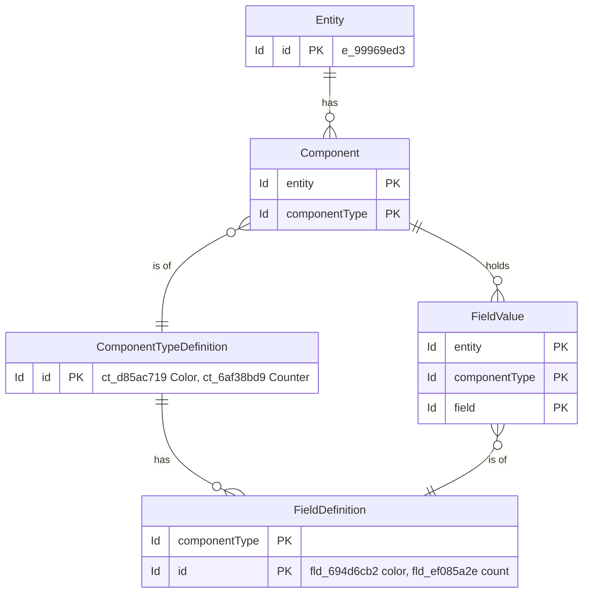
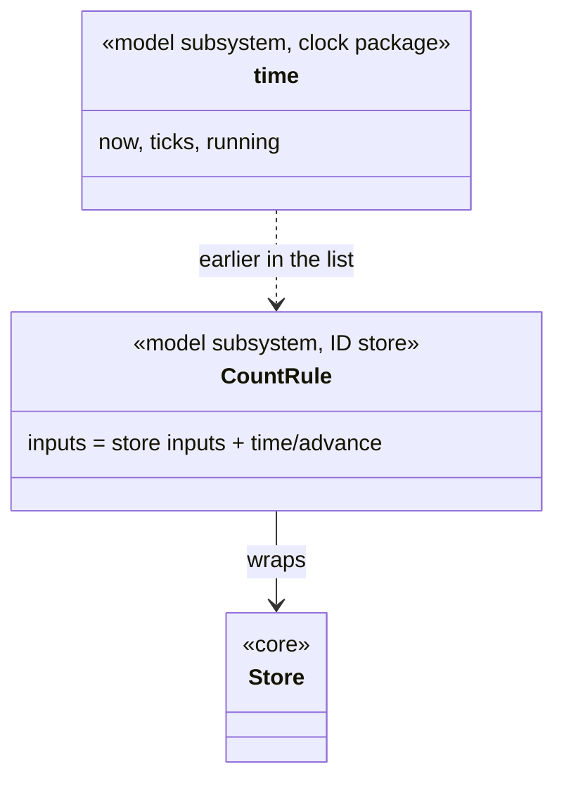
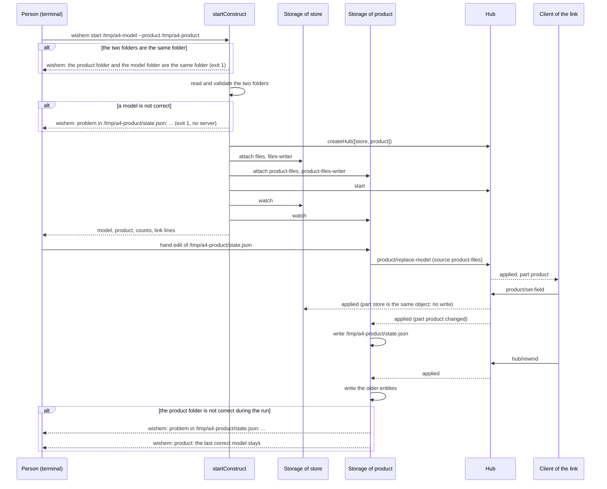
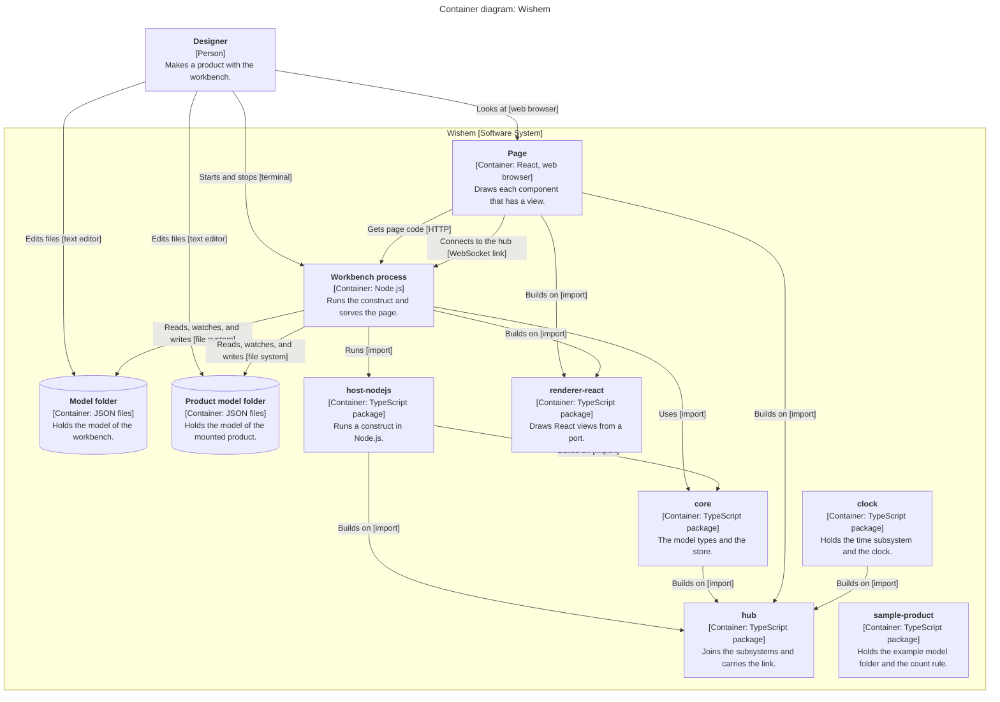

# Design

## Context

See `proposal.md` for the reason. The architecture is in [#527](https://github.com/twin-digital/opus/issues/527). The lead agent did the brainstorm alone and made each decision below, as `nodejs/wishem/docs/autonomous-flow.md` permits. No decision meets the three conditions of "When to ask the owner": each one is in private code or in a text that a later change can alter. The UI decision is under "UI options for the owner", so that the owner can overrule it in the review of the milestone.

The current state on `main`:

- `createStore({ id, model })` of `core` already takes an ID. The input types of a store are `<id>/replace-model`, `<id>/add-entity`, `<id>/remove-entity`, and `<id>/set-field`. No construct uses an ID other than `store`.
- `startConstruct({ folder, port, log, onWatchError })` of `host-nodejs` makes a hub with one store and attaches one storage subsystem (`attachModelFolderStorage`). The storage subsystem has the fixed store ID `store` and the fixed subsystem IDs `files` and `files-writer`. It holds the write of `state.json` while the definitions of the store differ from the files (#570). It writes no definition file (#577).
- `cli.ts` prints the counts of `read().store`. `workbench-app/scripts/start.ts` reads the definitions of `store` for the generator of the view types.
- A rewind (`hub/rewind`) restores each model subsystem. Its hub event is `applied`. The storage subsystem writes `state.json` after it (owner decision of 2026-11-27, comment on #533).
- `clock/src/globals.d.ts` declares `setInterval` and `clearInterval`. A package that reads `clock.ts` through the `source` condition with `"types": []` does not compile that file (#561). The clock measures the real time from `startClock`, also when the hub starts later (#561).

The owner decisions that bind this design:

- For the MVP, the hub of each construct is in a Node.js process. Each renderer uses the link.
- The workbench has its own construct. Its store holds the authored state of the mounted product, and a storage subsystem keeps it in files. A product construct has no storage subsystem. It gets the product model from the construct manager as inputs (#538).
- A rewind restores each model subsystem. In the workbench construct, it is an undo of the authored state.
- A definition change through the hub is not written to definition files yet (#577). The storage subsystem holds the write of `state.json` while the definitions differ (#570).

This change is planned on the state of `workbench-app` after [#534](https://github.com/twin-digital/opus/issues/534). See "What this change needs from #534".

## Goals / Non-Goals

**Goals:**

- One product that each later change of the milestones A4 and A5 can mount, run, and draw.
- The data form of a mount: where the product model is in the workbench construct, and how it stays separate.
- Each model in its own folder, with all rules of the model folder for each one.
- A person names the product folder when the workbench starts.

**Non-Goals:**

- A list of the things of the product on the page, or an edit form (#537).
- The model subsystem that holds the list of product constructs, the construct manager, and a product construct (#538).
- Controls of time in the workbench, and the page of a product construct (#539).
- Views of the sample product for a renderer (#539, #540, #541, #542). See Decision 8.
- More than one mounted product. A project has one product.
- A write of definition files (#577), and a permission for `hub/rewind`.

## Decisions

### 1. A mount is a second store with the ID `product`

When a product is mounted, the workbench construct has two stores: `createStore({ id: 'store', model: workbench })` first and `createStore({ id: 'product', model: product })` second. The joined state has the parts `store` and `product`. The inputs of the product are `product/replace-model`, `product/add-entity`, `product/remove-entity`, and `product/set-field`.

- Reason: each store validates its own model. A product entity with a component type of the workbench is then not correct in the store `product`, so the product model refers to nothing of the workbench (the glossary term **Mount**). The part `product` is the same object after each input to `store`, and the construct manager (#538) can compare it by identity.
- The name `store` stays for the workbench. Thus the page, the generator of the view types, `cli.ts`, and each test guide that reads `store` keep their meaning.
- In a product construct (#538), the product model is in the store `store`, because that construct is a construct of the product. The ID `product` exists only in the workbench construct.
- Alternative: one store that holds the two models under two keys. Rejected: the store validates one model, so a reference from the product to the workbench would be correct, and each input of the store would make a new part for the two models.
- Alternative: a store with the ID `workbench` and a store with the ID `product`. Rejected: it renames the part that the page, the scripts, and the test guides read, with no gain now.
- Alternative: the ID of the product store from the name of the product. Rejected: a project has one product, and a fixed ID gives each later change one name to read.

### 2. Each store has its own storage subsystem and model folder

`attachModelFolderStorage` gets the options `storeId` (default `store`) and `subsystemIds` (default `files` and `files-writer`). `startConstruct` attaches one storage subsystem for `store` with the model folder, and one for `product` with the product folder, with the IDs `product-files` and `product-files-writer`.

- Each rule of `wishem/host-nodejs/model-folder` applies to each storage subsystem alone: the follow of hand edits, the last correct model, the write of `state.json`, the hold of #570, the line at a stop, and the write after a rewind.
- The storage subsystem of one store reads only its own part. An `applied` event for an input of the other store finds its part unchanged by identity and writes nothing (the check `checked?.store === store` of `model-folder-storage.ts`).
- The product folder and the model folder must be different folders (`path.resolve` gives different values). Reason: two writers of one `state.json` would write over each other. A product folder inside the model folder is permitted: the watch of the model folder sees a change of a folder name only, and its read gives the same model, so it sends no input.
- Alternative: one storage subsystem for the two folders. Rejected: the hold, the queue of writes, and the lines are for one folder, and two of them make each rule harder.

### 3. The start commands name the product folder

`wishem start <folder> --product <folder>` and the `start` script of `workbench-app` (`--product <folder>`) give the product folder. With no option, the construct has no part `product`, as now. The `start` script resolves a relative path from `INIT_CWD`, as it does for `--model`.

- The mount is not a record of the workbench model. Reason: only the storage subsystem knows that a model is in files (rule of "Storage" in `concepts.md`). A path in the authored model would put a file name in the model.
- No default product. Reason: the workbench is not a part of one product, and `workbench-app` gets no dependency on the sample product. The test guide gives the path of the sample product.
- Alternative: a package name, such as `--product @thrashplay/wishem-sample-product`. Rejected: a product of a designer is a folder, not a package.
- Alternative: the sample product as the default of `workbench-app start`. Rejected: see above. A later change can add a default when the workbench has a product picker.

### 4. Each line names the product

- At the start, the commands print `wishem: product <absolute path>` after `wishem: model <path>`. `wishem start` prints `wishem: product: <counts>` after the counts of the model.
- Each problem of a product file names the absolute path of the file, for example `wishem: problem in /tmp/a4-product/state.json: ...`. The storage subsystem of the product sets `source` to the absolute path before it formats the problem. At the start, `startConstruct` does the same before it throws the `ModelError`, so the `wishem` command and the `start` script print the same lines.
- Each other line of the storage subsystem of the product starts with `wishem: product: `, for example `wishem: product: the last correct model stays`. `startConstruct` gives that storage subsystem a `log` that puts `product: ` after `wishem: `.
- The lines of the workbench model do not change. Reason: the test guides of A1 and A2 stay true.
- Alternative: a relative source such as `product/state.json`. Rejected: a folder with the name `product` does not exist.

### 5. The sample product is the package `sample-product`

The package `@thrashplay/wishem-sample-product` is in `nodejs/wishem/sample-product`, as the table of packages of #527 says. It is private. It holds:

- `model/definitions/` with two files and `model/state.json` (see "Data Model").
- `src/ids.ts`: the IDs of the model.
- `src/count-rule.ts`: `withCountRule`.
- `src/index.ts`: the barrel.
- Tests and a README.

The root entry uses no Node.js API. The package has `tsconfig.options.json` with `"types": []`, as `core`, `hub`, and `clock` have. It depends on `@thrashplay/wishem-core` and `@thrashplay/wishem-hub`. It has `@thrashplay/wishem-clock` as a development dependency for its tests.

- The package exports no path of its model folder. Reason: that needs `node:url`, and a product construct gets the product model from the construct manager, not from files (owner decision). A test or a script finds the folder at `nodejs/wishem/sample-product/model`, or from `import.meta.resolve('@thrashplay/wishem-sample-product/package.json')`.
- The tests read the model files as JSON modules (`import state from '../model/state.json' with { type: 'json' }`) and validate them with `validateModel`. Reason: a read with `node:fs` needs Node.js types, and those types hide the fault of #561 in the type check.
- Alternative: the model as TypeScript data. Rejected: the workbench construct keeps the product model in files, and a person edits those files.

### 6. The count rule wraps the store

`withCountRule(store)` returns a model subsystem with the ID of the store. Its `inputs` are the inputs of the store and `time/advance`. For each input of the store, it calls the store. For `time/advance`, it finds each entity with a `Counter` component whose `count` matches `^(0|[1-9][0-9]*)$`, and calls the store with one `<id>/set-field` input for each one, with the value plus 1. It changes no other value and refuses no tick. When no count changes, it returns the same part.

- The `time` subsystem must be earlier in the list of subsystems than the wrapped store, so that the two parts advance in one input. The rule does not read the part `time`.
- Reason: a rule is in a model subsystem (rule R1). The record holds only the ticks, so a rewind and a replay give the same counts (rule R3). The store validates each new value. No subsystem addresses a different subsystem (rule R20). #540 uses the same pattern (`withColorRule`).
- Add 1, not a copy of `ticks`. Reason: a count that the designer sets in the workbench (#537) is the start value in a product construct (#539), and the next tick continues from it.
- A value that is not a decimal integer stays. Reason: a refused tick would refuse the input for each model subsystem, and the time of the construct would stop.
- The value is a string, because `string` is the one field type. A number type is a later change.
- Alternative: the count in a part of its own. Rejected: a view gets the fields of its component, so no renderer could draw it.
- Alternative: an input subsystem that sends `set-field` after each tick. Rejected: it puts a rule in an I/O subsystem (rule R1).

### 7. The model of the sample product

One entity has two components: `Color` with the field `color` (`#1d4ed8`) and `Counter` with the field `count` (`0`). The color is a hex color of the form `#rrggbb`, which React, PixiJS, and Godot read. No rule changes the color.

- Two component types, not one with two fields. Reason: each renderer of #542 can attach a view to one of them, and the panel of #537 shows an entity with more than one component.
- The model does not validate the form of the color. A view that gets a value that is not a color draws nothing for it (the rule of #540).

### 8. The views of the sample product wait

This change adds no view to the sample product. Rule R7: the first change that runs a product construct with a renderer adds the views to `sample-product/views-<renderer>/`. The count gives #542 a value that changes at each tick, and the color gives a value that a view of each renderer can draw.

### 9. The two corrections of the clock from #561

- `clock.ts` declares `setInterval` and `clearInterval` itself, and `globals.d.ts` is removed. The type check of `sample-product`, which has `"types": []` and imports the clock in its tests through the `source` condition, is the proof.
- The listener of the clock sets the last measured time to `now()` on the `started` event.
- These items are in this change because the comment on #536 assigns them to it. The first item blocks the type check of `sample-product`. The second item gives correct ticks to the first construct that starts a clock before `hub.start()`, which is the order of `startConstruct`. The other items of #561 stay in #561.

### 10. A rewind is an undo of the two models

A rewind restores `store` and `product` together. Each storage subsystem writes its own `state.json` when the entities differ from its file. No new code: the rule exists for each storage subsystem. The owner decision of 2026-11-27 applies to each of the two models. The limit that the owner noted applies also: a rewind returns the full authored model of the two folders to the earlier point, and writes the older entities over a hand edit that came between.

### 11. The page does not change

The page reads the part `store`. The part `product` is in the joined state on the link, and the page ignores it. See "UI options for the owner".

### 12. The diagrams are changed after #534

The container diagram and the README of the architecture are changed by #534 (the container `renderer-react`). This change adds to that state. The delta of `wishem/architecture/diagrams` copies the requirement "The container diagram" with the scenario of #534. See "What this change needs from #534".

### 13. The blueprint gets the data form of a mount

- `glossary.md`, **Mount**: the product model is the store `product` of the workbench construct, which validates it alone. A storage subsystem keeps it in a folder of its own. The label stays **Proposed** until the owner reviews the milestone.
- `glossary.md`, **Authored state**: the stores of the workbench construct hold it (`store` and `product`), and a storage subsystem keeps each one.
- `concepts.md`, "Workbench and product": the first item says that the workbench construct has the store `store` for the model of the workbench and the store `product` for the mounted product. "Storage": the authored state is the state of the stores of the workbench construct.
- `nodejs/wishem/CLAUDE.md`: the list of packages gets `sample-product`.

## Interfaces

Owner: `@thrashplay/wishem-host-nodejs`.

```ts
// src/model-folder-storage.ts (internal to the package)
export interface ModelFolderStorageOptions {
  folder: string
  hub: Hub
  first: Model
  log: (line: string) => void
  onWatchError?: (error: Error) => void
  /** The ID of the store that this storage subsystem keeps. Default `store`. */
  storeId?: string
  /** Default `{ input: 'files', output: 'files-writer' }`. */
  subsystemIds?: { input: string; output: string }
  /** When `true`, the source of each problem is the absolute path of its file. Default `false`. */
  absoluteSources?: boolean
}

// src/start-construct.ts, exported from the root entry
export const PRODUCT_ID = 'product'
export const PRODUCT_FILES_ID = 'product-files'
export const PRODUCT_FILES_WRITER_ID = 'product-files-writer'

export interface ConstructOptions {
  folder: string
  /** The folder of the product model to mount as the store `product`. It must be a different folder from `folder`. */
  product?: string
  port?: number
  log?: (line: string) => void
  onWatchError?: (error: Error) => void
}

export interface Construct {
  url: string
  linkUrl: string
  /** Its store `store` holds the model. With `product`, its store `product` holds the product model. */
  hub: Hub
  close(): Promise<void>
}

/**
 * Rejects with a `ModelError` when a model is not correct at the start. A problem of the product names the
 * absolute path of its file. Rejects with an `Error` when `product` is the same folder as `folder`.
 */
export const startConstruct: (options: ConstructOptions) => Promise<Construct>
```

Owner: `@thrashplay/wishem-sample-product`, root entry. It uses no Node.js API.

```ts
import type { Id, Model } from '@thrashplay/wishem-core'
import type { ModelSubsystem } from '@thrashplay/wishem-hub'

export const COLOR_TYPE: Id // 'ct_d85ac719-7dd0-45d8-bf98-0da9e6ab0512'
export const COLOR_FIELD: Id // 'fld_694d6cb2-97e8-444e-961e-aa76744837fb'
export const COUNTER_TYPE: Id // 'ct_6af38bd9-a91d-49d9-9370-fa4e6c04769d'
export const COUNT_FIELD: Id // 'fld_ef085a2e-22ef-4409-bac4-9cd5648d0705'
export const SAMPLE_ENTITY: Id // 'e_99969ed3-f499-4dbb-bf6d-958db4542884'

/**
 * Returns a model subsystem with the ID of `store`. It applies each input of the store as the store does.
 * For each `time/advance`, it adds 1 to each `count` of a `Counter` component that is a decimal integer.
 * Put the `time` subsystem before it in the list of subsystems.
 */
export const withCountRule: (store: ModelSubsystem<Model>) => ModelSubsystem<Model>
```

Owner: `@thrashplay/wishem-workbench-app` (`scripts/start.ts`, not exported from the package).

```ts
export interface WorkbenchOptions {
  model?: string
  /** The folder of the product model to mount. Default: no product. */
  product?: string
  port?: number
  hubPort?: number
  views?: string
  viewTypes?: boolean
  log?: (line: string) => void
}
```

The API of `@thrashplay/wishem-clock` does not change.

## Data Model

The product folder has the layout and the schema of a model folder. No entity and no relationship of the schema changes. The new things are a second store of that schema, and the data of the sample product. The diagram shows the entities with the keys of the sample product.



The files of the sample product:

```json
// model/definitions/ct_d85ac719-7dd0-45d8-bf98-0da9e6ab0512.json
{
  "id": "ct_d85ac719-7dd0-45d8-bf98-0da9e6ab0512",
  "label": "Color",
  "fields": [{ "id": "fld_694d6cb2-97e8-444e-961e-aa76744837fb", "label": "color", "type": "string" }]
}
// model/definitions/ct_6af38bd9-a91d-49d9-9370-fa4e6c04769d.json
{
  "id": "ct_6af38bd9-a91d-49d9-9370-fa4e6c04769d",
  "label": "Counter",
  "fields": [{ "id": "fld_ef085a2e-22ef-4409-bac4-9cd5648d0705", "label": "count", "type": "string" }]
}
// model/state.json
{
  "entities": [
    {
      "id": "e_99969ed3-f499-4dbb-bf6d-958db4542884",
      "components": {
        "ct_d85ac719-7dd0-45d8-bf98-0da9e6ab0512": { "fld_694d6cb2-97e8-444e-961e-aa76744837fb": "#1d4ed8" },
        "ct_6af38bd9-a91d-49d9-9370-fa4e6c04769d": { "fld_ef085a2e-22ef-4409-bac4-9cd5648d0705": "0" }
      }
    }
  ]
}
```

The joined state and the subsystems of the workbench construct with a mounted product (new: the store `product` and its two I/O subsystems):

```mermaid
classDiagram
  class Hub {
    read() JoinedState
  }
  class store {
    <<model subsystem>>
    authored model of the workbench
  }
  class product {
    <<model subsystem, new>>
    authored model of the product
  }
  class files {
    <<input>>
  }
  class files_writer {
    <<output>>
  }
  class product_files {
    <<input, new>>
  }
  class product_files_writer {
    <<output, new>>
  }
  class ModelFolder {
    <<files>>
    model folder
  }
  class ProductFolder {
    <<files, new>>
    product folder
  }
  Hub --> store
  Hub --> product
  files ..> store : store/replace-model
  files_writer ..> store : reads
  product_files ..> product : product/replace-model
  product_files_writer ..> product : reads
  files ..> ModelFolder : watches
  files_writer ..> ModelFolder : writes state.json
  product_files ..> ProductFolder : watches
  product_files_writer ..> ProductFolder : writes state.json
```



The sample product in a product construct (#538 builds it; this change gives the parts):



## The flow of a mount



## Container diagram after the change

New: the container "Product model folder", the relationship from the workbench process to it, and the relationship from the designer to it. The table row of the model folder no longer says "the one store of persisted data". Nothing moves or is removed. The system context diagram does not change. The dynamic diagram and the component diagram of the page do not change, because the page does not draw the product.



- The package `sample-product` is a container with no relationship, because its imports are type-only. It imports only types from `core` and `hub`. Its table row says that it holds `model/` and `withCountRule`, and that `model/` is the example product model folder. The table row of the product model folder names `@thrashplay/wishem-sample-product` (`model/`) as the example folder.
- The entity diagram of the model folder applies to the two folders. Its title and its files do not change. The prose says that the product folder has the same entities.

## Failure Modes

| Failure                                                                           | Behavior                                                                                                                                                                               | Recovery                                                                               |
| --------------------------------------------------------------------------------- | -------------------------------------------------------------------------------------------------------------------------------------------------------------------------------------- | -------------------------------------------------------------------------------------- |
| `--product` is the model folder                                                   | `startConstruct` rejects before it reads a folder. The command prints the line and stops with exit code 1.                                                                             | Give a different folder.                                                               |
| `--product ""` or `--product` with no value                                       | `wishem start` prints the usage line and stops with exit code 2. The `start` script prints the error of the option and stops with exit code 1.                                         | Give a folder.                                                                         |
| The product folder does not exist or is not correct at the start                  | `ModelError` with the problems of the two folders. No hub, no server, no watch. The port of the hub stays free.                                                                        | Correct the folder and start again.                                                    |
| The product folder is not correct during the run                                  | The storage subsystem of the product prints each problem and `wishem: product: the last correct model stays`. The part `product` does not change. The workbench model is not affected. | Save a correct file. The terminal prints `wishem: product: the model is correct: ...`. |
| The watch of the product folder fails                                             | The line `wishem: product: the watch failed: ...`, and `onWatchError`. The `wishem` command closes the construct and stops with exit code 1, as for the model folder.                  | Start again.                                                                           |
| The port is in use                                                                | `startConstruct` closes the two storage subsystems and the link server, then rejects.                                                                                                  | Free the port.                                                                         |
| The watch of the product fails at the start, after the watch of the model started | `startConstruct` stops the hub, closes the two storage subsystems, the link server, and the server, and rejects.                                                                       | Start again.                                                                           |
| A write of the product `state.json` fails                                         | The line names the absolute path of the file. The process continues. The next change writes again.                                                                                     | Make the folder writable.                                                              |
| `construct.close()` is called two times, or during a read of the product folder   | The same promise. Each storage subsystem waits for its own queue and closes its ports one time.                                                                                        | None needed.                                                                           |
| The definitions of the product differ at the stop                                 | One line `wishem: product: the process stops, and the model folder does not hold the last changes of the store`.                                                                       | None. The behavior of #570.                                                            |
| A rewind past a hand edit of the product folder                                   | The older entities are written over the file. This is the owner decision of 2026-11-27.                                                                                                | Rewind again to the later point, or edit the file again.                               |
| The count is not a decimal integer                                                | The tick applies. The count stays.                                                                                                                                                     | Set a decimal integer.                                                                 |
| The clock starts before the hub                                                   | The ticks before the start are refused with `not-running`. At `started`, the clock measures from the start, so no late ticks come.                                                     | None needed.                                                                           |

Idempotence: `close()` gives one promise. Each storage subsystem closes its ports one time. A read of a folder whose content did not change sends no input. A `set-field` with the current value returns the same part, so no write follows. A tick with no count to change returns the same part.

## Example

```text
$ pnpm --filter @thrashplay/wishem-workbench exec wishem start /tmp/a4-model --product /tmp/a4-product
wishem: model /tmp/a4-model
wishem: product /tmp/a4-product
wishem: 1 component type, 1 entity
wishem: product: 2 component types, 1 entity
wishem: link at ws://127.0.0.1:4747/link
```

A product file that is saved in part during the run:

```text
wishem: problem in /tmp/a4-product/state.json: the text is not valid JSON (line 6)
wishem: product: the last correct model stays
```

Errors at the start:

```text
$ pnpm --filter @thrashplay/wishem-workbench exec wishem start /tmp/a4-model --product /tmp/a4-model
wishem: model /tmp/a4-model
wishem: product /tmp/a4-model
wishem: the product folder and the model folder are the same folder

$ echo '{ nope' > /tmp/a4-product/state.json
$ pnpm --filter @thrashplay/wishem-workbench exec wishem start /tmp/a4-model --product /tmp/a4-product
wishem: model /tmp/a4-model
wishem: product /tmp/a4-product
wishem: problem in /tmp/a4-product/state.json: the text is not valid JSON (line 1)
wishem: the model is not correct, so the hub did not start
```

An input to the product through the link (the protocol of `hub/LINK.md`):

```json
{
  "t": "submit",
  "request": 1,
  "subsystem": "raw-12345",
  "input": {
    "type": "product/set-field",
    "payload": {
      "entity": "e_99969ed3-f499-4dbb-bf6d-958db4542884",
      "componentType": "ct_6af38bd9-a91d-49d9-9370-fa4e6c04769d",
      "field": "fld_ef085a2e-22ef-4409-bac4-9cd5648d0705",
      "value": "7"
    }
  }
}
```

Result: `{"t":"result","request":1,"result":{"ok":true,"seq":1}}`. The same input with `"componentType": "ct_3f2a9c1e-8b47-4d0a-9e51-6c2f7a1b0d34"` (`AppBar`) gives `{"ok":false,"reason":"invalid","problems":[...]}`.

The count rule in code (the README of `sample-product` holds this example, and a test runs it):

```ts
import { createStore } from '@thrashplay/wishem-core'
import { createHub } from '@thrashplay/wishem-hub'
import { createTime, timeInputs } from '@thrashplay/wishem-clock'
import { withCountRule } from '@thrashplay/wishem-sample-product'

const hub = createHub({ subsystems: [createTime(), withCountRule(createStore({ model }))] })
hub.start()
const controls = hub.attach({ id: 'controls', kind: 'input' })
await controls.submit(timeInputs.advance(100))
// The count of the sample entity is now '1'.
```

## Package Impact

| Package                             | Published or private | Bump  | Reason                                                                                                            |
| ----------------------------------- | -------------------- | ----- | ----------------------------------------------------------------------------------------------------------------- |
| `@thrashplay/wishem-sample-product` | Private (new)        | minor | New package: the model folder, the IDs, and the count rule.                                                       |
| `@thrashplay/wishem-host-nodejs`    | Private              | minor | `startConstruct` and `wishem start` mount a product. The storage subsystem keeps a store that is named by its ID. |
| `@thrashplay/wishem-workbench-app`  | Private              | minor | The `start` script has the option `--product`.                                                                    |
| `@thrashplay/wishem-clock`          | Private              | patch | The timer declarations move into `clock.ts`. The clock measures from the `started` event.                         |

No other package changes. `core`, `hub`, `renderer-react`, and `workbench` get no change. `workbench` keeps its `start` script (`wishem start ./model`).

## UI

This change adds no UI and changes no UI. It adds no component and no design token. The style guide does not change. The screenshot baselines of `workbench-app` must not change. The page with a mounted product looks the same as the page with no product: the app bar and the zero state.

### UI options for the owner

The question: what does the page show of the mounted product in this change?

| Option                                | What the person sees                                                                                                   | Cost                                                                                                |
| ------------------------------------- | ---------------------------------------------------------------------------------------------------------------------- | --------------------------------------------------------------------------------------------------- |
| A. Nothing new on the page (selected) | The terminal names the product folder and its counts. The page is the same. #537 adds the panel that lists the things. | None.                                                                                               |
| B. The zero state names the product   | The text below the app bar is `1 entity in the product.` instead of `Nothing to show yet.` with a mounted product.     | A change to `Page.tsx` (which #534 changes), new screenshot baselines, and text that #537 replaces. |
| C. A status chip in the app bar       | The app bar shows a chip `product: 2 component types, 1 entity` at its right end.                                      | A new component in the style guide in each state and theme, and a change to the `AppBar` view.      |

Wireframe of option A (the same as now):

```text
+------------------------------------------------------+
| wishem.                                              |  app bar (entity of the workbench)
+------------------------------------------------------+
|                                                      |
|                 Workbench                            |  zero state
|                 Nothing to show yet.                 |
|                                                      |
+------------------------------------------------------+
```

Choice: option A. Reason: #537 builds the panel that lists the entities of the mounted product, and a summary now is UI that #537 removes (rule R7). The person sees the mount in the terminal, and the test guide shows the part `product` through the link. The owner can select B or C in the review of the milestone; each one is a small change after #537.

## Risks / Trade-offs

- [JSON modules in the tests of `sample-product`] → `import ... with { type: 'json' }` needs `resolveJsonModule` in `tsconfig.options.json` of the package, and the tests import files outside `src/`. If the type check or the build refuses it, Task 1 adds `model/**/*.json` to the `include` of the type check only, and reports it. The model check must not use `node:fs`, or the proof of the #561 fix is lost.
- [Two watches for each construct] → A mounted product doubles the watchers of the file system (two folders and two `definitions` folders). Four watchers are far below the limits of Linux and macOS.
- [A larger joined state on each link] → The `welcome` message holds the part `product`. Each `applied` message holds only the changed parts, so an input to one store does not send the other part.
- [The clock correction changes the behavior of a clock that starts before the hub] → No construct starts a clock now. The test guide of A2 starts each clock after `hub.start()`, so its results do not change.
- [Rewind writes over a hand edit in the product folder] → The owner accepted this for the workbench model (comment on #533). The test guide shows it.
- [The test guides of A1 change] → The usage line of `wishem` gets `[--product <folder>]`. Task 2 changes that line in `milestones/a1-construct.md`. No other line of A1 or A2 changes.
- [A merge with #534 and with other changes of A4] → `pnpm-lock.yaml` and the root `README.md` package list conflict when two changes add a package. Make them again after the first merge.

## Migration Plan

No data and no deployment. A folder with no product keeps the old behavior. Rollback is the revert of the pull request.

## What this change needs from #534

- The merge of #534 before Task 3 starts. Task 3 changes `docs/architecture/README.md`, `render.mjs`, and the SVG files of the container diagram, which #534 changes (the container `renderer-react`). The delta of `wishem/architecture/diagrams` copies the requirement "The container diagram" with the scenario that #534 adds.
- The state of `workbench-app` after #534: `connectHub({ onPort })`, `Page` with a `port`, and no `src/renderer/`. This change does not use or change these files. The page ignores the part `product`, because `Renderer` reads only the part `store`.
- `scripts/start.ts` is the same file before and after #534, so Task 3 can start on either base. `workbench-app/README.md` is changed by #534. Task 3 adds its lines to the version of #534.
- Tasks 1 and 2 do not depend on #534.

## The test guide

The final reviewer does these steps on the branch, with real processes and real files, and reports the result of each step. Run each command from the root of the repository. "Terminal 1" runs the construct. "Terminal 2" runs the other commands.

Setup:

```sh
pnpm install
pnpm build --filter "@thrashplay/wishem-*"
rm -rf /tmp/a4-model /tmp/a4-product
cp -r nodejs/wishem/workbench/model /tmp/a4-model
cp -r nodejs/wishem/sample-product/model /tmp/a4-product
```

Result: the build ends with no failed task. `/tmp/a4-product` holds `state.json` and two files in `definitions`.

1. **The sample product alone.** In terminal 1: `pnpm --filter @thrashplay/wishem-workbench exec wishem start /tmp/a4-product`. Result: `wishem: 2 component types, 1 entity`. Stop with Ctrl+C.
2. **Start with a mounted product.** In terminal 1: `pnpm --filter @thrashplay/wishem-workbench exec wishem start /tmp/a4-model --product /tmp/a4-product`. Result: the five lines of "Example", in that order.
3. **The two parts on the link.** In terminal 2: `node nodejs/wishem/docs/milestones/a1-construct/raw-link.mjs --once`. Result: the `welcome` line holds `"store":{` with `AppBar` and `"product":{` with `Color`, `Counter`, `#1d4ed8`, and `"0"`.
4. **An input to the product, then the file.** In terminal 2, send the `product/set-field` of "Example" with `raw-link.mjs --once --send '<the input>'`. Result: `"ok":true,"seq":1`. Then `grep -c '"7"' /tmp/a4-product/state.json` gives `1`, and `git diff --no-index nodejs/wishem/workbench/model/state.json /tmp/a4-model/state.json` gives no output.
5. **A hand edit of the product after the write.** In terminal 2: `sed -i 's/"7"/"8"/' /tmp/a4-product/state.json`, wait one second, then `raw-link.mjs --once`. Result: the `welcome` holds `"8"`. Terminal 1 prints no line.
6. **The product refers to nothing of the workbench.** Send `product/set-field` with the component type and the field of `AppBar` (`ct_3f2a9c1e-8b47-4d0a-9e51-6c2f7a1b0d34`, `fld_b81d04e7-2c6f-4a39-8d15-0e9a7f3c5b62`) and the entity of the product. Result: `"ok":false,"reason":"invalid"`. The file does not change.
7. **A rewind is an undo of the product.** Run `node nodejs/wishem/docs/milestones/a2-time/rewind-client.mjs --seq 0`. Result: `result: {"ok":true,...}`. After one second, `/tmp/a4-product/state.json` holds `"0"`, and `/tmp/a4-model/state.json` still has the title `Wishem`.
8. **A product file that is not correct.** `sed -i 's/"0"/"0",/' /tmp/a4-product/state.json`. Result in terminal 1: `wishem: problem in /tmp/a4-product/state.json: the text is not valid JSON (line N)`, where N is the line that the parser names, and `wishem: product: the last correct model stays`. Then `sed -i 's/"0",/"0"/' /tmp/a4-product/state.json`. Result: `wishem: product: the model is correct: 2 component types, 1 entity`.
9. **A definition change of the product holds only the product.** Send `product/replace-model` with the label `Count` for the component type `Counter` (the full model, as `link-client.mjs --label` does for `store`), then `store/set-field` for the title `Second`. Result: terminal 1 prints `wishem: product: the definitions of the store differ from the files in definitions, so state.json is not written` one time. `/tmp/a4-model/state.json` holds `Second`. `/tmp/a4-product/state.json` does not change.
10. **A stop and a start.** Press Ctrl+C in terminal 1. Result: the last line is `wishem: product: the process stops, and the model folder does not hold the last changes of the store`. Start again with the command of step 2. Result: the counts are the same, and `raw-link.mjs --once` shows the title `Second` and the label `Counter`.
11. **The same folder.** `pnpm --filter @thrashplay/wishem-workbench exec wishem start /tmp/a4-model --product /tmp/a4-model`. Result: `wishem: the product folder and the model folder are the same folder`, exit code 1.
12. **A product that is not correct at the start.** `echo '{ nope' > /tmp/a4-product/state.json`, then the command of step 2. Result: the four lines of "Errors at the start". Put the copy back with `rm -rf /tmp/a4-product && cp -r nodejs/wishem/sample-product/model /tmp/a4-product`.
13. **The workbench with a mounted product.** In terminal 1: `pnpm --filter @thrashplay/wishem-workbench-app start --model /tmp/a4-model --product /tmp/a4-product`. Result: `wishem: model /tmp/a4-model`, `wishem: product /tmp/a4-product`, the link line, and the page line. `node nodejs/wishem/docs/milestones/a1-construct/raw-link.mjs --url ws://127.0.0.1:5173/link --once` shows the two parts. A web browser at `http://127.0.0.1:5173/` shows the app bar and the zero state, as with no product. The browser console has no error.
14. **The workbench with no product.** Stop terminal 1, and start the workbench with no `--product`. Result: no `product` line, and the `welcome` has no part `product`.

## Follow-up

- `startWorkbench().close()` in `workbench-app/scripts/start.ts` has no guard for a second call. The `stop` handler calls it one time (`process.once`), so no fault is known.
- A number field type would let the count be a number. The count rule then changes its test of the value.
- The views of the sample product, one folder for each renderer, with the first change that draws a product construct (Decision 8).
- The definition files of the product folder are not written after a definition change through the hub. #577 covers each storage subsystem, and so also the product folder.
- `hub/rewind` has no permission. A client of the link can rewind the two models of the workbench. The comment of the owner on #533 records it.
