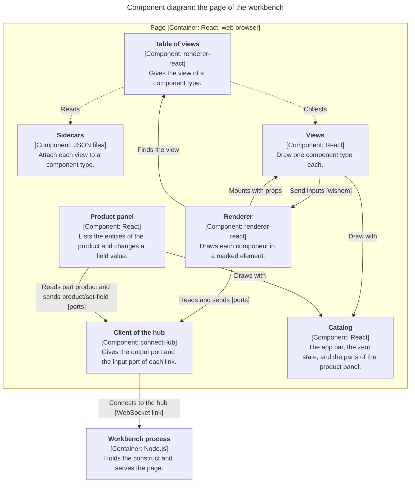

# Design

## Context

See `proposal.md` for the reason. The architecture is in [#527](https://github.com/twin-digital/opus/issues/527). The lead agent did the brainstorm alone and made each decision below, as `nodejs/wishem/docs/autonomous-flow.md` permits. No decision meets the three conditions of "When to ask the owner": each one is in private code, in a page that a later change can alter, or in text of the blueprint. The UI decision is under "UI options for the owner", so that the owner can overrule it in the review of the milestone.

The current state on `main` (`24fbcffc`):

- The workbench construct has the store `store` and, with `--product`, the store `product` and the construct list `constructs` (#536, #538). The storage subsystem of the product writes the `state.json` of the product folder after each change of the part `product`. The construct manager sends each change of the part `product` to each running product construct as `store/set-field` inputs, or as one `store/replace-model` (#538, Decision 7).
- The page (`workbench-app/src/Page.tsx`) draws the `Renderer` of `renderer-react` from the output port and shows the zero state below it. The `Renderer` reads only the part `store`. The page ignores the parts `product` and `constructs`.
- A view sends inputs through the prop `wishem`. The input port of the page is the input subsystem `page-<hex>-input`, so the record gives one source for each load of the page (#535, Decision 7). `createViewTools` holds the rule "one outcome, never a rejection" in the private function `send` of `renderer-react/src/view-tools.ts`.
- The field types are `string`, `number`, `boolean`, and `reference` (#535). The count of the sample product has the type `number` (#609). A reference names an entity of the same model.
- #535 Decision 13 leaves to this change the question of a part other than `store`: "A renderer that draws a different part (the mounted product of #536) is a decision of #537."
- The style guide shows each catalog component in each state, in the two themes, with screenshot tests and axe tests in the pinned browser in Docker (`scripts/browser-server.ts`). The Playwright project `workbench` runs `scripts/e2e-server.ts` with no product.
- The concepts say: "A table and an inspector for any registered kind are derived from its declaration. A hand-built panel is the exception." (**Proposed**). The wireframe `examples/editor-after-whistle-request.html` has a tab "Entities" and an "Inspector" with label and value rows.

## Goals / Non-Goals

**Goals:**

- The designer sees each entity of the mounted product in the page, and changes one field value of one entity, of each of the four field types.
- Each change is one input to the workbench construct, with the source of the page in the record. The storage subsystem writes it. A running product construct gets it.
- The tool follows each other change of the part `product` (a hand edit, a rewind, a client of the link) with no reload.
- Each new component is in the style guide in each state, with screenshot tests and axe tests.

**Non-Goals:**

- Add or remove an entity or a component, or change a definition, in the page. The tool changes field values only.
- Clear a field value. The store has no input for it (#535 Follow-up).
- Draw the picture of the product in the workbench page, or controls of a product construct (#539).
- An undo control in the page (#582).
- Provenance of the change in the authored state (concepts "Provenance"). The record holds the source. See Follow-up.
- A table of the entities of one component type (concepts "Tools"). See Follow-up.
- A change of the link protocol, the hub, the store, or the storage subsystem.

## Approaches

Three ways to show the product in the page were considered:

- **A. A tool of the page that is derived from the definitions (selected).** A component of `workbench-app` reads the part `product` through the output port, and makes the list and the inspector from the definitions and the entities. It sends `product/set-field` through the input port. It needs no view of the product and no change of the renderer. It is the "inspector derived from the declaration" of the concepts.
- **B. A view of a workbench component type.** A component type `ProductPanel` in the workbench model, with a React view. Rejected: a view gets only the fields of its own component (rule "A view is a pure function of its props", **Agreed**). The view cannot read the part `product`, and a field that copies the product model into the workbench model would put the product in the workbench model, against the glossary term **Mount**.
- **C. A second `Renderer` that draws the part `product` with views of the product.** Rejected: the sample product has no React views (#536 Decision 8), a picture of the product is the job of #539, and a picture does not give a form for each field. The `Renderer` would also need an option for the part and for the prefix of its inputs.

## Decisions

### 1. The product panel is a tool of the page, not a view

`src/tools/ProductTool.tsx` reads the part `product` with `usePart(port, 'product')` (`useSyncExternalStore` on `port.subscribe` and `port.read`, as the `Renderer` does). It keeps the ID of the selected entity as React state. It gives the model, the selection, and a change function to the catalog component `ProductPanel`. The `Page` shows `ProductTool` when the output port reads a part `product`, and the zero state when it does not.

- Reason: Approach A. The panel is the first tool of the concepts "Tools", and the derived form keeps rule R6: each field has a declaration, so the form needs no code for a product.
- The `Renderer` and its rules do not change. It reads `store` only. This answers #535 Decision 13: no renderer draws the part `product` in the workbench page.
- The folder `src/tools/` holds the parts of the page that read the joined state and send inputs, and that are not views. The catalog (`src/components/`) holds components that get props only, as now.

### 2. The selection is transient state of the page

The ID of the selected entity is React state of `ProductTool`. It is not in the model.

- Reason: it meets the three conditions of transient state of the concepts "Views" now: a reload loses it with no harm, no other part reads it, and no agent exists that needs it. When the agent needs "the thing that the designer selected", the selection moves to the model of the workbench (Follow-up).
- No entity is selected at the start, also with one entity. Reason: the designer acts to select, and the inspector state "nothing selected" is seen and tested.
- When the selected entity is not in the part `product` after an input, `ProductTool` clears the selection and moves the focus to the `nav` of the list, if the focus was in the inspector.

### 3. A commit sends one `product/set-field` through the input port of the page

`ProductTool` sends `{ type: 'product/set-field', payload: { entity, componentType, field, value } }` with `sendInput(input, message)` of `renderer-react`. The source in the record is `page-<hex>-input`, the same source as the title of the app bar.

- Reason: one designer in one page is one source (#535 Decision 7). The issue asks that the record holds the source of the change. The hub already records it, so no new subsystem is necessary.
- The page code imports only types from `core` (`SetFieldPayload` and the model types), as now. Reason: a value import of `storeInputs` would add the relationship from the page to `core` at the container level, for one string. The input type is the constant `PRODUCT_SET_FIELD = 'product/set-field'` in `src/tools/ProductTool.tsx`, and a test of the tool checks that it equals `storeInputs('product').setField(...).type`.
- Alternative: a third subsystem `page-<hex>-product` on the link. Rejected: the record would give two sources for one designer, and the link would carry one more subsystem with no reader.

### 4. `renderer-react` exports `sendInput`

The private function `send` of `view-tools.ts` becomes the export `sendInput(input: InputPort | undefined, message: Input): Promise<InputOutcome>`. `createViewTools` uses it, so its behavior does not change.

- Reason: the views and the product panel give the same outcomes for the same faults (`unknown` after the end of a link, `failed` after a fault of the hub, `not-permitted` with no port), and `outcomeText` makes one text for each. A copy in `workbench-app` would be a second rule that can differ.
- The `InputOutcome` type is already exported.

### 5. `outcomeText` moves to `src/outcome-text.ts` and gets a subject

`src/views/outcome-text.ts` moves to `src/outcome-text.ts`. It gets a second parameter, `subject`, with the default `'the title'`. The text for `unknown` becomes `The connection ended before an answer. Look at ${subject} after it connects.` `ProductTool` gives `'the value'`. The view of the app bar keeps the default, so its texts do not change.

- Reason: the views and the tools both use it. A tool that imports a file of `src/views/` would give the component diagram a relationship from the tools to the views with no meaning. The 535 final review found the same fault for the catalog (finding I2).
- The text for `invalid` stays the message of the first problem. Reason: the panel sends one field at a time, so the first problem is about that field. The panel does not read the path of a problem, so the two roots of the paths of #557 do not matter here. #557 stays open for a form that marks a field from a problem of a different input.

### 6. The name and the short ID of an entity

An entity has no name in the model. The list gives the labels of the component types of its components, in the order of the definitions, with `, ` between them (`Counter, Color`). An entity with no component is `No components`. The short ID is the first 10 characters (`e_99969ed3`), as `link-client.mjs` prints. The inspector shows the full ID.

- Reason: the labels are what the designer sees in the definitions. Two entities with the same component types have the same name, so the short ID is always beside it.
- Alternative: a field `name` of a component type of the product. Rejected: the panel would need a rule for a field that a product does not declare.

### 7. The controls of the four field types

| Type        | Control                                            | Commit                               | Value sent                                        |
| ----------- | -------------------------------------------------- | ------------------------------------ | ------------------------------------------------- |
| `string`    | Text field                                         | Enter, or the focus leaves the field | The text as typed, with no trim                   |
| `number`    | Text field with `inputmode="decimal"`              | Enter, or the focus leaves the field | `Number(text)`, when the trimmed text is a number |
| `boolean`   | Check box                                          | Each change                          | `true` or `false`                                 |
| `reference` | Select with one option for each entity of the part | Each change                          | The ID of the entity of the option                |

- A text field shows the value of the part (`String(value)` for a number) while the designer has no draft. The draft starts at the first keystroke. A commit or Escape ends it.
- A commit of a value that is equal to the current value sends nothing. For a field with no value, an empty text is equal to no value.
- A number text that is empty after a trim, or that gives a number that is not finite, sends nothing and shows "not saved" with `Type a number.` Reason: a string in a number field is never correct, and the message of the store for it names the entity ID and the type, which is not text for a designer. `Number('')` is `0`, so the check of the empty text is explicit.
- A reference field with no value, or with an ID of no entity, has a first option `No value` that is disabled and selected. No option clears a value (Non-Goals).
- A text field and not `<input type="number">`. Reason: the text of the designer stays as typed, so the row can show it with the "not saved" state, and the browser does not change it.
- Alternative: a form with one "Save" button for each component. Rejected: a group of changes would be more than one input or a new input type, and the app bar already commits one field with Enter and a move of the focus.

### 8. The states of a field row

A field row holds its phase as transient state, as the app bar does (#535 Decision 5): `idle`, `saving`, `not-saved`. The tool gives the row `onChange(value): Promise<ChangeOutcome>`. `saving` makes the control read-only (a text field) or disabled (a check box, a select), sets `aria-busy="true"`, and shows the mono label `Saving`. `not-saved` keeps the value of the designer and shows the line `The value is not saved. <reason>` with the role `alert`. An accepted change ends the draft, and the row shows the value of the part. With no `onChange` (no input port), the control is disabled.

- Reason: the same states and words as the app bar, so the designer learns one pattern.

### 9. The page shows the panel in the place of the zero state

With a part `product`, the space below the pictures of the views holds the product panel, and the zero state of the page is not shown. With no part `product`, the page is the same as now, and its screenshot baselines do not change.

### 10. A second workbench server for the Playwright tests

`scripts/e2e-server.ts` gets the option `--product`. With it, the script copies the model folder of `workbench` to `.e2e-product-model/` and the model folder of `sample-product` to `.e2e-product/`, and starts the workbench on the page port 4181, with `product` and no product code. `playwright.config.ts` has two web servers and a third project `product` with `tests/product.spec.ts`. The project `workbench` and its baselines do not change.

- Reason: the tests of the page with no product stay true, and the two servers write different folders.
- The product code is not loaded, so no product construct has rules. The tests of the panel do not need a product construct. The test guide shows a running product construct.
- `.gitignore` gets the entries `nodejs/wishem/workbench-app/.e2e-product/` and `nodejs/wishem/workbench-app/.e2e-product-model/` (entries that name a path in `nodejs/wishem/`, which "Where a change is permitted" permits).

### 11. A script drives the page in the pinned browser

`nodejs/wishem/docs/milestones/a4-workbench/page-driver.mjs` connects to the browser that `scripts/browser-server.ts` starts (`WISHEM_BROWSER_WS_ENDPOINT`, `exposeNetwork: '<loopback>'`), opens the page, runs the steps of its arguments, and prints the state of the panel. The test guide of this change and the test guide of the milestone use it.

- Reason: the browser of the tests is in Docker, and a reviewer has no screen. One script gives the same steps and the same lines on each computer.
- The script is a document of the milestone, as `raw-link.mjs` and `rewind-client.mjs` are. It is not part of a package.

### 12. The blueprint

- `glossary.md`: a new term **Product panel** (**Proposed**): "The tool of the workbench page that lists the entities of the mounted product and changes their field values. It is derived from the definitions of the product. It reads the part `product` and sends `product/set-field`." The term **Tool** gets the sentence "A tool of the page reads the joined state and sends inputs through the ports of the page. It is not a view." (**Proposed**)
- `concepts.md`, "Tools": the item about the table and the inspector gets the sentence "The product panel of the workbench page is the first inspector (#537)." "Views": the selection of the product panel is an example of transient state.
- The terms that the designer sees in the panel are `Entities`, `Inspector`, and the labels of the model. "Entity" is the term of the glossary, and brand.md asks for the plain words of the tool.

## Interfaces

Owner: `@thrashplay/wishem-renderer-react`, root entry.

```ts
import type { Input } from '@thrashplay/wishem-hub'

/**
 * Sends one input through the port. The promise never rejects.
 * With no port, the outcome is `not-permitted` and nothing is sent.
 * A `LinkClosedError` gives `unknown`. Each other error gives `failed`.
 */
export const sendInput: (input: InputPort | undefined, message: Input) => Promise<InputOutcome>
```

Owner: `@thrashplay/wishem-workbench-app` (not exported from the package).

```ts
// src/outcome-text.ts (moved from src/views/outcome-text.ts)
/** `subject` default: 'the title'. */
export const outcomeText: (outcome: Extract<InputOutcome, { ok: false }>, subject?: string) => string

// src/components/entity-name.ts
/** The labels of the component types of the entity, in the order of the definitions, or 'No components'. */
export const entityName: (entity: Entity, definitions: readonly ComponentTypeDefinition[]) => string
/** The first 10 characters of the ID. */
export const shortId: (id: Id) => string

// src/tools/use-part.ts
/** The part of the joined state with this key. Draws again when the part changes by identity. */
export const usePart: (port: PortReader, key: string) => unknown

// src/tools/ProductTool.tsx
export interface ProductToolProps {
  port: PortReader
  /** With no value, each control is disabled. */
  input: InputPort | undefined
}
/** Draws nothing when the port reads no part `product`. */
export const ProductTool: (props: ProductToolProps) => ReactNode

// src/components/FieldRow.tsx
export type ChangeOutcome = { saved: true } | { saved: false; reason: string }
export interface ReferenceOption {
  id: Id
  /** For example `Counter, Color · e_99969ed3`. */
  text: string
}
export interface FieldRowProps {
  field: FieldDefinition
  value: FieldValue | undefined
  /** The options of a `reference` field. */
  options?: readonly ReferenceOption[]
  /** With no value, the control is disabled. */
  onChange?: (value: FieldValue) => Promise<ChangeOutcome>
  /** The first state, for the style guide and the tests. */
  initial?: { state: 'saving' | 'not-saved'; draft: string | boolean; reason?: string }
}

// src/components/EntityList.tsx
export interface EntityListItem {
  id: Id
  name: string
  shortId: string
}
export interface EntityListProps {
  items: readonly EntityListItem[]
  selected?: Id
  onSelect: (id: Id) => void
}

// src/components/EntityInspector.tsx
export interface InspectedComponent {
  definition: ComponentTypeDefinition
  values: Readonly<Record<Id, FieldValue>>
}
export interface EntityInspectorProps {
  /** With no value: the zero state "Select an entity to change it." */
  entity?: { id: Id; name: string; components: readonly InspectedComponent[] }
  options: readonly ReferenceOption[]
  onChange?: (componentType: Id, field: Id, value: FieldValue) => Promise<ChangeOutcome>
}

// src/components/ProductPanel.tsx
export interface ProductPanelProps {
  model: Model
  selected?: Id
  onSelect: (id: Id) => void
  onChange?: (change: SetFieldPayload) => Promise<ChangeOutcome>
}
```

`Page` keeps `PageProps` (`port`, `input`, `views`). The catalog components import types from `core` and nothing from `hub`, `renderer-react`, `src/tools/`, or `src/views/`.

`nodejs/wishem/docs/milestones/a4-workbench/page-driver.mjs`:

```text
Usage, from the root of the repository:
  node nodejs/wishem/workbench-app/scripts/browser-server.ts \
    node ../docs/milestones/a4-workbench/page-driver.mjs [--url <page>] [--width <px>] [--scheme light|dark] <step>...
Default --url http://127.0.0.1:5173/, --width 1280, --scheme light.
Steps, in order:
  select:<short ID>                       click the item of the entity in the list
  type:<Component>.<field>=<text>         fill the text field and press Enter, then wait for the row to leave "saving"
  typeonly:<Component>.<field>=<text>     fill the text field, no commit
  escape:<Component>.<field>              press Escape in the text field
  check:<Component>.<field>               click the check box
  choose:<Component>.<field>=<short ID>   select the option of the entity
  exec:<command>                          run the command in a shell, in the root of the repository
  wait:<ms>
  print                                   print the state now
  shot:<file>                             save a screenshot of the page; the path is from the root of the repository
After the last step, the script prints the state:
  entities: <name> <short ID> [selected]; ...     or   panel: none
  <Component>.<field> = <value of the control> [saving]
  alert: <text of each element with the role alert>
  inspector: <text of the zero state of the inspector>   (when no entity is selected)
Exit code 0, or 1 with the line `error: <message>` when a step fails.
```

The script finds `@playwright/test` with `createRequire` from the working folder (`workbench-app`, which `browser-server.ts` sets). A row is the control in the group (role `group`) with the name of the component type, with the accessible name of the field.

## Data Model

No persisted schema changes, and no domain type of `core` changes. The panel reads the model types of `core` (`Model`, `Entity`, `ComponentTypeDefinition`, `FieldDefinition`) and sends `SetFieldPayload`. The props in "Interfaces" are UI types of `workbench-app`.

## The flow of a change in the panel

```mermaid
sequenceDiagram
  participant D as Designer
  participant T as ProductTool and FieldRow (page)
  participant L as Link (page-hex-input)
  participant H as Workbench hub
  participant P as Store product
  participant S as Storage of the product
  participant M as Construct manager
  participant C as Product construct play

  D->>T: select Counter, Color
  D->>T: type 7 in count, Enter
  T->>T: Number("7") is finite; 7 differs from 0
  T->>T: row phase saving
  T->>L: submit product/set-field {entity, componentType, field, value: 7}
  L->>H: submit
  H->>P: apply
  alt the store accepts
    P-->>H: new part product
    H-->>L: result ok, seq n
    H-->>S: applied (part product changed)
    S->>S: write state.json of the product folder
    H-->>M: applied (part product changed)
    M->>C: store/set-field count 7 (source construct-manager)
    H-->>T: applied, part product
    T->>T: row shows 7, phase idle
  else the store refuses
    P-->>H: problems
    H-->>L: result invalid
    L-->>T: outcome invalid
    T->>T: row not saved, first problem
  end
  alt the link ended
    L-->>T: outcome not-running or unknown
    T->>T: row not saved, keeps 7
  end
  D->>T: type ten in count, Enter
  T->>T: not a number: row not saved, "Type a number.", no input
```

## The architecture document

The change adds a component to the page container. It changes no element and no relationship of the system context level or of the container level, and no entity of a store. The container diagram, the system context diagram, the dynamic diagram, and the entity diagram do not change.

The component diagram of the page changes. New: the component "Product panel" (`[Component: React]`, "Lists the entities of the product and changes a field value."), its relationship to the client of the hub ("Reads part product and sends product/set-field [ports]"), and its relationship to the catalog ("Draws with"). Changed: the description of the catalog ("The app bar, the zero state, and the parts of the product panel."). The description of the diagram says that the page has seven components. Nothing moves or is removed.



The table of the component diagram in `docs/architecture/README.md` gets the row "Product panel | Component: React | `ProductTool` in `src/tools/`. It reads the part `product` from the output port, and it sends `product/set-field` through the input port. It draws `ProductPanel` of the catalog." The text says that the `Page` shows the product panel in the place of the zero state when the part `product` exists. The container diagram already shows the relationships from the page to `hub` and `renderer-react`. The page code imports only types from `core` (Decision 3), so the container diagram gets no relationship from the page to `core`, and it does not change.

## Failure Modes

| Failure                                                   | Behavior                                                                                                                                         | Recovery                                                               |
| --------------------------------------------------------- | ------------------------------------------------------------------------------------------------------------------------------------------------ | ---------------------------------------------------------------------- |
| The workbench process stopped, and the designer commits   | The outcome is `not-running`. The row shows `The value is not saved. The workbench does not run. Start it, and try again.` and keeps the value.  | Start the workbench. The page connects again. Commit again.            |
| The link ends before the `result`                         | The outcome is `unknown`. The row shows `... The connection ended before an answer. Look at the value after it connects.` Nothing is sent again. | After the new link, the row shows the value of the part. Commit again. |
| The store refuses the value                               | The outcome is `invalid`. The row shows the message of the first problem.                                                                        | Commit a correct value.                                                |
| The text of a number field is not a number                | No input. The row shows `Type a number.`                                                                                                         | Type a number, or press Escape.                                        |
| A hand edit of the product folder is not correct          | The part `product` does not change (#536). The panel shows the last correct model.                                                               | Correct the file.                                                      |
| A hand edit removes the selected entity                   | The selection clears. The inspector shows `Select an entity to change it.`                                                                       | Select a different entity.                                             |
| A hand edit changes the value while the designer types    | The draft stays. After the commit, the value of the designer is sent. After Escape, the row shows the new value.                                 | None needed.                                                           |
| A hand edit changes a definition while the designer types | The row is drawn from the new definition. When its field is removed, the row and its draft are removed.                                          | None needed.                                                           |
| Two pages change the same field                           | The hub applies the inputs in order. The last input sets the value. Each page shows the value of the part after the inputs.                      | None needed. The record holds the two sources.                         |
| The workbench has no product                              | The page shows the zero state. No product panel.                                                                                                 | Start with `--product`.                                                |
| The row is removed while it saves                         | The outcome changes no state of the removed row. No error.                                                                                       | None needed.                                                           |
| Arrow keys move through the options of a closed select    | Each change is a commit, so each option sends one input.                                                                                         | A rewind or a new choice. See Risks.                                   |

Idempotence: a commit of the current value sends nothing. A `set-field` with the current value returns the same part, so the storage subsystem writes nothing and the construct manager sends nothing. The panel never sends an input again after an outcome.

## Examples

The input that a commit of the count `7` sends, on the link of the page (`hub/LINK.md`):

```json
{
  "t": "submit",
  "request": 3,
  "subsystem": "page-4f1c0a9e2b7d3c58-input",
  "input": {
    "type": "product/set-field",
    "payload": {
      "entity": "e_99969ed3-f499-4dbb-bf6d-958db4542884",
      "componentType": "ct_6af38bd9-a91d-49d9-9370-fa4e6c04769d",
      "field": "fld_ef085a2e-22ef-4409-bac4-9cd5648d0705",
      "value": 7
    }
  }
}
```

Result: `{"t":"result","request":3,"result":{"ok":true,"seq":1}}`. A listener prints `applied #1 product/set-field from page-4f1c0a9e2b7d3c58-input`.

After a stop of the process, the same commit gives the outcome `not-running`, and the row shows:

```text
count   NUMBER   [7                    ]
The value is not saved. The workbench does not run. Start it, and try again.
```

The output of `page-driver.mjs` after `select:e_99969ed3 type:Counter.count=7`:

```text
step 1 select:e_99969ed3: done
step 2 type:Counter.count=7: done
entities: Counter, Color e_99969ed3 [selected]
Counter.count = 7
Color.color = #1d4ed8
```

## Package Impact

| Package                             | Published or private | Bump  | Reason                                                                                                      |
| ----------------------------------- | -------------------- | ----- | ----------------------------------------------------------------------------------------------------------- |
| `@thrashplay/wishem-workbench-app`  | Private              | minor | The product panel, its catalog components, the style guide, the second e2e server, and `outcomeText` moves. |
| `@thrashplay/wishem-renderer-react` | Private              | minor | The export `sendInput`.                                                                                     |

No other package changes. The documents (`nodejs/wishem/docs/`) are in no package. The changeset selects the two packages.

## UI

The chosen option is A of "UI options for the owner": the list of entities at the left and the inspector at the right, below the app bar.

Wide viewport (1280 pixels), with the sample entity selected:

```text
+--------------------------------------------------------------------------------------+
| wishem.                                                                              |  app bar, night
+---------------------------+----------------------------------------------------------+
| ENTITIES               1  | Counter, Color                                           |  surface
|                           | E_99969ED3-F499-4DBB-BF6D-958DB4542884                   |
| |Counter, Color           |                                                          |
| |E_99969ED3               | Counter                                                  |  legend of the group
|                           |   count     NUMBER   [0                             ]    |
|                           |                                                          |
|                           | Color                                                    |
|                           |   color     STRING   [#1d4ed8                      ]    |
|                           |                                                          |
+---------------------------+----------------------------------------------------------+
  288 px, line at the right   the remaining width
```

The bar `|` before the selected item is `accent`, and the name of the selected item is `accent-text`. Uppercase in the wireframe is a mono label.

Nothing selected:

```text
+---------------------------+----------------------------------------------------------+
| ENTITIES               1  |                                                          |
| Counter, Color            |                      INSPECTOR                           |
| E_99969ED3                |            Select an entity to change it.                |
+---------------------------+----------------------------------------------------------+
```

A row in "saving" and in "not saved":

```text
|   count     NUMBER   [7                             ]  SAVING                        |
|   count     NUMBER   [ten                           ]                                |
|   The value is not saved. Type a number.                                              |  danger-text
```

A row of each other type:

```text
|   on        BOOLEAN  [x] on                                                          |
|   target    REFERENCE [Switch · e_5f0c1d2e        v]                                 |
|   label     STRING   [                              ]  NO VALUE                      |
```

Narrow viewport (390 pixels):

```text
+------------------------------------+
| wishem.                            |
+------------------------------------+
| ENTITIES                        1  |
| |Counter, Color                    |
| |E_99969ED3                        |
+------------------------------------+
| Counter, Color                     |
| E_99969ED3-F499-...                |  wraps
| Counter                            |
| count   NUMBER                     |
| [0                               ] |
| Color                              |
| color   STRING                     |
| [#1d4ed8                         ] |
+------------------------------------+
```

### New components

All are additions to the catalog `src/components/` and to the style guide. No design token is added. Each uses roles only.

- **`EntityList`.** A `nav` with the accessible name `Entities`. A heading row: the mono label `Entities` and the count of entities as a mono label, in `fg-muted`. A `ul` with one `button` for each item. The name is UI text in `fg`, and the short ID is a mono label in `fg-muted`. The selected button has `aria-current="true"`, a 2-pixel bar in `accent` at its start edge, and its name in `accent-text`. Hover: the background `ground`. Focus: the ring in `accent`. No items: the `ZeroState` with `Entities` and `No entities yet.`.
- **`FieldRow`.** A grid row: the label (UI text, `fg`), the type (mono label, `fg-muted`), and the control. The text field and the select: `surface`, `fg`, a 1-pixel border in `control-border`, the radius of 4 pixels, the focus ring in `accent`; the text field has the caret in `maker` (the designer acts). The check box uses `accent-color` from the role `maker`, with the label of the field as its accessible name. `Saving` and `No value` are mono labels in `fg-muted`. The line of a rejection is UI text in `danger-text`, with the role `alert`, below the control.
- **`EntityInspector`.** A `section` with the accessible name of the entity. The name is a heading 2 in Inter at the UI text size, semibold (the display typeface is for the large headings only). The full ID is a mono label in `fg-muted` that wraps. One `fieldset` for each component, with the label of the component type as its `legend` (UI text, semibold), and one `FieldRow` for each field. No entity: the `ZeroState` with `Inspector` and `Select an entity to change it.`.
- **`ProductPanel`.** The layout: `surface`, the `EntityList` and the `EntityInspector`, with a 1-pixel `line` between them. From 768 pixels: two columns, the list 288 pixels wide. Below 768 pixels: one column, the list above the inspector, and the label and the type of each row above its control. It makes the items, the options, and the components from the model.
- **`ZeroState`** and **`AppBar`** do not change.

### States in the style guide

Each specimen in light mode and in dark mode, in the components section, after the zero state:

- "Entity list" (two entities, none selected), "Entity list, selected" (the second one selected), "Entity list, empty".
- "Field row, string", "Field row, number", "Field row, boolean", "Field row, reference", "Field row, no value", "Field row, saving", "Field row, not saved", "Field row, disabled".
- "Inspector, nothing selected", "Inspector, an entity" (the sample entity).
- "Product panel" (the sample model and a second entity with a `Switch` component, the first entity selected), in a frame 720 pixels wide, so that the two columns show.

Loading: before the first link, the page shows the zero state of the page, as now (the panel exists only with a port). Empty: "Entity list, empty" and "Inspector, nothing selected". Error: "Field row, not saved". Disabled: "Field row, disabled". The screenshot baselines of the section `components` change. The baselines of the other sections and of the project `workbench` do not change. The project `product` adds `product-light.png` and `product-dark.png`, the page with the sample entity selected.

### Keyboard and focus

- Tab moves from the title of the app bar to each item of the list, then to each control of the inspector, in the order of the groups and the rows.
- Enter or Space on an item selects it. The focus stays on the item. The inspector does not take the focus.
- In a text field: Enter commits and keeps the focus in the field. Escape restores the value of the part and keeps the focus. Tab commits through the move of the focus. In "saving", Enter and Escape do nothing.
- In a check box: Space changes the value and commits. In a select: each change of the value commits.
- When the selected entity is removed and the focus was in the inspector, the focus moves to the `nav` of the list (`tabIndex={-1}`).
- Each control has the label of its field as its accessible name, and each `fieldset` has the label of its component type, so a screen reader gives "Counter, count".

### UI options for the owner

The owner can overrule this choice in the review of the milestone.

| Option                                            | What the person sees                                                                                                                                        | Cost                                                                                                                                                    |
| ------------------------------------------------- | ----------------------------------------------------------------------------------------------------------------------------------------------------------- | ------------------------------------------------------------------------------------------------------------------------------------------------------- |
| A. A list at the left and an inspector (selected) | The entities in a column of 288 pixels. A selection shows one entity, with a group for each component and a row for each field, as in the editor wireframe. | Four catalog components. One click before a change.                                                                                                     |
| B. A table of entities                            | One row for each entity and one column for each field of each component type, with a control in each cell.                                                  | No selection, but the table is wide: each component type adds columns, and a cell of an entity with no such component is empty. Poor at a narrow width. |
| C. All entities open                              | One list in which each entity shows all its groups and rows. No selection.                                                                                  | Simple with one entity. With many entities, the page is long, and the designer scrolls to find one field.                                               |

Choice: option A. Reason: it is the form of the editor wireframe (`examples/editor-after-whistle-request.html`: a tab "Entities" and an "Inspector"), it works at a narrow width, and its parts (the list, the inspector) are the parts that a later table or world map reuses. #539 can add the controls of the product constructs above or beside the panel with no change of its layout.

## Risks / Trade-offs

- [A select commits each change, and the arrow keys on a closed select change the value in some browsers] → Each change is one correct input, and a rewind undoes it. A later change can commit a select on the blur only.
- [The selection is not in the model, so the agent cannot know it] → Decision 2. The Follow-up moves it when the agent needs it.
- [The panel draws each entity and each row again for each change of the part `product`] → The part changes only for an input to the product. The sample product has one entity. When a product has many entities, the rows can use `memo` by the identity of the component.
- [A field label can be the same in two component types] → Each row is in the `fieldset` of its component type, so the accessible name of the group separates them, and `page-driver.mjs` finds a row by the component type and the field.
- [The second web server doubles the start time of `test:ui`] → The servers start in parallel. The project `product` has few tests.
- [The screenshot baselines of the section `components` change, and #617 does not touch them] → Only this change regenerates them.
- [A merge with #617] → See "Order with other changes".

## Migration Plan

No data and no deployment. A workbench with no product shows the same page as before. Rollback is the revert of the pull request.

## Order with other changes

The change #617 (`617-add-update-subsystem`, branch `worktree-617-add-update-subsystem`) is in flight when this plan is written on `24fbcffc`. It changes `sample-product`, `construct-manager`, `workbench-app/scripts/start.ts`, `src/start.test.ts`, `README.md`, and `package.json`, the architecture README, `render.mjs`, the SVG files of the container diagram, `glossary.md`, `concepts.md`, and `nodejs/wishem/CLAUDE.md`.

The files in common:

- `nodejs/wishem/workbench-app/README.md`: #617 changes the paragraphs of `--product-code`. This change changes the paragraph that says "The page ignores the part `product`" and adds a section about the product panel.
- `nodejs/wishem/docs/architecture/README.md` and `render.mjs`: #617 changes the container diagram. This change changes the component diagram of the page only.
- `nodejs/wishem/docs/glossary.md` and `concepts.md`: different terms and paragraphs.
- The specifications: #617 modifies the requirement "The option --product-code names the rules of the product" of `wishem/workbench/start` and the container diagram requirement of `wishem/architecture/diagrams`. This change modifies "The start script mounts a product" and "The component diagram of the page". No requirement is in the two deltas.

This change does not use `wrapStore`, `behaviors`, or the count rule. The product panel reads the model only. The test guide uses `--product-code @thrashplay/wishem-sample-product`, which works before and after #617, because the option and the package stay.

The change that merges second does these steps:

1. Merge `main` into its branch. In the two README files, keep the paragraphs of the two changes.
2. In `render.mjs`, keep the container diagram of #617 and the component diagram of this change, then run `node nodejs/wishem/docs/architecture/render.mjs` and commit the SVG files that it writes. Look at the two changed diagrams in each theme.
3. If #617 merges second: its archive writes its deltas of `wishem/workbench/start` and `wishem/architecture/diagrams` on the main specifications that hold the requirements of this change. No text changes.
4. If this change merges second: run the steps 8 and 9 of "The test guide" again, because a product construct then runs the update subsystem. The results do not change: the count advances from the value of the panel.

## The test guide

The final reviewer does these steps on the branch, with real processes, real files, and the pinned web browser in Docker, and reports the real result of each step. Run each command from the root of the repository. Terminal 1 runs the workbench. Terminal 2 runs the other commands. Terminal 3 runs a listener. The folders are in `.superpowers/` of the worktree, which git ignores. Each run of `$PAGE` starts the browser container, builds the style guide, and opens a new page, so each run starts with no selection.

### 0. Prepare

```sh
pnpm install
pnpm build --filter "@thrashplay/wishem-*"
rm -rf .superpowers/a4 && mkdir -p .superpowers/a4
cp -r nodejs/wishem/workbench/model .superpowers/a4/model
cp -r nodejs/wishem/sample-product/model .superpowers/a4/product
RAW=nodejs/wishem/docs/milestones/a1-construct/raw-link.mjs
LISTEN=nodejs/wishem/docs/milestones/a1-construct/link-client.mjs
REWIND=nodejs/wishem/docs/milestones/a2-time/rewind-client.mjs
PAGE="node nodejs/wishem/workbench-app/scripts/browser-server.ts node ../docs/milestones/a4-workbench/page-driver.mjs"
CF=fld_ef085a2e-22ef-4409-bac4-9cd5648d0705
COLOR_RAW='"fld_694d6cb2-97e8-444e-961e-aa76744837fb":"#[0-9a-f]*"'
COUNT_RAW='"fld_ef085a2e-22ef-4409-bac4-9cd5648d0705":[0-9]*'
```

Result: the build ends with no failed task. `docker info` gives a server version.

### 1. Start the workbench with the product

Terminal 1:

```sh
pnpm --filter @thrashplay/wishem-workbench-app start --model .superpowers/a4/model --product .superpowers/a4/product --product-code @thrashplay/wishem-sample-product
```

Result: `wishem: model <path>`, `wishem: product <absolute path>`, `wishem: product code @thrashplay/wishem-sample-product`, `wishem: link at ws://127.0.0.1:4747/link`, and `wishem: workbench at http://127.0.0.1:5173/`.

Terminal 3:

```sh
node $LISTEN --url ws://127.0.0.1:5173/link
```

Result: `state: types: AppBar | entities: e_c0d5e6f1 AppBar{title="Wishem"}`.

### 2. The panel lists the entity, and the inspector shows it

```sh
$PAGE shot:.superpowers/a4/nothing-selected.png select:e_99969ed3 shot:.superpowers/a4/selected-light.png
```

Result: the lines `entities: Counter, Color e_99969ed3 [selected]`, `Counter.count = 0`, and `Color.color = #1d4ed8`. `nothing-selected.png` shows the list with one item and the text `Select an entity to change it.` `selected-light.png` shows the wireframe of option A. Terminal 3 prints no line.

### 3. A change in the page, the file, and the source in the record

```sh
$PAGE select:e_99969ed3 type:Counter.count=7
grep -o "\"$CF\": *[0-9]*" .superpowers/a4/product/state.json
```

Result: `Counter.count = 7`. Terminal 3 prints `applied #1 product/set-field from page-<16 hex>-input` and a `state:` line. The `grep` prints `"fld_ef085a2e-22ef-4409-bac4-9cd5648d0705": 7`.

### 4. A hand edit after the change in the page

```sh
sed -i 's/#1d4ed8/#047857/' .superpowers/a4/product/state.json
$PAGE select:e_99969ed3
```

Result: terminal 3 prints `applied #2 product/replace-model from product-files` and a `state:` line. The driver prints `Counter.count = 7` and `Color.color = #047857`.

### 5. A hand edit while the designer types

```sh
$PAGE select:e_99969ed3 typeonly:Counter.count=12 "exec:sed -i 's/\"$CF\": 7/\"$CF\": 5/' .superpowers/a4/product/state.json" wait:1500 print escape:Counter.count
```

Result: the first state (after `print`) has `Counter.count = 12`. The last state has `Counter.count = 5`. Terminal 3 prints one `product/replace-model from product-files` (with a `state:` line) and no `product/set-field`.

### 6. Text that is not a number

```sh
$PAGE select:e_99969ed3 type:Counter.count=ten
```

Result: `Counter.count = ten` and `alert: The value is not saved. Type a number.` Terminal 3 prints no line. The count in `state.json` is still `5`.

### 7. The same value sends nothing

```sh
$PAGE select:e_99969ed3 type:Counter.count=5
```

Result: `Counter.count = 5`, no alert, and terminal 3 prints no line.

### 8. A running product construct gets the change

```sh
node $RAW --once --send '{"type":"constructs/start","payload":{"construct":"play"}}'
PLAY=$(node $RAW --once | grep -o 'ws://127.0.0.1:[0-9]*/link')
node $RAW --url $PLAY --once | grep -o "$COUNT_RAW"
$PAGE select:e_99969ed3 type:Color.color=#b91c1c
node $RAW --url $PLAY --once | grep -o "$COLOR_RAW\|$COUNT_RAW"
```

Result: the first count is `5` or more. Terminal 3 prints the lines `applied #.. constructs/start` and `applied #.. constructs/report`, then `applied #<N> product/set-field from page-<16 hex>-input` and a `state:` line after each `applied` line (write down `N`). The last command prints `#b91c1c` and a count that is larger than the first count (the count was not reset). `grep -c '#b91c1c' .superpowers/a4/product/state.json` prints `1`.

### 9. A rewind of the workbench is an undo of the change in the panel

```sh
node $REWIND --seq <N - 1>
$PAGE select:e_99969ed3
node $RAW --url $PLAY --once | grep -o "$COLOR_RAW"
```

Result: `result: {"ok":true,...}`, then `title now: "Wishem"`. The driver prints `Color.color = #047857`. `state.json` holds `#047857`. The product construct holds `#047857`, because the construct manager sends the difference.

### 10. New field types: a boolean and a reference

Write a component type `Switch` with a `boolean` field `on` and a `reference` field `target`, then a second entity:

```sh
node -e '
const fs = require("fs")
const dir = ".superpowers/a4/product"
fs.writeFileSync(dir + "/definitions/ct_5b2e7c41-9d3a-4f60-8e17-2c4b6a8d0f93.json", JSON.stringify({
  id: "ct_5b2e7c41-9d3a-4f60-8e17-2c4b6a8d0f93", label: "Switch",
  fields: [
    { id: "fld_1e4a7b20-3c5d-4e6f-9a8b-7c6d5e4f3a21", label: "on", type: "boolean" },
    { id: "fld_8d9c0b1a-2e3f-4a5b-8c6d-0e1f2a3b4c5d", label: "target", type: "reference" }
  ] }))
const state = JSON.parse(fs.readFileSync(dir + "/state.json", "utf8"))
state.entities.push({ id: "e_5f0c1d2e-3a4b-4c5d-8e6f-7a8b9c0d1e2f", components: {
  "ct_5b2e7c41-9d3a-4f60-8e17-2c4b6a8d0f93": {
    "fld_1e4a7b20-3c5d-4e6f-9a8b-7c6d5e4f3a21": false,
    "fld_8d9c0b1a-2e3f-4a5b-8c6d-0e1f2a3b4c5d": "e_99969ed3-f499-4dbb-bf6d-958db4542884" } } })
fs.writeFileSync(dir + "/state.json", JSON.stringify(state, null, 2))'
$PAGE select:e_5f0c1d2e check:Switch.on choose:Switch.target=e_5f0c1d2e shot:.superpowers/a4/switch.png
grep -c '"fld_1e4a7b20-3c5d-4e6f-9a8b-7c6d5e4f3a21": true' .superpowers/a4/product/state.json
```

Result: the driver prints `entities: Counter, Color e_99969ed3; Switch e_5f0c1d2e [selected]`, `Switch.on = true`, and `Switch.target = Switch · e_5f0c1d2e`. Terminal 3 prints two `product/set-field` lines from `page-<16 hex>-input`, each with a `state:` line after it. The `grep` prints `1`, and `state.json` holds `"e_5f0c1d2e-3a4b-4c5d-8e6f-7a8b9c0d1e2f"` as the target.

### 11. A hand edit removes the selected entity

```sh
$PAGE select:e_5f0c1d2e "exec:node -e 'const fs=require(\"fs\");const p=\".superpowers/a4/product/state.json\";const s=JSON.parse(fs.readFileSync(p,\"utf8\"));s.entities=s.entities.slice(0,1);fs.writeFileSync(p,JSON.stringify(s,null,2))'" wait:1500
```

Result: `entities: Counter, Color e_99969ed3` (no `[selected]`) and `inspector: Select an entity to change it.`

### 12. A change while the workbench does not run

```sh
$PAGE select:e_99969ed3 "exec:pkill -INT -f 'node scripts/[s]tart.ts'" wait:2000 type:Counter.count=8
```

Result: terminal 1 stops, and terminal 3 prints `link closed`. The driver prints `Counter.count = 8` and `alert: The value is not saved. The workbench does not run. Start it, and try again.` The count in `state.json` is not `8`.

### 13. A narrow viewport in dark mode

Run the command of terminal 1 of step 1 again. Then:

```sh
$PAGE --width 390 --scheme dark select:e_99969ed3 shot:.superpowers/a4/narrow-dark.png
```

Result: `narrow-dark.png` shows the list above the inspector, with the label and the type of each row above its control, in dark mode, and no horizontal scroll bar.

### 14. The page with no product

Press Ctrl+C in terminal 1. Start the workbench with no product:

```sh
pnpm --filter @thrashplay/wishem-workbench-app start --model .superpowers/a4/model
```

Then `$PAGE shot:.superpowers/a4/no-product.png`. Result: `panel: none`. The image shows the app bar and the zero state `Nothing to show yet.`, as before this change.

### 15. The style guide and the tests in the pinned browser

Press Ctrl+C in terminal 1. Then:

```sh
pnpm --filter @thrashplay/wishem-workbench-app test:ui
```

Result: each test passes, in the projects `style-guide`, `workbench`, and `product`. `git status` shows no changed baseline.

### 16. Clean up

Press Ctrl+C in terminal 3. Run `rm -rf .superpowers/a4`.

## Follow-up

- The selection of the product panel in the model of the workbench, when the agent needs to know what the designer selected.
- Provenance of a change in the authored state (concepts "Provenance": "the designer, by hand"). The record holds the source now. The authored state does not.
- Add and remove an entity or a component in the panel, and a `store/clear-field` input for a field value (#535 Follow-up).
- A table of the entities of one component type, derived from the declaration (concepts "Tools").
- A select that commits on the blur, if the commit of each arrow key is a problem.
- `memo` of the rows when a product has many entities.
