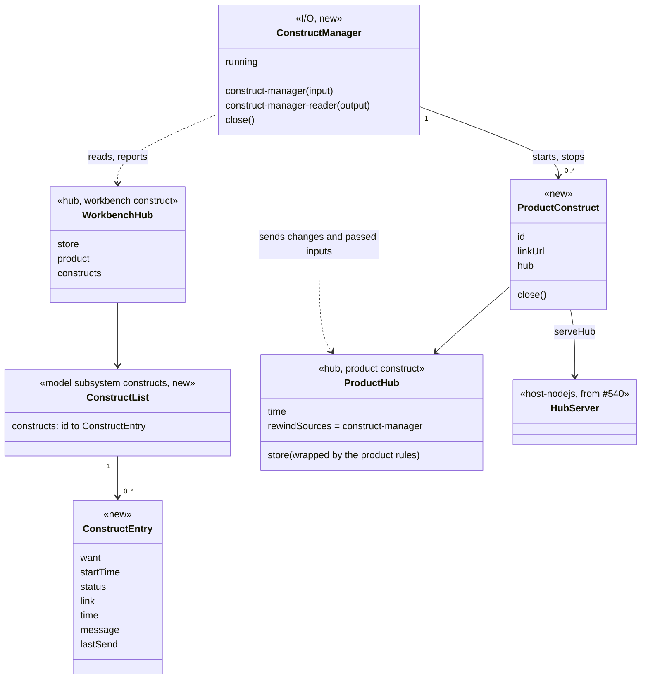
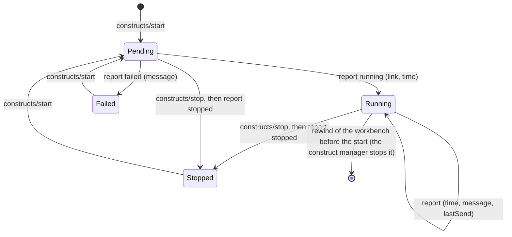
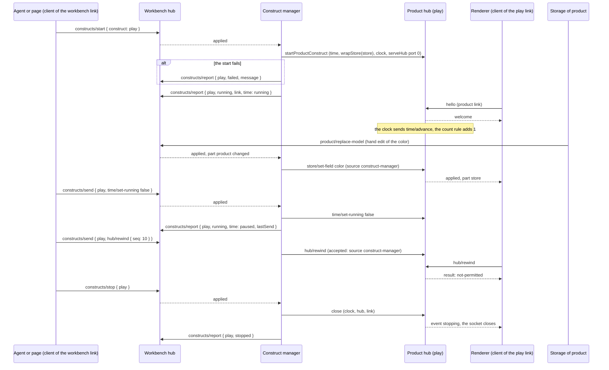
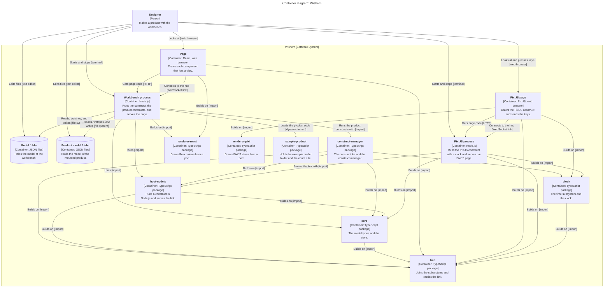

# Design

## Context

See `proposal.md` for the reason. The architecture is in [#527](https://github.com/twin-digital/opus/issues/527). The lead agent did the brainstorm alone and made each decision below, as `nodejs/wishem/docs/autonomous-flow.md` permits. No decision meets the three conditions of "When to ask the owner". The UI decision is under "UI options for the owner", so that the owner can overrule it in the review of the milestone.

The current state on `main` (45ec0521), with #540 merged as this change requires:

- The workbench construct holds the store `store` (the workbench model) and, with `--product <folder>`, the store `product` (the authored model of the product). Each store has its own storage subsystem and folder (#536). `startConstruct({ folder, product, port, log, onWatchError })` of `host-nodejs` makes the hub. It has no option for more model subsystems.
- `workbench-app/scripts/start.ts` (`startWorkbench`) runs `startConstruct` and a Vite page server in one Node.js process. The page reads only the part `store`.
- The hub applies inputs one at a time, keeps the record and the checkpoints, and accepts `hub/rewind` from each input subsystem (#533). The ID `hub` is reserved.
- `clock` has `createTime({ running })`, `timeInputs`, and `startClock(port, { stepMs, timer, now })`.
- `sample-product` has the model folder `model/` and `withCountRule(store)`, which adds 1 to each count at each tick. It is a native behavior in a first form (#602).
- #540 adds `serveHub(hub, { port })` to `host-nodejs`: it serves the link of a hub that the caller made on `127.0.0.1`, and `close()` stops the hub, closes each link, and releases the port. #540 also has the PixiJS construct, which is the first construct with a clock in a Node.js process (`pixi-page/src/construct/process.ts`).

The owner decisions that bind this design:

- For the MVP, a hub always runs in a Node.js process. Each renderer runs in its own construct and reaches the hub through the link (rule R21).
- A product construct has no storage subsystem. It gets the product model from the construct manager as inputs, and it writes no authored file. A rewind of a product construct changes no file (comment on #538, from the discussion on #533).
- To run a product again from an earlier point with a corrected definition, the order is: rewind first, then send the corrected definition. A rewind past the input that carried the correction removes it from the product construct (comment on #538).
- One model subsystem, the update subsystem (#617), will run the behaviors in a tick (#602, question 2, option B). This change does not design it. The count rule stays the rule of the sample product.
- Each new package is private.

## Goals / Non-Goals

**Goals:**

- A part of the workbench construct that holds which product constructs must run, and a part that makes it so.
- A product construct that runs the mounted product with its rules and a clock, and whose link a renderer in a different process can open (#539, #542).
- Each change of the authored state of the product reaches each running product construct, and keeps the live values that the change did not touch.
- The workbench and the agent can pass time inputs, writes, and a rewind to a product construct through the workbench construct.
- A decision on which subsystems can rewind a product construct, as a fact of the code.

**Non-Goals:**

- Controls in the workbench page, and the page of a product construct (#539).
- The update subsystem and a declaration of behaviors (#617, #481).
- A product construct in a process of its own. See Decision 1.
- A list of product constructs that is kept after the workbench stops.
- The construct manager in the `wishem` command of `host-nodejs`. See "Follow-up".
- A permission for `hub/rewind` in the workbench construct.

## Approaches

Three ways to build the construct manager were considered.

| Approach                                                                                                                                                  | Trade-off                                                                                                                                                                                                                                                                                                      | Result       |
| --------------------------------------------------------------------------------------------------------------------------------------------------------- | -------------------------------------------------------------------------------------------------------------------------------------------------------------------------------------------------------------------------------------------------------------------------------------------------------------- | ------------ |
| **A. A list subsystem and a manager in the workbench process. Each product construct is a hub in the same Node.js process, with its link on a new port.** | The smallest form. The manager uses direct ports on the two hubs, and the tests can use fake timers. A fault or an endless loop in the code of a product stops the workbench too. The code of a product cannot be loaded again while the process runs.                                                         | **Selected** |
| B. The same list and manager. Each product construct is a child Node.js process, and the manager is a client of its link.                                 | A fault of a product does not stop the workbench, and a new process loads new product code. It needs a launcher, a port handshake, a reconnect, a status of the child process, and IDs of the link that change for each link. It is approximately two more tasks, with no product that needs it now (rule R7). | Rejected now |
| C. No list subsystem. The workbench page or the agent calls a start function of the manager directly.                                                     | No model subsystem to write. It breaks rule R20 (a direct request to a subsystem), the record of the workbench does not hold the starts and stops, and an agent on the link has no way to start a construct.                                                                                                   | Rejected     |

Approach A keeps the manager behind one function that starts one product construct (`startProductConstruct`). Approach B can replace that function later with no change to the construct list, the inputs, or the reports.

## Decisions

### 1. A product construct is a hub in the workbench process

The construct manager starts each product construct in the Node.js process of the workbench, as `startProductConstruct` (Decision 6). The issue lets the design select the process, and asks for the first form.

- Reason: rule R21 needs only that the hub is in a Node.js process and that each renderer uses the link. A product construct serves its own link, so the page of #539 and the renderers of #542 reach it as a different process.
- Reason: `concepts.md` says that a process holds zero or more hubs (fifty previews are fifty constructs in one process). The hub code is the same for each construct.
- Reason: the construct manager is an I/O subsystem of the product construct (`concepts.md`, "Workbench and product"). In one process, it attaches its two subsystems with direct ports and fixed IDs. The rewind permission (Decision 8) can then name one fixed source.
- Alternative: a child process for each product construct (approach B). Rejected now. See "Approaches". The change to it is one function and its tests. See "Follow-up".
- Alternative: one child process for all product constructs. Rejected: it has the cost of B and not the isolation of one construct from another.

### 2. The construct list is the model subsystem `constructs`

The workbench construct with a mounted product has a third model subsystem, `constructs`, after `store` and `product`. Its part is one object, `{ constructs: { [id]: ConstructEntry } }`. An entry holds the wanted state (`running` or `stopped`), the time state at the start, and what the construct manager reported last: the status (`pending`, `running`, `stopped`, or `failed`), the address of the link, the time state (`running` or `paused`), a message, and the result of the last pass of an input. See "Data Model" and `specs/wishem/workbench/construct-list/spec.md`.

- Reason: control is state (rule R20). The list is the wanted state, and the reports are the real state. Both are in the record, with their sources.
- Reason: the agent reaches the workbench through a link (`concepts.md`). It can start, stop, and control a product construct with inputs, and read the status from the joined state.
- The ID of a construct is given by the sender of `constructs/start`, with the form of a subsystem ID (for example `play`). Reason: the source of the input supplies the ID, so a replay gives the same ID (the rule for entity IDs in `concepts.md`).
- The part is not kept in a file. No storage subsystem reads it. Reason: a product construct is live state, and its durable form is its record. After a restart of the workbench, no product construct runs.
- The list is a pure function in the root entry of `construct-manager`, with no Node.js API. Reason: it is a model subsystem, so it must replay with no process.
- Alternative: the list in the store `store`, as entities of a component type of the workbench. Rejected: the reports change at each start and stop, and the storage subsystem would write them to `state.json` of the workbench as authored state.
- Alternative: one part for each construct. Rejected: the hub has a fixed list of model subsystems.

### 3. Four inputs, and the report only from the construct manager

| Input               | Payload                                                    | Effect on the part                                                                                                             |
| ------------------- | ---------------------------------------------------------- | ------------------------------------------------------------------------------------------------------------------------------ |
| `constructs/start`  | `{ construct, running? }`                                  | `want: running`, `startTime` from `running` (default `true`). A new or stopped entry gets `status: pending` and no link.       |
| `constructs/stop`   | `{ construct }`                                            | `want: stopped`. The entry stays.                                                                                              |
| `constructs/send`   | `{ construct, input: { type, payload? } }`                 | None (the same part). Refused when the construct is not wanted to run or its status is not `running`.                          |
| `constructs/report` | `{ construct, status, link?, time?, message?, lastSend? }` | Sets the reported fields. `stopped` and `failed` remove `link` and `time`. Refused when the source is not `construct-manager`. |

- An input that changes nothing returns the same part.
- Reason for the check of the source: a model subsystem gets the recorded input, which holds the source. Only the construct manager knows the real state, so a status from a client of the link would be false. The refusal has the reason `invalid`, because a model subsystem can only refuse.
- Reason for `constructs/send` as an input that changes no part: the record of the workbench then holds each input that the workbench or the agent passed, with its source. The construct manager acts on the `applied` event, not on the part. A rewind is an `applied` event of `hub/rewind`, and a replay sends no event, so neither passes an input again.
- Alternative: one input type for each operation (`constructs/pause`, `constructs/step`, `constructs/rewind`, `constructs/write`). Rejected: the product construct already defines these inputs, and the list would copy each one. `constructs/send` passes each input of each product, also inputs of later subsystems.

### 4. The construct manager follows the list after each applied input

The construct manager attaches the input subsystem `construct-manager` and the output subsystem `construct-manager-reader` to the workbench hub. After each `applied` event, it does these steps in this order:

1. When the part `product` is a different object, it sends the change to each running product construct (Decision 7).
2. When the input is `constructs/send`, it passes the input (Decision 9).
3. It compares the list with the product constructs that run. It starts each construct that is wanted to run and does not run, and stops each product construct that is not wanted.
4. It reports each status that is not true. It reports nothing for a construct that the list does not hold, because the list refuses such a report.

- Reason for step 3 after each input, and not only after `constructs/start` and `constructs/stop`: a rewind of the workbench changes the list. "Control is state" means that the list after the rewind is the wanted state, so a rewind to the state before a start stops that construct.
- Reason for step 4: a rewind of the workbench also returns the reported statuses to their earlier values, which can be false. The construct manager reports the real status again. A report that is equal to the part changes nothing, so the steps end.
- A start is asynchronous (the link listens). While it runs, the entry has the status `pending`, and step 3 does not start it a second time.
- The construct manager sends each report as an input of its input subsystem. The hub applies it after the current input (rule of `wishem/hub/construct`: an input that a listener sends waits for its turn).

### 5. The product code is a module with the export `wrapStore`

The `start` script of the workbench page has the option `--product-code <module>`. The module must export a function `wrapStore(store: ModelSubsystem<Model>): ModelSubsystem<Model>`. The construct manager gives each product construct `wrapStore(createStore({ model }))` as its store. With no option, the store has no rules.

- The sample product exports `wrapStore`, which is `withCountRule`. The test guide uses `--product-code @thrashplay/wishem-sample-product`.
- A value that starts with `.` or `/` is a path, relative to `INIT_CWD`. Each other value is a package name, which the script resolves from its own package. The script loads the module before the construct of the workbench starts. A module that does not load, or that has no function `wrapStore`, stops the start with a message.
- Reason: the model folder of a product holds data only. The rules of a product are code (a native behavior in a first form), so the workbench needs to know where the code is. The product knows nothing about the workbench: `wrapStore` uses only the types of `core` and `hub`.
- Reason for one function: a product construct of the MVP has `time`, the store, and the rules of the product. The update subsystem (#617) will change this contract to a list of behaviors. Until then, the one function is the smallest contract.
- Alternative: a default product code from the package of the product folder. Rejected: it puts a file layout in the rule, and #536 rejected a default product for the same reason.
- Alternative: the product module gives the full list of model subsystems. Rejected: the product would then select the `time` subsystem and its position. The construct manager owns the form of a product construct.

### 6. What a product construct holds

`startProductConstruct({ id, model, wrapStore, running, timer, now, stepMs, onError })` does these steps:

1. It makes a hub with `createTime({ running })` first and `wrapStore(createStore({ model }))` second, and the option `rewindSources: ['construct-manager']`.
2. It calls `serveHub(hub, { port: 0 })`. The system selects the port.
3. It starts the hub, attaches the input subsystem `clock`, and calls `startClock` with the default step of 50 milliseconds.
4. It returns the product construct. The construct manager then attaches the input subsystem `construct-manager` and the output subsystem `construct-manager-reader` to `construct.hub`.

`close()` stops the clock, closes the port `clock`, and closes the server, which stops the hub. The construct manager closes its two ports on the hub of the construct before it calls `close()`. Each link gets `stopping`. When a step fails, the function closes each part that it made and rejects.

- The store has the ID `store`, as #536 Decision 1 says: a product construct is a construct of the product.
- The store starts from the product model at the start: the start of the record holds it. Reason: a rewind to 0 then gives the product at the start, not an empty store. The construct manager sends each later change as inputs (the glossary term **Construct manager**).
- No storage subsystem. Reason: owner decision. A product construct writes no file, so its rewind changes no file.
- The clock is in the product construct, so a step and a pause are inputs to the `time` of that construct (rule R20).
- The port of each link is selected by the system. The status gives the address. Reason: many constructs can run, and a fixed port would need a list of ports (rule R7).

### 7. A change of the product model becomes inputs

The construct manager keeps, for each running product construct, the product model that it last gave to it. When the part `product` changes, it computes `productChanges(last, next)`:

- When the definitions are equal and the two models hold the same entity IDs in the same order, with the same components: one `store/set-field` for each field value that differs, in the order of the entities, the components, and the fields.
- For each other change: one `store/replace-model` with the next product model.
- No input when the models are equal.

The construct manager sends the inputs in order, with the source `construct-manager`. When the product construct refuses one, it reports the message of the refusal and continues with the next input. After the last input, the next product model is the model that it last gave.

- Reason: the designer changes one value in the workbench (#537) while the product runs. A set-field changes that value and keeps the live values of each other field, such as a count that the ticks advanced.
- Reason for `replace-model` for each other change: a new definition, a new entity, and a removed entity can depend on each other (a reference of #535), and one replace is valid in one step. The live entities then return to the product model. The test guide shows it.
- A rewind of the workbench changes the part `product` like each other input. The construct manager sends the difference as new inputs. It does not rewind the product construct. Reason: the two constructs have different records.
- `productChanges` is a pure function in the root entry of `construct-manager`, with `isEqual` and `storeInputs` of `core`.
- Alternative: always `replace-model`. Rejected: each edit of a color would reset each count.
- Alternative: a merge of the live entities and the change in the construct manager, sent as one `replace-model`. Rejected: the construct manager reads the live state and then sends, and a tick between the read and the input is lost.

### 8. Only the construct manager rewinds a product construct

The hub gets the option `rewindSources: readonly string[]`. When it is given, the hub rejects `hub/rewind` from each other source with the reason `not-permitted`. A product construct gives `['construct-manager']`. The workbench construct gives no list, so its behavior does not change.

- Reason: the comment on #538 asks which subsystems can send `hub/rewind` to a product construct. The construct manager is the one source, so each rewind of a product construct is in the record of the workbench as a `constructs/send`, with the source of the request.
- A renderer or a page on the product link can still pause and step (#540 sends `time/set-running` and `time/advance` from its keys). It cannot rewind.
- The option does not apply to a record that a new hub replays. Reason: a replay applies inputs that were accepted.
- The option is in `hub`, not in a model subsystem. Reason: the hub applies `hub/rewind` itself, and no model subsystem sees it.
- Alternative: no limit, as on `main`. Rejected: the owner asked for a decision, and the guard makes "only the workbench rewinds a product construct" a fact of the code.
- Alternative: a general permission option for each input type. Rejected: no second type needs it (rule R7).

### 9. A pass of an input, and its result

After the `applied` event of `constructs/send` with the sequence number `n`, the construct manager submits the input to the product construct through its input port. It reports `lastSend: { seq: n, result }`, where `result` is the result of the product hub, or `{ ok: false, reason: 'error', message }` when the hub throws.

- Reason: the sender of `constructs/send` gets only the result of the workbench hub. The report gives it the result of the product hub, under the number of its own input.
- The construct manager reports the time state from the part `time` of the product construct, through its output port, when `running` changes. Reason: #539 shows the pause state, and a tick changes no report, so the record of the workbench does not grow at each tick.

### 10. The construct manager stops with the workbench

`ConstructManager.close()` removes its listener, stops each product construct, and closes its two ports. `startWorkbench` calls it before it closes the construct of the workbench. Reason: each product link gets `stopping` while the workbench hub still runs. A report after the stop is not sent.

### 11. `startConstruct` gets the option `subsystems`

`ConstructOptions.subsystems` is a list of more model subsystems. The hub gets them after the stores. `startWorkbench` gives `[createConstructList()]` when it mounts a product.

- Reason: `startConstruct` makes the hub, so the list must be given before. The construct manager is attached after the start, with the hub that `startConstruct` returns.
- Alternative: `startConstruct` attaches the construct manager. Rejected: `construct-manager` builds on `host-nodejs` (`serveHub`), so `host-nodejs` cannot import it.
- The `wishem` command does not use the option. See "Follow-up".

### 12. The package `construct-manager`

`@thrashplay/wishem-construct-manager` is in `nodejs/wishem/construct-manager`. It is private.

- Root entry (`src/index.ts`): `createConstructList`, `constructInputs`, `productChanges`, the IDs, and the types. It uses no Node.js API. A test of the package fails when a module of the root entry imports a `node:` module.
- Entry `node` (`src/node.ts`): `attachConstructManager` and `startProductConstruct`. It runs in Node.js.
- It depends on `core`, `hub`, `clock`, and `host-nodejs`.
- Reason for a package of its own: the list and the manager are one job of the workbench (the glossary term), and the container diagram shows each package that another package builds on.
- Alternative: the code in `host-nodejs`. Rejected: `host-nodejs` runs one construct and its storage, and it would get a dependency on `clock` for the product constructs only.
- Alternative: the code in `workbench-app`. Rejected: the agent will run a workbench with no page (see "Follow-up"), and the code must not be in the package of the page.

### 13. The blueprint

- `glossary.md`, **Construct manager**: the I/O part of the workbench construct that reads the construct list, starts each product construct in the process of the workbench, gives it the product model, sends each later change as inputs, passes inputs, and reports the status. The label stays **Proposed** until the owner reviews the milestone.
- `glossary.md`, new terms: **Construct list** (**Proposed**): the model subsystem `constructs` of the workbench construct. **Product code** (**Proposed**): the module that holds the rules of a product in code, which the workbench names with `--product-code`.
- `concepts.md`, "Workbench and product": the model subsystem that holds the list is `constructs`; a product construct is a hub in the process of the workbench with `time`, the store, the rules of the product, and a clock, with its own link; only the construct manager rewinds a product construct.
- `nodejs/wishem/CLAUDE.md`: the package in the list.

## Interfaces

Owner: `@thrashplay/wishem-hub` (root entry).

```ts
export interface HubOptions {
  // ...the options on main...
  /**
   * The IDs of the subsystems that can send `hub/rewind`. Default: each input subsystem.
   * The hub rejects a rewind from each other source with `not-permitted`. A replayed record is not checked.
   */
  rewindSources?: readonly string[]
}
```

Owner: `@thrashplay/wishem-host-nodejs` (root entry).

```ts
import type { ModelSubsystem } from '@thrashplay/wishem-hub'

export interface ConstructOptions {
  // ...folder, product, port, log, onWatchError, as on main...
  /** More model subsystems. The hub gets them after the stores. Default: none. */
  subsystems?: readonly ModelSubsystem[]
}
```

Owner: `@thrashplay/wishem-construct-manager`, root entry. It uses no Node.js API.

```ts
import type { Model } from '@thrashplay/wishem-core'
import type { Input, ModelSubsystem, SubmitResult } from '@thrashplay/wishem-hub'

export const CONSTRUCTS_ID = 'constructs'
export const CONSTRUCT_MANAGER_ID = 'construct-manager'
export const CONSTRUCT_MANAGER_READER_ID = 'construct-manager-reader'

export type WantedState = 'running' | 'stopped'
export type ConstructStatus = 'pending' | 'running' | 'stopped' | 'failed'
export type TimeState = 'running' | 'paused'

export type PassResult = SubmitResult | { readonly ok: false; readonly reason: 'error'; readonly message: string }

export interface ConstructEntry {
  readonly want: WantedState
  /** The time state when the construct starts. */
  readonly startTime: TimeState
  /** What the construct manager reported last. `pending` until its first report. */
  readonly status: ConstructStatus
  /** For example `ws://127.0.0.1:41377/link`. Only with the status `running`. */
  readonly link?: string
  /** Only with the status `running`. */
  readonly time?: TimeState
  readonly message?: string
  /** The result of the last `constructs/send`, under its sequence number in the workbench record. */
  readonly lastSend?: { readonly seq: number; readonly result: PassResult }
}

export interface ConstructList {
  readonly constructs: Readonly<Record<string, ConstructEntry>>
}

export interface ReportPayload {
  construct: string
  status: 'running' | 'stopped' | 'failed'
  link?: string
  time?: TimeState
  message?: string
  lastSend?: { seq: number; result: PassResult }
}

export const constructInputs: {
  start(construct: string, options?: { running?: boolean }): Input
  stop(construct: string): Input
  send(construct: string, input: Input): Input
  report(payload: ReportPayload): Input
}

/** The model subsystem `constructs`. Its first part has no construct. */
export const createConstructList: () => ModelSubsystem<ConstructList>

/**
 * The inputs that change a product construct from the model `before` to the model `after`:
 * one `<storeId>/set-field` for each changed value when only values differ, else one `<storeId>/replace-model`.
 * An empty list when the models are equal. Default `storeId`: `store`.
 */
export const productChanges: (before: Model, after: Model, storeId?: string) => Input[]
```

Owner: `@thrashplay/wishem-construct-manager`, entry `node`.

```ts
import type { Model } from '@thrashplay/wishem-core'
import type { ClockTimer } from '@thrashplay/wishem-clock'
import type { Hub, ModelSubsystem } from '@thrashplay/wishem-hub'

export type WrapStore = (store: ModelSubsystem<Model>) => ModelSubsystem<Model>

export interface ProductConstructOptions {
  /** The ID in the construct list. */
  id: string
  model: Model
  wrapStore?: WrapStore
  /** The first `running` value of the part `time`. */
  running: boolean
  /** Default 50. */
  stepMs?: number
  /** For tests. Default: `setInterval` and `Date.now`. */
  timer?: ClockTimer
  now?: () => number
  onError?: (error: unknown) => void
}

export interface ProductConstruct {
  readonly id: string
  /** For example `ws://127.0.0.1:41377/link`. */
  readonly linkUrl: string
  readonly hub: Hub
  /** Stops the clock and the hub, closes each link, and releases the port. Gives the same promise on each call. */
  close(): Promise<void>
}

/** Rejects with the error of a step (for example an error of `wrapStore`), and then holds no port and no timer. */
export const startProductConstruct: (options: ProductConstructOptions) => Promise<ProductConstruct>

export interface ConstructManagerOptions {
  /** The workbench hub. It runs, and it has the parts `product` and `constructs`. */
  hub: Hub
  wrapStore?: WrapStore
  /** Default: write to the terminal. */
  log?: (line: string) => void
  /** For tests: given to each product construct. */
  stepMs?: number
  timer?: ClockTimer
  now?: () => number
}

export interface ConstructManager {
  /** The product constructs that run, by ID. */
  readonly running: ReadonlyMap<string, ProductConstruct>
  /** Stops each product construct and closes the two ports. Gives the same promise on each call. */
  close(): Promise<void>
}

/** Attaches `construct-manager` and `construct-manager-reader` to the hub. Throws when an ID is in use. */
export const attachConstructManager: (options: ConstructManagerOptions) => ConstructManager
```

Owner: `@thrashplay/wishem-sample-product`, root entry.

```ts
/** The rules of the product for a product construct. It is `withCountRule`. */
export const wrapStore: (store: ModelSubsystem<Model>) => ModelSubsystem<Model>
```

Owner: `@thrashplay/wishem-workbench-app` (`scripts/start.ts`, not exported from the package).

```ts
export interface WorkbenchOptions {
  // ...model, product, port, hubPort, views, viewTypes, log, as on main...
  /** A package name or an absolute path of the module of the product rules. It needs `product`. */
  productCode?: string
}
```

## Data Model

No persisted schema changes. The new types are `ConstructList`, `ConstructEntry`, `ConstructManager`, and `ProductConstruct`. `Hub`, `Port`, and `ModelSubsystem` are the neighbours for context.



The lifecycle of one entry of the construct list:



`want` is a second value of the entry. `constructs/stop` sets `want: stopped` at once, and the status changes after the report.

## The flow of a product construct



## Container diagram after the change

New: the container `construct-manager`, the relationship from the workbench process to it, its relationships to `core`, `hub`, `clock`, and `host-nodejs`, and the relationship from the workbench process to `sample-product` (the product code). The table row of the workbench process says that it runs the product constructs and serves the link of each one. Nothing moves or is removed. The diagram includes the containers of #540, because Task 4 starts after #540 is merged. The system context diagram, the dynamic diagram, the component diagram of the page, and the entity diagram do not change.



- `construct-manager` imports `createStore`, `storeInputs`, and `isEqual` of `core`, `createHub` and `InputRefusedError` of `hub`, `createTime` and `startClock` of `clock`, and `serveHub` of `host-nodejs`, as values.
- The workbench process imports `createConstructList` and `attachConstructManager` of `construct-manager`, and loads the module of `--product-code` with `import()`. The diagram names the sample product, because it is the one product code. `workbench-app` keeps `sample-product` as a development dependency, which resolves the package name in the test guide.
- `sample-product` imports only types from `core` and `hub`, so the diagram shows no relationship from it.
- A product construct is not a process. The workbench process holds its hub and serves its link. The PixiJS page of #540 has a construct of its own and does not connect to a product construct.

## Failure Modes

| Failure                                                                        | Behavior                                                                                                                                                                                                   | Recovery                                                                        |
| ------------------------------------------------------------------------------ | ---------------------------------------------------------------------------------------------------------------------------------------------------------------------------------------------------------- | ------------------------------------------------------------------------------- |
| `wrapStore` throws, or `serveHub` cannot listen                                | `startProductConstruct` closes each part that it made and rejects. The construct manager reports `failed` with the message and prints `wishem: construct <id> failed: <message>`. The workbench continues. | Correct the product code, send `constructs/stop`, then send `constructs/start`. |
| `--product-code` does not load, or has no function `wrapStore`                 | The `start` script prints the reason, starts no construct, serves no page, and stops with exit code 1.                                                                                                     | Correct the option.                                                             |
| `--product-code` with no `--product`                                           | The script prints `wishem: --product-code needs --product` and stops with exit code 1.                                                                                                                     | Give `--product`.                                                               |
| A product construct refuses an input of a change of the product model          | The construct manager reports the message for that construct, prints one line, and sends the next input.                                                                                                   | The next change, or a stop and a start of the construct.                        |
| A rule of the product throws at a tick                                         | The product hub rejects the tick and changes nothing (rule of `wishem/hub/construct`). The clock continues. The product hub gives the error to `onError`, and the construct manager prints it.             | Correct the product code, then stop and start the construct.                    |
| A rule of the product does not end (an endless loop)                           | The workbench process stops reacting, because the product construct is in the same process.                                                                                                                | Stop the process. See "Follow-up" (a child process).                            |
| `constructs/send` to a construct that does not run                             | The construct list refuses it with `invalid`. Nothing is passed.                                                                                                                                           | Start the construct.                                                            |
| The passed input is refused or throws in the product construct                 | The report holds `lastSend` with the result or `{ ok: false, reason: 'error' }`.                                                                                                                           | Send a correct input.                                                           |
| A client of the product link sends `hub/rewind`                                | `not-permitted`. Nothing changes.                                                                                                                                                                          | Send it through `constructs/send`.                                              |
| A client of the workbench link sends `constructs/report`                       | The construct list refuses it with `invalid`.                                                                                                                                                              | None needed.                                                                    |
| A rewind of the workbench before a start, or to a false status                 | The construct manager stops the construct that is not wanted, and reports the real status. A stopped construct loses its live state.                                                                       | Start it again. The live state starts from the product model.                   |
| `constructs/start` and `constructs/stop` of one construct while its start runs | The start completes, then step 3 of Decision 4 sees `want: stopped` and stops it. Two reports follow: `running`, then `stopped`.                                                                           | None needed.                                                                    |
| The workbench stops while a start runs                                         | `close()` waits for the start, then closes the new construct. No report is sent after the stop.                                                                                                            | None needed.                                                                    |
| `close()` of the manager or of a product construct runs two times              | The same promise.                                                                                                                                                                                          | None needed.                                                                    |
| A link of a renderer to a product construct ends because the construct stopped | The renderer gets `stopping`. A new start has a new port, so a client must read the new address from the list.                                                                                             | Read `link` again.                                                              |

Idempotence: `constructs/start` of a construct that is wanted to run, `constructs/stop` of a stopped one, and a report that is equal to the part give the same part. A pass of an input is not idempotent, and the construct manager passes each `constructs/send` one time: only on its `applied` event, never on a rewind or a replay. `productChanges` of equal models gives no input.

## Examples

The start of the workbench with the sample product and its code:

```text
$ pnpm --filter @thrashplay/wishem-workbench-app start --model .superpowers/a4/model --product .superpowers/a4/product --product-code @thrashplay/wishem-sample-product
wishem: model /workspace/opus/.superpowers/a4/model
wishem: product /workspace/opus/.superpowers/a4/product
wishem: product code @thrashplay/wishem-sample-product
wishem: link at ws://127.0.0.1:4747/link
wishem: workbench at http://127.0.0.1:5173/
wishem: construct play runs, link at ws://127.0.0.1:41377/link
wishem: construct play stopped
```

The last two lines come after a `constructs/start` and a `constructs/stop` through the link.

A start that fails:

```text
wishem: construct play failed: the product code threw: count rule not ready
```

Errors at the start:

```text
$ pnpm --filter @thrashplay/wishem-workbench-app start --product-code ./missing.ts
wishem: --product-code needs --product
 ELIFECYCLE  Command failed with exit code 1.

$ pnpm --filter @thrashplay/wishem-workbench-app start --product nodejs/wishem/sample-product/model --product-code ./missing.ts
wishem: model ...
wishem: product /workspace/opus/nodejs/wishem/sample-product/model
wishem: product code ./missing.ts
wishem: the product code ./missing.ts cannot be loaded: Cannot find module '/workspace/opus/missing.ts'
 ELIFECYCLE  Command failed with exit code 1.
```

A start through the link (the protocol of `hub/LINK.md`):

```json
{
  "t": "submit",
  "request": 1,
  "subsystem": "raw-12345",
  "input": { "type": "constructs/start", "payload": { "construct": "play" } }
}
```

Result: `{"t":"result","request":1,"result":{"ok":true,"seq":1}}`. The next `applied` messages hold the part `constructs`:

```json
{
  "constructs": {
    "play": {
      "want": "running",
      "startTime": "running",
      "status": "running",
      "link": "ws://127.0.0.1:41377/link",
      "time": "running"
    }
  }
}
```

A pause through the construct manager:

```json
{
  "type": "constructs/send",
  "payload": { "construct": "play", "input": { "type": "time/set-running", "payload": { "running": false } } }
}
```

The report after it sets `"time": "paused"` and `"lastSend": { "seq": 5, "result": { "ok": true, "seq": 61 } }`.

A report from a client of the link: `{"ok":false,"reason":"invalid","problems":[{"message":"Only the construct manager reports a status","path":["source"]}]}`.

A rewind through the link of `play`: `{"t":"result","request":1,"result":{"ok":false,"reason":"not-permitted","problems":[]}}`.

## Package Impact

| Package                                | Published or private | Bump  | Reason                                                                                                                    |
| -------------------------------------- | -------------------- | ----- | ------------------------------------------------------------------------------------------------------------------------- |
| `@thrashplay/wishem-construct-manager` | Private (new)        | minor | New package: the construct list, `productChanges`, the construct manager, and the product construct.                      |
| `@thrashplay/wishem-hub`               | Private              | minor | New option `rewindSources`.                                                                                               |
| `@thrashplay/wishem-host-nodejs`       | Private              | minor | New option `subsystems` of `startConstruct`.                                                                              |
| `@thrashplay/wishem-sample-product`    | Private              | minor | New export `wrapStore`.                                                                                                   |
| `@thrashplay/wishem-workbench-app`     | Private              | minor | The `start` script has the option `--product-code`, the construct list, and the construct manager with a mounted product. |

No other package changes. `core`, `clock`, `renderer-react`, `renderer-pixi`, `pixi-page`, and `workbench` get no change. No package is published.

## UI

This change adds no UI and changes no UI. It adds no component and no design token. The style guide and the screenshot baselines of `workbench-app` do not change. The page with a mounted product looks the same as before: the app bar and the zero state. The page ignores the part `constructs`.

### UI options for the owner

The question: what does the page show of the product constructs in this change?

| Option                                | What the person sees                                                                                                        | Cost                                                                                                   |
| ------------------------------------- | --------------------------------------------------------------------------------------------------------------------------- | ------------------------------------------------------------------------------------------------------ |
| A. Nothing new on the page (selected) | The terminal prints each start and stop. The part `constructs` is on the link. #539 adds the controls and the product page. | None.                                                                                                  |
| B. A status line below the zero state | One line for each construct: `play: running, link ws://127.0.0.1:41377/link`.                                               | A change of `Page.tsx`, a new component in the style guide in each state, and text that #539 replaces. |
| C. A run button in the app bar        | A button "Run" starts `play`, and its label becomes "Stop".                                                                 | The first control of #539, with its states, its focus, and its screenshots, before its design.         |

Wireframe of option A (the same as now):

```text
+------------------------------------------------------+
| wishem.                                              |  app bar (entity of the workbench)
+------------------------------------------------------+
|                                                      |
|                 Workbench                            |  zero state
|                 Nothing to show yet.                 |
|                                                      |
+------------------------------------------------------+
```

Choice: option A. Reason: #539 designs the controls and the page of a product construct, and a status line now is UI that #539 removes (rule R7). The person sees each start and stop in the terminal, and the test guide reads the status through the link. The owner can select B or C in the review of the milestone.

## Risks / Trade-offs

- [A fault of the product code stops the workbench] → The product code is a native behavior that a person wrote. The failure modes say what a person sees. Approach B is the follow-up.
- [A replace of the model resets the live entities] → Only a change that is not a change of field values does it, such as a new definition. The test guide shows it, and the report has no message, because the reset is not an error.
- [The record of the workbench grows with the reports] → One report for each start, stop, change of the time state, refused change, and pass. A tick gives no report.
- [The product constructs use ports that the system selects] → A client reads the address from the part `constructs`. The address changes after a stop and a start.
- [The ID `construct-manager` on the workbench hub] → A client of the link cannot use that ID while the manager is attached (`id-in-use`).
- [A merge with #540 and with #535] → See "What this change needs from #540 and #535".
- [The order of the three model subsystems of the workbench] → `constructs` is last, so no input of a store reads it, and the joined state of a workbench with no product does not change.

## Migration Plan

No data and no deployment. A workbench with no product keeps the old behavior. `rewindSources` and `subsystems` are new options with defaults that keep the old behavior. Rollback is the revert of the pull request.

## What this change needs from #540 and #535

From #540 (branch `worktree-540-add-pixi-renderer`, `openspec/changes/540-add-pixi-renderer/`):

- `serveHub(hub, { port })` and `HubServer` of `host-nodejs`. Task 3 uses them for each product construct. #540 merges first, and this branch merges `main` before Task 1.
- `startConstruct` on `serveHub` (#540 Decision 10). Task 1 changes `start-construct.ts`, which #540 changes, so Task 1 starts after the merge.
- The container diagram, `render.mjs`, the architecture README, `concepts.md`, `glossary.md`, and `nodejs/wishem/CLAUDE.md` with the containers of #540. Task 4 adds to that state. The delta of `wishem/architecture/diagrams` holds the scenarios of #540. If #540 changes them before its archive, the archive of this change writes the delta again on the text of `main`.
- This change does not use `connectLink`. The page of #539 will use it to open the link of a product construct.
- The PixiJS construct of #540 stays a construct of its own (owner decision on #540). It is not a product construct, and the construct manager does not start it.

From #535 (branch `worktree-535-add-view-inputs`, `openspec/changes/535-add-view-inputs/`):

- No code. `productChanges` compares values with `isEqual`, so it works for the types `number`, `boolean`, and `reference` of #535 with no change.
- When #535 merges first, a reference makes an add or a removal of an entity depend on a different entity. Decision 7 sends such a change as one `replace-model`, so the order of the entities does not matter.
- #535 changes `docs/architecture/README.md`, `render.mjs` (the entity diagram and the component diagram of the page), `glossary.md`, and `concepts.md`. Task 4 changes the container diagram and different paragraphs. The change that merges second merges `main` first and runs `render.mjs` again.

The order of the merges: #540, then this change. #535 can merge before or after this change.

## The test guide

The final reviewer does these steps on the branch, with real processes and real files, and reports the result of each step. Run each command from the root of the repository. "Terminal 1" runs the workbench. "Terminal 2" runs the other commands. The folders are in `.superpowers/` of the worktree, which git ignores.

Setup:

```sh
pnpm install
pnpm build --filter "@thrashplay/wishem-*"
rm -rf .superpowers/a4 && mkdir -p .superpowers/a4
cp -r nodejs/wishem/workbench/model .superpowers/a4/model
cp -r nodejs/wishem/sample-product/model .superpowers/a4/product
RAW=nodejs/wishem/docs/milestones/a1-construct/raw-link.mjs
REWIND=nodejs/wishem/docs/milestones/a2-time/rewind-client.mjs
COUNT='"fld_ef085a2e-22ef-4409-bac4-9cd5648d0705":"[0-9]*"'
COLOR='"fld_694d6cb2-97e8-444e-961e-aa76744837fb":"#[0-9a-f]*"'
```

Result: the build ends with no failed task.

1. **Start the workbench with the product and its code.** In terminal 1: `pnpm --filter @thrashplay/wishem-workbench-app start --model .superpowers/a4/model --product .superpowers/a4/product --product-code @thrashplay/wishem-sample-product`. Result: the five lines of the first example of "Examples", up to the line of the page.
2. **The construct list is empty.** In terminal 2: `node $RAW --once | grep -o '"constructs":{"constructs":{}}'`. Result: one line.
3. **Start a product construct.** `node $RAW --once --send '{"type":"constructs/start","payload":{"construct":"play"}}'`. Result: `"ok":true`. Terminal 1 prints `wishem: construct play runs, link at ws://127.0.0.1:<port>/link`. Then `PLAY=$(node $RAW --once | grep -o 'ws://127.0.0.1:[0-9]*/link')` and `echo $PLAY`. Result: the address of terminal 1.
4. **The product runs with its rules.** `node $RAW --url $PLAY --once | grep -o "$COUNT"`, then again after two seconds. Result: two counts larger than 0, and the second one is larger by approximately 40.
5. **A hand edit of the product reaches the running construct and keeps the count.** `sed -i 's/#1d4ed8/#b91c1c/' .superpowers/a4/product/state.json`, wait one second, then `node $RAW --url $PLAY --once | grep -o "$COLOR\|$COUNT"`. Result: `#b91c1c`, and a count that continues from step 4 (not `0`).
6. **An input to the product through the workbench link, then the file and the construct.** `node $RAW --once --send '{"type":"product/set-field","payload":{"entity":"e_99969ed3-f499-4dbb-bf6d-958db4542884","componentType":"ct_6af38bd9-a91d-49d9-9370-fa4e6c04769d","field":"fld_ef085a2e-22ef-4409-bac4-9cd5648d0705","value":"1000"}}'`. Note the `seq` of the result as `N`. Result: `grep -c '"1000"' .superpowers/a4/product/state.json` gives `1`, and the count of `node $RAW --url $PLAY --once` is 1000 or more.
7. **Pause through the construct manager.** `node $RAW --once --send '{"type":"constructs/send","payload":{"construct":"play","input":{"type":"time/set-running","payload":{"running":false}}}}'`. Result: `"ok":true`. `node $RAW --once | grep -o '"time":"paused"'` gives one line. Two reads of the count one second apart give the same count.
8. **Step through the construct manager.** Send `constructs/send` with `{"type":"time/advance","payload":{"ms":50}}`. Result: the count is one more than in step 7.
9. **A rewind of the product construct changes no file.** Send `constructs/send` with `{"type":"hub/rewind","payload":{"seq":1}}`. Result: the part `constructs` holds `"lastSend"` with `"ok":true`. The color of `play` is `#1d4ed8` and its count is a small number that its ticks advance from `1`: the rewind went past the inputs that carried the hand edit and the value 1000. `.superpowers/a4/product/state.json` still holds `#b91c1c` and `"1000"`. `node $RAW --once | grep -o '"time":"running"'` gives one line, because the construct was running after its input 1.
10. **Only the construct manager rewinds.** `node $REWIND --url $PLAY --seq 0`. Result: `result: {"ok":false,"reason":"not-permitted",...}`. The count of `play` did not return to `0`.
11. **A step through the product link.** `node $RAW --url $PLAY --once --send '{"type":"time/advance","payload":{"ms":50}}'`. Result: `"ok":true`.
12. **A rewind of the workbench is an undo of the authored state, and the construct follows.** `node $REWIND --seq <N - 1>`. Result: `result: {"ok":true,...}`. After one second, `.superpowers/a4/product/state.json` holds the count `0` again and the color `#b91c1c`. The record of `play` holds a new `store/set-field` with the count `0` from `construct-manager`, and no new rewind: the count of `play` is a small number that its ticks advance from `0`. The color of `play` stays `#1d4ed8`, because the construct manager sends only the values that changed in the product model, and the color did not change there. The part `constructs` still holds `play` with the status `running`, because the rewind target is after the start.
13. **A definition change resets the live entities.** Make the input with the label `Count` for the component type `Counter`, and send it:

    ```sh
    LABEL=$(node -e 'const fs=require("fs");const d=".superpowers/a4/product/definitions";const definitions=fs.readdirSync(d).sort().map((f)=>JSON.parse(fs.readFileSync(d+"/"+f,"utf8")));definitions.forEach((x)=>{if(x.label==="Counter")x.label="Count"});const {entities}=JSON.parse(fs.readFileSync(".superpowers/a4/product/state.json","utf8"));console.log(JSON.stringify({type:"product/replace-model",payload:{model:{definitions,entities}}}))')
    node $RAW --once --send "$LABEL"
    ```

    Result: `"ok":true`. Terminal 1 prints `wishem: product: the definitions of the store differ from the files in definitions, so state.json is not written`. The record of `play` holds one `store/replace-model` from `construct-manager`, its count returns to `0` and advances from it, and its definitions have the label `Count`.

14. **A report from a client is refused.** `node $RAW --once --send '{"type":"constructs/report","payload":{"construct":"play","status":"stopped"}}'`. Result: `"reason":"invalid"`. `play` still runs.
15. **A stop and a start of the product construct.** Send `{"type":"constructs/stop","payload":{"construct":"play"}}`. Result: terminal 1 prints `wishem: construct play stopped`. `node $RAW --url $PLAY --once` prints `error: the connection failed`. The part `constructs` holds `play` with `"status":"stopped"`. Then send `constructs/start` for `play` again. Result: a new address in terminal 1, and the count of the new `play` starts from the count of the product model, not from the count of the old construct.
16. **A rewind of the workbench before the start stops the construct.** `node $REWIND --seq 0`. Result: terminal 1 prints `wishem: construct play stopped`, the part `constructs` has no construct, and the two `state.json` files hold the values of the copy at the setup (the undo of #536).
17. **The workbench stops the product constructs.** Start `play` again, then press Ctrl+C in terminal 1. Result: the command stops with exit code 0, and the address of `play` accepts no connection.
18. **A workbench with no product code.** In terminal 1, start the command of step 1 with no `--product-code`, then start `play`. Result: the part `time` of `play` advances, and the count stays the count of the product model.
19. **Errors of the option.** Run the command of step 1 with `--product-code ./missing.ts`. Result: the line of "Errors at the start", and the port 4747 is free (a new start with the command of step 1 succeeds). Run it with `--product-code @thrashplay/wishem-sample-product` and no `--product`. Result: `wishem: --product-code needs --product`, exit code 1.
20. **The page does not change.** With the command of step 1, open `http://127.0.0.1:5173/`. Result: the app bar and the zero state. The browser console has no error.

## Follow-up

- A product construct in a child process (approach B), when product code must be loaded again while the workbench runs (#481) or a fault of a product must not stop the workbench.
- The `wishem` command of `host-nodejs` has no construct manager, so an agent needs the `start` script of the page to run product constructs. A command for a workbench with no page can use `subsystems` and `attachConstructManager`.
- The contract `wrapStore` changes when the update subsystem (#617) gives a list of behaviors.
- A change of the authored state that adds or removes an entity replaces the live entities. A merge that keeps the live values of the other entities.
- `hub/rewind` has no permission in the workbench construct. Each client of the workbench link can rewind the authored state.
- The part `constructs` keeps only the result of the last pass of an input.
