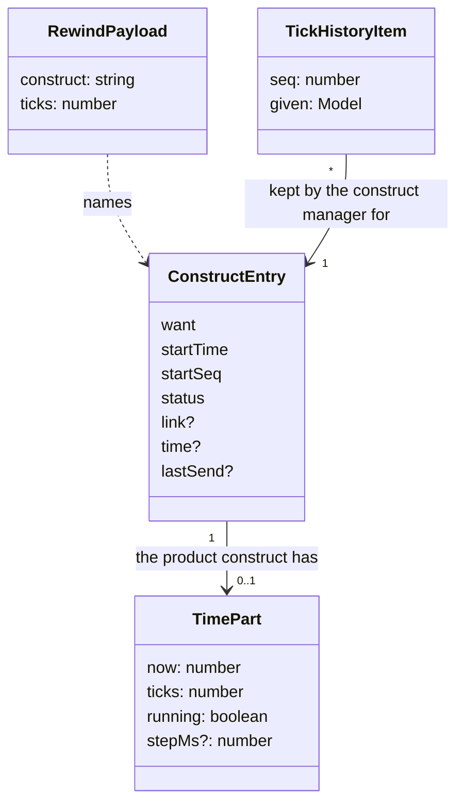
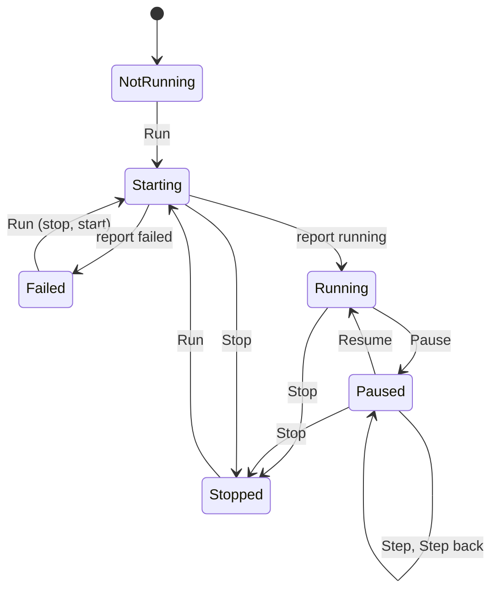
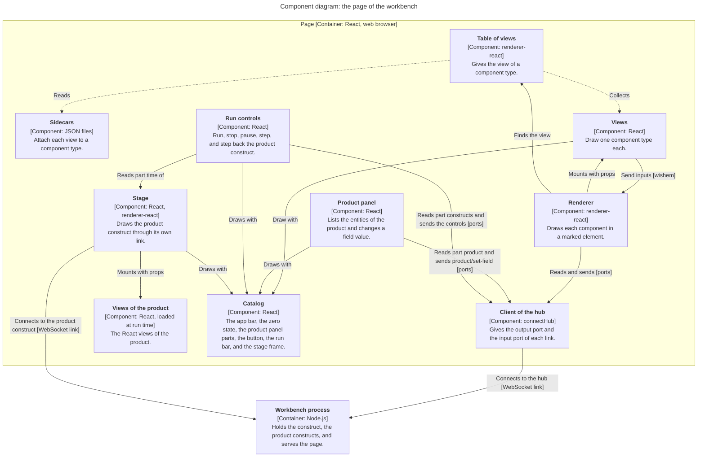

# Design

## Context

See `proposal.md`, "Why". The architecture is in [#527](https://github.com/twin-digital/opus/issues/527). The lead agent did the brainstorm alone and made each decision below, as `nodejs/wishem/docs/autonomous-flow.md` permits.

The state that this design starts from is `main` (`fa9b43c7`) plus the change #537 (branch `worktree-537-list-and-change-things`, archived on the branch at `16e98b40`, not merged at the time of this plan):

- The workbench construct has, with `--product`, the stores `store` and `product` and the construct list `constructs`. The construct manager starts a product construct for each entry that is wanted to run. A product construct has the parts `time` and `store`, the update subsystem with the behaviors of the product code, a clock of 50 milliseconds, and its own link on a port that the system selects (`ws://127.0.0.1:<port>/link`). Only the source `construct-manager` can rewind it.
- `constructs/send` passes one input to a product construct. The entry keeps the result of the last pass under the sequence number of the `constructs/send` (`lastSend`). The entry has the time state (`running` or `paused`) and the address of the link. It has no tick, no time, and no step length.
- The `time` part is `{ now, ticks, running }`. The step length is an option of `startClock` only. #561 asks for an optional `stepMs` in the part for this change.
- A `hub/rewind` makes the whole joined state equal to the state after the target. This includes `running` of the part `time` and each change of the store after the target. A rewind does not remove an input from the record. The hub queues the inputs of `submit` and applies them in order.
- After #537, the workbench page has the app bar (the `Renderer` of the part `store`), and below it the product panel (`ProductTool` in `src/tools/`), which reads the part `product` and sends `product/set-field` with `sendInput` of `renderer-react`. The page server passes only `/link` to the server of the workbench construct.
- The sample product has no React view. Change #542 (draft pull request #674, in apply) adds a React view `ClearColor` for the `Color` component in the new package `three-renderers`, a color behavior in `sample-product` that sets the color at each tick, and the option `port` of `startProductConstruct`.
- The concepts say: "The views of a product are with the product, in one folder for each renderer." (**Proposed**)

## Goals / Non-Goals

**Goals:**

- The designer runs, stops, pauses, resumes, steps, and steps back the product construct from the workbench page.
- The designer sees the picture of the running product construct in the workbench page, beside the product panel.
- A change in the product panel, or a hand edit of the product folder, shows in the picture with no reload.
- Each control is one input to the workbench construct, so the workbench record holds what the designer did.

**Non-Goals:**

- More than one product construct in the page. The page controls the construct `play`. A client of the link can still start other constructs.
- Inputs from the views of the product on the stage (a game that the designer plays). The stage link has no input subsystem. See Follow-up.
- A timeline, a rewind to any point, or a bookmark. Step back is one tick at a time.
- A page of the product in an `iframe`, and a renderer other than the React renderer on the stage.
- Generated types of the props of the views of the product. The views of the sample product declare their props by hand.
- A change of the link protocol or of the hub.

## Approaches

Three ways to show the product construct in the workbench page were considered:

- **A. A stage in the page that draws the product construct through its own link (selected).** The page opens a second link to the product construct through the page server, and draws its part `store` with a second `Renderer` of `renderer-react` and the React views of the product. The same link gives the run controls the part `time`. The page server already compiles React views, and the construct is drawn as each renderer draws it: through the link (rule R21).
- **B. An `iframe` of a page of the product.** Rejected for now: no product has a page of its own that a workbench can serve. The React page of #542 is a page of the package `three-renderers` with a fixed hub port. The controls would still need a second link for the part `time`. When a product has a page with a different renderer, such as PixiJS, an `iframe` is the way to show it (Follow-up).
- **C. A read-only table of the live state, derived from the definitions.** Rejected: it is an inspector, not the picture of the product. The issue asks for the page of the product construct.

Three ways to step back were considered:

- **A. A new input of the construct list, `constructs/rewind` with a count of ticks (selected).** The construct manager sees each applied input of the product construct from its start, so it keeps the history of the ticks, finds the target, and keeps the pause and the authored changes. The page sends one input. The agent can use it in the same way.
- **B. The page keeps the ticks that it saw on the stage link and sends `constructs/send` with `hub/rewind`.** Rejected: a reload loses the history, the rewind restores `running` of the target (a paused construct runs again), and the rewind removes from the live state the changes of the authored state after the target.
- **C. The page sends `hub/rewind` and then `time/set-running` as two `constructs/send` inputs.** Rejected: the clock can send a tick between the two inputs, and the authored changes are still lost.

## Decisions

### 1. The run controls control the product construct `play`

The run controls (**Proposed** term) are the tool `RunTool` in `src/tools/`. The page shows it when the output port reads a part `constructs`. It reads the entry `play` and sends each input with `sendInput` of `renderer-react` through the input port of the page, so the source in the workbench record is `page-<hex>-input`.

| Control   | Enabled when                                                     | Input to the workbench                                                                 |
| --------- | ---------------------------------------------------------------- | -------------------------------------------------------------------------------------- |
| Run       | no entry, `want` is `stopped`, or the status is `failed`         | `constructs/start { construct: 'play' }`; after `failed`, `constructs/stop` first      |
| Stop      | `want` is `running` (the same place as Run)                      | `constructs/stop { construct: 'play' }`                                                |
| Pause     | the status is `running` and the time state is `running`          | `constructs/send { construct: 'play', input: time/set-running { running: false } }`    |
| Resume    | the status is `running` and the time state is `paused`           | `constructs/send { construct: 'play', input: time/set-running { running: true } }`     |
| Step      | paused, and the stage link has a part `time`                     | `constructs/send { construct: 'play', input: time/advance { ms: time.stepMs ?? 50 } }` |
| Step back | paused, and the part `time` of the stage link has `ticks` over 0 | `constructs/rewind { construct: 'play', ticks: 1 }`                                    |

- Reason for one construct with a fixed ID: the issue asks for "a product construct", and the designer does not need a name for it. The ID `play` is the ID of the specifications of #538. A list of constructs is a later change when a second construct has a use, such as a check (Follow-up).
- Reason for inputs through the workbench and not through the stage link: the workbench record holds each action of the designer, and only the construct manager can rewind a product construct.
- Step and Step back need a pause. Reason: while the construct runs, the picture changes 20 times each second, and one tick is not visible.
- Run starts the construct with `running` set to `true`.

### 2. The result of a control

A control sends one input and waits for its outcome. While it waits, the button has `aria-busy="true"` and each control is disabled. The outcome:

- The workbench refuses the input: the line `Not done. <outcomeText(outcome, 'the product')>` shows with the role `alert`.
- The workbench accepts a `constructs/send` or a `constructs/rewind` with the sequence number `n`: the control waits until the entry has `lastSend.seq >= n`, for at most 5 seconds. When `lastSend.seq` is `n` and its result has `"ok":false`, the line `<control> was not done. <reason>` shows. `<reason>` is the message of the first problem, or the reason.
- The next accepted control removes the line.

This decides #631: the part keeps only the result of the last pass. The page needs only the result of its own last control, and the controls wait for one result at a time. The lead agent can close #631 with this decision.

### 3. The stage draws the product construct through its own link

The stage (**Proposed** term) is the hook `useStageLink(entry)` in `src/tools/use-stage-link.ts` and the catalog component `StageFrame`. While the entry `play` has the status `running` and a `link`, the hook opens a link with `connectLink` of `hub` at `/constructs/play/link` of the origin of the page, with one output subsystem `page-<hex>-stage` (prefix `page`, suffix `-stage`) and no input subsystem. It gives the remote port to a second `Renderer` with the views of the product, and the part `time` to the run controls.

- The hook closes the link when the entry stops, and opens a new link when `link` or `startSeq` changes. Reason: a new start has a new port and a new record.
- The `Renderer` gets no input port, so a view of the product that sends an input has the outcome `not-permitted` (Non-Goals).
- The `time` of the stage link is read with `usePart(port, 'time')` of #537. The page code imports the type `TimePart` from `clock` with `import type` only, so the page gets no new relationship at the container level (as #537 Decision 3 does for `core`).

### 4. The page server passes `/constructs/<id>/link`

`scripts/start.ts` adds a listener for the `upgrade` event of the HTTP server of Vite. For the path `/constructs/<id>/link`, it finds the product construct `<id>` in `manager.running`, opens a TCP connection to the port of its `linkUrl`, writes the request with the path `/link`, and pipes the two sockets. For an ID with no running construct, it writes `HTTP/1.1 404 Not Found` and closes the socket. When a product construct stops, its server closes the connection, so the piped socket ends.

- Reason for a path on the page address: a person with a forwarded port of the devcontainer reaches only the page port. The link of the workbench uses the same pattern (`/link`, requirement "The page address also carries the link").
- Rejected: the page opens `ws://127.0.0.1:<port>/link` of the entry directly. It fails when the page address is a forwarded port, and the browser of the tests in Docker reaches only the loopback addresses that it gets through `exposeNetwork`.
- Rejected: the `proxy` option of Vite. Its targets are fixed when the server starts, and each product construct has a new port.

### 5. The option `--product-views` and the views of the product

`--product-views <folder>` needs `--product`. The script checks that the folder exists, prints `wishem: product views <absolute path>`, adds the folder to `server.fs.allow`, and sets `resolve.dedupe` to `['react', 'react-dom']`. A middleware answers `GET /@wishem/product-views.json` with the pairs of the folder:

```json
{
  "views": [
    {
      "sidecar": "/@fs/workspace/opus/nodejs/wishem/sample-product/views/react/ClearColor.view.json",
      "view": "/@fs/workspace/opus/nodejs/wishem/sample-product/views/react/ClearColor.tsx"
    },
    {
      "sidecar": "/@fs/workspace/opus/nodejs/wishem/sample-product/views/react/Count.view.json",
      "view": "/@fs/workspace/opus/nodejs/wishem/sample-product/views/react/Count.tsx"
    }
  ]
}
```

A pair is a file `<name>.view.json` and a file `<name>.tsx` of the folder. A file `*.test.tsx` is not a view. With no option, the answer is `{ "views": [] }`. The watcher of Vite watches the folder. When a sidecar or a view file is added or removed, the script sends a full reload to the page. A change to a view file is a normal change of a module, and React Fast Refresh shows it.

`src/tools/product-views.ts` gives `loadProductViews()`. It fetches the list, imports each file with `import()`, and gives the maps to `collectViews` of `renderer-react` with the keys `./<name>.view.json` and `./<name>.tsx`. `main.tsx` loads the views before the first render of the page with the views, and gives them to `Page` in the new prop `productViews`. A `ViewCollectionError` is written to the console, and the stage shows `The views of the product are not correct.`

- Reason for a list at run time and not a module that Vite makes at the build: the build of `workbench-app`, its Vitest tests, and the style guide do not know a product. The list exists only in the development server of the `start` script, and each other build gets no view.
- Reason for an option and not a fixed path of the product folder: the product folder is a model folder, and the views are code of the product, not model (concepts "the presentation side").
- `resolve.dedupe` makes a view of the product use the React of the page, so that the hooks of the renderer and of the view are the same React.

### 6. The sample product has React views

`nodejs/wishem/sample-product/views/react/` holds `ClearColor.tsx` with `ClearColor.view.json` (component type `Color`), and `Count.tsx` with `Count.view.json` (component type `Counter`), with their tests.

- `ClearColor` is a `div` of 320 by 180 CSS pixels with `role="img"`, the name `Color <value>`, and the background of the prop `color`. `Count` is a `p` with the text `Count <value>` in the font of the page.
- The views declare their props by hand: `{ color: string | undefined; wishem: ViewTools }` and `{ count: number | undefined; wishem: ViewTools }`. `ViewTools` is a type of `renderer-react`.
- `sample-product` gets the development dependencies `react`, `@types/react`, `@thrashplay/wishem-renderer-react`, and `jsdom`, `jsx: react-jsx` in `tsconfig.options.json`, and the React settings of `workbench-app` in `vitest.config.d/` and `eslint.config.d/`. The type check, the lint, and the tests of the package cover `views/`. The build does not include `views/`, and the root entry does not import them.
- Reason for this folder: the concepts put the views of a product with the product, in one folder for each renderer. The sample product is the product that the workbench mounts.
- The view `ClearColor` of #542 in `three-renderers` draws a box of 640 by 360 pixels for the three-renderer test. This change does not change it. A follow-up makes the React page of `three-renderers` use the views of the sample product.

### 7. `time` holds the step length

`createTime({ running, stepMs })`. With `stepMs`, the first part is `{ now: 0, ticks: 0, running, stepMs }`, and `time/advance` and `time/set-running` keep it with the spread of the part. A `stepMs` that is not a finite number larger than 0 throws a `RangeError` with the text `The step length must be a finite number larger than 0.` `startClock` does not change: its option `stepMs` stays the length of its ticks. `startProductConstruct` gives the same `stepMs` (default 50) to `createTime` and to `startClock`.

- Reason: #561. A control sends one step of the length of the clock, and the part is the place that each reader of the construct already reads.
- Rejected: the step length in the entry of the construct list. It is a fact of the product construct, and a client of the product link needs it too.
- Rejected: `startClock` reads `stepMs` from the part. Two defaults would then exist for one value, and no reader needs it now.

### 8. The construct manager does `constructs/rewind`

The construct list accepts `constructs/rewind { construct, ticks }` as it accepts `constructs/send`: the construct is wanted to run and has the status `running`, and `ticks` is an integer of 1 or more. The part does not change.

For each live product construct, the construct manager keeps a **tick history**: a list of `{ seq, given }`, one for each applied `time/advance` of the construct, from each source, where `given` is the product model that the construct manager had given to the construct at that time. A `hub/rewind` of the construct to the target `T` removes each item with `seq > T`. The list keeps at most 100000 items, the record limit of the hub.

After the workbench hub applies `constructs/rewind` with `ticks` = `n`:

1. With an empty history, the result is `{ ok: false, reason: 'invalid', problems: [{ message: 'The construct has no tick to step back.', path: ['payload', 'ticks'] }] }`. Nothing is sent.
2. Else `k = max(0, length - n)`, the target is `history[k].seq - 1`, and `earlier` is `history[k].given`. `paused` is `!time.running` of the construct now.
3. In one turn, with no `await` between the calls, the construct manager calls `submit` of its input port of the construct for: `hub/rewind { seq: target }`, then each input of `productChanges(earlier, given)`, then `time/set-running { running: false }` when `paused`. The hub queues them in this order, and a timer of the clock cannot run between them.
4. It awaits the results, and reports the result of the `hub/rewind` as `lastSend` under the sequence number of the `constructs/rewind`, with `liveReport`.

- Reason for the authored changes: the live state of the construct after a step back holds the values that the designer changed in the authored state since the target, as it held them before the step back. Without them, a step back after a change in the product panel would show the old value on the stage while the panel shows the new one.
- Reason for `time/set-running` with the same value when the target was paused: a part with the same value stays the same object, and the construct manager needs no read of the state between two submits.
- A rewind or a replay of the workbench does not do a step back again, as for `constructs/send`.
- Reason for a new input and not `constructs/send` with `hub/rewind`: see "Approaches". The raw `hub/rewind` through `constructs/send` stays as it is.

### 9. The layout of the page

The chosen option is A of "UI options for the owner". From 1200 pixels: the product panel at the left, and the run area (the run bar and the stage) in a column of 672 pixels at the right, with a 1-pixel `line` between them. Below 1200 pixels: the run area above the product panel. See "UI".

### 10. Tests of the steps of the test guide

Each step of "The test guide" that a program can do is an automated test:

- `workbench-app/src/start.guide.test.ts` (Vitest): it starts `node scripts/start.ts` as a child process with the sample product, its product code, and its views on a copy of the folders in a temporary folder, with the ports 0. It does the steps 1, 3, 4, 5, 6, 7, 9, 10, 11, and 13 through link clients at the page address and through the files.
- `workbench-app/tests/run.guide.spec.ts` (Playwright, project `run`): it does the steps 2, 3, 4, 5, 6, 7, 8, 12, and 14 in the pinned browser, with the screenshots `run-paused-light.png`, `run-paused-dark.png`, and `run-narrow-dark.png` of the page with `play` paused at the tick 0.
- `scripts/e2e-server.ts` gets the option `--run`: it copies the model folder of `workbench` to `.e2e-run-model/` and the model folder of `sample-product` to `.e2e-run-product/`, and starts the workbench on the page port 4186, with the product code `@thrashplay/wishem-sample-product` and the views of the sample product. `playwright.config.ts` gets a third web server and the project `run`. `.gitignore` gets the two folders.
- For a screenshot with a fixed state, the test starts `play` paused with a link client (`constructs/start` with `running` set to `false`), so the tick is 0.
- Reason for port 4186: 4180 and 4181 are the servers of #537, 4181 and 4183 are used by `pixi-page`, and 4173 is the static server.

### 11. `page-driver.mjs` gets the run controls

`nodejs/wishem/docs/milestones/a4-workbench/page-driver.mjs` (#537) gets the steps `run`, `stop`, `pause`, `resume`, `step`, and `back`, each a click on the button and a wait until no control is busy, and `waitfor:<text>`, which waits at most 10 seconds for the text in the run area. After the last step it prints, in addition to the lines of #537:

```text
run: <status> tick <n> <time> [<names of the enabled controls>]
stage: <name of each element with the role img>; <text of the stage>
alert: <text>
```

### 12. The blueprint

- `glossary.md`: new terms **Run controls** (**Proposed**): "The tool of the workbench page that runs, stops, pauses, resumes, steps, and steps back the product construct `play`. Each control is one input to the workbench construct." **Stage** (**Proposed**): "The part of the workbench page that draws a product construct through its own link, with the React views of the product." **Step back** (**Proposed**): "The input `constructs/rewind` with one tick. The construct manager rewinds the product construct to the state before its last tick, and keeps the pause and the changes of the authored state." The term **Construct list** names `constructs/rewind`. The term **Time** says that the part can hold the step length.
- `concepts.md`, "Workbench and product": the page controls the product construct `play` and draws it on the stage; the construct manager does a step back. "Time": the table row "Pause, step, rewind" names `constructs/rewind` and the step length in the part. "Not built": "A step length that changes" stays.
- `nodejs/wishem/CLAUDE.md`: `sample-product` holds React views in `views/react/`; `workbench-app` holds the run controls and the stage.
- The terms that the designer sees are `Run`, `Stop`, `Pause`, `Resume`, `Step`, `Step back`, `Product`, `Stage`, and `Tick`. They are the plain dev words of `brand.md`. The page does not show the word "construct".

### 13. No question for the owner

No decision meets the three conditions of "When to ask the owner". The layout, the names of the controls, and the place of the views are easy to change later. The input `constructs/rewind` is in a private package. The layout is under "UI options for the owner", so that the owner can overrule it in the review of the milestone.

## Interfaces

Owner: `@thrashplay/wishem-clock`, root entry.

```ts
export interface TimePart {
  readonly now: number
  readonly ticks: number
  readonly running: boolean
  /** The step length of the clock of the construct, when the code that made the subsystem gave one. */
  readonly stepMs?: number
}

export interface TimeOptions {
  /** Default `true`. */
  running?: boolean
  /** Put in the part as `stepMs`. A finite number larger than 0. Default: none. */
  stepMs?: number
}
```

Owner: `@thrashplay/wishem-construct-manager`, root entry.

```ts
export interface RewindPayload {
  construct: string
  /** An integer of 1 or more. */
  ticks: number
}

export const constructInputs: {
  // ...start, stop, send, report, as now...
  rewind: (payload: RewindPayload) => Input
}
```

Owner: `@thrashplay/wishem-construct-manager`, entry `node`. `ProductConstructOptions.stepMs` keeps its type and its default 50. It now also goes to `createTime`.

Owner: `@thrashplay/wishem-workbench-app`, `scripts/start.ts` (not exported).

```ts
export interface WorkbenchOptions {
  // ...as now...
  /** A folder of React views and sidecars of the product. Needs `product`. */
  productViews?: string
}
```

Owner: `@thrashplay/wishem-workbench-app` (not exported from the package).

```ts
// src/tools/product-views.ts
/** Fetches `/@wishem/product-views.json`, imports each file, and collects the views. Empty table on 404. */
export const loadProductViews: (options?: {
  fetch?: typeof fetch
  load?: (url: string) => Promise<unknown>
}) => Promise<{ views: ViewTable } | { views: ViewTable; error: string }>

// src/tools/use-stage-link.ts
export type StageState =
  | { state: 'off' }
  | { state: 'connecting' }
  | { state: 'connected'; port: PortReader }
  | { state: 'down'; port: PortReader | undefined }
/** Opens the stage link while the entry runs. */
export const useStageLink: (id: string, entry: ConstructEntry | undefined) => StageState

// src/tools/run-state.ts
export type RunControl = 'run' | 'stop' | 'pause' | 'resume' | 'step' | 'back'
export interface RunState {
  status: 'Not running' | 'Starting' | 'Running' | 'Paused' | 'Stopped' | 'Failed'
  message?: string
  /** The controls that are enabled. */
  enabled: ReadonlySet<RunControl>
  /** With no part `time` on the stage link: no value. */
  readout?: { ticks: number; seconds: string }
}
/** A pure function of the entry, the part `time` of the stage link, and the presence of an input port. */
export const runState: (args: { entry?: ConstructEntry; time?: TimePart; canSend: boolean }) => RunState

// src/tools/RunTool.tsx
export interface RunToolProps {
  port: PortReader
  input: InputPort | undefined
  productViews: ProductViews
}
export const RunTool: (props: RunToolProps) => ReactNode

// src/components/Button.tsx
export interface ButtonProps {
  label: string
  variant?: 'plain' | 'maker'
  disabled?: boolean
  busy?: boolean
  onPress?: () => void
}

// src/components/RunBar.tsx
export interface RunBarProps {
  state: RunState
  /** The control that waits for its outcome. */
  busy?: RunControl
  /** The text of the line with the role alert. */
  alert?: string
  onControl?: (control: RunControl) => void
}

// src/components/StageFrame.tsx
export interface StageFrameProps {
  /** With a value, the zero state with this text, and no picture. */
  message?: string
  /** A second line below the picture, such as the text of a link that is down. */
  note?: string
  children?: ReactNode
}
```

`PageProps` gets `productViews: ProductViews` (`{ views: ViewTable; error?: string }`). `RunState` and `RunControl` are declared in `src/components/run-bar-types.ts`, and `src/tools/run-state.ts` imports them. So the catalog components import nothing from `hub`, `renderer-react`, `src/tools/`, or `src/views/`.

## Data Model

No persisted schema changes. Two domain types change:

- `TimePart` (`clock`) gets the optional `stepMs`.
- The construct list gets the input type `constructs/rewind` with `RewindPayload`. `ConstructEntry` does not change.



`TickHistoryItem` is memory of the construct manager, not state of a hub. New: `RewindPayload`, `TickHistoryItem`. Modified: `TimePart`.

The states of the run controls:



## The flow of a step back

```mermaid
sequenceDiagram
  participant D as Designer
  participant R as Run controls (page)
  participant W as Workbench hub
  participant M as Construct manager
  participant P as Product construct play
  participant S as Stage (page)

  D->>R: press Step back (paused, tick 12)
  R->>W: constructs/rewind {play, ticks 1} (page-hex-input)
  alt the list refuses (not running, ticks not correct)
    W-->>R: result invalid
    R->>R: alert "Not done. ..."
  else accepted
    W-->>R: result ok, seq n
    W-->>M: applied constructs/rewind (seq n)
    M->>M: history item k = last tick; target = seq(k) - 1
    alt no tick in the history
      M->>W: constructs/report lastSend {seq n, invalid}
      W-->>R: part constructs (lastSend n)
      R->>R: alert "Step back was not done. ..."
    else a tick
      M->>P: hub/rewind {seq target}
      M->>P: store/set-field ... (authored changes after the target)
      M->>P: time/set-running {false}
      P-->>S: applied (rewind), applied (set-field), applied (set-running)
      S->>S: picture and readout of tick 11
      M->>W: constructs/report lastSend {seq n, ok}
      W-->>R: part constructs (lastSend n)
    end
  end
  alt the product construct stops before the report
    M->>M: no live construct, no report
    R->>R: after 5 s, the control ends with no line
  end
```

## The architecture document

The change adds two components to the page container and a passage of links to the workbench process. It adds no container, no system context element, and no entity of a store.

The component diagram of the page (the diagram of #537 with the changes): New: "Run controls" (`[Component: React]`, "Run, stop, pause, step, and step back the product construct."), "Stage" (`[Component: React, renderer-react]`, "Draws the product construct through its own link."), and "Views of the product" (`[Component: React, loaded at run time]`, "The React views of the product, from the folder of `--product-views`."). New relationships: Run controls → Client of the hub "Reads part constructs and sends the controls [ports]"; Run controls → Stage "Reads part time of"; Stage → Workbench process "Connects to the product construct [WebSocket link]"; Stage → Views of the product "Mounts with props"; Run controls → Catalog and Stage → Catalog "Draw with". Changed: the description of the catalog ("The app bar, the zero state, the parts of the product panel, the button, the run bar, and the stage frame."). The description of the diagram says that the page has ten components.



The container diagram: the relationship from the page to the workbench process "Connects to the hub [WebSocket link]" becomes "Connects to the hub and to each product construct [WebSocket link]". The row "Workbench process" of the table says that it passes `/constructs/<id>/link` to each product construct and serves the views of the product of `--product-views`. The row "sample-product" names `views/react/`. The row "Page" names the run controls and the stage. No element and no other relationship changes. When #650 is on `main`, the same change applies to its container diagram of the runtime units, and its component diagram of the workbench process gets the passage of the links of the product constructs and the list of the views of the product in the Vite development server.

## Failure Modes

| Failure                                                                | Behavior                                                                                                                                    | Recovery                                                        |
| ---------------------------------------------------------------------- | ------------------------------------------------------------------------------------------------------------------------------------------- | --------------------------------------------------------------- |
| The workbench process stopped, and the designer presses a control      | The page has no link, so each control is disabled. If the link ends during the wait, the outcome is `unknown` and the line shows its text.  | Start the workbench. The page connects again.                   |
| The product construct fails at the start                               | The entry has the status `failed` and a message. The run bar shows `Failed` and the message. `Run` sends a stop and a start.                | Correct the product code, start the workbench again, press Run. |
| The product construct stops while a control waits                      | The construct manager reports `stopped`. The control ends after at most 5 seconds with no line, and the run bar shows `Stopped`.            | Press Run.                                                      |
| The stage link is down, and the entry still says `running`             | The stage keeps the last picture and shows `The product is not reachable. The page tries again.` `connectLink` tries again (500 ms to 5 s). | None. A new start gives a new address, and the hook follows it. |
| A request for `/constructs/<id>/link` of a construct that does not run | The page server answers 404 and closes the socket. The stage link tries again until the entry changes.                                      | None.                                                           |
| Two pages press Step at the same time                                  | The workbench hub applies the two inputs in order. The construct gets two ticks. Each page shows the result of its own control.             | None.                                                           |
| Step back with no tick in the history                                  | The result is `invalid` with `The construct has no tick to step back.` The page disables Step back at the tick 0, so only a client sees it. | None.                                                           |
| A step back to a target before the start of the record                 | The hub refuses the rewind with `invalid`. The result of the pass has the problem. Nothing changes.                                         | None. The history is never longer than the record limit.        |
| A change of the product is refused after a step back                   | The construct manager reports the message, as for each refused change (#538).                                                               | Correct the authored state.                                     |
| The folder of `--product-views` does not exist                         | The script prints the line, serves no page, and stops with exit code 1.                                                                     | Correct the path.                                               |
| A sidecar of the product is not correct                                | The page writes the message to the console. The stage shows `The views of the product are not correct.` The run controls still work.        | Correct the sidecar. The page loads again.                      |
| A view of the product throws while it draws                            | The `Renderer` of `renderer-react` handles it as for each view.                                                                             | Correct the view. Fast Refresh shows the change.                |

Idempotence: each control sends one input one time, and the page does not send it again after an outcome. `constructs/rewind` is not idempotent: each one steps back one more tick. A rewind or a replay of the workbench does not send a step back again.

## Examples

The inputs of the controls on the link of the page (`hub/LINK.md`):

```json
{"t":"submit","request":4,"subsystem":"page-4f1c0a9e2b7d3c58-input","input":{"type":"constructs/start","payload":{"construct":"play"}}}
{"t":"submit","request":5,"subsystem":"page-4f1c0a9e2b7d3c58-input","input":{"type":"constructs/send","payload":{"construct":"play","input":{"type":"time/set-running","payload":{"running":false}}}}}
{"t":"submit","request":6,"subsystem":"page-4f1c0a9e2b7d3c58-input","input":{"type":"constructs/send","payload":{"construct":"play","input":{"type":"time/advance","payload":{"ms":50}}}}}
{"t":"submit","request":7,"subsystem":"page-4f1c0a9e2b7d3c58-input","input":{"type":"constructs/rewind","payload":{"construct":"play","ticks":1}}}
```

A refused step back from a client: `{"t":"result","request":9,"result":{"ok":false,"reason":"invalid","problems":[{"message":"The ticks are not an integer of 1 or more","path":["payload","ticks"]}]}}`.

The terminal of the workbench:

```text
$ pnpm --filter @thrashplay/wishem-workbench-app start --product nodejs/wishem/sample-product/model --product-code @thrashplay/wishem-sample-product --product-views nodejs/wishem/sample-product/views/react
wishem: model /workspace/opus/nodejs/wishem/workbench/model
wishem: product /workspace/opus/nodejs/wishem/sample-product/model
wishem: product code @thrashplay/wishem-sample-product
wishem: product views /workspace/opus/nodejs/wishem/sample-product/views/react
wishem: link at ws://127.0.0.1:4747/link
wishem: workbench at http://127.0.0.1:5173/
wishem: construct play runs, link at ws://127.0.0.1:41377/link
```

An error case:

```text
$ pnpm --filter @thrashplay/wishem-workbench-app start --product nodejs/wishem/sample-product/model --product-views ./missing
wishem: model /workspace/opus/nodejs/wishem/workbench/model
wishem: product /workspace/opus/nodejs/wishem/sample-product/model
wishem: the product views folder /workspace/opus/missing does not exist
$ echo $?
1
```

The output of `page-driver.mjs` after `run pause`:

```text
step 1 run: done
step 2 pause: done
entities: Counter, Color e_99969ed3
run: Paused tick 37 1.85 s [stop resume step back]
stage: Color #1d4ed8; Count 37
```

## Package Impact

| Package                                | Published or private | Bump  | Reason                                                                                                        |
| -------------------------------------- | -------------------- | ----- | ------------------------------------------------------------------------------------------------------------- |
| `@thrashplay/wishem-clock`             | Private              | minor | `createTime` takes `stepMs`, and the part `time` holds it.                                                    |
| `@thrashplay/wishem-construct-manager` | Private              | minor | The part `time` of a product construct holds its step length. The input `constructs/rewind` and its handling. |
| `@thrashplay/wishem-sample-product`    | Private              | minor | The React views `ClearColor` and `Count` in `views/react/`.                                                   |
| `@thrashplay/wishem-workbench-app`     | Private              | minor | The run controls, the stage, the passage of `/constructs/<id>/link`, and the option `--product-views`.        |

No other package changes. `hub`, `core`, `host-nodejs`, `update`, and `renderer-react` get no change. A product construct of a different program, such as the sample construct of #542, gets `stepMs` in its part through `startProductConstruct`. No package is published. The changesets:

1. `clock` minor: the part `time` can hold the step length of the clock.
2. `construct-manager` minor: the part `time` of a product construct holds its step length.
3. `construct-manager` minor: the input `constructs/rewind` steps a product construct back by ticks, and keeps its pause and the changes of the authored state.
4. `sample-product` minor: React views for the color and the count.
5. `workbench-app` minor: the page address carries the link of each product construct at `/constructs/<id>/link`.
6. `workbench-app` minor: the option `--product-views` loads the React views of the product.
7. `workbench-app` minor: the page runs, stops, pauses, resumes, steps, and steps back the product construct, and draws it on the stage.

## UI

The chosen option is A of "UI options for the owner": the run area at the right of the product panel on a wide viewport, and above it on a narrow one.

Wide viewport (1280 pixels), `play` paused, nothing selected in the panel:

```text
+-------------------------------------------------------------------------------------------------+
| wishem.                                                                                         |  app bar, night
+-------------------+------------------------------+----------------------------------------------+
| ENTITIES       1  |                              | PRODUCT  PAUSED                              |  surface
| Counter, Color    |          INSPECTOR           | [Stop] [Resume] [Step] [Step back]  TICK 37  1.85 S |
| E_99969ED3        | Select an entity to change it.| +------------------------------------------+ |
|                   |                              | | +----------------+                       | |  stage frame, ground
|                   |                              | | |  #1d4ed8 box   | 320 x 180             | |
|                   |                              | | +----------------+                       | |
|                   |                              | | Count 37                                 | |
|                   |                              | +------------------------------------------+ |
+-------------------+------------------------------+----------------------------------------------+
  288 px               the remaining width            672 px, line at the left
```

`[Resume]` is a maker button: the label in `maker-text` and the border in `maker`. The status `PAUSED` is a mono label in `warning-text`. `TICK 37` and `1.85 S` are mono labels in `fg-muted`.

Not running:

```text
| PRODUCT  NOT RUNNING                                    |
| [Run] [Pause] [Step] [Step back]                        |  Pause, Step, Step back disabled
| +-----------------------------------------------------+ |
| |                       STAGE                         | |
| |    Not running. Press Run to start the product.     | |
| +-----------------------------------------------------+ |
```

Failed, and a refusal:

```text
| PRODUCT  FAILED                                         |
| [Run] [Pause] [Step] [Step back]                        |
| Two behaviors have the ID sample-product/count.         |  danger-text, role alert
```

```text
| PRODUCT  PAUSED                                         |
| [Stop] [Resume] [Step] [Step back]  TICK 0  0.00 S      |  Step back disabled
| Step back was not done. The construct has no tick to step back. |  danger-text, role alert
```

Narrow viewport (390 pixels):

```text
+------------------------------------+
| wishem.                            |
+------------------------------------+
| PRODUCT  RUNNING                   |
| [Stop] [Pause] [Step] [Step back]  |  wraps to a second row when needed
| TICK 412  20.60 S                  |
| +--------------------------------+ |
| | +------------+                 | |  the box keeps 320 x 180 or the width
| | | box        |                 | |
| | +------------+                 | |
| | Count 412                      | |
| +--------------------------------+ |
+------------------------------------+
| ENTITIES                        1  |
| ...the product panel of #537...    |
+------------------------------------+
```

### New components

All are additions to the catalog `src/components/` and to the style guide. No design token is added. Each uses roles only.

- **`Button`.** A `button` with the label in UI text, padding 6 by 12 pixels, the radius of 4 pixels. `plain`: `surface`, `fg`, a 1-pixel border in `control-border`; hover `ground`. `maker`: the same with the border in `maker` and the label in `maker-text`. Focus: the ring in `accent`. Disabled: `aria-disabled="true"` and the label in `fg-muted`, and a press does nothing; the button stays in the tab order of the toolbar pattern below. Busy: `aria-busy="true"` and the label stays. The app bar has no button, so the button is new.
- **`RunBar`.** A `div` with `role="toolbar"` and the name `Product controls`. Row 1: the mono label `Product` and the status as a mono label in its role. Row 2: four buttons (`Run` or `Stop`, `Pause` or `Resume`, `Step`, `Step back`), then the readout. `Run` and `Resume` are maker buttons, the others are plain. A line in `danger-text` with the role `alert` below the toolbar shows the message of a failure or of a refusal.
- **`StageFrame`.** A `section` with the name `Stage`, on `ground`, a 1-pixel border in `line`, the radius of 4 pixels, padding 16 pixels, and a minimum height of 212 pixels. With `message`, it shows the `ZeroState` with the label `Stage` and the message. With `note`, a line in `fg-muted` below the picture. The picture inherits no color from the frame: the frame sets `color` of the picture area to `initial` and `font` to the UI text. The renderer is a child, so the catalog does not import it.
- The stage shows `Connecting to the product.` for an entry with the status `pending`, and for an entry with the status `running` and no `link`.
- **`ZeroState`**, **`AppBar`**, and the components of the product panel do not change.
- `Page`: with a part `constructs`, `main` holds the product panel and the run area (`aside` with the name `Run`) in the layout of decision 9. With no part `constructs`, the page is the same as after #537, and its screenshot baselines do not change.

### States in the style guide

Each specimen in light mode and in dark mode, in the components section, after the product panel:

- "Button", "Button, maker", "Button, disabled".
- "Run bar, not running", "Run bar, starting", "Run bar, running" (tick 412), "Run bar, paused" (tick 42), "Run bar, paused at the start" (tick 0, Step back disabled), "Run bar, failed" (with the message), "Run bar, not done" (with the line of a refusal), "Run bar, no link" (each control disabled).
- "Stage, not running", "Stage, connecting", "Stage, no views", "Stage, not reachable" (a picture and the note), "Stage, a picture" (a box in `accent` drawn with a role class and the text `Count 7`, not a view of the product).

Loading: "Run bar, starting" and "Stage, connecting". Empty: "Stage, no views" and "Stage, not running". Error: "Run bar, failed", "Run bar, not done", and "Stage, not reachable". Disabled: "Button, disabled" and "Run bar, no link". The screenshot baselines of the section `components` change. The baselines of the other sections and of the projects `workbench` and `product` do not change, because those servers have no product code and no construct runs. The project `run` adds `run-paused-light.png`, `run-paused-dark.png`, and `run-narrow-dark.png`.

### Keyboard and focus

- The run bar uses the toolbar pattern: one stop in the tab order. The left and right arrow keys move the focus between the enabled buttons, Home and End go to the first and the last one. Tab moves from the run bar to the stage and then to the product panel (narrow) or from the product panel to the run bar (wide).
- Enter or Space on a button presses it. The focus stays on the button. When the label changes (`Run` to `Stop`, `Pause` to `Resume`), the focus stays on the same button.
- When a button becomes disabled while it has the focus (Step after Resume), the focus stays on it, and it has `aria-disabled="true"`. Reason: a disabled `button` element loses the focus.
- The stage is not in the tab order. A view of the product with a control is in the tab order as the view gives it.
- The line with the role `alert` is read by a screen reader when it shows. The status is in an element with `role="status"`.

### UI options for the owner

The owner can overrule this choice in the review of the milestone.

| Option                                  | What the person sees                                                                                                         | Cost                                                                                                                       |
| --------------------------------------- | ---------------------------------------------------------------------------------------------------------------------------- | -------------------------------------------------------------------------------------------------------------------------- |
| A. The run area at the right (selected) | The product panel and the stage at the same time on a wide screen. A change in the inspector shows in the picture beside it. | Three columns at 1280 pixels: the inspector has about 320 pixels. Below 1200 pixels the stage is above the panel.          |
| B. The run area above the product panel | A full-width bar and a stage of 640 by 360 pixels at the top, the panel below.                                               | At 720 pixels of height the panel starts below the fold, so the designer scrolls to change a value and to see the picture. |
| C. Two tabs, "Edit" and "Play"          | One view at a time: the product panel, or the controls and a large stage.                                                    | The designer cannot see a change of the authored state in the picture while making it. The issue asks for this result.     |

Choice: option A. Reason: the designer edits and watches at the same time, which is the result "A change of the authored state shows in the running construct". It is the layout of the editor wireframe (`examples/editor-after-whistle-request.html`: a viewport beside the inspector), and the product panel of #537 keeps its layout.

## Risks / Trade-offs

- [A step back re-applies the authored changes after the target with `productChanges`, which sends `store/replace-model` for a change of a definition] → For a change of a definition after the target, the store of the construct gets the product model, and the live values return to the authored values. This is the rule of #538 for a change of a definition.
- [The history of the ticks is memory of the construct manager] → It holds references to models that the construct manager already keeps, and at most 100000 items. A stop of the construct removes it.
- [`time/set-running` with `false` after each step back during a pause adds one input to the record] → The part stays the same object, so no reader draws again.
- [The page loads the views of the product with `import()` of `/@fs/` addresses] → It works only in the development server of the `start` script, which is the only server that has a product. A distribution of the workbench (#544) needs a different way and is a later change.
- [`resolve.dedupe` changes how Vite resolves React for each file] → The page and the views use one React, which is what the renderer needs. The tests of the page in the pinned browser prove it.
- [Three columns at 1280 pixels make the inspector narrow] → The fields of the sample product fit. The breakpoint of 1200 pixels gives one column below it.
- [The color behavior of #542 sets the color at each tick] → A color change in the panel shows on the stage only until the next tick. The test guide uses the count for the checks of a change, and the color only while the construct is paused.
- [The port 4181 is used by the project `product` of #537 and by the UI test of `pixi-page`] → This change uses 4186. The conflict of #537 is a follow-up bug.

## Migration Plan

No data and no deployment. A workbench with no product shows the same page as before. A workbench with a product and no `--product-views` shows the run controls and a stage with `The product has no React views.` Rollback is the revert of the pull request.

## Order with other changes

- **#537 (the product panel, branch `worktree-537-list-and-change-things`, in its last step).** This change builds on its page, its `usePart`, `sendInput`, `outcomeText`, its e2e server, and its `page-driver.mjs`. The apply starts after #537 is on `main`. At the start of the apply, merge `main` into the branch, and check that the delta of `wishem/architecture/diagrams` and the component diagram above start from the component diagram of #537. This change adds requirements only, so no requirement of #537 is in a delta of this change.
- **#542 (three renderers, draft pull request #674, in apply).** Either order works.
  - Files in common: `sample-product` (`package.json`, `README.md`, `src/index.ts` is not changed here), `construct-manager/src/product-construct.ts` (#542 adds `port`, this change gives `stepMs` to `createTime`), the architecture document and `render.mjs`, `glossary.md`, and `nodejs/wishem/CLAUDE.md`. Keep the lines of the two changes.
  - With #542 on `main`, a tick of the sample product sets the color. The test guide gives the result for each case. Its sample construct gets `stepMs` 500 in its part, which its tests do not read.
  - The view `ClearColor` of `three-renderers` stays. A follow-up gives the React page of `three-renderers` the views of the sample product.
- **#650 (the views of the architecture diagrams, in plan).** Either order works. When #650 is on `main` first, apply the container change of "The architecture document" to the diagram of the runtime units, add the passage of the product links and the list of the product views to the component diagram of the workbench process, and run `render.mjs --check`. When this change merges first, #650 starts from this component diagram of the page.
- **#685 (Bug: a product construct that fails at the start does not close its clock port).** It touches `product-construct.ts`, which this change changes for `stepMs`. This change does not correct it. The apply keeps the start order of `startProductConstruct` as it is.
- **#692 (Bug: a UI test of the view warnings fails when other view files exist).** The views of the product are in a different folder, so this change does not make it worse. This change does not correct it.
- **#706 (Bug: two start scripts can lose a terminate signal).** This change adds lines to `scripts/start.ts` and keeps its handling of the signals as it is. It does not correct it.
- **#631 (Task: the construct list keeps the result of each pass).** Decision 2 decides it: the part keeps the last result.

## The test guide

The final reviewer does these steps on the branch, with real processes, real files, and the pinned web browser in Docker, and reports the real result of each step. The results are the results after this change. Run each command from the root of the worktree. Terminal 1 runs the workbench. Terminal 2 runs the other commands. Terminal 3 runs a listener of the workbench, and terminal 4 runs a listener of `play`. The folders are in `.superpowers/` of the worktree, which git ignores. Each run of `$PAGE` opens a new page.

When #542 is on `main`, a tick of the sample product sets the color to `COLORS[ticks % 4]` (`#1d4ed8`, `#b91c1c`, `#15803d`, `#a16207`). When it is not, the color does not change at a tick. The results below give both.

### 0. Prepare

```sh
pnpm install
pnpm build --filter "@thrashplay/wishem-*"
rm -rf .superpowers/a4run && mkdir -p .superpowers/a4run
cp -r nodejs/wishem/workbench/model .superpowers/a4run/model
cp -r nodejs/wishem/sample-product/model .superpowers/a4run/product
RAW=nodejs/wishem/docs/milestones/a1-construct/raw-link.mjs
LISTEN=nodejs/wishem/docs/milestones/a1-construct/link-client.mjs
PAGE="node nodejs/wishem/workbench-app/scripts/browser-server.ts node ../docs/milestones/a4-workbench/page-driver.mjs"
CF=fld_ef085a2e-22ef-4409-bac4-9cd5648d0705
COUNT_RAW='"fld_ef085a2e-22ef-4409-bac4-9cd5648d0705":[0-9]*'
TICKS_RAW='"ticks":[0-9]*'
```

Result: the build ends with no failed task. `docker info` gives a server version.

### 1. Start the workbench with the product, its code, and its views

Terminal 1:

```sh
pnpm --filter @thrashplay/wishem-workbench-app start --model .superpowers/a4run/model --product .superpowers/a4run/product --product-code @thrashplay/wishem-sample-product --product-views nodejs/wishem/sample-product/views/react
```

Result: the lines `wishem: model <path>`, `wishem: product <absolute path>`, `wishem: product code @thrashplay/wishem-sample-product`, `wishem: product views <absolute path of nodejs/wishem/sample-product/views/react>`, `wishem: link at ws://127.0.0.1:4747/link`, and `wishem: workbench at http://127.0.0.1:5173/`.

Terminal 3: `node $LISTEN --url ws://127.0.0.1:5173/link`. Result: a `state:` line.

Terminal 2: `curl -s -o /dev/null -w '%{http_code}\n' -H 'Connection: Upgrade' -H 'Upgrade: websocket' -H 'Sec-WebSocket-Version: 13' -H 'Sec-WebSocket-Key: dGhlIHNhbXBsZSBub25jZQ==' http://127.0.0.1:5173/constructs/play/link`. Result: `404`, because `play` does not run.

### 2. The page before a run

```sh
$PAGE shot:.superpowers/a4run/not-running.png
```

Result: `run: Not running tick - - [run]` and `stage: ; Not running. Press Run to start the product.` The image shows the product panel at the left and the run area at the right, as the wireframe "Not running".

### 3. Run, and the stage draws the product

```sh
$PAGE run waitfor:Running wait:1000 print
```

Result: `run: Running tick <n> <time> [stop pause]` with `n` larger than 10, and `stage: Color #<hex>; Count <c>` with `c` larger than 10. Terminal 1 prints `wishem: construct play runs, link at ws://127.0.0.1:<port>/link`. Terminal 3 prints `applied #.. constructs/start from page-<16 hex>-input` and `applied #.. constructs/report from construct-manager`.

Terminal 4: `node $LISTEN --url ws://127.0.0.1:5173/constructs/play/link | head -3`. Result: the lines of a running construct, through the page address.

### 4. Pause, and the picture stays

```sh
$PAGE pause print wait:2000 print
node $RAW --url ws://127.0.0.1:5173/constructs/play/link --once | grep -o '"stepMs":[0-9]*'
```

Result: `run: Paused tick <t> ... [stop resume step back]`, two times with the same `t` and the same `stage:` line. The `grep` prints `"stepMs":50`. Terminal 3 prints one `constructs/send`.

### 5. Step and step back

```sh
$PAGE step step back print
```

Result: the last state has the tick `t + 1` and the count `c + 1`, where `t` and `c` are the values of step 4. With #542: the color is `COLORS[(t + 1) % 4]`. Terminal 3 prints two `constructs/send` and one `constructs/rewind`, each from `page-<16 hex>-input`, and `constructs/report` lines.

### 6. A change of the authored state while paused, and a step back after it

```sh
$PAGE select:e_99969ed3 type:Counter.count=100 wait:1000 print step print back print
grep -o "\"$CF\": *[0-9]*" .superpowers/a4run/product/state.json
```

Result: after the change, `stage: ...; Count 100` and the same tick as before. After `step`, `Count 101`. After `back`, `Count 100` and the status `Paused`. The `grep` prints `100`.

Then, with #542 on `main` only: `$PAGE select:e_99969ed3 type:Color.color=#ffffff back print`. Result: `stage: Color #ffffff; ...` after the step back, because the construct manager keeps the authored change.

### 7. A hand edit while the construct runs

```sh
$PAGE resume "exec:sed -i 's/\"$CF\": 100/\"$CF\": 500/' .superpowers/a4run/product/state.json" wait:1500 print
```

Result: `run: Running ...` and `stage: ...; Count <c>` with `c` of 500 or more. Terminal 3 prints `product/replace-model from product-files`.

### 8. Step back at the start

```sh
node $RAW --once --send '{"type":"constructs/stop","payload":{"construct":"play"}}'
node $RAW --once --send '{"type":"constructs/start","payload":{"construct":"play","running":false}}'
$PAGE waitfor:Paused print
```

Result: the last state is `run: Paused tick 0 0.00 s [stop resume step]`, with no `back`. `stage: ...; Count 500`, because the new construct starts from the product model.

### 9. A step back from a client with no tick, and a count that is not correct

```sh
node $RAW --once --send '{"type":"constructs/rewind","payload":{"construct":"play","ticks":1}}'
node $RAW --once --send '{"type":"constructs/rewind","payload":{"construct":"play","ticks":0}}'
node $RAW --once | grep -o '"lastSend":{[^}]*}'
```

Result: the first `result` is `{"ok":true,...}`, and the part `constructs` then has a `lastSend` with `"ok":false`, the reason `invalid`, and `The construct has no tick to step back.` The second `result` is `{"ok":false,"reason":"invalid",...}` with a problem at `payload.ticks`.

### 10. A rewind of the workbench past a step back

```sh
node $RAW --once --send '{"type":"constructs/send","payload":{"construct":"play","input":{"type":"time/advance","payload":{"ms":50}}}}'
node $RAW --once --send '{"type":"constructs/rewind","payload":{"construct":"play","ticks":1}}'
node $RAW --url ws://127.0.0.1:5173/constructs/play/link --once | grep -o "$TICKS_RAW"
node nodejs/wishem/docs/milestones/a2-time/rewind-client.mjs --url ws://127.0.0.1:5173/link --seq <N - 1>
node $RAW --url ws://127.0.0.1:5173/constructs/play/link --once | grep -o "$TICKS_RAW"
```

Terminal 3 prints `applied #<N> constructs/rewind` for the second command: write down `N`. Result: the two `grep` lines print `"ticks":0`. The rewind of the workbench sends no input to `play`: terminal 4 shows no new `applied` line after it.

### 11. Stop, and the link of the stage ends

```sh
node $RAW --once --send '{"type":"constructs/stop","payload":{"construct":"play"}}'
```

Result: terminal 4 prints the `stopping` event and `link closed`. Terminal 1 prints `wishem: construct play stopped`. The `curl` command of step 1 prints `404` again.

### 12. A narrow viewport in dark mode, and an edit of a product view

```sh
$PAGE --width 390 --scheme dark run waitfor:Running pause shot:.superpowers/a4run/narrow-dark.png
```

Result: `narrow-dark.png` shows the run area above the product panel in dark mode, with the buttons in one or two rows and no horizontal scroll bar.

Then: `$PAGE waitfor:Paused "exec:sed -i 's/Count /Count: /' nodejs/wishem/sample-product/views/react/Count.tsx" wait:2000 print`. Result: `stage: ...; Count: <c>`, and the `run:` line is the same as before the edit. Then run `git checkout nodejs/wishem/sample-product/views/react/Count.tsx`.

### 13. The option errors

Press Ctrl+C in terminal 1. Then:

```sh
pnpm --filter @thrashplay/wishem-workbench-app start --model .superpowers/a4run/model --product .superpowers/a4run/product --product-views ./missing; echo "exit $?"
pnpm --filter @thrashplay/wishem-workbench-app start --model .superpowers/a4run/model --product-views nodejs/wishem/sample-product/views/react; echo "exit $?"
pnpm --filter @thrashplay/wishem-workbench-app start --model .superpowers/a4run/model --product .superpowers/a4run/product --product-code @thrashplay/wishem-sample-product &
sleep 8; $PAGE run waitfor:Running print; kill %1
```

Result: the first command prints `wishem: the product views folder <absolute path>/missing does not exist` and `exit 1`. The second prints `wishem: --product-views needs --product` and `exit 1`. The third gives `stage: ; The product has no React views.` and a `run:` line with a tick.

### 14. The page with no product, and the tests in the pinned browser

```sh
pnpm --filter @thrashplay/wishem-workbench-app start --model .superpowers/a4run/model &
sleep 8; $PAGE print; kill %1
pnpm --filter @thrashplay/wishem-workbench-app test:ui
pnpm --filter @thrashplay/wishem-workbench-app exec vitest run src/start.guide.test.ts
```

Result: the driver prints `panel: none` and no `run:` line. Each test passes, in the projects `style-guide`, `workbench`, `product`, and `run`. `git status` shows no changed baseline.

### 15. Clean up

Press Ctrl+C in terminals 3 and 4. Run `rm -rf .superpowers/a4run`.

## Follow-up

- Inputs from the views of the product on the stage: an input subsystem on the stage link, so that the designer plays the product in the workbench.
- A timeline of the product construct: a rewind to any point and bookmarks, as the concepts "Bookmarks" give.
- More than one product construct in the page, such as a check beside `play`.
- An `iframe` of a page of the product, for a product whose renderer is not the React renderer.
- The React page of `three-renderers` (#542) uses the views of the sample product in place of its own `ClearColor`.
- Generated types of the props of the views of a product (the generator of `workbench-app` writes types for the workbench model only).
- Bug: the project `product` of `workbench-app` (#537) and the UI test of `pixi-page` both use the port 4181, so two parallel `test:ui` jobs on one computer conflict.
- Close #631 with decision 2.
- After the merge, create one break-test issue for the change: the library packages `clock` and `construct-manager`, as "Break-tests" of `autonomous-flow.md` gives. `sample-product` is only a development dependency of other packages.
- After the merge, the milestone `[WSH] A4 Workbench and product` can be complete. Do the steps of "When a milestone is complete": its test guide uses the section "The test guide" above and of #537.
