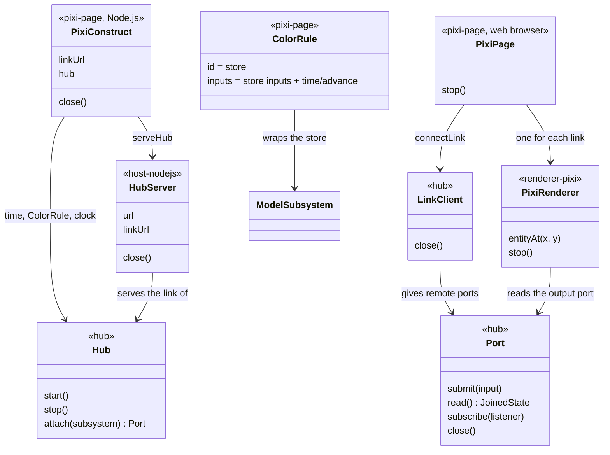
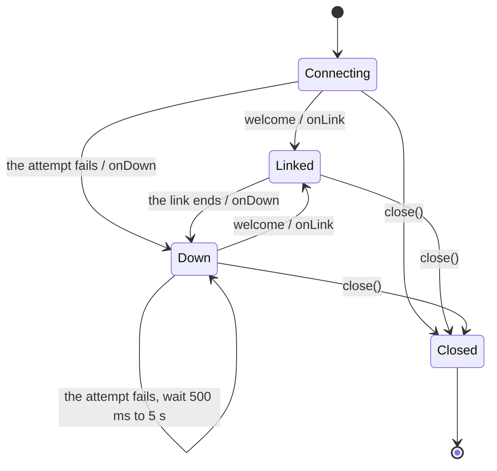
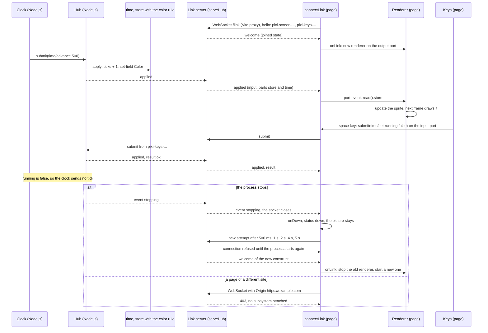
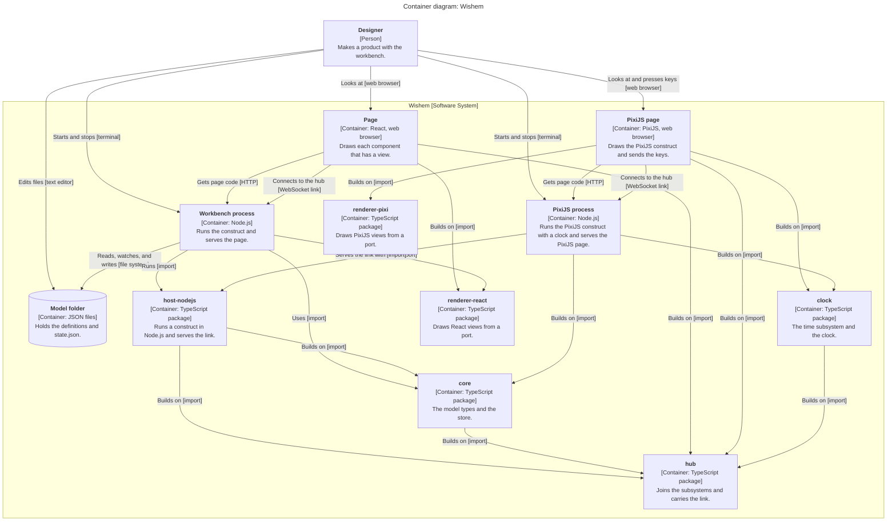

# Design

## Context

See `proposal.md` for the reason. The architecture is in [#527](https://github.com/twin-digital/opus/issues/527).

The current state:

- The hub gives each I/O subsystem a `Port` (`submit`, `read`, `subscribe`, `close`). A part that did not change is the same object. `openLink` gives a remote port with the same operations. A link fixes its subsystems at `hello`, and one link carries the subsystems of one process. Many model subsystems can declare one input type. The hub gives the input to them in the order of the list, and `context.read()` holds the new parts of the earlier subsystems.
- `@thrashplay/wishem-clock` has `createTime` (the part `time`: `now`, `ticks`, `running`) and `startClock(port, { stepMs, timer, now })`. `startClock` needs the port of an input subsystem and a joined state with the part `time`. It stops on the event `stopping`. No construct with a clock runs now.
- `@thrashplay/wishem-host-nodejs` has `startConstruct({ folder, port })`. It makes a hub with the store and the storage subsystem of a model folder, listens on `127.0.0.1` (default port 4747), and serves the link at `/link` through `attachLinkServer` of `link-server.ts`. The link server refuses an `Origin` header whose host name is not `127.0.0.1`, `localhost`, or `[::1]` (status 403). `startConstruct` is bound to a model folder, and it has no clock.
- The store holds definitions and entities. The only field type is `string`.
- The workbench is one Node.js process (`workbench-app/scripts/start.ts`): `startConstruct` and a Vite page server. Vite sends `/link` to the hub (a proxy with `ws: true` and `changeOrigin: false`), so the page opens its link on the address that served it. The page connects through `connectHub({ onPort })` (`workbench-app/src/hub-client.ts` after [#534](https://github.com/twin-digital/opus/issues/534)). `connectHub` attaches one output subsystem `page-<hex>`, connects again after a link ends (500 ms, then double, at most 5 s), and writes one warning for each loss. Follow-up of #534: "When a second page needs a remote port that connects again after a link ends (#540 or a product page), move the reconnect part of `connectHub` to `@thrashplay/wishem-hub`, with no React and no Node.js API."
- [#533](https://github.com/twin-digital/opus/issues/533) is merged: a rewind is the input `hub/rewind` with the usual `applied` event, and the ID `hub` is reserved. `nodejs/wishem/docs/milestones/a2-time/rewind-client.mjs --url <address> --seq <n>` sends a rewind and prints the first field of the first entity.
- Task 1 is built: `@thrashplay/wishem-renderer-pixi` draws PixiJS views from a `PortReader`. Its tests prove a remote port of `openLink`.
- `pixi.js` 8.23.0 is the current version. A probe in Node.js 24 with no DOM showed that `import 'pixi.js'` works, and that `Container`, `Sprite`, `Texture.WHITE`, `sprite.tint`, `visible`, and `getBounds()` work with no renderer.
- `opus-scripts` builds a package with a `vite` dependency as a Vite application. repo-kit gives such a package a `vite.config.ts` and a `tsconfig.json` for the bundler mode.
- `workbench-app/scripts/browser-server.ts` starts the pinned Playwright image in Docker. The project `workbench` of its Playwright configuration opens a page on the computer of the test runner through `exposeNetwork: '<loopback>'`. The pull request job `ui-tests` runs `turbo run test:ui --affected`.

The decision of the owner on 2026-11-27 ([comment on #540](https://github.com/twin-digital/opus/issues/540)): the PixiJS renderer has a construct of its own and does not use the hub of the workbench. The hub of that construct runs in a Node.js process, and the renderer runs in the page, a different process, through the link. For the MVP the hub is always in a Node.js process, so each renderer must work through the link. The same rule applies to the Godot renderer ([#541](https://github.com/twin-digital/opus/issues/541)) and to the test with three renderers ([#542](https://github.com/twin-digital/opus/issues/542)).

The lead agent made each other decision below alone, as `nodejs/wishem/docs/autonomous-flow.md` permits. The look of the page is in "UI options for the owner", so that the owner can change it in the review of the milestone.

## Goals / Non-Goals

**Goals:**

- The smallest renderer in a second library that draws a construct in a Node.js process through the link, with one kind of view.
- A picture that changes when the clock advances, and control of the time (pause, run, step) from the page through an input subsystem of the link.
- A page that connects again after the process stops and starts, with no reload.
- One general way for a Node.js program to serve the link of a hub that it made, for this construct, the construct manager ([#538](https://github.com/twin-digital/opus/issues/538)), and the Godot renderer (#541).
- One reconnecting client of the link for each page.
- A screenshot test that runs the real two processes.

**Non-Goals:**

- The test with three renderers on one hub (#542).
- A game, sprites, textures, text in the canvas, resize of the viewport, and input from a view.
- Generated types of the props of a PixiJS view.
- A screenshot on request and tool overlays (items 2 and 4 of the renderer contract) as operations of the renderer.
- A model in files or a storage subsystem for this construct.

## Decisions

### 1. Two packages: the renderer and the PixiJS page

`@thrashplay/wishem-renderer-pixi` (`nodejs/wishem/renderer-pixi`) is a library (Task 1). `@thrashplay/wishem-pixi-page` (`nodejs/wishem/pixi-page`) is a Vite application. It holds the construct of the PixiJS page (`src/construct/`), the Node.js process that runs it (`src/construct/process.ts`, `scripts/start.ts`), and the page (`src/main.ts`, `src/page.ts`, `src/keys.ts`, `src/status.ts`, `src/views/`).

- Reason: Decision 1 of #534. The page makes the port and holds the views. The renderer only draws from the port that it gets.
- Reason: the construct and the page are one demonstration of the renderer. The workbench has the same form: `workbench-app` holds the page and the start script that runs the construct.
- The code of `src/construct/` uses no Node.js API except `process.ts`. The page imports only `src/construct/model.ts` (for `STEP_MS`), so the page bundle holds no hub and no rule of the construct.
- Alternative: a second HTML entry in `workbench-app`. Rejected: the page is not a part of the workbench, and the owner requires a construct of its own.
- Alternative: a third package for the construct process. Rejected: nothing other than this page uses that construct (rule R7).

### 2. The hub is in a Node.js process, and the page uses the link

The Node.js process holds the hub of the construct with two model subsystems: `createTime({ running })` and the store with the color rule (Decision 3). It attaches the clock as the input subsystem `clock`, and it serves the link. The page is a different process. It opens one link with two subsystems: an output subsystem for the renderer and an input subsystem for the keys. It gives the remote port of the output subsystem to the renderer.

- Reason: the decision of the owner. For the MVP the hub is always in a Node.js process, and each renderer works through the link.
- Reason: one link carries the subsystems of one process (`concepts.md`), so the keys and the renderer share the link.
- The ID of each subsystem of the page is new for each link: `pixi-screen-<16 hex>` and `pixi-keys-<16 hex>`. Reason: the hub side can still hold the IDs of a link that ended.

### 3. The color rule is a model subsystem that wraps the store

The picture must change when the clock advances, but a view gets only the fields of its component, and the clock changes only the part `time`. `withColorRule(store, options)` returns a model subsystem with the ID `store`. It declares each input type of the store and `time/advance`. For each store input, it calls the store. For `time/advance`, it reads `ticks` from `context.read().time` and calls the store with a `store/set-field` that sets the `Color` field to `colors[ticks % colors.length]`. The `time` subsystem is first in the list, so it reads the new count. When the joined state has no part `time`, the rule refuses the tick with `InputRefusedError`.

The hub is now in Node.js, and this decision does not change: a model subsystem runs where the hub runs.

- Reason: rule R1 puts each rule in a model subsystem. The record holds only the ticks, so a replay and a rewind give the same colors (rule R3). The store validates the new value. No subsystem addresses a different subsystem (rule R20).
- Reason: the rule is code of this construct. A behavior system (milestone 3) replaces such code later.
- Alternative: an input subsystem that sends `store/set-field` after each tick. Rejected: it puts a rule in an I/O subsystem (rule R1), and a replay would not apply it.
- Alternative: give the time to a view as a second argument. Rejected: a view gets the fields of its component type (`concepts.md`, **Agreed**).

### 4. The renderer keeps one display object for each drawn component

`startRenderer({ port, views, stage, viewport, onError })` adds one root `Container` to the `stage`. For each component that has a view, it calls `view.create()` one time and keeps the object in the root, under the key of the entity and the component type. After each port event, it reads `port.read().store`. When the part is a different object, it sets each object again with `view.update(object, props, viewport)`, makes the objects of new components, removes and destroys the objects of components that are gone, and puts the objects in the order of the entities and then of the definitions. The application of PixiJS draws the stage on each frame. The renderer does not draw.

- Reason: PixiJS keeps its objects from frame to frame. A view that makes a new object for each change destroys and makes GPU objects at each tick.
- A view is still a pure function of its props: `update` sets each property of the object from the props and the viewport only. The object is an object of the renderer (`concepts.md`: the renderer keeps its own objects).
- The root container lets two renderers share one stage, and the stop removes only the objects of one renderer.
- The renderer reads `viewport.width` and `viewport.height` at each update. The page gives `app.screen`.
- When `create` or `update` throws, the renderer hides the object (or makes no object), calls `onError` (default `console.error`), and continues. Reason: an error in one view must not stop the listener of the port.
- Alternative: one view as a function that returns a new object for each change. Rejected: see the first reason.
- Alternative: the background color of the PixiJS renderer (`renderer.background.color`). Rejected: it is not a display object, two entities would set one value, and the renderer would need the PixiJS application.

### 5. The PixiJS view and its sidecar

A view file `<name>.ts` has a default export `{ create, update }`. Its sidecar `<name>.view.json` is `{ "kind": "pixi", "componentType": "ct_..." }`. `collectViews(sidecars, modules)` takes the results of `import.meta.glob` with `eager: true`, as the React renderer does. It ignores a sidecar of a different kind and throws a `ViewCollectionError` that names the files for each other problem.

- The view types its props by hand (`{ readonly color?: FieldValue }`). Rule R7: a generator waits until a second PixiJS view or a product needs it. See "Follow-up".
- The prop names use the rule of `wishem/renderer-html/view-types`. For two fields with one name, the first field gives the value. The PixiJS renderer gives no warning in the console. Rule R7.
- The sidecar parser and the name rule are small copies of the modules of the React renderer, with the same tests. Reason: an import from `@thrashplay/wishem-renderer-react` would bring React into a PixiJS page, and a move to a shared package changes the files of #534 while #534 is built. See "Follow-up".

### 6. The `ClearColor` view

The view makes a `Sprite` of `Texture.WHITE`. `update` sets the width and the height to the viewport and `tint` to the prop `color`. When `color` has no value, or PixiJS cannot convert it, the view sets `visible` to `false`.

- Reason: `tint` and `visible` are public properties that a test in Node.js reads.
- Alternative: `Graphics().rect().fill(color)`. Rejected: a test cannot read the fill color through a public property.

### 7. The renderer gives the entity at a point

`entityAt(x, y)` looks at the visible objects of the root from the top, and gives the entity and the component type of the first object whose bounds contain the point. Reason: item 3 of the renderer contract. The React renderer gives the same through the marks of its elements, and the cost here is small.

### 8. `PortReader` is a type of the package

`PortReader` is `Pick<Port, 'read' | 'subscribe'>`, the same type that #534 defines in `renderer-react`. Reason: #533 changed `hub/src/types.ts` while Task 1 was built. See "Follow-up".

### 9. PixiJS is a peer dependency

`renderer-pixi` has `pixi.js` `^8.23.0` as a peer dependency and as a development dependency (`catalog:`). `pixi-page` depends on `pixi.js` (`catalog:`). The catalog gets `pixi.js: ^8.23.0`. Reason: two copies of PixiJS in one page break `instanceof` and the shared registries of PixiJS.

### 10. A general function serves the link of a hub: `serveHub` in `host-nodejs`

`host-nodejs` gets `serveHub(hub, { port })` in `src/serve-hub.ts`. It makes the HTTP server, attaches the link server of `link-server.ts` to it, and listens on `127.0.0.1`. It answers each other request with status 404. It returns `{ url, linkUrl, close() }`. The caller makes the hub and starts it. `close()` stops the hub when it runs, so that each link gets `stopping`, closes the sockets, and releases the port. `startConstruct` uses `serveHub`, and its behavior does not change.

- Reason: the link server is reused, not copied. The Origin check, the 404 answers, and the close with a grace time stay in one place.
- Reason: #538 starts product constructs with no storage subsystem, and #541 serves a construct to a Godot process. Each one makes its own hub and needs only the server of the link. `serveHub` has no model, no folder, and no clock, so each one can use it.
- `serveHub` has no default port. Reason: each caller has its own port (4747 for the workbench, 4748 for this construct), and 0 lets the system select one.
- Alternative (b): options of `startConstruct` for more model subsystems and a clock. Rejected: `startConstruct` reads and writes a model folder, and a product construct has no storage subsystem. Options for each kind of construct make one function hold each assembly.
- Alternative: a copy of the server in `pixi-page`. Rejected: two Origin checks can differ.
- Files of `host-nodejs`: `src/serve-hub.ts` and `src/serve-hub.test.ts` (new), `src/start-construct.ts` (uses `serveHub`), `src/index.ts` (exports), and `README.md`.

### 11. The clock runs in the Node.js process

`startPixiConstruct({ port, paused })` in `src/construct/process.ts` does these steps in this order: it makes the hub (`createPixiHub`), calls `serveHub`, starts the hub, attaches the input subsystem `clock`, and calls `startClock(port, { stepMs: STEP_MS })` with `STEP_MS = 500`. `close()` stops the clock, closes the port of the clock, and then closes the server, which stops the hub. When `serveHub` rejects (for example, the port is in use), the hub does not start, no clock runs, and `startPixiConstruct` rejects with the same error.

- Reason: the clock is an input subsystem of the construct, so it is in the process of the hub. A tick then does not depend on the page, and two pages see the same time.
- Reason: one change of color each 500 milliseconds is easy to see and does not flash.
- The option `paused` starts the `time` subsystem with `running: false`. The command takes it as `--paused`.

### 12. The model is in code, with no storage subsystem

`src/construct/model.ts` holds `CONSTRUCT_MODEL`: one component type `Clear color` with the field `Color`, and one entity with a `Clear color` component whose color is the first color of `COLORS`. The store starts from it. The state is in memory. A new start of the process starts at tick 0 with the first color.

- Reason: the owner decided for #538 that a product construct has no storage subsystem. This construct is a small product construct.
- Reason: the test guide and the screenshot test start from a known state after each start.
- Alternative: a model folder with `startConstruct`. Rejected: it adds a storage subsystem, and a hand edit of a file is not a part of this renderer.

### 13. One reconnecting client of the link: `connectLink` in `hub`

`hub` gets `connectLink(options)` in `src/link/connect-link.ts`. It opens a link with the subsystems of the options. The ID of each subsystem is `<prefix>-<16 hex>`, new for each link. After each `welcome`, it calls `onLink(ports)` with the remote ports in the order of the subsystems. When the first attempt fails, or when a link ends, it calls `onDown()` one time, and then tries again after 500 ms, 1 s, 2 s, 4 s, and then each 5 s. A `welcome` sets the delay to 500 ms again. It calls `onRefused(error)` one time for each period with no link. `close()` closes the link and opens no new one. `connectHub` of `workbench-app` becomes a small function on `connectLink`: the address `/link` of the page, one output subsystem with the prefix `page`, `pagehide`, and its console messages. The tests of `connectHub` do not change, and they pass.

- Reason: the follow-up of #534 names this page as the second page. The PixiJS page needs two subsystems on one link, so a copy of `connectHub` would differ at once. The state machine of `connectHub` has many cases (a close during a delay, while a socket opens, inside `onPort`, before the `welcome`). Two copies double the risk of a fault.
- `connectLink` uses no Node.js API and no DOM. The caller gives `createSocket`, so `hub` keeps `types: []`. It uses `setTimeout`, `clearTimeout`, and `crypto.getRandomValues`, which `src/link/globals.d.ts` declares, as `clock` does for `setInterval`.
- `connectLink` sends no input again after a link ends (`LINK.md`, "The end of a link").
- Alternative: copy the reconnect code into `pixi-page`, with a follow-up. Rejected for the reasons above. The cost of the move is one task that waits for the merge of #594.
- Files of `hub`: `src/link/connect-link.ts`, `src/link/connect-link.test.ts`, `src/link/globals.d.ts` (new), `src/index.ts`, `README.md`, and a section "A client that connects again" in `LINK.md`. Files of `workbench-app`: `src/hub-client.ts` only.

### 14. The page gets the address of the link from the address that served it

`scripts/start.ts` starts the construct (`startPixiConstruct`) and a Vite page server in one Node.js process, as the workbench does. Vite sends `^/link$` to the hub with `ws: true` and `changeOrigin: false`. The page opens `ws://<host of the page>/link` (`wss:` for `https:`).

- Reason: the person opens one address. The page needs no configuration. The browser sends the `Origin` of the page (`http://127.0.0.1:5174`), and the link server accepts it, because its host name is `127.0.0.1`. A page of a different site sends a different `Origin`, and the link server refuses it with status 403.
- The Vite server runs with `server.hmr: false`. Reason: the HMR client of Vite reloads the page when its server comes back, and a reload hides the reconnect of the link. With no HMR, the page connects again through `connectLink`, and the status line shows the number of the link. A change of a view file then needs a reload by hand.
- Alternative: a query parameter with the address of the hub. Rejected: no caller needs a different address (rule R7).

### 15. The page holds one renderer for each link

`startPage({ stage, viewport, keys, connect, onStatus })` in `src/page.ts`:

- Before the first link, the status is `connecting`. The canvas shows the background of PixiJS.
- On each link, the page stops the renderer of the old link, starts a new renderer on the new output port, gives the new input port to the keys, and sets the status `connected` with the number of the link (1 for the first link after the page loaded).
- When the link is down, the renderer keeps its objects, because the remote port keeps its last joined state. The keys send nothing. The status is `down`.
- `stop()` closes the client of the link, removes the key listener, stops the renderer, and closes the ports. A second call does nothing.

`connect` is a parameter, so that the tests of the page in Node.js give ports of `openLink` on `createChannelPair`, or a client of a real `startPixiConstruct`. `src/main.ts` gives `connectLink` with `(url) => new WebSocket(url)`.

### 16. The keys send inputs through the input subsystem of the link

`attachKeys(target, input)` listens to `keydown`. `input()` gives the current input port, or no value while the link is down. The space key sends `timeInputs.setRunning(!running)`, with `running` read from the part `time` of the port. The period key sends `timeInputs.advance(STEP_MS)`. The page calls `preventDefault` for the space key. A rejected or failed submit is ignored, and the page sends it no second time. With no port or no part `time`, a key sends nothing.

- Reason: pause, run, and step are inputs (rule R20). The record holds them with the source `pixi-keys-<hex>`.
- Alternative: the page starts paused by a query parameter. Rejected: the time belongs to the construct, which two pages can share. The process option `--paused` is deterministic.

### 17. The start for a person: one command

`pnpm --filter @thrashplay/wishem-pixi-page start` runs `node scripts/start.ts`. It starts the construct on `127.0.0.1:4748` and the page server on `127.0.0.1:5174`, and prints the two addresses. Options: `--paused`, `--port <number>`, `--hub-port <number>` (0 lets the system select). Ctrl+C or `SIGTERM` stops the page server and then the construct, and the command ends with exit code 0. When a port is in use, the command writes `wishem: port <number> is in use`, stops each part that started, and ends with exit code 1.

- Reason: the workbench has the same form, and one command is one step for a person.
- Reason: 4748 and 5174 are next to the ports of the workbench (4747 and 5173), so the workbench and the PixiJS page can run at the same time.
- The page in the web browser is the second process. A stop and a start of the command proves the reconnect of the page, because the page stays open (Decision 14).
- Alternative: two commands, one for the construct and one for the page server. Rejected: a person must start two terminals, and the page server would need the address of the hub. The proof of the link does not need it.

### 18. The screenshot test runs the real two processes

`pixi-page` has its own `scripts/browser-server.ts`: it starts the pinned Playwright image in Docker, starts `playwright run-server`, and runs the command with `WISHEM_BROWSER_WS_ENDPOINT`. It copies no build. The Playwright `webServer` runs `node scripts/start.ts --port 4181 --hub-port 0 --paused`, with `reuseExistingServer: false`, so each run starts a new construct at tick 0. The browser opens `http://127.0.0.1:4181/` through `exposeNetwork: '<loopback>'`. The page connects through the Vite proxy to the hub. The test:

1. Opens `/` and waits for `data-ready` on the canvas and for the status text "Connected (link 1)".
2. `expect(canvas).toHaveScreenshot('tick-0.png')`.
3. Presses the period key. `expect(canvas).toHaveScreenshot('tick-1.png')`, and the two images are different.
4. Waits 1500 milliseconds (three intervals of the clock). `expect(canvas).toHaveScreenshot('tick-1.png')` again.
5. Presses the space key. `expect.poll` until a screenshot of the canvas is different from `tick-1.png`.

- Reason: the input of step 3 goes from the page through the link to the hub in Node.js, and the picture comes back through the link. A fault in the link, the proxy, or the input subsystem makes step 3 fail.
- Reason: the process starts paused, so the picture does not change before a key.
- The test has one worker and no retry. Reason: the construct is shared, and a retry would start from a later tick.
- Alternative: the clock of Playwright (`page.clock`). Rejected: the clock is in Node.js, not in the page.
- Alternative: use the script of `workbench-app`. Rejected: it builds and copies the style guide. See "Follow-up".

### 19. A rewind needs no new code

The page draws the state after `hub/rewind`, because the remote port gives the `applied` event and the renderer reads the part `store` after each event. The color rule is a pure function of the parts, so a checkpoint restores it. The clock measures the real time again after a rewind. The test guide shows a rewind with `rewind-client.mjs`.

### 20. The documents

- The architecture document shows the new containers (see "Container diagram after the change"). The README gets a short list of the path of a tick from the clock in the PixiJS process to the picture in the PixiJS page. The component diagram of the workbench page and the dynamic diagram do not change.
- `concepts.md`, "Distribution": the item "A product with a browser renderer can run the hub in the page" becomes "For the MVP, the hub of each construct is in a Node.js process, and each renderer reads it through a link. (**Agreed**, owner, 2026-11-27)". "The three renderers": the PixiJS renderer is the package `renderer-pixi`, its view is the PixiJS view (sidecar kind `pixi`), and `pixi-page` holds a construct with a clock in a Node.js process and a page that reads it through a link. The item about the view of the PixiJS renderer stays **Proposed** for Godot and gives `ClearColor` as the view of the PixiJS renderer.
- `glossary.md`: a new term **PixiJS view**, beside **React view**.
- `nodejs/wishem/CLAUDE.md`: the two packages in the list, and `serveHub` in the item of `host-nodejs`.

### Rejected alternative: the hub in the page

The first plan of this change put the hub, the store, the `time` subsystem, and the clock in the page, with no link. Reason then: `concepts.md` said that a product with a browser renderer can run the hub in the page, and no construct with a clock ran in Node.js. Rejected by the owner on 2026-11-27: the owner wants to test the link between a construct whose hub and renderer are in different processes, and for the MVP the hub is always in a Node.js process, so each renderer must work through the link.

## Interfaces

Owner: `@thrashplay/wishem-renderer-pixi`, root entry (Task 1, built).

```ts
import type { Container } from 'pixi.js'
import type { FieldValue, Id } from '@thrashplay/wishem-core'
import type { Port } from '@thrashplay/wishem-hub'

/** The two operations of a port that a renderer uses. */
export type PortReader = Pick<Port, 'read' | 'subscribe'>

export interface Viewport {
  readonly width: number
  readonly height: number
}

export type ViewProps = Readonly<Record<string, FieldValue | undefined>>

/** The default export of a PixiJS view file. */
export interface PixiView<Props = ViewProps, Display extends Container = Container> {
  /** Makes the display object of one component. Called one time for each component. */
  create(): Display
  /** Sets each property of the object from the props and the viewport only. */
  update(display: Display, props: Props, viewport: Viewport): void
}

export const PIXI_KIND = 'pixi'

export interface CollectedView {
  /** For example `ClearColor.view.json`. */
  sidecar: string
  componentType: Id
  view: PixiView
}
export type ViewTable = ReadonlyMap<Id, CollectedView>
export class ViewCollectionError extends Error {
  readonly files: readonly string[]
}
/** Each argument maps the path of a file to its loaded module, as `import.meta.glob` with `eager: true` gives. */
export const collectViews: (sidecars: Record<string, unknown>, modules: Record<string, unknown>) => ViewTable

export interface RendererOptions {
  port: PortReader
  views: ViewTable
  /** The renderer adds one root container to it. */
  stage: Container
  /** Read at each update. */
  viewport: Viewport
  /** Gets each error of a view. Default: `console.error`. */
  onError?: (error: unknown) => void
}

export interface DrawnComponent {
  entity: Id
  componentType: Id
}

export interface PixiRenderer {
  /** The top visible component at a point of the viewport. */
  entityAt(x: number, y: number): DrawnComponent | undefined
  /** Removes the listener and destroys the objects of the renderer. A second call does nothing. */
  stop(): void
}

/** Draws at once from `port.read()`, then after each event of the port. */
export const startRenderer: (options: RendererOptions) => PixiRenderer
```

Owner: `@thrashplay/wishem-host-nodejs`, root entry (Task 2).

```ts
import type { Hub } from '@thrashplay/wishem-hub'

export interface ServeHubOptions {
  /** Use 0 to let the system select a port. */
  port: number
}

export interface HubServer {
  /** For example `http://127.0.0.1:4748`. */
  readonly url: string
  /** For example `ws://127.0.0.1:4748/link`. */
  readonly linkUrl: string
  /** Stops the hub when it runs, closes each link, and releases the port. Gives the same promise on each call. */
  close(): Promise<void>
}

/**
 * Listens on 127.0.0.1 and serves the link of the hub at `/link`. Does not start the hub.
 * Rejects with the error of the listen (for example `EADDRINUSE`), and then holds no socket.
 */
export const serveHub: (hub: Hub, options: ServeHubOptions) => Promise<HubServer>
```

Owner: `@thrashplay/wishem-hub`, root entry (Task 4).

```ts
export interface LinkClientSubsystem {
  /** The ID of the subsystem is `<prefix>-<16 hex>`, new for each link. */
  prefix: string
  kind: 'input' | 'output'
}

export interface ConnectLinkOptions {
  /** For example `ws://127.0.0.1:5174/link`. */
  url: string
  createSocket: (url: string) => WebSocketLike
  /** One or more. */
  subsystems: readonly LinkClientSubsystem[]
  /** Called after each `welcome`, with one remote port for each subsystem, in the order of `subsystems`. */
  onLink: (ports: readonly Port[]) => void
  /** Called one time when the client has no link: after the first attempt fails, or after a link ends. Not called after `close()`. */
  onDown?: () => void
  /** Called one time for each period with no link, for the first refusal. */
  onRefused?: (error: LinkRefusedError) => void
  /** Gets each error of a listener of the link, of `onLink`, and of `onDown`. */
  onError?: (error: unknown) => void
  /** Default 500. */
  firstDelayMs?: number
  /** Default 5000. */
  maxDelayMs?: number
}

export interface LinkClient {
  /** Closes the link and opens no new one. A second call does nothing. */
  close(): void
}

/** Opens a link at once, and opens a new link after each end, until `close()`. */
export const connectLink: (options: ConnectLinkOptions) => LinkClient
```

`connectHub(options)` of `workbench-app/src/hub-client.ts` keeps its signature (`HubClientOptions`, `HubClient`) and its behavior.

Owner: `@thrashplay/wishem-pixi-page` (not exported; used by its own modules, scripts, and tests).

```ts
// src/construct/model.ts (Task 3)
export const CLEAR_COLOR_TYPE: Id // ct_...
export const COLOR_FIELD: Id // fld_...
export const SCREEN_ENTITY: Id // e_...
export const COLORS: readonly [string, string, string, string] // '#1d4ed8', '#b91c1c', '#15803d', '#a16207'
export const CONSTRUCT_MODEL: Model // the field holds COLORS[0]
export const STEP_MS = 500

// src/construct/color-rule.ts (Task 3)
export interface ColorRuleOptions {
  entity: Id
  componentType: Id
  field: Id
  colors: readonly string[]
}
/** A model subsystem with the ID of the store that also applies `time/advance`. */
export const withColorRule: (store: ModelSubsystem<Model>, options: ColorRuleOptions) => ModelSubsystem<Model>

// src/construct/create-hub.ts (Task 3)
export interface PixiHubOptions {
  running: boolean
  onError?: (error: unknown) => void
}
/** A hub with `time` and the store with the color rule, in this order. Not started. */
export const createPixiHub: (options: PixiHubOptions) => Hub

// src/construct/process.ts (Task 3, Node.js only)
export interface PixiConstructOptions {
  /** Use 0 to let the system select a port. */
  port: number
  /** Default `false`. */
  paused?: boolean
  /** For tests. Default: `setInterval` and `Date.now`. */
  timer?: ClockTimer
  now?: () => number
  /** Default: write to the terminal. */
  log?: (line: string) => void
}
export interface PixiConstruct {
  readonly url: string
  readonly linkUrl: string
  readonly hub: Hub
  /** Stops the clock, the hub, and the server. Gives the same promise on each call. */
  close(): Promise<void>
}
export const startPixiConstruct: (options: PixiConstructOptions) => Promise<PixiConstruct>

// src/keys.ts (Task 5)
/** Listens to `keydown` on the target. Returns a function that removes the listener. A second call does nothing. */
export const attachKeys: (target: EventTarget, input: () => Port | undefined) => () => void

// src/status.ts (Task 5)
export type LinkStatus =
  { state: 'connecting' } | { state: 'connected'; link: number } | { state: 'down'; link: number }
export const statusText: (status: LinkStatus) => string

// src/page.ts (Task 5)
export interface PageLinkHandlers {
  /** The output port, then the input port. */
  onLink(ports: readonly Port[]): void
  onDown(): void
}
export type PageConnector = (handlers: PageLinkHandlers) => { close(): void }
export interface PageOptions {
  stage: Container
  viewport: Viewport
  /** Gets the key events. */
  keys: EventTarget
  connect: PageConnector
  onStatus: (status: LinkStatus) => void
  onError?: (error: unknown) => void
}
export interface PixiPage {
  /** Closes the link client, removes the keys, stops the renderer, and closes the ports. A second call does nothing. */
  stop(): void
}
export const startPage: (options: PageOptions) => PixiPage

// src/views/ClearColor.ts (Task 5)
declare const view: PixiView<{ readonly color?: FieldValue }, Sprite>
export default view

// scripts/start.ts (Task 5, Node.js only)
export interface PixiStartOptions {
  /** The port of the page. Default 5174. */
  port?: number
  /** The port of the hub. Default 4748. */
  hubPort?: number
  /** Default `false`. */
  paused?: boolean
  log?: (line: string) => void
}
export interface PixiStart {
  pageUrl: string
  linkUrl: string
  /** Stops the page server, then the construct. */
  close(): Promise<void>
}
export const startPixi: (options?: PixiStartOptions) => Promise<PixiStart>
```

`src/main.ts` runs only in the web browser. It makes the `Application` (640 by 360 pixels), adds `app.canvas` to the page, and calls `startPage` with `connect` from `connectLink({ url, createSocket: (address) => new WebSocket(address), subsystems: [{ prefix: 'pixi-screen', kind: 'output' }, { prefix: 'pixi-keys', kind: 'input' }], ... })`, and `onStatus` that writes `statusText(status)` to the status line.

## Data Model

No persisted schema changes. The new types are `HubServer` (host-nodejs), `LinkClient` (hub), the color rule, the construct, and the page. `Hub`, `Port`, `ModelSubsystem`, and `PixiRenderer` are the neighbours for context.



The state of the client of the link, in `connectLink` and in the status line of the page:



## The flow from a tick to the picture



## Container diagram after the change

New: the containers PixiJS page, PixiJS process, `renderer-pixi`, and `clock`, with their relationships. `clock` exists on `main`, and it is a container now because the PixiJS process builds on it. Nothing moves or is removed. The diagram includes `renderer-react` from #534, because Task 5 starts after #534 is merged.



`renderer-pixi` imports only types from `core` and `hub`, so the diagram shows no relationship from it. The PixiJS page imports `timeInputs` of `clock`, `connectLink` of `hub`, and `startRenderer` of `renderer-pixi`. The PixiJS process imports `serveHub` of `host-nodejs`, `createTime` and `startClock` of `clock`, and `createStore` of `core`. The system context diagram does not change: the designer is the one person, and Wishem connects to no external system.

## Failure Modes

| Failure                                                                                                                         | Behavior                                                                                                                                                                        | Recovery                                                                                                                                                                                            |
| ------------------------------------------------------------------------------------------------------------------------------- | ------------------------------------------------------------------------------------------------------------------------------------------------------------------------------- | --------------------------------------------------------------------------------------------------------------------------------------------------------------------------------------------------- |
| The process stops (Ctrl+C or `SIGTERM`)                                                                                         | The hub sends `stopping`. The link ends. The page keeps the last picture, shows the status `down`, and the keys send nothing.                                                   | `connectLink` tries again after 500 ms, 1 s, 2 s, 4 s, then each 5 s. The next `welcome` gives a new renderer and the status `connected` with the next link number. The construct starts at tick 0. |
| The process ends with no `stopping` (it is killed)                                                                              | The socket closes. The page does as for a stop.                                                                                                                                 | As above.                                                                                                                                                                                           |
| The link ends while a submit of a key waits                                                                                     | The submit has no result, and the page does not send it again.                                                                                                                  | The person presses the key again after the new link.                                                                                                                                                |
| A key while the link is down                                                                                                    | No input. No error.                                                                                                                                                             | None needed.                                                                                                                                                                                        |
| The port of the hub (4748) or of the page (5174) is in use                                                                      | The command writes `wishem: port <number> is in use`, stops each part that started, and ends with exit code 1. `startPixiConstruct` rejects, and no hub runs and no clock runs. | Stop the other process, or give `--hub-port` or `--port`.                                                                                                                                           |
| A page of a different site opens `/link`                                                                                        | The link server answers 403 and attaches no subsystem.                                                                                                                          | None needed.                                                                                                                                                                                        |
| The hub refuses the `hello` (for example, `stopped` during a stop)                                                              | `connectLink` calls `onRefused` one time and tries again.                                                                                                                       | The next `welcome`.                                                                                                                                                                                 |
| A listener of the link, `onLink`, or `onDown` throws                                                                            | `connectLink` gives the error to `onError` and continues. The link stays open.                                                                                                  | None needed.                                                                                                                                                                                        |
| Two pages on one construct                                                                                                      | Each page has its own link and IDs. Both pages show the same color. A key in one page changes the time of both.                                                                 | None needed. This is the behavior of a shared construct.                                                                                                                                            |
| A view throws in `create` or `update`                                                                                           | The renderer hides that object, calls `onError` one time, and sets the other objects.                                                                                           | The next different part `store` calls the view again.                                                                                                                                               |
| The value of `Color` is not a color                                                                                             | `ClearColor` hides its sprite. The canvas shows the background of PixiJS.                                                                                                       | The next tick sets a color of the list.                                                                                                                                                             |
| `close()` of `serveHub`, `startPixiConstruct`, or `startPixi` runs two times, or from inside a listener of a port during a tick | Each call gives the same promise. No error. No later tick.                                                                                                                      | None needed.                                                                                                                                                                                        |
| `stop()` of the page runs two times, or inside `onLink`                                                                         | The second call does nothing. A link that arrives after the stop is closed, and the page starts no renderer.                                                                    | None needed.                                                                                                                                                                                        |
| The space key while an input waits                                                                                              | The keys read `running` at the key press. Two fast presses can send the same value. The `time` subsystem ignores a value equal to the current one.                              | Press the key again.                                                                                                                                                                                |
| Docker is not available                                                                                                         | `browser-server.ts` stops with exit code 1 and says that the screenshot tests need Docker.                                                                                      | Start Docker, or let the pull request checks run the tests.                                                                                                                                         |
| WebGL is not available in the browser                                                                                           | PixiJS selects the next renderer. The solid color gives the same pixels.                                                                                                        | None needed.                                                                                                                                                                                        |

Idempotency: an input is not idempotent. No part of this change sends an input again after a link ends. `close()` and `stop()` are idempotent. `serveHub` and `startPixiConstruct` do not retry a listen.

## Examples

The README of `renderer-pixi` holds the example of Task 1 (`src/readme-example.test.ts`).

The README of `host-nodejs` holds this example of `serveHub`:

```ts
import { createStore } from '@thrashplay/wishem-core'
import { createHub } from '@thrashplay/wishem-hub'
import { serveHub } from '@thrashplay/wishem-host-nodejs'

const hub = createHub({ subsystems: [createStore({ model })] })
const server = await serveHub(hub, { port: 0 })
hub.start()
console.log(server.linkUrl) // ws://127.0.0.1:41377/link
await server.close() // stops the hub, closes each link, releases the port
```

The start of the PixiJS page, from the root of the repository:

```
$ pnpm --filter @thrashplay/wishem-pixi-page start

> @thrashplay/wishem-pixi-page@0.0.0 start nodejs/wishem/pixi-page
> node scripts/start.ts

wishem: link at ws://127.0.0.1:4748/link
wishem: PixiJS page at http://127.0.0.1:5174/
```

With `--paused`:

```
$ pnpm --filter @thrashplay/wishem-pixi-page start --paused
...
wishem: the time of the construct starts paused
wishem: link at ws://127.0.0.1:4748/link
wishem: PixiJS page at http://127.0.0.1:5174/
```

When the port of the hub is in use:

```
$ pnpm --filter @thrashplay/wishem-pixi-page start
...
wishem: port 4748 is in use
 ELIFECYCLE  Command failed with exit code 1.
```

A rewind through a client of the link, after three steps from a paused start:

```
$ node nodejs/wishem/docs/milestones/a2-time/rewind-client.mjs --url ws://127.0.0.1:4748/link --seq 1
result: {"ok":true,"seq":4}
title now: "#b91c1c"
```

## Package Impact

| Package                            | Published or private | Bump  | Reason                                                                                                                                                                 |
| ---------------------------------- | -------------------- | ----- | ---------------------------------------------------------------------------------------------------------------------------------------------------------------------- |
| `@thrashplay/wishem-renderer-pixi` | Private (new)        | minor | New package: the PixiJS renderer, the table of views, and the entity at a point.                                                                                       |
| `@thrashplay/wishem-pixi-page`     | Private (new)        | minor | New package: the PixiJS construct in a Node.js process, the color rule, the page that reads it through the link, the keys, the start command, and the screenshot test. |
| `@thrashplay/wishem-host-nodejs`   | Private              | minor | New export `serveHub`. `startConstruct` uses it, with no change of behavior.                                                                                           |
| `@thrashplay/wishem-hub`           | Private              | minor | New export `connectLink`, and a section of `LINK.md`.                                                                                                                  |
| `@thrashplay/wishem-workbench-app` | Private              | patch | `connectHub` uses `connectLink`. No change that the person sees.                                                                                                       |

`core` and `clock` get new dependents and no change. The changeset has no entry for a package that does not change. No package is published.

## UI options for the owner

The config asks for two or three options of the look, for the owner to select. The lead agent selected option A, as `autonomous-flow.md` permits. The owner can select a different option in the review of the milestone.

- **A. The canvas and one status line below it (selected).** The page shows the canvas and one line of text: "Connecting to the construct." before the first link, "Connected (link 2). Space: pause or run. Period: one step." with a link, and "The construct is not reachable. The page tries again." while the link is down. Reason: a person and the final reviewer must see the state of the link, and the number of the link shows that the page connected again with no reload. The text is not in the canvas, so the screenshots do not change.
- **B. The canvas only.** The state of the link is only in the console and in an attribute `data-link` of the canvas. Rejected: a person cannot see if the page is connected, and a step of the test guide would need the console.
- **C. Text in the canvas.** A PixiJS `Text` object over the color shows the state. Rejected: it is a second kind of display object, the status is not state of the construct, and each status text would change the screenshots.

## UI

The page is a proof of the renderer, not a screen of the workbench. It uses no component of the workbench style guide, and it adds no component and no design token. Reason: the colors are values of fields in the model of the construct, and the status line is plain text with the default font and colors of the browser. The style guide of `workbench-app` and `wishem/design-system/component-catalog` do not change.

```
+--------------------------------------------------+
| canvas, 640 x 360 CSS pixels, at the top left     |
|                                                  |
|   filled with the color of the field Color:      |
|   #1d4ed8 -> #b91c1c -> #15803d -> #a16207 -> ... |
|   one change each 500 ms while running           |
|                                                  |
+--------------------------------------------------+
Connected (link 1). Space: pause or run. Period: one step.
```

- `index.html` sets `:root { color-scheme: light dark }`, `body { margin: 0 }`, `canvas { display: block; max-width: 100%; height: auto }`, and `p { margin: 8px }`. It sets no color. The browser gives the text and the background colors of the light theme or the dark theme.
- States:
  - Connecting (loading): the canvas shows the background of PixiJS, and the status line says "Connecting to the construct."
  - Connected: the color follows the construct. Running: the color changes. Paused: the color stays.
  - Down (error): the canvas keeps the last picture, and the status line says "The construct is not reachable. The page tries again."
  - A value that is not a color: the background of PixiJS. No message.
  - The page has no empty state and no disabled state: the construct always has one entity, and the keys do nothing while the link is down.
- Narrow viewport: on a viewport narrower than 640 pixels, the canvas becomes smaller and keeps its shape, and the status line wraps. The page has no horizontal scroll.
- Keyboard: `keydown` on `window` while the page has focus. Space toggles the pause. Period sends one step. Each other key does nothing. The page calls `preventDefault` for the space key, so that the page does not scroll. The page has no element that gets focus.
- Accessibility: the canvas has `role="img"` and the `aria-label` "The color of the construct". The status line is a `p` with `role="status"`, so a screen reader reads each change.

## Risks / Trade-offs

- [The HMR client of Vite reloads the page after a restart] → `server.hmr: false` in `scripts/start.ts`. The step of the test guide checks the link number: "link 2" after a restart shows that the page did not reload. If Vite still reloads, Task 5 reports it, and the follow-up issue of the workbench page covers both pages.
- [WebSocket through `exposeNetwork: '<loopback>'` and the Vite proxy in the screenshot test] → The page and the link use one origin, so the browser sees only `127.0.0.1:4181`. If the link does not open in Docker, Task 6 reports it with the output of the browser console.
- [WebGL in the pinned headless browser] → PixiJS then selects WebGPU or Canvas. A solid color gives the same pixels. If no renderer starts, Task 6 sets `preference: ['webgl', 'canvas']` in `src/main.ts` and reports it.
- [A screenshot before the first frame] → The test waits for `data-ready` on the canvas and for the status text. `toHaveScreenshot` waits for two screenshots that are equal.
- [The move of `connectHub` changes the workbench page] → The tests of `connectHub` stay as they are on `main` and must pass. Task 4 changes no other file of `workbench-app`.
- [Conflicts with #534 / #594] → Tasks 4 and 5 change files that #594 changes. They start after #594 is merged. See "What this change needs from #534 and #533".
- [The archive of `wishem/architecture/diagrams`] → #534 modifies the same requirement. The delta of this change holds the scenario of #534 ("The page and the workbench process build on the React renderer package"), so the order of the two archives does not matter.
- [The copies of the sidecar parser and of the name rule in `renderer-pixi`] → The tests of the two renderers use the same examples. The follow-up moves them to one place.
- [The second copy of `browser-server.ts`] → It is shorter, because it copies no build. The follow-up shares one script.

## Migration Plan

No data and no deployment. `serveHub` and `connectLink` are new exports, and the callers that exist keep their behavior. Rollback is the revert of the pull request.

## What this change needs from #534 and #533

From #534 (pull request #594):

- No code for Task 1, 2, or 3. `renderer-pixi` defines its own `PortReader`, sidecar parser, and name rule.
- Task 4 changes `workbench-app/src/hub-client.ts`, which #594 makes (from `src/renderer/hub-client.ts`) with `connectHub({ onPort })`. Task 4 starts after #594 is merged.
- Task 5 changes `docs/architecture/README.md`, `render.mjs`, the SVG files of the container diagram, `nodejs/wishem/CLAUDE.md`, and `concepts.md`, which #594 changes too. Task 5 starts after #594 is merged, and its container diagram includes `renderer-react`.
- Tasks 2 and 3 can start before #594 is merged. If #594 merges after Task 3, run `pnpm install` and `pnpm update-readme` again after the merge of `main`.

From #533 (merged as #583):

- Update the branch from `main` before Task 2. `main` has the record, the rewind, `HUB_ID`, and `hubInputs`, and the clock that measures the real time again after a rewind.
- #533 reserves the ID `hub`. This change uses the IDs `store`, `time`, `clock`, `pixi-screen-<hex>`, `pixi-keys-<hex>`, and `page-<hex>`.

## The test guide

The test guide of the milestone `[WSH] A5 Renderers` (`nodejs/wishem/docs/milestones/a5-renderers.md`) gets one section for this renderer. The final reviewer does these steps on the branch with real processes and a real web browser, and reports the result of each step.

What a person needs: the checkout, Node.js 24, pnpm, a web browser, and Docker for the last step.

1. `pnpm install`, then `pnpm build --filter "@thrashplay/wishem-pixi-page..."`. Result: the build ends with no error. The build also makes `nodejs/wishem/hub/dist/`, which `rewind-client.mjs` uses.
2. In terminal 1: `pnpm --filter @thrashplay/wishem-pixi-page start`. Result: the terminal shows `wishem: link at ws://127.0.0.1:4748/link` and `wishem: PixiJS page at http://127.0.0.1:5174/`.
3. Open `http://127.0.0.1:5174/` in a web browser. Result: the status line says "Connected (link 1). Space: pause or run. Period: one step." A rectangle of 640 by 360 pixels changes its color two times each second: blue, red, green, amber, then blue again.
4. Press the space key. Result: the color stops changing.
5. Press the period key three times. Result: for each press, the color goes to the next color of the list.
6. Press the space key. Result: the color changes two times each second again.
7. In terminal 1, press Ctrl+C. Result: the command stops. The page keeps the last color, and the status line says "The construct is not reachable. The page tries again."
8. In terminal 1, run the command of step 2 again. Do not reload the page. Result: within 5 seconds the status line says "Connected (link 2). ...", and the colors run again from blue. "link 2" shows that the page did not reload.
9. In terminal 1, press Ctrl+C, then run `pnpm --filter @thrashplay/wishem-pixi-page start --paused`. Result: the terminal also shows `wishem: the time of the construct starts paused`. Within 5 seconds the page says "Connected (link 3). ...", and the rectangle is blue and does not change.
10. Press the period key three times. Result: red, green, amber.
11. In terminal 2: `node nodejs/wishem/docs/milestones/a2-time/rewind-client.mjs --url ws://127.0.0.1:4748/link --seq 1`. Result: `result: {"ok":true,"seq":4}` and `title now: "#b91c1c"` (the program prints the first field of the entity, here the color). The page shows red.
12. Press the period key. Result: green. The construct continues from the tick after the target.
13. In terminal 2: `curl -s -o /dev/null -w "%{http_code}\n" -H "Origin: https://example.com" -H "Connection: Upgrade" -H "Upgrade: websocket" -H "Sec-WebSocket-Version: 13" -H "Sec-WebSocket-Key: dGhlIHNhbXBsZSBub25jZQ==" http://127.0.0.1:4748/link`. Result: `403`. The page in the web browser stays connected.
14. In terminal 2: `pnpm --filter @thrashplay/wishem-pixi-page start`. Result: `wishem: port 4748 is in use`, and the command ends with exit code 1. The page in the web browser stays connected.
15. In terminal 1, press Ctrl+C. Result: the command stops.
16. `pnpm --filter @thrashplay/wishem-pixi-page test:ui` on a computer with Docker. Result: the screenshot test passes.

What this renderer does not do: it does not share a hub with the React renderer or the Godot renderer ([#542](https://github.com/twin-digital/opus/issues/542)), it has no view other than `ClearColor`, the construct keeps no state after a stop, and the canvas does not follow the size of the window.

## Follow-up

- Move `PortReader` to `@thrashplay/wishem-hub`, and make `renderer-react` and `renderer-pixi` import it.
- Share the sidecar parser, the name rule of the props, and the pairing of sidecars with view files between `renderer-react` and `renderer-pixi`, with one set of tests.
- Share one `browser-server.ts` between `workbench-app` and `pixi-page`.
- Generated types of the props of a PixiJS view, when a second PixiJS view or a product needs them.
- The viewport of the PixiJS renderer follows the size of the window.
- A screenshot on request and tool overlays as operations of a renderer (items 2 and 4 of the renderer contract), for the React renderer and the PixiJS renderer.
- The workbench start script runs Vite with HMR. The HMR client of Vite can reload the workbench page after the process starts again, so the step 7.6 of `a1-construct.md` ("with no reload") is not proved. Examine it, and give the workbench page the same proof as the PixiJS page (a visible number of the link, or `hmr: false`).
