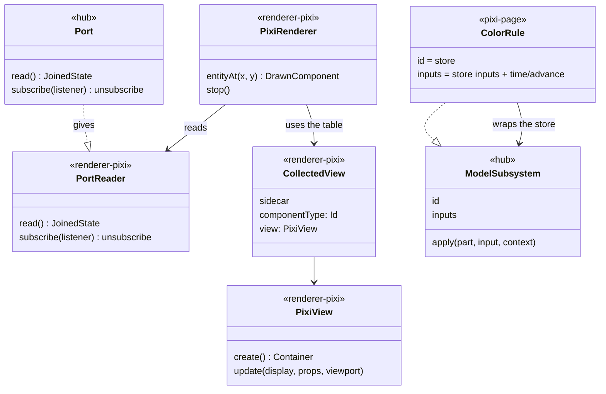
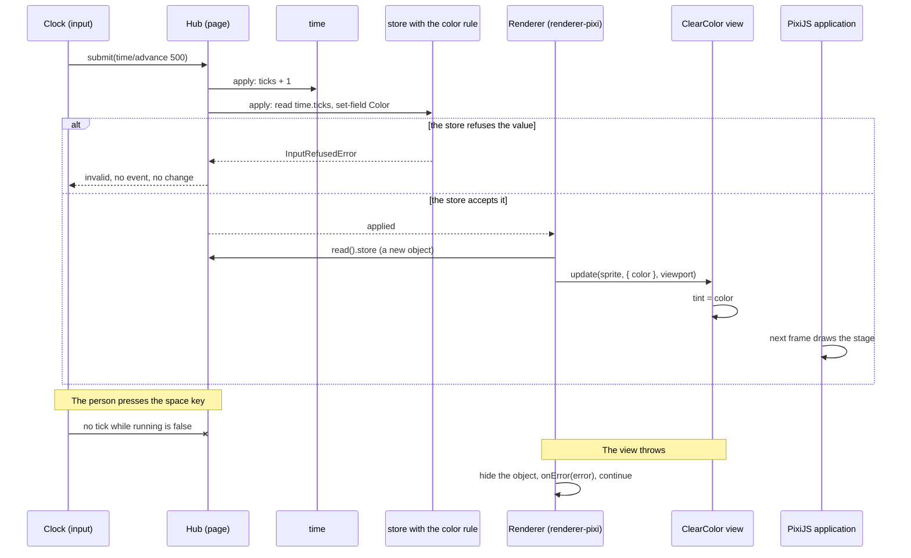
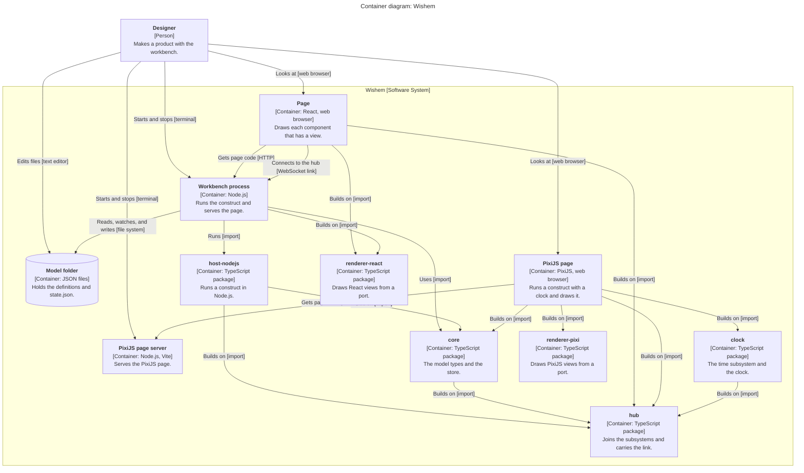

# Design

## Context

See `proposal.md` for the reason. The architecture is in [#527](https://github.com/twin-digital/opus/issues/527).

The current state:

- The hub gives each I/O subsystem a `Port` (`submit`, `read`, `subscribe`, `close`). A part that did not change is the same object. `openLink` gives a remote port with the same operations. Many model subsystems can declare one input type. The hub gives the input to them in the order of the list, and `context.read()` holds the new parts of the earlier subsystems.
- `@thrashplay/wishem-clock` has `createTime` (the part `time`: `now`, `ticks`, `running`) and `startClock(port, { stepMs, timer, now })`. `startConstruct` of `host-nodejs` makes a hub with the store only, so no construct with a clock runs now.
- The store holds definitions and entities. The only field type is `string`.
- The React renderer is in `workbench-app/src/renderer/`. [#534](https://github.com/twin-digital/opus/issues/534), which is built now in a different worktree, makes it the package `@thrashplay/wishem-renderer-react`. Its Decision 1 sets the boundary between a renderer package and the page that uses it, and the name `@thrashplay/wishem-renderer-<library>` in `nodejs/wishem/renderer-<library>`. This change follows that boundary.
- `pixi.js` 8.23.0 is the current version (published 2026-11-11). A probe in Node.js 24 with no DOM showed that `import 'pixi.js'` works, that `Container`, `Sprite`, `Texture.WHITE`, and `Graphics` work with no renderer, that `sprite.tint` returns the color as a number, that `getBounds()` gives the size, and that `sprite.tint = 'not a color'` throws `Unable to convert color`. The renderers of PixiJS 8.23 are WebGL, WebGPU, and Canvas. The default order is `webgl`, `webgpu`, `canvas`. A renderer in Node.js needs a native canvas module (the documentation names `canvas`), and only the Canvas renderer runs on it.
- `opus-scripts` builds a package with a `vite` dependency as a Vite application. repo-kit gives such a package a `vite.config.ts` and a `tsconfig.json` for the bundler mode.
- `workbench-app/scripts/browser-server.ts` starts the pinned Playwright image in Docker. The project `workbench` of its Playwright configuration opens a page on the computer of the test runner through `exposeNetwork: '<loopback>'`. The pull request job `ui-tests` runs `turbo run test:ui --affected`.

The lead agent made each decision below alone, as `nodejs/wishem/docs/autonomous-flow.md` permits. No decision meets the three conditions of "When to ask the owner": the page is a proof that a person uses only to see the renderer work, and each decision is in private code that a later change can alter.

## Goals / Non-Goals

**Goals:**

- The smallest renderer in a second library that draws from the same hub code through a port, with one kind of view.
- A picture that changes when the clock advances, and a screenshot test that proves it with no window.
- Tests in Node.js that need no web browser and no graphics card.
- No change to the workbench page, and no file of code in common with #533 or #534.

**Non-Goals:**

- A PixiJS page that connects to a hub in a different process. This is part of [#542](https://github.com/twin-digital/opus/issues/542).
- A game, sprites, textures, text, resize of the viewport, and input from a view.
- Generated types of the props of a PixiJS view.
- A screenshot on request and tool overlays (items 2 and 4 of the renderer contract) as operations of the renderer. The React renderer does not have them either.

## Decisions

### 1. Two packages: the renderer and the page

`@thrashplay/wishem-renderer-pixi` (`nodejs/wishem/renderer-pixi`) is a library. `@thrashplay/wishem-pixi-page` (`nodejs/wishem/pixi-page`) is a Vite application that holds the construct, the view, the sidecar, and the keys.

- Reason: Decision 1 of #534. The page makes the port and holds the views. The renderer only draws from the port that it gets.
- Reason: a package with a `vite` dependency is built as an application. A page in the renderer package would replace the library build of `dist/` with an application build.
- Alternative: a second HTML entry in `workbench-app`. Rejected: the page is not a part of the workbench, the workbench app would depend on PixiJS, and #534 changes `workbench-app`.
- Alternative: the package `sample-product` of #527. Rejected: that is the product of #542, which has three renderers on one hub.

### 2. The hub is in the page

The page makes one hub in the web browser: `createHub({ subsystems: [createTime({ running }), withColorRule(createStore({ model }), ...)] })`. It attaches the clock (`clock`, input), the keys (`keys`, input), and the renderer (`screen`, output).

- Reason: the issue permits it, and `concepts.md` says that a product with a browser renderer can run the hub in the page. No construct with a clock runs in Node.js now, and a new one is the work of #542.
- The renderer gets a `PortReader`, so the page of #542 can give it a remote port with no change to the renderer. The tests of Task 1 prove the remote port with `openLink` on `createChannelPair`.
- Alternative: a Node.js process with the construct and a link, as the workbench has. Rejected for this change: it adds a process, a server, and a start script that #542 will design for three renderers.

### 3. The color rule is a model subsystem

The picture must change when the clock advances, but a view gets only the fields of its component, and the clock changes only the part `time`. The page wraps the store: `withColorRule(store, options)` returns a model subsystem with the ID `store`. It declares each input type of the store and `time/advance`. For each store input, it calls the store. For `time/advance`, it reads `ticks` from `context.read().time` and calls the store with a `store/set-field` that sets the `Color` field to `colors[ticks % colors.length]`. The `time` subsystem is first in the list, so it reads the new count. When the joined state has no part `time`, the rule refuses the tick with `InputRefusedError`.

- Reason: rule R1 puts each rule in a model subsystem. The record holds only the ticks, so a replay gives the same colors (rule R3). The store validates the new value. No subsystem addresses a different subsystem (rule R20).
- Reason: the rule is code of the page. A behavior system (milestone 3) replaces such code later.
- Alternative: an input subsystem that sends `store/set-field` after each tick. Rejected: it puts a rule in an I/O subsystem (rule R1), and a replay with a changed value would not apply it.
- Alternative: give the time to a view as a second argument. Rejected: a view gets the fields of its component type (`concepts.md`, **Agreed**), and the React renderer does not do it.
- Alternative: a second model subsystem that holds the color in its own part. Rejected: the renderer draws components of the part `store`, as the React renderer does.

### 4. The renderer keeps one display object for each drawn component

`startRenderer({ port, views, stage, viewport, onError })` adds one root `Container` to the `stage`. For each component that has a view, it calls `view.create()` one time and keeps the object in the root, under the key of the entity and the component type. After each port event, it reads `port.read().store`. When the part is a different object, it sets each object again with `view.update(object, props, viewport)`, makes the objects of new components, removes and destroys the objects of components that are gone, and puts the objects in the order of the entities and then of the definitions. The application of PixiJS draws the stage on each frame. The renderer does not draw.

- Reason: PixiJS keeps its objects from frame to frame. A view that makes a new object for each change destroys and makes GPU objects at each tick.
- A view is still a pure function of its props: `update` sets each property of the object from the props and the viewport only. The object is an object of the renderer (`concepts.md`: the renderer keeps its own objects).
- The root container lets two renderers share one stage, and the stop removes only the objects of one renderer.
- The renderer reads `viewport.width` and `viewport.height` at each update. The page gives `app.screen`.
- When `create` or `update` throws, the renderer hides the object (or makes no object), calls `onError` (default `console.error`), and continues. Reason: an error in one view must not stop the listener of the port.
- Alternative: one view as a function that returns a new object for each change. Rejected: see the first reason.
- Alternative: the background color of the PixiJS renderer (`renderer.background.color`). Rejected: it is not a display object, two entities would set one value, and the renderer would need the PixiJS application.

### 5. The PixiJS view and its sidecar

A view file `<name>.ts` has a default export `{ create, update }`. Its sidecar `<name>.view.json` is `{ "kind": "pixi", "componentType": "ct_..." }`. `collectViews(sidecars, modules)` takes the results of `import.meta.glob` with `eager: true`, as the React renderer does. It ignores a sidecar of a different kind and throws a `ViewCollectionError` that names the files for each other problem.

- The view types its props by hand (`{ readonly color?: FieldValue }`). Rule R7: a generator waits until a second PixiJS view or a product needs it. See "Follow-up".
- The prop names use the rule of `wishem/renderer-html/view-types`. For two fields with one name, the first field gives the value. The PixiJS renderer gives no warning in the console. Rule R7.
- The sidecar parser and the name rule are small copies of the modules of the React renderer, with the same tests. Reason: an import from `@thrashplay/wishem-renderer-react` would bring React into a PixiJS page, and a move to a shared package changes the files of #534 while #534 is built. See "Follow-up".

### 6. The `ClearColor` view

The view makes a `Sprite` of `Texture.WHITE`. `update` sets the width and the height to the viewport and `tint` to the prop `color`. When `color` has no value, or PixiJS cannot convert it, the view sets `visible` to `false`.

- Reason: `tint` and `visible` are public properties that a test in Node.js reads. The probe confirmed both.
- Alternative: `Graphics().rect().fill(color)`. Rejected: a test cannot read the fill color through a public property.

### 7. The renderer gives the entity at a point

`entityAt(x, y)` looks at the visible objects of the root from the top, and gives the entity and the component type of the first object whose bounds contain the point. Reason: item 3 of the renderer contract. The React renderer gives the same through the marks of its elements, and the cost here is small.

### 8. `PortReader` is a type of the package

`PortReader` is `Pick<Port, 'read' | 'subscribe'>`, the same type that #534 defines in `renderer-react`. Reason: `hub/src/types.ts` is a file that #533 changes. See "Follow-up".

### 9. PixiJS is a peer dependency

`renderer-pixi` has `pixi.js` `^8.23.0` as a peer dependency and as a development dependency (`catalog:`). `pixi-page` depends on `pixi.js` (`catalog:`). The catalog gets `pixi.js: ^8.23.0`. Reason: two copies of PixiJS in one page break `instanceof` and the shared registries of PixiJS.

### 10. The keys and the paused start

The page listens to `keydown` on `window`. The space key sends `timeInputs.setRunning(!running)`, with `running` read from the part `time`. The period key sends `timeInputs.advance(500)`. The query parameter `paused` starts the `time` subsystem with `running: false`. The clock has `stepMs: 500`.

- Reason: a person can see pause, resume, and step. The screenshot test gets a picture that does not change while it waits.
- Reason: one color change each 500 milliseconds is easy to see and does not flash.
- Alternative: the clock of Playwright (`page.clock`). Rejected: a fake `requestAnimationFrame` can stop the draw of PixiJS, and the page still needs a pause for a person.

### 11. The screenshot test

`pixi-page` has its own `scripts/browser-server.ts`: it starts the pinned Playwright image in Docker, starts `playwright run-server`, and runs the command with `WISHEM_BROWSER_WS_ENDPOINT`. It does not copy a build into the container. The Playwright `webServer` starts Vite at `127.0.0.1:4181`, and the browser opens it through `exposeNetwork: '<loopback>'`, as the project `workbench` does. The test:

1. Opens `/?paused` and waits for the canvas.
2. `expect(canvas).toHaveScreenshot('tick-0.png')`.
3. Presses the period key. `expect(canvas).toHaveScreenshot('tick-1.png')`, and the two images are different.
4. Waits 1500 milliseconds (three intervals of the clock). `expect(canvas).toHaveScreenshot('tick-1.png')` again.
5. Presses the space key. `expect.poll` until a screenshot of the canvas is different from `tick-1.png`.

- The page lets PixiJS select its renderer. A solid color gives the same pixels with WebGL (SwiftShader) and with Canvas.
- Alternative: a screenshot in Node.js with the Canvas renderer and a native canvas module. Rejected: a new native module needs an entry in `allowBuilds` of `pnpm-workspace.yaml`, which is outside "Where a change is permitted", and the Node.js tests prove the display objects already.
- Alternative: use the script of `workbench-app`. Rejected: it builds and copies the style guide. A shared script changes `workbench-app`. See "Follow-up".

### 12. The documents

- The architecture document shows the new containers (see "Container diagram after the change"). The page of the workbench and its component diagram do not change. The dynamic diagram does not change. The README gets a short list of the path of a tick in the PixiJS page.
- `concepts.md`, "The three renderers": the PixiJS renderer is the package `renderer-pixi`, its view is the PixiJS view (sidecar kind `pixi`), and the page `pixi-page` holds a construct with a clock. The item "The view of the PixiJS renderer and the view of the Godot renderer each clear the viewport to a color that a field gives" stays **Proposed** for Godot and becomes the description of `ClearColor`.
- `glossary.md`: a new term **PixiJS view**, beside **React view**.
- `nodejs/wishem/CLAUDE.md`: the two packages in the list.

## Interfaces

Owner: `@thrashplay/wishem-renderer-pixi`, root entry.

```ts
import type { Container } from 'pixi.js'
import type { FieldValue, Id } from '@thrashplay/wishem-core'
import type { Port } from '@thrashplay/wishem-hub'

/** The two operations of a port that a renderer uses. */
export type PortReader = Pick<Port, 'read' | 'subscribe'>

export interface Viewport {
  readonly width: number
  readonly height: number
}

export type ViewProps = Readonly<Record<string, FieldValue | undefined>>

/** The default export of a PixiJS view file. */
export interface PixiView<Props = ViewProps, Display extends Container = Container> {
  /** Makes the display object of one component. Called one time for each component. */
  create(): Display
  /** Sets each property of the object from the props and the viewport only. */
  update(display: Display, props: Props, viewport: Viewport): void
}

export const PIXI_KIND = 'pixi'

export interface CollectedView {
  /** For example `ClearColor.view.json`. */
  sidecar: string
  componentType: Id
  view: PixiView
}
export type ViewTable = ReadonlyMap<Id, CollectedView>
export class ViewCollectionError extends Error {
  readonly files: readonly string[]
}
/** Each argument maps the path of a file to its loaded module, as `import.meta.glob` with `eager: true` gives. */
export const collectViews: (sidecars: Record<string, unknown>, modules: Record<string, unknown>) => ViewTable

export interface RendererOptions {
  port: PortReader
  views: ViewTable
  /** The renderer adds one root container to it. */
  stage: Container
  /** Read at each update. */
  viewport: Viewport
  /** Gets each error of a view. Default: `console.error`. */
  onError?: (error: unknown) => void
}

export interface DrawnComponent {
  entity: Id
  componentType: Id
}

export interface PixiRenderer {
  /** The top visible component at a point of the viewport. */
  entityAt(x: number, y: number): DrawnComponent | undefined
  /** Removes the listener and destroys the objects of the renderer. A second call does nothing. */
  stop(): void
}

/** Draws at once from `port.read()`, then after each event of the port. */
export const startRenderer: (options: RendererOptions) => PixiRenderer
```

Owner: `@thrashplay/wishem-pixi-page` (not exported; used by its own modules and tests).

```ts
// src/model.ts
export const CLEAR_COLOR_TYPE: Id // ct_...
export const COLOR_FIELD: Id // fld_...
export const SCREEN_ENTITY: Id // e_...
export const COLORS: readonly [string, string, string, string] // '#1d4ed8', '#b91c1c', '#15803d', '#a16207'
export const PAGE_MODEL: Model // the field holds COLORS[0]

// src/color-rule.ts
export interface ColorRuleOptions {
  entity: Id
  componentType: Id
  field: Id
  colors: readonly string[]
}
/** A model subsystem with the ID of the store that also applies `time/advance`. */
export const withColorRule: (store: ModelSubsystem<Model>, options: ColorRuleOptions) => ModelSubsystem<Model>

// src/keys.ts
export const STEP_MS = 500
/** Listens to `keydown` on the target. Returns a function that removes the listener. A second call does nothing. */
export const attachKeys: (port: Port, target: EventTarget) => () => void

// src/page.ts
export interface PageOptions {
  stage: Container
  viewport: Viewport
  /** Gets the key events. */
  keys: EventTarget
  paused: boolean
  /** For tests. Default: `setInterval` and `Date.now`. */
  timer?: ClockTimer
  now?: () => number
  onError?: (error: unknown) => void
}
export interface PixiPage {
  readonly hub: Hub
  readonly renderer: PixiRenderer
  /** Stops the clock, the keys, and the renderer, closes the ports, and stops the hub. A second call does nothing. */
  stop(): void
}
export const startPage: (options: PageOptions) => PixiPage

// src/views/ClearColor.ts
declare const view: PixiView<{ readonly color?: FieldValue }, Sprite>
export default view
```

`src/main.ts` runs only in the web browser. It makes the `Application` (640 by 360 pixels), adds `app.canvas` to the page, and calls `startPage({ stage: app.stage, viewport: app.screen, keys: window, paused })`.

## Data Model

No persisted schema changes. The types of the renderer are new, and the page adds a model subsystem. `Port` and `ModelSubsystem` are the neighbours for context.



## The flow from a tick to the picture



## Container diagram after the change

New: the containers PixiJS page, PixiJS page server, `renderer-pixi`, and `clock`, with their relationships. `clock` exists on `main`, and it is a container now because the PixiJS page builds on it. Nothing moves or is removed. The diagram includes `renderer-react` from #534, because Task 2 starts after #534 is merged.



`renderer-pixi` imports only types from `core` and `hub`, so the diagram shows no relationship from it. The system context diagram does not change: the designer is the one person, and Wishem connects to no external system.

## Failure Modes

| Failure | Behavior | Recovery |
| --- | --- | --- |
| A view throws in `create` or `update` | The renderer hides that object (or makes none), calls `onError` one time for the error, and sets the other objects. | The next different part `store` calls the view again. |
| The value of `Color` is not a color | `ClearColor` hides its sprite. The canvas shows the background of PixiJS. No error. | The next tick sets a color of the list. |
| The joined state has no part `store` | The renderer draws nothing. | The next event with a part `store` draws it. |
| The link of a remote port ends | The remote port keeps its last joined state, and the renderer keeps its objects. | The page gives a new port to a new renderer. |
| `stop()` of the renderer runs two times, inside a listener of the same port, or after the page destroyed the stage | The second call does nothing. A listener call after the stop does nothing. A destroyed object is not destroyed again. | None needed. |
| `stop()` of the page runs two times | The second call does nothing. | None needed. |
| A key after the stop of the page | The listener is removed. No input. | None needed. |
| The hub stops | The clock stops on `stopping`. The renderer keeps its objects. | None needed. |
| The space key while an input waits in the queue of the hub | The keys read `running` at the key press. Two fast presses can send the same value. The time part ignores a value equal to the current one. | Press the key again. |
| The port 5174 or 4181 is in use | Vite stops with an error that names the port (`--strictPort`). | Stop the other process. |
| Docker is not available | `browser-server.ts` stops with exit code 1 and says that the screenshot tests need Docker. | Start Docker, or let the pull request checks run the tests. |
| WebGL is not available in the browser | PixiJS selects the next renderer. The solid color gives the same pixels. | None needed. |

The renderer and the page make no write outside the hub. `startRenderer` does not retry.

## Examples

The README of `renderer-pixi` holds this example. `src/readme-example.test.ts` runs the same code, with a view that the test gives.

```ts
import { Container } from 'pixi.js'
import { createStore } from '@thrashplay/wishem-core'
import { createHub } from '@thrashplay/wishem-hub'
import { collectViews, startRenderer } from '@thrashplay/wishem-renderer-pixi'

const hub = createHub({ subsystems: [createStore({ model })] })
hub.start()
const port = hub.attach({ id: 'screen', kind: 'output' })
const views = collectViews(
  import.meta.glob('./views/*.view.json', { eager: true }),
  import.meta.glob(['./views/*.ts', '!./views/*.test.ts'], { eager: true }),
)
const stage = new Container()
const renderer = startRenderer({ port, views, stage, viewport: { width: 640, height: 360 } })

renderer.entityAt(10, 10) // { entity: 'e_5b0e...', componentType: 'ct_...' }
renderer.stop()
port.close()
```

The start of the page, from the root of the repository:

```
$ pnpm --filter @thrashplay/wishem-pixi-page start

  VITE v8.3.4  ready in 412 ms

  ➜  Local:   http://127.0.0.1:5174/
```

When the port is in use:

```
$ pnpm --filter @thrashplay/wishem-pixi-page start
error when starting dev server:
Error: Port 5174 is already in use
```

## Package Impact

| Package | Published or private | Bump | Reason |
| --- | --- | --- | --- |
| `@thrashplay/wishem-renderer-pixi` | Private (new) | minor | New package: the PixiJS renderer, the table of views, and the entity at a point. |
| `@thrashplay/wishem-pixi-page` | Private (new) | minor | New package: the PixiJS page with a construct, a clock, the color rule, the keys, and the screenshot test. |

No other package changes. `core`, `hub`, and `clock` get new dependents and no change. The changeset has no entry for a package that does not change.

## UI

The page is a proof of the renderer, not a screen of the workbench. Its whole content is the canvas of PixiJS. The lead agent selected the smallest page: a canvas with no text and no control. Reason: the colors are values of fields in the model of the page, and each other element would be UI of the workbench, which has a style guide of its own. The keys and the address are in the README of the package and in the test guide.

```
+--------------------------------------------------+
| canvas, 640 x 360 CSS pixels, at the top left     |
|                                                  |
|   filled with the color of the field Color:      |
|   #1d4ed8 -> #b91c1c -> #15803d -> #a16207 -> ... |
|   one change each 500 ms while running           |
|                                                  |
+--------------------------------------------------+
```

- No component and no design token is added. The style guide of `workbench-app` does not change. The page uses no raw color in its styles. The four colors are values of the model (`src/model.ts`), and PixiJS draws them.
- `index.html` sets `body { margin: 0 }` and `canvas { display: block; max-width: 100%; height: auto }`. On a viewport narrower than 640 pixels, the canvas becomes smaller and keeps its shape. The page has no horizontal scroll.
- States: running (the color changes), paused (the color stays), and a value that is not a color (the background of PixiJS). The page has no loading state that a person sees: the canvas appears after `app.init` resolves. The page has no theme: the colors are data.
- Keyboard: `keydown` on `window` while the page has focus. Space toggles the pause. Period sends one step. Each other key does nothing. The page calls `preventDefault` for the space key, so that the page does not scroll. The page has no element that gets focus.
- The canvas has `role="img"` and the `aria-label` "The color of the construct".

## Risks / Trade-offs

- [WebGL in the pinned headless browser] → Recent Chromium versions do not always give SwiftShader WebGL with no flag. PixiJS then selects WebGPU or Canvas. A solid color gives the same pixels. If no renderer starts, Task 3 sets `preference: ['webgl', 'canvas']` in `src/main.ts` and reports it.
- [A screenshot before the first frame] → `toHaveScreenshot` waits for two screenshots that are equal. The test also waits until `app.init` resolved (the page sets `data-ready` on the canvas).
- [The copies of the sidecar parser and of the name rule] → The tests of the two renderers use the same examples. The follow-up moves them to one place.
- [The repo-kit sync of a new Vite application] → `pnpm sync` makes `vite.config.ts`, a bundler `tsconfig.json`, and the `dev` and `preview` scripts for `pixi-page`. Task 2 verifies `git status` after the sync, and puts each setting of the page in `vite.config.d/`.
- [The second copy of `browser-server.ts`] → It is shorter, because it copies no build. The follow-up shares one script.
- [Conflicts with #534] → Tasks 2 and 3 change the architecture document, `render.mjs`, `nodejs/wishem/CLAUDE.md`, `concepts.md`, and the root `README.md`, which #534 also changes. Task 2 starts after #534 is merged. See "What this change needs from #534 and #533".
- [The archive of `wishem/architecture/diagrams`] → #534 modifies the same requirement. If #534 is archived first, the delta of this change must also hold the scenario of #534 ("The page and the workbench process build on the React renderer package") before the archive, or the archive removes it.
- [PixiJS updates the canvas only on a frame] → The renderer changes the objects at once, and the next frame draws them. A test in Node.js reads the objects, not pixels.

## Migration Plan

No data and no deployment. Each package is new and private. Rollback is the revert of the pull request.

## What this change needs from #534 and #533

From #534:

- No code. `renderer-pixi` defines its own `PortReader`, sidecar parser, and name rule, and it does not import `renderer-react`.
- The boundary of its Decision 1 and the name of a renderer package, which this design follows.
- Task 1 changes only `nodejs/wishem/renderer-pixi/`, the catalog in `pnpm-workspace.yaml`, `pnpm-lock.yaml`, and the root `README.md` (the package list that `pnpm update-readme` writes). It can be built before #534 is merged. If #534 merges first, run `pnpm install` and `pnpm update-readme` again after the merge of `main`.
- Task 2 starts after #534 is merged. It changes `docs/architecture/README.md`, `render.mjs`, the SVG files of the container diagram, `nodejs/wishem/CLAUDE.md`, and "The three renderers" in `concepts.md`, which #534 changes too. Its container diagram includes `renderer-react`.

From #533:

- Nothing. With #533, a rewind is the input `hub/rewind` with the usual `applied` event. The renderer reads the part `store` after each event of any type, so it draws the state after a rewind with no new code. The color rule is a pure function of the parts, so a checkpoint of the hub restores it.
- #533 reserves the ID `hub`. The page uses the IDs `store`, `time`, `clock`, `keys`, and `screen`.
- #533 changes `clock` (the clock measures the real time again after a rewind) and the text of `glossary.md` and `concepts.md`. This change does not change `clock`. After #533 merges, update the branch, and keep the text of #533 around the new term "PixiJS view".
- The fault of #565 (binary WebSocket frames) does not affect this change: the page opens no link.

## The test guide

The test guide of the milestone `[WSH] A5 Renderers` (`nodejs/wishem/docs/milestones/a5-renderers.md`) gets one section for this renderer. A person does these steps from a new checkout:

1. `pnpm install`, then `pnpm build --filter "@thrashplay/wishem-pixi-page..."`. Result: the build ends with no error.
2. `pnpm --filter @thrashplay/wishem-pixi-page start`. Result: the terminal shows `http://127.0.0.1:5174/`.
3. Open `http://127.0.0.1:5174/` in a web browser. Result: a rectangle of 640 by 360 pixels changes its color two times each second: blue, red, green, amber, then blue again.
4. Press the space key. Result: the color stops changing.
5. Press the period key three times. Result: the color goes to the next color of the list for each press.
6. Press the space key. Result: the color changes two times each second again.
7. Open `http://127.0.0.1:5174/?paused`. Result: the rectangle is blue and does not change until a key press.
8. Press Ctrl+C in the terminal. Result: the command stops.
9. `pnpm --filter @thrashplay/wishem-pixi-page test:ui` on a computer with Docker. Result: the screenshot test passes.

What this renderer does not do: it does not connect to a hub in a different process ([#542](https://github.com/twin-digital/opus/issues/542)), it has no view other than `ClearColor`, and the canvas does not follow the size of the window.

## Follow-up

- After #533 and #534 are merged: move `PortReader` to `@thrashplay/wishem-hub`, and make `renderer-react` and `renderer-pixi` import it.
- After #534 is merged: share the sidecar parser, the name rule of the props, and the pairing of sidecars with view files between `renderer-react` and `renderer-pixi`, with one set of tests.
- Share one `browser-server.ts` between `workbench-app` and `pixi-page`.
- Generated types of the props of a PixiJS view, when a second PixiJS view or a product needs them.
- The viewport of the PixiJS renderer follows the size of the window.
- A screenshot on request and tool overlays as operations of a renderer (items 2 and 4 of the renderer contract), for the React renderer and the PixiJS renderer.
