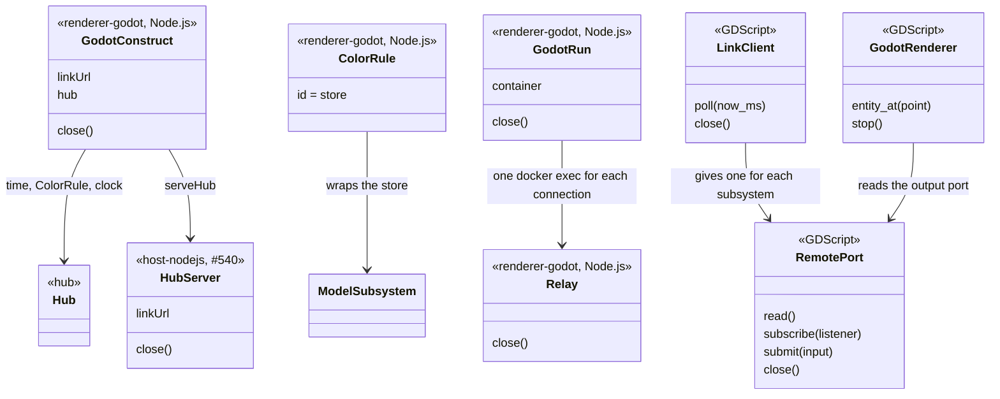
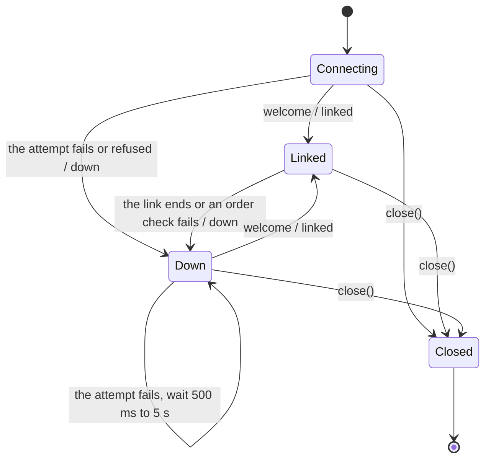
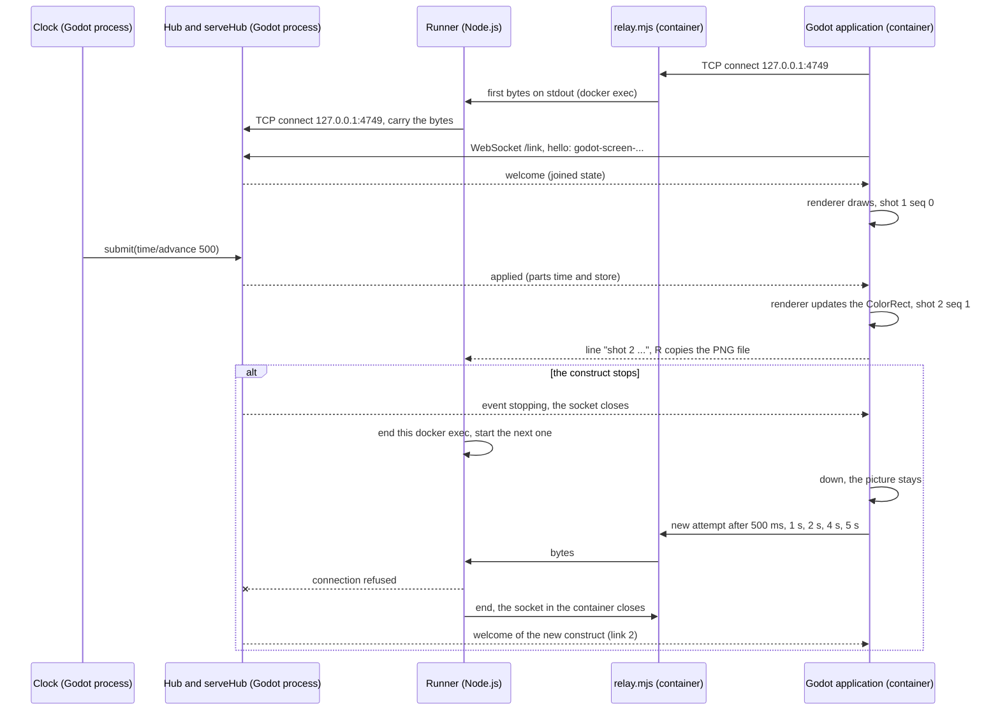
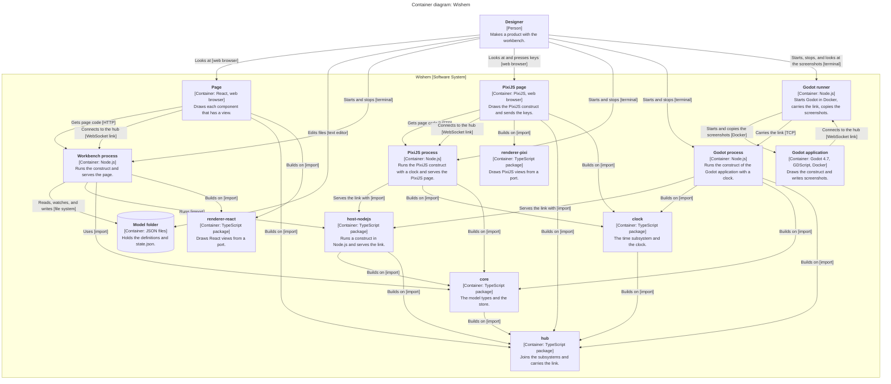

# Design

## Context

See `proposal.md` for the reason. The architecture is in [#527](https://github.com/twin-digital/opus/issues/527).

The current state:

- `@thrashplay/wishem-hub` has the hub, the ports, the record, and the link. `LINK.md` defines protocol version 1. The only clients are TypeScript: `openLink` and, after #540, `connectLink`.
- `host-nodejs` serves the link at `/link` on `127.0.0.1` through `attachLinkServer` (`link-server.ts`). The link server accepts a request with no `Origin` header, and a request whose origin host is `127.0.0.1`, `localhost`, or `[::1]`. It refuses each other origin with status 403. `webSocketChannel` ignores each message that is not text (`channel.ts`), so a binary WebSocket message gets no answer.
- Change #540 (branch `worktree-540-add-pixi-renderer`) adds `serveHub(hub, { port })` to `host-nodejs` (Task 2, built), the construct of the PixiJS page in a Node.js process (`pixi-page/src/construct/`: the model, `withColorRule`, `createPixiHub`, `startPixiConstruct` on port 4748, built in Task 3), `connectLink` in `hub` with a section "A client that connects again" in `LINK.md` (Task 4), and the documents (Task 5). `pixi-page` is an application. Its construct is not exported.
- The owner decided on 2026-11-27: for the MVP the hub is always in a Node.js process. Each renderer runs in its own construct and reaches the hub through the link. No hub runs in the Godot application (rule R21).
- Godot runs only in a Docker container (`autonomous-flow.md`). The Docker daemon of the development container is on a different computer (`DOCKER_HOST=ssh://prod-development-docker`, Ubuntu 24.04, x86_64). A container on that daemon cannot reach `127.0.0.1` of the computer that runs the construct. The job `ui-tests` of the pull request checks uses a local Docker daemon on `ubuntu-latest` and runs `turbo run test:ui --affected`.
- The current stable release of Godot is 4.7.2 (`git ls-remote` of `godotengine/godot`, tag `4.7.2-stable`).
- Godot facts that this design uses, stated from memory (**Unverified**): `WebSocketPeer` has `connect_to_url`, `poll`, `get_ready_state`, `get_available_packet_count`, `get_packet`, `was_string_packet`, `send_text`, `close`, and `inbound_buffer_size` with the default 65535 bytes. `JSON.parse_string` gives each number as a `float`. `--headless` uses a dummy renderer that makes no pixels. Under a virtual X display (Xvfb) with Mesa, `--rendering-driver opengl3` renders with software. `get_viewport().get_texture().get_image()` after `RenderingServer.frame_post_draw` gives the rendered pixels. `OS.get_cmdline_user_args()` gives the arguments after `--`. The release has `Godot_v4.7.2-stable_linux.x86_64.zip`, `Godot_v4.7.2-stable_linux.arm64.zip`, and `SHA512-SUMS.txt`. Task 1 verifies each fact that it uses and reports each difference.

The lead agent made each decision below alone, as `nodejs/wishem/docs/autonomous-flow.md` permits.

## Goals / Non-Goals

**Goals:**

- A Godot application that draws a construct in a Node.js process through the link, with one kind of view.
- A remote port in GDScript, written from `LINK.md` only, with the corrections of `LINK.md` that it needs.
- A screenshot with no window that changes when the clock advances.
- A Godot application that connects again after the construct stops and starts.
- A path from the Godot container to the construct that works with a local and with a remote Docker daemon.

**Non-Goals:**

- The test with three renderers on one hub (#542).
- An input subsystem or keys in the Godot application.
- A Godot window on the screen of a person, an export of the Godot project, and an installation of Godot on the computer of a person.
- Generated types of the props of a Godot view.
- A screenshot on request and tool overlays as operations of the renderer (items 2 and 4 of the renderer contract).
- A change to the code of `core`, `hub`, `clock`, or `host-nodejs`.

## Approaches

The brainstorm compared three ways to connect the Godot application in Docker to the hub in a Node.js process. The hub side is local (`127.0.0.1`), and the Docker daemon can be on a different computer.

1. **The runner carries the bytes (selected).** The command that starts the container (the Godot runner) runs a small relay in the container through `docker exec -i`. The relay listens on `127.0.0.1:<hub port>` in the container. For each connection, it sends the bytes on its standard output and gets the bytes on its standard input. The runner carries them to `127.0.0.1:<hub port>` on its own computer. Trade-off: a small relay with tests, and one connection at a time. It works with each Docker daemon, needs no published port, and does not change the server of the construct.
2. **Host network.** `docker run --network host`, and the Godot application connects to `127.0.0.1` of the Docker computer. With a remote daemon, an `ssh -R` forward also brings the port of the construct to that computer. Rejected: it works only on Linux and with a daemon that SSH reaches, it uses a fixed port on a shared computer, and it gives two paths to test.
3. **The construct in the container.** The image holds Node.js and a bundle of the construct, and both processes run in the container. Rejected: the person does not start and stop the construct in a terminal, the test guide must use `docker exec` for each step, and the build needs a bundle of four packages.

## Decisions

### 1. One package: `renderer-godot`

`@thrashplay/wishem-renderer-godot` (`nodejs/wishem/renderer-godot`) holds:

- `godot/`: the Godot project. `godot/wishem/` holds the remote port, the messages of the link, the table of views, and the renderer. `godot/views/` holds the view `ClearColor`. `godot/main.tscn` and `godot/main.gd` are the application. `godot/tests/` holds the GDScript tests and their runner.
- `src/construct/`: the construct in a Node.js process (Decision 9).
- `src/runner/`: the Godot runner: the Docker commands, the relay, and `runGodot` (Decisions 6 and 7).
- `docker/`: `Dockerfile` and `relay.mjs`, the files of the image.
- `scripts/start.ts` (the construct), `scripts/godot.ts` (the runner, the image, and the GDScript tests).
- `tests/godot.ui.test.ts`: the screenshot test (Decision 12).

- Reason: the issue names one package that holds the Godot project and the remote port. No other package builds on it now (rule R7).
- The root entry exports `startGodotConstruct`, `runGodot`, `imageTag`, and `ensureImage`, so that #542 can use them.
- Alternative: two packages, as #540 has (`renderer-pixi` and `pixi-page`). Rejected: the GDScript files are not a TypeScript library that a different package imports.

### 2. The remote port in GDScript has three parts

- `godot/wishem/link_messages.gd`: static functions with no state: `hello(subsystems)`, `submit(request, subsystem, input)`, `parse(text)` (a JSON object with a text `t`, or an empty dictionary), `is_id(id)`, `new_id(prefix)`, and `as_int(value)`.
- `godot/wishem/remote_port.gd`: one port of one link. It gives `read()`, `subscribe(listener)`, `submit(input)`, and `close()`. All ports of one link share one joined state.
- `godot/wishem/link_client.gd`: the state machine of `connectLink` of #540 in GDScript. It holds the socket, sends `hello`, checks the order, keeps the joined state, matches each `result` to its request, and opens a new link after each end with the waits of `LINK.md`.

The client gets time only through `poll(now_ms)`, and makes its socket through `socket_factory`. `main.gd` calls `poll(Time.get_ticks_msec())` in `_process`, and gives `WebSocketPeer.new`. The tests give a fake socket and a time that they control.

- Reason: a test of the state machine needs no network, no scene tree, and no real time.
- Reason: one link carries the subsystems of one process (`concepts.md`), as in `connectLink`.
- The client sets `inbound_buffer_size` to 4 MiB before it connects. Reason: the default of 64 KiB is smaller than a large joined state (gap 3 of Decision 14).
- The client converts each number of a message with `as_int` before it compares or stores it, and sends each number as an integer. Reason: `JSON.parse_string` gives floats (gap 4).
- A listener gets the same events as in TypeScript: `{ "type": "started" }`, `{ "type": "applied", "input": {...} }`, and `{ "type": "stopping" }`.
- `submit(input)` returns a `Submission` object with a signal `finished(result)` and the member `result`. An output port gives `{ "ok": false, "reason": "not-permitted", "problems": [] }` with no message. With no link, the port gives `not-running`. When the link ends first, it gives `{ "error": "The link closed." }`, and the client sends no input again.
- GDScript files use `preload` and no `class_name`. Reason: `class_name` needs the global class cache of an editor import, and the container copies the project for each run.
- Alternative: a Godot addon from the Asset Library. Rejected: the issue asks for a remote port written from `LINK.md`.

### 3. The Godot view and its sidecar

A Godot view is a file `<name>.gd` that extends `RefCounted` and has `create() -> Node` and `update(node: Node, props: Dictionary, viewport: Vector2) -> void`. Its sidecar `<name>.view.json` is `{ "kind": "godot", "componentType": "ct_..." }`. `godot/wishem/views.gd` gives `collect_views(folder)`, which reads each `*.view.json` of the folder with `DirAccess`, ignores a sidecar of a different kind, loads the view file with the same base name, and gives `{ "views": { <ID>: { "sidecar", "view" } }, "errors": [ <text that names the file> ] }`. It also gives `field_name(label)` and `props(definition, component)`, with the rule of `wishem/renderer-html/view-types` and the same examples as the tests of `renderer-react`.

- Reason: the same model as the React view and the PixiJS view: a sidecar attaches a view to its component type (`concepts.md`, **Agreed**).
- Reason: GDScript has no exceptions. A view that has no `create` or no `update` is an error at collection, so the renderer finds most faults before it calls a view.
- Alternative: a scene file (`.tscn`) as a view. Rejected: a scene holds state in its nodes, and a view is a pure function of its props.

### 4. The renderer keeps one node for each drawn component

`godot/wishem/renderer.gd` takes a port, the table of views, a root `Node`, and a `Callable` that gives the size of the viewport. It adds one `Control` as its root child, and keeps one node for each drawn component, under the key of the entity and the component type. After each event of the port, it reads `port.read().store`. When the part is a different object (`is_same`), it calls `update` for each node, makes the nodes of new components, removes and frees the nodes of components that are gone, and orders the nodes as the entities and then the definitions. `entity_at(point)` looks at the visible nodes from the top and gives `{ "entity", "componentType" }` of the first `Control` whose rectangle holds the point. `stop()` removes the listener and frees the root child.

- Reason: Decision 4 of #540. A node that stays from frame to frame is the Godot form of a display object.
- When `create` gives no `Node`, the renderer makes no node and writes one error with `push_error`. Reason: a GDScript error cannot be caught, so the renderer checks the result.

### 5. The `ClearColor` view

`create()` makes a `ColorRect`. `update` sets `position` to 0, `size` to the viewport, and `color` to `Color.html(props.color)`. When `color` has no value or `Color.html_is_valid` is false, it sets `visible` to `false`.

- Reason: a `ColorRect` is a node that a test reads (`color`, `size`, `visible`), and it covers the viewport.
- Alternative: `RenderingServer.set_default_clear_color`. Rejected: it is one value for the full application, not a node of a component, and two entities would set one value. #540 rejected the PixiJS form of it for the same reason.

### 6. The Godot image

`docker/Dockerfile` starts from `node:24-bookworm-slim` with an exact version and digest. It installs `xvfb`, `xauth`, the Mesa libraries for OpenGL, and the X libraries that Godot needs. It downloads the zip of Godot 4.7.2 for the architecture of the build (`TARGETARCH`: `amd64` gives `x86_64`, `arm64` gives `arm64`), checks its SHA-512 sum against the value in the Dockerfile, and puts `godot` in `/usr/local/bin`. It copies `relay.mjs` to `/srv/relay.mjs`. The tag is `wishem-godot:4.7.2-<first 12 hex digits of the SHA-256 of the files of docker/>`.

- Reason: no official image of Godot exists, and an image of a third party can change. The sum and the digest pin each byte.
- Reason: Node.js runs the relay (Decision 7). The base image gives it.
- `pnpm godot:image` builds the image when the tag is not on the daemon, and prints `wishem-godot: image <tag> is ready`. The other commands build it first in the same way.
- The run uses `xvfb-run -a -s "-screen 0 640x360x24" godot --rendering-driver opengl3 --resolution 640x360 --path /srv/godot`. Before the first run in a container, the runner runs `godot --headless --path /srv/godot --import` one time. The GDScript tests use `--headless`, because they draw nothing.

### 7. The runner carries the bytes of the link

`runGodot(options)` in `src/runner/run-godot.ts`:

1. It checks `docker info`, and builds the image when it is missing.
2. It removes each container with the label `wishem-godot=<8 hex of the SHA-1 of the host name and the package path>` that a killed run left. It creates a container with that label and a name of the form `wishem-godot-<8 hex>`, copies `godot/` to `/srv/godot`, and starts it attached, with the arguments `-- --link ws://127.0.0.1:<hub port>/link --shots /out`.
3. It starts the relay (`src/runner/relay.ts`): `docker exec -i <container> node /srv/relay.mjs <hub port>`. The relay in the container accepts one connection, sends its bytes on its standard output, writes its standard input to the socket, and ends when the socket closes. When the first bytes arrive, the runner connects to `127.0.0.1:<hub port>` and carries the bytes in both directions. When one side ends, it ends the other side and starts the next `docker exec`.
4. For each line of the application, it calls `log`. For a `shot` line, it copies the file with `docker cp` to the folder of the screenshots before it calls `log`.
5. `close()` ends the relay and removes the container with `docker rm -f`. A second call gives the same promise.

- Reason: see "Approaches".
- When the construct does not listen, the connection of the runner fails, the runner ends that `docker exec`, and the socket in the container closes. The application then tries again, as for a link that ends.
- Between two connections, no relay listens for a short time, so a connection attempt fails. The application tries again. Reason: one connection at a time is enough, because the application opens one link.
- `relay.ts` takes `spawnInner`, so that the tests run `node docker/relay.mjs` on the same computer with no Docker.
- The relay sees bytes only. The `Origin` header and each message of the link pass with no change.

### 8. The application writes a screenshot when the picture changes

`main.gd` reads `--link` and `--shots`. It opens one link with one output subsystem with the prefix `godot-screen`. After each `welcome`, it stops the renderer of the old link and starts a renderer on the new port. After each drawing that follows a `welcome` or a new part `store`, it waits for `RenderingServer.frame_post_draw`, takes the image of the viewport, writes `/out/<4-digit number>.png`, and prints `wishem-godot: shot <n> seq <seq> color <#rrggbb of the center pixel> file /out/<file>`. The runner replaces the path in the line with the absolute local path.

- Reason: the screenshot is the proof of the issue. The color in the line lets a person and a test see the result with no image program.
- The lines `wishem-godot: connecting to <url>`, `wishem-godot: connected (link <n>)`, and `wishem-godot: the hub is not reachable. Godot tries again.` show the state of the link.
- `shots/` is empty at the start of the runner. `.gitignore` ignores it.

### 9. The construct is in this package, in a Node.js process

`src/construct/` has the form of `pixi-page/src/construct/` of #540: `model.ts` (one component type `Clear color` with the field `Color`, one entity, new IDs, `COLORS` = `#1d4ed8`, `#b91c1c`, `#15803d`, `#a16207`, `STEP_MS` = 500, `DEFAULT_PORT` = 4749), `color-rule.ts` (`withColorRule`, a model subsystem with the ID `store`, Decision 3 of #540), `create-hub.ts` (`createGodotHub`: `time` first, then the store with the rule), and `process.ts` (`startGodotConstruct`: makes the hub, calls `serveHub`, starts the hub, attaches the clock, and starts it). `scripts/start.ts` is the command with `--port` and `--paused`, and the messages of the spec.

- Reason: rule R21 and the decision of the owner: the Godot renderer has a construct of its own in a Node.js process.
- Reason: the same colors as the PixiJS page, so that #542 can compare the two pictures.
- Port 4749. Reason: next to 4747 (workbench) and 4748 (PixiJS page), so that the three can run at the same time.
- Alternative: use the construct of the PixiJS page. Rejected: `pixi-page` exports nothing, and the PixiJS page then would be a part of this test.
- Alternative: move the construct of `pixi-page` to a shared package now. Rejected: #542 puts the three renderers on one hub, and that change decides the shared construct. A move now changes `pixi-page` two times. See "Follow-up".

### 10. The GDScript tests

`godot/tests/run.gd` extends `SceneTree`. It loads each `godot/tests/test_*.gd`, runs each function that starts with `test_`, prints `PASS <file> <name>` or `FAIL <file> <name>: <message>`, prints `wishem-godot tests: <passed> passed, <failed> failed`, and ends with exit code 1 when one test fails or when it found no test. A test uses `assert_equal` and `assert_true` of `godot/tests/check.gd`, which records the failure and returns. `scripts/godot.ts test` runs it in the image with `--headless --script res://tests/run.gd`.

- Reason: GDScript has no test library in the repository, and a library from the Asset Library is a download that this design does not pin. A small runner is enough for the tests of this change.
- `godot/tests/fixtures/link-examples.json` holds the messages of `LINK.md`. `scripts/link-examples.ts` writes it from `@thrashplay/wishem-hub/link/examples`, and a Vitest test fails when the file is not equal to the examples. Reason: the GDScript tests then use the same messages as the document (gap 0 of Decision 14).

### 11. The scripts of the package

| Script        | Command                                  | Docker |
| ------------- | ---------------------------------------- | ------ |
| `start`       | `node scripts/start.ts`                  | No     |
| `godot`       | `node scripts/godot.ts run`              | Yes    |
| `godot:image` | `node scripts/godot.ts image`            | Yes    |
| `test`        | `opus-test` (Vitest, `src/**/*.test.ts`) | No     |
| `test:godot`  | `node scripts/godot.ts test`             | Yes    |
| `test:ui`     | `pnpm test:godot && node --test tests/`  | Yes    |

`turbo.json` gets the task `@thrashplay/wishem-renderer-godot#test:ui` with the inputs of the shared task `test:ui` and `godot/**` and `docker/**`. Reason: a change of a GDScript file must not give a result from the cache.

- Reason: `test` runs where Docker is not available. The job `ui-tests` runs `test:ui` with Docker.

### 12. The screenshot test runs the two real processes

`tests/godot.ui.test.ts` runs with `node --test`, one test at a time:

1. `startGodotConstruct({ port: 0, paused: true })`.
2. `runGodot({ hubPort, shotsDir: '.out/test-shots' })`. Wait at most 30 seconds for `connected (link 1)` and a shot with `seq 0`. Each pixel of the PNG file is `#1d4ed8`, with at most 2 of difference in each channel (`pngjs`).
3. A link client of the test (`openLink`, `webSocketChannel`, an input subsystem `test-steps`) sends `time/advance` of 500. Wait for a shot with `seq 1`. Each pixel is `#b91c1c`, and the file is different from the first one.
4. Wait 1500 milliseconds. No new shot.
5. `close()` of the construct. Wait for the line of the loss.
6. `startGodotConstruct({ port: <same port>, paused: true })`. Wait for `connected (link 2)` and a shot with `seq 0` whose pixels are `#1d4ed8`.
7. `close()` of the runner. `docker ps -a --filter name=<container>` gives no line.

- Reason: a fault in the remote port, the renderer, the relay, or the order of the link makes a step fail.
- Reason: the construct starts paused, so no tick changes the picture between two checks.

### 13. A rewind needs no new code

The application draws the state after `hub/rewind`, because the remote port gives the `applied` event and the renderer reads the part `store` after each event. The test guide shows a rewind with `rewind-client.mjs`.

### 14. The gaps of `LINK.md`

The plan read `LINK.md` as the writer of a GDScript client and found these gaps. Task 7 corrects each one in `LINK.md`. Task 2 and Task 5 report each further gap that they find, and Task 7 corrects it too.

0. No gap: the examples of the document are already the messages of `examples.ts`. Decision 10 uses them.
1. **The address.** The document does not say where the hub side listens. Add: the program that holds the hub gives the address. `host-nodejs` serves `ws://127.0.0.1:<port>/link`. A request with no `Origin` header is accepted. A request whose origin host is not `127.0.0.1`, `localhost`, or `[::1]` gets HTTP status 403 before the WebSocket opens, with no `refused` message.
2. **The kind of WebSocket message.** "A WebSocket text message is the usual choice" lets a client send a binary message, and the hub side ignores it with no answer. Add: send each message as a text message. The hub side ignores a binary message. Example: in Godot, use `send_text`, not `send` or `put_packet`.
3. **The size of a message.** The document gives no limit. Add: the protocol has no maximum size. `welcome` holds the full joined state. Make the receive buffer of the WebSocket library large enough. Example: `WebSocketPeer.inbound_buffer_size` of Godot has a default of 64 KiB.
4. **The numbers.** The document gives the type "number" for `protocol`, `seq`, `request`, and the target of `hub/rewind`. Add: each number of version 1 is an integer from 0 to 2^53 - 1. A JSON parser that gives floats (for example GDScript) converts each one to an integer before it compares or sends it.
5. **The status of `welcome`.** The table gives `"stopped"`, but a stopped hub gives `refused` with the reason `stopped` (`serve-link.ts`). Change: the status is `"created"` or `"running"`.
6. **No keepalive.** The document does not say if the hub side sends a WebSocket ping. Add: the hub side sends no ping and has no time limit for `hello`. A client that must find a lost connection uses the ping of its WebSocket library.
7. **The IDs after a link ends.** No gap. The section "A client that connects again" of `LINK.md` says to use the same subsystem IDs for each link, and to make new IDs only after `refused` with `id-in-use`. The GDScript client does the same.

### 15. The documents

- The architecture document shows the new containers (see "Container diagram after the change"), with a short list of the path of a tick from the clock in the Godot process to the screenshot.
- `concepts.md`, "Processes and links": the item "A remote port exists in TypeScript, for a page in a web browser, and in GDScript, for Godot" gets the package `renderer-godot`. "The three renderers": the Godot renderer is in `renderer-godot`, its view is the Godot view (sidecar kind `godot`), and its construct runs in a Node.js process. The item about the view of the Godot renderer gives `ClearColor`.
- `glossary.md`: a new term **Godot view** (**Proposed**), beside **PixiJS view**. Reason: rule R17 (**Agreed**) gives each renderer its own kind of view.
- `nodejs/wishem/CLAUDE.md`: the package in the list, with the note that its GDScript tests and its screenshot test need Docker.

## Interfaces

Owner: `@thrashplay/wishem-renderer-godot`, root entry and modules.

```ts
import type { Hub } from '@thrashplay/wishem-hub'
import type { ClockTimer } from '@thrashplay/wishem-clock'
import type { Id, Model } from '@thrashplay/wishem-core'

// src/construct/model.ts
export const CLEAR_COLOR_TYPE: Id
export const COLOR_FIELD: Id
export const SCREEN_ENTITY: Id
export const COLORS: readonly ['#1d4ed8', '#b91c1c', '#15803d', '#a16207']
export const CONSTRUCT_MODEL: Model
export const STEP_MS = 500
export const DEFAULT_PORT = 4749

// src/construct/color-rule.ts: as `withColorRule` of #540
export const withColorRule: (store: ModelSubsystem<Model>, options: ColorRuleOptions) => ModelSubsystem<Model>

// src/construct/create-hub.ts
export const createGodotHub: (options: { running: boolean; onError?: (error: unknown) => void }) => Hub

// src/construct/process.ts (root entry)
export interface GodotConstructOptions {
  /** Use 0 to let the system select a port. */
  port: number
  /** Default `false`. */
  paused?: boolean
  timer?: ClockTimer
  now?: () => number
  log?: (line: string) => void
}
export interface GodotConstruct {
  readonly linkUrl: string
  readonly port: number
  readonly hub: Hub
  /** Stops the clock, the hub, and the server. Gives the same promise on each call. */
  close(): Promise<void>
}
export const startGodotConstruct: (options: GodotConstructOptions) => Promise<GodotConstruct>

// src/runner/docker.ts
export interface DockerCli {
  /** Gives the output, or `undefined` when the command fails. */
  run(args: readonly string[]): string | undefined
  spawn(args: readonly string[]): ChildProcessLike
}
export interface ChildProcessLike {
  readonly stdin: NodeJS.WritableStream
  readonly stdout: NodeJS.ReadableStream
  kill(): void
  once(event: 'exit', listener: (code: number | null) => void): void
}
export const imageTag: (dockerDir: string) => string
export const ensureImage: (docker: DockerCli, dockerDir: string, log: (line: string) => void) => string

// src/runner/relay.ts
export interface RelayOptions {
  hubPort: number
  /** Starts one relay in the container. */
  spawnInner: () => ChildProcessLike
  onError?: (error: unknown) => void
}
export interface Relay {
  /** Ends the current connection and starts no new relay. Gives the same promise on each call. */
  close(): Promise<void>
}
export const startRelay: (options: RelayOptions) => Relay

// src/runner/run-godot.ts (root entry)
export interface RunGodotOptions {
  /** Default 4749. */
  hubPort?: number
  /** Default `<package>/shots`. Emptied at the start. */
  shotsDir?: string
  log?: (line: string) => void
  docker?: DockerCli
}
export interface GodotRun {
  readonly container: string
  /** Resolves with the exit code of Godot. */
  readonly exited: Promise<number>
  /** Ends the relay and removes the container. Gives the same promise on each call. */
  close(): Promise<void>
}
export const runGodot: (options?: RunGodotOptions) => Promise<GodotRun>
```

Owner: the Godot project of `@thrashplay/wishem-renderer-godot` (GDScript, loaded with `preload`).

```gdscript
# godot/wishem/link_client.gd
extends RefCounted
signal linked(ports: Array)            # one remote port for each subsystem, in order
signal down()                          # one time for each period with no link
signal refused(reason: String, message: String)
func _init(options: Dictionary) -> void
	# url: String; subsystems: Array of { "prefix": String, "kind": "input" | "output" }
	# socket_factory: Callable (default WebSocketPeer.new); first_delay_ms = 500; max_delay_ms = 5000
	# inbound_buffer_size = 4194304
func poll(now_ms: int) -> void
func close() -> void

# godot/wishem/remote_port.gd
extends RefCounted
func read() -> Dictionary
func subscribe(listener: Callable) -> Callable   # gives the function that removes the listener
func submit(input: Dictionary) -> Submission    # Submission: signal finished(result: Dictionary); var result
func close() -> void

# godot/wishem/views.gd
static func field_name(label: String) -> String
static func props(definition: Dictionary, component: Dictionary) -> Dictionary
static func collect_views(folder: String) -> Dictionary   # { "views": { id: { sidecar, view } }, "errors": [String] }

# godot/wishem/renderer.gd
extends RefCounted
func _init(port, views: Dictionary, root: Node, viewport_size: Callable) -> void
func entity_at(point: Vector2) -> Dictionary     # {} or { "entity": String, "componentType": String }
func stop() -> void

# godot/views/ClearColor.gd
extends RefCounted
func create() -> Node                            # a ColorRect
func update(node: Node, props: Dictionary, viewport: Vector2) -> void
```

## Data Model

No persisted schema changes. The new types are the remote port (`LinkClient`, `RemotePort`, `Submission`), the Godot renderer, the construct, and the runner with its relay. `Hub`, `HubServer`, and `ModelSubsystem` are the neighbours for context.



The state of `link_client.gd`:



## The flow from a tick to the screenshot



## Container diagram after the change

New: the containers Godot process, Godot runner, and Godot application, with their relationships. The diagram starts from the diagram of #540. Nothing moves or is removed.



The Godot application is GDScript and imports no TypeScript package. The Godot runner imports no package of Wishem. The package `@thrashplay/wishem-renderer-godot` is not a container of its own: no other package builds on it, and its parts are in the three new containers. The screenshots are files that no part of Wishem reads, so the diagram shows no store for them. The system context diagram does not change: the designer is the one person, and Wishem connects to no external system. Docker is a tool that runs a container of Wishem, as the web browser runs the page.

## Failure Modes

| Failure                                                                   | Behavior                                                                                                                             | Recovery                                                                                                                                                                    |
| ------------------------------------------------------------------------- | ------------------------------------------------------------------------------------------------------------------------------------ | --------------------------------------------------------------------------------------------------------------------------------------------------------------------------- |
| The construct stops (Ctrl+C or `SIGTERM`)                                 | The hub sends `stopping`. The link ends. The application keeps the last picture, writes no screenshot, and prints the loss one time. | The application tries again after 500 ms, 1 s, 2 s, 4 s, then each 5 s. The next `welcome` gives `connected (link <n+1>)` and a screenshot. The construct starts at tick 0. |
| The construct is killed with no `stopping`                                | The socket of the runner closes. The runner ends the `docker exec`, and the socket in the container closes.                          | As above.                                                                                                                                                                   |
| The runner starts before the construct                                    | Each connection of the runner fails, and the application prints the loss one time.                                                   | Start the construct. The application connects at its next attempt.                                                                                                          |
| An attempt between two `docker exec` commands                             | The connection in the container is refused.                                                                                          | The application tries again.                                                                                                                                                |
| A gap in the sequence numbers, or a message that is not correct           | The application closes the connection and treats the link as ended.                                                                  | A new link gives the full joined state.                                                                                                                                     |
| The hub refuses the `hello` (for example `stopped` during a stop)         | The application prints the reason one time for each period with no link.                                                             | It tries again.                                                                                                                                                             |
| A `welcome` larger than 4 MiB                                             | The WebSocket library of Godot closes the connection.                                                                                | The link fails at each attempt. Raise `inbound_buffer_size`. The joined state of this construct is less than 1 KiB.                                                         |
| A sidecar or a view is not correct                                        | `collect_views` gives an error that names the file, and the application prints it. The other views draw.                             | Correct the file.                                                                                                                                                           |
| `create` of a view gives no node                                          | The renderer makes no node for that component and writes one error.                                                                  | Correct the view.                                                                                                                                                           |
| The value of `Color` is not a color                                       | `ClearColor` hides its node. The screenshot has the default clear color of Godot.                                                    | The next tick sets a color of the list.                                                                                                                                     |
| Docker is not available                                                   | The command prints that it needs Docker and ends with exit code 1.                                                                   | Start Docker.                                                                                                                                                               |
| The image build stops (time limit, network)                               | BuildKit keeps each finished layer.                                                                                                  | Run `godot:image` again.                                                                                                                                                    |
| The SHA-512 sum of the zip of Godot does not agree                        | The build fails.                                                                                                                     | Do not change the sum without a check of the release.                                                                                                                       |
| The runner ends with no clean-up (killed)                                 | The container stays.                                                                                                                 | The next start of the runner removes containers with the label `wishem-godot` of the same package path. `docker rm -f` removes it by hand.                                  |
| The port of the construct (4749) is in use                                | The command prints `wishem: port 4749 is in use`, starts no clock, and ends with exit code 1.                                        | Stop the other process, or give `--port`.                                                                                                                                   |
| `close()` of the construct, of the runner, or of the relay runs two times | Each call gives the same promise. No error.                                                                                          | None needed.                                                                                                                                                                |

Idempotency: an input is not idempotent. The remote port sends no input again after a link ends. The application sends no input. `close()` and `stop()` are idempotent. The relay carries bytes and sends nothing of its own.

## Examples

The start of the construct:

```
$ pnpm --filter @thrashplay/wishem-renderer-godot start --paused

> @thrashplay/wishem-renderer-godot@0.0.0 start nodejs/wishem/renderer-godot
> node scripts/start.ts --paused

wishem: the time of the construct starts paused
wishem: link at ws://127.0.0.1:4749/link
```

The start of the Godot application in a second terminal:

```
$ pnpm --filter @thrashplay/wishem-renderer-godot godot

> @thrashplay/wishem-renderer-godot@0.0.0 godot nodejs/wishem/renderer-godot
> node scripts/godot.ts run

wishem-godot: image wishem-godot:4.7.2-3f9a0c1d22be is ready
wishem-godot: container wishem-godot-7c41e09a started
wishem-godot: connecting to ws://127.0.0.1:4749/link
wishem-godot: connected (link 1)
wishem-godot: shot 1 seq 0 color #1d4ed8 file /workspace/opus/nodejs/wishem/renderer-godot/shots/0001.png
```

A step from a third terminal, with the program of the test guide:

```
$ node nodejs/wishem/docs/milestones/a5-renderers/time-client.mjs --url ws://127.0.0.1:4749/link step
result: {"ok":true,"seq":1}
```

The second terminal then shows:

```
wishem-godot: shot 2 seq 1 color #b91c1c file /workspace/opus/nodejs/wishem/renderer-godot/shots/0002.png
```

With no Docker:

```
$ pnpm --filter @thrashplay/wishem-renderer-godot godot
...
wishem-godot: Docker is not available. Godot runs only in its Docker image. Start Docker.
 ELIFECYCLE  Command failed with exit code 1.
```

A GDScript test that fails:

```
$ pnpm --filter @thrashplay/wishem-renderer-godot test:godot
...
PASS test_link_messages.gd test_hello_has_the_subsystems
FAIL test_link_client.gd test_gap_closes_the_link: expected the state "down", got "linked"
wishem-godot tests: 41 passed, 1 failed
 ELIFECYCLE  Command failed with exit code 1.
```

`time-client.mjs` takes `step`, `pause`, or `run`, and `--url` (default `ws://127.0.0.1:4749/link`). It opens a link with one input subsystem, sends `time/advance` of 500, or `time/set-running` with `false` or `true`, prints the result, and closes the link. It uses the built `dist/` of `hub` and `clock`, as `rewind-client.mjs` does.

## Package Impact

| Package                             | Published or private | Bump  | Reason                                                                                                                                                                                                       |
| ----------------------------------- | -------------------- | ----- | ------------------------------------------------------------------------------------------------------------------------------------------------------------------------------------------------------------ |
| `@thrashplay/wishem-renderer-godot` | Private (new)        | minor | New package: the Godot project with the remote port in GDScript, the renderer, the `ClearColor` view, the construct in a Node.js process, the runner with the relay, the image, the commands, and the tests. |
| `@thrashplay/wishem-hub`            | Private              | patch | `LINK.md` gets the corrections of Decision 14. No code changes.                                                                                                                                              |

`core`, `clock`, and `host-nodejs` get a new dependent and no change. The changeset has no entry for a package that does not change. No package is published.

## UI options for the owner

The config asks for two or three options of the look, for the owner to select. The lead agent selected option A, as `autonomous-flow.md` permits. The owner can select a different option in the review of the milestone.

- **A. The color only, and the state of the link in the terminal (selected).** The viewport shows only the color of the construct. The application prints the state of the link and each screenshot as lines. Reason: no person sees the window in Docker, the lines are in the terminal of the runner, and the screenshots hold only the color, so a check of each pixel is simple.
- **B. A `Label` with the state of the link over the color.** Rejected: the text changes the pixels of each screenshot, and the font rendering of Mesa can differ between computers.
- **C. The state in the title of the window.** Rejected: under Xvfb no person sees the title.

## UI

The Godot application is a proof of the renderer, not a screen of the workbench. It uses no component of the workbench style guide, and it adds no component and no design token. The colors are values of a field of the model of the construct. The style guide of `workbench-app` and `wishem/design-system/component-catalog` do not change.

```
+--------------------------------------------------+
| viewport, 640 x 360 pixels (Xvfb, no window)     |
|                                                  |
|   filled with the color of the field Color:      |
|   #1d4ed8 -> #b91c1c -> #15803d -> #a16207 -> ... |
|   one change for each tick                        |
|                                                  |
+--------------------------------------------------+
terminal of the runner:
wishem-godot: connected (link 1)
wishem-godot: shot 1 seq 0 color #1d4ed8 file /workspace/opus/nodejs/wishem/renderer-godot/shots/0001.png
```

- States: connecting (the default clear color of Godot, no screenshot), connected (the color of the construct, a screenshot for each change), down (the last picture stays, the terminal shows the loss), a value that is not a color (the default clear color of Godot).
- No empty state and no disabled state: the construct always has one entity, and the application has no control.
- Narrow viewport, keyboard, and focus: not applicable. The viewport is fixed at 640 by 360 pixels, and the application takes no input. Accessibility: the person reads the state and the color in the terminal as text.

## Risks / Trade-offs

- [Software OpenGL in Xvfb gives no pixels or a different color] → Task 1 runs a probe in the image before it writes the tests. A solid color through the compatibility renderer gives exact pixels; the test permits a difference of 2 in each channel. If no pixels come, Task 1 tries `--rendering-method gl_compatibility` and reports the result to the lead agent.
- [A Godot fact of "Context" is not correct (**Unverified**)] → Task 1 verifies the version, the release files, the sums, and the WebSocket API in the image, and reports each difference before Task 2 starts.
- [The first image build takes more than 140 seconds on the remote daemon] → The Dockerfile has one layer for the packages and one for Godot. BuildKit keeps each finished layer, so a second run of `godot:image` continues.
- [`docker exec` over SSH adds latency] → The waits of the screenshot test are 30 seconds. The relay carries only one link.
- [The job `ui-tests` builds the image on each run that the package affects] → The build downloads about 60 MB. The job has a time limit of 20 minutes. If the job is too slow, a follow-up asks the owner for a cache of the image in CI.
- [The construct is a copy of the construct of `pixi-page`] → Both use the same tests of the color rule. The follow-up for #542 makes one construct.
- [Conflicts with #540] → See "What this change needs from #540 and the order of the merges".
- [The archive of `wishem/architecture/diagrams`] → The delta of this change holds the text of the requirement after #540. If #540 changes its delta, Task 7 writes the delta of this change again from `main` before the archive.

## Migration Plan

No data and no deployment. The package is new, and `LINK.md` gets text only. Rollback is the revert of the pull request.

## What this change needs from #540 and the order of the merges

From #540:

- `serveHub(hub, { port })` and `HubServer` of `host-nodejs` (#540 Task 2). Task 4 of this change imports it.
- The form of the construct of the PixiJS page (`pixi-page/src/construct/`, #540 Task 3) as the model for Task 4. This change imports no file of `pixi-page`.
- The section "A client that connects again" of `LINK.md` (#540 Task 4). Task 2 follows its rules, and Task 7 adds the corrections of this change after it.
- The architecture document, `render.mjs`, the container diagram, `concepts.md`, `glossary.md`, and `nodejs/wishem/CLAUDE.md` after #540 Task 5. Task 7 changes the same files.

The order:

1. #540 merges first. This change changes no file of #540.
2. Tasks 1, 2, and 3 can start before #540 merges. They change only new files in `nodejs/wishem/renderer-godot/`, `pnpm-lock.yaml`, `pnpm-workspace.yaml` (the catalog), the root `README.md`, `turbo.json`, and `.gitignore`.
3. Before Task 4, #540 is merged, and the branch of this change merges `main`. Run `pnpm install` and `pnpm update-readme` again when `pnpm-lock.yaml` or the root `README.md` has a conflict.
4. Tasks 4 to 7 run after that merge.
5. The archive of this change runs after the archive of #540, because both modify the requirement "The container diagram".

## The test guide

The test guide of the milestone `[WSH] A5 Renderers` (`nodejs/wishem/docs/milestones/a5-renderers.md`) gets one section for this renderer. The final reviewer does these steps on the branch with real processes and reports the result of each step.

What a person needs: the checkout, Node.js 24, pnpm, and Docker (local or remote through `DOCKER_HOST`). The person does not install Godot.

1. `pnpm install`, then `pnpm build --filter "@thrashplay/wishem-renderer-godot..."`. Result: the build ends with no error. The build also makes `nodejs/wishem/hub/dist/` and `nodejs/wishem/clock/dist/`, which the programs of the guide use.
2. `pnpm --filter @thrashplay/wishem-renderer-godot godot:image`. Result: `wishem-godot: image wishem-godot:4.7.2-<12 hex> is ready`. A second run prints the same line in a few seconds and builds nothing.
3. In terminal 2: `pnpm --filter @thrashplay/wishem-renderer-godot godot`. Result: `wishem-godot: connecting to ws://127.0.0.1:4749/link`, then one time `wishem-godot: the hub is not reachable. Godot tries again.` No construct runs yet.
4. In terminal 1: `pnpm --filter @thrashplay/wishem-renderer-godot start --paused`. Result: terminal 1 shows `wishem: the time of the construct starts paused` and `wishem: link at ws://127.0.0.1:4749/link`. Within 5 seconds terminal 2 shows `wishem-godot: connected (link 1)` and `wishem-godot: shot 1 seq 0 color #1d4ed8 file /workspace/opus/nodejs/wishem/renderer-godot/shots/0001.png`.
5. Open `nodejs/wishem/renderer-godot/shots/0001.png` in an image viewer. Result: an image of 640 by 360 pixels, all blue.
6. In terminal 3: `node nodejs/wishem/docs/milestones/a5-renderers/time-client.mjs step`. Result: `result: {"ok":true,"seq":1}`. Terminal 2 shows `shot 2 seq 1 color #b91c1c`.
7. Wait 5 seconds. Result: terminal 2 shows no new shot. The construct is paused.
8. In terminal 3: `node nodejs/wishem/docs/milestones/a5-renderers/time-client.mjs run`. Result: terminal 2 shows a new shot two times each second, with the colors `#15803d`, `#a16207`, `#1d4ed8`, `#b91c1c`, and again.
9. In terminal 3: `node nodejs/wishem/docs/milestones/a5-renderers/time-client.mjs pause`. Result: the shots stop.
10. In terminal 3: `node nodejs/wishem/docs/milestones/a2-time/rewind-client.mjs --url ws://127.0.0.1:4749/link --seq 1`. Result: `result: {"ok":true,"seq":<n>}` and `title now: "#b91c1c"` (the program prints the first field of the entity, here the color). Terminal 2 shows a shot with `color #b91c1c`.
11. In terminal 1, press Ctrl+C. Result: the command stops. Terminal 2 shows `wishem-godot: the hub is not reachable. Godot tries again.` one time, and no new shot.
12. In terminal 1, run the command of step 4 again. Result: within 5 seconds terminal 2 shows `wishem-godot: connected (link 2)` and a shot with `seq 0 color #1d4ed8`. "link 2" shows that Godot connected again with no restart.
13. In terminal 3: `pnpm --filter @thrashplay/wishem-renderer-godot start`. Result: `wishem: port 4749 is in use`, and the command ends with exit code 1. Terminal 2 shows no loss.
14. In terminal 2, press Ctrl+C. Result: the command ends with exit code 0. `docker ps -a --filter name=wishem-godot` shows no container.
15. In terminal 1, press Ctrl+C. Result: the command stops.
16. `pnpm --filter @thrashplay/wishem-renderer-godot test:ui`. Result: the GDScript tests end with `0 failed`, and the screenshot test passes.

What this renderer does not do: it does not share a hub with the React renderer or the PixiJS renderer (#542), it has no view other than `ClearColor`, it takes no input, it shows no window on the screen of the person, and the construct keeps no state after a stop.

## Follow-up

- #542: one construct for the three renderers replaces the constructs of `pixi-page` and `renderer-godot`, with one set of tests of the color rule.
- The hub side refuses a binary WebSocket message with `refused` and the reason `malformed`, so that a client gets an answer (gap 2 of Decision 14). It changes the code of `hub` and the spec `wishem/hub/link`.
- Generated types of the props of a Godot view, when a second Godot view or a product needs them.
- An input subsystem in the Godot application (keys or a controller), when a product needs it.
- A cache of the Godot image for the job `ui-tests`, if the build makes the job too slow. A change to the CI workflow needs the permission of the owner.
