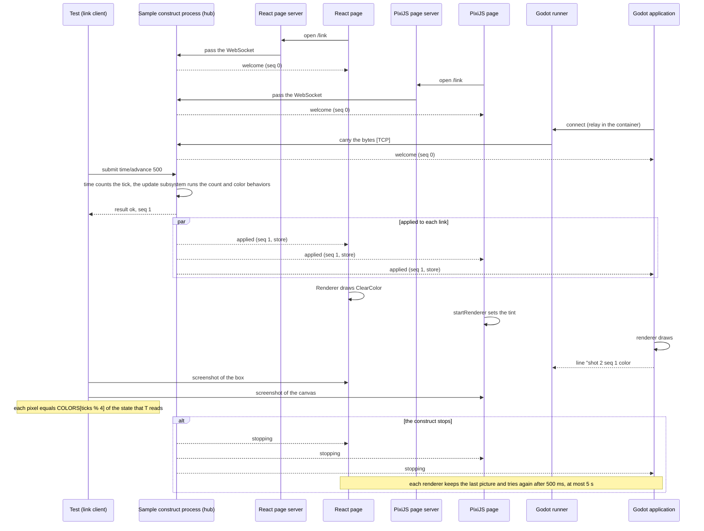

# Design

## Context

See `proposal.md`, "Why". This design starts from `main` after #617 (the update subsystem). The facts that shape the approach:

- `pixi-page/src/construct/` and `renderer-godot/src/construct/` hold two copies of one construct: a `Clear color` entity, a color rule, a clock of 500 milliseconds. The copies have different IDs. After #617 the PixiJS copy runs the color behavior in the update subsystem, and the Godot copy keeps its own wrap of the store (#662).
- The sample product (`sample-product/model`) has one entity with a `Color` component (field `color`, `#1d4ed8`) and a `Counter` component (field `count`, `0`). After #617 it exports `behaviors`, which holds the count behavior. Its color does not change at a tick.
- `startProductConstruct` of `construct-manager` (entry `node`) makes the form of a product construct: the parts `time` and `store`, the update subsystem with the behaviors of the product, a clock, and a link on a port that the system selects. Only the source `construct-manager` can rewind it.
- The workbench page (`workbench-app`) draws the workbench construct. R21 says that a demonstration of a renderer has a construct of its own and does not use the hub of the workbench. No React page draws a different construct.
- The PixiJS page opens `/link` on the address of its page server, and the page server passes the WebSocket to the hub. The Godot runner carries the bytes of the link from the container to `127.0.0.1:<hub port>` of its own computer, one connection at a time.
- The PixiJS view and the Godot view `ClearColor` read the prop `color`. The label `Color` of the old constructs and the label `color` of the sample product give the same prop name in each renderer.
- The screenshot tests of the PixiJS page (Playwright in Docker, through `scripts/browser-server.ts`) and of the Godot application (`node --test` and `runGodot`) each start their own construct. The CI job `ui-tests` runs `turbo run test:ui --affected`.

## Goals / Non-Goals

**Goals:**

- One construct with one hub. The React page, the PixiJS page, and the Godot application draw it at the same time, each in its own process, each through the link.
- One test that runs the four processes and proves that each picture has the color of the same state of the hub, that each picture changes when the clock advances, and that each picture stays the same while the clock is paused.
- One copy of the color behavior, with one set of tests.

**Non-Goals:**

- The same messages in the three renderers for a field that gives no prop (the parity items of #542, #657, and #663). See "Follow-up".
- A React page with keys, a view other than `ClearColor`, or generated types of its props.
- The workbench page as a renderer of a product construct.
- A rewind of the sample construct from a client of the link.
- One command that starts the construct and the three renderers.

## Approaches

Three approaches give one hub to the three renderers.

- **A. A product construct of the sample product in a process of its own (selected).** A new command starts `startProductConstruct` with the model folder and the behaviors of the sample product, on a known port. Each renderer gets a hub port option and draws it. The constructs of `pixi-page` and `renderer-godot` are removed. Reason: the issue names the sample product as the product that runs, the construct has the same form as each product construct of the workbench, the port is known, and one copy of the color behavior stays.
- **B. A product construct that the workbench starts.** The person starts the workbench with `--product`, sends `constructs/start`, reads the address of the link, and starts each renderer with that address. Rejected: the port changes at each start, each input goes through `constructs/send`, the test needs the full workbench, and the workbench page still draws the workbench construct, so a React page for the product is necessary in each case.
- **C. The PixiJS construct as the one construct.** The Godot view and a React view attach to its `Clear color` type. Rejected: the model stays in the code of one renderer package, the sample product is not the product that runs, and the Godot copy of the construct stays or goes with no gain.

The lead agent did the brainstorm alone, as `autonomous-flow.md` says.

## Decisions

### 1. The sample construct is a product construct of the sample product

The sample construct (**Proposed** term) is `startProductConstruct({ id: 'sample', model, behaviors, running, stepMs: 500, port })`. `model` comes from `readModelFolder` of `host-nodejs` on `nodejs/wishem/sample-product/model`, and `behaviors` is the export of `sample-product`. It has no storage subsystem and writes no file.

- Reason: `construct-manager` owns the form of a product construct (#538, decision 5). The sample construct has the same parts, the same update subsystem, and the same clock as a product construct of the workbench. A renderer that draws it draws a product construct.
- The command finds the model folder by its path in the repository, from the folder of the package (`../sample-product/model`). The tests of `construct-manager` use the same path. The root entry of `sample-product` uses no Node.js API, so it cannot export the path.
- The rewind rule of a product construct stays: only the source `construct-manager` can rewind. See "Follow-up".

### 2. The color behavior is in the sample product

`sample-product/src/color-behavior.ts` gives `colorBehavior` with the ID `sample-product/color` and the component type `Color`. It sets `color` to `COLORS[tick.ticks % COLORS.length]`. `COLORS` is `['#1d4ed8', '#b91c1c', '#15803d', '#a16207']`, the list of the old constructs. `behaviors` is `[countBehavior, colorBehavior]`.

- Reason: the picture of each renderer must change at a tick, and the views draw a color. The sample product is "the one product to mount, run, and draw" (its README). One copy of the behavior has one set of tests, as the comment of #541 on the issue asks.
- Rejected: views that draw the count as text. Each renderer draws text with its own font, and the Godot test reads the pixel at the center.
- Rejected: the color behavior in `three-renderers`. Then the product constructs of the workbench do not change color, and the sample product holds a color that nothing changes.
- A product construct of the workbench with the sample product code also changes its color at each tick. The workbench page does not draw the part `store` of a product construct, so nothing that a person sees in the workbench changes.

### 3. `startProductConstruct` gets the option `port`

`ProductConstructOptions.port?: number`. With no value, or 0, the system selects the port. The construct manager passes no port. When the port is in use, `serveHub` rejects with `EADDRINUSE`, and the function starts no clock and holds no port.

- Reason: a person and the renderers need a known address. The option is the smallest change to the form of a product construct.

### 4. One new package: `three-renderers`

`nodejs/wishem/three-renderers` (`@thrashplay/wishem-three-renderers`, **Proposed** name, private) holds the command of the sample construct, the React page and its page server, and the test from end to end.

- Reason: each of the three parts uses more than one renderer package or none. The package depends on `pixi-page` and `renderer-godot` (as development dependencies, for the test). No package depends on it, so the graph has no cycle.
- Rejected: the React page in `workbench-app`. R21 keeps the demonstration out of the workbench.
- Rejected: a separate package `react-page`. It would need the sample construct for its own test, and only the package of the test from end to end has it. Follow-up when the React page grows.
- Rejected: the command of the sample construct in `sample-product` or in `construct-manager`. `construct-manager` has `sample-product` as a development dependency, so `sample-product` cannot depend on `construct-manager`. `construct-manager` is a library and holds no product.

### 5. The ports

| Part                               | Default port | Option       |
| ---------------------------------- | ------------ | ------------ |
| The link of the sample construct   | 4750         | `--hub-port` |
| The page server of the React page  | 5175         | `--port`     |
| The page server of the PixiJS page | 5174         | `--port`     |

The renderers take `--hub-port` with the default 4750: the React page server, the PixiJS page server, and the Godot runner. The workbench keeps 4747 and 5173. The ports 4748 and 4749 are free after the change.

- Reason: a new number for the new construct, so that a command or a note with 4748 or 4749 fails clearly and does not connect to a different construct.

### 6. The PixiJS page holds no construct

`pixi-page/src/construct/` is removed (the color behavior of #617 moves to the sample product, decision 2). `scripts/start.ts` starts only the Vite server. The proxy `/link` goes to `http://127.0.0.1:<hub port>`. The command prints `wishem: PixiJS page at <address>` and `wishem: the page connects to ws://127.0.0.1:<hub port>/link`. The option `--paused` is removed, because the construct is in a different process. The page, the keys, and the status line do not change.

- The keys of the PixiJS page send their inputs to the sample construct. So the space key pauses the picture of each renderer, and the period key steps each one. The test guide uses this.
- `PixiStartOptions` keeps `port`, `hubPort`, and `log`, and loses `paused`. `PixiStart.linkUrl` is the address of the construct.

### 7. The Godot application holds no construct

`renderer-godot/src/construct/`, `scripts/start.ts`, the script `start`, and the exports `startGodotConstruct`, `GodotConstruct`, and `GodotConstructOptions` are removed. The default hub port of `runGodot` and of `godot/main.gd` (`DEFAULT_LINK`) is 4750. The runner, the relay, the remote port, and the renderer do not change.

- This change replaces #662: the Godot construct and its color rule are removed, so no color rule of the Godot construct stays to change.

### 8. The views attach to the `Color` type of the sample product

The sidecars `pixi-page/src/views/ClearColor.view.json` and `renderer-godot/godot/views/ClearColor.view.json` get the component type `ct_d85ac719-7dd0-45d8-bf98-0da9e6ab0512`. The code of the views does not change: the prop is `color` in each renderer. The colors and their order do not change, so the PixiJS baselines `tick-0.png` and `tick-1.png` stay the same.

### 9. The React page

`three-renderers/index.html`, `src/main.tsx`, `src/ReactPage.tsx`, and `src/views/ClearColor.tsx` with `ClearColor.view.json` (`{ "kind": "react", "componentType": "ct_d85ac719-..." }`).

- The page opens one link at `/link` of its origin with `connectLink` of `hub`, with one output subsystem `react-page-<hex>` and no input subsystem. It gives the remote port to `Renderer` of `renderer-react`.
- The view `ClearColor` is a `div` that fills the box of 640 by 360 pixels with the background color of the prop `color`. With no value, it draws nothing.
- The view declares its props by hand (`{ color: string | undefined, wishem: ViewTools }`). The generator of the types of the props runs in the `start` script of `workbench-app` and has no command for a different package. See "Follow-up".
- The status line has the three texts of the PixiJS page, with no text about keys: "Connecting to the construct.", "Connected (link N).", "The construct is not reachable. The page tries again."
- `scripts/react-page.ts` starts the Vite server with the React plugin, `server.ws: false` (as the PixiJS page, so that Vite does not reload the page when the server comes back), and the proxy `/link` to the hub port.

### 10. The screenshot tests of the PixiJS page and of the Godot application start the sample construct

Each test starts the sample construct in its own Node.js process through the libraries: `startProductConstruct` of `construct-manager`, `behaviors` of `sample-product`, and `readModelFolder` of `host-nodejs`, with `running: false` and `stepMs: 500`. Each package gets a test helper of a few lines (`tests/sample-construct.ts`) and the development dependencies `construct-manager` and `sample-product`.

- Reason: `pixi-page` and `renderer-godot` cannot depend on `three-renderers`, because `three-renderers` depends on them for its test. The helper is a call of one library function.
- PixiJS: the Playwright `webServer` runs `node scripts/start.ts --port 4181 --hub-port 4183`. The test file starts the construct on port 4183 before the first page load, and closes it at the end. The reconnect test closes the construct and starts a new one on port 4183, in place of a stop and a start of the command. The steps and the baselines do not change.
- Godot: the test calls the helper in place of `startGodotConstruct`, with port 0 for the first start and the same port for the second start. The steps do not change.

### 11. The test from end to end

`three-renderers/tests/three-renderers.ui.test.ts` runs with `node --test` under `scripts/browser-server.ts` (a copy of the script of `pixi-page`). The script `test:ui` is `node scripts/browser-server.ts node --test "tests/*.ui.test.ts"`.

1. Spawn `node scripts/construct.ts --paused --hub-port 0`. Read the port from the line `wishem: link at`.
2. Spawn `node scripts/react-page.ts --port 0 --hub-port <port>` and `node <pixi-page>/scripts/start.ts --port 0 --hub-port <port>`. Read each page address from its line.
3. Call `runGodot({ hubPort: <port>, shotsDir: '.out/test-shots' })` of `renderer-godot`.
4. Connect to the browser with `chromium.connect` of `@playwright/test` and `exposeNetwork: '<loopback>'`. Open each page in its own tab, with a viewport of 1280 by 720 pixels. Wait for "Connected (link 1)" in each status line and for the Godot lines `connected (link 1)` and `shot 1 seq 0`.
5. Open a link of the test with one input subsystem `e2e-<pid>`. Each check reads the joined state through it.
6. Check the first picture: each pixel of the screenshot of the React box, of the PixiJS canvas, and of the last Godot shot is `#1d4ed8`. The test decodes each PNG with `pngjs`.
7. Send `time/advance` of 500. Each picture is `#b91c1c` within 5 seconds. Each page screenshot differs from step 6.
8. Wait 1500 milliseconds. Each page screenshot is equal to step 7, and no new Godot shot came.
9. Send `time/set-running` with `true`. Within 5 seconds each picture has a color that is not `#b91c1c`.
10. Send `time/set-running` with `false`. Read the joined state, with `ticks` = `t`. Within 2 seconds each picture is `COLORS[t % 4]`. Then wait 1500 milliseconds: each page screenshot stays the same, and no new Godot shot came.
11. In a `finally` block: close the link, the browser, the Godot run, and the three child processes, in this order.

- The check is the color of the state of the hub, not a baseline. So the test proves that the three renderers agree with the hub and with each other, and it needs no image file.
- A step polls each renderer at most 5 seconds (2 seconds after the pause), because the three renderers draw at different times.
- `turbo.json` needs no new entry: the default task `test:ui` covers the files of the package, and the files of `pixi-page` and `renderer-godot` change the hash through `^build`.

### 12. The field with an empty name

The outcome needs no change here. The rule is the rule of #657: such a field gives no prop and a warning. The React renderer gets it in #657, the PixiJS renderer in #663, and the Godot renderer gives no prop and no warning. A follow-up issue gives the Godot renderer the warning. The test of this change uses no such field.

### 13. The blueprint and the documents

- `glossary.md`: the term **Native behavior** names the count behavior and the color behavior of the sample product. New term **Sample construct** (**Proposed**): the construct of the sample product that the three renderers draw.
- `nodejs/wishem/CLAUDE.md`: the package `three-renderers` in the list. `pixi-page` holds a page and its page server. `renderer-godot` holds no construct. `sample-product` holds the count behavior and the color behavior.
- `rules.md`: R21 does not change. The sample construct is a construct of its own and does not use the hub of the workbench.
- `docs/milestones/a5-renderers/time-client.mjs`: the default address is `ws://127.0.0.1:4750/link`.
- The READMEs of `pixi-page`, `renderer-godot`, `sample-product`, `construct-manager`, and the new `three-renderers`. The section "Rewind" of the PixiJS README is removed, because the sample construct refuses a rewind from a client of the link.
- The test guide of the milestone (`docs/milestones/a5-renderers.md`) is not part of this change. "When a milestone is complete" of `autonomous-flow.md` writes it after the merge, from the section "The test guide" below.

### 14. No question for the owner

No decision meets the three conditions of "When to ask the owner". Each decision is easy to change later: the ports, the place of the color behavior, the package name, and the removed constructs are private code.

## Interfaces

Owner: `@thrashplay/wishem-construct-manager`, entry `node`. Only the changed member is shown.

```ts
export interface ProductConstructOptions {
  // ...id, model, behaviors, running, stepMs, timer, now, onError, as after #617...
  /** The port of the link. Default 0: the system selects the port. */
  port?: number
}
```

Owner: `@thrashplay/wishem-sample-product`, root entry.

```ts
import type { NativeBehavior } from '@thrashplay/wishem-update'

/** The colors of the color behavior, in the order of the ticks. */
export const COLORS: readonly ['#1d4ed8', '#b91c1c', '#15803d', '#a16207']
/** Sets `color` of each `Color` component to `COLORS[tick.ticks % COLORS.length]`. */
export const colorBehavior: NativeBehavior
/** The count behavior, then the color behavior. */
export const behaviors: readonly NativeBehavior[]
```

Owner: `@thrashplay/wishem-three-renderers` (private, root entry for its own tests and scripts).

```ts
import type { Hub } from '@thrashplay/wishem-hub'

/** 4750. */
export const DEFAULT_HUB_PORT: number
/** 500. */
export const SAMPLE_STEP_MS: number

export interface SampleConstructOptions {
  /** Default 4750. Use 0 to let the system select a port. */
  port?: number
  /** Default `false`. */
  paused?: boolean
}

export interface SampleConstruct {
  /** For example `ws://127.0.0.1:4750/link`. */
  readonly linkUrl: string
  readonly hub: Hub
  /** Stops the clock and the hub and releases the port. Gives the same promise on each call. */
  close(): Promise<void>
}

/** Reads the model folder of the sample product and starts its product construct. Rejects with `EADDRINUSE` when the port is in use. */
export const startSampleConstruct: (options?: SampleConstructOptions) => Promise<SampleConstruct>
```

Owner: `@thrashplay/wishem-three-renderers`, `scripts/react-page.ts` (not exported).

```ts
export interface ReactPageOptions {
  /** Default 5175. Use 0 to let the system select a port. */
  port?: number
  /** Default 4750. */
  hubPort?: number
  log?: (line: string) => void
}

export interface ReactPageStart {
  /** For example `http://127.0.0.1:5175/`. */
  pageUrl: string
  /** For example `ws://127.0.0.1:4750/link`. */
  linkUrl: string
  close(): Promise<void>
}

export const startReactPage: (options?: ReactPageOptions) => Promise<ReactPageStart>
```

Owner: `@thrashplay/wishem-pixi-page`, `scripts/start.ts` (not exported). `startPixi` keeps its name.

```ts
export interface PixiStartOptions {
  /** Default 5174. Use 0 to let the system select a port. */
  port?: number
  /** The port of the construct. Default 4750. */
  hubPort?: number
  log?: (line: string) => void
}
// PixiStart does not change. The option `paused` is removed.
```

Owner: `@thrashplay/wishem-renderer-godot`, root entry.

```ts
export interface RunGodotOptions {
  /** Default 4750. */
  hubPort?: number
  // ...shotsDir, log, docker, as before...
}
// The exports startGodotConstruct, GodotConstruct, and GodotConstructOptions are removed.
```

## Data Model

No data changes. The model folder of the sample product does not change. No component type, field, or entity is added. `colorBehavior` is a value of the type `NativeBehavior` of #617.

## The flow: one tick, three pictures



## Container diagram after the change

New: the sample construct process, the React page server, and the React page. Moved: the PixiJS page and the Godot runner connect to the sample construct process. Changed: the PixiJS process serves only the PixiJS page and builds on no package of Wishem. Removed: the Godot process, and the relationships of the PixiJS process to `host-nodejs`, `clock`, `core`, `hub`, and `update`. The diagram starts from the diagram of #617.

```mermaid
---
title: 'Container diagram: Wishem'
---
flowchart TB
  designer["<b>Designer</b><br/>[Person]<br/>Makes a product with the workbench."]
  subgraph wishem["Wishem [Software System]"]
    page["<b>Page</b><br/>[Container: React, web browser]<br/>Draws each component that has a view."]
    process["<b>Workbench process</b><br/>[Container: Node.js]<br/>Runs the construct and the product constructs, and serves the page."]
    folder[("<b>Model folder</b><br/>[Container: JSON files]<br/>Holds the definitions and state.json.")]
    pfolder[("<b>Product model folder</b><br/>[Container: JSON files]<br/>The model of the mounted product.")]
    sample["<b>Sample construct process</b><br/>[Container: Node.js]<br/>Runs the sample construct with a clock and serves its link."]
    reactserver["<b>React page server</b><br/>[Container: Node.js]<br/>Serves the React page and passes its link."]
    reactpage["<b>React page</b><br/>[Container: React, web browser]<br/>Draws the sample construct."]
    pixiprocess["<b>PixiJS process</b><br/>[Container: Node.js]<br/>Serves the PixiJS page and passes its link."]
    pixipage["<b>PixiJS page</b><br/>[Container: PixiJS, web browser]<br/>Draws the sample construct and sends the keys."]
    godotrunner["<b>Godot runner</b><br/>[Container: Node.js]<br/>Starts Godot in Docker, carries the link, copies the screenshots."]
    godotapp["<b>Godot application</b><br/>[Container: Godot 4.7, GDScript, Docker]<br/>Draws the sample construct and writes screenshots."]
    cm["<b>construct-manager</b><br/>[Container: TypeScript package]<br/>The construct list and the product constructs."]
    sp["<b>sample-product</b><br/>[Container: TypeScript package]<br/>The sample model folder and its behaviors."]
    update["<b>update</b><br/>[Container: TypeScript package]<br/>Runs the behaviors of a tick."]
    host["<b>host-nodejs</b><br/>[Container: TypeScript package]<br/>Runs a construct in Node.js and serves the link."]
    core["<b>core</b><br/>[Container: TypeScript package]<br/>The model types and the store."]
    hub["<b>hub</b><br/>[Container: TypeScript package]<br/>Joins the subsystems and carries the link."]
    clock["<b>clock</b><br/>[Container: TypeScript package]<br/>The time subsystem and the clock."]
    rr["<b>renderer-react</b><br/>[Container: TypeScript package]<br/>Draws React views from a port."]
    rp["<b>renderer-pixi</b><br/>[Container: TypeScript package]<br/>Draws PixiJS views from a port."]
  end
  designer -- "Looks at [web browser]" --> page
  designer -- "Edits files [text editor]" --> folder
  designer -- "Edits files [text editor]" --> pfolder
  designer -- "Starts and stops [terminal]" --> process
  designer -- "Starts and stops [terminal]" --> sample
  designer -- "Starts and stops [terminal]" --> reactserver
  designer -- "Looks at [web browser]" --> reactpage
  designer -- "Starts and stops [terminal]" --> pixiprocess
  designer -- "Looks at and presses keys [web browser]" --> pixipage
  designer -- "Starts, stops, and looks at the screenshots [terminal]" --> godotrunner
  page -- "Gets page code [HTTP]" --> process
  page -- "Connects to the hub [WebSocket link]" --> process
  process -- "Reads, watches, and writes [file system]" --> folder
  process -- "Reads, watches, and writes [file system]" --> pfolder
  process -- "Runs [import]" --> host
  process -- "Uses [import]" --> core
  process -- "Builds on [import]" --> rr
  process -- "Runs the product constructs with [import]" --> cm
  process -- "Loads the product code [dynamic import]" --> sp
  process -- "Checks the product code with [import]" --> update
  sample -- "Runs the sample construct with [import]" --> cm
  sample -- "Runs the behaviors of [import]" --> sp
  sample -- "Builds on [import]" --> host
  sample -- "Reads [file system]" --> pfolder
  reactpage -- "Gets page code [HTTP]" --> reactserver
  reactpage -- "Connects to the hub [WebSocket link]" --> reactserver
  reactserver -- "Passes the link [WebSocket]" --> sample
  reactpage -- "Builds on [import]" --> rr
  reactpage -- "Builds on [import]" --> hub
  pixipage -- "Gets page code [HTTP]" --> pixiprocess
  pixipage -- "Connects to the hub [WebSocket link]" --> pixiprocess
  pixiprocess -- "Passes the link [WebSocket]" --> sample
  pixipage -- "Builds on [import]" --> rp
  pixipage -- "Builds on [import]" --> hub
  pixipage -- "Builds on [import]" --> clock
  godotrunner -- "Starts and copies the screenshots [Docker]" --> godotapp
  godotapp -- "Connects to the hub [WebSocket link]" --> godotrunner
  godotrunner -- "Carries the link [TCP]" --> sample
  page -- "Builds on [import]" --> hub
  page -- "Builds on [import]" --> rr
  cm -- "Runs the behaviors with [import]" --> update
  cm -- "Builds on [import]" --> core
  cm -- "Builds on [import]" --> hub
  cm -- "Builds on [import]" --> clock
  cm -- "Builds on [import]" --> host
  update -- "Builds on [import]" --> core
  update -- "Builds on [import]" --> hub
  update -- "Builds on [import]" --> clock
  host -- "Builds on [import]" --> core
  host -- "Builds on [import]" --> hub
  core -- "Builds on [import]" --> hub
  rr -- "Builds on [import]" --> hub
  clock -- "Builds on [import]" --> hub
```



`@thrashplay/wishem-three-renderers` is not a container of its own: no other package builds on it, and its parts are the sample construct process, the React page server, and the React page. The product model folder of the sample product is the folder that the sample construct process reads. The test from end to end is not a container: it runs the containers. The system context diagram does not change: the designer is the one person, and Wishem connects to no external system.

## The architecture document

`docs/architecture/README.md` and `render.mjs` change in the tasks that change the containers (see `tasks.md`):

- The table of the containers: new rows "Sample construct process", "React page server", and "React page". The row "PixiJS process" says that it serves the PixiJS page and passes its link. The row "Godot process" is removed. The rows "Godot runner" and "Godot application" name the sample construct.
- The list of the dependencies: `three-renderers` depends on `construct-manager`, `sample-product`, `host-nodejs`, `hub`, and `renderer-react`, with `pixi-page` and `renderer-godot` as development dependencies. `pixi-page` depends on `renderer-pixi`, `hub`, and `clock`. `renderer-godot` depends on no package of Wishem at run time. Each development dependency for a test is named.
- The prose: the paths of a tick in the PixiJS page and in the Godot application start in the sample construct process. A new path of a tick for the React page.
- The introduction: "The React page, the PixiJS page, and the Godot application each draw the color of one construct with a clock."

## Failure Modes

| Failure                                                    | Behavior                                                                                                                       | Recovery                                                                                     |
| ---------------------------------------------------------- | ------------------------------------------------------------------------------------------------------------------------------ | -------------------------------------------------------------------------------------------- |
| A renderer starts before the sample construct              | The page server runs and passes a WebSocket that fails. The page shows "not reachable". The Godot relay closes the connection. | Each renderer tries again after 500 ms, then up to 5 s. It connects when the construct runs. |
| The sample construct stops                                 | Each link gets `stopping`. Each renderer keeps the last picture and shows the loss.                                            | Start the construct again. Each renderer connects with the next link number, with no reload. |
| A port is in use                                           | The command prints `wishem: port <n> is in use` and ends with exit code 1. The construct starts no clock.                      | Stop the other program, or give a different port.                                            |
| Two clients send inputs at the same time (keys and a test) | The hub gives each input its own `seq`. Each link gets the `applied` events in the same order.                                 | None needed. An input is not sent again by a client, so no input applies two times.          |
| A renderer draws later than the others                     | The pictures differ for a short time.                                                                                          | The test polls each renderer for at most 5 s (2 s after the pause).                          |
| The model folder of the sample product is not valid        | `readModelFolder` gives problems. The command prints each problem and ends with exit code 1.                                   | Correct the file.                                                                            |
| Docker is not available                                    | `test:ui` ends with exit code 1 and the message of `browser-server.ts` or `runGodot`.                                          | Start Docker, or let the pull request checks run the test.                                   |
| The Godot image is missing                                 | `runGodot` builds it. The first run takes minutes.                                                                             | None. Later runs use the image.                                                              |
| Two `test:ui` jobs build the Godot image at the same time  | Docker builds the same tag two times. Each build gives the same image.                                                         | None. Time only.                                                                             |
| The test fails between two steps                           | The `finally` block closes the link, the browser, the Godot run, and the child processes.                                      | None. `docker ps -a` shows no container of the run.                                          |
| A client sends `hub/rewind` to the sample construct        | The hub refuses it with `not-permitted`, because only `construct-manager` can rewind a product construct.                      | See "Follow-up".                                                                             |

Each command is a start or a stop of a process. A second stop request does nothing. A step of the test is not idempotent (each `time/advance` adds a tick), and the test sends each input one time.

## Examples

Terminal 1, the sample construct:

```
$ pnpm --filter @thrashplay/wishem-three-renderers construct --paused
wishem: the time of the construct starts paused
wishem: link at ws://127.0.0.1:4750/link
^C
$ echo $?
0
```

The port is in use:

```
$ pnpm --filter @thrashplay/wishem-three-renderers construct
wishem: port 4750 is in use
$ echo $?
1
```

Terminal 2, the React page:

```
$ pnpm --filter @thrashplay/wishem-three-renderers react-page
wishem: React page at http://127.0.0.1:5175/
wishem: the page connects to ws://127.0.0.1:4750/link
```

Terminal 3, the PixiJS page:

```
$ pnpm --filter @thrashplay/wishem-pixi-page start
wishem: PixiJS page at http://127.0.0.1:5174/
wishem: the page connects to ws://127.0.0.1:4750/link
```

Terminal 4, the Godot application:

```
$ pnpm --filter @thrashplay/wishem-renderer-godot godot
wishem-godot: image wishem-godot:4.7.2-3f9c0a1b7e42 is ready
wishem-godot: connecting to ws://127.0.0.1:4750/link
wishem-godot: connected (link 1)
wishem-godot: shot 1 seq 0 color #1d4ed8 file /workspace/opus/nodejs/wishem/renderer-godot/shots/0001.png
```

A step from terminal 5:

```
$ node nodejs/wishem/docs/milestones/a5-renderers/time-client.mjs step
result: {"ok":true,"seq":1}
```

## Package Impact

| Package                                | Published or private | Bump  | Reason                                                                                                                                                                     |
| -------------------------------------- | -------------------- | ----- | -------------------------------------------------------------------------------------------------------------------------------------------------------------------------- |
| `@thrashplay/wishem-three-renderers`   | Private (new)        | minor | New package: the sample construct and its command, the React page and its page server, and the test from end to end.                                                       |
| `@thrashplay/wishem-sample-product`    | Private              | minor | New exports `colorBehavior` and `COLORS`. `behaviors` holds two behaviors, so a product construct with the sample product code changes its color at each tick.             |
| `@thrashplay/wishem-construct-manager` | Private              | minor | New option `port` of `startProductConstruct`.                                                                                                                              |
| `@thrashplay/wishem-pixi-page`         | Private              | minor | Breaking for a private `0.x` package: no construct, `--paused` removed, `--hub-port` names the construct to draw, default 4750. New development dependencies for its test. |
| `@thrashplay/wishem-renderer-godot`    | Private              | minor | Breaking for a private `0.x` package: no construct, the script `start` and the export `startGodotConstruct` removed, default hub port 4750.                                |

No other package changes. `core`, `hub`, `clock`, `host-nodejs`, `update`, `renderer-react`, `renderer-pixi`, `workbench`, and `workbench-app` get no change. `workbench-app` loads `sample-product` as product code in a development command: its product constructs change their color at each tick, and its page does not draw that part. No package is published.

## UI options for the owner

The config asks for two or three options of the look. The lead agent selected option A, as `autonomous-flow.md` permits.

- **A. The box and one status line below it (selected).** The same layout as the PixiJS page, so that the person sees two pictures of one size side by side. Reason: the person compares the pages, and the status line shows the number of the link.
- **B. The workbench layout with an app bar.** Rejected: the React page is a proof of the renderer, not a screen of the workbench, and the app bar is an entity of the workbench model.
- **C. The box only.** Rejected: the person cannot see if the page is connected.

## UI

The React page is a proof of the renderer, not a screen of the workbench. It uses no component of the workbench style guide, and it adds no component and no design token. The color is a value of a field of the sample product. The style guide of `workbench-app` and `wishem/design-system/component-catalog` do not change. The PixiJS page and the Godot application do not change their look.

```
+--------------------------------------------------+
| box, 640 x 360 CSS pixels, at the top left        |
|                                                  |
|   the view ClearColor, filled with `color`:      |
|   #1d4ed8 -> #b91c1c -> #15803d -> #a16207 -> ... |
|   one change for each tick                        |
|                                                  |
+--------------------------------------------------+
Connected (link 1).
```

- `index.html` sets `:root { color-scheme: light dark }` and `body { margin: 0 }`. The box is a `div` of 640 by 360 pixels with `max-width: 100%` and `aspect-ratio: 16 / 9`. The status line is a `p` with `margin: 8px`. The page sets no color. The browser gives the colors of the light theme or the dark theme.
- States:
  - Connecting (loading): the box shows the background of the page, and the status line says "Connecting to the construct."
  - Connected: the color follows the construct. Running: it changes. Paused: it stays.
  - Down (error): the box keeps the last picture, and the status line says "The construct is not reachable. The page tries again."
  - No value: the view draws nothing, and the box shows the background of the page.
  - The page has no empty state and no disabled state: the sample construct always has one entity, and the page has no control.
- Narrow viewport: on a viewport narrower than 640 pixels, the box becomes smaller and keeps its shape, and the status line wraps. The page has no horizontal scroll.
- Keyboard and focus: the page has no control and no element that gets focus.
- Accessibility: the box has `role="img"` and the `aria-label` "The color of the construct". The status line has `role="status"`.

## Risks / Trade-offs

- [The job `ui-tests` runs a third test that needs Docker, with the Godot image and the browser image] → The test runs in one job with the other UI tests. If the job comes near its limit of 20 minutes, a cache of the Godot image is a follow-up that needs the permission of the owner (the CI workflow), as #541 records.
- [The test helper of the sample construct is in `pixi-page` and in `renderer-godot`] → It is one call of a library function. A shared helper needs a package below the renderers. Follow-up when a third copy appears.
- [`browser-server.ts` has a third copy] → Follow-up issue for one shared script.
- [The command reads the model folder by its path in the repository] → The tests of `construct-manager` use the same path. A move of the folder breaks both, and the tests find it.
- [A product construct of the workbench with the sample product code changes its color twenty times each second (`stepMs` 50)] → No part draws it now. A renderer that draws a product construct of the workbench later sets its own step or reads the step of the construct list.
- [The sample construct refuses a rewind from a client of the link] → The PixiJS page loses the rewind of its README. A rewind of the hub is tested in `hub` and in the construct manager. See "Follow-up".

## Migration Plan

No data changes. A person who started `pnpm --filter @thrashplay/wishem-pixi-page start` or `pnpm --filter @thrashplay/wishem-renderer-godot start` now starts `pnpm --filter @thrashplay/wishem-three-renderers construct` first. To roll back, revert the pull request.

## Order with other changes

- **#617 (update subsystem, worktree `617-add-update-subsystem`, in apply).** This change merges second. Its apply starts after #617 is on `main`: it uses `createUpdate`, `NativeBehavior`, `behaviors` of the sample product, and the option `behaviors` of `startProductConstruct`. At the start of the apply:
  1. Merge `main` into the branch.
  2. Task 1 makes `colorBehavior` in `sample-product` from the color behavior of #617 in `pixi-page/src/construct/color-behavior.ts`, and moves its tests. Task 4 removes that file.
  3. Check the deltas against the archived specs. The delta of `wishem/sample-product/model` modifies "The root entry exports the behaviors of the product", which #617 adds. The delta of `wishem/renderer-pixi/construct` removes "The color rule follows the count of ticks" in the form of #617. The delta of `wishem/architecture/diagrams` removes "The container diagram" and adds "The container diagram of Wishem" with each scenario of the archived requirement that still applies. Run `pnpm exec openspec validate 542-three-renderers-end-to-end --strict`.
  4. The delta of #617 for `wishem/architecture/diagrams` has no scenarios of the Godot process and of the Godot runner of #541. If #617 archives with them, the new requirement of this change keeps "The Godot application connects to the sample construct through the Godot runner" and drops the Godot process. If #617 drops them, this change needs no extra step.
- **#662 (the Godot color rule as a behavior).** This change replaces it: the Godot construct is removed. Do not start #662. When this change merges, close #662 as replaced, with a link to the pull request. If #662 merges first, Task 5 removes its code with the rest of `renderer-godot/src/construct/`.
- **#639 (link rules, worktree `639-link-result-and-seq-rules`, in plan).** No conflict in the code: this change does not change `hub/LINK.md`, the reference client, `link_client.gd`, or `link_messages.gd`. Both changes touch `renderer-godot/package.json` only through the changeset. The second to merge merges `main` and runs `test:godot` again.
- **#650 (the new form of the architecture diagrams, blocked by #617).** Either order works.
  - When #650 merges first: this change writes its containers in the new form. The container diagram gets the runtime units of this change (the sample construct process, the React page server, the React page; the Godot process removed; the PixiJS process passes the link), with runtime relationships only. The script of #650 writes the package dependency view again with `three-renderers` and the changed dependencies of `pixi-page` and `renderer-godot`, and its check passes. The delta of `wishem/architecture/diagrams` of this change is written again on the requirements of #650.
  - When this change merges first: #650 starts from the container diagram of this change. Its list of runtime units holds the sample construct process, the React page server, and the React page, and holds no Godot process.
- **#657 (empty field name in the React renderer) and #663 (the same in the PixiJS renderer).** No conflict: this change does not touch `field-names.ts` or `view-warnings.ts`.

## The test guide

The final reviewer does these steps on the branch with real processes, real files, and a real web browser, and reports the real result of each step. Run each command from the root of the worktree. The terminals 1 to 4 run one command each. Terminal 5 runs the other commands.

What a person needs: the checkout, Node.js 24, pnpm, Docker (local or remote through `DOCKER_HOST`), and a web browser on the same computer. The person does not install Godot.

### 1. Prepare

1. `pnpm install`, then `pnpm build --filter "@thrashplay/wishem-three-renderers..."`. Result: the build ends with no error. It also makes `nodejs/wishem/hub/dist/` and `nodejs/wishem/clock/dist/`, which `time-client.mjs` uses.
2. `pnpm --filter @thrashplay/wishem-renderer-godot godot:image`. Result: `wishem-godot: image wishem-godot:4.7.2-<12 hex> is ready`.

### 2. The renderers wait for the construct

3. Terminal 2: `pnpm --filter @thrashplay/wishem-three-renderers react-page`. Result: `wishem: React page at http://127.0.0.1:5175/` and `wishem: the page connects to ws://127.0.0.1:4750/link`. Open the address in the web browser. Result: the status line says "The construct is not reachable. The page tries again."
4. Terminal 3: `pnpm --filter @thrashplay/wishem-pixi-page start`. Result: `wishem: PixiJS page at http://127.0.0.1:5174/` and `wishem: the page connects to ws://127.0.0.1:4750/link`. Open the address in a second tab, beside the first. Result: the same status line.
5. Terminal 4: `pnpm --filter @thrashplay/wishem-renderer-godot godot`. Result: `wishem-godot: connecting to ws://127.0.0.1:4750/link`, then `wishem-godot: the hub is not reachable. Godot tries again.`

### 3. One construct, three pictures

6. Terminal 1: `pnpm --filter @thrashplay/wishem-three-renderers construct --paused`. Result: `wishem: the time of the construct starts paused` and `wishem: link at ws://127.0.0.1:4750/link`. Within 5 seconds: the React page says "Connected (link 1)." and its box is blue (`#1d4ed8`). The PixiJS page says "Connected (link 1). Space: pause or run. Period: one step." and its canvas is blue. Terminal 4 shows `wishem-godot: connected (link 1)` and `shot 1 seq 0 color #1d4ed8`.
7. Open `nodejs/wishem/renderer-godot/shots/0001.png`. Result: an image of 640 by 360 pixels, all blue.

### 4. A step from a client of the link

8. Terminal 5: `node nodejs/wishem/docs/milestones/a5-renderers/time-client.mjs step`. Result: `result: {"ok":true,"seq":1}`. The React box and the PixiJS canvas are red (`#b91c1c`). Terminal 4 shows `shot 2 seq 1 color #b91c1c`.
9. Wait 5 seconds. Result: no picture changes, and terminal 4 shows no new shot.

### 5. The clock advances

10. Terminal 5: `node nodejs/wishem/docs/milestones/a5-renderers/time-client.mjs run`. Result: `result: {"ok":true,"seq":2}`. The two pages change color two times each second: green, amber, blue, red, and again. Terminal 4 shows a new shot two times each second with the same colors. At each moment the two pages show the same color, and the last shot of terminal 4 has that color.
11. Terminal 5: `node nodejs/wishem/docs/milestones/a5-renderers/time-client.mjs pause`. Result: the pictures stop. The two pages show one color, and the last shot of terminal 4 has that color.

### 6. A key of the PixiJS page changes the three pictures

12. In the PixiJS tab, press the period key. Result: the PixiJS canvas, the React box, and the next shot of terminal 4 have the next color of the list.
13. In the PixiJS tab, press the space key. Result: the three pictures change two times each second. Press the space key again. Result: they stop.

### 7. A stop and a start of the construct

14. Terminal 1: press Ctrl+C. Result: the command ends with exit code 0 (`echo $?` gives `0`). The two pages keep their last color and say "The construct is not reachable. The page tries again." Terminal 4 shows the loss one time and no new shot.
15. Terminal 1: run the command of step 6 again. Result: within 5 seconds the React page says "Connected (link 2).", the PixiJS page says "Connected (link 2). ...", terminal 4 shows `connected (link 2)` and a shot with `seq 0 color #1d4ed8`. Each picture is blue. Neither page reloaded.
16. Terminal 5: `pnpm --filter @thrashplay/wishem-three-renderers construct`. Result: `wishem: port 4750 is in use`, and the command ends with exit code 1. No picture changes.

### 8. The workbench is a different construct

17. Terminal 5: `pnpm --filter @thrashplay/wishem-workbench-app start --port 0 --hub-port 0`. Result: the workbench starts, and its address of the link is not `ws://127.0.0.1:4750/link`. The three pictures do not change. Press Ctrl+C.

### 9. Stop each part

18. Terminal 4: Ctrl+C. Result: exit code 0. `docker ps -a --filter name=wishem-godot` shows no container.
19. Terminals 3 and 2: Ctrl+C. Result: each ends with exit code 0. Terminal 1 still runs, and `time-client.mjs step` still gives `"ok":true`.
20. Terminal 1: Ctrl+C. Result: exit code 0.

### 10. The tests that need Docker

21. `pnpm --filter @thrashplay/wishem-three-renderers test:ui`. Result: the test passes. It prints the name of each test, and `docker ps -a` shows no container of the test after it ends.
22. `pnpm --filter @thrashplay/wishem-pixi-page test:ui`. Result: the tests pass against the baselines, with no change to `tests/__screenshots__/`.
23. `pnpm --filter @thrashplay/wishem-renderer-godot test:ui`. Result: the GDScript tests end with `0 failed`, and the screenshot test passes.

What this change does not do: the React page sends no input and has one view; a rewind from a client of the link is refused by the sample construct; the three renderers do not give the same message for a field with an empty name; and no single command starts the four processes.

## Follow-up

- #663: the PixiJS renderer gives no prop and a warning for a field with an empty name (the rule of #657).
- A new issue: the Godot renderer gives a warning (`push_warning`) for a field whose label gives no prop, with the same text as the other renderers. Its milestone is `[WSH] A5 Renderers` or `[WSH] R1 Tech Debt`.
- A new issue: a rewind of the sample construct from a client of the link (an option of the source of a rewind for `startProductConstruct`, or a different rule for the sample construct), and the section "Rewind" of the PixiJS README again.
- A new issue: the generator of the types of the props as a command for a package other than `workbench-app`, so that the React page uses generated types.
- A new issue: one shared `browser-server.ts` for `workbench-app`, `pixi-page`, and `three-renderers`.
- Close #662 as replaced when this change merges.
- After the merge, create one break-test issue for each library package that the change changed, as "Break-tests" of `autonomous-flow.md` says: `construct-manager` and `sample-product`.
- After the merge, the milestone `[WSH] A5 Renderers` is complete. Do the steps of "When a milestone is complete": the test guide `docs/milestones/a5-renderers.md` uses the section "The test guide" above.
