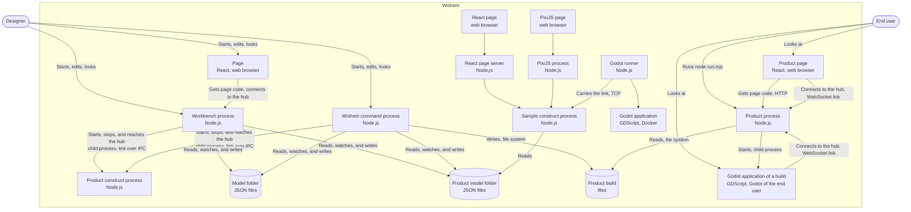
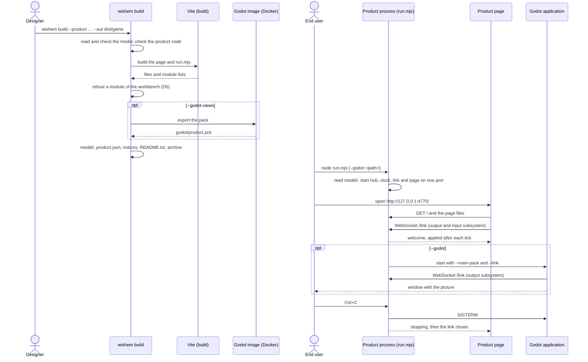

# Design

## Context

See `proposal.md` (Why) for the motivation, and for the rule R21 and how this change agrees with it.

- A product is three inputs now: a model folder (`--product`), product code with the list `behaviors` (`--product-code`), and a folder of React views with sidecars (`--product-views`). The workbench and `wishem start` take the same options.
- `startProductConstruct` of `construct-manager` (file `src/product-construct.ts`) makes a hub with the parts `time` and `store`, the update subsystem, and a clock, and serves its link with `serveHub` of `host-nodejs`. `serveHub` answers each request that is not the link with status 404. `attachLinkServer` checks the origin: a page on `127.0.0.1` or `localhost` can open the link.
- The sample construct (`three-renderers`) is a product construct in a Node.js process. Its React page gets its files from a Vite development server, which passes `/link` to the construct. No part of Wishem makes static files of a page or a bundle of a Node.js entry.
- The Godot application (`renderer-godot/godot/`) is one Godot project. It reads its views from `res://views`, takes `--link` and `--shots` after `--`, and writes a screenshot for each new picture, to `user://shots` when no `--shots` is given. Godot 4.7.2 runs only in the Docker image of `renderer-godot`.
- Owner decisions (#545, 2026-11-27, recorded in `autonomous-flow.md`): no licence, each archive has the notice "All rights reserved"; a release is a GitHub prerelease that the lead agent makes by hand with `gh release create`; each Wishem npm package stays private; nothing is published to npm; the CI release workflow is a plan only (#550).

## Goals / Non-Goals

**Goals:**

- One command makes a product build and its archive from the three inputs of a product, and an optional folder of Godot views.
- An end user runs the build with one command, on a computer with Node.js 24, with no checkout and no `node_modules`.
- The hub runs in the product process. The page and the Godot application reach it through the link (R21).
- The build holds nothing of the workbench, and a check proves it at each build.
- Each step of the test guide that a program can do is an automated test with real processes.

**Non-Goals:**

- A single executable that holds Node.js, an installer, or a signed application. See D2.
- A native Godot executable. See D4.
- PixiJS views of a product. No product has PixiJS views; the views of `pixi-page` are views of that page (rule R7). A follow-up issue records it.
- Inputs of the end user other than the inputs that a React view sends through its tools. An input subsystem in Godot is #613.
- A CI workflow that makes a release (#550, a plan only), and the distribution of the workbench (#544).
- The authored state of the end user. The product process writes no file.

## Decisions

### D1. The hub is in the product process, and the page is static files

The build holds `run.mjs`, the product process. It makes the product construct with `startProductConstruct` and gives the server of the link a request handler that sends the files of `page/`. The page and the link have one port and one origin, so the page opens `/link` of its own address.

Alternatives:

- A hub in the page, as the issue says. Rejected: rule R21 (**Agreed**, 2026-11-27) and its "Rejected:" line forbid it.
- A second port for the page, with a page that reads the port of the link from a file. Rejected: two ports and two addresses for the end user, and the page must learn the second port.

### D2. The form of the build: a folder and a `.tar.gz` archive, run with Node.js 24

The issue names "one folder or archive", and #545 names an archive on a GitHub release. The command writes both: the folder, for the designer to try, and the archive of the folder, for a release. The archive is `.tar.gz`: `tar` on Linux, macOS, and Windows 10 or later extracts it. The end user runs `node run.mjs`. Node.js 24 is the one requirement, and `run.mjs` checks the version (the bundle targets Node.js 24).

This is a decision of the lead agent. The test of "When to ask the owner" fails at condition 3: the next prerelease can change the form, and no end user depends on it yet.

Alternatives:

- A single executable application of Node.js for each platform. Rejected for now: one build for each platform and the signing of executables, before the first collaborator tests a build. It can come later with no change to the folder.
- A container image. Rejected: an end user needs Docker, and Godot in a container shows no window.
- A `.zip` archive. Rejected: it gives no advantage over `.tar.gz` here, and `tar` (npm) writes `.tar.gz` with no native code.

### D3. Bundles with Vite, and the inputs as virtual modules

The builder makes two bundles with the API of Vite:

- **The page**: a client build of `src/page/` of `product-build`. A plugin gives the virtual module `virtual:wishem-product-views`, which imports each sidecar and each view file of `--product-views` and calls `collectViews`. Output: `page/index.html` and its JavaScript files, with no source maps.
- **The product process**: an SSR build of `src/run/main.ts` with each dependency in the bundle (`ssr.noExternal: true`), target Node.js 24, one file `run.mjs`, no minification (the names stay readable for a fault report). A plugin gives `virtual:wishem-product-code`, which re-exports `behaviors` from the product code, or an empty list with no `--product-code`.

The builder resolves `--product-code` with the rules of `wishem start` (a path, or a package name from the command package) and checks it with `checkProductCode` first.

Alternative: tsdown for the Node.js bundle. Rejected: Vite is already the tool of each page of Wishem, and one tool gives one plugin form for the two virtual modules.

### D4. A product with a Godot renderer: a pack and the Godot of the end user

With `--godot-views <folder>`, the builder calls `exportGodotPack` of `renderer-godot`. It copies `godot/` with no `tests/` and no `views/` into a folder in the container, copies the views folder as `views/`, adds an export preset, and runs `godot --headless --export-pack`. The result is `godot/product.pck` in the build. The end user runs it with Godot 4.7.2: `node run.mjs --godot <path of godot>` starts `<godot> --main-pack godot/product.pck <args after --> -- --link <link>`.

The Godot application stays a renderer in its own process that reaches the hub through the link (R17, R21).

Alternatives:

- A native executable for each platform. Rejected for now: it needs the export templates of Godot (about 1 GB) in the image, and one export for each platform. A later change can add it; the pack is the same content.
- The Godot project as a folder (`godot --path`). Rejected: the first run of Godot imports the resources and writes `.godot/` in the build.
- Godot in Docker for the end user. Rejected: the image has a virtual display only.

Risk: Godot can need export templates also for `--export-pack`. Task 2 checks this first. If it needs them, the image gets the templates file of 4.7.2 with its SHA-512 sum, as for the Godot release.

### D5. The check that the build holds nothing of the workbench

Each bundle gives the list of its modules (the module IDs of the Rollup output). The builder refuses the build when a module is in `workbench`, `workbench-app`, `command`, or `vite`, or in `construct-manager` other than `src/product-construct.ts` and `src/ids.ts`. The run entry imports the subpath `@thrashplay/wishem-construct-manager/product-construct`, not the entry `node`, so the construct manager and the launchers do not get into the bundle. The test of the sample build also checks that the page bundle holds no `hub/src/hub.ts`: the page holds the link client only.

Alternative: a text search of the build for names of the workbench. Rejected: a bundle can rename, and a search finds no module that has no such name.

### D6. The notices

`NOTICE.txt` says that the build holds code of Wishem and the product, and holds the line `All rights reserved.` (#545). The bundles hold third-party code (React, React DOM, scheduler, and `ws`, each MIT). The MIT licence requires its notice in each copy, so the builder writes `THIRD-PARTY-NOTICES.txt`: for each package outside the workspace that a bundle holds, its name, its version, and its licence file. A package with no licence file stops the build with a line that names it.

### D7. `product.json` and the step of the clock

`product.json` holds `{ "name", "stepMs", "page", "godot" }`. The name is `--name`, or the base name of `--out`. The step is `--step-ms`, default 50, the default of a product construct. The sample product uses 500, as the sample construct does. The model has no name and no step, so the build options give them.

### D8. The Godot application writes a file only with `--shots`

With no `--shots`, the application writes no PNG file and shows `wishem-godot: picture <n> seq <seq> color <color>`. An end user then gets no file twice each second. The runner always gives `--shots`, so the screenshot test and the `godot` script do not change.

### D9. Where the code lives

- New private package `@thrashplay/wishem-product-build`: `src/run/` (the product process), `src/page/` (the page), `src/build/` (the builder, the notices, the archive, the check of D5). Its root entry exports `buildProduct` and the types. The `wishem` command calls it for `wishem build`.
- `host-nodejs`: `serveHub` takes `handleRequest`. `construct-manager`: `startProductConstruct` passes `handleRequest`, and gives `url`.
- `renderer-godot`: `exportGodotPack`, the export preset, and `main.gd`.
- `render.mjs`: `product-build` in layer 4 with `command` (a runtime dependency in the same layer is permitted when it makes no cycle). The implementer changes the layers only if the check needs it.

Alternative: the builder in `command`. Rejected: `command` would get Vite and React as dependencies, and the run entry and the page are not parts of the command.

### D10. Signals of the product process

The product process keeps its own `SIGINT` and `SIGTERM` listeners from the first line of `main`, and never removes all listeners. A signal during the start sets a flag; the start then closes what it opened and the process ends with exit code 0. This avoids the fault of #706. The Godot application gets `SIGTERM`, and `SIGKILL` after 5 seconds.

### D11. The release of the sample product

After the merge, the lead agent builds the sample product on `main` (with the page and the Godot pack), and makes the prerelease `wishem-sample-product-v0.1.0` with `gh release create --prerelease`, with the archive as its file (#545). The README of `product-build` gives the steps, so that #550 can automate them. No file in `.github/workflows/` changes.

## C4 container diagram after the change

New: the person end user; the product build (store); the product process; the product page; the Godot application of a build. New relationships: the Wishem command process writes the product build. The other containers and relationships do not change, and the diagram below shows them in short form.



The system context diagram gets the person "End user", with the relationship "Runs a product build and looks at it [terminal, web browser, Godot]".

## Main flow



Error paths: a model or product code that is not correct stops `wishem build` before it writes a file; a module of the workbench stops it before the archive; a port in use stops `run.mjs` with exit code 1; the end of Godot stops `run.mjs` with exit code 0.

## Interfaces

`host-nodejs` (`src/serve-hub.ts`):

```ts
import type { IncomingMessage, ServerResponse } from 'node:http'

export interface ServeHubOptions {
  /** Use 0 to let the system select a port. */
  port: number
  /** Gets each request that does not open a WebSocket. Default: status 404 with a JSON error. */
  handleRequest?: (request: IncomingMessage, response: ServerResponse) => void
}
```

`construct-manager` (`src/product-construct.ts`):

```ts
export interface ProductConstructOptions {
  // …the current options…
  /** Gives the server of the link each request that does not open a WebSocket. */
  handleRequest?: (request: IncomingMessage, response: ServerResponse) => void
}

export interface ProductConstruct {
  // …the current members…
  /** For example `http://127.0.0.1:4770`. */
  readonly url: string
}
```

`renderer-godot` (`src/runner/export-pack.ts`, exported from the root entry):

```ts
export interface ExportGodotPackOptions {
  /** A folder of Godot views with sidecars of the kind `godot`. */
  views: string
  /** The path of the `.pck` file to write. */
  out: string
  docker?: DockerCli
  log?: (line: string) => void
}

/** Exports the Godot application with the views as one pack, in the pinned image. Rejects when Docker is not available or the export fails. */
export const exportGodotPack: (options: ExportGodotPackOptions) => Promise<void>
```

`product-build` (root entry):

```ts
export interface BuildProductOptions {
  /** The model folder of the product. */
  product: string
  /** A `file:` URL of the product code, resolved by the caller. */
  productCodeUrl?: string
  productViews?: string
  godotViews?: string
  name: string
  stepMs: number
  /** The folder to write. It must not exist or must be empty. `<out>.tar.gz` must not exist. */
  out: string
  log?: (line: string) => void
}

export interface ProductBuild {
  folder: string
  archive: string
  /** The module IDs of each bundle, for the check of D5 and its tests. */
  modules: { page: readonly string[]; run: readonly string[] }
}

export type BuildErrorReason = 'exists' | 'model' | 'product-code' | 'views' | 'workbench-module' | 'notice' | 'godot'

export class BuildError extends Error {
  readonly reason: BuildErrorReason
}

export const buildProduct: (options: BuildProductOptions) => Promise<ProductBuild>
```

`product.json` (in the build):

```ts
interface ProductManifest {
  name: string
  stepMs: number
  page: boolean
  godot: boolean
}
```

The product process (`src/run/product-process.ts`, bundled into `run.mjs`):

```ts
export interface ProductProcessOptions {
  /** The folder of the build. */
  root: string
  /** Default 4770. */
  port?: number
  paused?: boolean
  /** The program and the arguments before `--` of the application. */
  godot?: { command: string; args: readonly string[] }
  log?: (line: string) => void
}

export interface ProductProcess {
  pageUrl?: string
  linkUrl: string
  /** Resolves when the Godot application ends, with its exit code. Absent with no Godot. */
  godotEnded?: Promise<number>
  /** Stops Godot, the clock, the hub, and the server. Gives the same promise on each call. */
  close(): Promise<void>
}

export const startProductProcess: (options: ProductProcessOptions) => Promise<ProductProcess>
```

## Examples

```
$ pnpm --filter @thrashplay/wishem-command exec wishem build \
    --product "$PWD/nodejs/wishem/sample-product/model" \
    --product-code @thrashplay/wishem-sample-product \
    --product-views "$PWD/nodejs/wishem/sample-product/views/react" \
    --name sample-product --step-ms 500 --out /tmp/w/sample-product
wishem: product /workspace/opus/nodejs/wishem/sample-product/model
wishem: product code @thrashplay/wishem-sample-product
wishem: views /workspace/opus/nodejs/wishem/sample-product/views/react
wishem: 2 component types, 1 entity
wishem: build at /tmp/w/sample-product
wishem: archive at /tmp/w/sample-product.tar.gz

$ wishem build --product ./model --out /tmp/w/sample-product
wishem: a build needs --product-views or --godot-views
usage: wishem start <folder> [--product <folder>] [--product-code <module>] [--port <number>]
       wishem build --product <folder> --out <folder> [--product-code <module>] [--product-views <folder>] [--godot-views <folder>] [--name <name>] [--step-ms <number>]
$ echo $?
2

$ cd /tmp/e/sample-product && node run.mjs
wishem: product sample-product
wishem: 2 component types, 1 entity
wishem: page at http://127.0.0.1:4770/
wishem: link at ws://127.0.0.1:4770/link
^C
$ echo $?
0

$ node run.mjs
wishem: product sample-product
wishem: 2 component types, 1 entity
wishem: port 4770 is in use
$ echo $?
1

$ node run.mjs --godot ~/bin/godot-4.7.2
wishem: product sample-product
wishem: 2 component types, 1 entity
wishem: page at http://127.0.0.1:4770/
wishem: link at ws://127.0.0.1:4770/link
wishem: Godot runs in the process 51234
wishem-godot: connecting to ws://127.0.0.1:4770/link
wishem-godot: connected (link 1)
wishem-godot: picture 1 seq 3 color #15803d
wishem: the Godot application ended (exit code 0)
```

## UI

The product page has no tool and no component of the workbench catalog: the build holds nothing of the workbench (the catalog is in `workbench-app`). So no style guide entry and no design token changes. The views of the product give its look. The page shell is the shell of the React page of `three-renderers`: a full viewport root, the `Renderer`, and one status text.

```
+--------------------------------------------------+
| Connecting                                       |  <- status text, only when no link is open
|                                                  |
|  [ box 320 x 180, the color ]   Count 7          |  <- the React views of the product
|                                                  |
+--------------------------------------------------+
```

- States: connecting (before the first `welcome`), linked (no status text), no link (`No link. The page tries again.`, the last picture stays).
- Narrow viewport: the root wraps; the views decide their own size.
- Keyboard and focus: the page adds no control. The status text is a `role="status"` element, so a screen reader reads each change.
- Light and dark: the page sets only `color-scheme: light dark` and the system colors; it adds no colour of its own.

## Failure Modes

| Failure                                                   | Result                                                                                      | Recovery                                                     |
| --------------------------------------------------------- | ------------------------------------------------------------------------------------------- | ------------------------------------------------------------ |
| The model is not correct at build                         | The lines of the problems, no file, exit code 1                                             | Correct the model and build again                            |
| The product code cannot be loaded, or the check times out | The line of `wishem start`, no file, exit code 1                                            | Correct the code                                             |
| A module of the workbench gets into a bundle              | The line that names the module, no archive, exit code 1. The folder can hold partial files. | Remove the import; remove the folder by hand and build again |
| Docker is not available with `--godot-views`              | The Docker line, no archive, exit code 1                                                    | Start Docker                                                 |
| The export of the pack fails                              | The output of Godot, no archive, exit code 1. The builder removes its container.            | Correct the views                                            |
| The build is stopped (Ctrl+C) during the bundles          | No archive. The folder can hold partial files.                                              | Remove the folder by hand and build again                    |
| `--out` or the archive exists                             | No change, exit code 1                                                                      | Give a new `--out`                                           |
| The port of `run.mjs` is in use                           | `wishem: port <port> is in use`, exit code 1, no timer                                      | `--port`                                                     |
| `model/` of the build is not correct (a hand edit)        | The lines of the problems, exit code 1                                                      | Correct the file                                             |
| Godot cannot start (`ENOENT`)                             | `wishem: cannot start Godot: <reason>`; the product process stops, exit code 1              | Give the correct path                                        |
| Godot ends                                                | The line of the end; the product process stops, exit code 0                                 | Start again                                                  |
| A request for a path outside `page/`                      | Status 404                                                                                  | None needed                                                  |

`wishem build` is not idempotent on purpose: it refuses an `--out` that exists, so it never deletes files of the designer. No step of the builder removes a folder by a path in a variable outside its own temporary folder.

## Package Impact

| Package                                | Published or private | Bump  | Why                                                                                     |
| -------------------------------------- | -------------------- | ----- | --------------------------------------------------------------------------------------- |
| `@thrashplay/wishem-host-nodejs`       | private              | minor | `serveHub` takes `handleRequest`                                                        |
| `@thrashplay/wishem-construct-manager` | private              | minor | `startProductConstruct` takes `handleRequest` and gives `url`                           |
| `@thrashplay/wishem-renderer-godot`    | private              | minor | `exportGodotPack`, the export preset, screenshots only with `--shots`, the picture line |
| `@thrashplay/wishem-product-build`     | private              | minor | New package: the product process, the product page, and the builder                     |
| `@thrashplay/wishem-command`           | private              | minor | The subcommand `wishem build`                                                           |
| `@thrashplay/wishem-docs-check`        | private              | patch | `product-build` in `devDependencies`, for the check of the architecture document        |

No package is published. No change is breaking: each new option is optional, and the runner always gave `--shots`.

The changesets, one for each distinct change:

1. `host-nodejs` minor and `construct-manager` minor: other requests on the port of the link.
2. `renderer-godot` minor: the pack and the screenshots only with `--shots`.
3. `product-build` minor: the new package.
4. `command` minor: `wishem build`.
5. `docs-check` patch: the new development dependency.

## Open bugs and issues of the same files or behavior

- **#685** (Bug): `startProductConstruct` does not close the clock port when the start fails. The product process uses this function. This change does not fix it (out of scope). The product process ends after a failed start, so the open port ends with the process. Task 1 changes `startProductConstruct` and keeps the fault as it is; it does not add to it.
- **#706** (Bug): two start scripts can lose a `SIGTERM` that arrives during the start. The product process uses the form of D10, and a test sends `SIGTERM` before the link line. The two scripts of #706 do not change.
- **#734** (Task): three packages copy the browser server code. The Playwright test of `product-build` needs the browser server too; it gets a fourth copy, and Task 6 adds a comment to #734 that names it.
- **#765** (Task) and the Godot view `ClearColor`: the Godot view of the sample product is in `renderer-godot/godot/views/`, not in `sample-product/views/godot/`. The build takes any folder, and the tests give `renderer-godot/godot/views`. The move is a follow-up.
- **#613** (Feature): an input subsystem in the Godot application. Not in this change.
- **#757**, **#692** (Bug): the workbench page and the view warnings test. Other files and behavior; no relation.

## Overlaps

- **#544 (the workbench to a designer).** This change gives it: the archive writer and the notices of `product-build` (`writeArchive`, `writeNotices`, exported from the root entry), the rule for the notice "All rights reserved", the check that the extracted archive runs outside the repository, and the release steps in the README of `product-build`. The product build of a designer needs `wishem build`, so the workbench archive of #544 holds `product-build` and its dependencies (Vite, React).
- **#550 (a CI release workflow, a plan only).** This change gives it: the exact build command of the sample product, the archive name, the tag form `wishem-sample-product-v<version>`, and the steps of the release by hand that the workflow will automate.

## The test guide

The results are the results after the change. No step exists on `main` now. Run each step from the root of the worktree after `pnpm install`.

1. Build the sample product:

   ```bash
   OUT=$(mktemp -d)
   pnpm --filter @thrashplay/wishem-command exec wishem build \
     --product "$PWD/nodejs/wishem/sample-product/model" \
     --product-code @thrashplay/wishem-sample-product \
     --product-views "$PWD/nodejs/wishem/sample-product/views/react" \
     --name sample-product --step-ms 500 --out "$OUT/sample-product"
   ```

   Result: the lines of "Examples", then exit code 0. `ls "$OUT/sample-product"` shows `NOTICE.txt`, `README.txt`, `THIRD-PARTY-NOTICES.txt`, `model`, `page`, `product.json`, `run.mjs`.

2. Build again with the same `--out`. Result: `wishem: <OUT>/sample-product exists`, exit code 1, and the files of step 1 do not change.

3. Extract the archive outside the repository and run it:

   ```bash
   RUN=$(mktemp -d); tar -xzf "$OUT/sample-product.tar.gz" -C "$RUN"
   cd "$RUN/sample-product" && node run.mjs --port 0
   ```

   Result: four lines; the page and the link have the same port. `ls "$RUN"` shows only `sample-product`; no `node_modules` exists on the path to `$RUN`.

4. Open the page address in a web browser. Result: a color box with the name `Color …` and `Count …`. The color changes two times each second, and the count goes up by 2 each second.

5. In a second terminal, run `node run.mjs` in `$RUN/sample-product` with the port of step 3. Result: `wishem: port <port> is in use`, exit code 1. The page of step 4 continues.

6. Press Ctrl+C in the first terminal. Result: exit code 0. The page shows `No link. The page tries again.` and keeps the last picture. `pgrep -f run.mjs` shows nothing.

7. Edit `$RUN/sample-product/model/state.json`: set the color of the sample entity to `#15803d`. Run `node run.mjs --port <port of step 3> --paused`. Result: `wishem: the time of the product starts paused`; the page of step 4 opens the link again with no reload and shows `Color #15803d` and `Count 0`, and the picture does not change for 2 seconds.

8. Set `state.json` to the text `{`. Run `node run.mjs --port 0`. Result: a problem that names `state.json`, exit code 1. Put the file back.

9. Look at the notices. Result: `NOTICE.txt` holds `All rights reserved.`; `THIRD-PARTY-NOTICES.txt` names `react`, `react-dom`, `scheduler`, and `ws`, each with its licence text.

10. Build with Godot (Docker is necessary):

    ```bash
    pnpm --filter @thrashplay/wishem-command exec wishem build \
      --product "$PWD/nodejs/wishem/sample-product/model" \
      --product-code @thrashplay/wishem-sample-product \
      --godot-views "$PWD/nodejs/wishem/renderer-godot/godot/views" \
      --name sample-godot --step-ms 500 --out "$OUT/sample-godot"
    ```

    Result: `wishem: Godot pack at <OUT>/sample-godot/godot/product.pck`, then the lines of the build and of the archive. The build has no `page/`.

11. Run the Godot build in the Godot image: `pnpm --filter @thrashplay/wishem-product-build run-in-godot-image "$OUT/sample-godot.tar.gz"`. The script extracts the archive in a container of the image and runs `node run.mjs --port 0 --godot godot -- --rendering-driver opengl3 --audio-driver Dummy` with the virtual display. Result: `wishem-godot: connected (link 1)`, then a `picture` line about two times each second, with the four colors of the sample product in order. Ctrl+C: exit code 0, and `docker ps -a` shows no container of the run.

12. Run `node run.mjs --godot godot` in the build of step 3. Result: `wishem: this build has no Godot application`, exit code 2.

Automated tests of these steps (Task 6): steps 1, 2, 3, 5, 6, 7, 8, 9, and 12 in `product-build/tests/build.guide.test.ts` (real `wishem` and `node run.mjs` processes, a link client of the test in the place of the eyes); steps 4, 6, and 7 in the Playwright test `product-build/tests/page.ui.test.ts`; steps 10 and 11 in `product-build/tests/godot.ui.test.ts` (Docker). Each test uses port 0 or the port of its own run, keeps each limit at least 3 times the expected time with a separate limit for each wait, and kills each process group and container that it starts, on a pass and on a failure.

## Risks / Trade-offs

- [Godot needs export templates for a pack] → Task 2 checks it first; then the image gets the pinned templates file. The image tag changes, and CI builds the image again (#614 is the cache).
- [The bundle of `ws` with its optional native modules] → `ws` loads `bufferutil` and `utf-8-validate` only when they exist; the test of step 3 runs the bundle with no `node_modules`, so a missing module fails the test.
- [An end user needs Node.js 24] → `README.txt` says it in its first line, and `run.mjs` checks it. D2 gives the later option.
- [A product outside the repository resolves `react` from its views folder] → the sample product has `react`; a designer project of #544 needs it. #544 records this.
- [The build is slow, with two Vite builds and a Docker export] → acceptable for a release step; the tests build one time for each test file.
- [A fourth copy of the browser server code] → #734 gets a comment.

## Migration Plan

No data and no consumer changes. The two library options are optional. After the merge, the lead agent makes the prerelease of D11.

## Follow-up

- An issue (R1 Tech Debt): move the Godot view `ClearColor` and its sidecar to `sample-product/views/godot/`, with the tests that use it.
- An issue (`[WSH] Later`): PixiJS views of a product, and a PixiJS page in a product build.
- An issue (`[WSH] Later`): a single executable for each platform, and a native Godot export, for end users with no Node.js and no Godot.
- A comment on #734: the fourth copy of the browser server code in `product-build`.
- A comment on #544 and on #550 with the parts of "Overlaps".
