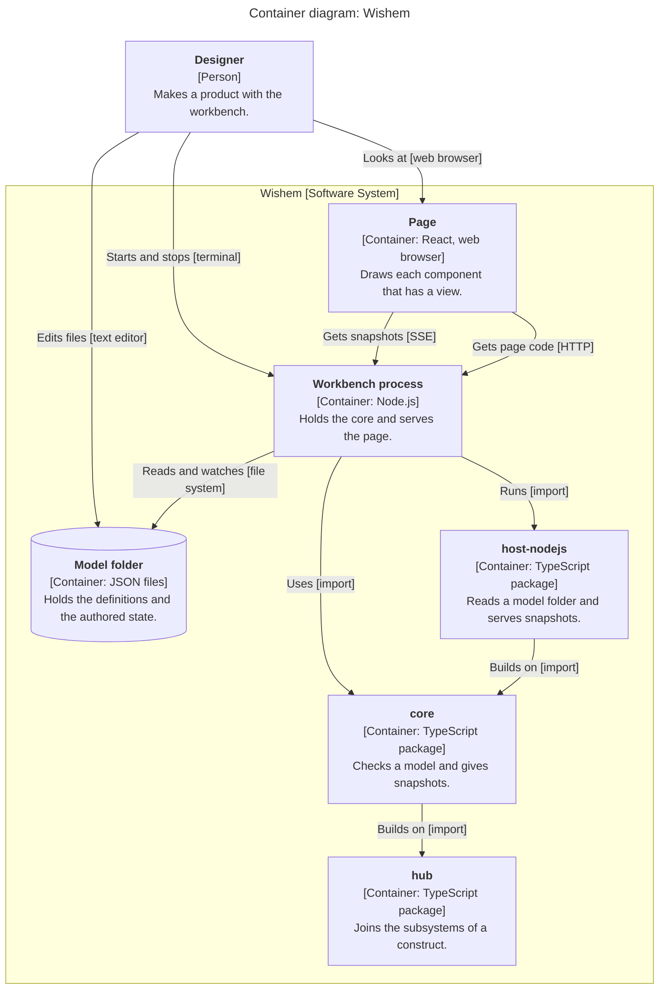

# Design

## Context

See `proposal.md` for the reason.

- `nodejs/wishem/docs/architecture/README.md` is the architecture document. `nodejs/wishem/docs/architecture/render.mjs` writes each diagram from one description, with one SVG file for each theme. The script fails when a label does not fit or an arrow is too short.
- The container diagram has five containers: the page, the workbench process, the model folder, `host-nodejs`, and `core`.
- `@thrashplay/wishem-core` depends on `@thrashplay/wishem-hub` (`nodejs/wishem/core/package.json`). `core/src/store.ts` imports `InputRefusedError` as a value and the types `Input`, `InputProblem`, `ModelSubsystem`, and `RecordedInput` from the hub package. The store is a model subsystem of a hub.
- `@thrashplay/wishem-hub` depends on no other package of Wishem. It exports `createHub`, `Hub`, `Port`, `HubEvent`, `JoinedState`, `RecordedInput`, and the errors `HubConfigurationError` and `InputRefusedError`.
- No process makes a hub. The workbench process imports `core`, and `core` imports the hub package, so the hub code loads in the process. The process uses `createCore`, not the store.
- The specification `wishem/hub/construct` exists. The architecture document does not link to it.

## Goals / Non-Goals

**Goals:**

- The container diagram, its `alt` text, its `desc` text, the table of containers, and the text on package dependencies agree with the `package.json` files of Wishem.
- The layout of the container diagram leaves space for the relationships that [#531](https://github.com/twin-digital/opus/issues/531) adds to `hub`.

**Non-Goals:**

- The system context diagram, the dynamic diagram, the component diagram of the page, and the entity diagram of the model folder do not change. The dynamic diagram and the component diagram show the running workbench, and the running workbench does not make a hub. The store does not change the files of the model folder.
- The link, the storage subsystem, the package `clock`, and the removal of `createCore` are not in this change.

## Decisions

### 1. The container `hub`

- Name: `hub`. Type: `[Container: TypeScript package]`. Description in the diagram: "Joins the subsystems of a construct."
- Row in the table of containers: "The hub of a construct: `createHub`, the ports, the record of inputs, the joined state, and the hub events. It uses no Node.js API. Package: `@thrashplay/wishem-hub`."
- Reason: the package name is the name of the other package containers (`core`, `host-nodejs`). The glossary terms are hub, construct, port, record, joined state, and hub event.

### 2. The relationship from `core` to `hub`

- `core` "Builds on [import]" `hub`. It is a gray arrow (`quiet`), because it is not on the primary path.
- The label is the same as the label of `host-nodejs` to `core`.
- No relationship goes from the workbench process to `hub`. A new paragraph under the diagram says that the process loads the hub code through `core` and makes no hub. This has the same form as the paragraph on the page and the types of `core`.
- Alternative: an arrow "Uses [import]" from the process to `hub`. Rejected: the process calls no function of the hub package. The arrow would say that the process uses a hub.

### 3. The layout

- `hub` is in the middle column (`MIDDLE`), in a new row below `host-nodejs` and `core`. The arrow goes down from the bottom of `core` and turns left to the right edge of `hub`. The label chip is on the vertical part.
- The boundary of the software system, the height of the diagram, and the legend move down by one row.
- Reason: #531 adds "Builds on [import]" from `host-nodejs` to `hub` and from the page to `hub`. In the middle column, the arrow of `host-nodejs` can mirror the arrow of `core`.
- Alternative: `hub` in the right column, directly below `core`. Rejected: the straight arrow has no space for a label chip with one row of space, and the arrow of #531 from `host-nodejs` would cross the row.
- The implementer can change the coordinates when a check of `render.mjs` fails or an item of the checklist of the `diagrams` skill fails. The column and the row stay.

### 4. The text about `core`

- The row of `core` in the table names the store: "The model types, `validateModel`, `createCore`, `ModelError`, and the store (`createStore`, `storeInputs`). The core has `getSnapshot` and `subscribe`. The store is a model subsystem of the hub. It uses no Node.js API. Package: `@thrashplay/wishem-core`."
- The description of `core` in the diagram ("Checks a model and gives snapshots.") does not change. It is correct, and the running workbench uses `createCore`.
- Alternative: "Checks a model and holds the store." Rejected for this change: the running workbench does not use the store. #531 makes this change when the process uses the store.

### 5. The text on package dependencies

The paragraph under the table names each package and the packages of Wishem that it depends on:

- `@thrashplay/wishem-workbench-app` depends on `@thrashplay/wishem-core`, `@thrashplay/wishem-host-nodejs`, and `@thrashplay/wishem-workbench`.
- `@thrashplay/wishem-workbench` depends on `@thrashplay/wishem-core` and `@thrashplay/wishem-host-nodejs`. It does not depend on `@thrashplay/wishem-workbench-app`.
- `@thrashplay/wishem-host-nodejs` depends on `@thrashplay/wishem-core`.
- `@thrashplay/wishem-core` depends on `@thrashplay/wishem-hub`.
- `@thrashplay/wishem-hub` depends on no other package of Wishem.

Reason: the sentence "depends on the other three packages" is not correct when Wishem has five packages.

### 6. The texts that count the containers

- The `desc` text of the container diagram in `render.mjs` starts "Wishem has six containers." and adds "The core package builds on the hub package."
- The `alt` text in `README.md` adds "The core package builds on the hub package."

### 7. The list of specifications

"The specifications" of the document adds `wishem/core/store` (the store) and `wishem/hub/construct` (the hub, the ports, and the record). The link to `wishem/core/snapshot` stays, because `createCore` exists.

## C4 diagrams

### Container diagram after the change

New: the element `hub` and the relationship `core` "Builds on [import]" `hub`. No element or relationship moves or is removed.

The system context diagram does not change: the designer is the one person, and Wishem connects to no external system.

## Package Impact

No package changes. The change edits only documents in `nodejs/wishem/docs/architecture/` and the specification. The changeset is empty.

| Package | Published or private | Bump | Reason |
| ------- | -------------------- | ---- | ------ |
| None    | -                    | -    | -      |

## Risks / Trade-offs

- [The plan of #531 adds the hub in its own task 1.6] → After this change is merged, the plan of #531 changes that task to add only its own relationships and descriptions.
- [A taller diagram is harder to read on a small screen] → The diagram grows by one row only. The implementer looks at each image at a width of 880 px.

## Assumptions

- The branch `530-add-link` is not merged into `main`. The document does not mention the link.
- The hub code that loads through `core` is not a use of the hub by the process. The diagram shows no arrow from the process to `hub`.
