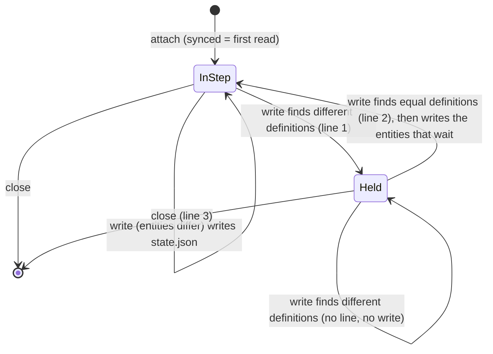
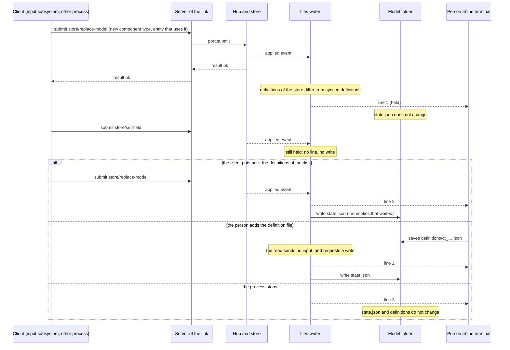

# Design

## Context

See `proposal.md` for the fault and its variants. The current state:

- `attachModelFolderStorage` in `nodejs/wishem/host-nodejs/src/model-folder-storage.ts` attaches `files` (input) and `files-writer` (output). It keeps `synced`, the definitions and the entities that it last read from the folder or wrote to `state.json` (decision 3 of the design of #531).
- `write` runs after each `applied` event, in the queue of reads and writes. It compares only `current().entities` with `synced.entities`.
- `read` makes the next model part by part. For each part that is equal to the same part of `synced`, it takes the part of the store. Then `synced` becomes the read.
- The subsystem writes no definition file (decision 4 of the design of #531). A definition file holds one component type, and a write of definitions needs a rule for file names first.
- The hub permits each input type from each input subsystem. The store validates each input against the full model, so the part `store` is always correct.

The lead agent did the brainstorm alone and made each decision below, as `nodejs/wishem/docs/autonomous-flow.md` permits. No decision meets the three conditions of "When to ask the owner": the difference that a user sees is one line in the terminal, and a later change can remove the hold with no effect on a user.

## Goals / Non-Goals

**Goals:**

- Each `state.json` that the process writes, with the files in `definitions`, gives a correct model.
- Each change of the store that the model folder does not hold gets a line in the terminal: when the difference starts, and when the process stops with it.

**Non-Goals:**

- A write of definition files. A later change builds it, when an agent changes definitions through the hub.
- A change to the hub or to the store. A permission for each input type and each source is not in this change.
- Rewind and checkpoints (#533). This change does not design for them.
- A write of a part of the entities. The hold applies to the full `state.json`.

## Decisions

### 1. The write waits while the definitions differ

`write` first compares `current().definitions` with `synced.definitions` with `sameDefinitions` (the `isEqual` of `@thrashplay/wishem-core` that the file uses now). When they differ, `write` writes nothing and does not change `synced`. When they are equal, `write` continues as now.

- Reason: each bad folder and each lost change starts when the definitions of the store differ from the disk (see `proposal.md`). One check at that point covers each variant, also the variant of two inputs that are each correct, which a check of one input cannot find.
- Reason: with the hold, each `state.json` on the disk holds entities that the store held together with the definitions on the disk. The folder is thus always a model that the store held, not a mix of two models.
- Reason: this is the smallest correction on the path to the later design. When the storage subsystem writes definition files, `synced.definitions` follows each change of the store, and the condition is never true. The check can stay as a guard.
- `synced.definitions` is the value of the disk, because the subsystem never writes definitions. It changes only after a correct read.
- The order of the definitions counts. `isEqual` compares the lists in order, and the model folder gives the order of the file names. A different order is a change that the folder cannot hold.

### 2. Three lines in the terminal, each one time for each state

The subsystem keeps one flag, `held`. It is false at the start.

| When                                                                | Line                                                                                                  | Then           |
| ------------------------------------------------------------------- | ----------------------------------------------------------------------------------------------------- | -------------- |
| `write` finds different definitions, and `held` is false            | `wishem: the definitions of the store differ from the files in definitions, so state.json is not written` | `held` = true  |
| `write` finds equal definitions, and `held` is true                 | `wishem: the definitions of the store are equal to the files in definitions again`                    | `held` = false |
| `close` ends, and the definitions of the store differ from `synced` | `wishem: the process stops, and the model folder does not hold the last changes of the store`         | none           |

- Reason: one line when the state starts tells the person at once. A line for each input would fill the terminal during a session of edits.
- Reason for the line at the stop: the first line can be far up in the terminal. The person must see the loss at the time it occurs.
- The line at the stop uses a fresh comparison, not `held`, so a stop directly after an input whose write did not run yet is also reported. `close` gives the same promise on each call, so the line shows one time.

### 3. A read that makes the definitions equal requests a write

After each correct read, the subsystem requests a write, as an `applied` event does. `write` decides if it writes.

- Reason: a person can add the definition file of a new component type by hand. The read then gives definitions that are equal to the store, and the next model is equal to the part `store`, so the read sends no input and the hub gives no `applied` event. With no request, the entities that wait stay out of `state.json` until the next input.
- The request is cheap: when nothing waits, `write` finds equal entities and returns.
- A read that sends `replace-model` already causes an `applied` event. The queue joins the two requests into one write (`writeQueued`).

### 4. The hub and the store do not change

- Reason: the store is correct; the fault is in what the storage subsystem writes. The specification `wishem/host-nodejs/model-folder` owns the rule, as the issue requires.

### Alternatives

| Option                                                                                        | Result                                                                                                                                                                                                                                                                                                                      | Decision            |
| --------------------------------------------------------------------------------------------- | --------------------------------------------------------------------------------------------------------------------------------------------------------------------------------------------------------------------------------------------------------------------------------------------------------------------------- | ------------------- |
| The storage subsystem writes the definitions also (option 1 of the issue)                     | The best end state, and the later design. It needs a rule for the names of new files, the remove of a file for a removed type, a rule for the order, and the care for hand-named files such as `app-bar.json`. It is a feature, not a bug fix, and no input of the product changes definitions now.                       | Rejected for now    |
| Do not write entities that use a definition that is not on the disk (option 2 of the issue)   | Write `state.json` when the entities of the store are correct for the definitions on the disk. More changes of the entities reach the disk, but the folder can then hold a model that the store never held: the old definitions with the new entities. The check also needs `validateModel` on each write.             | Rejected            |
| The store, or the hub, refuses `replace-model` from a subsystem that is not `files` (option 3) | It closes the path, but it is the opposite of the later design, in which an agent changes definitions through the hub. It changes `core` or `hub` and their specifications, and the store must know the ID of a storage subsystem. A later change must remove it.                                                         | Rejected            |
| The hold of decision 1                                                                        | One comparison in one package. The folder always starts. Each lost change gets a line. When definitions are written later, the hold is never true.                                                                                                                                                                       | Selected            |

## Interfaces

No exported type or function changes. `ModelFolderStorageOptions`, `ModelFolderStorage`, `attachModelFolderStorage`, and `startConstruct` keep their signatures. The new behavior is in the three lines of decision 2, which go to the `log` function of the options.

## Domain types

No domain type changes. The life of the storage subsystem gets a state for the hold. This diagram shows only the write and the hold. The reads, the settle time, and the close keep the states of the design of #531.



## The main flows

### The fault of the issue, with the hold



## Failure Modes

| Failure                                                                                       | Result                                                                                                                                                                       | Recovery                                                                                      |
| --------------------------------------------------------------------------------------------- | ---------------------------------------------------------------------------------------------------------------------------------------------------------------------------- | --------------------------------------------------------------------------------------------- |
| A client changes the definitions through the link                                            | The store holds the change. `state.json` does not change. Line 1.                                                                                                            | The client sends the definitions of the disk again, or a person adds the files. A stop gives line 3. |
| A client sends the definitions of the disk in a different order                               | The same as a change: the hold and line 1.                                                                                                                                   | The client sends the order of the file names.                                                 |
| A person saves `state.json` while the write is held                                           | The read takes the definitions of the store and the entities of the file, and sends `replace-model`. The store can refuse it when an entity of the file uses a removed type; the subsystem prints the problems and "the last correct model stays". | Last write wins, as now. The person corrects the file.                                        |
| A person edits a definition file while the write is held                                     | The read takes the definitions of the file. When the entities of the store use a type that the files do not declare, the store refuses the input and the subsystem prints the problems. | The person adds the missing definition, or a client sends a model that fits the files.       |
| The write fails while the definitions are equal                                              | As now: the line that names `state.json`, and the next change writes again.                                                                                                 | As now.                                                                                       |
| The process stops while the write is held                                                    | Line 3. The model folder keeps the last state that it held, and it starts.                                                                                                  | The changes of the store are lost. The record of the hub is in memory only.                   |
| `close` is called two times                                                                  | One promise, so line 3 shows at most one time.                                                                                                                               | None needed.                                                                                  |

The idempotency of each operation:

- The comparison of definitions has no effect on the disk. A second `write` while held does nothing.
- The write of `state.json` stays idempotent: the same entities give the same file.
- The request for a write after a read is idempotent: with nothing to write, `write` returns.

## Examples

A client of the link adds a component type and an entity that uses it, and the person then stops the process:

```
$ wishem start ./model
wishem: model /home/designer/model
wishem: 1 component type, 1 entity
wishem: link at ws://127.0.0.1:4747/link
wishem: the definitions of the store differ from the files in definitions, so state.json is not written
^C
wishem: the process stops, and the model folder does not hold the last changes of the store
$ wishem start ./model
wishem: model /home/designer/model
wishem: 1 component type, 1 entity
wishem: link at ws://127.0.0.1:4747/link
```

The second start does not fail. Before this change, it printed `wishem: problem in state.json: Entity e_… has a component of the type ct_…, which is not defined` and stopped with exit code 1.

The person adds the definition file while the process runs:

```
wishem: the definitions of the store differ from the files in definitions, so state.json is not written
wishem: the definitions of the store are equal to the files in definitions again
```

## Package Impact

| Package                          | Published or private | Bump  | Reason                                                                                                   |
| -------------------------------- | -------------------- | ----- | -------------------------------------------------------------------------------------------------------- |
| `@thrashplay/wishem-host-nodejs` | Private              | patch | Bug fix: the storage subsystem holds the write of `state.json` while the definitions differ, and prints three new lines. No API change. |

No other package changes. `@thrashplay/wishem-workbench` and `@thrashplay/wishem-workbench-app` use `startConstruct`, but their page is an output subsystem, so no input of theirs changes the definitions, and their behavior does not change.

## Risks / Trade-offs

- [A client changes a label through the link, and then each change of the entities stays out of `state.json`] → Line 1 tells the person at once, and line 3 at the stop. No input of the workbench changes definitions now. The write of definitions removes the hold later.
- [The hold looks at the full list of definitions, also at the order] → The folder cannot hold a different order, so the line is true. A later write of definitions needs a rule for the order.
- [The view types of the workbench follow the definitions of the store, also while they are held] → The keeper of the view types is an output subsystem and writes no model file. See "Follow-up".
- [A request for a write after each correct read adds one job to the queue] → The job compares two values and returns. Reads come only after a watch event and the settle time.

## Migration Plan

No migration. The model folder and its schema do not change. A folder that an earlier version made bad still needs a correction by hand: remove the components of the undefined type from `state.json`, or add the definition file.

## Follow-up

- The storage subsystem writes definition files when an agent changes definitions through the hub. It needs a rule for file names, for a removed type, and for the order.
- The keeper of the view types in `workbench-app/scripts/start.ts` generates types from the definitions of the store, also while the model folder does not hold them.
