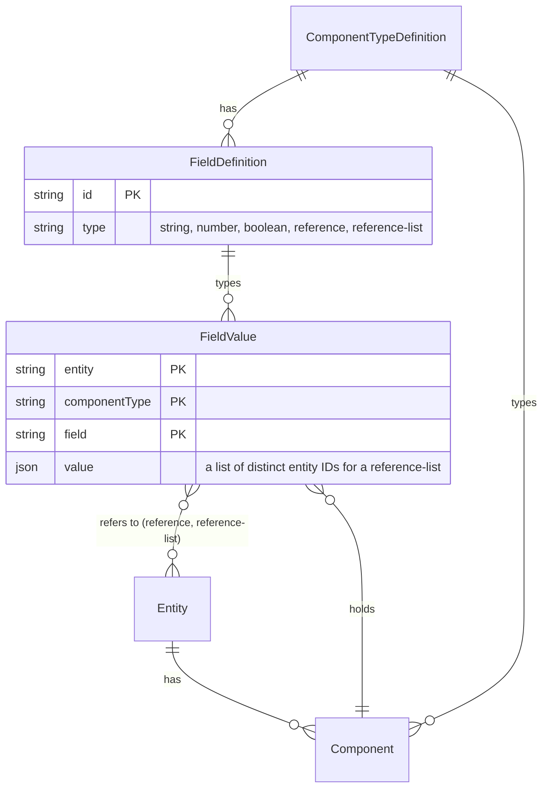
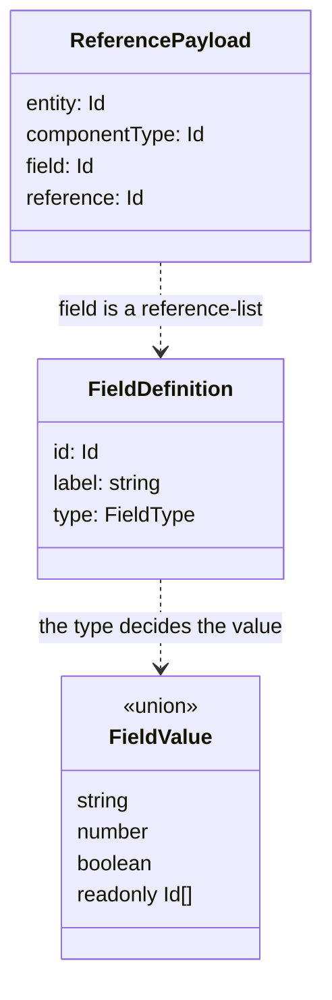
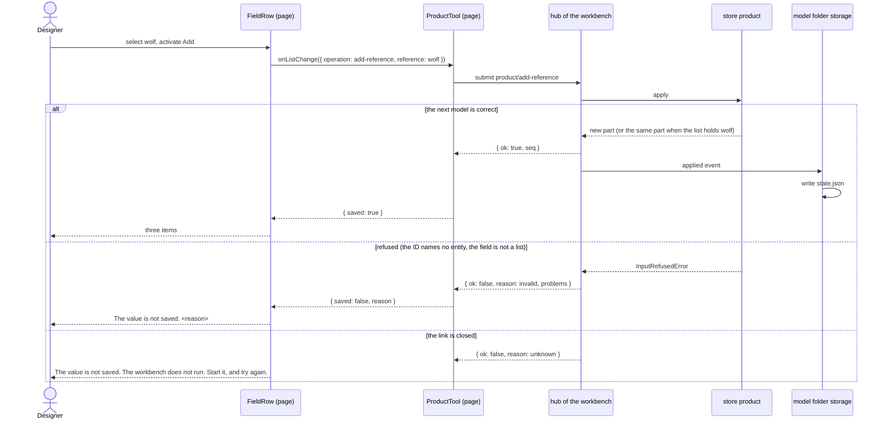

# Design

## Context

See `proposal.md` for the reason of the change. These facts of `main` (421d7841) shape the design:

- `core` has four field types. `FieldValue` is `string | number | boolean`. `validateModel` checks a `reference` value in two passes: the form `e_<uuid>`, and then that an entity has the ID.
- `set-field` compares the old value and the new value with `===` (`store.ts`). A list is an object, so `===` is false for two equal lists, and the store gives a new part (#557).
- `isEqual(a: Model, b: Model)` compares the canonical JSON text of two models. `construct-manager` and `host-nodejs` call it with models only.
- `remove-entity` runs `validateModel` on the next model. A reference that names no entity fails, so the store refuses the removal of an entity that a reference names (#535, Decision 8).
- The React renderer: `findHolds` finds the held entities from each `reference` field of a component with a view. `Renderer` gives the prop of a `reference` field as the picture of the entity, and draws `null` for an entity that is already on the path. `holdWarnings` gives one `reference-cycle` warning for each such reference.
- The PixiJS renderer and the Godot renderer give each field value as its prop with no change. A `reference` prop is the ID string. They hold no entity.
- The product panel: `FieldRow` has a control for each of the four types. `EntityInspector` and `ProductPanel` pass a `SetFieldPayload` up, and `ProductTool` sends `product/set-field`.
- The model folder storage of `host-nodejs` reads `state.json` and the definition files, and watches both. It compares models with `isEqual`.
- The update subsystem skips a returned value that is `===` to the old value. For a list, it sends `set-field` to the store in the tick. After this change, the store gives the same part for an equal list, so the rule "A tick that changes nothing keeps the part" stays true with no change of `update`.

The lead agent did the brainstorm alone, as `nodejs/wishem/docs/autonomous-flow.md` requires. Each decision has its reason and the alternatives that were rejected.

## Goals / Non-Goals

**Goals:**

- A product can declare a field that holds an ordered list of entities, and each tool that reads a model accepts it.
- The store has an input for each change of a list that the issue names: add one reference, remove one reference, and set the full list.
- The React renderer draws each entity of the list in the picture of its holder.
- A designer can change a list in the product panel of the workbench.

**Non-Goals:**

- A list of a different item type, such as a list of numbers.
- An input that moves an item in a list, and a control in the panel that changes the order. `set-field` with the new list changes the order (Follow-up).
- A tool of a view that adds or removes a reference. A view does not get the IDs of its entities now (#608).
- An input that clears a field (#607).
- A hold rule in the PixiJS renderer or the Godot renderer.

## Decisions

### 1. One change with four tasks

The issue names four parts: the field type, the comparison in `set-field`, the two inputs, and the rule of the renderer. The product panel is the fifth part, because a field type that the panel cannot show breaks the panel: the text field shows the list as text, and a commit sends a string that the store refuses. Task 1 is the type and the comparison in `core`. Task 2 is the two inputs. Task 3 is the three renderers. Task 4 is the product panel. Each task has its own tests, and a reviewer can reject one task and approve its neighbor.

### 2. The name of the type is `reference-list`

The type is a string, as the four types are. Reason: `FieldDefinition` keeps one shape, and each tool that reads `type` needs one more case and no new key. A list of a different item type can later be `string-list` or similar, with the same form.

Alternatives rejected:

- **`references`.** Rejected: it reads as a typo of `reference`, and it gives no form for a list of a different type.
- **`{ "type": "list", "of": "reference" }`.** Rejected: a second key in each field definition, which each tool must read, for one list type that a product needs now.

This decision does not need the owner. A rename later is a change of the definition files of a model folder and of one constant, and only test models use the type now.

### 3. The value is a JSON list of distinct entity IDs, in order

The value is a JSON list, so `state.json` holds it with no change of the storage. Each item has the rules of a `reference`: the form `e_<uuid>`, and an entity of the model has the ID. An item can name the entity that holds the list, and a later entity. The order is part of the value. `[]` is a correct value, and it is different from an omitted field.

No ID is in one list two times. Reason: a list holds entities, and one entity is one thing. A deck holds a card one time. With duplicates, `remove-reference` would need to say which copy it removes, and the React renderer would draw one entity two times in one holder with one key.

The problem of an item has the path of the field and the index of the item, for example `['entities', 0, 'components', <ct>, <fld>, 2]`. The problem of a duplicate names the later index.

`FieldValue` becomes `string | number | boolean | readonly Id[]`. The list is `readonly` because the store freezes each part.

Alternative rejected: **duplicates are permitted.** Rejected for the reasons above. A product that needs one entity two times, such as two copies of a card, makes two entities.

### 4. `isEqual` compares two JSON values, and `set-field` uses it

`isEqual` takes two values of any kind: `(a: unknown, b: unknown) => boolean`. It compares their canonical JSON text, as it does now for models. The callers that give two models do not change. `set-field` compares the current value and the new value with `isEqual`, and gives the same part object when they are equal. For a string, a number, and a boolean, the result is the same as `===`: `"3"` and `3` have different JSON text. Two lists are equal only when they hold the same IDs in the same order.

Alternative rejected: **a separate function `isEqualValue`.** Rejected: the issue names `isEqual`, and one function with one rule is simpler than two.

### 5. The inputs `add-reference` and `remove-reference`

Both inputs have the payload `{ entity, componentType, field, reference }`. The first three keys have the meaning of `set-field`. `reference` is one entity ID. The store checks the payload keys as `set-field` does, and also refuses a field whose type is not `reference-list`.

- `add-reference` adds `reference` at the end of the list. A field with no value, or a component that the entity does not have, gets the list `[reference]`. The next model goes through `validateModel`, so an ID that no entity has, or an ID of the wrong form, is refused with the problem of the model.
- `remove-reference` removes `reference` and keeps the order of the other items. The last removal leaves `[]`. Reason: the input changes the items, not the presence of the field. The input `clear-field` of #607 removes a value.
- An input that changes nothing gives the same part object and is accepted: an `add-reference` of an ID that the list holds, and a `remove-reference` of an ID that the list does not hold, or of a field with no value. Reason: this is the rule of `set-field` with the same value, and of `clear-field` of #607. A caller, such as an agent, can send the input without a read first, and the result is the same.

The store also accepts `set-field` with a full list. That input sets the order.

Alternatives rejected:

- **An `index` key in `add-reference`.** Rejected for now: `set-field` sets any order, and the issue does not name an insert. An optional `index` can come later with no breaking change.
- **Refuse an `add-reference` of an ID that the list holds.** Rejected: an input that asks for the state that exists is not a fault, as with `set-field`.
- **`remove-entity` removes the ID from each list.** Rejected for the reason of #535, Decision 8: an input would change a different entity with no sign in its payload.

### 6. The React renderer gives a list of pictures, and each item is held

The rule of a held entity of #535 applies to each item: an entity is held when a `reference` field or a `reference-list` field of a component with a view of a different entity names it. `findHolds` adds one edge for each item of a list.

The prop of a `reference-list` field is a list with one item for each ID, in the order of the value: `readonly ReactNode[]`. Each item is the picture of that entity, as for a `reference` field. An item whose entity is on the path from the top level is `null`, and gives the `reference-cycle` warning of #535. The list keeps that position, so the item at index `i` is the picture of the ID at index `i`. The renderer puts each item in a React fragment whose key is the ID of the entity. The IDs are distinct (Decision 3), so the keys are distinct. An empty value gives `[]`. An omitted field gives no value.

Alternatives rejected:

- **One `ReactNode` for the full list.** Rejected: the view cannot put each entity in its own place, such as a cell of a grid or a card in a fan.
- **The list of IDs, and a component that draws one entity.** Rejected by #535, Decision 9: the renderer would not know which entities are held before the views draw.
- **The entities of a list are not held.** Rejected: the issue says to use the rule of a held entity.

### 7. The generator writes a list type

`Values` has `readonly string[]` for a `reference-list` field, and `Props` has `readonly ReactNode[] | undefined`. The file imports `ReactNode` when a `reference` field or a `reference-list` field exists. The comment of the member in `Props` is "The pictures of the entities that the field "<label>" (<id>) names, in the order of the list.".

### 8. The PixiJS renderer and the Godot renderer give the IDs

The two renderers give each value as its prop now, and they hold no entity: a `reference` prop is the ID. A `reference-list` prop is the list of IDs, the same rule. The PixiJS renderer gets the wider type from `FieldValue`. The Godot renderer gets an `Array` from the JSON of the link, and its source does not change. Each package gets tests that prove the rule. Reason: the hold rule is a rule of the React renderer (#535, Risks). A game that draws with PixiJS or Godot decides its own rule.

### 9. No tool of a view for a list

`ViewTools` gets no `addReference` and no `removeReference`. Reason: a view does not get the IDs of the entities of its list, or its own ID, so it has no ID to give. `setField` with a full list and `submit` with `storeInputs().addReference(...)` stay available. #608 gives a view the ID of a referenced entity, and a tool can come with it.

### 10. The product panel has a list control

`FieldRow` shows a `reference-list` field as a list control: one item for each ID, with the name and the short ID of the entity and a button `Remove`, then a select of the entities that the list does not hold and a button `Add`. The select shows the entity of the row too: a list can name its own entity (Decision 3). The row keeps its phases (`idle`, `saving`, `not-saved`) and its texts. See "UI".

`FieldRow` gets the optional prop `onListChange`. The inspector and the panel pass a change with an `operation`, so that one callback carries each input of the store: `set-field`, `add-reference`, and `remove-reference`. `ProductTool` sends `product/<operation>` with the payload. Reason: one callback for each input would grow at each new input, such as `clear-field` of #607.

Alternative rejected: **a text field with the list as JSON.** Rejected: a designer types IDs, and a fault shows only after the commit.

### 11. The entity diagram gets "zero or more" at `Entity`

A `FieldValue` of the type `reference-list` names zero or more entities. The relationship "Refers to" gets the mark "zero or more" at `Entity`. No other relationship uses the mark "zero or one", so the legend no longer lists it. No package, process, or import changes, so the container diagram and the package view do not change.

## Interfaces

`@thrashplay/wishem-core`:

```ts
export type FieldType = 'string' | 'number' | 'boolean' | 'reference' | 'reference-list'

/** The field types, in the order of the specification. */
export const FIELD_TYPES: readonly FieldType[] // ['string', 'number', 'boolean', 'reference', 'reference-list']

/** A reference is the ID of an entity. A reference list is a list of distinct entity IDs. */
export type FieldValue = string | number | boolean | readonly Id[]

/** True when the canonical JSON text of the two values is the same. Record keys are sorted. */
export const isEqual: (a: unknown, b: unknown) => boolean

export interface ReferencePayload {
  /** The ID of the entity that holds the list. */
  entity: Id
  /** The ID of the component type. */
  componentType: Id
  /** The ID of a `reference-list` field. */
  field: Id
  /** The ID of the entity to add or to remove. */
  reference: Id
}

export interface StoreInputs {
  replaceModel(model: Model): Input
  addEntity(entity: Entity): Input
  removeEntity(entity: Id): Input
  setField(payload: SetFieldPayload): Input
  addReference(payload: ReferencePayload): Input // `<id>/add-reference`
  removeReference(payload: ReferencePayload): Input // `<id>/remove-reference`
}
```

`@thrashplay/wishem-renderer-react` (the shapes change, not the names):

```ts
/** The fields by prop name, and the tools in `wishem`. A `reference` field is a `ReactNode`. A `reference-list` field is a list of them. */
export type ViewProps = Readonly<Record<string, FieldValue | ReactNode | readonly ReactNode[]>> & {
  readonly wishem: ViewTools
}
```

`@thrashplay/wishem-workbench-app` (internal to the package):

```ts
// components/FieldRow.tsx
export interface ListChange {
  operation: 'add-reference' | 'remove-reference'
  reference: Id
}
export interface FieldRowProps {
  field: FieldDefinition
  value: FieldValue | undefined
  options?: readonly ReferenceOption[]
  onChange?: (value: FieldValue) => Promise<ChangeOutcome>
  /** The changes of a `reference-list` field. With no value, the list control is disabled. */
  onListChange?: (change: ListChange) => Promise<ChangeOutcome>
  /** `draft` is not used by the list control. */
  initial?: { state: 'saving' | 'not-saved'; draft?: string | boolean; reason?: string }
}

// components/EntityInspector.tsx
export type FieldChange = { operation: 'set-field'; value: FieldValue } | ListChange
export interface EntityInspectorProps {
  entity?: { id: Id; name: string; components: readonly InspectedComponent[] }
  options: readonly ReferenceOption[]
  onChange?: (componentType: Id, field: Id, change: FieldChange) => Promise<ChangeOutcome>
}

// components/ProductPanel.tsx
export type ProductChange =
  | { operation: 'set-field'; payload: SetFieldPayload }
  | { operation: 'add-reference' | 'remove-reference'; payload: ReferencePayload }
export interface ProductPanelProps {
  model: Model
  selected?: Id
  onSelect: (id: Id) => void
  onChange?: (change: ProductChange) => Promise<ChangeOutcome>
}
```

## Data Model

The model folder gets no new entity. The value of a `reference-list` field refers to zero or more entities. `FieldDefinition.type` and `FieldValue` change.





`FieldValue`, `FieldType`, and `FieldDefinition.type` are modified. `ReferencePayload` is new.

## The flow of a change in the list control



## Failure Modes

| Failure                                                    | Behavior                                                                                                 | Recovery                                             |
| ---------------------------------------------------------- | -------------------------------------------------------------------------------------------------------- | ---------------------------------------------------- |
| A hand edit of `state.json` puts an ID two times in a list | The storage prints the problem with the field and the later index. The last correct model stays.         | Correct the file.                                    |
| A hand edit gives a list item that names no entity         | The storage prints the problem with the ID and the index. The last correct model stays.                  | Correct the file.                                    |
| `remove-entity` of an entity that a list names             | The store refuses the input with the problem of the model, which names the holder and the field.         | Send `remove-reference` first, then `remove-entity`. |
| `add-reference` of an ID that the list holds               | Accepted. The part is the same object. The record holds the input.                                       | None needed. The input is idempotent.                |
| `remove-reference` of an ID that the list does not hold    | Accepted. The part is the same object.                                                                   | None needed. The input is idempotent.                |
| Two pages add the same entity at the same time             | The hub applies the inputs in order. The second gives the same part. The list holds the entity one time. | None needed.                                         |
| The workbench stops while a change waits                   | The row shows "not saved" with the reason of `outcomeText`. The list shows the items of the last part.   | Start the workbench, and do the change again.        |
| A list names its holder in a React view                    | The item draws nothing, and the console has one `reference-cycle` warning.                               | Remove the ID from the list.                         |

## Examples

A definition file with a list (`definitions/ct_4a1b2c3d-5e6f-4a7b-8c9d-0e1f2a3b4c5d.json`):

```json
{
  "id": "ct_4a1b2c3d-5e6f-4a7b-8c9d-0e1f2a3b4c5d",
  "label": "Deck",
  "fields": [{ "id": "fld_5b2c3d4e-6f7a-4b8c-9d0e-1f2a3b4c5d6e", "label": "Cards", "type": "reference-list" }]
}
```

An input through the link, and its result:

```json
{ "type": "product/add-reference",
  "payload": { "entity": "e_1f2a3b4c-5d6e-4f7a-8b9c-0d1e2f3a4b5c",
               "componentType": "ct_4a1b2c3d-5e6f-4a7b-8c9d-0e1f2a3b4c5d",
               "field": "fld_5b2c3d4e-6f7a-4b8c-9d0e-1f2a3b4c5d6e",
               "reference": "e_4c5d6e7f-8a9b-4c0d-9e1f-3a4b5c6d7e8f" } }
→ { "ok": true, "seq": 3 }
```

An input that the store refuses:

```json
{ "type": "product/add-reference", "payload": { "...": "...", "reference": "e_00000000-0000-4000-8000-000000000000" } }
→ { "ok": false, "reason": "invalid", "problems": [{ "message": "Entity e_1f2a3b4c-5d6e-4f7a-8b9c-0d1e2f3a4b5c has the field \"Cards\" of \"Deck\", which refers to the entity \"e_00000000-0000-4000-8000-000000000000\", and no entity has that ID", "path": ["entities", 0, "components", "ct_4a1b2c3d-5e6f-4a7b-8c9d-0e1f2a3b4c5d", "fld_5b2c3d4e-6f7a-4b8c-9d0e-1f2a3b4c5d6e", 2] }] }
```

A hand edit with a duplicate. The terminal of the workbench prints:

```text
wishem: problem in state.json: Entity e_1f2a3b4c-5d6e-4f7a-8b9c-0d1e2f3a4b5c has the field "Cards" of "Deck", which holds the entity "e_2a3b4c5d-6e7f-4a8b-9c0d-1e2f3a4b5c6d" two times
wishem: the last correct model stays
```

`formatProblem` of `host-nodejs` gives the form of the line. The path of the problem (`[..., <field ID>, 3]`) is in the `Problem`, not in the line.

The generated file of a `Deck` view:

```ts
export interface Values {
  /** The field "Cards" (fld_5b2c3d4e-6f7a-4b8c-9d0e-1f2a3b4c5d6e). */
  readonly cards: readonly string[]
}

export interface Props {
  /** The pictures of the entities that the field "Cards" (fld_5b2c3d4e-6f7a-4b8c-9d0e-1f2a3b4c5d6e) names, in the order of the list. */
  readonly cards: readonly ReactNode[] | undefined
  /** Sends inputs for this component. */
  readonly wishem: ViewTools<Values>
}
```

## Package Impact

| Package                             | Published or private | Bump  | Why                                                                                                               |
| ----------------------------------- | -------------------- | ----- | ----------------------------------------------------------------------------------------------------------------- |
| `@thrashplay/wishem-core`           | private              | minor | The field type `reference-list`, the inputs `add-reference` and `remove-reference`, and `isEqual` for each value. |
| `@thrashplay/wishem-renderer-react` | private              | minor | The entities of a list are held and drawn as a list of pictures. The generator writes the types of a list.        |
| `@thrashplay/wishem-renderer-pixi`  | private              | patch | A view gets a `reference-list` prop as the list of IDs (the type of the props gets wider).                        |
| `@thrashplay/wishem-renderer-godot` | private              | patch | A view gets a `reference-list` prop as an `Array` of IDs (tests only; behavior through the link).                 |
| `@thrashplay/wishem-host-nodejs`    | private              | patch | The model folder accepts the field type `reference-list` (through `core`, no source change).                      |
| `@thrashplay/wishem-workbench-app`  | private              | minor | The product panel has a list control that sends `add-reference` and `remove-reference`.                           |

`update`, `construct-manager`, `sample-product`, `three-renderers`, and `pixi-page` get the wider `FieldValue` and no change of behavior. The final review runs their type check (`...^@thrashplay/wishem-core`).

The changesets, one for each distinct change:

1. `606-core-reference-list.md`: `core` minor. Add the field type `reference-list`, and `set-field` keeps the part for an equal list.
2. `606-core-reference-inputs.md`: `core` minor. Add the store inputs `add-reference` and `remove-reference`.
3. `606-core-is-equal.md`: `core` minor. `isEqual` compares two JSON values of any kind.
4. `606-renderer-react-reference-list.md`: `renderer-react` minor. The entities of a `reference-list` field are held and given as a list of pictures.
5. `606-renderer-react-view-types.md`: `renderer-react` minor. The generator writes the types of a `reference-list` field.
6. `606-reference-list-consumers.md`: `host-nodejs`, `renderer-pixi`, and `renderer-godot` patch. They accept the field type `reference-list` and give its value as the list of IDs.
7. `606-workbench-app-list-control.md`: `workbench-app` minor. The product panel changes a list of references.

## UI

The lead agent selected the option below alone, as `autonomous-flow.md` requires ("The lead agent does the brainstorm alone"). The UI is easy to change later, so the question does not meet the third condition of "When to ask the owner".

The option: a list of items, each with its own button `Remove`, and one select and one button `Add` below the items. Reason: it reuses the select of a `reference` field, the button of the catalog, and the mono label of `no value`. Each change is one input, so the record and the rewind show each step.

### Wireframe

Wide (768 pixels and more), the three columns of the field row:

```text
┌───────────────────────────────────────────────────────────────────────────┐
│ Cards      REFERENCE-  Card  e_2a3b4c5d                        [ Remove ] │
│            LIST        Card  e_3b4c5d6e                        [ Remove ] │
│                        [ Deck · e_1f2a3b4c            ▾ ]      [ Add    ] │
└───────────────────────────────────────────────────────────────────────────┘
```

An empty list:

```text
│ Cards      REFERENCE-  EMPTY LIST                                         │
│            LIST        [ Card · e_2a3b4c5d            ▾ ]      [ Add    ] │
```

Saving (after a click of Add):

```text
│ Cards      REFERENCE-  Card  e_2a3b4c5d                        [ Remove ]░ │
│            LIST        Card  e_3b4c5d6e                        [ Remove ]░ │
│                        [ Card · e_4c5d6e7f            ▾ ]░     [ Add    ]░ │  SAVING
```

Not saved:

```text
│ Cards      REFERENCE-  Card  e_2a3b4c5d                        [ Remove ] │
│            LIST        Card  e_3b4c5d6e                        [ Remove ] │
│                        [ Card · e_4c5d6e7f            ▾ ]      [ Add    ] │
│                        The value is not saved. The workbench does not run. │
│                        Start it, and try again.                           │
```

Narrow (below 768 pixels): the label and the type are on the first line, and the control takes the full width below them, as for the other rows. Each item keeps its name on the left and its button on the right.

### Components and tokens

- No new component and no new token. The list control is a part of `FieldRow`. It uses `Button` (plain), the select classes of the `reference` row, `text-ui` with `fg` for the name, and the mono label in `fg-muted` for the short ID and for `empty list`.
- The type label `REFERENCE-LIST` stays in the column of 5rem. The browser breaks it after the hyphen. The screenshot tests show the result.
- The style guide gets the specimens "Field row, reference list", "Field row, reference list, empty", "Field row, reference list, saving", "Field row, reference list, not saved", and "Field row, reference list, disabled". The specimen "Inspector, an entity" and "Product panel" do not change.

### States

| State          | What the row shows                                                                                                           |
| -------------- | ---------------------------------------------------------------------------------------------------------------------------- |
| idle           | The items, the select, and the buttons, each enabled. The select shows the first entity that the list does not hold.         |
| empty          | The mono label `empty list` in place of the items.                                                                           |
| no value       | The mono label `no value` in place of the items. `Add` sets the list.                                                        |
| full           | The list holds each entity. The select shows no option and is disabled, and `Add` is disabled.                               |
| saving         | Each button and the select are disabled. The group has `aria-busy="true"`. The mono label `Saving` shows beside the control. |
| not saved      | The items of the part, and the alert line `The value is not saved.` with the reason.                                         |
| disabled       | No `onListChange`: each button and the select are disabled. The items show.                                                  |
| light and dark | Each state in each theme, through the tokens.                                                                                |

### Keyboard and focus

- The order of the tab key: the button `Remove` of each item, in the order of the list, then the select, then `Add`.
- After an accepted removal, the focus goes to the button `Remove` of the next item. When no next item exists, to the button of the previous item. When the list is empty, to the select.
- After an accepted addition, the focus stays on `Add`. When the list then holds each entity, the focus goes to the button `Remove` of the last item.
- After a rejection, the focus stays on the control that the designer used.
- The group has the label of the field as its accessible name (`aria-labelledby`). Each button `Remove` has the accessible name `Remove <name> · <short ID>`. The select has the accessible name `Add to <label>`.

### UI options for the owner

The owner can change the option in a later change. The two other options that the lead agent considered:

- **A multi-select (`<select multiple>`).** One control. Rejected: the browser control does not show the order, and a change of many items is one input with no step in the record.
- **A check box for each entity of the product.** Rejected: it does not show the order of the list, and a product with many entities gives a long row.

## Risks / Trade-offs

- [The wider `FieldValue` breaks a consumer that expects a primitive, such as `String(value)`] → The final review runs the type check of each dependent of `core`. `FieldRow` gets its own branch for the list. A `String(value)` that the type check does not find shows a list as text, which the tests of the panel find.
- [An `add-reference` that changes nothing is in the record] → The same is true for `set-field` with the same value. A rewind to that input gives the same model.
- [A large list in the product panel] → The panel shows each item. A product with many entities is not a case of milestone A4. #716 (memo of the rows) and #714 (a table of entities) cover the speed and the layout later.
- [Two holders of one entity, one through a list] → The React renderer draws the entity in each holder, by the rule of #535. No new risk.

## Migration Plan

No migration. Each model of `main` stays correct: the change adds a type and does not change the rules of the four types. A model with a `reference-list` field is not correct for a build of `main` before this change, as for each new type.

## The test guide

The final reviewer does these steps on the branch, with real processes, real files, and a real web browser, and reports the real result of each step. Each result is the result after this change: `main` has no field type `reference-list`. Run each command from the root of the worktree. Terminal 1 runs the workbench. Terminal 2 runs commands. Terminal 3 runs a listener.

### 0. Prepare

```sh
pnpm install
pnpm build --filter "@thrashplay/wishem-*"
rm -rf /tmp/a4-deck
cp -r nodejs/wishem/sample-product/model /tmp/a4-deck
cat > /tmp/a4-deck/definitions/ct_4a1b2c3d-5e6f-4a7b-8c9d-0e1f2a3b4c5d.json <<'EOF'
{ "id": "ct_4a1b2c3d-5e6f-4a7b-8c9d-0e1f2a3b4c5d", "label": "Deck", "fields": [
  { "id": "fld_5b2c3d4e-6f7a-4b8c-9d0e-1f2a3b4c5d6e", "label": "Cards", "type": "reference-list" } ] }
EOF
cat > /tmp/a4-deck/definitions/ct_7d4e5f6a-8b9c-4d0e-9f1a-3b4c5d6e7f80.json <<'EOF'
{ "id": "ct_7d4e5f6a-8b9c-4d0e-9f1a-3b4c5d6e7f80", "label": "Card", "fields": [
  { "id": "fld_8e5f6a7b-9c0d-4e1f-8a2b-4c5d6e7f8091", "label": "Title", "type": "string" } ] }
EOF
cat > /tmp/a4-deck/state.json <<'EOF'
{ "entities": [
  { "id": "e_1f2a3b4c-5d6e-4f7a-8b9c-0d1e2f3a4b5c", "components": { "ct_4a1b2c3d-5e6f-4a7b-8c9d-0e1f2a3b4c5d": {
    "fld_5b2c3d4e-6f7a-4b8c-9d0e-1f2a3b4c5d6e": ["e_2a3b4c5d-6e7f-4a8b-9c0d-1e2f3a4b5c6d", "e_3b4c5d6e-7f8a-4b9c-8d0e-2f3a4b5c6d7e"] } } },
  { "id": "e_2a3b4c5d-6e7f-4a8b-9c0d-1e2f3a4b5c6d", "components": { "ct_7d4e5f6a-8b9c-4d0e-9f1a-3b4c5d6e7f80": { "fld_8e5f6a7b-9c0d-4e1f-8a2b-4c5d6e7f8091": "Goat" } } },
  { "id": "e_3b4c5d6e-7f8a-4b9c-8d0e-2f3a4b5c6d7e", "components": { "ct_7d4e5f6a-8b9c-4d0e-9f1a-3b4c5d6e7f80": { "fld_8e5f6a7b-9c0d-4e1f-8a2b-4c5d6e7f8091": "Owl" } } },
  { "id": "e_4c5d6e7f-8a9b-4c0d-9e1f-3a4b5c6d7e8f", "components": { "ct_7d4e5f6a-8b9c-4d0e-9f1a-3b4c5d6e7f80": { "fld_8e5f6a7b-9c0d-4e1f-8a2b-4c5d6e7f8091": "Wolf" } } } ] }
EOF
```

Result: the build ends with each task successful. `/tmp/a4-deck/definitions` holds four files.

### 1. Start the workbench with the deck and a listener

Terminal 1:

```sh
pnpm --filter @thrashplay/wishem-workbench-app start --product /tmp/a4-deck
```

Result: `wishem: product /tmp/a4-deck`, and `wishem: workbench at http://127.0.0.1:5173/`. No line starts with `wishem: problem`.

Terminal 3:

```sh
node nodejs/wishem/docs/milestones/a1-construct/link-client.mjs --url ws://127.0.0.1:5173/link
```

Result: a `state:` line, and no error.

### 2. The list control

Open `http://127.0.0.1:5173/`. Select the item `Deck` in the list of entities.

Result: the inspector shows the group `Deck` with the row `Cards`, the type label `REFERENCE-LIST`, the items `Card e_2a3b4c5d` and then `Card e_3b4c5d6e`, each with a button `Remove`, a select whose options are `Deck · e_1f2a3b4c` and `Card · e_4c5d6e7f`, and a button `Add`.

### 3. Add a card in the page

Select `Card · e_4c5d6e7f` and activate `Add`.

Result:

- The row shows three items, with `e_4c5d6e7f` last. The select has the one option `Deck · e_1f2a3b4c`.
- Terminal 3: `applied #<n> product/add-reference from page-<16 hex>-input`.
- `grep -o '"e_[0-9a-f-]*"' /tmp/a4-deck/state.json | head -4` prints the ID of the deck, then `e_2a3b4c5d…`, `e_3b4c5d6e…`, and `e_4c5d6e7f…`.

### 4. A hand edit of the order after the change in the page

Terminal 2:

```sh
node -e "const f='/tmp/a4-deck/state.json';const s=JSON.parse(require('fs').readFileSync(f,'utf8'));const c=s.entities[0].components['ct_4a1b2c3d-5e6f-4a7b-8c9d-0e1f2a3b4c5d'];c['fld_5b2c3d4e-6f7a-4b8c-9d0e-1f2a3b4c5d6e'].reverse();require('fs').writeFileSync(f,JSON.stringify(s))"
```

Result: with no reload, the row shows `e_4c5d6e7f`, then `e_3b4c5d6e`, then `e_2a3b4c5d`. Terminal 3: `applied #<n> product/replace-model from files`.

### 5. The store refuses to remove an entity that a list names

```sh
node --input-type=module -e "import { openLink, webSocketChannel } from './nodejs/wishem/hub/dist/index.js'; const link = await openLink(await webSocketChannel(new WebSocket('ws://127.0.0.1:5173/link')), [{ id: 'guide', kind: 'input' }]); console.log(JSON.stringify(await link.ports.guide.submit({ type: 'product/remove-entity', payload: { entity: 'e_3b4c5d6e-7f8a-4b9c-8d0e-2f3a4b5c6d7e' } }))); link.close()"
```

Result: one line with `"ok":false`, `"reason":"invalid"`, and a problem that names `e_1f2a3b4c-5d6e-4f7a-8b9c-0d1e2f3a4b5c`, the field `Cards`, and `e_3b4c5d6e-7f8a-4b9c-8d0e-2f3a4b5c6d7e`. The row still shows three items.

### 6. Remove the card in the page, and then the entity

In the page, activate `Remove` of the item `e_3b4c5d6e`.

Result: the row shows `e_4c5d6e7f` and then `e_2a3b4c5d`. The focus is on the button `Remove` of `e_2a3b4c5d`. Terminal 3: `applied #<r> product/remove-reference from page-<16 hex>-input`. Write down `r`.

Run the command of step 5 again.

Result: one line with `"ok":true`. The list of entities of the panel has no item `e_3b4c5d6e`.

### 7. A rewind is an undo of the removal from the list

```sh
node nodejs/wishem/docs/milestones/a2-time/rewind-client.mjs --seq <r - 1> --url ws://127.0.0.1:5173/link
```

Result: `result: {"ok":true,…}`. The list of entities shows `e_3b4c5d6e` again, and the row `Cards` of `Deck` shows three items in the order of step 4. `grep -o e_3b4c5d6e-7f8a-4b9c-8d0e-2f3a4b5c6d7e /tmp/a4-deck/state.json | wc -l` prints `2`: the ID of the entity and the item of the list.

### 8. The same list through set-field

```sh
node --input-type=module -e "import { openLink, webSocketChannel } from './nodejs/wishem/hub/dist/index.js'; const link = await openLink(await webSocketChannel(new WebSocket('ws://127.0.0.1:5173/link')), [{ id: 'guide', kind: 'input' }]); const p = link.ports.guide; const deck = p.read().product.entities[0]; const before = p.read().product; const value = [...deck.components['ct_4a1b2c3d-5e6f-4a7b-8c9d-0e1f2a3b4c5d']['fld_5b2c3d4e-6f7a-4b8c-9d0e-1f2a3b4c5d6e']]; console.log(JSON.stringify(await p.submit({ type: 'product/set-field', payload: { entity: deck.id, componentType: 'ct_4a1b2c3d-5e6f-4a7b-8c9d-0e1f2a3b4c5d', field: 'fld_5b2c3d4e-6f7a-4b8c-9d0e-1f2a3b4c5d6e', value } }))); link.close()"
```

Result: one line with `"ok":true`. `stat -c %Y /tmp/a4-deck/state.json` gives the same time before and after the command: the files writer writes no file for the same part.

### 9. A duplicate in a hand edit

```sh
node -e "const f='/tmp/a4-deck/state.json';const s=JSON.parse(require('fs').readFileSync(f,'utf8'));const l=s.entities[0].components['ct_4a1b2c3d-5e6f-4a7b-8c9d-0e1f2a3b4c5d']['fld_5b2c3d4e-6f7a-4b8c-9d0e-1f2a3b4c5d6e'];l.push(l[0]);require('fs').writeFileSync(f,JSON.stringify(s))"
```

Result: terminal 1 prints a line that starts with `wishem: problem in state.json:`, names the field `Cards`, and says `two times`, then `wishem: the last correct model stays`. The row keeps three items.

Run the command of step 4 with `.reverse()` replaced by `.pop()`. Result: no problem line.

### 10. A nested React view of a list

Press Ctrl+C in terminal 1 and in terminal 3. Terminal 2:

```sh
rm -rf /tmp/a4-deck-model
cp -r nodejs/wishem/workbench/model /tmp/a4-deck-model
cp /tmp/a4-deck/definitions/ct_4a1b2c3d-5e6f-4a7b-8c9d-0e1f2a3b4c5d.json /tmp/a4-deck/definitions/ct_7d4e5f6a-8b9c-4d0e-9f1a-3b4c5d6e7f80.json /tmp/a4-deck-model/definitions/
node -e "const w=JSON.parse(require('fs').readFileSync('/tmp/a4-deck-model/state.json','utf8'));const d=JSON.parse(require('fs').readFileSync('/tmp/a4-deck/state.json','utf8'));const ids=new Set(d.entities.map(e=>e.id));const l=d.entities[0].components['ct_4a1b2c3d-5e6f-4a7b-8c9d-0e1f2a3b4c5d']['fld_5b2c3d4e-6f7a-4b8c-9d0e-1f2a3b4c5d6e'];d.entities[0].components['ct_4a1b2c3d-5e6f-4a7b-8c9d-0e1f2a3b4c5d']['fld_5b2c3d4e-6f7a-4b8c-9d0e-1f2a3b4c5d6e']=l.filter(i=>ids.has(i));w.entities.push(...d.entities);require('fs').writeFileSync('/tmp/a4-deck-model/state.json',JSON.stringify(w))"
V=nodejs/wishem/workbench-app/src/views
echo '{ "kind": "react", "componentType": "ct_4a1b2c3d-5e6f-4a7b-8c9d-0e1f2a3b4c5d" }' > $V/Deck.view.json
echo '{ "kind": "react", "componentType": "ct_7d4e5f6a-8b9c-4d0e-9f1a-3b4c5d6e7f80" }' > $V/Card.view.json
cat > $V/Deck.tsx <<'EOF'
import type { Props } from './Deck.view.gen.js'
const DeckView = ({ cards }: Props) => (
  <ol aria-label='Deck' className='p-4'>{(cards ?? []).map((card, index) => <li key={index}>{card}</li>)}</ol>
)
export default DeckView
EOF
cat > $V/Card.tsx <<'EOF'
import type { Props } from './Card.view.gen.js'
const CardView = ({ title }: Props) => <span>{title}</span>
export default CardView
EOF
pnpm --filter @thrashplay/wishem-workbench-app start --model /tmp/a4-deck-model
```

Result:

- The terminal prints `wishem: wrote Deck.view.gen.ts: added cards` and `wishem: wrote Card.view.gen.ts: added title`.
- `grep -E "readonly cards:" nodejs/wishem/workbench-app/src/views/Deck.view.gen.ts` shows `readonly cards: readonly string[]` and `readonly cards: readonly ReactNode[] | undefined`.
- Open `http://127.0.0.1:5173/`. The page shows the app bar, then a numbered list with the card titles in the order of the list in `state.json`. No card title shows a second time below the list. In the developer tools, `document.querySelectorAll('[data-wishem-entity="e_2a3b4c5d-6e7f-4a8b-9c0d-1e2f3a4b5c6d"]').length` is `1`, and that element is inside the element with `data-wishem-entity="e_1f2a3b4c-5d6e-4f7a-8b9c-0d1e2f3a4b5c"`.

### 11. Clean up

Press Ctrl+C in terminal 1. Terminal 2:

```sh
rm nodejs/wishem/workbench-app/src/views/Deck.tsx nodejs/wishem/workbench-app/src/views/Deck.view.json nodejs/wishem/workbench-app/src/views/Deck.view.gen.ts
rm nodejs/wishem/workbench-app/src/views/Card.tsx nodejs/wishem/workbench-app/src/views/Card.view.json nodejs/wishem/workbench-app/src/views/Card.view.gen.ts
git status --short
```

Result: `git status --short` prints nothing.

### The automated tests of the test guide

Each step that a program can do is an automated test of the change.

| Step | Automated test                                                                                                                                                                                                                           | Task |
| ---- | ---------------------------------------------------------------------------------------------------------------------------------------------------------------------------------------------------------------------------------------- | ---- |
| 0–1  | The Playwright project `list` of `workbench-app` starts the real start script on a copy of a fixture product with a deck (`scripts/e2e-server.ts --list`).                                                                               | 4    |
| 2    | `tests/product-list.spec.ts`: the row shows the items in order, the select options, and the type label.                                                                                                                                  | 4    |
| 3    | `tests/product-list.spec.ts`: `Add` gives three items, one `product/add-reference` with the source `page-…-input` in the record, and the IDs in order in `state.json`.                                                                   | 4    |
| 4    | `tests/product-list.spec.ts`: a write of `state.json` after the change in the page reverses the row with no reload.                                                                                                                      | 4    |
| 5–6  | `tests/product-list.spec.ts`: `remove-entity` through a link is refused while the list names the card. After `Remove` in the page, the same input is accepted. The focus is on the next button.                                          | 4    |
| 7    | `tests/product-list.spec.ts`: `hub/rewind` to the sequence number before `remove-reference` shows the card again in the row and in `state.json`.                                                                                         | 4    |
| 8    | `core` `store.hub.test.ts`: `set-field` with an equal new list through a hub gives the same part object. The writer of `host-nodejs` skips a part that is the same object (`checked.store === store`), and its tests on `main` prove it. | 1    |
| 9    | `core` `validate-model.test.ts` gives the duplicate problem. `tests/product-list.spec.ts`: after a write of a duplicate, the row keeps its items.                                                                                        | 1, 4 |
| 10   | `renderer-react` `Renderer.test.tsx` (the nesting, the order, and the marks of the elements), and `view-types.test.ts` (the text of the generated file, written to a temporary folder by `generateViewTypes`).                           | 3    |
| 11   | No test: a manual step.                                                                                                                                                                                                                  | —    |

Step 10 has no browser test. Reason: a browser test of the views of the workbench reads the real `views` folder, and a test that writes view files there breaks the other tests (#692). The renderer tests and the generator tests use the real code with no mock.

## Open Bugs of the same files or behavior

The open issues of the type `Bug` with the label `app:wishem` on 2026-11-28 are #757, #712, #706, #692, and #685.

- #692 (a UI test of the view warnings reads the real `views` folder): the same folder as step 10. This change adds no test that writes to that folder, for the reason of #692. The change does not correct #692.
- #757, #712, #706, and #685 touch the reload of product views, the end-to-end test of the three renderers, the start scripts, and the clock port of a product construct. This change does not touch those files or that behavior.

The open task #557 (store findings) has the item "If a reference is an object, use `isEqual`". Decision 4 does it. The finisher adds a comment on #557 that names this change for that item.

## Work in flight at the same time

- **#607 (`store/clear-field`)** plans at the same time on the branch `worktree-607-clear-field-value`. The two changes touch the same places: `core/src/store.ts` (the list `OPERATIONS`, `handlers`, `StoreInputs`, `storeInputs`), `core/src/index.ts`, `core/src/store.test.ts`, `core/src/store.hub.test.ts`, the delta of `wishem/core/store`, and in `workbench-app` `FieldRow.tsx`, `EntityInspector.tsx`, `ProductPanel.tsx`, `ProductTool.tsx`, the style guide, and the screenshot baselines. Order: the change that enters apply second merges `main` before each task that touches those files, keeps the entries of both changes, and makes the screenshot baselines again. If #607 merges first, Task 4 also gives the clear control of #607 to the `reference-list` row in the form that #607 gives to the other rows, and the `ProductChange` union gets its `clear-field` member. If this change merges first, #607 adds `{ operation: 'clear-field' }` to `FieldChange` and `ProductChange` (Decision 10). The two deltas of `wishem/core/store` add different requirements. The archive of the second change reads the main spec again (the rule of the briefs).
- **#669 (break-test of `construct-manager`)** and **#680 (break-test of `sample-product`)** run now. This change does not change the source of those packages. They get the wider type `FieldValue` only. No order is necessary.

## Follow-up

- A control in the product panel that changes the order of a list (`set-field` with the new order).
- An `index` in `add-reference`, when a product needs an insert.
- Tools of a view that add and remove a reference, with #608.
- A list of a different item type, when a product needs it.
