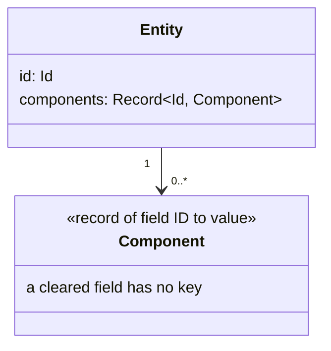
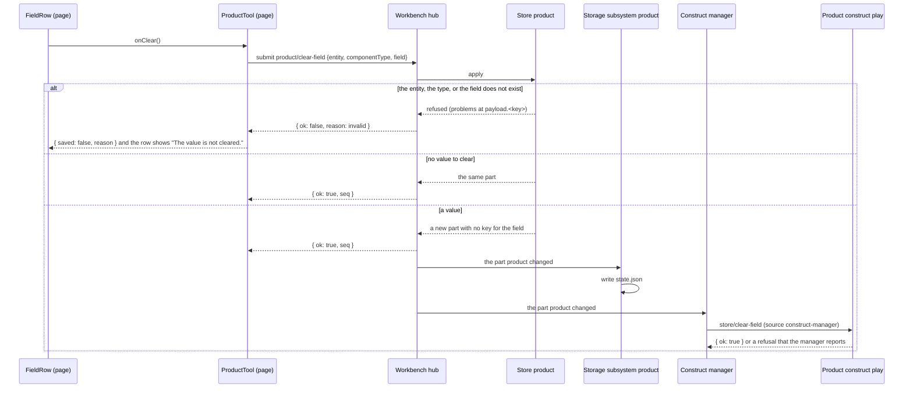

# Design

## Context

See `proposal.md`, "Why". The current state:

- `core/src/store.ts` applies four inputs: `replace-model`, `add-entity`, `remove-entity`, and `set-field`. `set-field` checks its payload (`entity`, `componentType`, `field`, `value`), refuses an entity, a component type, or a field that does not exist, with problems at `['payload', <key>]`, gives the same part when the value does not change, and runs `validateModel` on the next model. `remove-entity` refuses the removal of an entity that a reference field of a different entity names, through `validateModel`.
- `wishem/core/model` says that a component can omit a field of its component type ("An omitted field"), and an empty component `{}` is correct. Thus "no value" exists in the model, but no input makes it.
- The update subsystem (`update/src/update.ts`) declares `[...store.inputs, 'time/advance']` and passes each input of the store to the store. A new input of the store reaches it with no code change.
- `construct-manager/src/product-changes.ts` gives one `set-field` for each changed or added value when only values differ, and one `replace-model` for each other change. A removed value counts as "each other change" (`onlyValuesDiffer` is false), so the store of a running product construct gets the full product model, and its live values return to the authored values.
- `workbench-app`: `ProductTool` sends `product/set-field` with `sendInput` and `outcomeText(outcome, 'the value')`. `ProductPanel` and `EntityInspector` pass `onChange` to each `FieldRow`. `FieldRow` has the phases `idle`, `saving`, and `not-saved`, and shows `no value` for a field with no value (not for a reference, whose select shows the disabled option `No value`). The catalog `Button` has `label`, `variant`, `disabled` (as `aria-disabled`, the focus stays), `busy`, `tabIndex`, and `onPress`.
- The hub keeps a record of each accepted input. A rewind applies the inputs again from a checkpoint, so a new input of the store rewinds with no change of the hub.
- The storage subsystem of the product writes the `entities` of the part to `state.json` after each change. A cleared value is not in the JSON.
- The renderers read the full parts of the link. A view that gets no value draws its fallback: the three `ClearColor` views of `three-renderers`, `pixi-page`, and `renderer-godot` draw `#ff00ff` (#743). The `ClearColor` view of the workbench stage (`sample-product/views/react/ClearColor.tsx`) draws nothing for no value until #759. The `Count` view draws nothing for no value.
- The test from end to end of the three renderers makes the state "no value" with `store/replace-model` of a model with an empty `Color` component.

## Goals / Non-Goals

**Goals:**

- One input that removes one value, with the refusals and the same-part rule of `set-field`.
- The product panel can clear each of the four field types, and a clear rewinds.
- A clear in the workbench keeps the live values of a running product construct.
- A test with real processes for each step of "The test guide" that a program can do.

**Non-Goals:**

- A removal of a component or of an entity in the product panel (#713).
- A `clearField` tool in the prop `wishem` of a React view. No view needs it now (Follow-up).
- A native behavior that removes a key from its fields. The update subsystem writes only the values that a behavior returns, as now.
- One root for the paths of the problems (#557). `clear-field` uses the paths of `set-field`.
- A change of the renderers or of the views. #759 gives the `ClearColor` view of the workbench the fallback color.
- The other changes of `productChanges` for an added or removed entity (#630).

## Approaches

The lead agent did the brainstorm alone, as `autonomous-flow.md` says.

- **A. A new input `clear-field` and a `Clear` button in each row (selected).** One input type with one meaning in the record. One control that works the same for the four field types.
- **B. `set-field` with the value `null`.** Rejected: `null` is not a `FieldValue`, and `validateModel` refuses it in a model. The store would have to treat one value of the payload as a different operation, and a reader of the record would need to know that rule. A `null` that a bug sends would clear a value with no sign.
- **C. A clear through the controls that exist: an empty text field, and an enabled `No value` option of the select.** Rejected: for a `string` field, the empty text is a value, different from "no value". A `boolean` field has no empty state of its check box. Two field types would need a different control, and the designer would learn three ways to do one thing.

## Decisions

### 1. The input `clear-field`

The payload is `{ entity, componentType, field }`, the keys of `set-field` with no `value`. `storeInputs(id).clearField(payload)` gives `{ type: '<id>/clear-field', payload }`.

- Reason for the name: "field" is the definition, and the input clears the value of the field in one component. `set-field` and `clear-field` are a pair in the record.
- Rejected: `remove-field`. It reads as the removal of the field from the component type.
- Rejected: `unset-field`. "Clear" is the word of the issue and of the button.

### 2. The component stays

After a clear, the component stays in the entity, also with no value. Reason: the name of an entity in the list comes from its components, and a clear of a value must not change which components an entity has. A removal of a component is a different act, with its own input later (#713).

Rejected: remove the component when it becomes empty. The name of the entity would change, the group of the component would leave the inspector while the designer works in it, and the construct manager would then send `replace-model`.

### 3. A clear of a value that does not exist gives the same part

When the component has no value for the field, or the entity has no component of that type, the store accepts the input and gives the same part object. It does not add the component. Reason: the issue asks for it; the input is then idempotent, so a second press, a replay, or a clear from the construct manager after a hand edit has no effect. This is the rule of `set-field` with the same value.

Rejected: a refusal of a clear of no value. A client that does not know the current state (the construct manager, a second page) would get a refusal for a state that it wants.

### 4. Refusals and the check of the next model

The store refuses the same faults as `set-field`, with the same messages and paths: a payload that is not an object, a key `entity`, `componentType`, or `field` that is not a string, an entity that does not exist, a component type that is not defined, and a field that is not a field of the component type. The checks of the IDs run before the check "no value", so a clear of an unknown field is refused, also when nothing is to clear.

The store runs `validateModel` on the next model, as `set-field` and `remove-entity` do. Reason: the rule "The store applies an input only when the model after the input is correct" stays true for each input, also when a later rule (for example a list of references, #606) makes a model with a missing value incorrect. With the current rules the check always passes, and its cost is the cost of a `set-field`. An entity and a component that the input does not change stay the same objects in the next part (the requirement "The part of the store does not change in place").

### 5. The construct manager sends `store/clear-field`

`productChanges(before, after)` keeps its test "only values differ": the same definitions, the same entity IDs in the same order, and the same component types in each entity. The test no longer requires that each value of `before` is in `after`. When only values differ, the result is, in the order of the entities and the components: one `set-field` for each value of `after` that differs from `before` (as now, in the order of the fields of `after`), then one `clear-field` for each field that `before` holds and `after` does not hold (in the order of the fields of `before`).

- Reason: a clear in the panel is a change of one value, so the running product construct keeps its live values, as for `set-field` (#538).
- A removal of a full component is still a change of the components, so it gives `replace-model`. #630 can change that later.

### 6. The update subsystem needs no code

`createUpdate` declares the inputs of its store, so `product/clear-field` and `store/clear-field` reach the store through the wrap. A test in `update` proves it, because a product construct uses the wrap.

### 7. The `Clear` button of a row

Each `FieldRow` shows a plain `Button` with the label `Clear` after the control, for each field type. Its accessible name is `Clear <label of the field>`.

- Disabled (with `aria-disabled`, so that the focus stays) when the field has no value, while the row saves, and when the row has no `onClear`. After an accepted clear, the field has no value, so the button becomes disabled and keeps the focus.
- A press sets the phase `saving` (the control is read-only or disabled, `aria-busy="true"`, the mono label `Saving`), and calls `onClear`. An accepted outcome ends in `idle` with no draft and no alert. A rejection sets the phase `not-saved` with the line `The value is not cleared. <reason>`. The row remembers which act failed, so that the line names it. A later accepted change or clear removes the line.
- A text field commits its draft on a blur (#537). A press of `Clear` with the pointer or a Tab to it moves the focus out of the text field first, so a draft commits before the press, and the button is disabled while that commit saves. The designer presses `Clear` again after it. A draft that the row refused (for example `ten`) does not save, so the press of `Clear` clears the value and removes the draft and the alert.
- The `not-saved` state of the style guide gets a second form: `initial` takes the state `not-cleared`, and `draft` becomes optional.
- Rejected: hide the button when the field has no value. The focus would go to the body after each clear, and the row would change its width.
- Rejected: an icon button `×`. The brand has no icons yet ("Logo and iconography come later"), and a text label needs no tooltip.
- Rejected: the maker variant. The clear is a secondary action of the row, and Wishfire is scarce on purpose.

### 8. The accessible name of a button

`Button` gets the optional prop `accessibleName`, which becomes `aria-label`. The visible label stays. The name starts with the label, so that a person who uses voice control can say the label (WCAG 2.5.3). No other button uses it now. Reason: each row of a group has a button `Clear`, and a screen reader or a test must tell them apart.

### 9. The panel sends `product/clear-field`

`ProductTool` sends `{ type: 'product/clear-field', payload }` with `sendInput`, and gives `outcomeText(outcome, 'the value')` as the reason. `ProductPanel` and `EntityInspector` pass `onClear` as they pass `onChange`.

### 10. The test from end to end of the three renderers

Its step 16 sends `store/clear-field` for the field `color` of the sample entity, in place of `store/replace-model` with an empty `Color` component. Reason: the state is the same, and the step now proves the input from the store to the three pictures. The two later steps still send `replace-model`, so that input stays tested.

### 11. Tests of the steps of the test guide

| Step of the test guide                                | Automated test                                                                                    |
| ----------------------------------------------------- | ------------------------------------------------------------------------------------------------- |
| 2. Clear the count in the panel                       | `workbench-app/tests/product.spec.ts`: the row, `state.json`, the input and its source            |
| 3. A second clear, and a clear of no value            | `product.spec.ts`: the button is disabled and has the focus; `core` store tests for the same part |
| 4. The rewind of the clear                            | `product.spec.ts`: a rewind through a link client restores the row and `state.json`               |
| 5. The refusals through the link                      | `core/src/store.hub.test.ts`: the reasons and the paths through a hub                             |
| 6. A clear while `play` is paused                     | `workbench-app/tests/run.guide.spec.ts`: the count of `play` stays, `play` gets `clear-field`     |
| 7. A hand edit removes a value while `play` runs      | `construct-manager/src/construct-manager.test.ts`: a real product construct gets `clear-field`    |
| 8. A reference, a refused removal, a clear, a removal | `product.spec.ts`: with a component type `Link` in the product folder of the test                 |
| 9. The three renderers draw the fallback              | `three-renderers/tests/three-renderers.guide.ui.test.ts`, step 16                                 |
| 10. Dark mode and a narrow viewport                   | `product.spec.ts`: the screenshots, axe, and no horizontal scroll at 390 pixels                   |

### 12. `page-driver.mjs` gets `clear:`

The step `clear:<Component>.<field>` presses the button `Clear <field>` in the group of the component, and waits until no element has `aria-busy="true"`. The print adds ` [no value]` to the line of a row that shows the text `no value`. A disabled button gives the line `error: the button Clear <field> is disabled` and the exit code 1.

### 13. The blueprint

`glossary.md`, the term **Product panel**: it sends `product/set-field` and `product/clear-field`. No text with the label **Agreed** changes.

### 14. No question for the owner

The input is a contract that is hard to change later, but approach A is clearly better than B and C (see "Approaches"). The look of the button is easy to change. Thus the three conditions of "When to ask the owner" are not all true. "UI options for the owner" gives the options for the review of the milestone.

## Interfaces

`@thrashplay/wishem-core` (`src/store.ts`, exported from `src/index.ts`):

```ts
export interface ClearFieldPayload {
  /** The ID of the entity. */
  entity: Id
  /** The ID of the component type. */
  componentType: Id
  /** The ID of the field. */
  field: Id
}

export interface StoreInputs {
  replaceModel(model: Model): Input
  addEntity(entity: Entity): Input
  removeEntity(entity: Id): Input
  setField(payload: SetFieldPayload): Input
  clearField(payload: ClearFieldPayload): Input
}
```

`@thrashplay/wishem-construct-manager` (`src/product-changes.ts`), the signature does not change:

```ts
/** `<storeId>/set-field` and `<storeId>/clear-field` inputs when only values differ, else one `<storeId>/replace-model`. */
export const productChanges: (before: Model, after: Model, storeId?: string) => Input[]
```

`@thrashplay/wishem-workbench-app` (private, inside the package):

```ts
// src/components/Button.tsx
export interface ButtonProps {
  label: string
  /** The accessible name. It starts with the label. Default: the label. */
  accessibleName?: string
  variant?: 'plain' | 'maker'
  disabled?: boolean
  busy?: boolean
  tabIndex?: number
  onPress?: () => void
}

// src/components/FieldRow.tsx
export interface FieldRowProps {
  field: FieldDefinition
  value: FieldValue | undefined
  options?: readonly ReferenceOption[]
  onChange?: (value: FieldValue) => Promise<ChangeOutcome>
  /** With no value, the button Clear is disabled. */
  onClear?: () => Promise<ChangeOutcome>
  initial?: { state: 'saving' | 'not-saved' | 'not-cleared'; draft?: string | boolean; reason?: string }
}

// src/components/EntityInspector.tsx
export interface EntityInspectorProps {
  entity?: { id: Id; name: string; components: readonly InspectedComponent[] }
  options: readonly ReferenceOption[]
  onChange?: (componentType: Id, field: Id, value: FieldValue) => Promise<ChangeOutcome>
  onClear?: (componentType: Id, field: Id) => Promise<ChangeOutcome>
}

// src/components/ProductPanel.tsx
export interface ProductPanelProps {
  model: Model
  selected?: Id
  onSelect: (id: Id) => void
  onChange?: (change: SetFieldPayload) => Promise<ChangeOutcome>
  onClear?: (change: ClearFieldPayload) => Promise<ChangeOutcome>
}

// src/tools/ProductTool.tsx
export const PRODUCT_CLEAR_FIELD = 'product/clear-field'
```

## Data Model

No persisted schema changes. `state.json` already permits a component with no value for a field. The domain types do not change: a cleared value is a missing key of the record of a component.



## The flow of a clear



## The architecture document

No container, process, package, or import changes. The component diagram of the page keeps its components and relationships. The label of the relationship from the product panel to the client of the hub becomes `Reads part product and sends set-field and clear-field [ports]`. The table row "Product panel" and the alt text of the component diagram in `docs/architecture/README.md`, and the description of the diagram in `render.mjs`, name the two inputs. `render.mjs` writes the two SVG files of the component diagram of the page again, and `render.mjs --check` passes.

## Failure Modes

| Failure                                                                | Behavior                                                                                                                        | Recovery                                                         |
| ---------------------------------------------------------------------- | ------------------------------------------------------------------------------------------------------------------------------- | ---------------------------------------------------------------- |
| The workbench process does not run                                     | `sendInput` gives `not-running`. The row shows `The value is not cleared. The workbench does not run. Start it, and try again.` | Start the workbench, and press `Clear` again.                    |
| The link ends before the result                                        | The row shows `The value is not cleared. The connection ended before an answer. Look at the value after it connects.`           | Look at the row after the page connects. A second clear is safe. |
| A hand edit removed the entity, the component type, or the field first | The hub refuses the input with the problem of the store. The row shows its message.                                             | The panel shows the new model.                                   |
| Two pages clear the same value                                         | The first clear changes the part. The second gives the same part.                                                               | None needed: the input is idempotent.                            |
| The product construct refuses `store/clear-field`                      | The construct manager reports the message for that construct, and it sends the next change (as for `set-field`).                | The next change of the product, or a stop and a start.           |
| A replay or a rewind applies the clear again                           | The same result, because the store reads no clock and makes no ID.                                                              | None needed.                                                     |

`clear-field` is idempotent: a second application gives the same part object.

## Examples

A clear through the link (`raw-link.mjs`):

```text
$ node nodejs/wishem/docs/milestones/a1-construct/raw-link.mjs --url ws://127.0.0.1:5173/link --once \
    --send '{"type":"product/clear-field","payload":{"entity":"e_99969ed3-f499-4dbb-bf6d-958db4542884","componentType":"ct_6af38bd9-a91d-49d9-9370-fa4e6c04769d","field":"fld_ef085a2e-22ef-4409-bac4-9cd5648d0705"}}'
sent: {"t":"hello",...}
received: {"t":"welcome",...}
sent: {"t":"submit","request":1,...}
received: {"t":"applied","input":{"seq":4,"source":"raw-1234","type":"product/clear-field",...},"parts":{"product":{...}}}
received: {"t":"result","request":1,"result":{"ok":true,"seq":4}}
closed: code 1005
```

A clear of a field that the component type does not have:

```text
received: {"t":"result","request":1,"result":{"ok":false,"reason":"invalid","problems":[{"message":"The component type \"Counter\" has no field with the ID \"fld_694d6cb2-97e8-444e-961e-aa76744837fb\"","path":["payload","field"]}]}}
```

The code:

```ts
const inputs = storeInputs('product')
await port.submit(inputs.clearField({ entity: SAMPLE_ENTITY, componentType: COUNTER_TYPE, field: COUNT_FIELD }))
```

## Package Impact

| Package                                | Published or private | Bump  | Why                                                                                                       |
| -------------------------------------- | -------------------- | ----- | --------------------------------------------------------------------------------------------------------- |
| `@thrashplay/wishem-core`              | private              | minor | The input `clear-field`, `storeInputs().clearField`, and the type `ClearFieldPayload`.                    |
| `@thrashplay/wishem-update`            | private              | patch | The update subsystem applies `clear-field` of the store that it wraps (a consequence of the core change). |
| `@thrashplay/wishem-construct-manager` | private              | minor | A removed value goes to a running product construct as `store/clear-field`, so its live values stay.      |
| `@thrashplay/wishem-workbench-app`     | private              | minor | The `Clear` button of each row of the product panel.                                                      |
| `@thrashplay/wishem-three-renderers`   | private              | none  | A change of a test only.                                                                                  |

Four changesets, one for each row with a bump. No breaking change: no existing input or export changes.

## UI

The selected option: A, a plain `Clear` button at the end of each row. Reason: one control for the four field types, the catalog `Button` with no new design token, and a disabled state that keeps the focus.

A row 512 pixels wide or more with a value, with no value, saving, and not cleared:

```text
|   count     NUMBER   [0                         ]  ( Clear )                         |
|   count     NUMBER   [                          ]  ( Clear )  NO VALUE               |  Clear in fg-muted, aria-disabled
|   count     NUMBER   [0                         ]  ( Clear )  SAVING                 |  read-only, aria-busy
|   count     NUMBER   [0                         ]  ( Clear )                         |
|   The value is not cleared. The workbench does not run. Start it, and try again.     |  danger-text, role alert
```

A row of each other type:

```text
|   on        BOOLEAN  [x] ( Clear )                                                   |
|   target    REFERENCE [Switch · e_5f0c1d2e     v]  ( Clear )                         |
|   target    REFERENCE [No value                v]  ( Clear )                         |  Clear disabled
```

A row less than 512 pixels wide (for example, at a viewport of 390 pixels): the label and the type above, the control and the button on one line.

```text
| count   NUMBER                     |
| [0                    ] ( Clear )  |
| color   STRING                     |
| [#1d4ed8              ] ( Clear )  |
```

### Changed components

No design token is added. Each uses roles only.

- **`Button`.** The optional `accessibleName` (`aria-label`). The look does not change, so the style guide gets no new specimen for it.
- **`FieldRow`.** The row layout follows the width of its container (`@container` and `@lg:`, which switch at 512 pixels), not the viewport. The plain `Button` `Clear` after the control, in the flex line of the control, before the mono labels `Saving` and `no value`. The text field and the select keep `w-full` and shrink (`min-w-0`), and the button does not shrink. The line of a rejection names the act: `The value is not saved.` or `The value is not cleared.`
- **`EntityInspector`**, **`ProductPanel`.** They pass `onClear`. Their look changes only by the buttons of the rows.

### States in the style guide

Each specimen in light mode and in dark mode, in the components section:

- Each existing "Field row, …" specimen shows the button `Clear`: enabled in "string", "number", "boolean", and "reference"; disabled in "no value", "saving", and "disabled".
- New: "Field row, not cleared", a `count` row with the value `0`, the state `not-cleared`, and the reason `The workbench does not run. Start it, and try again.`
- "Inspector, an entity" and "Product panel" show the buttons. Their baselines change.

### Keyboard and focus

- The order in a row: the control, then the button `Clear`. Tab and Shift+Tab move between them.
- Enter or Space on `Clear` sends the clear. The focus stays on the button, which becomes disabled. Escape in a text field does not change.
- A disabled `Clear` keeps its place in the tab order, as each disabled `Button` does.

### UI options for the owner

The owner can overrule this choice in the review of the milestone.

| Option                                     | What the person sees                                                                                  | Cost                                                                                         |
| ------------------------------------------ | ----------------------------------------------------------------------------------------------------- | -------------------------------------------------------------------------------------------- |
| A. A `Clear` button in each row (selected) | A text button after each control. It is disabled when the field has no value.                         | One more button for each row: the inspector is busier. The row grows by about 2 pixels.      |
| B. An icon button `×` in the control       | A small cross inside the text field or the select, as in many search fields.                          | No icon set exists yet. A check box has no place for it. It needs a tooltip for its meaning. |
| C. A menu `…` for each row                 | One small button that opens a menu with `Clear`. Later items (remove the component) can go in it too. | Two presses for a clear, and a menu component that the catalog does not have.                |

## Risks / Trade-offs

- [A press of `Clear` with a text draft commits the draft first, and `Clear` is disabled while that commit saves] → The designer presses `Clear` again. A draft that the row refused does not block the clear. The unit tests of `FieldRow` cover the two orders.
- [Each row gets a button, so the inspector is busier] → Plain style, `fg-muted` when disabled. The option C of "UI options for the owner" can replace it later.
- [The color behavior sets the color at each tick] → A clear of the color in a running `play` lasts until the next tick. The test guide clears the color while `play` is paused, and uses the count for the running case.
- [The stage draws nothing for a color with no value until #759] → The test guide gives the result for each case.
- [`productChanges` now sends `clear-field` to a product construct whose store does not know the input] → Each product construct uses `createStore` of the same `core`, so the store applies it. A refusal is reported, as for `set-field`.

## Migration Plan

No data and no deployment. A model with no cleared value behaves as before. Rollback is the revert of the pull request.

## Order with other changes

- **#606 (a field type for a list of references, in plan at the same time on a different branch).** Files in common: `core/src/store.ts`, `core/src/store.test.ts`, `core/src/index.ts`, `core/README.md` (the table of inputs), `construct-manager/src/product-changes.ts` and its tests, `workbench-app/src/components/FieldRow.tsx` and its tests, the style guide, and the delta of `wishem/core/store`. This change adds requirements to `wishem/core/store` and modifies none, so a MODIFIED requirement of #606 does not conflict with it. Recommended order: this change first, because it is smaller, and #606 can then clear a full list with `clear-field`. The change that merges second merges `main`, keeps the lines of the two changes in `store.ts`, `FieldRow.tsx`, and `product-changes.ts` (#606 compares lists with `isEqual`; this change adds the removed values), and runs the tests of `core`, `construct-manager`, and `workbench-app` again. If #606 adds a field type, its row also gets the button `Clear`.
- **#669 and #679 (break-tests of `construct-manager`).** #669 runs now. Task 2 changes `construct-manager`. Start Task 2 after the pull request of #669 is merged, and merge `main` into the branch first. Do not start #679 while this change is in apply (the rule of "Work at the same time").
- **#680 (break-test of `sample-product`, runs now).** This change does not change `sample-product`. No order.
- **#740 and #760 (break-tests after #542 and #743).** Their scope can hold `three-renderers/tests/three-renderers.guide.ui.test.ts`, which Task 4 changes. When one of them is merged first, merge `main` and keep its test changes. Do not start them while Task 4 is in apply.
- **#759 (the `ClearColor` view of the workbench follows the color rule).** Either order works. With #759 on `main`, the stage draws `#ff00ff` after a clear of the color, and the test guide gives that result.
- **#630 (keep the live values when the authored state adds or removes an entity).** It changes the same requirement of `wishem/workbench/construct-manager` and `product-changes.ts`. It starts from the requirement of this change when this change is on `main` first.
- **#713 (add and remove an entity or a component in the product panel), #715 (commit a select on the blur), #716 (memo for the rows).** They change `FieldRow` or the panel later and keep the button `Clear`.
- **#557 (one root for the paths of the problems).** `clear-field` uses the paths of `set-field`, so a later decision changes the two inputs in one place.

Open bugs of the same files or behavior:

- **#712 (the test from end to end of the three renderers failed one time at the start of the PixiJS page).** Task 4 changes step 16 of the same test, not its start. This change does not correct it. A failure at the start in the pull request checks is #712, not a fault of this change: run the job again one time.
- **#692 (a UI test of the view warnings fails when other view files exist).** The Playwright suite of `workbench-app` that Tasks 3 and 4 run holds it. This change adds no view file. It does not correct it.
- **#757 (a reloaded workbench page can draw an old version of a product view for some seconds).** The test guide reloads the page in each `$PAGE` run. Wait for the step `waitfor:` before a check of the stage. This change does not correct it.
- **#685 and #706** touch the start of a product construct and the start scripts. This change does not touch them.

## The test guide

The final reviewer does these steps on the branch, with real processes, real files, and the pinned web browser in Docker, and reports the real result of each step. The results are the results after this change. Run each command from the root of the worktree. Terminal 1 runs the workbench. Terminal 2 runs the other commands. Terminal 3 runs a listener of the workbench, and terminal 4 runs a listener of `play`. Each run of `$PAGE` opens a new page.

### 0. Prepare

```sh
pnpm install
pnpm build --filter "@thrashplay/wishem-*"
rm -rf .superpowers/a4clear && mkdir -p .superpowers/a4clear
cp -r nodejs/wishem/workbench/model .superpowers/a4clear/model
cp -r nodejs/wishem/sample-product/model .superpowers/a4clear/product
RAW=nodejs/wishem/docs/milestones/a1-construct/raw-link.mjs
LISTEN=nodejs/wishem/docs/milestones/a1-construct/link-client.mjs
PAGE="node nodejs/wishem/workbench-app/scripts/browser-server.ts node ../docs/milestones/a4-workbench/page-driver.mjs"
STATE=.superpowers/a4clear/product/state.json
E1=e_99969ed3-f499-4dbb-bf6d-958db4542884
COLOR=ct_d85ac719-7dd0-45d8-bf98-0da9e6ab0512
CF_COLOR=fld_694d6cb2-97e8-444e-961e-aa76744837fb
COUNTER=ct_6af38bd9-a91d-49d9-9370-fa4e6c04769d
CF=fld_ef085a2e-22ef-4409-bac4-9cd5648d0705
fields() { node -e 'const s=JSON.parse(require("fs").readFileSync(process.argv[1],"utf8"));console.log(JSON.stringify(s.entities.map(e=>e.components)))' "$STATE"; }
```

Result: the build ends with no failed task. `docker info` gives a server version.

### 1. Start the workbench with the product, its code, and its views

Terminal 1:

```sh
pnpm --filter @thrashplay/wishem-workbench-app start --model .superpowers/a4clear/model --product .superpowers/a4clear/product --product-code @thrashplay/wishem-sample-product --product-views nodejs/wishem/sample-product/views/react
```

Result: the line `wishem: workbench at http://127.0.0.1:5173/`.

Terminal 3: `node $LISTEN --url ws://127.0.0.1:5173/link`. Result: a `state:` line.

### 2. Clear the count in the panel

```sh
$PAGE select:e_99969ed3 clear:Counter.count
fields
```

Result: the page prints `Counter.count =  [no value]` and `Color.color = #1d4ed8`, and no `alert:` line. Terminal 3 prints `applied #<n> product/clear-field from page-<16 hex>-input`. `fields` prints the `Counter` component as `{}` and the `Color` component with `#1d4ed8`.

### 3. A second clear, and a clear of no value through the link

```sh
$PAGE select:e_99969ed3 clear:Counter.count
node $RAW --url ws://127.0.0.1:5173/link --once --send "{\"type\":\"product/clear-field\",\"payload\":{\"entity\":\"$E1\",\"componentType\":\"$COUNTER\",\"field\":\"$CF\"}}"
```

Result: the page prints `error: the button Clear count is disabled` and ends with the exit code 1. The link prints a `result` with `"ok":true` and a `seq`. `fields` prints the same as in step 2, and the file did not change (`stat -c %Y $STATE` gives the same time as after step 2).

### 4. The rewind of the clear

Use the number `n` of the line `applied #<n> product/clear-field` of step 2.

```sh
node $RAW --url ws://127.0.0.1:5173/link --once --send "{\"type\":\"hub/rewind\",\"payload\":{\"seq\":<n - 1>}}"
$PAGE select:e_99969ed3 print
fields
```

Result: the link prints `"ok":true`. The page prints `Counter.count = 0` with no `[no value]`. `fields` prints the count `0`.

### 5. The refusals through the link

```sh
node $RAW --url ws://127.0.0.1:5173/link --once --send "{\"type\":\"product/clear-field\",\"payload\":{\"entity\":\"e_00000000-0000-4000-8000-000000000000\",\"componentType\":\"$COUNTER\",\"field\":\"$CF\"}}"
node $RAW --url ws://127.0.0.1:5173/link --once --send "{\"type\":\"product/clear-field\",\"payload\":{\"entity\":\"$E1\",\"componentType\":\"$COUNTER\",\"field\":\"$CF_COLOR\"}}"
node $RAW --url ws://127.0.0.1:5173/link --once --send "{\"type\":\"product/clear-field\",\"payload\":{\"entity\":\"$E1\",\"componentType\":\"$COUNTER\"}}"
```

Result: three results with `"ok":false` and `"reason":"invalid"`, with the paths `["payload","entity"]`, `["payload","field"]`, and `["payload","field"]`. The first message names `e_00000000-0000-4000-8000-000000000000`. Terminal 3 prints no `applied` line.

### 6. A clear of the color while `play` is paused

```sh
$PAGE run waitfor:Running wait:1000 pause print
```

Result: `run: Paused tick <t> ...` and `stage: Color #<hex>; Count <c>`, with `c` larger than 10.

Terminal 4: `node $LISTEN --url ws://127.0.0.1:5173/constructs/play/link --json`.

```sh
$PAGE select:e_99969ed3 clear:Color.color print
```

Result: `Color.color =  [no value]`, the same tick `t`, and `stage: ; Count <c>` with the same `c` (with #759 on `main`: `stage: Color #ff00ff; Count <c>`). Terminal 4 prints `applied #.. store/clear-field from construct-manager`, and the part `store` has no color key and the count `c`. Before this change, `play` got `store/replace-model` and the count became `0`.

```sh
$PAGE step print
```

Result: tick `t + 1`, `stage: Color #<hex>; Count <c + 1>`, because the color behavior sets a color at each tick.

### 7. A hand edit removes a value while `play` runs

```sh
$PAGE resume waitfor:Running
node -e 'const f=process.argv[1],fs=require("fs"),s=JSON.parse(fs.readFileSync(f,"utf8"));delete s.entities[0].components[process.argv[2]][process.argv[3]];fs.writeFileSync(f,JSON.stringify(s,null,2)+"\n")' "$STATE" "$COUNTER" "$CF"
$PAGE wait:1000 print
```

Result: terminal 3 prints `applied #.. product/replace-model from product-files`. Terminal 4 prints `applied #.. store/clear-field from construct-manager` and no `store/replace-model`. The stage shows no `Count` text, and the color still changes at each tick (`stage: Color #<hex>;`), because the count behavior keeps a count that is not a number.

```sh
$PAGE stop waitfor:Not
```

Result: `run: Stopped tick - - [run]`.

### 8. A reference, a refused removal, a clear, and a removal

```sh
cat > .superpowers/a4clear/product/definitions/ct_3a7b9c1d-2e4f-4a6b-8c0d-1e2f3a4b5c6d.json <<'EOF'
{
  "id": "ct_3a7b9c1d-2e4f-4a6b-8c0d-1e2f3a4b5c6d",
  "label": "Link",
  "fields": [{ "id": "fld_5d6e7f8a-9b0c-4d1e-8f2a-3b4c5d6e7f8a", "label": "target", "type": "reference" }]
}
EOF
node -e 'const f=process.argv[1],fs=require("fs"),s=JSON.parse(fs.readFileSync(f,"utf8"));s.entities.push({id:"e_7c1e2f3a-4b5c-4d6e-8f7a-9b0c1d2e3f4a",components:{"ct_3a7b9c1d-2e4f-4a6b-8c0d-1e2f3a4b5c6d":{"fld_5d6e7f8a-9b0c-4d1e-8f2a-3b4c5d6e7f8a":process.argv[2]}}});fs.writeFileSync(f,JSON.stringify(s,null,2)+"\n")' "$STATE" "$E1"
$PAGE wait:500 select:e_7c1e2f3a print
```

Result: `entities: Counter, Color e_99969ed3; Link e_7c1e2f3a [selected]` and `Link.target = Counter, Color · e_99969ed3`.

```sh
node $RAW --url ws://127.0.0.1:5173/link --once --send "{\"type\":\"product/remove-entity\",\"payload\":{\"entity\":\"$E1\"}}"
```

Result: `"ok":false`, `"reason":"invalid"`, and a problem whose message starts with `Entity e_7c1e2f3a-4b5c-4d6e-8f7a-9b0c1d2e3f4a has the field "target" of "Link", which refers to the entity "e_99969ed3-f499-4dbb-bf6d-958db4542884"`.

```sh
$PAGE select:e_7c1e2f3a clear:Link.target print
node $RAW --url ws://127.0.0.1:5173/link --once --send "{\"type\":\"product/remove-entity\",\"payload\":{\"entity\":\"$E1\"}}"
$PAGE wait:500 print
fields
```

Result: `Link.target = No value`. The removal gives `"ok":true`. The last print gives `entities: Link e_7c1e2f3a`. `fields` prints one entity with the `Link` component `{}`.

### 9. The three renderers draw the fallback after a clear

Stop terminal 1 first (the ports of the test differ, but the slots of the computer are few).

```sh
node nodejs/wishem/docs/flow-scripts/heavy.mjs pnpm --filter @thrashplay/wishem-three-renderers test:ui
```

Result: each test passes. Step 16 of the test sends `store/clear-field`, and each picture is `#ff00ff`. If the run fails at the start of the PixiJS page, it is #712: run it one more time.

### 10. Dark mode, a narrow viewport, and the tests in the pinned browser

Start terminal 1 again with the command of step 1, on a new copy of the product (repeat the `cp` lines of step 0).

```sh
$PAGE --scheme dark --width 390 select:e_99969ed3 shot:.superpowers/a4clear/narrow-dark.png
node nodejs/wishem/docs/flow-scripts/heavy.mjs pnpm --filter @thrashplay/wishem-workbench-app test:ui
```

Result: the image shows each row with its label and type above the control and the button `Clear` on the line of the control, with no horizontal scroll, in the dark theme. Each Playwright test passes, with the screenshot and axe tests of the style guide and of the product page.

### 11. Clean up

Stop terminals 1, 3, and 4 with Ctrl+C. `rm -rf .superpowers/a4clear`. Result: `git status` shows no change.

## Follow-up

- A `clearField` tool in the prop `wishem` of a React view, and in the generated `Values`, when a view needs to clear a value.
- A Clear control for an item of a list of references, when #606 adds the list.
