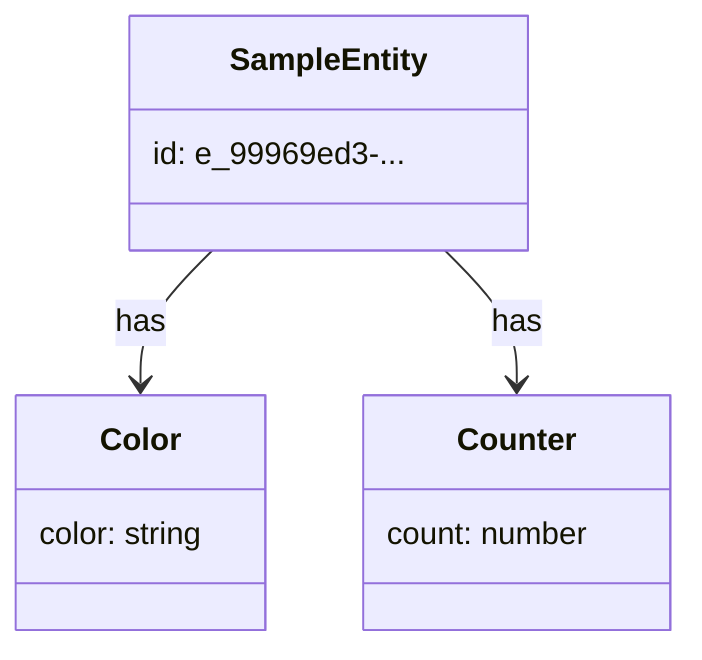

# Design

## Context

See `proposal.md` for the reason. The current state:

- `model/definitions/ct_6af38bd9-a91d-49d9-9370-fa4e6c04769d.json` gives the field `count` (`fld_ef085a2e-22ef-4409-bac4-9cd5648d0705`) the type `string`. `model/state.json` holds `"0"`.
- `withCountRule` in `src/count-rule.ts` changes a count only when the text agrees with `^(0|[1-9][0-9]*)$`. It writes `String(BigInt(count) + 1n)` with `store/set-field` (with the ID of the wrapped store).
- `@thrashplay/wishem-core` has the field type `number`. `validateModel` accepts a `number` field only when the value is a finite JSON number. The store checks each `set-field` with `validateModel`, so it refuses a text value for a `number` field with the reason `invalid`.

The places in the repository that read or write the count of the sample product:

| Place                                                                                 | Reads or writes the count as text | Change                          |
| ------------------------------------------------------------------------------------- | --------------------------------- | ------------------------------- |
| `sample-product/model/` (definition and `state.json`)                                 | Yes                               | Type `number`, value `0`.       |
| `sample-product/src/count-rule.ts`                                                    | Yes                               | Adds 1 to a number.             |
| `sample-product/src/count-rule.test.ts`, `model.test.ts`, `readme-example.test.ts`    | Yes                               | Numbers.                        |
| `sample-product/README.md`                                                            | Yes                               | Numbers.                        |
| `openspec/specs/wishem/sample-product/model/spec.md`                                  | Yes                               | The delta of this change.       |
| `host-nodejs/src/start-construct.test.ts`, `model-folder-storage.test.ts`             | Yes, with their own fixtures      | None. See decision 4.           |
| `host-nodejs/src/cli.test.ts`                                                         | No (only the IDs and the label)   | None.                           |
| `workbench-app/src/start.test.ts`                                                     | No (counts definitions, entities) | None.                           |
| `pixi-page`, `renderer-react`, `renderer-pixi`, `workbench`                           | No                                | None.                           |
| `docs/architecture/README.md`, `nodejs/wishem/CLAUDE.md`                              | No ("adds 1 to each count")       | None.                           |
| `construct-manager` and `sample-product/src/count-rule.test.ts` on the branch of #538 | Yes                               | See "Order with other changes". |

## Goals / Non-Goals

**Goals:**

- The count of the sample product is a JSON number in the model folder, in the store, on the link, and in `state.json`.
- The count rule adds 1 to a number with the `+` operator of JavaScript.

**Non-Goals:**

- No change to the fixtures of the `host-nodejs` tests.
- No integer type and no range in the model. The model has the type `number` only.
- No view of the sample product. The views of the sample product wait for a later change.

## Decisions

### 1. The count is the JSON number `0` at the start

The definition file gives `count` the type `number`. `state.json` holds `0` with no quotes. The IDs and the labels do not change, so the exported constants do not change.

### 2. The rule adds 1 to each count that is a number

For each `time/advance`, the rule sends `set-field` with `count + 1` for each `Counter` component whose `count` has the JavaScript type `number`. It accepts each number that the model accepts: a negative number and a number that is not an integer too. Example: `-1` gives `0`, and `1.5` gives `2.5`. The regular expression and `BigInt` are removed.

Reason: the store and `validateModel` already make sure that a `number` value is finite. A second grammar in the rule would make the rule refuse values that the model accepts, and a person who sets `1.5` with `set-field` would see a count that stops with no message.

Alternative rejected: add 1 only to a safe integer that is 0 or more. Rejected: it is a rule that the model does not have, and the designer sees no reason for a count that stops.

### 3. A count that is not a number stays, and the rule never refuses a tick

A `Counter` component with no `count` key, or a model whose definition of `Counter` gives `count` a different type, keeps its value. The tick is accepted. Reason: a rule that refuses a tick would stop the clock of the full construct for one bad component. This is the same contract as before the change, with "number" in place of "decimal integer".

### 4. The fixtures of `host-nodejs` do not change

`start-construct.test.ts` and `model-folder-storage.test.ts` write their own definition of a counter, with the IDs of the sample product and the type `string`, into a temporary folder. They do not import or copy `sample-product`, and they apply no count rule. They test the mount and the files, not the sample product, so a counter with a text field is a correct fixture for them. A change to them would also make a break-test of `host-nodejs` necessary for no change of its source. This is outside the scope of the issue.

### 5. A large count

A JavaScript number is a 64-bit float. From `2 ** 53`, `count + 1` is equal to `count`, so `set-field` gives the same part and the count stops. At 10 ticks each second, the count gets to `2 ** 53` after more than 28 million years. The rule does not test for it. A test records the behavior: a count of `2 ** 53` stays `2 ** 53`, and the tick is accepted.

### 6. The bump is minor

`@thrashplay/wishem-sample-product` is private, at `0.0.0`. The change of the field type is a breaking change of the data contract: a copy of the folder with `"0"` is not correct. For a version `0.x`, a minor bump marks a breaking change.

## Interfaces

The signature of the one function does not change (`@thrashplay/wishem-sample-product`):

```ts
export const withCountRule: (store: ModelSubsystem<Model>) => ModelSubsystem<Model>
```

The data contract changes. The definition file of `Counter`:

```json
{
  "id": "ct_6af38bd9-a91d-49d9-9370-fa4e6c04769d",
  "label": "Counter",
  "fields": [{ "id": "fld_ef085a2e-22ef-4409-bac4-9cd5648d0705", "label": "count", "type": "number" }]
}
```

The entity in `state.json`:

```json
{
  "id": "e_99969ed3-f499-4dbb-bf6d-958db4542884",
  "components": {
    "ct_d85ac719-7dd0-45d8-bf98-0da9e6ab0512": { "fld_694d6cb2-97e8-444e-961e-aa76744837fb": "#1d4ed8" },
    "ct_6af38bd9-a91d-49d9-9370-fa4e6c04769d": { "fld_ef085a2e-22ef-4409-bac4-9cd5648d0705": 0 }
  }
}
```

The input that sets the count has a number value:

```json
{
  "type": "store/set-field",
  "payload": {
    "entity": "e_99969ed3-f499-4dbb-bf6d-958db4542884",
    "componentType": "ct_6af38bd9-a91d-49d9-9370-fa4e6c04769d",
    "field": "fld_ef085a2e-22ef-4409-bac4-9cd5648d0705",
    "value": 7
  }
}
```

The same input with `"value": "7"` gets `{ "ok": false, "reason": "invalid" }`.

## Data Model

Only the type of the field `count` changes. The entities and the relations do not change.



## Package Impact

| Package                             | Published or private | Bump  | Reason                                                                                                     |
| ----------------------------------- | -------------------- | ----- | ---------------------------------------------------------------------------------------------------------- |
| `@thrashplay/wishem-sample-product` | Private              | minor | The field `count` has the type `number`. The count rule adds 1 to a number. The data contract is breaking. |

No other package changes. `workbench-app` has `sample-product` as a development dependency, and its test does not change. When #538 merges first, see "Order with other changes" for the row of `construct-manager`.

## Order with other changes

The change #538 (`538-add-construct-manager`, not merged) adds the package `construct-manager` and the export `wrapStore` of `sample-product`. Its diff against `main`:

- `sample-product/src/index.ts`: `export { withCountRule as wrapStore } from './count-rule.js'`. No conflict with this change.
- `sample-product/src/count-rule.test.ts`: a block `describe('wrapStore')` that compares `wrapStore` with `withCountRule` with `toEqual`. It has no count value, so it does not change.
- `sample-product/README.md`: one paragraph about `wrapStore` after "Put the `time` subsystem before the wrapped store". The text of this change is near it, so a merge can conflict. Keep the two texts.
- `construct-manager/src/construct-manager.test.ts`: `countOf` reads the count, `setCount(store, value: string)` sends a text value, and the tests expect `'100'`, `'0'`, `'3'`, and `'1'`.
- `construct-manager/src/product-construct.test.ts`: `countOf` has the return type `string | undefined`, and the tests expect `'5'` and `'0'`.
- `construct-manager/src/product-changes.test.ts`: its own fixtures, not the sample product. No change.
- `design.md` of #538, "The test guide": steps 6 and 9 send and look for the text `"1000"`.

The two changes can merge in each order. The second to merge does these steps after it merges `main` into its branch:

1. In `construct-manager.test.ts`, give `setCount` the value type `number`, send numbers, and expect the numbers `100`, `0`, `3`, and `1`.
2. In `product-construct.test.ts`, give `countOf` the return type `FieldValue | undefined` (from `@thrashplay/wishem-core`), and expect the numbers `5` and `0`.
3. Search the `construct-manager` package for each other text count of the sample product (`grep -rn "COUNT_FIELD\|countOf\|setCount" nodejs/wishem/construct-manager/src`), and change it to a number.
4. Keep the `wrapStore` paragraph and the text of this change in `sample-product/README.md`.
5. When #609 is second: add `@thrashplay/wishem-construct-manager` (private, patch: the tests give the count as a number) to the changeset and to "Package Impact". When #538 is second: change the steps 6 and 9 of its test guide to send `1000` with no quotes and to look for `1000` with no quotes.
6. Run the tests of `sample-product` and `construct-manager`.

## Risks / Trade-offs

- [A copy of the model folder from before the change holds `"0"`, and it is not correct with the new definition] → The test guides copy the folder fresh in their setup. `wishem start` prints the problem and names the field and the type.
- [A merge of #538 after this change fails its tests] → "Order with other changes" lists each place.
- [The count stops at `2 ** 53`] → Decision 5. No user gets there.

## Migration Plan

No data outside the repository holds the sample product. A person with a copy of the folder copies it again, or changes `"0"` to `0` by hand. To roll back, revert the commit.

## The test guide

The final reviewer does these steps on the branch, with real processes and real files, and reports the result of each step. Run each command from the root of the repository. "Terminal 1" runs the construct. "Terminal 2" runs the other commands.

Setup:

```sh
pnpm install
pnpm build --filter "@thrashplay/wishem-*"
mkdir -p .superpowers/609
rm -rf .superpowers/609/product
cp -r nodejs/wishem/sample-product/model .superpowers/609/product
P="$PWD/.superpowers/609/product"
COUNT='const s=JSON.parse(require("fs").readFileSync(process.argv[1],"utf8"));console.log(JSON.stringify(s.entities[0].components["ct_6af38bd9-a91d-49d9-9370-fa4e6c04769d"]))'
SET='{"type":"store/set-field","payload":{"entity":"e_99969ed3-f499-4dbb-bf6d-958db4542884","componentType":"ct_6af38bd9-a91d-49d9-9370-fa4e6c04769d","field":"fld_ef085a2e-22ef-4409-bac4-9cd5648d0705","value":VALUE}}'
```

Set `P`, `COUNT`, and `SET` in both terminals. Result: the build ends with no failed task.

1. **The files.** `grep -c '"type": "number"' nodejs/wishem/sample-product/model/definitions/ct_6af38bd9-a91d-49d9-9370-fa4e6c04769d.json` and `node -e "$COUNT" "$P/state.json"`. Result: `1`, and `{"fld_ef085a2e-22ef-4409-bac4-9cd5648d0705":0}`.
2. **The count rule in a process.** In terminal 2:

   ```sh
   pnpm --filter @thrashplay/wishem-sample-product exec node --input-type=module -e '
   import { readFileSync, readdirSync } from "node:fs"
   import { createStore } from "@thrashplay/wishem-core"
   import { createHub } from "@thrashplay/wishem-hub"
   import { createTime, timeInputs } from "@thrashplay/wishem-clock"
   import { COUNTER_TYPE, COUNT_FIELD, withCountRule } from "@thrashplay/wishem-sample-product"
   const dir = process.argv[1]
   const definitions = readdirSync(`${dir}/definitions`).map((f) => JSON.parse(readFileSync(`${dir}/definitions/${f}`, "utf8")))
   const { entities } = JSON.parse(readFileSync(`${dir}/state.json`, "utf8"))
   const hub = createHub({ subsystems: [createTime(), withCountRule(createStore({ model: { definitions, entities } }))] })
   hub.start()
   const port = hub.attach({ id: "tester", kind: "input" })
   for (let i = 0; i < 3; i++) await port.submit(timeInputs.advance(100))
   const count = hub.read().store.entities[0].components[COUNTER_TYPE][COUNT_FIELD]
   console.log(count, typeof count)
   ' "$P"
   ```

   Result: `3 number`.

3. **Start the copy.** In terminal 1: `pnpm --filter @thrashplay/wishem-workbench exec wishem start "$P"`. Result: `wishem: 2 component types, 1 entity`, and the line of the link.
4. **The count on the link.** In terminal 2: `node nodejs/wishem/docs/milestones/a1-construct/raw-link.mjs --once`. Result: the `welcome` line holds `"fld_ef085a2e-22ef-4409-bac4-9cd5648d0705":0`, with no quotes around `0`.
5. **An input with a number, then the file.** `node nodejs/wishem/docs/milestones/a1-construct/raw-link.mjs --once --send "$(echo "$SET" | sed s/VALUE/7/)"`. Result: `"ok":true`. Then `node -e "$COUNT" "$P/state.json"` gives `{"fld_ef085a2e-22ef-4409-bac4-9cd5648d0705":7}`.
6. **An input with text.** `node nodejs/wishem/docs/milestones/a1-construct/raw-link.mjs --once --send "$(echo "$SET" | sed 's/VALUE/"9"/')"`. Result: `"ok":false,"reason":"invalid"`. `node -e "$COUNT" "$P/state.json"` still gives `7`.
7. **A hand edit to text after the write.** `sed -i 's/"fld_ef085a2e-22ef-4409-bac4-9cd5648d0705": *7/"fld_ef085a2e-22ef-4409-bac4-9cd5648d0705": "8"/' "$P/state.json"`, then `grep -c '"8"' "$P/state.json"`. Result: `1`. Terminal 1 prints `wishem: problem in <P>/state.json: Entity e_99969ed3-f499-4dbb-bf6d-958db4542884 has the value "8" for the field "count" of "Counter", but the type of the field is "number"` and `wishem: the last correct model stays`. `raw-link.mjs --once` still shows `7`.
8. **A hand edit to a number.** `sed -i 's/"8"/8/' "$P/state.json"`. Result: terminal 1 prints `wishem: the model is correct: 2 component types, 1 entity`. `raw-link.mjs --once` shows `"fld_ef085a2e-22ef-4409-bac4-9cd5648d0705":8`.
9. **A stop and a start, then the rule on the kept count.** Press Ctrl+C in terminal 1. Start again with the command of step 3. Result: `raw-link.mjs --once` shows `8`. Stop terminal 1. Run the command of step 2 again. Result: `11 number`.
10. **The tests of the package.** `pnpm exec turbo run test --filter @thrashplay/wishem-sample-product`. Result: each test passes.

When #538 merged first, also do this step: start the construct manager with the copy, as "The test guide" of #538 shows, and read the link of the product construct with `raw-link.mjs --url <its link> --once`. Result: the count is a number with no quotes, and it grows between two reads.
