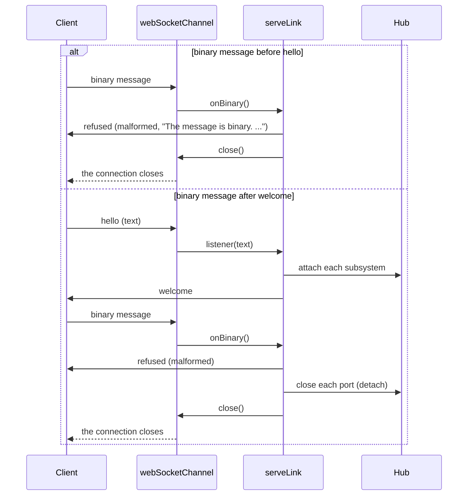

# Design

## Context

See proposal.md, "Why". The current state:

- `webSocketChannel` (`hub/src/link/channel.ts`) wraps a WebSocket in a `Channel`. Its `message` handler gives `event.data` to the endpoint only when `data` is a string. It drops each other message. `serveLink` never sees a binary message.
- The `ws` library of `host-nodejs` gives a text message as a string and a binary message as a `Buffer` (`ws` 8, `event-target.js`: `data: isBinary ? data : data.toString()`). A web browser gives a binary message as a `Blob` or an `ArrayBuffer`. Each is a value that is not a string.
- `attachLinkServer` (`host-nodejs/src/link-server.ts`) gives the `ws` socket to `webSocketChannel` and then calls `serveLink`. It needs no change.
- `serveLink` (`hub/src/link/serve-link.ts`) already refuses a malformed text message with `refused` and the reason `malformed`, before and after `welcome` (a second `hello`, a `submit` with a missing key). Its `refuse` function sends the message and calls `shutdown`, which detaches each port and closes the channel. After `shutdown`, `serveLink` ignores each later message.
- The interface `Channel` has one message listener: `onMessage(listener: (text: string) => void)`. A message that arrives before the listener waits in a queue. Hand-written `Channel` objects exist in tests of `hub` (`serve-link.test.ts`, `open-link.test.ts`, `examples.test.ts`) and of `renderer-react` (`view-tools.test.ts`).
- `openLink` (the reference client) also uses `webSocketChannel`. The hub side sends no binary message.
- The planner ran a real hub process on `main` and sent a binary message with the `WebSocket` of Node.js 24. The hub side sent nothing and kept the connection open, before `hello` and after `welcome`. The client closed the connection after 2 seconds.

## Goals / Non-Goals

**Goals:**

- The hub side answers each binary message with `refused` and the reason `malformed`, and closes the connection.
- `LINK.md` and the spec `wishem/hub/link` give this rule.

**Non-Goals:**

- The client side. `openLink` and the GDScript client keep their behavior for a binary message from the hub side. See "Follow-up".
- The WebSocket close code of a refusal. The hub side closes with no code for each refusal. This change does not change that.
- A check of the content of a binary message. The hub side refuses each binary message, also one that holds valid JSON in UTF-8.

## Decisions

### D1: `Channel.onMessage` gets an optional second listener for a binary message

```ts
onMessage(listener: (text: string) => void, onBinary?: () => void): void
```

The endpoint keeps one queue for text messages and binary messages in the order of arrival. When the listeners are registered, each waiting entry goes to its listener in that order. A channel with no `onBinary` drops a binary message, as it does now. `webSocketChannel` calls the binary path for each `message` event whose `data` is not a string. `createChannelPair` carries text only and never calls `onBinary`.

- Reason: each existing caller and each hand-written `Channel` still compiles and keeps its behavior. The client side (`openLink`) passes no `onBinary`, so it does not change. One call registers both listeners, so the order of a text message and a binary message that wait in the queue stays correct.
- The binary listener gets no argument. The hub side needs only the fact. A later change can add a parameter with no break for an existing listener.
- Rejected: a listener of the type `(data: string | Uint8Array) => void`. Each consumer of `Channel` must then change, and the conversion of a `Blob` to bytes is asynchronous in a web browser.
- Rejected: `webSocketChannel` turns a binary message into a text that is not JSON, so that `serveLink` refuses it as "not JSON". The text of the refusal then names the wrong cause.
- Rejected: a separate method `onBinary(listener)`. A text message and a binary message that wait before the registration can then go out of order.
- Rejected: `webSocketChannel` closes the socket for a binary message. The channel does not know the protocol, so it cannot send `refused`.

### D2: A `message` event whose `data` is not a string is a binary message

`webSocketChannel` treats each `message` event with `data` that is not a string as binary: a `Buffer`, an `ArrayBuffer`, a `Blob`, a typed array, and also an event with no `data`. The test "gives a text message to the listener and ignores other data" of `channel.test.ts` changes: a listener with no `onBinary` still gets only the text messages, and a listener with `onBinary` gets one call for each other message, in order.

- Reason: the WebSocket of the web platform and `ws` give a text message as a string and only a text message as a string. A real socket always sets `data`.

### D3: The hub side refuses a binary message at each point of a link

`serveLink` registers `onBinary`. Before `welcome` and after `welcome`, a binary message calls `refuse('malformed', 'The message is binary. Send each message as a WebSocket text message.')`. After `shutdown`, `serveLink` ignores each later message, binary or text.

- Reason: `LINK.md` says that the hub side sends `refused` with the reason `malformed` for a malformed message, and closes the connection. A second `hello` after `welcome` already gets this answer. A binary message is a defect of the client, and it does not end later. One rule for each point of a link is simpler for a client.
- Rejected: refuse only before `welcome`, and ignore a binary message after `welcome`. The fault of the client then stays hidden for each message after the start, and the issue asks for the refusal without a limit.
- Rejected: a new reason, for example `binary`. A client of version 1 knows the closed list of reasons. `malformed` already means "a defect in the client", and the text names the cause.

### D4: `LINK.md` gives the rule in three places

- "The kind of message": the hub side answers a binary message with `refused` with the reason `malformed`, and closes the connection.
- The section `refused`: the hub side sends `refused` when it cannot serve the `hello`, and also when a message of the client is malformed. Before `welcome`, the hub side attaches none of the subsystems. After `welcome`, it detaches each subsystem of the link. The current text says only "when it cannot serve the `hello`", which is already not complete for a second `hello`.
- The row `malformed` of the reason table: add "A message is binary."

### D5: The test of the real WebSocket is in `host-nodejs`

`link-server.test.ts` opens a real `ws` client to `attachLinkServer`, sends a binary frame, and gets `refused` with the reason `malformed` and the close. The tests of `hub` use a fake socket, so only this test proves the form of `data` that `ws` gives.

### D6: Package impact and break-test

`hub` gets a patch. `host-nodejs` gets a patch also: its source does not change, but the server of the `wishem` command now answers a binary message. Each other dependent of `hub` keeps its behavior for a client that sends only text. After the merge, one break-test issue follows for `hub`. `host-nodejs` gets no break-test issue, because its source files do not change.

### D7: No question for the owner

No decision meets the three conditions of "When to ask the owner". A developer of a client sees the refusal, but the change is easy to change later: the reason and the text are not part of an interface that a correct client uses. Each file of the change is in a permitted place.

### Brainstorm

The issue settled the behavior. The lead agent decided the interface of the channel (D1) and the point of the refusal (D3) alone, with the options above.

## Interfaces

Package `@thrashplay/wishem-hub`, `src/link/channel.ts`. The member `onMessage` of the exported interface `Channel` changes:

```ts
/** A connection that carries text messages in order. Each channel has one message listener and one close listener. */
export interface Channel {
  send(text: string): void
  /**
   * A message that arrives before the listeners are registered waits for them.
   * `onBinary` runs for each binary message, in order with the text messages. Without it, a binary message is dropped.
   */
  onMessage(listener: (text: string) => void, onBinary?: () => void): void
  onClose(listener: () => void): void
  close(): void
}
```

`webSocketChannel(socket: WebSocketLike): Promise<Channel>` and `WebSocketLike` do not change. `serveLink(hub: Hub, channel: Channel): void` does not change.

## Sequence



## Examples

A client sends 3 bytes as a binary message as its first message. The hub side sends this text message, and then closes the connection:

```json
{
  "t": "refused",
  "reason": "malformed",
  "message": "The message is binary. Send each message as a WebSocket text message."
}
```

A client that sends `hello` as a text message gets `welcome`, as before. A text message that is not JSON still gets the text "The message is not correct or is not the hello message."

## Failure Modes

| Failure                                              | Resulting behavior                                                                                    | Recovery                                                            |
| ---------------------------------------------------- | ----------------------------------------------------------------------------------------------------- | ------------------------------------------------------------------- |
| A client sends a binary message before `hello`       | `refused` with `malformed`, then the close. No subsystem is attached                                  | Correct the client. A new attempt with a binary message fails again |
| A client sends a binary message after `welcome`      | `refused` with `malformed`, then the close. Each subsystem of the link is detached. The hub continues | The client opens a new link with text messages. The IDs are free    |
| A client sends a text message after a binary message | The hub side ignores it. The connection closes                                                        | As above                                                            |
| The send of `refused` fails (the socket closed)      | `serveLink` shuts down the link, as for each failed send                                              | None necessary                                                      |

The refusal changes no state of the hub. A second binary message on the same connection gets no second `refused`.

## Risks / Trade-offs

- [A client sends JSON in a binary frame and worked by chance with a different server] → No such client exists: the hub side never accepted a binary message. `LINK.md` always said "Send each message as a WebSocket text message".
- [A hand-written `Channel` in a test of a different package ignores the new parameter] → The parameter is optional. Such a channel never delivers a binary message, so its behavior does not change.

## The test guide

Run each command from the root of the repository. "Terminal 1" runs the hub process. "Terminal 2" runs the clients. The commands use the `WebSocket` of Node.js 24, which sends a `Uint8Array` as a binary message.

The planner ran steps 2 to 5 on `main` before the change (on port 4872). Each binary message got no answer: the output was `no close after 2 s` and then `closed: code 1005`. The results below are the results that the change must give.

1. Build the packages and run their tests:

   ```sh
   pnpm build --filter "@thrashplay/wishem-host-nodejs..."
   pnpm exec turbo run test --filter @thrashplay/wishem-hub --filter @thrashplay/wishem-host-nodejs
   ```

   Result: the build ends with `successful` for each task. The tests pass with no failed test.

2. Make a copy of the model and start a hub process. In terminal 1, run:

   ```sh
   rm -rf .superpowers/611-model
   mkdir -p .superpowers
   cp -r nodejs/wishem/workbench/model .superpowers/611-model
   pnpm --filter @thrashplay/wishem-workbench exec wishem start "$PWD/.superpowers/611-model"
   ```

   Result in terminal 1 (the path is the path of your checkout):

   ```text
   wishem: model <checkout>/.superpowers/611-model
   wishem: 1 component type, 1 entity
   wishem: link at ws://127.0.0.1:4747/link
   ```

3. Send a binary message as the first message. In terminal 2, run:

   ```sh
   node -e "const s = new WebSocket('ws://127.0.0.1:4747/link'); s.onopen = () => { console.log('sent: 3 bytes as a binary message'); s.send(new Uint8Array([1, 2, 3])) }; s.onmessage = (e) => console.log('received:', e.data); s.onclose = (e) => console.log('closed: code', e.code); setTimeout(() => { console.log('no close after 2 s'); s.close() }, 2000).unref()"
   ```

   Result in terminal 2, in less than 1 second:

   ```text
   sent: 3 bytes as a binary message
   received: {"t":"refused","reason":"malformed","message":"The message is binary. Send each message as a WebSocket text message."}
   closed: code 1005
   ```

   The line `no close after 2 s` does not occur. Terminal 1 prints no line.

4. Start a link, then send a binary message. In terminal 2, run:

   ```sh
   node -e "const s = new WebSocket('ws://127.0.0.1:4747/link'); s.onopen = () => s.send(JSON.stringify({ t: 'hello', protocol: 1, subsystems: [{ id: 'binary-check', kind: 'output' }] })); s.onmessage = (e) => { const m = JSON.parse(e.data); console.log('received:', m.t, m.reason ?? ''); if (m.t === 'welcome') { console.log('sent: 3 bytes as a binary message'); s.send(new Uint8Array([1, 2, 3])) } }; s.onclose = (e) => console.log('closed: code', e.code); setTimeout(() => { console.log('no close after 2 s'); s.close() }, 2000).unref()"
   ```

   Result in terminal 2:

   ```text
   received: welcome
   sent: 3 bytes as a binary message
   received: refused malformed
   closed: code 1005
   ```

5. Run the command of step 4 again. It uses the same subsystem ID `binary-check`.

   Result: the same four lines. The first line is `received: welcome`, not `received: refused id-in-use`. The refusal of step 4 detached the subsystem, and its ID is free again.

6. A text client still works after the refusals. In terminal 2, run:

   ```sh
   node nodejs/wishem/docs/milestones/a1-construct/raw-link.mjs --once
   ```

   Result: a line `sent: {"t":"hello",...}`, a line `received: {"t":"welcome","protocol":1,"status":"running","seq":0,...}`, and `closed: code 1005`. The hub process in terminal 1 still runs.

7. In terminal 1, press Ctrl+C. Then remove the copy: `rm -rf .superpowers/611-model`.

## Package Impact

| Package                          | Published or private | Bump  | Why                                                                                                         |
| -------------------------------- | -------------------- | ----- | ----------------------------------------------------------------------------------------------------------- |
| `@thrashplay/wishem-hub`         | private              | patch | `Channel.onMessage` gets the optional listener `onBinary`. `serveLink` refuses a binary message. `LINK.md`. |
| `@thrashplay/wishem-host-nodejs` | private              | patch | No source change. The server of the `wishem` command answers a binary message with `refused`. A new test.   |

The change to `Channel` is not breaking: the new parameter is optional. The other dependents of `hub` keep their behavior for a client that sends only text, so they are not in the changeset.

## Follow-up

- The reference client (`openLink`) and the GDScript client ignore a binary message from the hub side. The hub side sends none, so the risk is low. A follow-up issue can make each client close the connection for it, with one rule in `LINK.md`.
