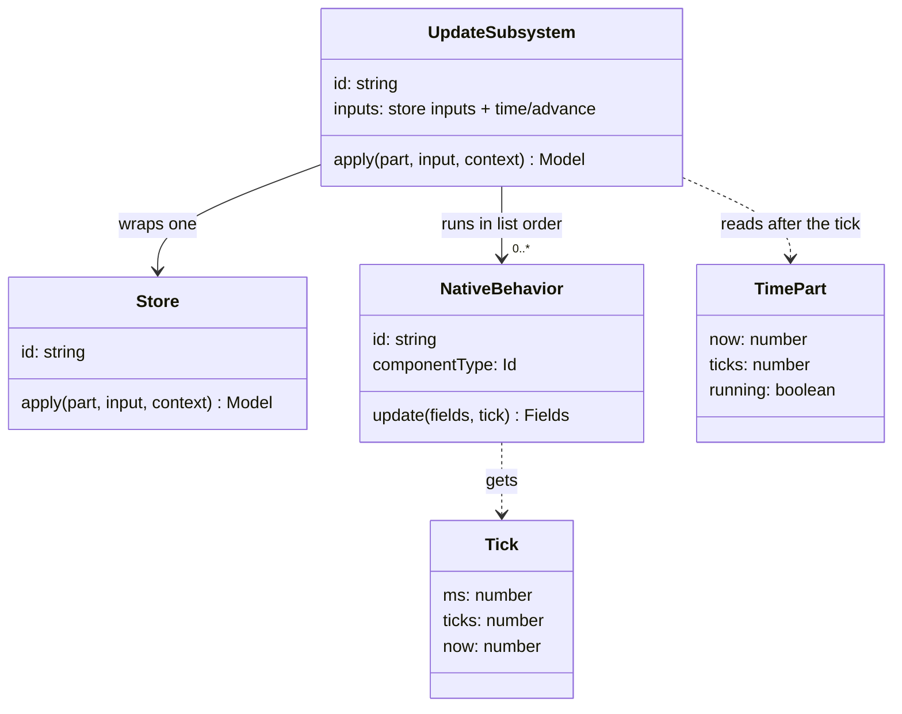
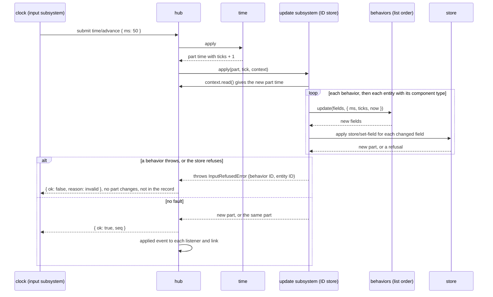
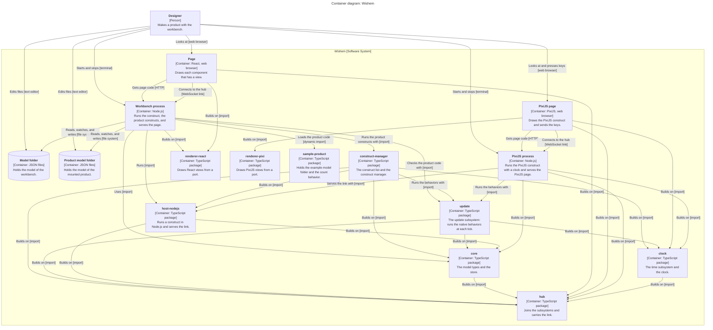

# Design

## Context

See `proposal.md` for the reason. The owner answered the discovery issue #602: question 1 is option A (interpolation in a renderer, built when a product with motion needs it), and question 2 is option B (a thin update step after #536 and #540). Rule R22 (**Agreed**) records option B. The lead agent did the brainstorm alone, as `nodejs/wishem/docs/autonomous-flow.md` permits. No decision of this change meets the three conditions of "When to ask the owner".

The state that this change starts from is `main` at `d8233331`, with #538 (construct manager, pull request #623) merged, and #609 (the count is a number, pull request #640) merged before the apply starts. See "Order with other changes" for the case in which this change merges before #609.

- `withCountRule(store)` of `sample-product` wraps a store. For each `time/advance`, it adds 1 to each `count` of a `Counter` component that is a number (#609; on `d8233331` it is still a decimal integer in text), with one `store/set-field` for each count, through the wrapped store. It never refuses a tick. #538 exports it again as `wrapStore`.
- `withColorRule(store, { entity, componentType, field, colors })` of `pixi-page` wraps the store of the PixiJS construct. For each tick, it reads `ticks` of the part `time` with `context.read()` and sets the `Color` field of one entity to `colors[ticks % 4]`. It refuses the tick when the joined state has no part `time`.
- `ModelSubsystem.apply(part, input, context)` of `hub` returns the new part, or the same object when nothing changes. `context.read()` holds the new parts of the model subsystems that are earlier in the order. The hub refuses the full input when a model subsystem throws `InputRefusedError`, and no part changes. A refused input is not in the record.
- `time` of `clock` refuses a `time/advance` whose `ms` is not a finite number larger than 0. It is the first model subsystem of each construct.
- The store of `core` checks each `set-field` with `validateModel`. It returns the same part when the value does not change.
- The construct manager of #538 makes each product construct with `createTime({ running })` and `wrapStore(createStore({ model }))`. The `start` script of `workbench-app` loads the module of `--product-code` and reads its function `wrapStore` (`loadProductCode` in `scripts/start.ts`).

## Goals / Non-Goals

**Goals:**

- One model subsystem, the update subsystem, owns the update step of a tick and the order of the behaviors.
- The count rule and the color rule are the first two native behaviors, with the same results as before for the same record.
- The product code that the workbench loads gives data (a list of behaviors), and the construct manager makes the update subsystem.

**Non-Goals:**

- A declaration of a behavior in the model, a prompt, a history, a check, and the replacement of code while the product runs. These are the behavior feature (#481).
- Phases of the update step (input, movement, rules, cleanup). The order is the order of one list. A phase is a group of that list, and it is added when a product needs two groups (rule R7).
- A behavior that reads a different component, a different entity, or an event.
- Interpolation (#602, question 1).
- A view of the order in the workbench.

## Approaches

The brainstorm compared three forms of the update subsystem.

| Approach                                                                       | What it gives                                                                                                                          | Cost                                                                                                                                                                                                                      |
| ------------------------------------------------------------------------------ | -------------------------------------------------------------------------------------------------------------------------------------- | ------------------------------------------------------------------------------------------------------------------------------------------------------------------------------------------------------------------------- |
| A. A new package `update` that wraps the store (selected)                      | One owner of the update step. Each behavior is a plain object. The construct manager and the PixiJS construct make it in the same way. | One new package, a container in the architecture document, and three dependencies (`core`, `hub`, `clock`).                                                                                                               |
| B. The update subsystem in `core`, beside the store                            | No new package.                                                                                                                        | `core` must read the part `time`, so it needs `clock` or a copy of the ID `time` and of the type `TimePart`. `core` holds the model and the store, and the update step is a separate job of a construct.                  |
| C. A function that each product calls in its own `wrapStore` (no new contract) | No change of the construct manager.                                                                                                    | The product code still wraps the store, so a product can wrap it two times or not use the update subsystem. The construct manager does not own the form of a product construct (#538, decision 5), and #481 has no place. |

Choice: approach A. It agrees with the issue ("one model subsystem wraps the store one time", "the construct gives it a list"), and with the comment on #617 that the contract `wrapStore` changes to a list of behaviors.

## Decisions

### 1. The package `@thrashplay/wishem-update`

The update subsystem is in a new private package in `nodejs/wishem/update` (the name `update` is **Proposed**). It has one root entry. It depends on `core` (`storeInputs`), `hub` (`InputRefusedError`), and `clock` (`TIME_ID`, `TimePart`). It uses no Node.js API: its `tsconfig.options.json` has `"types": []`, as `clock` has.

- Reason: see "Approaches". The package that other packages build on is a container of the architecture document.
- Alternative: in `clock`, beside `time`. Rejected: `clock` would depend on `core`, and the clock is an input subsystem with a different job.

### 2. A native behavior is an ID, a component type, and a pure function

```ts
{ id: 'sample-product/count', componentType: COUNTER_TYPE, update: (fields, tick) => ... }
```

`update(fields, tick)` gets the fields of one component (frozen, as the store holds them) and the tick. It returns the new fields: the same object, or a new object. The update subsystem writes each field of the result whose value is not `===` to the current value, in the order of the keys of the result. A field that the result does not hold keeps its value. The store has no operation that removes a field.

- The ID is text that is not empty and is unique in one list. The convention is `<package>/<name>` (**Proposed**). Reason: a problem names the behavior, and #481 and a view of the workbench need a name for each behavior.
- `update` gets no entity ID and no joined state. Reason: rule R4 and the issue ("a pure function from the fields of the component and the tick to the new fields"). A behavior that needs more waits for #481.
- Alternative: `update` returns only the changed fields. Rejected: a behavior that returns `fields` when nothing changes is simpler to write, and the comparison is in one place.

### 3. The tick gives the delta and the time after the tick

`Tick` (**Proposed** name) holds `ms` (the payload `ms` of `time/advance`, the delta that rule R22 names), and `ticks` and `now` of the part `time` after the tick. The update subsystem reads the part `time` with `context.read()`, so `time` must be earlier in the list of subsystems. When the joined state has no part `time`, or the part has no number `ticks` and `now`, the update subsystem refuses the tick with one problem whose path is `['time']`.

- Reason: the color behavior needs `ticks`. A behavior of motion needs `ms`. `now` costs nothing.
- The update subsystem does not check `ms`. Reason: `time` refuses a bad `ms` first, and then the hub refuses the full input.

### 4. The order: the list, then the entities

At each tick, the update subsystem runs the first behavior for each entity that has its component type, in the order of the entities of the store. Then it runs the second behavior in the same way, and so on. Each run gets the fields after each earlier write of the same tick.

- Reason: a behavior is one rule of the product, and the rules run one after the other, so a later rule reads what an earlier rule did in the same tick (rule R22). It is the order of a "system" in an entity and component engine. A phase becomes a group of this list later.
- Alternative: for each entity, each behavior. Rejected: the order of two rules would then change with the order of the entities.
- The specification of `wishem/update/update-subsystem` gives the order. A test with two behaviors on one field (double, then add 1) fixes it.

### 5. Each write goes through the store

For each changed field, the update subsystem calls `store.apply(part, setField, context)` with `storeInputs(store.id).setField(...)` as the type and the payload, and with the `seq` and the `source` of the tick. The store checks the value and freezes the new part.

- Reason: the store is the one part that checks and writes a model (rule R5). The update subsystem knows no rule of the model.
- Cost: `validateModel` runs once for each changed field. For the sample product and the PixiJS construct, that is one field each tick. See "Risks / Trade-offs".
- Alternative: build the next model and check it one time. Rejected: it copies the work of the store, and the store returns the same part only for its own inputs.

### 6. A fault of a behavior refuses the tick

When `update` throws, or when the store refuses a write, the update subsystem throws `InputRefusedError`. The hub refuses the tick, and no part changes. Each problem has a message that starts with `The behavior "<id>" for the entity "<entity>": ` and a path that starts with `['behaviors', <id>, <entity>]`. For a refusal of the store, the rest is the message and the path of each problem of the store. For an error, the rest is the message of the error.

- Reason: the same record gives the same result (rule R3), and a refused input is not in the record, so a replay is not affected. A step through the link shows the problem to the person who sent it. A skip of the write would hide a fault in code that a person wrote.
- A behavior that gets data it cannot use, such as a count that is not a number, returns its fields with no change (#609, decision 3). That is not a fault.
- Alternative: skip the write and continue. Rejected: the field stops with no message.
- The clock ignores the result of a tick, so a behavior with a fault stops the time of the construct, and the terminal shows nothing. See "Follow-up".

### 7. The list is checked when the update subsystem is made

`checkBehaviors(value)` returns the list, or throws a `TypeError` that names the first problem: the value is not an array, an item at position `n` has no text `id`, no text `componentType`, or no function `update`, or two items have the ID `<id>`. `createUpdate` calls it.

- Reason: the product code is a module that a person names on the command line, so its data can be wrong. The `start` script of the workbench calls `checkBehaviors` when it loads the module, so the person sees the problem before a construct starts.
- The update subsystem does not check that the component type is defined. Reason: `store/replace-model` can add or remove a definition while the construct runs. A behavior for a component type that no entity has does nothing.

### 8. The sample product exports `countBehavior` and `behaviors`

`src/count-rule.ts` becomes `src/count-behavior.ts`. `countBehavior` (the term "count behavior" is **Proposed**) has the ID `sample-product/count` and the component type `Counter`. When `count` is a number, it returns the fields with `count + 1`. Each other value stays. `behaviors` is `[countBehavior]`. The exports `withCountRule` and `wrapStore` are removed. `sample-product` depends on `update` for types only.

- Reason: the issue makes the count rule the first native behavior. The rule R22 says that no rule wraps the store by itself, so the wrap goes.

### 9. The PixiJS construct runs the color behavior

`src/construct/color-rule.ts` becomes `src/construct/color-behavior.ts`. `colorBehavior` (the term "color behavior" is **Proposed**) has the ID `pixi-page/color` and the component type `Clear color`. It returns the fields with `Color` set to `COLORS[tick.ticks % COLORS.length]`. `createPixiHub` gives the hub `createTime({ running })` and `createUpdate({ store: createStore({ model: CONSTRUCT_MODEL }), behaviors: [colorBehavior] })`. `withColorRule` and `ColorRuleOptions` are removed.

- The color behavior acts on each entity with a `Clear color` component. The construct has one such entity, so the colors do not change.
- The refusal when the part `time` is missing moves into the update subsystem (decision 3).

### 10. The product code exports `behaviors`

The module that `--product-code` names exports `behaviors`, a list of native behaviors. `loadProductCode` of `workbench-app/scripts/start.ts` calls `checkBehaviors(module.behaviors)` from `update`. When it throws, the script prints `wishem: the product code has no correct list behaviors: <message>` and stops with exit code 1, before the construct of the workbench starts.

The construct manager gets the option `behaviors?: readonly NativeBehavior[]` in place of `wrapStore`, in `ConstructManagerOptions` and in `ProductConstructOptions`. The default is `[]`. `startProductConstruct` makes the hub with `createTime({ running })` and `createUpdate({ store: createStore({ model }), behaviors })`. The type `WrapStore` is removed.

- Reason: the construct manager owns the form of a product construct (#538, decision 5). Each product construct has one update subsystem, also with no product code (the glossary term **Update subsystem**). #481 adds the behaviors that the model declares to the same list.
- A product construct with no behavior has the input type `time/advance` on the store too. It returns the same part, so the joined state does not change.

### 11. The blueprint and the architecture document

- `glossary.md`: **Update subsystem** names the package and the order of decision 4. **Native behavior** names the count behavior and the color behavior, which the update subsystem runs. **Product code** says that the module exports the list `behaviors`. The term **Tick** does not change. Its entry adds one sentence: the type `Tick` of `update` holds the facts of one tick that a behavior gets.
- `concepts.md`, "The game loop": the row "Update of the rules" is "Built". The item "The update subsystem" leaves "Not built". "Native behaviors": the count behavior is a native behavior that the update subsystem runs.
- `rules.md`: R22 does not change.
- `nodejs/wishem/CLAUDE.md`: the package `update` in the list, and `sample-product` holds the count behavior.
- `docs/architecture/README.md` and `render.mjs`: see "The architecture document".

## Interfaces

Owner: `@thrashplay/wishem-update`, root entry.

```ts
import type { FieldValue, Id, Model } from '@thrashplay/wishem-core'
import type { ModelSubsystem } from '@thrashplay/wishem-hub'

/** The fields of one component: field ID to value. */
export type Fields = Readonly<Record<Id, FieldValue>>

/** The facts of one tick that a behavior gets. */
export interface Tick {
  /** The length of the tick in milliseconds: the payload `ms` of `time/advance`. */
  readonly ms: number
  /** `ticks` of the part `time` after the tick. */
  readonly ticks: number
  /** `now` of the part `time` after the tick. */
  readonly now: number
}

/** A behavior whose code a person wrote. */
export interface NativeBehavior {
  /** Not empty, and unique in one list. For example `sample-product/count`. */
  readonly id: string
  /** The ID of the component type. */
  readonly componentType: Id
  /** A pure function. Returns the new fields, or the same object. */
  readonly update: (fields: Fields, tick: Tick) => Fields
}

export interface UpdateOptions {
  store: ModelSubsystem<Model>
  /** The order of the list is the order in a tick. */
  behaviors: readonly NativeBehavior[]
}

/** Returns the list, or throws a `TypeError` that names the first problem. */
export const checkBehaviors: (value: unknown) => readonly NativeBehavior[]

/**
 * The update subsystem: a model subsystem with the ID and the first part of `store`. It applies each input
 * type of the store as the store does, and also `time/advance`. Put the `time` subsystem before it.
 * Throws the error of `checkBehaviors`.
 */
export const createUpdate: (options: UpdateOptions) => ModelSubsystem<Model>
```

Owner: `@thrashplay/wishem-sample-product`, root entry. The IDs do not change.

```ts
import type { NativeBehavior } from '@thrashplay/wishem-update'

/** Adds 1 to `count` of each `Counter` component when the value is a number. */
export const countBehavior: NativeBehavior
/** The behaviors of the product, for `--product-code`. */
export const behaviors: readonly NativeBehavior[]
```

Owner: `@thrashplay/wishem-pixi-page` (`src/construct/color-behavior.ts`, not exported from the package).

```ts
/** Sets `Color` of each `Clear color` component to `COLORS[tick.ticks % COLORS.length]`. */
export const colorBehavior: NativeBehavior
```

Owner: `@thrashplay/wishem-construct-manager`, entry `node`. Only the changed members are shown.

```ts
import type { NativeBehavior } from '@thrashplay/wishem-update'

export interface ProductConstructOptions {
  // ...id, model, running, stepMs, timer, now, onError, as in #538...
  /** Default: no behavior. */
  behaviors?: readonly NativeBehavior[]
}

export interface ConstructManagerOptions {
  // ...hub, log, stepMs, timer, now, as in #538...
  /** Given to each product construct. Default: no behavior. */
  behaviors?: readonly NativeBehavior[]
}
// The type WrapStore is removed.
```

Owner: `@thrashplay/wishem-workbench-app` (`scripts/start.ts`, not exported). `WorkbenchOptions.productCode` does not change. Its module must export `behaviors`.

## Data Model

The change adds domain types in code. New: `NativeBehavior`, `Tick`, `Fields`, and the update subsystem. Changed: the store of a construct is wrapped by the update subsystem. The model data and the files do not change.



## The flow of a tick

All the parts are in one process. The diagram shows the order in the hub.



## The architecture document

The change adds a package that other packages build on, so it changes the container level.

New: the container `update`, its relationships to `core`, `hub`, and `clock`, and the relationships to it from the PixiJS process, from `construct-manager`, and from the workbench process. Changed: the description of `sample-product` ("Holds the example model folder and the count behavior."). Nothing moves or is removed. The system context diagram, the dynamic diagram, the component diagram of the page, and the entity diagram do not change.



- `update` imports `storeInputs` of `core`, `InputRefusedError` of `hub`, and `TIME_ID` of `clock`, as values.
- The PixiJS process imports `createUpdate` of `update`. It no longer imports `InputRefusedError` of `hub`, and it still imports `createHub` of `hub`, so its relationship to `hub` stays.
- `construct-manager` imports `createUpdate`. The workbench process imports `checkBehaviors`.
- `sample-product` imports only types of `update`, so the diagram shows no relationship from it. The dependency list of the document names the dependency.

The architecture `README.md` gets: a row `update` in the table of the container diagram, a paragraph that says why `update` is a container and what imports it, the PixiJS paragraphs with `createUpdate` and the color behavior, the step 2 of the path of a tick ("The update subsystem runs the color behavior, which sets the `Color` field to the color at the position `ticks` modulo 4"), the row and the paragraph of `sample-product` with `countBehavior` and `behaviors`, the dependency list, and a link to the specification `wishem/update/update-subsystem`. `render.mjs` gets the container and the relationships, and writes `containers-light.svg` and `containers-dark.svg` again.

## Failure Modes

| Failure                                                                         | Result                                                                                                                                      | Recovery                                            |
| ------------------------------------------------------------------------------- | ------------------------------------------------------------------------------------------------------------------------------------------- | --------------------------------------------------- |
| A behavior throws at a tick                                                     | The hub refuses the tick (`invalid`). No part changes. The record does not hold it. The clock sends the next tick, which also fails.        | Correct the behavior and start the construct again. |
| A behavior returns a value that the store refuses, or a key that is not a field | The same as above. The problem has the message of the store.                                                                                | Correct the behavior.                               |
| A write of a later field fails after earlier writes of the same tick            | The update subsystem throws, the hub keeps the parts of before the tick. The writes are not partial: the hub applies a tick in full or not. | None needed.                                        |
| No part `time`, or the update subsystem is before `time` in the list            | Each `time/advance` is refused with a problem at the path `['time']`.                                                                       | Put `time` first.                                   |
| The list of behaviors is not correct                                            | `createUpdate` throws a `TypeError`. The `start` script prints the reason and starts nothing. The construct manager reports `failed`.       | Correct the product code.                           |
| A replay of a record                                                            | Each tick of the record was accepted, so the same behaviors give the same state. A changed behavior can make a replay fail (`ReplayError`). | Use the code of the record.                         |

Each apply of a tick is idempotent for one part and one input: the behaviors are pure, so the same part and the same tick give an equal result.

## Examples

A tick that a behavior with a fault refuses, through the link of a product construct:

```text
$ node nodejs/wishem/docs/milestones/a1-construct/raw-link.mjs --url ws://127.0.0.1:41377/link --once --send '{"type":"time/advance","payload":{"ms":50}}'
...
received: {"t":"result","request":1,"result":{"ok":false,"reason":"invalid","problems":[{"message":"The behavior \"test/boom\" for the entity \"e_99969ed3-f499-4dbb-bf6d-958db4542884\": boom","path":["behaviors","test/boom","e_99969ed3-f499-4dbb-bf6d-958db4542884"]}]}}
```

The `start` script with a module whose `behaviors` is not a list:

```text
$ pnpm --filter @thrashplay/wishem-workbench-app start --model .superpowers/617/model --product .superpowers/617/product --product-code ./.superpowers/617/not-a-list.mjs
wishem: model .superpowers/617/model
wishem: product .superpowers/617/product
wishem: product code ./.superpowers/617/not-a-list.mjs
wishem: the product code has no correct list behaviors: The behaviors are not a list.
```

The command stops with exit code 1, and the port 4747 stays free.

## Package Impact

| Package                                | Published or private | Bump  | Reason                                                                                                                                                 |
| -------------------------------------- | -------------------- | ----- | ------------------------------------------------------------------------------------------------------------------------------------------------------ |
| `@thrashplay/wishem-update`            | Private (new)        | minor | New package: `createUpdate`, `checkBehaviors`, `NativeBehavior`, `Tick`, `Fields`.                                                                     |
| `@thrashplay/wishem-sample-product`    | Private              | minor | Breaking for a private `0.x` package: `countBehavior` and `behaviors` in place of `withCountRule` and `wrapStore`. New dependency on `update`.         |
| `@thrashplay/wishem-pixi-page`         | Private              | patch | The construct runs the color behavior through the update subsystem. No export changes. New dependency on `update`.                                     |
| `@thrashplay/wishem-construct-manager` | Private              | minor | Breaking for a private `0.x` package: the option `behaviors` in place of `wrapStore`, and the type `WrapStore` is removed. New dependency on `update`. |
| `@thrashplay/wishem-workbench-app`     | Private              | minor | Breaking: the module of `--product-code` exports `behaviors`. New dependency on `update`.                                                              |

No other package changes. `core`, `hub`, `clock`, `host-nodejs`, `renderer-react`, `renderer-pixi`, and `workbench` get no change. No package is published.

## UI

This change adds no UI and changes no UI. The PixiJS page shows the same colors in the same order, and its screenshot baselines do not change. The workbench page does not change.

## Risks / Trade-offs

- [`validateModel` runs once for each changed field at each tick] → One field for each tick in the two constructs. A product with many entities makes a tick slow. A batch write in the store is the follow-up when a product needs it.
- [A behavior with a fault stops the time with no message in the terminal] → The test guide shows the problem through the link. See "Follow-up".
- [The order is one flat list] → It is the order that the specification gives, and a phase is a group of it later. #481 decides where a declared behavior goes in the list.
- [A breaking change of the product code] → The sample product is the one product code, and it changes in the same change.

## Migration Plan

No data changes. A module of product code exports `behaviors` in place of `wrapStore`. To roll back, revert the pull request.

## Order with other changes

The change #538 (`538-add-construct-manager`, pull request #623) is on `main` at `d8233331`. This plan is written on that commit. The deltas of this change of `wishem/workbench/start`, `wishem/workbench/construct-manager`, `wishem/sample-product/model`, and `wishem/architecture/diagrams` modify the text that #538 archived. Task 4 changes the code of #538 that uses `wrapStore`: `construct-manager/src/product-construct.ts`, `construct-manager.ts`, `node.ts`, their tests, `readme-example.test.ts`, and `README.md`; `workbench-app/scripts/start.ts`, `src/start.test.ts`, and `README.md`; and the glossary term **Product code**. Task 2 starts from the container diagram of #538 in `render.mjs`.

The change #609 (`609-count-type-number`, pull request #640) is not merged when this plan is written. Both changes modify the requirement "A tick adds 1 to each count" of `wishem/sample-product/model` and the count rule. The delta of this change has the number form of #609.

When #609 merges first (the plan), this change does these steps:

1. Merge `main` into the branch before Task 1.
2. Task 3 makes `countBehavior` from the number form of `withCountRule` (`typeof count === 'number'`, `count + 1`), and moves the number tests of #609 (`41` to `42`, `1.5` to `2.5`, `2 ** 53` stays, a `string` definition with `many` stays) to `count-behavior.test.ts`.
3. The test guide reads the count as a number with no quotes.

When this change merges before #609, #609 does these steps after it merges `main`:

1. Change `countBehavior` in `sample-product/src/count-behavior.ts` in place of `withCountRule`: add 1 to a number, and keep each other value.
2. Write its delta of the requirement "A tick adds 1 to each count" on the text of this change (the count behavior), and keep the number scenarios.
3. Change the tests of `count-behavior.test.ts` and of `construct-manager` to numbers.
4. Change the definition file and `state.json` as its plan says. Until then, the count of this change is text, and the behavior adds 1 to a decimal integer in text, as `withCountRule` does on `d8233331`. The implementer of Task 3 records which form it used in the ledger.

## The test guide

The final reviewer does these steps on the branch, with real processes and real files, and reports the result of each step. Run each command from the root of the repository. "Terminal 1" runs a construct. "Terminal 2" runs the other commands. The folder `.superpowers/617/` is in the worktree, and git ignores it.

Setup:

```sh
pnpm install
pnpm build --filter "@thrashplay/wishem-*"
rm -rf .superpowers/617 && mkdir -p .superpowers/617
cp -r nodejs/wishem/workbench/model .superpowers/617/model
cp -r nodejs/wishem/sample-product/model .superpowers/617/product
RAW=nodejs/wishem/docs/milestones/a1-construct/raw-link.mjs
REWIND=nodejs/wishem/docs/milestones/a2-time/rewind-client.mjs
CLEAR='"fld_590c5266-eb3d-4022-bb6c-7856b920c4e1":"#[0-9a-f]*"'
COUNT='"fld_ef085a2e-22ef-4409-bac4-9cd5648d0705":[0-9.]*'
COLOR='"fld_694d6cb2-97e8-444e-961e-aa76744837fb":"#[0-9a-f]*"'
TICKS='"ticks":[0-9]*'
cat > .superpowers/617/boom.mjs <<'EOF'
export const behaviors = [{ id: 'test/boom', componentType: 'ct_6af38bd9-a91d-49d9-9370-fa4e6c04769d', update: () => { throw new Error('boom') } }]
EOF
echo 'export const behaviors = "count"' > .superpowers/617/not-a-list.mjs
```

Set the variables in both terminals. Result: the build ends with no failed task.

### Part 1: the color behavior of the PixiJS construct

1. **Start the PixiJS construct paused.** In terminal 1: `pnpm --filter @thrashplay/wishem-pixi-page start --paused`. Result: the lines `wishem: the time of the construct starts paused`, `wishem: link at ws://127.0.0.1:4748/link`, and `wishem: PixiJS page at http://127.0.0.1:5174/`.
2. **The first state.** In terminal 2: `node $RAW --url ws://127.0.0.1:4748/link --once | grep -o "$CLEAR\|$TICKS"`. Result: `#1d4ed8` and `"ticks":0`.
3. **A step through the link runs the behavior.** `node $RAW --url ws://127.0.0.1:4748/link --once --send '{"type":"time/advance","payload":{"ms":500}}'`. Result: `"ok":true`. Read again as in step 2. Result: `#b91c1c` and `"ticks":1`.
4. **Three more steps give the first color again.** Send the input of step 3 three times. Result: the color is `#15803d`, then `#a16207`, then `#1d4ed8`, and `"ticks":4`.
5. **A rewind gives the color of the target.** `node $REWIND --url ws://127.0.0.1:4748/link --seq 1`. Result: `"ok":true`. Read as in step 2. Result: `#b91c1c` and `"ticks":1`.
6. **A bad tick changes nothing.** Send `{"type":"time/advance","payload":{"ms":0}}`. Result: `"ok":false,"reason":"invalid"`, and the read gives `#b91c1c` and `"ticks":1`.
7. **The page draws the behavior.** Open `http://127.0.0.1:5174/` and press the period key. Result: the canvas changes from red to green. Press the space key. Result: the color changes two times each second. With Docker, `pnpm --filter @thrashplay/wishem-pixi-page test:ui` passes with the baselines that the change did not touch.
8. **The stop.** Press Ctrl+C in terminal 1. Result: the command `node scripts/start.ts` ends with exit code 0. `pnpm` reports the signal (#624).

### Part 2: the count behavior in a product construct of the workbench

9. **Start the workbench with the product code.** In terminal 1: `pnpm --filter @thrashplay/wishem-workbench-app start --model .superpowers/617/model --product .superpowers/617/product --product-code @thrashplay/wishem-sample-product`. Result: the line `wishem: product code @thrashplay/wishem-sample-product`, and the line of the page.
10. **Start a product construct.** `node $RAW --once --send '{"type":"constructs/start","payload":{"construct":"play"}}'`. Result: `"ok":true`. `PLAY=$(node $RAW --once | grep -o 'ws://127.0.0.1:[0-9]*/link')`. Result: the address that terminal 1 prints.
11. **The count advances with the clock.** `node $RAW --url $PLAY --once | grep -o "$COUNT"`, and again after two seconds. Result: two numbers with no quotes, and the second is larger by approximately 40.
12. **A hand edit of the product file reaches the construct, and the behavior keeps the count.** `sed -i 's/#1d4ed8/#b91c1c/' .superpowers/617/product/state.json`, wait one second, then `node $RAW --url $PLAY --once | grep -o "$COLOR\|$COUNT"`. Result: `#b91c1c`, and a count that continues from step 11.
13. **Pause, then a step through the construct manager.** Send `{"type":"constructs/send","payload":{"construct":"play","input":{"type":"time/set-running","payload":{"running":false}}}}`, read the count, then send `constructs/send` with `{"type":"time/advance","payload":{"ms":50}}`. Result: the count after the step is 1 more than the count after the pause.
14. **A rewind of the product construct.** Send `constructs/send` with `{"type":"hub/rewind","payload":{"seq":1}}`. Result: `"lastSend"` holds `"ok":true`. The color of `play` is `#1d4ed8`, and its count is a small number that its ticks advance from `1`, because the construct was running after its input 1. `.superpowers/617/product/state.json` still holds `#b91c1c`.
15. **The stop.** Press Ctrl+C in terminal 1. Result: the address `$PLAY` accepts no connection.

### Part 3: a fault of a behavior, and the check of the product code

16. **A behavior that throws.** In terminal 1: the command of step 9 with `--product-code ./.superpowers/617/boom.mjs`. Start `play` as in step 10. Then `node $RAW --url $PLAY --once --send '{"type":"time/advance","payload":{"ms":50}}'`. Result: `"ok":false,"reason":"invalid"`, and a problem with the message `The behavior "test/boom" for the entity "e_99969ed3-f499-4dbb-bf6d-958db4542884": boom`. `node $RAW --url $PLAY --once | grep -o "$TICKS"` gives `"ticks":0` two times, one second apart: the time of the construct does not advance. Stop terminal 1.
17. **Product code with no list.** Run the command of step 9 with `--product-code ./.superpowers/617/not-a-list.mjs`. Result: `wishem: the product code has no correct list behaviors: The behaviors are not a list.`, exit code 1, and a new start with the command of step 9 can use the port 4747.

### Part 4: the order and the record in one process

18. **The order of the list, and a replay.** In terminal 2:

    ```sh
    pnpm --filter @thrashplay/wishem-sample-product exec node --input-type=module -e '
    import { readFileSync, readdirSync } from "node:fs"
    import { createStore } from "@thrashplay/wishem-core"
    import { createHub } from "@thrashplay/wishem-hub"
    import { createTime, timeInputs } from "@thrashplay/wishem-clock"
    import { createUpdate } from "@thrashplay/wishem-update"
    import { COUNTER_TYPE, COUNT_FIELD, countBehavior } from "@thrashplay/wishem-sample-product"
    const dir = process.argv[1]
    const definitions = readdirSync(`${dir}/definitions`).map((f) => JSON.parse(readFileSync(`${dir}/definitions/${f}`, "utf8")))
    const { entities } = JSON.parse(readFileSync(`${dir}/state.json`, "utf8"))
    const double = { id: "test/double", componentType: COUNTER_TYPE, update: (f) => ({ ...f, [COUNT_FIELD]: f[COUNT_FIELD] * 2 }) }
    const make = (behaviors) => [createTime(), createUpdate({ store: createStore({ model: { definitions, entities } }), behaviors })]
    const count = (hub) => hub.read().store.entities[0].components[COUNTER_TYPE][COUNT_FIELD]
    for (const behaviors of [[double, countBehavior], [countBehavior, double]]) {
      const hub = createHub({ subsystems: make(behaviors) })
      hub.start()
      const port = hub.attach({ id: "tester", kind: "input" })
      for (let i = 0; i < 3; i++) await port.submit(timeInputs.advance(100))
      const copy = createHub({ subsystems: make(behaviors), record: { start: hub.recordStart(), inputs: hub.record() } })
      console.log(count(hub), count(copy))
    }
    ' "$PWD/nodejs/wishem/sample-product/model"
    ```

    Result: `7 7` and then `14 14`. The first list doubles first (0, 1, 3, 7). The second list adds 1 first (2, 6, 14). Each replay gives the same count.

19. **The tests of the changed packages.** `pnpm exec turbo run test --filter @thrashplay/wishem-update --filter @thrashplay/wishem-sample-product --filter @thrashplay/wishem-pixi-page --filter @thrashplay/wishem-construct-manager --filter @thrashplay/wishem-workbench-app`. Result: each test passes.

## Follow-up

- The construct manager and the PixiJS process print no line when a tick is refused. A person sees that the time stops, and the problem only through a step on the link. A report of the first refused tick is a follow-up issue.
- A batch write of more than one field in the store, when a product has many entities in a tick.
- Phases of the update step, when a product needs two groups of behaviors.
- The behavior feature (#481) adds the behaviors that the model declares to the list of the update subsystem, and gives the workbench a view of the order.
- After the merge, create one break-test issue for each library package that the change changed, as "Break-tests" of `autonomous-flow.md` says: `update`, `construct-manager`, and `sample-product`. A different package depends on each one.
