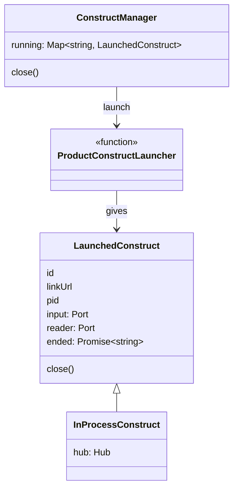
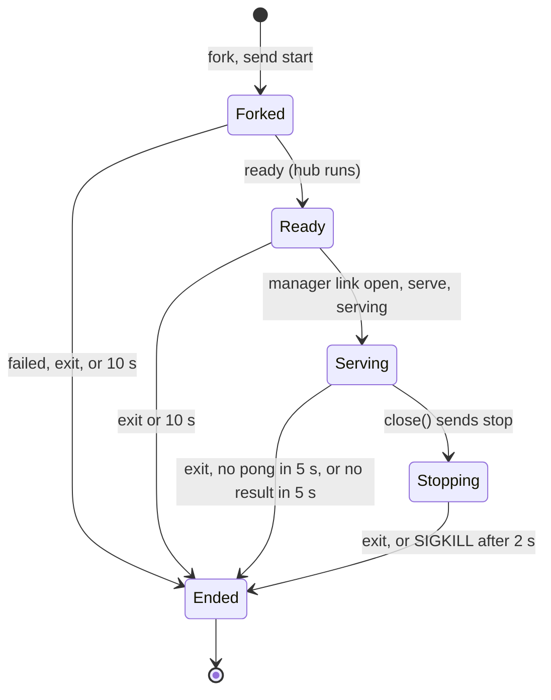
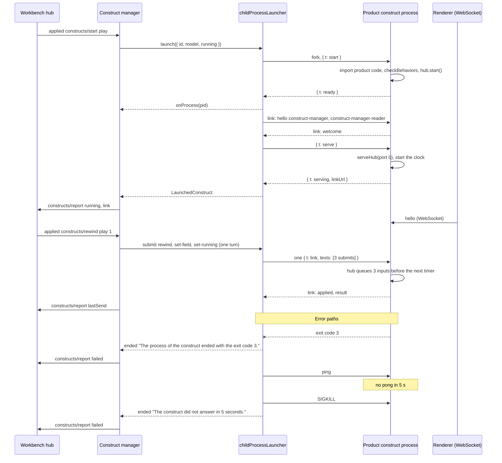
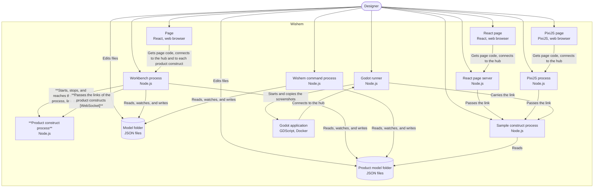

# Design

## Context

See `proposal.md`, "Why". The state on `main` (f70b6b98):

- `attachConstructManager` (`construct-manager/src/construct-manager.ts`) calls `startProductConstruct` for each construct that the list wants. `startProductConstruct` (`src/product-construct.ts`) makes a hub with `time` and the update subsystem, serves its link with `serveHub`, and starts a clock, all in the workbench process. The manager attaches `construct-manager` and `construct-manager-reader` directly to that hub, and reads `construct.hub.read().time` for the time state.
- The `start` script of `workbench-app` loads the product code with `import()` and `checkBehaviors` in its own process, and gives the list `behaviors` to the manager. It passes `/constructs/<id>/link` to `manager.running.get(id).linkUrl`.
- `three-renderers` calls `startProductConstruct` in the sample construct process. That process is a process of its own, but no construct manager starts it.
- The hub has the type `Channel`, `serveLink(hub, channel)`, and `openLink(channel, subsystems)`. The link protocol runs on each channel that carries text messages in order. `openLink` sends a `submit` in the same call as `submit()`, and `serveLink` gives it to the hub queue in the same call as the message. So inputs that one turn submits are in the hub queue before a timer of the hub process can run, if the channel gives them to `serveLink` in one turn.
- The design of #538 (Approach B) named the costs of a child process: a launcher, a port handshake, a status of the child process, and IDs of the link. This change pays them.

## Goals / Non-Goals

**Goals:**

- Each product construct that the construct manager starts runs in a child process of its own, and reaches nothing in the workbench process but its IPC channel.
- Each behavior of the construct list, the reports, the inputs, the step back, and the passage of `/constructs/<id>/link` stay as the specification of `main` gives them.
- A crash, an endless loop, or a code that cannot be loaded makes one construct `failed`. The workbench continues.
- Each start loads the product code again.
- No product construct process stays after the workbench process ends, for each cause.
- Each step of "The test guide" that a program can do is an automated test with real processes.

**Non-Goals:**

- A replacement of the code of a running product construct (hot reload). A new version runs after a stop and a start. #481 decides how a behavior prompt replaces code.
- A restart of a failed construct by the manager. The person or the agent sends `constructs/stop` and `constructs/start`, as on `main`.
- A change of the `wishem` command (#629). The launcher in the entry `node` is ready for it.
- A limit on the memory or the CPU of a product construct process.
- A change of the sample construct process of `three-renderers`.

## Approaches

| Approach                                                                                                                                                     | Trade-off                                                                                                                                                                                                                                                                       | Result       |
| ------------------------------------------------------------------------------------------------------------------------------------------------------------ | ------------------------------------------------------------------------------------------------------------------------------------------------------------------------------------------------------------------------------------------------------------------------------- | ------------ |
| **A. A launcher behind the manager. The child serves the WebSocket link for renderers, and the manager uses a second link on the IPC channel of the child.** | The manager code stays one path that uses only two ports. The IPC channel exists only between the two processes, so no client of the WebSocket link can take the IDs of the manager. The IPC channel also tells the child when the parent ends.                                 | **Selected** |
| B. The manager connects to the WebSocket link of the child, as a renderer does.                                                                              | No IPC code. A client can open the link before the manager and take the ID `construct-manager`, and then send `hub/rewind`. A child must poll for its parent to find a parent that was killed. The inputs of one step back arrive in separate WebSocket frames.                 | Rejected     |
| C. A worker thread (`node:worker_threads`) for each product construct.                                                                                       | A faster start. An endless loop does not stop the main thread, but `process.exit` in a behavior ends the full process, and a worker shares the module loader rules of the process. It does not meet the goal "a fault of a product must not stop the workbench" for each fault. | Rejected     |
| D. One child process for all product constructs.                                                                                                             | One process to start. A fault of one product construct stops each other one (#538 Decision 1 rejected it for the same reason).                                                                                                                                                  | Rejected     |

## Decisions

### 1. The launcher is the one seam between the manager and a product construct

`attachConstructManager` takes the option `launch`, a function that starts one product construct and gives a `LaunchedConstruct`: the link address, an input port and an output port with the IDs of the manager, a promise `ended`, and `close()`. The manager uses only these. It reads the time state from the output port (`reader.read().time`), not from a hub.

- `childProcessLauncher(options)` is the default. It starts a product construct process.
- `inProcessLauncher(options)` calls `startProductConstruct` and attaches the two ports directly. Its `LaunchedConstruct` also has `hub`. It takes `behaviors`, `stepMs`, `timer`, and `now`. The tests of the manager that use a fake clock use it. The workbench never uses it.
- Reason: the 119 tests of the manager on `main` use a fake clock and read the hub of each construct. A fake clock cannot reach a different process. With one seam, these tests keep the manager logic covered, and a new test file runs the scenarios that need processes with real children.
- Reason: #629 can give the same launcher to the `wishem` command.
- Alternative: the option `inProcess: boolean`. Rejected: the options of the two forms differ (a module URL against a list of functions), and a boolean mixes them in one object.
- Alternative: only real children in each test. Rejected: each scenario of the step back counts ticks, and a real clock makes them slow and unstable.

### 2. The product construct process

`construct-manager/src/product-construct-process.ts` is the entry of the child. The build writes `dist/product-construct-process.js`. The launcher finds it at `new URL('../dist/product-construct-process.js', import.meta.url)`. This URL is the same file from `src/` (the tests, with the `source` condition) and from `dist/` (the workbench at run time).

- The launcher calls `fork(file, [], { execArgv: [], stdio: ['ignore', 'pipe', 'pipe', 'ipc'], serialization: 'json' })`. `execArgv: []` keeps the flags of vitest and of the parent out of the child.
- The tests need the build: `turbo.json` gets the entry `@thrashplay/wishem-construct-manager#test` with `dependsOn: ["upstream-sources", "@twin-digital/vitest-config#build", "^build", "build"]`, the same form as `@thrashplay/wishem-host-nodejs#test`. `turbo.json` entries that name a Wishem package are permitted.
- Alternative: run `src/product-construct-process.ts` with the type stripping of Node.js. Rejected: the source files import `./ids.js`, and Node.js does not map that name to `ids.ts`.
- Alternative: a `bin` file. Rejected: nothing runs the child but the launcher.

### 3. The messages on the IPC channel

The IPC channel carries objects with the key `t`. One kind carries the link protocol. The other kinds are control messages.

| Message                                                         | From   | Meaning                                                                                        |
| --------------------------------------------------------------- | ------ | ---------------------------------------------------------------------------------------------- |
| `{ t: 'start', id, model, running, stepMs, productCode? }`      | parent | The first message. `productCode` is a file URL.                                                |
| `{ t: 'check', productCode }`                                   | parent | The first message of a check (Decision 8).                                                     |
| `{ t: 'ready' }`                                                | child  | The hub runs and `serveLink` listens on the IPC channel. No clock and no WebSocket server yet. |
| `{ t: 'link', texts: string[] }`                                | both   | The link messages of one turn of the sender, in order.                                         |
| `{ t: 'serve' }`                                                | parent | The link of the manager is open. Serve the WebSocket link and start the clock.                 |
| `{ t: 'serving', linkUrl }`                                     | child  | The WebSocket link listens.                                                                    |
| `{ t: 'failed', message }`                                      | child  | The start or the check failed. The child then ends with the exit code 1.                       |
| `{ t: 'checked', count }` / `{ t: 'refused', reason, message }` | child  | The result of a check. `reason` is `load` or `behaviors`.                                      |
| `{ t: 'ping' }` / `{ t: 'pong' }`                               | both   | The check that the child answers (Decision 6).                                                 |
| `{ t: 'stop' }`                                                 | parent | Close the WebSocket server, stop the clock and the hub, and end with the exit code 0.          |

- `ipcChannel(endpoint)` in `src/ipc-channel.ts` makes a `Channel` of `hub` on an IPC endpoint (`process` in the child, the `ChildProcess` in the parent). `send(text)` adds the text to a list and sends the list as one `link` message in a microtask. The receiver gives each text of a `link` message to the listener in one turn. Reason: the step back sends `hub/rewind`, the changes, and `time/set-running` with no `await` between them (#539 Decision 8). With one IPC message for the turn, the child hub queues them all before its clock timer can run, as in one process.
- The order of the start: the hub starts, then the manager opens its link, then the WebSocket server and the clock start. Reason: no client of the WebSocket link can hold the ID `construct-manager` before the manager, and the tick history of the manager holds the first tick.
- The child ignores `SIGINT`. A terminal sends `SIGINT` to the full process group, and the child ends through `stop` or the disconnect, so a client of its link gets `stopping`.
- A watchdog thread (a `worker_threads` worker, not the product code) in the child checks the parent each 500 ms. It ends the child with `SIGKILL` when the parent is gone, also when the main thread is blocked. It does not keep the child alive.
- The child ends when its IPC channel disconnects (`process.on('disconnect')`): it closes the server and calls `process.exit(0)`. Reason: the IPC channel disconnects when the parent ends for each cause, also `SIGKILL`.

### 4. The product code loads in the child

The workbench gives the launcher the file URL of the product code. Each child imports it with `import()` and checks it with `checkBehaviors`, then makes the hub with `createUpdate`. A new process has an empty module cache, so each start loads the current file.

- The `start` script resolves the value of `--product-code` to a URL one time: a path with `pathToFileURL(resolve(INIT_CWD ?? cwd, value))`, a package name with `import.meta.resolve(value)` of `scripts/start.ts`. This gives the same file as the `import()` of `main`. A package name that does not resolve gives the line `wishem: the product code <value> cannot be loaded: <reason>`, as on `main`.
- An error of the import or of `checkBehaviors` in a start is a `failed` start with the message of the error (the scenario "Code that cannot be loaded").
- Reason: the issue names the reload of the code as one of the two reasons for the change.
- Alternative: `import()` with a query string in the workbench process for each start. Rejected: the module cache keeps each version, and a fault still stops the workbench.

### 5. A product construct process that ends

The launcher resolves `ended` with a message when the child ends and no `close()` was called: `The process of the construct ended with the exit code <code>.` or `... with the signal <signal>.` The manager then removes the construct from `live` and `running`, closes its ports, prints `wishem: construct <id> failed: <message>`, and reports `failed` with the message. It does not start the construct again: the rule of `main` keeps a `failed` construct until a stop and a start. The `failed` report holds `startSeq`, the start number of its start. The construct list ignores a report with the `startSeq` of an earlier start, so a stop and a start that come before the report keep the new start.

- A WebSocket client of the old link sees the connection close with no `stopping` event, because the process ended. The page of the stage shows its state `down`, as for each lost link (#539).

### 6. A product construct process that does not answer

- **Start:** the launcher kills the child with `SIGKILL` when no `serving` arrives in `startMs` (default 10000). The start fails with `The construct did not start in 10 seconds.`
- **Ping:** each `pingMs` (default 1000), the launcher sends `ping`. The child answers `pong` from its event loop. When no `pong` arrives in `answerMs` (default 5000), the launcher kills the child and resolves `ended` with `The construct did not answer in 5 seconds.`
- **Input:** each `submit` of the input port of the launcher rejects when no result arrives in `answerMs`, with the same message, and the launcher kills the child in the same way.
- The text gives the time in seconds from the option: `answerMs` 5000 gives `5 seconds`, 1000 gives `1 second`.
- Reason: an endless loop in a behavior stops the clock of the child, and the stage stops with no message. The ping finds it with no action of the person. The limit on a submit keeps the queue of the manager (`chain`) from a wait with no end.
- Reason for 5 seconds: one tick of a correct product takes milliseconds. A limit that is too short kills a slow, correct product. The test guide waits for it one time.
- Each option is for tests. The workbench uses the defaults.

### 7. The stop of a product construct process

`close()` of a `LaunchedConstruct` closes the two remote ports, sends `stop`, and waits for the exit for at most `stopMs` (default 2000). Then it sends `SIGKILL` and waits for the exit. It gives the same promise on each call. When the child ended before, `close()` resolves at once.

- The child sends `stopping` on each WebSocket link before it ends, so the scenario "A stop" of `main` stays true.
- The workbench stops the manager before its hub, as on `main`. When the workbench process is killed, Decision 3 ends each child.

### 8. The check of the product code at the start of the workbench

`checkProductCode(url, { answerMs })` starts the same child with the message `check`. The child imports the module, calls `checkBehaviors`, and answers `checked` or `refused`, then ends. The check fails with `The check did not end in 5 seconds.` when no answer arrives in `answerMs`. The `start` script prints the lines of `main` from the result:

- `refused` with `load`: `wishem: the product code <value> cannot be loaded: <message>`.
- `refused` with `behaviors`: `wishem: the product code has no correct list behaviors: <message>`.
- no answer: `wishem: the product code <value> cannot be loaded: The check did not end in 5 seconds.`

Reason: the person gets the error at the start, as on `main`, and the workbench process never runs the code. A module with an endless loop at its top level cannot stop the start.

Alternative: no check at the start, only the `failed` start of `play`. Rejected: the specification of `main` gives the errors of `--product-code` at the start, and the owner did not ask to remove them.

### 9. The output of a product construct process

The launcher reads the standard output and the standard error of the child line by line, and gives each line to `onLine`. The manager gives `onLine` to the launcher as `(line) => log(\`wishem: construct ${id}: ${line}\`)`. The `onError`of the hub of the child writes to the standard error, so its lines show in the same form as on`main`: `wishem: construct <id>: <message>`.

The manager prints `wishem: construct <id> runs in the process <pid>` when the child process exists, before the link opens and before the line `wishem: construct <id> runs, link at <link>`. Reason: a person who must stop a process needs its ID, and the test of a killed workbench uses it.

### 10. `startProductConstruct` and #685

`product-construct.ts` gets one internal function that makes the hub and the clock, which `startProductConstruct` and the child both use. `startProductConstruct` keeps its interface, so `three-renderers` does not change. In the same lines, the change corrects the first two items of #685: a failed start closes the clock port, the dead `clock?.stop()` goes, and the doc comment of `close` says that `close` stops the hub through the server. The third item (`construct?.close()` in the catch block of `startConstruct` of the manager) goes with the rewrite of that function. The fourth item (a limit for tests that loop) stays in #685.

### 11. The blueprint

- `glossary.md`: **Construct manager** says that it starts each product construct in a product construct process and reaches it through a link on the IPC channel. New term **Product construct process** (**Proposed**): the Node.js child process of the workbench process that runs one product construct, loads the product code, and serves the link of the construct. **Product code** says that each product construct process loads it.
- `concepts.md`, "Workbench and product": the line "A product construct is a hub in the process of the workbench" becomes "A product construct is a hub in a product construct process, a child process of the workbench process". Add one line: a fault of the product code ends or fails one product construct process, and the workbench continues.
- `rules.md`: no change. R21 stays true: the hub of each construct runs in a Node.js process, and each renderer reaches it through the link.
- `nodejs/wishem/CLAUDE.md`: the line of `construct-manager` names the launchers and the product construct process.

### 12. No question for the owner

Each decision meets fewer than the three conditions of "When to ask the owner". The user of Wishem sees the new lines in the terminal and the failure messages, and they are easy to change later. The process model is the one that #538 named as the follow-up.

## Interfaces

Owner: `@thrashplay/wishem-construct-manager`, entry `node`.

```ts
export interface ProductConstructStart {
  /** The ID in the construct list. */
  id: string
  model: Model
  /** The first `running` value of the part `time`. */
  running: boolean
}

export interface LaunchedConstruct {
  readonly id: string
  /** For example `ws://127.0.0.1:41377/link`. */
  readonly linkUrl: string
  /** The process ID of the product construct process, or of this process for `inProcessLauncher`. */
  readonly pid: number
  /** The input port `construct-manager` on the hub of the product construct. */
  readonly input: Port
  /** The output port `construct-manager-reader` on the hub of the product construct. */
  readonly reader: Port
  /** Resolves with a message when the construct ended with no call of `close()`. Never rejects. */
  readonly ended: Promise<string>
  /** Closes the ports and ends the construct. Gives the same promise on each call. */
  close(): Promise<void>
}

export interface LaunchHooks {
  /** Each line of the standard output and the standard error of the construct. */
  onLine?: (line: string) => void
  /** Called one time when the process exists, before the link opens. */
  onProcess?: (pid: number) => void
}

export type ProductConstructLauncher = (start: ProductConstructStart, hooks?: LaunchHooks) => Promise<LaunchedConstruct>

export interface ChildProcessLauncherOptions {
  /** The file URL of the product code. Default: no behaviors. */
  productCode?: string
  /** Default 50. */
  stepMs?: number
  /** Default 10000. */
  startMs?: number
  /** Default 1000. */
  pingMs?: number
  /** Default 5000. */
  answerMs?: number
  /** Default 2000. */
  stopMs?: number
}

/** Starts each product construct in a product construct process. Rejects with the reason of a failed start, and then no process stays. */
export const childProcessLauncher: (options?: ChildProcessLauncherOptions) => ProductConstructLauncher

export interface InProcessLauncherOptions {
  behaviors?: readonly NativeBehavior[]
  stepMs?: number
  timer?: ClockTimer
  now?: () => number
}

export interface InProcessConstruct extends LaunchedConstruct {
  readonly hub: Hub
}

/** Starts each product construct in this process with `startProductConstruct`. For tests. `ended` never resolves. */
export const inProcessLauncher: (options?: InProcessLauncherOptions) => ProductConstructLauncher

export type ProductCodeCheck =
  { ok: true; count: number } | { ok: false; reason: 'load' | 'behaviors'; message: string }

/** Loads and checks the product code in a child process. A check with no answer in `answerMs` (default 5000) gives `load` with `The check did not end in 5 seconds.` */
export const checkProductCode: (url: string, options?: { answerMs?: number }) => Promise<ProductCodeCheck>

export interface ConstructManagerOptions {
  /** The workbench hub. It runs, and it has the parts `product` and `constructs`. */
  hub: Hub
  /** Default: `childProcessLauncher()`. */
  launch?: ProductConstructLauncher
  /** Default: write to the terminal. */
  log?: (line: string) => void
}

export interface ConstructManager {
  /** The product constructs that run, by ID. */
  readonly running: ReadonlyMap<string, LaunchedConstruct>
  /** Stops each product construct and closes the two ports. Gives the same promise on each call. */
  close(): Promise<void>
}
```

`startProductConstruct`, `ProductConstruct`, and `ProductConstructOptions` do not change.

Owner: `@thrashplay/wishem-construct-manager`, internal (not exported from an entry).

```ts
/** A `Channel` of `@thrashplay/wishem-hub` on an IPC endpoint. The texts of one turn go in one message. */
export const ipcChannel: (endpoint: IpcEndpoint) => Channel

export interface IpcEndpoint {
  send(message: object): boolean
  on(event: 'message', listener: (message: unknown) => void): void
  on(event: 'disconnect', listener: () => void): void
  off(event: 'message' | 'disconnect', listener: (...args: never[]) => void): void
}
```

`ipcChannel` gives the listener only the `link` messages, so the control messages and the link share one endpoint.

## Data Model

No persisted data changes. The construct list does not change. The new and changed types:



`LaunchedConstruct`, `ProductConstructLauncher`, and `InProcessConstruct` are new. `ConstructManager.running` has the new value type. `ConstructManagerOptions` is changed.

The life of a product construct process:



An end from `Serving` with no `close()` resolves `ended`, and the manager reports `failed`. An end from `Forked` or `Ready` rejects the launch, and the manager reports `failed`. An end from `Stopping` gives the report `stopped`.

## The flow of a start and a step back



## The architecture document

The container diagram after the change (new elements in bold):



- New: the container **Product construct process** (`Container: Node.js`), with the packages `construct-manager` (`src/product-construct-process.ts`), `update`, `clock`, `host-nodejs` (`serveHub`), `hub`, `core`, and the product code (for example `sample-product`). Its responsibility: runs one product construct with its clock and its update subsystem, loads the product code, serves the link of the construct on a port that the system selects, and ends when the workbench process ends. It writes no file.
- New: the two relationships from the workbench process to the product construct process.
- Changed: the row "Workbench process" says that it starts a product construct process for each product construct, passes `/constructs/<id>/link` to it, and checks the product code in a child process. `update` and `sample-product` (the product code) leave its list of packages.
- Changed: the text "A product construct is not a process. It is a hub in the workbench process ..." becomes a paragraph about the product construct process, and the paragraph of `--product-code` says that the child loads it. The path from a change of the product model gets the link on the IPC channel in step 3.
- The component diagram of the workbench process: the components "Product constructs", "Update subsystem", and "Product code" leave the boundary. New component "Launcher" (`[Component: construct-manager]`, `childProcessLauncher`, `checkProductCode`). New element outside the boundary: "Product construct process" (`[Container: Node.js]`). Relationships: construct manager → launcher "Starts and stops each product construct"; start script → launcher "Checks the product code"; launcher → product construct process "Starts, stops, and reaches the hub [child process, link over IPC]"; Vite development server → product construct process "Passes `/constructs/<id>/link` [WebSocket]". The table of the components changes in the same way.
- The package dependency view does not change: no package and no dependency changes.

## Failure Modes

| Failure                                                           | Result                                                                                                                                                                      | Recovery                                        |
| ----------------------------------------------------------------- | --------------------------------------------------------------------------------------------------------------------------------------------------------------------------- | ----------------------------------------------- |
| The product code cannot be loaded or has no correct list (start)  | The child sends `failed` and ends with exit code 1. The manager reports `failed` with the message.                                                                          | Correct the file. Stop and start the construct. |
| Two behaviors with the same ID                                    | The same as the row above, with the error of `createUpdate`.                                                                                                                | The same.                                       |
| The child ends during the start                                   | The launch rejects with the exit message. `failed`.                                                                                                                         | The same.                                       |
| No `serving` in 10 seconds                                        | `SIGKILL`. `failed` with `The construct did not start in 10 seconds.`                                                                                                       | The same.                                       |
| A behavior calls `process.exit(n)` or the child crashes           | `ended` resolves. `failed` with the exit code or the signal. The WebSocket links close with no `stopping`.                                                                  | Stop and start.                                 |
| A behavior does not end                                           | No `pong` in 5 seconds: `SIGKILL`, `failed` with `The construct did not answer in 5 seconds.` A `submit` that waits rejects with the link-closed error.                     | Correct the code. Stop and start.               |
| A submit has no result in 5 seconds                               | The same as the row above.                                                                                                                                                  | The same.                                       |
| The child does not end in 2 seconds after `stop`                  | `SIGKILL`. The report is `stopped`.                                                                                                                                         | None needed.                                    |
| The workbench process gets `SIGKILL` or crashes                   | The IPC channel disconnects. Each child closes its server and ends. For a child with a blocked event loop, the watchdog thread of the child ends it in at most 0.5 seconds. | None needed.                                    |
| The port of the WebSocket server cannot listen in the child       | The child sends `failed` with the error. `failed`.                                                                                                                          | Stop and start.                                 |
| A client of the WebSocket link uses the ID `construct-manager`    | `refused` with `id-in-use`, because the IPC link holds it from before the server listens.                                                                                   | None needed.                                    |
| The product code at the check of the workbench start does not end | The check kills the child after 5 seconds. The start fails with `The check did not end in 5 seconds.`                                                                       | Correct the code.                               |
| A `failed` report while the manager closes                        | The manager sends no report after `close()`, as on `main`.                                                                                                                  | None needed.                                    |

Idempotence: `close()` of a `LaunchedConstruct` and of the manager gives the same promise on each call. `ended` resolves one time. A report of `failed` for a construct that is already `failed` gives the same part. The manager passes each `constructs/send` one time, as on `main`. A submit that timed out is not sent again: the child is killed, so the input cannot apply after the report.

## Examples

A run with the sample product (the lines that this change adds are the `runs in the process` line and the lines of the child):

```text
$ pnpm --filter @thrashplay/wishem-workbench-app start --model .superpowers/a4child/model --product .superpowers/a4child/product --product-code ./.superpowers/a4child/code.mjs --product-views nodejs/wishem/sample-product/views/react
wishem: model /workspace/opus/.superpowers/a4child/model
wishem: product /workspace/opus/.superpowers/a4child/product
wishem: product code ./.superpowers/a4child/code.mjs
wishem: product views /workspace/opus/nodejs/wishem/sample-product/views/react
wishem: link at ws://127.0.0.1:4747/link
wishem: workbench at http://127.0.0.1:5173/
wishem: construct play runs in the process 48213
wishem: construct play runs, link at ws://127.0.0.1:41377/link
wishem: construct play: guide: loaded in 48213
wishem: construct play stopped
```

A behavior that ends its process:

```text
wishem: construct play runs in the process 48390
wishem: construct play runs, link at ws://127.0.0.1:41529/link
wishem: construct play failed: The process of the construct ended with the exit code 3.
```

A behavior that does not end:

```text
wishem: construct play failed: The construct did not answer in 5 seconds.
```

Product code that does not end at the check of the start:

```text
wishem: product code ./.superpowers/a4child/loop.mjs
wishem: the product code ./.superpowers/a4child/loop.mjs cannot be loaded: The check did not end in 5 seconds.
$ echo $?
1
```

## Package Impact

| Package                                | Published or private | Bump  | Why                                                                                                                                                                                                                                                                                       |
| -------------------------------------- | -------------------- | ----- | ----------------------------------------------------------------------------------------------------------------------------------------------------------------------------------------------------------------------------------------------------------------------------------------- |
| `@thrashplay/wishem-construct-manager` | private              | minor | The product construct process, the launchers, `checkProductCode`, and the manager on a launcher. **Breaking** for its one consumer: `attachConstructManager` takes `launch` in place of `behaviors`, `stepMs`, `timer`, and `now`, and `running` holds `LaunchedConstruct`. Part of #685. |
| `@thrashplay/wishem-workbench-app`     | private              | minor | The `start` script runs each product construct in a child process, checks the product code in a child process, and prints the process ID of each product construct.                                                                                                                       |

Two changesets, one for each row, because each is a distinct change: a new process model of the library, and the change of the start script that uses it. `three-renderers` keeps `startProductConstruct` and gets no changeset. The architecture document, the blueprint, and `turbo.json` go with these changesets. The final reviewer runs the type check of `...^@thrashplay/wishem-construct-manager` (`workbench-app`, `three-renderers`, `docs-check`).

## Open bugs of the same files or behavior

- **#685** "A product construct that fails at the start does not close its clock port": `product-construct.ts` and `construct-manager.ts`. This change corrects items 1, 2, and 3 (Decision 10). Item 4 (a limit for the tests of the manager that loop) stays open. The pull request says "Part of #685", and the finisher adds a comment to #685 that names the items that stay.
- **#706** "Two start scripts can lose a terminate signal that arrives during the start": names `workbench-app/scripts/start.ts` for a `SIGTERM` during the start of the page server. This change does not change the signal handling. A product construct process that starts during that window ends with the workbench through Decision 3. #706 stays open.
- **#712** (the end-to-end test of the three renderers), **#692** (a UI test of the view warnings), **#757** (an old version of a product view): other files and other behavior. No change.

## Order with other changes

- **#740** (break-test of `construct-manager` and `sample-product` after #542) runs now. The apply of this change does not start while it runs ("Work at the same time": no break-test of a package while a change of that package is in apply, and the reverse).
- **#679**, **#769**, **#776** (break-tests that wait for `construct-manager`): Task 1 to Task 3 rewrite `construct-manager.ts` and `product-construct.ts`, which are in the scope of #679 and #769. A break-test of them before this change tests code that this change replaces. Recommended order: start the apply of this change when #740 is closed, and run #679, #769, and #776 after this change is merged, on the new `main`. If the lead starts one of them first, the apply waits until it is closed.
- **#630** (keep the live values when an entity is added or removed), planned now: it changes `product-changes.ts` and the step back in `construct-manager.ts`. Task 3 of this change rewrites the same function `stepBack` (the time state from the reader port) and each place that uses `construct.hub`. Order: the two changes do not apply `construct-manager` at the same time. Task 1 and Task 2 add new files and change `product-construct.ts` only, so they can run while #630 applies; Task 3 starts after #630 is merged, and merges `main` first. If #628 reaches Task 3 first, #630 waits for the merge of #628. The tests of the step back that #630 adds use the in-process launcher after this change.
- **#606** (a field type for a list of references) is in apply in `core`, the renderers, and `workbench-app`. It does not change `construct-manager`. It changes files of `workbench-app/src/` and may change `src/start.test.ts`. Task 4 changes `scripts/start.ts` and adds a new test file. Task 4 merges `main` first when #606 is merged. No other order is necessary.
- **#629** (the `wishem` command with the construct manager) depends on this change only for the default launcher. It can plan now and apply after this change.

The apply can start when #740 is closed and no break-test of `construct-manager` is in work. Task 3 can start when #630 is merged, or before #630 starts its apply.

## The test guide

The final reviewer does these steps on the branch, with real processes and real files, and reports the real result of each step. The results are the results after this change; `main` has no product construct process. Run each command from the root of the worktree. Terminal 1 runs the workbench. Terminal 2 runs the other commands. The folder is in `.superpowers/` of the worktree, which git ignores.

### 0. Prepare

```sh
pnpm install
pnpm build --filter "@thrashplay/wishem-*"
rm -rf .superpowers/a4child && mkdir -p .superpowers/a4child
cp -r nodejs/wishem/workbench/model .superpowers/a4child/model
cp -r nodejs/wishem/sample-product/model .superpowers/a4child/product
RAW=nodejs/wishem/docs/milestones/a1-construct/raw-link.mjs
LISTEN=nodejs/wishem/docs/milestones/a1-construct/link-client.mjs
PAGE="node nodejs/wishem/workbench-app/scripts/browser-server.ts node ../docs/milestones/a4-workbench/page-driver.mjs"
CT=ct_6af38bd9-a91d-49d9-9370-fa4e6c04769d
CF=fld_ef085a2e-22ef-4409-bac4-9cd5648d0705
write_code() { cat > .superpowers/a4child/code.mjs <<EOF
import { appendFileSync } from 'node:fs'
appendFileSync(new URL('./loaded.txt', import.meta.url), process.pid + '\n')
console.log('guide: loaded in ' + process.pid)
export const behaviors = [{ id: 'guide/count', componentType: '$CT', update: (f) => { $1 } }]
EOF
}
write_code "return { ...f, '$CF': f['$CF'] + 1 }"
```

Result: the build ends with no failed task. `code.mjs` exists.

### 1. The start checks the code in a child process

Terminal 1:

```sh
pnpm --filter @thrashplay/wishem-workbench-app start --model .superpowers/a4child/model --product .superpowers/a4child/product --product-code ./.superpowers/a4child/code.mjs --product-views nodejs/wishem/sample-product/views/react
```

Terminal 2:

```sh
cat .superpowers/a4child/loaded.txt; pgrep -f 'scripts/start.ts'; pgrep -fc product-construct-process
```

Result: terminal 1 shows the lines of "Examples" to `wishem: workbench at http://127.0.0.1:5173/`. `loaded.txt` holds one process ID, and it is not an ID that `pgrep -f scripts/start.ts` prints. `pgrep -fc` prints `0`: the check process ended, and no product construct runs.

### 2. Run `play` in its own process

```sh
node $RAW --once --send '{"type":"constructs/start","payload":{"construct":"play"}}'
sleep 1; pgrep -f product-construct-process; tail -1 .superpowers/a4child/loaded.txt
node $LISTEN --url ws://127.0.0.1:5173/constructs/play/link | head -3
```

Result: terminal 1 shows `wishem: construct play runs in the process <pid>`, `wishem: construct play runs, link at ws://127.0.0.1:<port>/link`, and `wishem: construct play: guide: loaded in <pid>`, with one `<pid>`. `pgrep` prints that `<pid>`, and the last line of `loaded.txt` is that `<pid>`. The listener prints a `state:` line with `time` and `store`, and `applied` lines of `time/advance` from `clock`.

### 3. Pause, step, and step back through the IPC link

```sh
node $RAW --once --send '{"type":"constructs/send","payload":{"construct":"play","input":{"type":"time/set-running","payload":{"running":false}}}}'
node $RAW --url ws://127.0.0.1:5173/constructs/play/link --once | grep -o '"ticks":[0-9]*'
node $RAW --once --send '{"type":"constructs/send","payload":{"construct":"play","input":{"type":"time/advance","payload":{"ms":50}}}}'
node $RAW --once --send '{"type":"product/set-field","payload":{"entity":"e_99969ed3-f499-4dbb-bf6d-958db4542884","componentType":"ct_d85ac719-7dd0-45d8-bf98-0da9e6ab0512","field":"fld_694d6cb2-97e8-444e-961e-aa76744837fb","value":"#b91c1c"}}'
node $RAW --once --send '{"type":"constructs/rewind","payload":{"construct":"play","ticks":1}}'
node $RAW --url ws://127.0.0.1:5173/constructs/play/link --once | grep -o '"ticks":[0-9]*\|"#b91c1c"\|"running":[a-z]*'
```

Result: the first `grep` gives a tick count `t`. The last `grep` gives `"running":false`, `"ticks":t`, and `"#b91c1c"`: the step back removed the step and kept the authored color and the pause.

### 4. The IDs of the manager are in use

```sh
node -e "const s=new WebSocket(process.argv[1]);s.onopen=()=>s.send(JSON.stringify({t:'hello',protocol:1,subsystems:[{id:'construct-manager',kind:'input'}]}));s.onmessage=(e)=>{console.log(e.data);s.close()}" ws://127.0.0.1:5173/constructs/play/link
node $RAW --url ws://127.0.0.1:5173/constructs/play/link --once --send '{"type":"hub/rewind","payload":{"seq":1}}'
```

Result: the first command prints `{"t":"refused","reason":"id-in-use",...}`. The second prints a `result` with `"reason":"not-permitted"`.

### 5. A new version of the code runs after a stop and a start

```sh
node $RAW --once --send '{"type":"constructs/send","payload":{"construct":"play","input":{"type":"time/set-running","payload":{"running":true}}}}'
write_code "return { ...f, '$CF': f['$CF'] + 10 }"
sleep 1; node $LISTEN --url ws://127.0.0.1:5173/constructs/play/link | head -4
node $RAW --once --send '{"type":"constructs/stop","payload":{"construct":"play"}}'
node $RAW --once --send '{"type":"constructs/start","payload":{"construct":"play","running":false}}'
sleep 1
node $RAW --once --send '{"type":"constructs/send","payload":{"construct":"play","input":{"type":"time/advance","payload":{"ms":50}}}}'
node $RAW --url ws://127.0.0.1:5173/constructs/play/link --once | grep -o "\"$CF\":[0-9]*"
```

Result: before the stop, the count in the `applied` lines grows by 1 at each tick. Terminal 1 shows `wishem: construct play stopped`, then a new `runs in the process <pid2>` with a different ID. After one step, the count is the count of the product model plus 10.

### 6. A behavior that ends its process

```sh
write_code "process.exit(3)"
node $RAW --once --send '{"type":"constructs/stop","payload":{"construct":"play"}}'
node $RAW --once --send '{"type":"constructs/start","payload":{"construct":"play"}}'
sleep 2
node $RAW --once | grep -o '"status":"[a-z]*"\|The process of the construct[^"]*'
pgrep -fc product-construct-process
```

Result: terminal 1 shows `wishem: construct play failed: The process of the construct ended with the exit code 3.` The `grep` prints `"status":"failed"` and the message. `pgrep -fc` prints `0`. The `node $RAW --once` command got the `welcome` of the workbench, so the workbench runs.

### 7. A behavior that does not end

```sh
write_code "for (;;) {}"
node $RAW --once --send '{"type":"constructs/stop","payload":{"construct":"play"}}'
node $RAW --once --send '{"type":"constructs/start","payload":{"construct":"play"}}'
time node $RAW --once --send '{"type":"product/set-field","payload":{"entity":"e_99969ed3-f499-4dbb-bf6d-958db4542884","componentType":"'$CT'","field":"'$CF'","value":7}}'
sleep 7
node $RAW --once | grep -o '"status":"[a-z]*"\|The construct did not answer[^"]*'
pgrep -fc product-construct-process
```

Result: the `time` of the set-field is less than 1 second, with `"ok":true`. Terminal 1 shows `wishem: construct play failed: The construct did not answer in 5 seconds.` The `grep` prints `"status":"failed"` and the message. `pgrep -fc` prints `0`.

### 8. Code that cannot be loaded

```sh
echo 'export const behaviors = [' > .superpowers/a4child/code.mjs
node $RAW --once --send '{"type":"constructs/stop","payload":{"construct":"play"}}'
node $RAW --once --send '{"type":"constructs/start","payload":{"construct":"play"}}'
sleep 2; node $RAW --once | grep -o '"status":"[a-z]*","message":"[^"]*'
```

Result: `"status":"failed"` and a message with `SyntaxError` or `Unexpected end of input`. Terminal 1 shows the `failed` line.

### 9. The stage draws the product from the child

```sh
write_code "return { ...f, '$CF': f['$CF'] + 1 }"
node $RAW --once --send '{"type":"constructs/stop","payload":{"construct":"play"}}'
$PAGE run waitfor:Running wait:1000 print
```

Result: `run: Running tick <n> ...` with `n` larger than 10, and `stage: Color #<hex>; Count <c>` with `c` larger than the count of the product model.

### 10. A stop of the workbench ends each product construct process

Terminal 1: press Ctrl+C.

```sh
pgrep -fc product-construct-process
```

Result: terminal 1 shows `wishem: construct play stopped` and the command ends with exit code 0. `pgrep -fc` prints `0`.

### 11. A killed workbench leaves no process

Start terminal 1 again with the command of step 1. Then:

```sh
node $RAW --once --send '{"type":"constructs/start","payload":{"construct":"play"}}'
sleep 1; PID=$(pgrep -f product-construct-process); echo $PID
pkill -KILL -f 'scripts/start.ts'
sleep 2; pgrep -fc product-construct-process; ps -p $PID > /dev/null; echo $?
```

Result: `PID` is one process ID. After the kill, `pgrep -fc` prints `0`, and `ps` gives exit code 1.

### 12. The checks at the start

```sh
write_code "return f"; echo 'for (;;) {}' >> .superpowers/a4child/code.mjs
pnpm --filter @thrashplay/wishem-workbench-app start --model .superpowers/a4child/model --product .superpowers/a4child/product --product-code ./.superpowers/a4child/code.mjs; echo "exit $?"
pnpm --filter @thrashplay/wishem-workbench-app start --model .superpowers/a4child/model --product .superpowers/a4child/product --product-code ./missing.mjs; echo "exit $?"
pgrep -fc product-construct-process
```

Result: the first command prints `wishem: the product code ./.superpowers/a4child/code.mjs cannot be loaded: The check did not end in 5 seconds.` after 5 to 7 seconds and `exit 1`. The second prints a line that names `./missing.mjs` and the reason, and `exit 1`. `pgrep -fc` prints `0`.

### 13. Clean up

```sh
rm -rf .superpowers/a4child
```

### The automated tests of the guide

- `construct-manager/src/product-construct-process.test.ts` (Task 1 and Task 2) and `construct-manager/src/construct-manager.child.test.ts` (Task 3) do steps 2, 3, 4, 5, 6, 7, 8, and 11 with the launcher and real children, with `answerMs` 1000 and `pingMs` 200 where the step waits for a fault. Step 11 starts a small Node.js script that launches a child and then gets `SIGKILL`.
- `workbench-app/src/start.child.guide.test.ts` (Task 4) runs `node scripts/start.ts` and does steps 1, 2, 5, 6, 7, 10, 11, and 12 with link clients, the files, and `process.kill(pid, 0)` for the process IDs of the terminal lines. Step 7 waits for the default 5 seconds one time.
- Step 9 needs the pinned web browser in Docker. The stage tests of #539 cover it with the same page, and the final reviewer does it by hand.
- Each test file stops each process that it started in `afterEach` or `afterAll`, and checks with `process.kill(pid, 0)` that each child process ID it saw has ended. Each file runs in less than 60 seconds, so each `test` command fits the slot of 140 seconds.

## Risks / Trade-offs

- [A start takes longer: a Node.js process and its imports, approximately 200 to 500 milliseconds] → The report `running` follows the `serving` message, so the page shows `Starting` for that time. The tests wait for the status, not for a fixed time.
- [One process for each product construct uses memory, approximately 40 MB each] → A workbench runs one or two product constructs. No limit now.
- [The queue of the manager waits for a child that does not answer, for at most 5 seconds] → Each other construct waits too in that time. The ping kills the child, and the queue continues.
- [The tests of the manager logic use the in-process launcher] → The two launchers give the same `LaunchedConstruct`, and `construct-manager.child.test.ts` runs each requirement that differs between them with real children.
- [`pgrep -f` in the test guide is for Linux] → The automated tests use `process.kill(pid, 0)`, which works on each system.
- [The tests of `construct-manager` now need a build] → The turbo entry builds the package and its dependencies first, as for `host-nodejs`.
- [A child that reads a large model at each start] → The model goes in one IPC message, as JSON. The product models of Wishem are small.

## Migration Plan

No data and no deployment. The one consumer of `attachConstructManager` is `workbench-app`, which this change updates. Rollback is the revert of the pull request.

## Follow-up

- #481 decides how a behavior prompt replaces the code of a running product construct. The new code can run after a stop and a start now.
- #629 gives the `wishem` command the construct manager with `childProcessLauncher`.
- A restart of a `failed` construct with one input, if the run controls need it.
