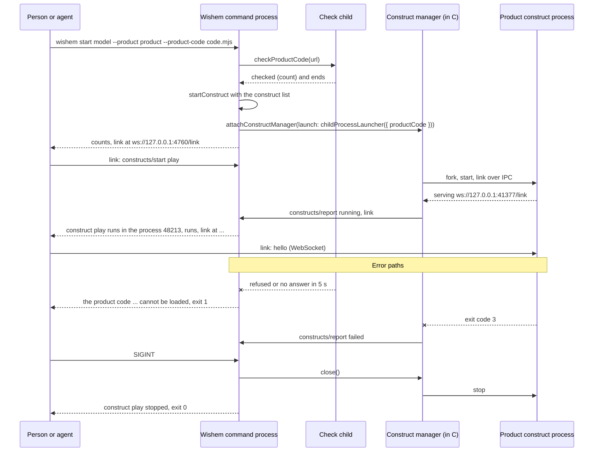
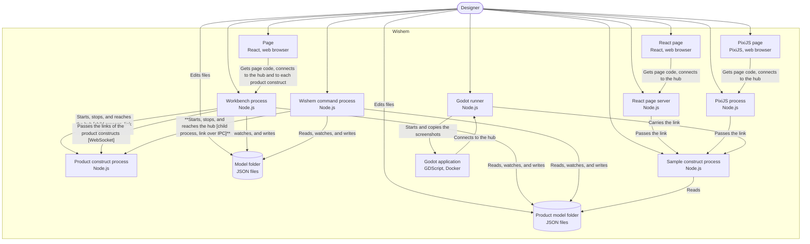
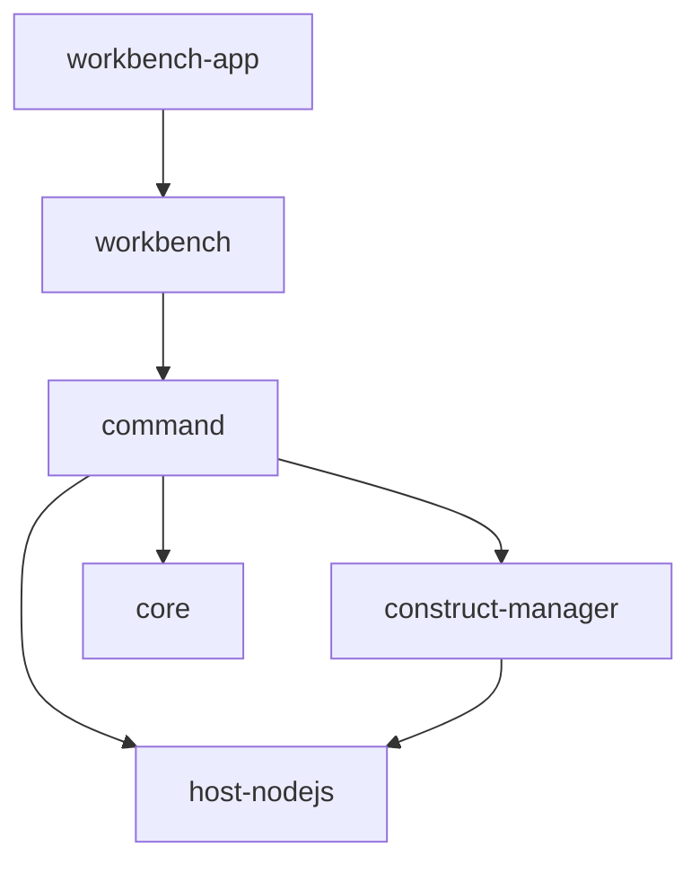

# Design

## Context

See `proposal.md`, "Why". The state on `main` (532c3243), and the plan of #628 that this change applies after:

- `host-nodejs/src/cli.ts` is the `wishem` command. It parses `start <folder> [--product <folder>] [--port <number>]`, calls `startConstruct` with no `subsystems`, prints the counts and the address, and stops the construct on `SIGINT` and `SIGTERM`, also during the start (`cli.signal.test.ts`). `host-nodejs/bin/wishem.js` imports `dist/cli.js`. `cli.test.ts` and `cli.guide.test.ts` (#632) start `dist/cli.js` as a child process, so `turbo.json` has the entry `@thrashplay/wishem-host-nodejs#test` that builds the package first.
- `construct-manager` has `@thrashplay/wishem-host-nodejs` in `dependencies`: `construct-manager.ts` imports `PRODUCT_ID`, and `product-construct.ts` (and, after #628, `product-construct-process.ts`) imports `serveHub`. So `host-nodejs` cannot import `construct-manager` with no dependency cycle.
- `workbench` has the `start` script `exec wishem start ./model`. It gets the bin from its dependency `host-nodejs`. The milestone guides and `sample-product/README.md` run `pnpm --filter @thrashplay/wishem-workbench exec wishem start ...`.
- `workbench-app/scripts/start.ts` is the one user of the construct manager. With `--product`, it gives `subsystems: [createConstructList()]` to `startConstruct` and calls `attachConstructManager`. After #628 it resolves `--product-code` to a file URL, checks it with `checkProductCode`, and attaches the manager with `launch: childProcessLauncher({ productCode })`.
- The plan of #628 says in its Non-Goals that the `wishem` command does not change, and in "Follow-up" that #629 gives the command the construct manager with `childProcessLauncher`.

## Goals / Non-Goals

**Goals:**

- `wishem start --product` runs, pauses, steps, steps back, and stops product constructs through its link, with the same construct list and construct manager as the workbench.
- `--product-code` gives the behaviors to each product construct, with the same checks and lines as the `start` script of the workbench.
- No dependency cycle. No change to the source of `construct-manager`.
- The commands that people and guides use (`pnpm --filter @thrashplay/wishem-workbench exec wishem start ...`, `pnpm --filter @thrashplay/wishem-workbench start`) do not change.
- Each step of "The test guide" that a program can do is an automated test with real processes.

**Non-Goals:**

- A passage of `/constructs/<id>/link` on the port of the command. The address of each product construct is in its entry of the part `constructs` and in the terminal line. A client connects to it directly.
- `--product-views`, a page, or a Vite development server in the command.
- A change of the construct list, the construct manager, the launchers, or the product construct process. #628 owns them.
- A change of the `start` script of `workbench-app`.

## Approaches

| Approach                                                                                                                                                                                      | Trade-off                                                                                                                                                                                                                                                 | Result       |
| --------------------------------------------------------------------------------------------------------------------------------------------------------------------------------------------- | --------------------------------------------------------------------------------------------------------------------------------------------------------------------------------------------------------------------------------------------------------- | ------------ |
| **A. Move the `wishem` command to a new package `command`, which depends on `host-nodejs` and `construct-manager`. `workbench` depends on `command` for the bin.**                            | No cycle. One command with one usage line. The package of each import is explicit in `package.json`. Costs one new package (the lock file, the README list, the layers of `render.mjs`, `docs-check`).                                                    | **Selected** |
| B. Keep `cli.ts` in `host-nodejs`, and give it the construct manager by dependency injection: `host-nodejs` exports a `runCommand(argv, extensions)`, and a bin in a higher package calls it. | `host-nodejs` keeps the parse of the options. But the bin must still go to a package that depends on both, `host-nodejs` then holds options (`--product-code`) whose meaning is in a different package, and the command code is in two packages.          | Rejected     |
| C. Load `construct-manager` in `cli.ts` with a dynamic `import()` of a package that is not in its `dependencies`.                                                                             | No new package. A hidden dependency in the wrong direction: the package dependency view and the layer check do not see it, a build of `host-nodejs` alone does not build it, and a change of `construct-manager` breaks `host-nodejs` with no type error. | Rejected     |
| D. Remove the dependency of `construct-manager` on `host-nodejs` (move `PRODUCT_ID` and `serveHub`).                                                                                          | `serveHub` is the WebSocket server of `host-nodejs` and belongs there. A move changes `construct-manager` while #628 rewrites it and #630, #679, #769, and #776 work on it.                                                                               | Rejected     |
| E. Put the bin in `construct-manager`.                                                                                                                                                        | No new package. A library package then holds a command, and its tests start the command. It changes `construct-manager` while other work is on it.                                                                                                        | Rejected     |
| F. A second command with a different name in `workbench` or in a new package, and `wishem` stays in `host-nodejs`.                                                                            | The issue permits "a new command". Two commands that each start a construct for a model folder, with two usage lines and two specifications of the same options. A person must know which one runs product constructs.                                    | Rejected     |

## Decisions

### 1. The package `command` holds the `wishem` command

New private package `@thrashplay/wishem-command` in `nodejs/wishem/command`. It holds `bin/wishem.js` and `src/cli.ts`, which move from `host-nodejs` with `git mv`, and the three test files of the command (`cli.test.ts`, `cli.signal.test.ts`, `cli.guide.test.ts`).

- `dependencies`: `@thrashplay/wishem-construct-manager`, `@thrashplay/wishem-core`, `@thrashplay/wishem-host-nodejs`. `devDependencies`: `@thrashplay/wishem-hub` (link clients of the tests), `@thrashplay/wishem-sample-product` (the product code and the model of the tests), and the shared tooling.
- `cli.ts` imports `startConstruct`, `DEFAULT_PORT`, and `PRODUCT_ID` from `@thrashplay/wishem-host-nodejs`, and `describeCounts` and `formatProblem` from `@thrashplay/wishem-host-nodejs/format`. `host-nodejs` gets no new export. `cli.signal.test.ts` mocks `@thrashplay/wishem-host-nodejs` in place of `./start-construct.js`.
- The package has no public API of code. `package.json` has the `bin`, `files` (`bin`, `dist`), and `exports` with `"./package.json"` and `"./*"` (the entry that `pnpm sync` writes for each package). The build compiles `src/cli.ts` to `dist/cli.js`, as in `host-nodejs` on `main`. `pnpm install && pnpm sync` writes the shared config, and Task 1 keeps what it writes.
- `workbench` replaces `@thrashplay/wishem-host-nodejs` with `@thrashplay/wishem-command` in `dependencies`, and keeps `host-nodejs` in `devDependencies` for `model.test.ts` (`readModelFolder`). pnpm links the bin of a dependency into `node_modules/.bin` of `workbench`, so its `start` script and `pnpm --filter @thrashplay/wishem-workbench exec wishem` do not change. A package does not get a link to its own bin, so the bin cannot go into `workbench` itself.
- `host-nodejs` removes `bin/`, the `bin` field, `bin` in `files`, `src/cli.ts`, and the three test files. Its README keeps "The link", "Serve the link of a hub", "The model folder", "More model subsystems", "The product folder", "Problems" (the problems of `startConstruct`), and "Use in code". The section "The command" moves to the README of `command`, and the README of `host-nodejs` gets one line with a link to it.
- `turbo.json`: the entry `@thrashplay/wishem-host-nodejs#test` becomes `@thrashplay/wishem-command#test` with the same `dependsOn` (`"^build", "build"`) and inputs. The tests that stay in `host-nodejs` do not read `dist/`. `^build` also builds `construct-manager`, so `dist/product-construct-process.js` of #628 exists for the tests of Task 2.
- `docs-check` gets `@thrashplay/wishem-command` in `devDependencies` (the rule of the check).
- The capability `wishem/host-nodejs/cli` keeps its path. An area names a behavior domain, not a package, and the requirements of the command stay in one specification. Reason: a move of each requirement to a new capability is a REMOVED and an ADDED of each block, with no change of behavior.
- The layers of `render.mjs`: a new layer `Commands` with `command`, between `Hosts, renderers, and products` and `Applications`. Reason: `workbench` (Applications) uses `command`, and `command` uses packages of layer 3, so each arrow goes down with no arrow in one layer.

### 2. With `--product`, the command holds the construct list and attaches the construct manager

`cli.ts` calls `startConstruct({ ..., subsystems: product === undefined ? undefined : [createConstructList()] })`, as the `start` script of `workbench-app` does. Then it calls `attachConstructManager({ hub: started.hub, launch: childProcessLauncher({ productCode }), log: say })`, before it prints the counts and the address. With no `--product`, it does neither, and the command is the command of `main`.

- Reason for `--product` as the condition: the construct manager reads the part `product`. A list with no product has nothing to run.
- Reason for an explicit `launch`: the default `childProcessLauncher()` of #628 has no product code.
- The lines of the manager go to `say` (standard output), so the tests and a person read them in the same place as the other lines.
- The joined state of the command then has the parts `store`, `product`, the storage parts, and `constructs`, the same as the workbench construct. A client sends the inputs `constructs/*` through the link of the command.

### 3. The option `--product-code`

- `parseArgs` gets `'product-code': { type: 'string' }`. An empty value gives the usage line and exit code 2, as `--product ""` does. A value with no `--product` gives `wishem: --product-code needs --product`, the usage line, and exit code 2. Reason: the command reports a wrong use of its options with exit code 2. The `start` script of `workbench-app` uses exit code 1 for the same text, because it has no usage line.
- The command prints `wishem: product code <value>` after `wishem: product <folder>`, with the value as the person gave it, as the `start` script does.
- The value becomes a file URL one time: a value that starts with `.` or `/` is a path, resolved with `path.resolve(value)` from the folder of the process, the same rule as `<folder>` and `--product` of the command. Each other value is a package name, resolved with `import.meta.resolve(value)` of `cli.ts`. A package name that does not resolve gives `wishem: the product code <value> cannot be loaded: <reason>` and exit code 1.
  - Reason for the folder of the process and not `INIT_CWD`: the two folder options of the command use it, and `pnpm exec` runs the command in the folder of the package. The guides give absolute paths.
  - Reason for `import.meta.resolve` of `cli.ts`: the same rule as the `start` script, from its own package. `@thrashplay/wishem-sample-product` is a development dependency of `command`, so it resolves in the repository.
- The command calls `checkProductCode(url)` of #628 before `startConstruct`. It prints the lines of #628 Decision 8 and stops with exit code 1 for a `refused` result or no answer. The command process never imports the module.
- The command does not share this code with `scripts/start.ts` of `workbench-app`. Reason: each resolves a package name from its own package, and a shared helper in `construct-manager` changes that package while other work is on it. The two copies are approximately 15 lines, and each has its tests.

### 4. The stop

- `cli.ts` keeps one value `running` with `close()`: `manager.close()`, then `construct.close()`. The handler of `SIGINT` and `SIGTERM` and the watch error call it. Reason: the manager stops each product construct before the hub of the command stops, as in the workbench, so the line `wishem: construct <id> stopped` shows before the exit.
- A stop signal during the start: when the signal arrives before `startConstruct` resolves, the command closes the construct and attaches no manager (the form of `main`). When the manager is attached, the handler closes the two in order. `cli.signal.test.ts` gets one test for each case.
- A `SIGKILL` of the command: the IPC channel of each product construct process disconnects, and the child ends (#628 Decision 3). The command does nothing for it.
- The correction of #568 item "two variables for the construct" is not in the scope. Task 2 changes the same lines, and the implementer reports the state of that item.

### 5. The blueprint and the architecture document

- Container diagram: the relationship from the Wishem command process to the product construct process, "Starts, stops, and reaches the hub [child process, link over IPC]". The row of the Wishem command process: it runs one construct for a model folder with no page and no Vite development server; with `--product`, it mounts a product model folder, holds the construct list, and starts a product construct process for each product construct; with `--product-code`, it checks the product code in a child process. Packages: `command` (bin `wishem`, `src/cli.ts`), `host-nodejs` (`startConstruct`), `construct-manager`, `core`, `hub`, `workbench` (the folder `model/`). The row of the product construct process (#628): it ends when its parent process ends. The text under the diagram says that the `wishem` command starts product construct processes in the same way as the workbench process.
- Package dependency view: the card `command` in the new layer `Commands`, arrows to `construct-manager`, `core`, and `host-nodejs`, and the arrow from `workbench` to `command`. The table row of `host-nodejs` loses "provides the `wishem` command", and a new row for `command`.
- `glossary.md`: **Construct manager** names the workbench process and the Wishem command process. **Product construct process** (of #628): a child process of the workbench process or of the Wishem command process. **Product code**: the option `--product-code` of the `start` script of the workbench and of `wishem start`.
- `concepts.md`, "Workbench and product": one line that the `wishem` command with `--product` runs the construct list and the construct manager with no page.
- `nodejs/wishem/CLAUDE.md`: the line of `host-nodejs` loses "provides the `wishem` command", and a new line for `command`.
- `docs/milestones/a1-construct.md`: the two usage lines get `[--product-code <module>]`.
- `rules.md`: no change. R21 stays true: each hub runs in a Node.js process, and each client reaches it through the link.

### 6. No question for the owner

The decisions meet fewer than the three conditions of "When to ask the owner". A user of Wishem runs the same command with the same name. The package of the bin is easy to change later, and #544 (the distribution of the workbench) decides how a designer installs it.

## Interfaces

No package exports a new TypeScript interface. The command line, owner `@thrashplay/wishem-command` (bin `wishem`):

```text
usage: wishem start <folder> [--product <folder>] [--product-code <module>] [--port <number>]
```

The interfaces of #628 that this change uses, owner `@thrashplay/wishem-construct-manager`, entry `node` (see `design.md` of `628-product-construct-child-process`, "Interfaces"):

```ts
export const attachConstructManager: (options: ConstructManagerOptions) => ConstructManager
export interface ConstructManagerOptions {
  hub: Hub
  launch?: ProductConstructLauncher
  log?: (line: string) => void
}
export interface ConstructManager {
  readonly running: ReadonlyMap<string, LaunchedConstruct>
  close(): Promise<void>
}
export const childProcessLauncher: (options?: ChildProcessLauncherOptions) => ProductConstructLauncher
export interface ChildProcessLauncherOptions {
  productCode?: string // a file URL
  // stepMs, startMs, pingMs, answerMs, stopMs: the command uses the defaults
}
export type ProductCodeCheck =
  { ok: true; count: number } | { ok: false; reason: 'load' | 'behaviors'; message: string }
export const checkProductCode: (url: string, options?: { answerMs?: number }) => Promise<ProductCodeCheck>
```

Also from #628: the build output `construct-manager/dist/product-construct-process.js`, and the log lines `wishem: construct <id> runs in the process <pid>`, `wishem: construct <id> runs, link at <address>`, `wishem: construct <id>: <line>`, `wishem: construct <id> stopped`, and `wishem: construct <id> failed: <message>`.

From `main`: `createConstructList` (root entry of `construct-manager`), `startConstruct` with the option `subsystems`, `DEFAULT_PORT`, and `PRODUCT_ID` (`host-nodejs`), and `describeCounts` and `formatProblem` (`host-nodejs/format`).

## Data Model

No persisted data changes, and no type changes. The part `constructs` of the construct of the command is the construct list of `main`.

## The flow of a start through the command



## The architecture document

The container diagram after this change and #628 (the new relationship in bold):



- New: the relationship from the Wishem command process to the product construct process.
- Changed: the rows of the Wishem command process and of the product construct process (Decision 5).
- No element is new or removed. The component diagram of the workbench process does not change.

The package dependency view after the change (only the changed arrows):



`workbench` loses its arrow to `host-nodejs`.

## Failure Modes

| Failure                                                                | Result                                                                                                                                                         | Recovery                                  |
| ---------------------------------------------------------------------- | -------------------------------------------------------------------------------------------------------------------------------------------------------------- | ----------------------------------------- |
| `--product-code` with no `--product`, or an empty value                | The error line (for no `--product`) and the usage line. Exit code 2. No server.                                                                                | Give the option correctly.                |
| The module cannot be loaded, or the package name does not resolve      | `wishem: the product code <value> cannot be loaded: <reason>`. Exit code 1. No server.                                                                         | Correct the path or the file.             |
| The module has no correct list `behaviors`                             | `wishem: the product code has no correct list behaviors: <message>`. Exit code 1.                                                                              | Correct the module.                       |
| The module does not end at the check                                   | The check kills its child after 5 seconds. `... cannot be loaded: The check did not end in 5 seconds.` Exit code 1.                                            | Correct the module.                       |
| The model or the product is not correct, or the port is in use         | The lines and exit codes of `main`. The check of the product code ran before, and its child ended.                                                             | As on `main`.                             |
| A product construct fails (exit, no answer, no start, code not loaded) | The manager reports `failed` with the message and prints the line. The command continues.                                                                      | `constructs/stop` and `constructs/start`. |
| `SIGINT` or `SIGTERM` during the start                                 | Before the construct runs: the construct closes, no manager. After: the manager closes, then the construct. Exit code 0.                                       | None needed.                              |
| `SIGINT` or `SIGTERM` during the check of the product code             | The command waits for the check to end, at most 5 seconds. Then it exits with code 0, whatever the result of the check. No server.                             | None needed.                              |
| The watch of a folder fails during a run                               | The manager closes, then the construct. Exit code 1, as on `main`.                                                                                             | Start the command again.                  |
| The command gets `SIGKILL` or crashes                                  | Each product construct process sees its IPC channel disconnect and ends (#628).                                                                                | None needed.                              |
| A second signal during the stop                                        | The stop runs one time (`stopState`), as on `main`.                                                                                                            | None needed.                              |
| Two commands with the same `--port`                                    | The second prints that the port is in use and stops with exit code 1. The product constructs of each command use ports that the system selects, with no clash. | Use a different `--port`.                 |

Idempotence: `close()` of the manager and of the construct give the same promise on each call. A second signal does not start a second stop. The inputs `constructs/*` have the idempotence of the construct list of `main`.

## Examples

A run with the sample product (the lines after the address come from the construct manager):

```text
$ node nodejs/wishem/command/bin/wishem.js start /workspace/opus/.superpowers/a4cmd/model --product /workspace/opus/.superpowers/a4cmd/product --product-code @thrashplay/wishem-sample-product --port 4760
wishem: model /workspace/opus/.superpowers/a4cmd/model
wishem: product /workspace/opus/.superpowers/a4cmd/product
wishem: product code @thrashplay/wishem-sample-product
wishem: 1 component type, 1 entity
wishem: product: 2 component types, 1 entity
wishem: link at ws://127.0.0.1:4760/link
wishem: construct play runs in the process 48213
wishem: construct play runs, link at ws://127.0.0.1:41377/link
^Cwishem: construct play stopped
$ echo $?
0
```

Error cases:

```text
$ wishem start ./model --product-code ./code.mjs
wishem: --product-code needs --product
usage: wishem start <folder> [--product <folder>] [--product-code <module>] [--port <number>]
$ echo $?
2
$ wishem start /tmp/m --product /tmp/p --product-code ./missing.mjs
wishem: model /tmp/m
wishem: product /tmp/p
wishem: product code ./missing.mjs
wishem: the product code ./missing.mjs cannot be loaded: Cannot find module '/tmp/missing.mjs' imported from ...
$ echo $?
1
```

## Package Impact

| Package                          | Published or private | Bump  | Why                                                                                                                                                   |
| -------------------------------- | -------------------- | ----- | ----------------------------------------------------------------------------------------------------------------------------------------------------- |
| `@thrashplay/wishem-command`     | private (new)        | minor | Holds the `wishem` command. With `--product`, the command runs the construct list and the construct manager. The option `--product-code`.             |
| `@thrashplay/wishem-host-nodejs` | private              | minor | **Breaking** for its consumers: the package has no `bin`. The `wishem` command is in `@thrashplay/wishem-command`. The library entries do not change. |
| `@thrashplay/wishem-workbench`   | private              | patch | Gets the `wishem` command from `@thrashplay/wishem-command`. The `start` script does not change.                                                      |
| `@thrashplay/wishem-docs-check`  | private              | patch | The development dependency `@thrashplay/wishem-command`, and the architecture document that it checks.                                                |

Two changesets, one for each distinct change:

1. The move of the command (Task 1): `@thrashplay/wishem-command` minor, `@thrashplay/wishem-host-nodejs` minor, `@thrashplay/wishem-workbench` patch, `@thrashplay/wishem-docs-check` patch.
2. The command runs product constructs (Tasks 2 and 3): `@thrashplay/wishem-command` minor.

The final reviewer runs the type check of `...^@thrashplay/wishem-host-nodejs` and `...@thrashplay/wishem-command`.

## Open bugs of the same files or behavior

Search: open issues with the label `app:wishem` and the type `Bug` on 2026-11-28.

- **#706** "Two start scripts can lose a terminate signal that arrives during the start": the files are `pixi-page/scripts/start.ts`, `workbench-app/scripts/e2e-server.ts`, and `workbench-app/scripts/start.ts`. `cli.ts` removes no listener, and its stop during the start has tests (`cli.signal.test.ts`). This change keeps that form and adds the manager to it (Decision 4). #706 stays open, with no change.
- **#685** "A product construct that fails at the start does not close its clock port": `product-construct.ts` and `construct-manager.ts`. #628 corrects items 1 to 3. This change does not change these files. No change.
- **#757**, **#712**, **#692**: the page of the workbench, the end-to-end test of the three renderers, and the UI test of the view warnings. Other files and other behavior. No change.

Open tasks of the same files: **#568** (the findings of the reviews of #531) names `cli.ts`: no test of a second `SIGINT` during the start, and two variables for the construct. These items move with the file to `command/src/cli.ts`. The finisher adds a comment to #568 with the new path.

## Order with other changes

- **#628** (planned, construct-manager and workbench-app): Tasks 2 and 3 use `childProcessLauncher`, `checkProductCode`, the option `launch`, and `dist/product-construct-process.js`. Task 1 changes `architecture/README.md` and `render.mjs`, which Task 4 of #628 also changes. Order: the apply of this change starts after #628 is merged, and the delta of `wishem/architecture/diagrams` is read again against `main` at that time.
- **#630** (planned, construct-manager): no shared file. The step back that the tests of Task 2 use is the behavior of `main`, which #630 keeps. No order.
- **#606** (in apply: core, the renderers, workbench-app): it modifies the requirement "The entity diagram of the model folder" of `wishem/architecture/diagrams` and the entity diagram. This change modifies a different requirement. Both change `architecture/README.md` and the SVG files that `render.mjs` writes. Order: the branch merges `main` first when #606 is merged, and runs `render.mjs` again.
- **#679**, **#769**, **#776** (break-tests of `construct-manager` and `core`): this change does not change the source of `construct-manager` or `core`, so the rule "no break-test of a package while a change of that package is in apply" does not apply. They can run at the same time.

## The test guide

The final reviewer does these steps on the branch, with real processes and real files, and reports the real result of each step. The results of steps 1 to 11 are the results after this change: on `main`, the command has no construct list and no `--product-code`. Run each command from the root of the worktree. `W` runs the bin of the command directly with `node`, so `echo $?` gives the exit code of the command. A run through `pnpm exec` gives the exit code of pnpm instead: 130 after Ctrl+C, and 1 for each non-zero exit code of the command. Terminal 1 runs the command. Terminal 2 runs the other commands. Set the variables of step 0 in each terminal.

### 0. Prepare

```sh
pnpm install
pnpm build --filter "@thrashplay/wishem-*"
D=$PWD/.superpowers/a4cmd
W="node nodejs/wishem/command/bin/wishem.js"
L=ws://127.0.0.1:4760/link
RAW=nodejs/wishem/docs/milestones/a1-construct/raw-link.mjs
LISTEN=nodejs/wishem/docs/milestones/a1-construct/link-client.mjs
CT=ct_6af38bd9-a91d-49d9-9370-fa4e6c04769d
CF=fld_ef085a2e-22ef-4409-bac4-9cd5648d0705
link_of_play() { node $RAW --url $L --once | grep -o 'ws://127.0.0.1:[0-9]*/link' | grep -v ':4760/' | head -1; }
write_code() { cat > $D/code.mjs <<EOF
import { appendFileSync } from 'node:fs'
appendFileSync(new URL('./loaded.txt', import.meta.url), process.pid + '\n')
export const behaviors = [{ id: 'guide/count', componentType: '$CT', update: (f) => { $1 } }]
EOF
}
```

Terminal 2 only:

```sh
rm -rf $D && mkdir -p $D
cp -r nodejs/wishem/workbench/model $D/model
cp -r nodejs/wishem/sample-product/model $D/product
write_code "return { ...f, '$CF': f['$CF'] + 1 }"
```

Result: the build ends with no failed task. `$D/code.mjs` exists.

### 1. The start checks the code in a child process

Terminal 1:

```sh
$W start $D/model --product $D/product --product-code $D/code.mjs --port 4760
```

Terminal 2:

```sh
cat $D/loaded.txt; pgrep -f 'bin/wishem.js start'; pgrep -fc product-construct-process
```

Result: terminal 1 shows `wishem: model <D>/model`, `wishem: product <D>/product`, `wishem: product code <D>/code.mjs`, `wishem: 1 component type, 1 entity`, `wishem: product: 2 component types, 1 entity`, and `wishem: link at ws://127.0.0.1:4760/link`, in this order. `loaded.txt` holds one process ID, and `pgrep -f` prints a different ID. `pgrep -fc` prints `0`.

### 2. The link of the command has the construct list

```sh
node $RAW --url $L --once | grep -o '"constructs":{"constructs":{}}'
```

Result: the `grep` prints `"constructs":{"constructs":{}}`.

### 3. Run `play`

```sh
node $RAW --url $L --once --send '{"type":"constructs/start","payload":{"construct":"play"}}'
sleep 1; pgrep -f product-construct-process; tail -1 $D/loaded.txt
P=$(link_of_play); echo $P
node $LISTEN --url $P | head -3
```

Result: terminal 1 shows `wishem: construct play runs in the process <pid>` and `wishem: construct play runs, link at <P>`. `pgrep` prints that `<pid>`, and the last line of `loaded.txt` is that `<pid>`. The listener prints a `state:` line with `time` and `store`, and `applied` lines of `time/advance`.

### 4. Pause, step, and step back through the link of the command

```sh
node $RAW --url $L --once --send '{"type":"constructs/send","payload":{"construct":"play","input":{"type":"time/set-running","payload":{"running":false}}}}'
node $RAW --url $P --once | grep -o '"ticks":[0-9]*'
node $RAW --url $L --once --send '{"type":"constructs/send","payload":{"construct":"play","input":{"type":"time/advance","payload":{"ms":50}}}}'
node $RAW --url $L --once --send '{"type":"constructs/rewind","payload":{"construct":"play","ticks":1}}'
node $RAW --url $P --once | grep -o '"ticks":[0-9]*\|"running":[a-z]*'
```

Result: the first `grep` gives a tick count `t`. The last `grep` gives `"running":false` and `"ticks":t`.

### 5. A hand edit of the product folder reaches `play`

```sh
node -e "const f=process.argv[1];const fs=require('fs');const s=JSON.parse(fs.readFileSync(f));s.entities[0].components['ct_d85ac719-7dd0-45d8-bf98-0da9e6ab0512']['fld_694d6cb2-97e8-444e-961e-aa76744837fb']='#15803d';fs.writeFileSync(f,JSON.stringify(s,null,2))" $D/product/state.json
sleep 1
node $RAW --url $P --once | grep -c '"#15803d"'
node $RAW --url $L --once | grep -c '"#15803d"'
```

Result: each `grep -c` prints `1`.

### 6. A new version of the code runs after a stop and a start

```sh
write_code "return { ...f, '$CF': f['$CF'] + 10 }"
node $RAW --url $L --once --send '{"type":"constructs/stop","payload":{"construct":"play"}}'
node $RAW --url $L --once --send '{"type":"constructs/start","payload":{"construct":"play","running":false}}'
sleep 1; P=$(link_of_play)
node $RAW --url $P --once | grep -o "\"$CF\":[0-9]*"
node $RAW --url $L --once --send '{"type":"constructs/send","payload":{"construct":"play","input":{"type":"time/advance","payload":{"ms":50}}}}'
node $RAW --url $P --once | grep -o "\"$CF\":[0-9]*"
```

Result: terminal 1 shows `wishem: construct play stopped`, then `runs in the process <pid2>` with a new ID. After the step, the count is the first count plus 10.

### 7. A behavior that ends its process

```sh
write_code "process.exit(3)"
node $RAW --url $L --once --send '{"type":"constructs/stop","payload":{"construct":"play"}}'
node $RAW --url $L --once --send '{"type":"constructs/start","payload":{"construct":"play"}}'
sleep 2
node $RAW --url $L --once | grep -o '"status":"[a-z]*"\|The process of the construct[^"]*'
pgrep -fc product-construct-process
```

Result: terminal 1 shows `wishem: construct play failed: The process of the construct ended with the exit code 3.` The `grep` prints `"status":"failed"` and the message, so the command serves its link. `pgrep -fc` prints `0`.

### 8. An interrupt signal stops `play` and the command

```sh
write_code "return { ...f, '$CF': f['$CF'] + 1 }"
node $RAW --url $L --once --send '{"type":"constructs/stop","payload":{"construct":"play"}}'
node $RAW --url $L --once --send '{"type":"constructs/start","payload":{"construct":"play"}}'
sleep 1
```

Terminal 1: press Ctrl+C, then `echo $?`. Terminal 2: `pgrep -fc product-construct-process`.

Result: terminal 1 shows `wishem: construct play stopped`, and `echo` prints `0`. `pgrep -fc` prints `0`.

### 9. A killed command leaves no process

Start terminal 1 again with the command of step 1. Then:

```sh
node $RAW --url $L --once --send '{"type":"constructs/start","payload":{"construct":"play"}}'
sleep 1; PID=$(pgrep -f product-construct-process); echo $PID; P=$(link_of_play)
pkill -KILL -f 'bin/wishem.js start'
sleep 2; pgrep -fc product-construct-process; ps -p $PID > /dev/null; echo $?
node $RAW --url $P --once | grep -c 'connection failed'
```

Result: `PID` is one process ID. After the kill, `pgrep -fc` prints `0`, `ps` gives exit code 1, and the last command prints `1`: `raw-link.mjs` prints `error: the connection failed` and `closed: code 1006`, and exits with code 0 (it has no non-zero exit code for a refused connection).

### 10. The product code as a package name

Terminal 1:

```sh
$W start $D/model --product $D/product --product-code @thrashplay/wishem-sample-product --port 4760
```

Terminal 2:

```sh
node $RAW --url $L --once --send '{"type":"constructs/start","payload":{"construct":"play"}}'
sleep 1; node $LISTEN --url $(link_of_play) | head -4
```

Result: terminal 1 shows `wishem: product code @thrashplay/wishem-sample-product`. In the `applied` lines, the count grows by 1 at each tick. Press Ctrl+C in terminal 1.

### 11. The checks at the start

```sh
$W start $D/model --product-code $D/code.mjs; echo "exit $?"
$W start $D/model --product $D/product --product-code ""; echo "exit $?"
$W start $D/model --product $D/product --product-code $D/missing.mjs; echo "exit $?"
echo "export const behaviors = 'count'" > $D/bad.mjs
$W start $D/model --product $D/product --product-code $D/bad.mjs; echo "exit $?"
echo 'for (;;) {}' > $D/loop.mjs
time $W start $D/model --product $D/product --product-code $D/loop.mjs; echo "exit $?"
pgrep -fc product-construct-process
```

Result: (1) `wishem: --product-code needs --product`, the usage line with `[--product-code <module>]`, `exit 2`. (2) The usage line, `exit 2`. (3) `wishem: the product code <D>/missing.mjs cannot be loaded: <reason>`, `exit 1`. (4) `wishem: the product code has no correct list behaviors: The behaviors are not a list.`, `exit 1`. (5) After 5 to 7 seconds, `wishem: the product code <D>/loop.mjs cannot be loaded: The check did not end in 5 seconds.`, `exit 1`. `pgrep -fc` prints `0`.

### 12. With no product, the command does not change

Terminal 1:

```sh
$W start $D/model --port 4760
```

Terminal 2:

```sh
node $RAW --url $L --once | grep -c '"constructs"'
node $RAW --url $L --once --send '{"type":"constructs/start","payload":{"construct":"play"}}'
```

Result: terminal 1 shows the three lines of `main` (`model`, the counts, `link at`). The first command prints `0`. The second prints a `result` with `"ok":false`. Press Ctrl+C in terminal 1. This result is the same on `main`.

### 13. The start script of the base workbench

```sh
pnpm --filter @thrashplay/wishem-workbench start --port 4760
```

Result: the command prints `wishem: link at ws://127.0.0.1:4760/link`, as on `main`. Press Ctrl+C.

### 14. Clean up

```sh
rm -rf $D
```

### The automated tests of the guide

- `command/src/cli.constructs.guide.test.ts` (Task 2): starts `node dist/cli.js start <model> --product <product> --port 0` with copies of the two model folders in a temporary folder, and does steps 2, 3, 4, 5, 8, 9, and 12 with no product code, with link clients (`openLink` and `webSocketChannel` of `hub`), the files, the terminal lines, and `process.kill(pid, 0)` for the process IDs of the terminal lines.
- `command/src/cli.product-code.guide.test.ts` (Task 3): does steps 1, 6, 7, 10, and 11 in the same form. Step 11 waits for the default 5 seconds one time.
- Step 13 is `workbench/src/start.test.ts`, which runs with no change.
- Each test file stops each process that it started in `afterEach` or `afterAll` (`SIGKILL` for a process that did not end), and checks with `process.kill(pid, 0)` that each product construct process ID that it saw has ended. Each file runs in less than 60 seconds, so each `test` command fits the slot of 140 seconds.

## Risks / Trade-offs

- [A new package for one file of code] → It keeps the dependency direction of the layers, and it is the place for later subcommands of `wishem` (#544).
- [The tests of `command` need the build of `construct-manager` and of `command`] → The turbo entry builds the package and its dependencies first, as for `host-nodejs` on `main`.
- [A package name of `--product-code` resolves from the package `command`, not from the folder of the person] → The same rule as the `start` script of the workbench. A path works for each module. #544 decides the rule for an installed workbench.
- [The product code lines are in two scripts] → Each has its tests. The spec of each gives the same text.
- [`pnpm exec` can print a line of its own after a non-zero exit code] → The tests run `node dist/cli.js` and read the exit code of the command.

## Migration Plan

No data and no deployment. Each command of the guides and the `start` script of `workbench` stay the same. A program that ran `node nodejs/wishem/host-nodejs/bin/wishem.js` runs `node nodejs/wishem/command/bin/wishem.js`: no file in the repository does this. Rollback is the revert of the pull request.

## Follow-up

- After the merge, one break-test issue for this change: `command` is a library package by the rule of "Break-tests", because `workbench` has it in `dependencies`. The scope is `command/src/cli.ts` and the tests that the change added or changed.
- A comment on #568 with the new path of `cli.ts`.
- A passage of `/constructs/<id>/link` on the port of the command, if a renderer needs a stable address for a product construct of the command. No issue now.
