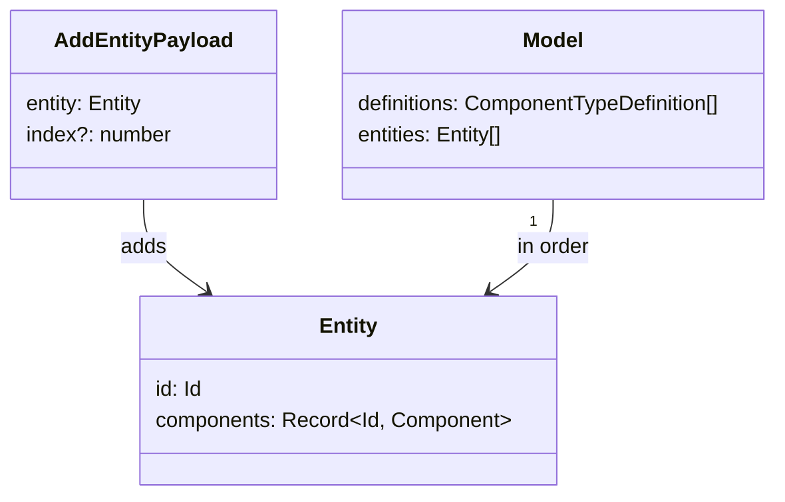
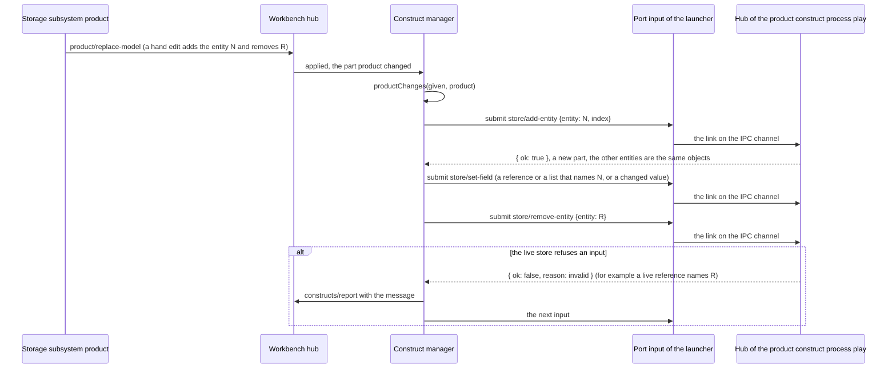

# Design

## Context

See `proposal.md`, "Why". The current state on `main` (55f61fba):

- `construct-manager/src/product-changes.ts`: `productChanges(before, after, storeId)` gives no input for equal models (`isEqual`). When `onlyValuesDiffer` is true (equal definitions, the same entity IDs in the same order, the same component types in each entity), it gives one `set-field` for each changed or added value and one `clear-field` for each removed value (#607). It compares the values with `isEqual`, so an equal list of references in a new object gives no input (#606). Else it gives one `replace-model` with `after`.
- `construct-manager/src/construct-manager.ts`: each running product construct is a `LaunchedConstruct` of `launchers.ts`. The construct manager reaches it only through the ports `input` (`construct-manager`) and `reader` (`construct-manager-reader`) of the launcher. `childProcessLauncher` (the default) runs the product construct in a product construct process (`product-construct-process.ts`), and the two ports are ports of a link on the IPC channel (`ipc-channel.ts`). The channel sends the texts of one turn in one IPC message (#628). `inProcessLauncher` runs the construct in the same process, for tests, and gives its `hub` too.
- `submitChanges` sends `productChanges(item.given, product)` through `item.input`, one input at a time, and waits for each result. It reports a refused input and sends the next one. `item.given` becomes the new product model before the inputs go (#643 records this).
- The step back (`stepBack`) finds the tick in `item.ticks`. The construct manager fills `item.ticks` from the `applied` events of `item.reader`: one item for each `time/advance` with the `given` model of that time, and a `hub/rewind` removes the ticks after its target. The step back sends `hub/rewind`, then `productChanges(first.given, item.given)`, then `time/set-running` when the construct was paused, through `item.input` with no `await` between them. Thus the inputs of a step back go in one IPC message, and the hub of the product construct applies them with no tick between them. Each result of `productChanges` goes through the same path, so this change does not touch `construct-manager.ts`, `launchers.ts`, or the product construct process.
- The work of an ended construct (`ended`) runs through the chain of the construct manager, and a `failed` report carries `startSeq`. `constructs/report` ignores a report of an earlier start (#628).
- `core/src/store.ts`: `add-entity` (`{ entity }`) puts the entity at the end of the list, refuses an ID that exists, and runs `validateModel` on the next model. `remove-entity` (`{ entity }`) refuses an ID that does not exist and an entity that a `reference` field or a `reference-list` field of a different entity names. `set-field`, `clear-field`, and `remove-entity` each run `validateModel`. A reference or an item of a list that names no entity is an error of `validateModel`. A list holds distinct IDs, and it can hold the ID of its own entity.
- `core/src/store.ts` also has `add-reference` and `remove-reference` for one item of a `reference-list` field, and `storeInputs()` gives `addReference` and `removeReference` (#606). `isEqual(a, b)` of `core/src/equality.ts` is exported from `core/src/index.ts`.
- The order of the entities is part of the behavior: the update subsystem runs each behavior for the entities in the order of the store (`wishem/update/update-subsystem`), and the renderers draw in that order. Thus the live order must be the authored order.
- The model of the sample product has one entity (`Counter` and `Color`). The count behavior adds 1 to each `Counter` count at each tick.
- Tests: `construct-manager.test.ts` uses `inProcessLauncher` with a fake clock (`makeClock`) and reads the hub of the construct (`InProcessConstruct.hub`). Its group "a step back" tests the tick history and the step back (#769). `construct-manager.child.test.ts` uses `childProcessLauncher` with the sample product code and reads the construct through `reader` (`stateOf`, `appliedOf`).

## Goals / Non-Goals

**Goals:**

- An added or removed entity keeps the live values of each other entity in each running product construct, for an input of the workbench, a hand edit of `state.json`, a rewind of the workbench, and a step back.
- The live order of the entities stays the authored order.
- Each input of the sequence is accepted by a store that holds the earlier model, also with references and lists of references between the entities of the change.
- The same inputs go to a product construct in a product construct process and to one in the process of the construct manager.
- A test with real processes or a real store for each step of "The test guide" that a program can do.

**Non-Goals:**

- Keep the live values when a component is added to or removed from an entity, or when the order of the entities changes. The store has no input for these yet (#713 adds the inputs of the components). See "Follow-up".
- Correct the `given` model after a refused input (#643). See "Failure Modes".
- Controls to add or remove an entity in the product panel (#713).
- A change of the link, of the launchers, of the IPC channel, of the product construct, or of the product construct process (#628).
- Send `add-reference` or `remove-reference` for a changed list. A changed list goes as one `set-field` of the full list, as #606 gives for values (Decision 4).

## Approaches

The lead agent did the brainstorm alone, as `autonomous-flow.md` says.

- **A. A sequence of the inputs that exist, with a position for `add-entity` (selected).** The store gets one optional key. `productChanges` stays the one place that knows how to change one model into the other.
- **B. Only `add-entity` at the end and `remove-entity`, with `replace-model` when the new entity is not at the end.** Rejected: the undo of a removal (a rewind of the workbench) puts the entity back at its old position, so the most usual case after a removal would still lose the live values. The issue asks for each change that adds or removes an entity.
- **C. `add-entity` at the end, and a live order that differs from the authored order.** Rejected: the update subsystem runs the behaviors in the order of the entities, so the live result would differ from a new start of the construct, and the renderers would draw in a different order.
- **D. A new input `move-entity`, and `add-entity` at the end and then a move.** Rejected for this change: two inputs for one act, and a new input type that no other client needs now. A move input can come with the follow-up for a new order.
- **E. A new input `patch-model` that applies a full diff in one step.** Rejected: one more contract with the full complexity of a diff, and the store would duplicate the logic of the four inputs that exist.

## Decisions

### 1. `add-entity` takes an optional `index`

The payload is `{ entity, index? }`. With no `index`, the entity goes at the end, as now. With `index`, the entity goes at that position, and the entities from that position move one position back. `index` equal to the number of entities is the end. The store checks `index` with the other keys of the payload, before the ID and the model. It refuses an `index` that is not an integer (`Number.isInteger`) from 0 to the number of entities, with the problem `The index is not an integer from 0 to <n>` at `['payload', 'index']`. The check of the ID does not change. `validateModel` checks the next model with the new entity at its position, and the part takes the checked entity from that position (now `checked.entities.at(-1)`). An entity that the input does not change stays the same object.

`storeInputs(id).addEntity(entity, index?)` gives `{ type: '<id>/add-entity', payload: { entity } }` with no `index`, and `{ entity, index }` with an `index`.

- Reason for the name: `index` is the term of a list position in JavaScript, and the record shows it with no unit.
- Rejected: `before: <entity ID>`. The construct manager knows the position in the model that it gave, and a position needs no second lookup. An ID that a live store does not hold would need one more refusal.
- No breaking change: each input of `main` has no `index` and keeps its meaning.

### 2. When `productChanges` sends parts

`productChanges` sends parts (no `replace-model`) when the three conditions are all true:

1. The definitions of the two models are equal.
2. The entities that the two models both hold (by ID) are in the same order in the two models.
3. Each of these entities has the same component types in the two models.

Each other change gives one `replace-model` with `after`, as now. The test "only values differ" of #607 becomes the case of this rule with no added and no removed entity. Its result does not change.

### 3. The order of the inputs

The result has three phases. Each phase is in the order of the entities of `after` (phase 3: of `before`), then of the components, then of the fields, as #607 gives for values.

1. **Additions.** One `add-entity` for each added entity. Its components are the components of `after`, with no value for each `reference` field or `reference-list` field that names an entity that is not in the store at that time: an added entity that comes later in the phase (Decision 4). A reference to itself stays. The `index` places the entity directly after the entity that comes before it in `after` (in the list of the store at that time, which still holds the removed entities), or at 0 when it is the first entity of `after`. The payload has no `index` when that position is the end of the list.
2. **Values.** For each entity that the two models both hold: one `set-field` for each changed or added value, then one `clear-field` for each removed value (#607). Then, for each added entity, one `set-field` for each value that phase 1 left out.
3. **Removals.** For each removed entity, one `clear-field` for each `reference` field or `reference-list` field whose value names a different removed entity. Then one `remove-entity` for each removed entity.

Why each input is accepted, from a store that holds `before`:

- Phase 1: an added entity names only entities that are in the store (the entities of the two models, earlier added entities, and itself). The removed entities stay, so each reference of `before` is still correct.
- Phase 2: after phase 1, each entity of `after` is in the store, so each reference of `after` is correct. The removed entities are still in the store, so a value of `before` that names one stays correct until it changes.
- Phase 3: `after` is a correct model, so no entity of `after` names a removed entity. After the clears, a removed entity names only itself or an entity of `after`. `remove-entity` permits a reference to itself, so each removal is accepted.
- The order: each entity of the two models keeps its relative order (condition 2). Each added entity is directly after the entity before it in `after`, and only the entity after it in `after` is put directly after it later. After the removals, the list is the list of `after`.

A test applies the result to a real store for each case of the table of Decision 6, and compares the store with `after`.

- Rejected: run the sequence on a local store in `productChanges` and send `replace-model` when one input fails. The phases are correct by construction, a second store costs a copy of the model for each change, and a silent fall back would hide a fault of the phases.
- Rejected: `remove-entity` first. A removed entity that an entity of the two models names is refused until the reference changes, and the new value can name an added entity, which needs the addition first.

### 4. Which values name an entity

A value names an entity when its field (found by the component type and the field ID in the definitions) has the type `reference` and the value is the ID of the entity, or has the type `reference-list` and the list holds the ID of the entity. The phases treat a full list as one value: phase 1 leaves out the full list when one of its IDs names an entity that is not yet in the store, phase 2 sets the full list, and phase 3 clears the full list when one of its IDs names a different removed entity. A list that holds the ID of its own entity stays in phase 1. Values are compared with `isEqual`, as `productChanges` does on `main`, so an equal list in a new object gives no input.

A list of references to a removed entity adds no phase and no input type:

- In an entity of the two models, the list of `after` does not hold the removed ID (`after` is a correct model). Thus the list is a changed value, and phase 2 sends one `set-field` of the full list before the removal of phase 3. This order is necessary: `remove-entity` refuses an entity that a list of a different entity holds, as for a `reference` field.
- In a removed entity, a list that holds the ID of a different removed entity gets one `clear-field` in phase 3. A list that holds only the IDs of entities of `after` or its own ID stays, and goes with its entity.
- A list that a live input added (for example `add-reference` through a `constructs/send`) and that names a removed entity is the first row of "Failure Modes".

- Reason for `set-field` of the full list and no `add-reference` or `remove-reference`: one input for each changed value, as #607 and #606 give for values. A list with a new order or with more than one changed item would need more inputs and an order rule of its own.

### 5. A rewind of the workbench and a step back

No code changes in `construct-manager.ts`, `launchers.ts`, `ipc-channel.ts`, or `product-construct-process.ts`. The construct manager sends each input through the port `input` of the `LaunchedConstruct`, and it has no access to the hub of a product construct process. After a rewind of the workbench, the part `product` is a different object, and `submitChanges` sends `productChanges(given, product)`. The undo of a removal is an addition at the old position, and the undo of an addition is a removal. A step back rewinds the product construct to a tick, and then sends `productChanges(first.given, item.given)`, so an entity that was added or removed after that tick is added or removed again, and the other entities have the live values of that tick.

The inputs of a step back go with no `await` between them. With `childProcessLauncher`, `ipcChannel` sends the texts of one turn in one IPC message, so the hub of the product construct process gets the `hub/rewind`, the `add-entity`, `set-field`, `clear-field`, and `remove-entity` inputs, and the `time/set-running` together, and the clock of the process cannot tick between them. A step back with more inputs makes that one IPC message longer and adds no message. The tick history (`item.ticks`) comes from the `applied` events of the port `reader`, and an added or removed entity does not change it.

The added entity of an undo gets its authored values, not the live values that it had before its removal. Reason: the product construct has no record of the live values of an entity that the authored state removed, and the authored values are what a new start gives.

### 6. Tests of the cases

`product-changes.test.ts` gets one table of cases. For each case: the exact list of inputs, and the result of the inputs on a real store (`createStore` in a hub) is equal to `after` (`isEqual`), with each input accepted. The model of the table has a component type with one `reference` field and one `reference-list` field.

| Case                                                              | Inputs                                                                                    |
| ----------------------------------------------------------------- | ----------------------------------------------------------------------------------------- |
| An entity at the end                                              | `add-entity` with no `index`                                                              |
| An entity at the start                                            | `add-entity` with `index` 0                                                               |
| An entity between two entities                                    | `add-entity` with `index` 1                                                               |
| Two new entities one after the other                              | `add-entity` with `index` 1, then `index` 2                                               |
| A removed entity at the start, the middle, and the end            | one `remove-entity`                                                                       |
| A removed entity and a new entity at its position                 | `add-entity` with `index` 1 (after the entity before it), then `remove-entity`            |
| An added entity, a removed entity, and a changed value            | `add-entity`, `set-field`, `remove-entity`                                                |
| A new entity that names an entity of the two models               | `add-entity` with the reference                                                           |
| An entity of the two models that names a new entity               | `add-entity`, then `set-field`                                                            |
| Two new entities that name each other                             | `add-entity` of `a` with no value, `add-entity` of `b` with its value, `set-field` of `a` |
| A new entity that names itself                                    | `add-entity` with the reference                                                           |
| Two removed entities that name each other                         | two `clear-field`, then two `remove-entity`                                               |
| A reference that moves from a removed entity to a new entity      | `add-entity`, `set-field`, `remove-entity`                                                |
| A removed entity that names an entity of the two models           | one `remove-entity`                                                                       |
| A list of an entity of the two models that holds a removed entity | `set-field` of the full list, then `remove-entity`                                        |
| A new entity whose list holds an entity that is added later       | `add-entity` with no list, `add-entity`, then `set-field` of the full list                |
| A new entity whose list holds its own ID                          | `add-entity` with the list                                                                |
| Two removed entities whose lists hold each other                  | two `clear-field` of the full lists, then two `remove-entity`                             |
| An equal list in a new object, with an addition                   | `add-entity` only                                                                         |
| A new order of the entities of the two models, with an addition   | `replace-model`                                                                           |
| A new definition with an addition                                 | `replace-model`                                                                           |
| A new component of an entity of the two models, with an addition  | `replace-model`                                                                           |
| The ID of the store `product`                                     | `product/add-entity`, `product/remove-entity`                                             |

The existing cases "a new entity" and "a removed entity" of the table of `replace-model` move to this table with their new results.

### 7. Tests of the steps of the test guide

| Step of the test guide                                   | Automated test                                                                                                    |
| -------------------------------------------------------- | ----------------------------------------------------------------------------------------------------------------- |
| 2–3. A hand edit adds an entity while `play` is paused   | `workbench-app/tests/run.guide.spec.ts`: a write of `state.json`; `play` gets `store/add-entity`, the count stays |
| 4. A step counts the two entities                        | `construct-manager.test.ts`: a step adds 1 to each count                                                          |
| 5. A hand edit adds an entity at the start               | `run.guide.spec.ts`: `play` gets `store/add-entity` with `index` 0, and the order of the store is the file order  |
| 6. A hand edit removes an entity                         | `run.guide.spec.ts`: `play` gets `store/remove-entity`, the count stays, no `store/replace-model`                 |
| 7. A rewind of the workbench after the removal           | `run.guide.spec.ts` (through a link client of the workbench) and `construct-manager.test.ts`                      |
| 8. Two new entities that name each other, then a removal | `construct-manager.test.ts`, with a product model that has the component type `Link` (`target` and `targets`)     |
| 9. A step back after an addition                         | `construct-manager.test.ts`, the group "a step back", and `construct-manager.child.test.ts`                       |
| Each case of the phases                                  | `product-changes.test.ts` (Decision 6)                                                                            |

### 8. No question for the owner

The key `index` is a contract of the record, but approach A is clearly better than B to E (see "Approaches"), and an optional key can get a sibling later with no break. The use of `set-field` for a full list (Decision 4) is an internal choice of `productChanges` that a later change can make finer with no break. The conditions of "When to ask the owner" are not all true.

### 9. The launchers of the tests

- `construct-manager.test.ts` uses `inProcessLauncher` with the fake clock, as its other tests do. The fake clock makes the ticks exact: a paused count, a step, and the tick of a step back have exact values. The tests read the hub of the construct (`InProcessConstruct.hub`), its record, and its part `store`. This is access of the test only. The construct manager uses only the ports of the launcher.
- `construct-manager.child.test.ts` gets two tests with `childProcessLauncher` and the sample product code, for the two places where a product construct process differs: the JSON of the IPC channel carries the payload of `add-entity` with its `index`, and the inputs of a step back go in one IPC message while the clock of the process runs. The tests read the construct through `reader` (`stateOf` and `appliedOf` of the file).
- Reason: the in-process launcher gives exact ticks, and a child process with a real clock gives no exact count. A test of each case with real children would add some seconds for each case and test no other path.

### 10. The order of the apply

The apply of this change starts after the break-tests #776, #788 (its second part, `construct-manager`), and #797 are closed, and merges `main` into the branch first. One apply runs the three tasks. See "Order with other changes".

- Reason: each of the three break-tests has `construct-manager` in its scope, and #776 also has `core/src/store.ts`. The flow does not start a break-test of a package while a change that changes that package is in apply, and it does the break-tests the oldest first. Task 2 replaces most of `productChanges`, so a break-test after it would run its mutants on code that its commit range does not hold, and its tests would need rework (the reason of the rule, #647). Task 3 needs Tasks 1 and 2, so no task can start early.

## Interfaces

`@thrashplay/wishem-core` (`src/store.ts`, exported from `src/index.ts`):

```ts
export interface AddEntityPayload {
  entity: Entity
  /** The position of the entity in the list, from 0 to the number of entities. Default: the end. */
  index?: number
}

export interface StoreInputs {
  replaceModel(model: Model): Input
  /** With no `index`, the payload has no `index` key. */
  addEntity(entity: Entity, index?: number): Input
  removeEntity(entity: Id): Input
  setField(payload: SetFieldPayload): Input
  clearField(payload: ClearFieldPayload): Input
  addReference(payload: ReferencePayload): Input
  removeReference(payload: ReferencePayload): Input
}
```

`@thrashplay/wishem-construct-manager` (`src/product-changes.ts`), the signature does not change:

```ts
/**
 * The inputs that change a store from `before` to `after`: `add-entity`, `set-field`, `clear-field`, and
 * `remove-entity` when the definitions, the order of the common entities, and their component types are equal,
 * else one `replace-model`.
 */
export const productChanges: (before: Model, after: Model, storeId?: string) => Input[]
```

## Data Model

No persisted schema changes. `state.json` does not change. The payload of the input `add-entity` gets the optional key `index` (modified). `Entity` and `Model` do not change.



## The flow of an added entity



A step back sends `hub/rewind`, the inputs of `productChanges(first.given, item.given)`, and `time/set-running` through the same port in one turn, so they go in one IPC message.

## The architecture document

No container, process, package, relationship, or import changes. The construct manager reaches the product construct process through the link on the IPC channel of #628, with no new message. Step 2 of "the path from a change of the product model to a running product construct" in `docs/architecture/README.md` says that the construct manager gets the inputs with `productChanges`, which stays true. The document and `render.mjs` do not change, and `render.mjs --check` passes with no new files.

## Failure Modes

| Failure                                                                                         | Behavior                                                                                                                                                                                                     | Recovery                                                                                                      |
| ----------------------------------------------------------------------------------------------- | ------------------------------------------------------------------------------------------------------------------------------------------------------------------------------------------------------------ | ------------------------------------------------------------------------------------------------------------- |
| A live value or a live list item that a send set names a removed entity                         | The product construct refuses `remove-entity`. The construct manager reports the message and sends the next input.                                                                                           | Clear the live value or remove the item through the product link, then a later change, or a stop and a start. |
| An earlier refused input left the construct different from `given` (#643)                       | A later input can be refused for the same reason (for example `add-entity` of an ID that the construct holds).                                                                                               | A stop and a start. #643 records the correction.                                                              |
| A change of the definitions, of the order, or of the component types comes with an added entity | One `replace-model`, as now. The live values return to the authored values.                                                                                                                                  | None needed: this is the rule of the specification.                                                           |
| A rewind of the workbench or a step back gives the same change again                            | The same inputs, from the same two models.                                                                                                                                                                   | None needed.                                                                                                  |
| The construct stops while the inputs go                                                         | `submit` rejects. The construct manager reports the message, as for `set-field`. When the process ended, `ended` runs through the chain after the inputs, and the `failed` report carries `startSeq` (#628). | None needed.                                                                                                  |
| A product construct process does not answer an input in 5 seconds                               | The launcher kills the process, and `submit` rejects with `The construct did not answer in 5 seconds.` The construct manager reports the message, and then the construct is `failed`.                        | A stop and a start. The inputs of one change are small, so the limit is the same as for `set-field`.          |

`productChanges` is a pure function. The inputs of one change are not idempotent as a group (a second `add-entity` of the same ID is refused), but the construct manager sends each change one time: it compares with `given`.

## Examples

A new entity through the link of the workbench (`raw-link.mjs`), at the start of the list:

```text
$ node nodejs/wishem/docs/milestones/a1-construct/raw-link.mjs --url ws://127.0.0.1:5173/link --once \
    --send '{"type":"product/add-entity","payload":{"index":0,"entity":{"id":"e_3c9a5d7e-2b4f-4a6c-8d8e-9f1a2b3c4d5e","components":{"ct_6af38bd9-a91d-49d9-9370-fa4e6c04769d":{"fld_ef085a2e-22ef-4409-bac4-9cd5648d0705":500}}}}}'
sent: {"t":"hello",...}
received: {"t":"welcome",...}
sent: {"t":"submit","request":1,...}
received: {"t":"applied","input":{"seq":9,"source":"raw-1234","type":"product/add-entity",...},"parts":{"product":{...}}}
received: {"t":"result","request":1,"result":{"ok":true,"seq":9}}
closed: code 1005
```

An `index` out of range:

```text
received: {"t":"result","request":1,"result":{"ok":false,"reason":"invalid","problems":[{"message":"The index is not an integer from 0 to 2","path":["payload","index"]}]}}
```

The code:

```ts
const inputs = productChanges(before, after)
// [{ type: 'store/add-entity', payload: { entity: { id: 'e_3c9a…', components: { … } }, index: 0 } },
//  { type: 'store/remove-entity', payload: { entity: 'e_2b8f…' } }]
```

## Package Impact

| Package                                | Published or private | Bump  | Why                                                                                                       |
| -------------------------------------- | -------------------- | ----- | --------------------------------------------------------------------------------------------------------- |
| `@thrashplay/wishem-core`              | private              | minor | `add-entity` takes an optional `index`, and `storeInputs().addEntity(entity, index?)`.                    |
| `@thrashplay/wishem-construct-manager` | private              | minor | An added or removed entity goes to a running product construct as inputs that keep the other live values. |
| `@thrashplay/wishem-workbench-app`     | private              | none  | A change of a test only.                                                                                  |

Two changesets, one for each row with a bump. No breaking change: each input and export of `main` keeps its meaning. The update subsystem passes each input of its store with no change, so `update` gets no changeset.

## Risks / Trade-offs

- [The phases send more inputs than one `replace-model`] → One input for each added or removed entity and each changed value. A change of a person or of a rewind is small. A change of many entities in one write gives many inputs, in one pass with no tick between them only for a step back. For a hand edit, a tick can come between two inputs; each input leaves a correct model.
- [A tick between two inputs of one change can run a behavior on a model that is half changed] → Each intermediate model is correct, and the behaviors run on the entities that the store holds at that time. The same is true for the values of #607.
- [An undo of a removal gives the authored values of that entity, not its live values] → Decision 5. A new start gives the same values.
- [A hand edit with many entities sends many inputs through the IPC channel] → `submitChanges` waits for each result, so each input is one round trip to the product construct process. A change of a person is small. The inputs of a step back go in one IPC message (Decision 5).
- [A list is sent in full for one changed item] → Decision 4. A list is short in the products of now, and a later change can send `add-reference` and `remove-reference`.

## Migration Plan

No data and no deployment. A product model with no added or removed entity behaves as before. Rollback is the revert of the pull request.

## Order with other changes

The order is Decision 10: the apply starts after #776, #788 (second part), and #797 are closed.

- **#776 (Break-test: `607` after #18).** Its scope holds `core/src/store.ts`, `core/src/index.ts`, and `construct-manager/src/product-changes.ts`. Task 1 changes `store.ts`, and Task 2 replaces most of `productChanges`. It is the oldest of the three, so it goes first. Its text names the commit range and the package wrongly (`607`, #18); the break-test reads it as the change #607.
- **#788 (Break-test: after #606), second part.** PR #792 did the part of `core` and `renderer-react`. The part of `construct-manager` (`product-changes.ts`) is open. Its mutants are the comparison with `isEqual` that Decision 4 keeps.
- **#797 (Break-test: after #628).** Its scope holds `construct-manager.ts`, `launchers.ts`, `ipc-channel.ts`, `product-construct-process.ts`, `product-construct.ts`, `construct-list.ts`, and `node.ts`, and their tests (`construct-manager.test.ts`, `construct-manager.child.test.ts`). This change does not change the source of these files, but Task 2 adds tests to the two test files. A break-test can add tests to the group "a step back", so Task 2 merges `main` after it and keeps each test.
- The three break-tests all have `construct-manager` in their scope, so they run one after the other, the oldest first ("Break-tests" of `autonomous-flow.md`). When a break-test closes with no pull request, the next item can start.
- **#606 and #628 (merged).** Their state on `main` is in "Context". Task 1 adds `index` next to the list inputs of #606 in `store.ts`, `store.test.ts`, `store.hub.test.ts`, and `core/README.md`. The delta of this change modifies "An input adds an entity", and #606 modified "An input removes an entity" and "A value that does not change keeps the part", so the deltas do not conflict.
- **#796 (product construct processes: small findings of #628) and #787 (lists of references: small findings of #606).** They change `launchers.ts`, `product-construct-process.ts`, `construct-manager.child.test.ts`, `core/src/store.ts`, and `core/src/store.test.ts`. They are tasks of `[WSH] R1 Tech Debt` and do not block this change. The change that merges second merges `main` and keeps the tests of both.
- **#713 (add and remove an entity or a component in the product panel).** It sends `product/add-entity` and `product/remove-entity`, and running product constructs then keep their live values with this change. Its inputs for components can make the follow-up for components possible.
- **#643 (construct manager: small findings of #538).** Its first item (`given` after a refused input) applies also to `add-entity` and `remove-entity`. This change does not correct it.
- **#557 (store findings).** The item "The paths of the problems start at two roots" applies to the new problem of `index`, which has a path that starts with `payload`, as the other faults of a payload. This change does not decide the item.
- The break-test issue of this change comes after the merge, and its scope is in "Workflow follow-up" of `tasks.md`.

Open bugs of the same files or behavior (`app:wishem`, the type `Bug`):

- **#685 (a product construct that fails at the start does not close its clock port).** `product-construct.ts` and the branch of `inProcessLauncher` where `attach` throws. This change does not touch them, and its tests start no construct that fails. No effect.
- **#757 (a reloaded workbench page can draw an old version of a product view for some seconds).** The test guide reloads the page in each `$PAGE` run. Use `waitfor:` before a check of the stage. This change does not correct it.
- **#692 (a UI test of the view warnings fails when other view files exist).** It is in the Playwright suite of `workbench-app` that Task 3 runs. Task 3 adds no view file. This change does not correct it.
- **#706 (two start scripts can lose a terminate signal that arrives during the start).** Terminal 1 of the test guide runs the start script of `workbench-app`. Stop it with Ctrl+C only after the line `wishem: workbench at`. This change does not correct it.

## The test guide

The final reviewer does these steps on the branch, with real processes, real files, and the pinned web browser in Docker, and reports the real result of each step. The results are the results after this change. On `main`, steps 3, 5, 6, and 7 give `store/replace-model` in terminal 4, and the count of the sample entity returns to the authored count `0`. Run each command from the root of the worktree. Terminal 1 runs the workbench. Terminal 2 runs the other commands. Terminal 3 runs a listener of the workbench, and terminal 4 runs a listener of `play`. Each run of `$PAGE` opens a new page.

### 0. Prepare

```sh
pnpm install
pnpm build --filter "@thrashplay/wishem-*"
rm -rf .superpowers/a4entity && mkdir -p .superpowers/a4entity
cp -r nodejs/wishem/workbench/model .superpowers/a4entity/model
cp -r nodejs/wishem/sample-product/model .superpowers/a4entity/product
cat > .superpowers/a4entity/product/definitions/ct_3a7b9c1d-2e4f-4a6b-8c0d-1e2f3a4b5c6d.json <<'EOF'
{
  "id": "ct_3a7b9c1d-2e4f-4a6b-8c0d-1e2f3a4b5c6d",
  "label": "Link",
  "fields": [
    { "id": "fld_5d6e7f8a-9b0c-4d1e-8f2a-3b4c5d6e7f8a", "label": "target", "type": "reference" },
    { "id": "fld_7a8b9c0d-1e2f-4a3b-8c4d-5e6f7a8b9c0d", "label": "targets", "type": "reference-list" }
  ]
}
EOF
RAW=nodejs/wishem/docs/milestones/a1-construct/raw-link.mjs
LISTEN=nodejs/wishem/docs/milestones/a1-construct/link-client.mjs
PAGE="node nodejs/wishem/workbench-app/scripts/browser-server.ts node ../docs/milestones/a4-workbench/page-driver.mjs"
STATE=.superpowers/a4entity/product/state.json
COUNTER=ct_6af38bd9-a91d-49d9-9370-fa4e6c04769d
CF=fld_ef085a2e-22ef-4409-bac4-9cd5648d0705
LINK=ct_3a7b9c1d-2e4f-4a6b-8c0d-1e2f3a4b5c6d
LF=fld_5d6e7f8a-9b0c-4d1e-8f2a-3b4c5d6e7f8a
LL=fld_7a8b9c0d-1e2f-4a3b-8c4d-5e6f7a8b9c0d
E2=e_2b8f4c6d-1a3e-4f5b-9c7d-8e0f1a2b3c4d
E3=e_3c9a5d7e-2b4f-4a6c-8d8e-9f1a2b3c4d5e
NA=e_4d0b6e8f-3c5a-4b7d-9e9f-0a2b3c4d5e6f
NB=e_5e1c7f9a-4d6b-4c8e-8f0a-1b3c4d5e6f7a
E4=e_6a3e9b1c-7f8d-4e0a-9b2c-3d5e6f7a8b9c
# edit '<JavaScript that changes the array e of the entities>'
edit() { node -e 'const f=process.argv[1],fs=require("fs"),s=JSON.parse(fs.readFileSync(f,"utf8")),e=s.entities;eval(process.argv[2]);fs.writeFileSync(f,JSON.stringify(s,null,2)+"\n")' "$STATE" "$1"; }
```

Result: the build ends with no failed task. `docker info` gives a server version.

### 1. Start the workbench with the product and its code

Terminal 1:

```sh
pnpm --filter @thrashplay/wishem-workbench-app start --model .superpowers/a4entity/model --product .superpowers/a4entity/product --product-code @thrashplay/wishem-sample-product --product-views nodejs/wishem/sample-product/views/react
```

Result: the line `wishem: workbench at http://127.0.0.1:5173/`.

Terminal 3: `node $LISTEN --url ws://127.0.0.1:5173/link`. Result: a `state:` line.

### 2. Run `play` and pause it

```sh
$PAGE run waitfor:Running wait:1000 pause print
```

Result: `run: Paused tick <t> ...` and `stage: Color #<hex>; Count <c>`, with `c` larger than 10. Terminal 1 prints `wishem: construct play runs in the process <pid>` and then the line of the link of `play`.

Terminal 4: `node $LISTEN --url ws://127.0.0.1:5173/constructs/play/link --json`. Result: a `state:` line whose sample entity has the count `c`.

### 3. A hand edit adds an entity at the end

```sh
edit "e.push({id:'$E2',components:{'$COUNTER':{'$CF':1000}}})"
$PAGE wait:500 print
```

Result: terminal 3 prints `applied #.. product/replace-model from product-files`. Terminal 4 prints `applied #.. store/add-entity from construct-manager` and no `store/replace-model`, and its `state:` line holds the sample entity with the count `c` and then `e_2b8f4c6d-…` with the count `1000`. The page prints `entities: Counter, Color e_99969ed3; Counter e_2b8f4c6d`, and `run: Paused tick <t>`.

### 4. A step counts the two entities

```sh
$PAGE step print
```

Result: tick `t + 1`. The `state:` line of terminal 4 holds the count `c + 1` for the sample entity and `1001` for `e_2b8f4c6d-…`.

### 5. A hand edit adds an entity at the start

```sh
edit "e.unshift({id:'$E3',components:{'$COUNTER':{'$CF':500}}})"
$PAGE wait:500 print
```

Result: terminal 4 prints `applied #.. store/add-entity from construct-manager`, and its `state:` line holds `e_3c9a5d7e-…` (count `500`), the sample entity (count `c + 1`), and `e_2b8f4c6d-…` (count `1001`), in this order. The page lists the three entities in the same order.

### 6. A hand edit removes an entity

```sh
edit "s.entities=e.filter(x=>x.id!=='$E2')"
$PAGE wait:500 print
```

Result: terminal 3 prints `applied #<r> product/replace-model from product-files`. Terminal 4 prints `applied #.. store/remove-entity from construct-manager` and no `store/replace-model`, and its `state:` line holds `e_3c9a5d7e-…` (count `500`) and the sample entity (count `c + 1`).

### 7. A rewind of the workbench after the removal

Use the number `r` of step 6.

```sh
node $RAW --url ws://127.0.0.1:5173/link --once --send "{\"type\":\"hub/rewind\",\"payload\":{\"seq\":<r - 1>}}"
$PAGE wait:500 print
cat $STATE
```

Result: the link prints `"ok":true`. Terminal 4 prints `applied #.. store/add-entity from construct-manager`, and its `state:` line holds `e_3c9a5d7e-…` (count `500`), the sample entity (count `c + 1`), and `e_2b8f4c6d-…` with the authored count `1000`, in this order. `state.json` holds the three entities.

### 8. Two new entities that name each other, then their removal

Each of the two entities names the other in `target` and in its list `targets`.

```sh
edit "e.push({id:'$NA',components:{'$LINK':{'$LF':'$NB','$LL':['$NB']}}},{id:'$NB',components:{'$LINK':{'$LF':'$NA','$LL':['$NA']}}})"
$PAGE wait:500 select:e_4d0b6e8f print
```

Result: terminal 4 prints, in this order, `store/add-entity` (of `e_4d0b6e8f-…`, with an empty `Link` component), `store/add-entity` (of `e_5e1c7f9a-…`, with `target` and `targets`), and two `store/set-field` (the `target` and the `targets` of `e_4d0b6e8f-…`), each from `construct-manager`, and no `store/replace-model`. The page prints `Link.target = Link · e_5e1c7f9a`. Terminal 1 prints no line `the change of the product was refused`.

```sh
edit "s.entities=e.filter(x=>x.id!=='$NA'&&x.id!=='$NB')"
$PAGE wait:500 print
```

Result: terminal 4 prints four `store/clear-field` (`target` and `targets` of each entity) and then two `store/remove-entity`, and no `store/replace-model`. The `state:` line holds the three entities of step 7 with the counts of step 7. Terminal 1 prints no refusal.

### 9. A step back after an addition

```sh
$PAGE step
edit "e.push({id:'$E4',components:{'$COUNTER':{'$CF':7}}})"
$PAGE wait:500 back print
```

Result: terminal 4 prints `applied #.. hub/rewind from construct-manager` and then `applied #.. store/add-entity from construct-manager`, with no `time/advance` between them. The page prints `run: Paused tick <t + 1>`. The `state:` line holds four entities, the last one `e_6a3e9b1c-…` with the count `7`, and the sample entity with the count `c + 1`.

### 10. An `index` that is not correct

```sh
node $RAW --url ws://127.0.0.1:5173/link --once --send "{\"type\":\"product/add-entity\",\"payload\":{\"index\":9,\"entity\":{\"id\":\"e_6f2d8a0b-5e7c-4d9f-8a1b-2c4d5e6f7a8b\",\"components\":{}}}}"
```

Result: `"ok":false`, `"reason":"invalid"`, the message `The index is not an integer from 0 to 4`, and the path `["payload","index"]`. Terminal 3 prints no `applied` line.

### 11. Clean up

```sh
$PAGE stop waitfor:Not
```

Stop terminals 1, 3, and 4 with Ctrl+C. `rm -rf .superpowers/a4entity`. Result: `git status` shows no change.

## Follow-up

- Keep the live values when a component is added to or removed from an entity, with the inputs of the components of #713.
- Keep the live values when the order of the entities changes (an input that moves an entity).
