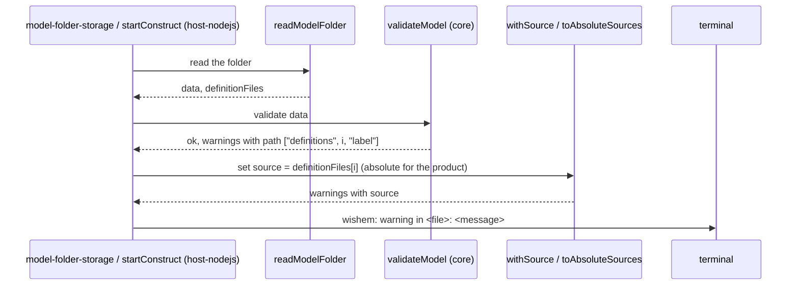

# Design

## Context

See proposal.md, "Why".

- `validateModel` in `nodejs/wishem/core/src/validate-model.ts` gives a warning for each component type that repeats the label of an earlier component type. The path of each warning is `["definitions"]`.
- `withSource` in `nodejs/wishem/host-nodejs/src/read-model-folder.ts` sets `source` from the path. It sets a definition file only when the second item of the path is a number. Thus it sets no source on a warning.
- `model-folder-storage.ts` and `start-construct.ts` give the warnings to `withSource`, then to `toAbsoluteSources` for the product folder. `nameProduct` in `start-construct.ts` keeps a line that starts with `wishem: warning in ` and adds `wishem: product: ` to each other line. Today each product warning gets the prefix, and the branch for a warning with a source does not run.
- `workbench-app/scripts/generate.ts` also gives each model warning to `withSource` and prints it with `formatProblem`.
- `validateModel` gives warnings only when it found no problem. At that time each item of `definitions` is a correct component type, so the index in the input data is the index in `model.definitions`, and the index of a file in `definitionFiles`.
- No other code reads the path of a model warning. The store (`core/src/store.ts`) discards the warnings. The renderers, the workbench page, and the construct manager do not get model warnings. The view warnings of `renderer-react` and `renderer-pixi` are a different type and do not change.

## Goals / Non-Goals

**Goals:**

- Each warning of `validateModel` that comes from one definition names that definition by its index.
- The terminal names the definition file of a duplicate label, as a relative path for the model folder and as an absolute path for the product folder.
- Tests that kill the survivors S17, S18, and C4 of #619.

**Non-Goals:**

- No change to the text of the warning message.
- No new warning kinds.
- No change to `withSource`, `toAbsoluteSources`, `nameProduct`, or `formatProblem`.
- No change to the view warnings of the renderers.

## Decisions

### D1: Keep the code for a warning with a source, and give the warning an index

The lead agent selected this option in a comment on #632 (2026-11-28). The designer must know which file has the duplicate label. The other option was to remove the code for a warning with a source. It was rejected because the terminal then cannot name the file.

### D2: The warning names the later of the two definitions

A warning of a duplicate label comes from two definitions. The warning names the definition with the larger index: the definition that repeats the label of an earlier definition. The message continues to name the two IDs.

Reason: `validateModel` gives one warning for each definition after the first that has the label. When the warning names the later definition, each of these warnings names a different file. With three definitions that have one label, the two warnings name the second file and the third file. If each warning named the first definition, the two warnings would name the same file, and the terminal would never name the other two files.

Alternative rejected: a warning with two paths. `Problem` has one `path`, and a second field would change the type of `core` for each consumer.

Trade-off: the files of `definitions/` are read in the order of their names. Thus the warning names the file whose name is later in that order, not the file that the designer changed last. The message names the two IDs, so the designer can find the other file.

### D3: The path ends with `label`

The path is `["definitions", <index>, "label"]`, not `["definitions", <index>]`. Reason: the problems of `validateModel` name the key that has the fault (for example `["definitions", 1, "id"]` for a duplicate ID), and the label is the key that causes this warning. `withSource` reads only the first two items, so the source is the same with both forms.

### D4: No source change in `host-nodejs` and `workbench-app`

`withSource` already maps `["definitions", <number>, …]` to the file. The change is in `core` only. The tests of `host-nodejs` and `workbench-app` show the new lines. The tests in `start-construct.test.ts` under "A warning of the product that has no source" expect the prefix `wishem: product: warning: `. They change to expect the source of the file.

### D5: One task

The change is one deliverable: a warning that names its file. The tests of `core`, `host-nodejs`, and `workbench-app` fail before the change of `validate-model.ts`, and pass after it. A second task with only tests of other packages would have no failing run before its code.

## Interfaces

The types do not change. The contract of the `path` of a warning changes (package `@thrashplay/wishem-core`):

```ts
// nodejs/wishem/core/src/model.ts (unchanged)
export interface Problem {
  severity: 'error' | 'warning'
  message: string
  path: (string | number)[]
  source?: string
}

// A warning of validateModel for a duplicate label:
// { severity: 'warning', message: 'Component types <first ID> and <later ID> have the same label "<label>"',
//   path: ['definitions', <index of the later definition>, 'label'] }
```

## Flow



## Sample terminal session

After the change, with the commands of "The test guide":

```
$ node nodejs/wishem/host-nodejs/bin/wishem.js start /tmp/632-model --product /tmp/632-product --port 0
wishem: model /tmp/632-model
wishem: product /tmp/632-product
wishem: warning in definitions/zz-copy.json: Component types ct_3f2a9c1e-8b47-4d0a-9e51-6c2f7a1b0d34 and ct_7a1c2d3e-4b5f-4a6b-8c7d-9e0f1a2b3c4d have the same label "AppBar"
wishem: 2 component types, 1 entity
wishem: product: 1 component type, 1 entity
wishem: link at ws://127.0.0.1:44701/link
```

An error case does not change: a definition file that is not valid JSON gives `wishem: problem in definitions/zz-copy.json: the text is not valid JSON` and the command stops with a non-zero exit code.

## Package Impact

| Package                            | Published | Bump  | Why                                                                                                          |
| ---------------------------------- | --------- | ----- | ------------------------------------------------------------------------------------------------------------ |
| `@thrashplay/wishem-core`          | private   | patch | A warning of a duplicate label has the index of the later definition in its path.                            |
| `@thrashplay/wishem-host-nodejs`   | private   | patch | The terminal line of a model warning names the definition file (absolute for the product). No source change. |
| `@thrashplay/wishem-workbench-app` | private   | patch | The `generate` script names the definition file in the line of a model warning. No source change.            |

No breaking change: each package is private, and the type `Problem` does not change.

Changesets (one for each distinct change):

1. `@thrashplay/wishem-core` patch: "A warning for two component types with the same label has the path of the later definition."
2. `@thrashplay/wishem-host-nodejs` patch and `@thrashplay/wishem-workbench-app` patch: "The line of a warning for a duplicate label names the definition file." This is the same change in two consumers.

## Architecture document

The change adds, changes, or removes no package, process, relationship, or import. `docs/architecture/README.md` and its diagrams do not change. `nodejs/wishem/core/README.md` gets one sentence about the path of the warning.

## Other changes and open Bugs

- #537 (product panel, merging): it changes `workbench-app`, but not `scripts/generate.ts` or `src/generate.test.ts`. The workbench page does not show model warnings. A merge conflict is possible only in `generate.test.ts` if #537 adds a test at the same place; merge `main` before the finish.
- #542 (three renderers, in apply), #650 (diagrams, in apply), #539 (being planned): no file of this change differs on their branches, and none of them reads the path of a model warning.
- Open Bug #691 ("A refused number that is not finite names the value null"): its worktree changes `describeValue` in `core/src/validate-model.ts` and adds tests to `validate-model.test.ts`. This change does not touch `describeValue`. The two changes edit different lines, so the merge is simple. This change does nothing about #691.
- No other open Bug touches `validate-model.ts`, `read-model-folder.ts`, `model-folder-storage.ts`, or `start-construct.ts`. #685 and #706 are about the start and the stop of other constructs and scripts.

## Risks / Trade-offs

- [The text of a warning line changes, and a person or a script that matches `wishem: product: warning:` no longer matches] → No script in the repository matches it, except the tests that this change updates.
- [A later warning of `validateModel` can come from no single definition] → Such a warning keeps a path with no index and gets no source. The code for a warning with no source stays.
- [The file order of `definitions/` decides which file the warning names] → D2 records it, and the message names the two IDs.

## Migration Plan

None. The change is in the output of a private development tool. To roll back, revert the commit.

## The test guide

Run these steps from the root of the worktree. The expected results "on `main`" come from a real run on `main` on 2026-11-28. The results "after the change" are the expected results of the change. Use `--port 0` so that the system selects a free port. The port in the output differs on each run.

1. Make a model folder and a product folder from the base workbench, and add a duplicate label to the model folder:

   ```
   rm -rf /tmp/632-model /tmp/632-product
   cp -r nodejs/wishem/workbench/model /tmp/632-model
   cp -r nodejs/wishem/workbench/model /tmp/632-product
   printf '{ "id": "ct_7a1c2d3e-4b5f-4a6b-8c7d-9e0f1a2b3c4d", "label": "AppBar", "fields": [] }\n' > /tmp/632-model/definitions/zz-copy.json
   pnpm build --filter @thrashplay/wishem-host-nodejs --filter @thrashplay/wishem-workbench-app...
   ```

2. In terminal 1, start the construct:

   ```
   node nodejs/wishem/host-nodejs/bin/wishem.js start /tmp/632-model --product /tmp/632-product --port 0
   ```

   On `main`, the third line is `wishem: warning: Component types ct_3f2a9c1e-8b47-4d0a-9e51-6c2f7a1b0d34 and ct_7a1c2d3e-4b5f-4a6b-8c7d-9e0f1a2b3c4d have the same label "AppBar"`.

   After the change, the third line is `wishem: warning in definitions/zz-copy.json: Component types ct_3f2a9c1e-8b47-4d0a-9e51-6c2f7a1b0d34 and ct_7a1c2d3e-4b5f-4a6b-8c7d-9e0f1a2b3c4d have the same label "AppBar"`. The next lines are `wishem: 2 component types, 1 entity`, `wishem: product: 1 component type, 1 entity`, and `wishem: link at ws://127.0.0.1:<port>/link`.

3. In terminal 2, add the same file to the product folder while the construct runs (a hand edit after the start):

   ```
   cp /tmp/632-model/definitions/zz-copy.json /tmp/632-product/definitions/zz-copy.json
   ```

   On `main`, terminal 1 shows `wishem: product: warning: Component types ct_3f2a9c1e-8b47-4d0a-9e51-6c2f7a1b0d34 and ct_7a1c2d3e-4b5f-4a6b-8c7d-9e0f1a2b3c4d have the same label "AppBar"`.

   After the change, terminal 1 shows `wishem: warning in /tmp/632-product/definitions/zz-copy.json: Component types ct_3f2a9c1e-8b47-4d0a-9e51-6c2f7a1b0d34 and ct_7a1c2d3e-4b5f-4a6b-8c7d-9e0f1a2b3c4d have the same label "AppBar"`. No line starts with `wishem: product: warning`.

4. In terminal 2, remove the file from the product folder:

   ```
   rm /tmp/632-product/definitions/zz-copy.json
   ```

   On `main` and after the change, terminal 1 shows no new warning line.

5. In terminal 2, add the file again. Then stop the construct in terminal 1 with Ctrl+C, and start it again with the command of step 2 (a stop and then a start):

   ```
   cp /tmp/632-model/definitions/zz-copy.json /tmp/632-product/definitions/zz-copy.json
   ```

   After the change, the start shows the line of step 2 for the model folder and the line of step 3 for the product folder, each one time, before `wishem: 2 component types, 1 entity`. On `main`, the product line is `wishem: product: warning: Component types …`.

6. Run the generate script of the workbench app on the model folder:

   ```
   node nodejs/wishem/workbench-app/scripts/generate.ts --model /tmp/632-model --check
   ```

   On `main`, the output is `wishem: model /tmp/632-model`, `wishem: warning: Component types ct_3f2a9c1e-8b47-4d0a-9e51-6c2f7a1b0d34 and ct_7a1c2d3e-4b5f-4a6b-8c7d-9e0f1a2b3c4d have the same label "AppBar"`, and `wishem: the generated files of 1 view are current`, and the exit code is 0.

   After the change, the second line is `wishem: warning in definitions/zz-copy.json: Component types ct_3f2a9c1e-8b47-4d0a-9e51-6c2f7a1b0d34 and ct_7a1c2d3e-4b5f-4a6b-8c7d-9e0f1a2b3c4d have the same label "AppBar"`. The other lines and the exit code do not change.

Steps 2, 3, 4, and 5 are also the automated test `nodejs/wishem/host-nodejs/src/cli.guide.test.ts`, with real `wishem start` processes and temporary folders. Step 6 is also a test in `nodejs/wishem/workbench-app/src/generate.test.ts`.
