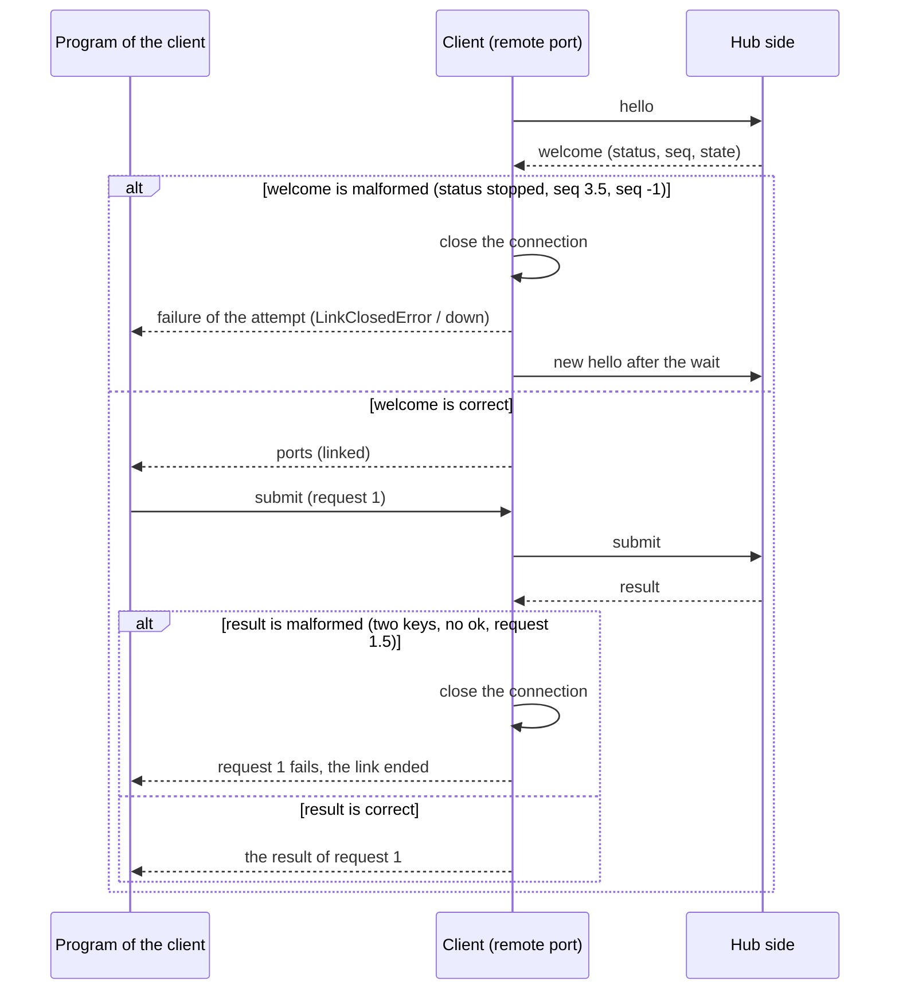

# Design

## Context

See proposal.md, "Why". The current state of each client:

- The reference client reads each message of the hub side in `parseHubMessage` (`hub/src/link/messages.ts`). The function gives `undefined` for a malformed message. `openLink` (`open-link.ts`) then closes the channel. Before `welcome`, `openLink` rejects with a `LinkClosedError`. After `welcome`, it ends the link. `connectLink` counts a rejected `openLink` as a failed attempt and waits.
- `parseHubMessage` checks a number with `Number.isFinite` only. `isResult` reads `error` first and does not look at `result` when `error` is present. `STATUSES` holds `created`, `running`, and `stopped`.
- The GDScript client (`renderer-godot/godot/wishem/link_client.gd`) checks each message in its handler (`_welcome`, `_apply`, `_result`). It converts each number with `Messages.as_int` (`link_messages.gd`), which gives `null` for a value that is not a whole number with an absolute value of 2^53 - 1 or less. `_result` uses `result` when it is a dictionary, and does not check `ok`. `_welcome` does not read `status`.
- The hub side (`serve-link.ts`) sends `refused` with the reason `stopped` to a stopped hub, and sends `result` with one key only.
- `LINK.md` says: a client that gets a malformed message closes the connection and opens a new link. An unknown type and an unknown key are ignored. Ruling L1 of the change `541-add-godot-renderer` keeps this rule for the values of known keys too (an `event` with an unknown value).

## Goals / Non-Goals

**Goals:**

- One rule in `LINK.md` for each of the three findings of issue #639, and for the related checks of the same messages where the two clients differ.
- The two clients obey the rule, with tests in each client.

**Non-Goals:**

- The hub side. It sends no malformed message, and its reader of `hello` and `submit` does not change. See "Follow-up".
- The form of the value of `result` after `ok` (`seq`, `reason`, `problems`). See "Follow-up".
- A second `welcome` after the start of a link. Each client ignores it now. This change does not change that.

## Decisions

### D1: A `result` with the keys `result` and `error` is malformed

Both clients close the connection. The send of that request fails as for each end of a link.

- Reason: `LINK.md` says "The message has the key `result` or the key `error`, and not both". A message that breaks this rule is malformed, and a malformed message closes the connection. This is the rule of Ruling L1.
- A key is present when the JSON object holds it, also with the value `null`. Then `{ "result": {...}, "error": null }` is malformed: `error` is present and is not text.
- Rejected: `error` wins (the reference client now). Rejected: `result` wins (the GDScript client now). Each one picks a value from a message that the hub side never sends, and hides a defect.

### D2: The full form of a `result` message

A `result` message is malformed when one of these is true:

- `request` is not an integer from 0 to 2^53 - 1;
- it has the two keys `result` and `error`, or neither of them;
- `result` is present and is not an object with a boolean `ok`;
- `error` is present and is not text.

The reference client already checks `ok`. The GDScript client adds the check. The reference client adds the integer check of `request`. The GDScript client already closes the connection for a `request` that is not an integer.

- Reason: the two clients must give the same answer for each `result`. The check of `ok` is in the same function as D1, and costs one line in each client.

### D3: Each number of a message of the hub side is an integer from 0 to 2^53 - 1

The numbers are `protocol` and `seq` of `welcome`, `seq` of the input of `applied`, and `request` of `result`. A message with a number that is not an integer from 0 to 2^53 - 1 is malformed. The client closes the connection when that message arrives, and not at a later message.

- In the reference client, `parseHubMessage` makes the check (`Number.isSafeInteger(value) && value >= 0`). A `welcome` with the `seq` 3.5 then gives `undefined`, and `openLink` rejects with a `LinkClosedError` before it gives a port.
- In the GDScript client, `Messages.as_int` gives `null` for a negative number too. Each number of the protocol is 0 or more, so no caller needs a negative number. `-0.0` gives 0.
- `LINK.md` ("The numbers") says that a message with such a number is malformed.
- Reason: "The numbers" already says that each number is an integer from 0 to 2^53 - 1, and the rule of the welcome says that a `seq` that is not an integer is malformed. A client that accepts the `welcome` gives a wrong `seq` to its program until the next `applied`.
- Rejected: round the number. A client that rounds hides a defect of the hub side.

### D4: The status of a `welcome` is `created` or `running`

A `welcome` with a different status, also `stopped`, is malformed. Both clients close the connection. The GDScript client adds the check, and the reference client removes `stopped` from `STATUSES`.

- Reason: a stopped hub sends `refused` with the reason `stopped`, and not `welcome`. The status is a known key with a closed list of values, as `event` is. Ruling L1 made an `event` with an unknown value malformed.
- Rejected: ignore an unknown status, as an unknown key is ignored. A later version of the protocol that adds a status changes the protocol version, so a client of version 1 never gets it.

### D5: A malformed `welcome` is a failed attempt

The two clients already treat a malformed `welcome` as a failed attempt and wait ("A client that connects again"). This change does not change the wait.

### D6: No question for the owner

No decision meets the three conditions of "When to ask the owner". A user of Wishem does not see the difference: the hub side sends none of these messages. Each rule is easy to change later.

### Brainstorm

The design was settled by the issue, by the existing rule of `LINK.md`, and by Ruling L1. The lead agent did not run a separate brainstorm.

## Interfaces

Package `@thrashplay/wishem-hub`, `src/link/messages.ts`. The exported type `HubMessage` changes in the member `welcome` only:

```ts
export type WelcomeStatus = 'created' | 'running'

export type HubMessage =
  | { t: 'welcome'; protocol: number; status: WelcomeStatus; seq: number; state: JoinedState }
  | { t: 'refused'; reason: RefusalReason; message: string; supported?: number[] }
  | { t: 'event'; event: 'started' | 'stopping' }
  | { t: 'applied'; input: RecordedInput; parts: Record<string, unknown> }
  | { t: 'result'; request: number; result?: SubmitResult; error?: string }
```

`WelcomeStatus` is not exported from `src/index.ts`. `serve-link.ts` builds its `welcome` from `hub.status`, which has the type `HubStatus`. It must narrow the status to `WelcomeStatus` there. The hub side refuses a stopped hub before that line, so its behavior does not change.

The GDScript client has no new public function. `Messages.as_int(value: Variant) -> Variant` gives `null` for a negative number.

## Sequence



## Failure Modes

| Failure                                    | Resulting behavior                                                     | Recovery                                        |
| ------------------------------------------ | ---------------------------------------------------------------------- | ----------------------------------------------- |
| A hub side with a defect sends one of them | The client closes the connection at the message, and the request fails | The client waits and opens a new link           |
| The same defect at each attempt            | Each attempt fails, and the wait grows to 5 s                          | Correct the hub side. The client keeps the wait |
| A send that is waiting when the link ends  | The send fails, and the client does not send it again                  | The program reads the new state and decides     |

The checks change no state of the hub. A new link gives the full joined state, so the close is idempotent.

## Risks / Trade-offs

- [A stricter client ends a link that a looser client keeps] → The hub side never sends these messages. The tests of the hub side and of `connectLink` against a real hub show it.
- [A negative number in `as_int` was accepted by a caller] → Each caller of `as_int` reads a number of the protocol, and each such number is 0 or more. The GDScript tests show it.

## The test guide

The rules are rules of the protocol. A person sees them through the tests of the two clients. Run each command from the root of the repository.

1. Run the tests of the reference client:

   ```
   pnpm exec turbo run test --filter @thrashplay/wishem-hub -- --reporter=verbose
   ```

   Result: the run passes with no failed test. The output names the new tests of `messages.test.ts` and `open-link.test.ts`, for example "gives undefined for a result with a result and an error" and "closes the channel and rejects with a LinkClosedError for a welcome with the seq 3.5".

2. Run the GDScript tests (Docker is necessary):

   ```
   pnpm --filter @thrashplay/wishem-renderer-godot test:godot
   ```

   Result: the output has the summary line `wishem-godot tests: <n> passed, 0 failed`. The summary line is not the last line. Godot prints `ERROR` lines at shutdown after it, and these lines are expected. The output has a `PASS` line for each new test of `test_link_client.gd` and `test_link_messages.gd`, for example `PASS res://tests/test_link_client.gd test_a_result_with_result_and_error_closes_the_socket_and_gives_down_once`.

## Package Impact

| Package                             | Published or private | Bump  | Why                                                                                                                                                 |
| ----------------------------------- | -------------------- | ----- | --------------------------------------------------------------------------------------------------------------------------------------------------- |
| `@thrashplay/wishem-hub`            | private              | patch | The reference client closes the link for the malformed messages of D1 to D4. `HubMessage` has the type `WelcomeStatus`. `LINK.md` states the rules. |
| `@thrashplay/wishem-renderer-godot` | private              | patch | The GDScript client closes the link for the same malformed messages.                                                                                |

The other packages that depend on `hub` do not change behavior with a correct hub side, because the hub side sends none of these messages. They are not in the changeset.

## Follow-up

- The form of the value of `result`: `seq` of `{ "ok": true }`, and `reason` and `problems` of `{ "ok": false }`. Neither client checks them. A follow-up issue can give one rule for them.
- The hub side reads `protocol` of `hello` and `request` of `submit` with `Number.isFinite`. A fractional `request` gets a `result` with the same fractional number. `LINK.md` says that each number is an integer. A follow-up issue can make the hub side send `refused` with the reason `malformed` for it.
