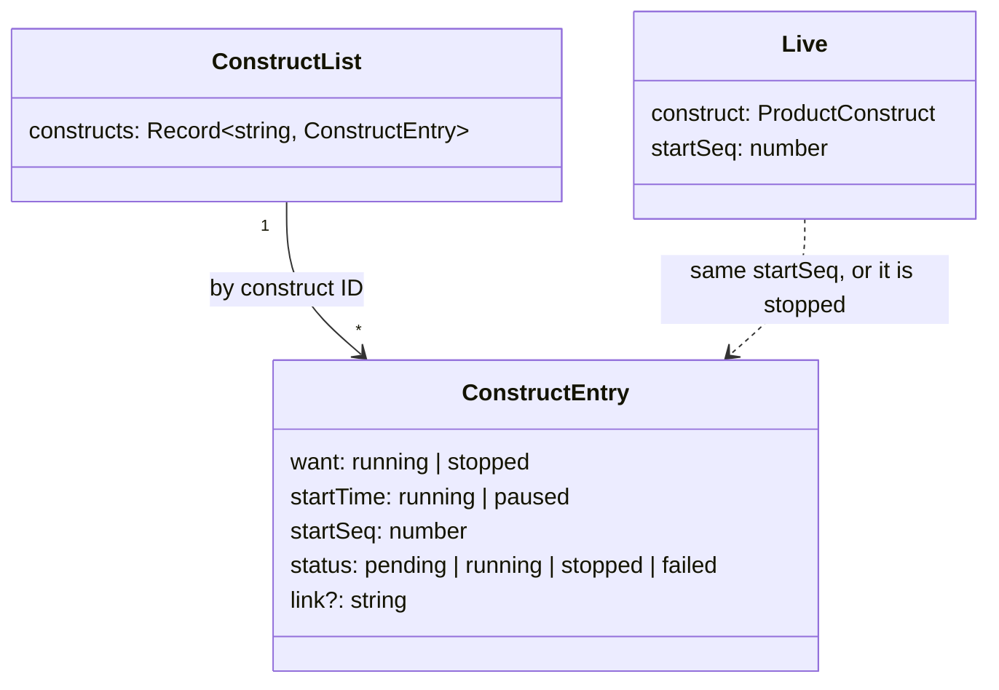
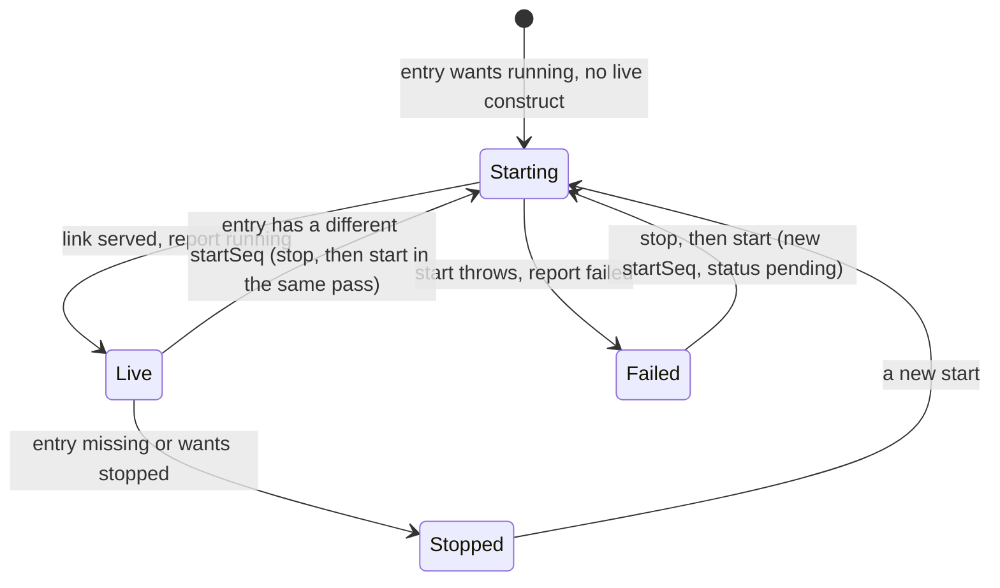
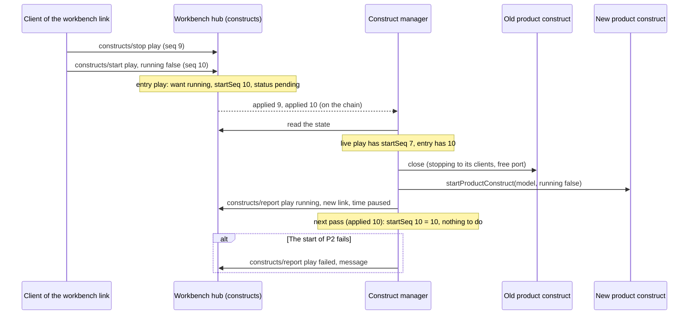

# Design

## Context

The state that this change starts from is `main` at `9708c13b`, with #538 (the construct manager, pull request #623) merged.

- The construct list (`construct-manager/src/construct-list.ts`) is a model subsystem of the workbench construct. An entry holds `want`, `startTime`, `status`, and optional `link`, `time`, `message`, and `lastSend`. `constructs/start` of an entry that is not wanted to run writes a new entry with the status `pending`. `constructs/start` of an entry that is wanted to run returns the same part. `apply` gets a `RecordedInput`, which holds `seq`, the sequence number of the input in the workbench record.
- The hub gives each accepted input the number `lastSeq + 1`. A rewind is an input of the record too, so the numbers only increase. Two inputs of one record never have the same number.
- The construct manager (`construct-manager/src/construct-manager.ts`) subscribes to the applied inputs of the workbench and handles them one at a time on a chain of promises. Each pass (`handle`) reads the joined state at the time of the pass, not at the time of the input. `reconcile()` stops each live construct whose entry is missing or not wanted, and starts each wanted entry that has no live construct and does not have the status `failed`. `reportTruth()` then reports the real status.
- The fault (see proposal.md, "Why"): when `constructs/stop` and `constructs/start` of `play` are both applied before the pass of the stop, the pass sees `want: running` and a live construct, and does nothing. The archived design of #538 and its ledger (Task 3, "minor (deferred)"; final review M1) record the fault. The archived ledger also records two rulings that stay: `reportTruth()` reports `stopped` only when the entry is not wanted to run, and the construct list is the authority for a restart after `failed` ("send `constructs/stop`, then `constructs/start`").

## Goals / Non-Goals

**Goals:**

- A stop and a start of one entry always give a new product construct, also when the construct manager handles both in one pass.
- The new product construct uses the options of the second start (`startTime`).
- The construct list stays a function of the record: a replay gives the same part, and a rewind returns the start number of the target.

**Non-Goals:**

- A control on the page that starts a construct again (#539).
- A report that names the start that it reports. See decision 4.
- A new input `constructs/restart`. A client sends a stop and a start.

## Approaches

The design follows the issue. The lead agent did the brainstorm alone, and the design was settled by the issue and the archived review, so no `superpowers:brainstorming` session ran. Three approaches were compared:

- **A. The entry holds the sequence number of its last start (selected).** The construct manager keeps the number of each live construct and compares. It is a pure function of the record, it survives a replay, and a rewind gives the number of the target.
- **B. The construct manager handles each applied input with the state after that input.** The hub gives the state after each input only through a replay from a checkpoint, and the construct manager would have to keep a copy of each state while a start runs. Rejected: more work in each pass, and the pass of an input that the construct manager missed (for example during a slow start) still sees only the last state.
- **C. A counter of starts in the entry (1, 2, 3, ...).** It works the same as A, but a rewind and a new start can give the same counter value as a start that the rewind removed. Example: start (1), stop, start (2), rewind to after the stop, start (2 again). Rejected: the sequence number is unique in a record, a counter is not.

## Decisions

### 1. The field `startSeq` (**Proposed**)

Each entry of the construct list holds `startSeq: number`, the `seq` of the `constructs/start` that wrote the entry. The spec calls it "the start number". A second start of an entry that is wanted to run returns the same part, so the entry keeps its `startSeq`. A stop keeps the `startSeq` of the entry. A report keeps it.

Reason: the number is unique in a record (see Context), and it comes only from the record. Rejected: a counter (approach C), and a time stamp (not a function of the record, so a replay gives a different part).

### 2. The construct manager compares the start number

`Live` holds the `startSeq` of the entry at the time of the start. `reconcile()` stops a live construct when its entry is missing, is not wanted to run, or has a different `startSeq`. The loop of starts that follows then sees no live construct and starts a new one from the entry, with its `startTime` and the product model at that time. The terminal shows `wishem: construct play stopped` and then `wishem: construct play runs, link at ...`.

No `stopped` report is sent between the two: the entry is wanted to run, and the ruling of #538 for `reportTruth()` stays. The status goes from `pending` (written by the second start) to `running` with the new address. A client sees the change of the address.

### 3. A rewind to a different start gives a new construct

After a rewind of the workbench, the entry can hold the `startSeq` of an earlier start while the live construct belongs to a later start. The construct manager stops the live construct and starts a new one. Reason: one rule for each case, and the live construct must belong to the start that the list names. The construct of the earlier start was stopped and cannot come back. A new construct from the product model is the nearest true state. Rejected: keep the live construct after a rewind (the list and the construct then disagree, and a later stop and start of the same numbers cannot be detected).

This is not a question for the owner: one option is clearly better (condition 1 of "When to ask the owner" is false), and the rule is in one function, easy to change later (condition 3 is false).

### 4. A report does not name its start

A report of the construct manager does not hold `startSeq`. When a stop and a start are applied while a start runs, the report of the old start can reach the new entry and say `running` with the old address. The next pass, which the stop and the start put on the chain, stops that construct, starts a new one, and reports the new address. Reason: the false status lasts at most until the next pass, and a field in the report adds a contract and a refusal with no use now. Rejected: a report with `startSeq`, which the list ignores when the number differs. A follow-up can add it if #539 shows the short false status.

### 5. `raw-link.mjs` accepts more than one `--send`

The test guide needs a real client that sends a stop and a start with no wait between them. `raw-link.mjs` gets `send` with `multiple: true`. After `welcome`, it sends each input as a `submit` with the request numbers 1, 2, ..., one after the other in the same task. With `--once`, it closes after the result of the last request. With one `--send`, the output is the same as before. Reason: the script is the client of each test guide, and a new script for one case is more to keep. The two inputs arrive in one task of the workbench process or in two. The test guide gives the same result for both, and the unit test of Task 1 proves the case of one pass.

### 6. The blueprint

The term **Construct list** of `nodejs/wishem/docs/glossary.md` adds "the sequence number of its last start" to what an entry holds. The README of `construct-manager` adds `startSeq` to the list of fields and to the row of `constructs/start`.

## Interfaces

Owner: `@thrashplay/wishem-construct-manager`, root entry. Only the changed members are shown.

```ts
export interface ConstructEntry {
  readonly want: WantedState
  readonly startTime: TimeState
  /** The sequence number of the `constructs/start` that wrote the entry, in the workbench record. */
  readonly startSeq: number
  readonly status: ConstructStatus
  readonly link?: string
  readonly time?: TimeState
  readonly message?: string
  readonly lastSend?: { readonly seq: number; readonly result: PassResult }
}
```

`constructInputs`, `ReportPayload`, `ConstructManagerOptions`, and `ConstructManager` do not change. The internal `Live` of `construct-manager.ts` gets `readonly startSeq: number`.

## Data Model

Modified: `ConstructEntry` (the new field `startSeq`). `Live` is internal and gets the same field. Nothing is persisted: the construct list is not kept when the workbench stops.



The lifecycle of a product construct gets one transition: a live construct whose entry has a different `startSeq` is stopped and started again in the same pass.



## The flow of a stop and a start in one pass



## Failure Modes

| Failure                                                             | Resulting behavior                                                                                          | Recovery                                               |
| ------------------------------------------------------------------- | ----------------------------------------------------------------------------------------------------------- | ------------------------------------------------------ |
| The close of the old construct throws                               | The construct manager prints the error and the line of the stop, and starts the new construct (as #538).    | None needed.                                           |
| The start of the new construct fails                                | The entry gets the status `failed` with the message. The construct manager does not try again.              | Send `constructs/stop`, then `constructs/start`.       |
| A stop and a start arrive while the start of the old construct runs | The old start reports `running` with its address. The next pass stops it and starts a new one (decision 4). | Automatic, in the next pass.                           |
| Two starts with no stop                                             | The second start returns the same part. No new construct.                                                   | None: a start of a running construct is not a restart. |
| A replay of the workbench record                                    | The same `startSeq` values. The construct manager is not attached to a replay hub.                          | None needed.                                           |

Each pass is idempotent: a second pass with the same state finds the same `startSeq` and does nothing.

## Examples

A stop and a start through the workbench link, with `raw-link.mjs` and two `--send` options:

```console
$ node nodejs/wishem/docs/milestones/a1-construct/raw-link.mjs --once \
    --send '{"type":"constructs/stop","payload":{"construct":"play"}}' \
    --send '{"type":"constructs/start","payload":{"construct":"play","running":false}}'
sent: {"t":"hello","protocol":1,"subsystems":[{"id":"raw-52114","kind":"input"}]}
received: {"t":"welcome",...}
sent: {"t":"submit","request":1,"subsystem":"raw-52114","input":{"type":"constructs/stop","payload":{"construct":"play"}}}
sent: {"t":"submit","request":2,"subsystem":"raw-52114","input":{"type":"constructs/start","payload":{"construct":"play","running":false}}}
received: {"t":"result","request":1,"result":{"ok":true,"seq":9}}
received: {"t":"result","request":2,"result":{"ok":true,"seq":10}}
closed: code 1005
```

Terminal 1 of the workbench:

```console
wishem: construct play stopped
wishem: construct play runs, link at ws://127.0.0.1:43811/link
```

The entry after the pass: `{"want":"running","startTime":"paused","startSeq":10,"status":"running","link":"ws://127.0.0.1:43811/link","time":"paused"}`.

An error case: a stop of a construct that is not in the list is refused, and the start that follows it is a new start.

```console
$ node nodejs/wishem/docs/milestones/a1-construct/raw-link.mjs --once \
    --send '{"type":"constructs/stop","payload":{"construct":"other"}}' \
    --send '{"type":"constructs/start","payload":{"construct":"other"}}'
...
received: {"t":"result","request":1,"result":{"ok":false,"reason":"invalid","problems":[{"message":"The list has no construct \"other\"","path":["payload","construct"]}]}}
received: {"t":"result","request":2,"result":{"ok":true,"seq":12}}
```

## Package Impact

| Package                                | Published or private | Bump  | Why                                                                                                                                         |
| -------------------------------------- | -------------------- | ----- | ------------------------------------------------------------------------------------------------------------------------------------------- |
| `@thrashplay/wishem-construct-manager` | Private              | patch | A fix: a stop and a start in one pass give a new product construct. `ConstructEntry` gets the field `startSeq`, which only the list writes. |
| `@thrashplay/wishem-workbench-app`     | Private              | patch | No code change. Its `start` script runs the construct manager, so its behavior changes: a stop and a start always give a new construct.     |

No published package changes. No breaking change. `raw-link.mjs` and the glossary are in no package.

## UI

The change adds no UI. The page shows no construct list yet (#539).

## Risks / Trade-offs

- [A short false status after a stop and a start during a slow start (decision 4)] → The next pass corrects it. A follow-up adds `startSeq` to the report if #539 needs it.
- [A rewind to an earlier start gives a new construct, not the old one (decision 3)] → The old construct was stopped and cannot come back. The terminal shows the stop and the start.
- [Existing tests compare full entries with `toEqual`] → Task 1 adds `startSeq` to each of them.

## Migration Plan

None. The construct list is not kept when the workbench stops, so no stored entry lacks `startSeq`. A record of a workbench that a replay reads gets `startSeq` from its own inputs.

## Order with other changes

The change #617 (`617-add-update-subsystem`, worktree `.claude/worktrees/617-add-update-subsystem`) is in flight. Its Task 4 changes `construct-manager.ts`, `product-construct.ts`, `node.ts`, their tests, and `README.md`: the option `behaviors` replaces `wrapStore`. Its delta of `wishem/workbench/construct-manager` modifies the requirements "The construct manager starts each construct that is wanted to run" and "A product construct holds the product and no storage". This change modifies two other requirements of that spec, so the deltas do not overlap.

The plan expects #617 to merge first. The second change to merge does these steps:

1. Merge `main` into the branch before its first task, or before its push when the other change merged during the apply.
2. In `construct-manager.ts`, keep both parts: the option `behaviors` of #617 in `startConstruct` and in `ConstructManagerOptions`, and the field `startSeq` of `Live` and the comparison in `reconcile()` of this change.
3. In `construct-manager.test.ts`, make each test of this change use the `setup()` of #617 (a list of behaviors in place of `wrapStore`). The tests of this change use only `setup()`, `start()`, `open()`, `countOf()`, and `construct()`.
4. In `construct-manager/README.md`, keep the section of `behaviors` of #617 and the field `startSeq` of this change.
5. Run lint, the type check, and the tests of `@thrashplay/wishem-construct-manager` again.

When this change merges first, #617 does the same steps from its side: its Task 4 changes the `setup()` of each test, also the new tests of this change.

The change #539 (the control that starts a construct again) is blocked by #642 and starts after this change merges.

## The test guide

The final reviewer does these steps on the branch, with real processes and real files, and reports the result of each step. Run each command from the root of the repository. "Terminal 1" runs the workbench. "Terminal 2" runs the other commands. The folders are in `.superpowers/` of the worktree, which git ignores.

Setup:

```sh
pnpm install
pnpm build --filter "@thrashplay/wishem-*"
rm -rf .superpowers/a4 && mkdir -p .superpowers/a4
cp -r nodejs/wishem/workbench/model .superpowers/a4/model
cp -r nodejs/wishem/sample-product/model .superpowers/a4/product
RAW=nodejs/wishem/docs/milestones/a1-construct/raw-link.mjs
STOP='{"type":"constructs/stop","payload":{"construct":"play"}}'
START='{"type":"constructs/start","payload":{"construct":"play"}}'
PAUSED='{"type":"constructs/start","payload":{"construct":"play","running":false}}'
```

Result: the build ends with no failed task.

1. **Start the workbench with the product and its code.** In terminal 1: `pnpm --filter @thrashplay/wishem-workbench-app start --model .superpowers/a4/model --product .superpowers/a4/product --product-code @thrashplay/wishem-sample-product`. Result: the lines of the start, up to the line of the page.
2. **Start `play`.** In terminal 2: `node $RAW --once --send "$START"`. Result: `"ok":true` and a `seq` (note it as `S1`). Terminal 1 prints `wishem: construct play runs, link at ws://127.0.0.1:<port>/link`. Then `OLD=$(node $RAW --once | grep -o 'ws://127.0.0.1:[0-9]*/link')`. Result: the address of terminal 1. `node $RAW --once | grep -o "\"startSeq\":$S1"` gives one line.
3. **The old construct runs.** Wait two seconds. `node $RAW --url $OLD --once | grep -o '"ticks":[0-9]*'`. Result: a number larger than 20.
4. **Keep a client on the old link.** In a third terminal: `node $RAW --url $OLD`. Result: the `welcome` line, and the terminal stays open.
5. **A stop and a start in one write.** In terminal 2: `node $RAW --once --send "$STOP" --send "$PAUSED"`. Result: two `result` lines with `"ok":true`, the second with a `seq` (note it as `S2`). Terminal 1 prints `wishem: construct play stopped` and then `wishem: construct play runs, link at ws://127.0.0.1:<port>/link` with a different port. The third terminal shows the `stopping` event and then `closed`.
6. **A new address and a new record.** `NEW=$(node $RAW --once | grep -o 'ws://127.0.0.1:[0-9]*/link')`. Result: `$NEW` differs from `$OLD`. `node $RAW --url $OLD --once` prints `error: the connection failed`. `node $RAW --once | grep -o "\"startSeq\":$S2"` gives one line, and `node $RAW --once | grep -o '"time":"paused"'` gives one line.
7. **The ticks start from 0, and the time state of the second start is used.** Wait two seconds. `node $RAW --url $NEW --once | grep -o '"ticks":[0-9]*\|"running":false'`. Result: `"ticks":0` and `"running":false`. The count of the sample product is the count of the product model (`0`).
8. **A start again with the time running.** `node $RAW --once --send "$STOP" --send "$START"`. Result: terminal 1 prints the line of the stop and a line of a start with a third address. Wait two seconds. `node $RAW --url <third address> --once | grep -o '"ticks":[0-9]*'` gives a number from 20 to 80: the ticks started from 0 at the start of step 8.
9. **Two starts with no stop keep the construct.** `node $RAW --once --send "$START" --send "$START"`. Result: two `"ok":true`. Terminal 1 prints no new line. The address of `play` is the address of step 8.
10. **A rewind to the first start gives a new construct.** `node nodejs/wishem/docs/milestones/a2-time/rewind-client.mjs --seq $S1`. Result: `result: {"ok":true,...}`. Terminal 1 prints the line of the stop and a line of a start with a fourth address. `node $RAW --once | grep -o "\"startSeq\":$S1"` gives one line, and the ticks of the fourth address advance from 0.
11. **Stop the workbench.** Press Ctrl+C in terminal 1. Result: the address of `play` accepts no connection, and `node scripts/start.ts` exits with code 0 (pnpm reports the signal, #624).

## Follow-up

- A report that names its start, if the short false status of decision 4 is a problem for #539.
- Break-test issue after the merge: `construct-manager`, as "Break-tests" of `autonomous-flow.md` says (a different package depends on it).
