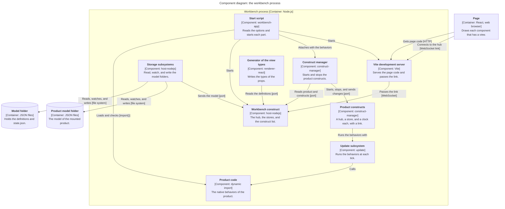
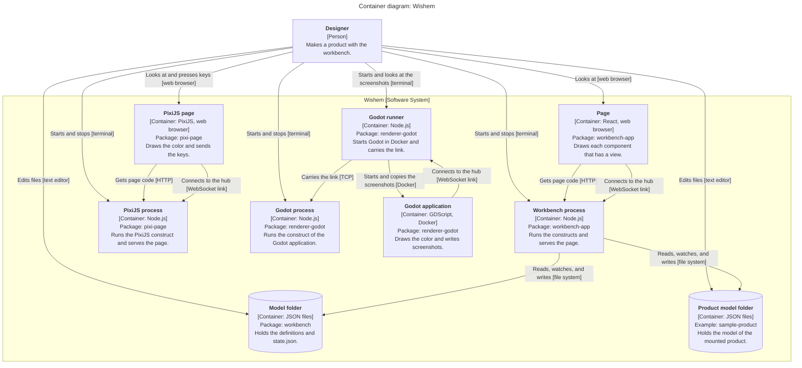

# Design

## Context

See `proposal.md`, "Why". The owner decided #649 with option A on 2026-11-28 and asked for all three views in #650. This plan starts from `main` at `0f1c57db`, after #617 (the update subsystem). After Tasks 1 and 2, the owner made two more decisions on 2026-11-28: the package dependency view has arrows (Decision 3), and the merge checks run the check (#696, Decision 11).

The facts that shape the approach:

- `nodejs/wishem/docs/architecture/render.mjs` describes five diagrams by hand: the system context, the containers, the dynamic diagram of a change, the components of the page, and the entities of the model folder. It uses only `node:` modules. It reads the colors from `workbench-app/src/styles/tokens.css`. It renders each file in memory first, so that a failed check writes no file.
- The container diagram is 1614 by 3090 pixels. It has 19 cards: the designer, 9 runtime units and stores, and 9 packages. The runtime units and stores are the page, the workbench process, the model folder, the product model folder, the PixiJS page, the PixiJS process, the Godot process, the Godot runner, and the Godot application.
- The architecture document holds a hand-written list of the dependencies of each package, below the table of the containers.
- `nodejs/wishem/` has 13 packages. No package has a Wishem package in `peerDependencies`. All packages are private.
- CI runs `turbo run build`, `lint`, and `test` with `--affected`. A task runs when a file of its package changed, or a file of a package that it depends on. A file in `nodejs/wishem/docs/` is in no package.
- `autonomous-flow.md` does not permit a change to the CI workflows without the permission of the owner. The permission of #649 names `docs/diagrams.md`, `.claude/skills/diagrams/`, the root `CLAUDE.md`, and `openspec/config.yaml`. The permission of #696 names one step in `.github/workflows/merge-checks.yaml`.
- `merge-checks.yaml` runs on each pull request against `main`, for each change. Its job `merge-checks` checks out the repository and runs `./.github/actions/setup` (Node.js and the install).
- The `lint` command of a package runs ESLint on each file of the package folder.

## Goals / Non-Goals

**Goals:**

- The container diagram shows runtime units, stores, and runtime relationships only.
- The package dependency view comes from the `package.json` files, and a check in CI fails when it is out of date.
- The component diagram of the workbench process exists.
- Each set of diagram instructions gives one rule: a runtime unit is in the container diagram, and a package is in the package dependency view.

**Non-Goals:**

- No change to product code. No package other than the new `docs-check` changes.
- No change to the system context diagram, the dynamic diagram, the component diagram of the page, or the entity diagram.
- No change to a CI workflow other than the one step of Decision 11.
- No check of imports in the source files. The view shows the declared dependencies of `package.json`.

## Decisions

### 1. The container diagram holds runtime units only

The containers on `main` after this change: the page, the workbench process, the Wishem command process (`wishem start ./model` of `host-nodejs`), the model folder, the product model folder, the PixiJS page, the PixiJS process, the Godot process, the Godot runner, and the Godot application. The designer is the one person.

The relationships are the runtime relationships of the current diagram, with each "Builds on [import]", "Runs [import]", "Uses [import]", "Serves the link with [import]", "Runs the behaviors with [import]", "Checks the product code with [import]", "Runs the product constructs with [import]", and "Loads the product code [dynamic import]" removed.

- Reason: in C4, a container is a unit that runs or holds data (#649).
- The dynamic import of the product code is an import, so it is not a relationship. The table row of the workbench process names `sample-product` as the product code.

### 2. Each card names the package that holds the unit

Each card of a container gets one more line below the type: `Package: <name>`, for example `Package: workbench-app`. The table of the containers gets a column "Packages": each package whose code runs in the unit, the package of the entry first. Example for the workbench process: `workbench-app` (`scripts/start.ts`), `host-nodejs`, `construct-manager`, `update`, `core`, `hub`, `clock`, `renderer-react` (entry `view-types`), `workbench` (export `modelFolder`), and `sample-product` (the product code).

- Reason: the issue says that the technology line names the packages of the container. A list of 10 packages does not fit on a card of 250 pixels, and the fit check of the script fails. One line gives the package that holds the unit. The table gives the full list.
- Rejected: all packages in the type line. The line has room for about 34 characters.
- Rejected: the transitive dependencies on the card. The package dependency view shows them.
- For a store, the line gives the package of the folder: `Package: workbench` for the model folder, and `Example: sample-product` for the product model folder.

The diagram is about 880 pixels wide, as the other diagrams. The layout is the work of Task 2. With 10 cards, three columns are sufficient.

### 3. The package dependency view: layer bands, cards, and an arrow for each runtime dependency

The owner decided on 2026-11-28 that the view has arrows. The view `packages-light.svg` and `packages-dark.svg` has one tinted band for each layer, from the highest layer at the top to the lowest layer at the bottom. The label of a band is `Layer <n>: <name>`. Each band holds the cards of its packages. Each runtime dependency is one arrow.

**The arrows.** An arrow goes from the card of a package to the card of each Wishem package in its `dependencies` or `peerDependencies`. The arrow starts on the bottom edge of the card of the package, and its head touches the top edge of the card of the dependency. Thus each arrow goes down. With the `package.json` files at the time of this revision, the view has 38 arrows.

- Reason: the layer rule (Decision 4) makes each runtime dependency go to the same layer or a lower layer. When each arrow goes down, a reader knows the direction before the reader finds the head.
- All arrows have one style: a thin line in the quiet color, with a head. The view has no primary path, so no arrow uses the accent color.
- An arrow has no label chip. The legend gives the meaning of the arrow: `Uses at run time [dependencies, peerDependencies]`. Reason: each arrow of the view has the same meaning. The label rule of the `diagrams` skill (a short label on each relationship) is for a C4 diagram, where the relationships have different meanings. 38 chips with the same words give no information, and they need room that the lanes do not have. The `MIN_PLAIN` check applies to each arrow.
- Each arrow is a group `<g class="uses" data-from="<package>" data-to="<dependency>">` with a `<title>` `<package> uses <dependency>`. The tests read the two attributes. A web browser shows the `<title>` when a reader points at the arrow.

**The test dependencies are text, not arrows.** A card shows the name of its package. When the package has a Wishem package only in `devDependencies`, the card also shows the line `Tests with: <names>` (or `Tests with: each other package`). The card has no line `Uses:`, because the arrows show it.

- Reason: the view stays clear only without them. `docs-check` alone has 13 test dependencies, one to each other package. With them, the view has 57 arrows. A test dependency can go to any layer (Decision 4), so its arrow can go up or stay in one row, and the rule "each arrow goes down" stops.
- Rejected: dashed arrows for the test dependencies, with `docs-check` left out. Then the view leaves out some dependencies of one kind, and a reader must know the exception.

**The rows.** A band holds one or more rows of cards. The rank of a package in its band is 1 when it uses no package of its band. Else its rank is 1 more than the highest rank of the packages of its band that it uses. Rank 1 is the lowest row of the band. Thus an arrow between two packages of one band also goes down. A rank with more than three packages takes more than one row, in the order of the cards. Packages of one rank do not use one another, so no arrow joins those rows.

**The columns.** Each row has three columns, on one grid for the full view. The columns line up in each band, so each space between two columns (a gutter) is free from the top of the view to the bottom. The order of the cards: the lowest row in the order of the names; each higher row by the mean column of the cards that its packages use, with ties in the order of the names. Each card goes in the free column nearest to that mean.

**The routes.** Each arrow is a set of vertical and horizontal lines with round corners:

1. Down from its port on the bottom edge of the source card to its own track in the channel below the source row. A channel is the space between two rows.
2. When the dependency is in the next row: along the track to the x of its port on the top edge of the target card, then down to the card.
3. Else: along the track to its own lane, down the lane to its own track in the channel above the target row, along that track to the x of the port, then down to the card. A lane is a vertical line in a gutter, in a margin, or in a column that has no card in each row between the source and the target.

- The ports of a card are spaced evenly on its edge, in the order of the x of the other end of each arrow. A card is wide enough for its ports.
- Each arrow has its own track in each channel and its own lane. Two arrows never share a line. Two arrows can cross at a right angle.
- A band has no head. The label of a band is in a column at the left of its cards, and the label can have more than one line. No lane or track goes through the label.
- The layout constants (the column width, the gutter width, the space between two tracks or two lanes, the height of a channel) start at values that make the fit checks pass. The implementer changes them until the image is clear. A card is 176 pixels wide, a gutter is 96 pixels wide, a lane is 11 pixels from the next lane, and a track is 12 pixels from the next track. The view is 1040 pixels wide. Its height grows with the channels.

**The checks of the routes.** The script throws an error and writes no file in each of these cases, as the fit check does:

| Problem                                                      | Message                                                         |
| ------------------------------------------------------------ | --------------------------------------------------------------- |
| A line of an arrow goes through a card that it does not join | `The arrow <a> -> <b> crosses the card <c>`                     |
| A line of an arrow goes through the label of a band          | `The arrow <a> -> <b> crosses the label of the layer "<layer>"` |
| Two arrows have a part of a line in common                   | `The arrows <a> -> <b> and <c> -> <d> share a line`             |
| An arrow does not end lower than it starts                   | `The arrow <a> -> <b> does not go down`                         |

The rows with the `package.json` files at the time of this revision, from the top. The order of the cards in a row is the work of the implementer.

```
Package dependency view: Wishem                     (each arrow goes down)
+-- Layer 5: Checks -----------------------------------------------------+
|  [docs-check / Tests with: each other package]                           |
+-- Layer 4: Applications ------------------------------------------------+
|  [workbench-app / Tests with: sample-product]                            |
|  [workbench / Tests with: hub]  [pixi-page]                              |
+-- Layer 3: Hosts, renderers, and products ------------------------------+
|  [construct-manager / Tests with: sample-product]  [renderer-godot]      |
|  [host-nodejs / Tests with: clock]  [renderer-pixi]  [renderer-react]    |
|  [sample-product / Tests with: clock]                                    |
+-- Layer 2: Model and subsystems ----------------------------------------+
|  [update]                                                                |
|  [clock / Tests with: core]  [core]                                      |
+-- Layer 1: Hub ---------------------------------------------------------+
|  [hub]                                                                   |
+-------------------------------------------------------------------------+
Legend: layer (band), package (card), uses at run time (arrow)
```

- Rejected: a dependency matrix. It is hard to read for one package, and it needs rotated column labels.
- Rejected: an arrow only for a dependency that no other path gives (a transitive reduction). The owner asked for the dependencies, and a test proves that each one has an arrow.
- The `desc` of each file gives the count of the packages, of the layers, and of the arrows, the rule of the layers, and the meaning of the line `Tests with:`. The `alt` text of the document gives the same. Neither lists the dependencies, so the text does not go out of date.

### 4. The layers are data in `render.mjs`

`render.mjs` holds one ordered list of layers. Each layer has a name and the names of its packages:

| Layer | Name                           | Packages                                                                                                  |
| ----- | ------------------------------ | --------------------------------------------------------------------------------------------------------- |
| 1     | Hub                            | `hub`                                                                                                     |
| 2     | Model and subsystems           | `core`, `clock`, `update`                                                                                 |
| 3     | Hosts, renderers, and products | `host-nodejs`, `construct-manager`, `renderer-react`, `renderer-pixi`, `renderer-godot`, `sample-product` |
| 4     | Applications                   | `workbench`, `workbench-app`, `pixi-page`                                                                 |
| 5     | Checks                         | `docs-check`                                                                                              |

- Reason: the layers of #649 have a meaning (`update` is a subsystem with `core` and `clock`), and a layer from the longest path would put `update` above `core`. A declared layer is a decision of the author, and the check keeps it true.
- A runtime dependency goes to the same layer or a lower layer. Example: `construct-manager` uses `host-nodejs` in the same layer. A development dependency can go to any layer, because `construct-manager` tests with `sample-product`.
- A package is a folder of `nodejs/wishem/` with a `package.json`. Its short name is the folder name. The `name` field is `@thrashplay/wishem-<folder>`. The script fails when the two differ.

### 5. The checks of `render.mjs`

The script does these checks on each run. A failed check prints one line for each problem, writes no file, and ends with exit code 1:

| Problem                                                   | Line                                                                        |
| --------------------------------------------------------- | --------------------------------------------------------------------------- |
| A package is in no layer                                  | `render: the package <name> has no layer`                                   |
| A layer names a folder that is not a package              | `render: the layer "<layer>" names <name>, which is not a package`          |
| A package is in two layers                                | `render: the package <name> is in two layers`                               |
| A runtime dependency goes to a higher layer               | `render: <a> (layer "<A>") uses <b> (layer "<B>"), which is a higher layer` |
| The table of the packages in `README.md` has no row       | `render: the table of the packages has no row for <name>`                   |
| A package is not a development dependency of `docs-check` | `render: <name> is not a development dependency of docs-check`              |
| The folder name and the `name` field differ               | `render: the folder <folder> holds the package <name>`                      |
| The runtime dependencies in one layer make a cycle        | `render: the packages of the layer "<layer>" use one another in a cycle`    |

The table of the packages is the first table after the heading `## Package dependency view: Wishem` in `README.md`. A row is for a package when its first cell is the name of the package in backticks.

With `--check`, the script renders each file in memory, compares it with the file on the disk, and writes no file. It prints `render: <file> is out of date` for each file that differs or is missing, then `render: run node nodejs/wishem/docs/architecture/render.mjs`, and ends with exit code 1. When each file is current, it prints `render: each file is current` and ends with exit code 0.

Two more options make the script testable with a copy of the files:

- `--packages <folder>`: the folder of the packages. Default: `nodejs/wishem/`.
- `--out <folder>`: the folder of the SVG files and of `README.md`. Default: the folder of the script.

The tokens always come from `workbench-app/src/styles/tokens.css` of the checkout.

- Reason: one script makes the files and checks them, so the check and the files cannot disagree.
- Rejected: a second script for the check. It would need a second copy of the layout.

### 6. The check runs in the tests of a new package `docs-check`

New package `nodejs/wishem/docs-check`, `@thrashplay/wishem-docs-check`, private. Its tests run `render.mjs --check` in a child process. Its `devDependencies` hold each other package of `nodejs/wishem/` as `workspace:*`.

- Reason: CI runs the tests of each package that a change affects. A change to the `package.json` of any Wishem package affects `docs-check`, because `docs-check` depends on it. Thus CI runs the check for each change to a dependency.
- The root `turbo.json` gets the entry `@thrashplay/wishem-docs-check#test`, with the inputs of the default `test` task and `$TURBO_ROOT$/nodejs/wishem/*/package.json`, `$TURBO_ROOT$/nodejs/wishem/docs/architecture/**`, and `$TURBO_ROOT$/nodejs/wishem/workbench-app/src/styles/tokens.css`. Reason: the cache of the task must miss when one of these files changes. `autonomous-flow.md` permits an entry of `turbo.json` that names a Wishem package.
- The merge checks also run the check (Decision 11). The tests of `docs-check` stay, because they also prove the checks of the script with copies of the files.
- Rejected: a `package.json` in `nodejs/wishem/docs/`. The `lint` command would run ESLint with the type rules on each script of `docs/`.
- Rejected: the test in `workbench-app`. It would need development dependencies on `pixi-page` and `renderer-godot`, and the application would hold a check of the documents.
- The package has `src/index.ts`, which exports `renderScript`, the absolute path of `render.mjs`, and `architectureFolder`. The tests use them. No other package imports `docs-check`.

The tests of `docs-check` also read `containers-light.svg` and fail when it holds the text `TypeScript package` or `[import]`. Reason: the rule of Decision 1 stays true after this change.

### 7. The component diagram of the workbench process

File names: `components-workbench-process-light.svg` and `components-workbench-process-dark.svg`. Title: `Component diagram: the workbench process`. The page, the model folder, and the product model folder are outside the boundary of the process.



- The implementer checks each arrow against the code (step 3 of the `diagrams` skill) and corrects the arrow, not the code. Facts from the plan: `startConstruct` attaches the storage subsystems (`attachModelFolderStorage`) and serves the link. `attachConstructManager` attaches the output port `construct-manager-reader` to the workbench hub and calls `startProductConstruct`, which holds `createUpdate`, `createHub`, `startClock`, and `serveHub`. `keepViewTypesCurrent` of `scripts/start.ts` attaches the output port `view-types` and runs `generateViewTypes`.
- The amber path: from the page through the Vite development server to the workbench construct, and from the construct manager to the product constructs and the update subsystem.
- The table of the components gives the module of each one. The prose says that the generator writes `src/views/*.view.gen.ts`, which the page does not read, and that a renderer in a different process can open the link of a product construct.
- Reason for nine components: the issue names four (the construct, the construct manager, the product constructs, the update subsystem). The other five carry the relationships to the page, to the model folders, and to the product code.

### 8. The architecture document

`nodejs/wishem/docs/architecture/README.md` gets this order: the system context diagram, the container diagram, the dynamic diagram, the component diagram of the page, the component diagram of the workbench process, the package dependency view, and the entity diagram.

- The introduction says that a container is a unit that runs or a store of data, and that the package dependency view shows the packages.
- The section of the container diagram loses each paragraph that explains an import, and the dependency list. The prose of each runtime path stays. The table gets the column "Packages" (Decision 2).
- The section of the package dependency view has the picture, a short text about the layers and the rule, the arrows, and the line `Tests with:`, how the merge checks and the tests of `docs-check` run the check, how to run the check, and the table of the packages: the package (in backticks), the layer, and the responsibility. The responsibility comes from the package list of `nodejs/wishem/CLAUDE.md`.
- The prose of the container section keeps the facts that are not imports, for example that a product construct is not a process.

### 9. The instructions for diagrams

| File                                    | Change                                                                                                                                                                                                                                                                                                                                                                                                                                                                                                                                                                                                                                                                                                                                                   |
| --------------------------------------- | -------------------------------------------------------------------------------------------------------------------------------------------------------------------------------------------------------------------------------------------------------------------------------------------------------------------------------------------------------------------------------------------------------------------------------------------------------------------------------------------------------------------------------------------------------------------------------------------------------------------------------------------------------------------------------------------------------------------------------------------------------- |
| `docs/diagrams.md`                      | A container is a process, a service, a deployable unit, a browser application, or a store of persisted data. A library package is not a container. New row and section "The package dependency view" (not C4): required for a product that has an architecture document and two or more packages that depend on one another; a script makes it from the package manifests; an arrow for each runtime dependency, which goes down to a lower layer or row and crosses no card; no label chip on these arrows, and the legend gives their meaning; the test dependencies as text on the card; a check fails when it is out of date. The file name `packages`. The order of the document. The table of the containers gives the packages of each container. |
| `.claude/skills/diagrams/SKILL.md`      | Step 2 names the package dependency view. Step 3: for the view, the package manifests are the source, and the author does not draw it by hand. The render script runs a check mode, and it fails when an arrow crosses a card or two arrows share a line. A checklist for the view: each runtime dependency has an arrow, each arrow goes down, and the legend gives the meaning of the arrow. A common mistake: a library package as a container.                                                                                                                                                                                                                                                                                                       |
| Root `CLAUDE.md`, section "Diagrams"    | One sentence more: a container is a unit that runs or a store, and the packages and their dependencies are in a generated package dependency view.                                                                                                                                                                                                                                                                                                                                                                                                                                                                                                                                                                                                       |
| `openspec/config.yaml`                  | The list in the `proposal` rule loses "or a package that other packages build on". A change that adds or removes a package, or a dependency between packages, runs the render script, and the check fails when it does not. The same in the `specs` and `tasks` rules.                                                                                                                                                                                                                                                                                                                                                                                                                                                                                   |
| `nodejs/wishem/docs/autonomous-flow.md` | "Reviews": the final reviewer compares the runtime units that the change adds or changes with the container diagram and its table, and runs `node nodejs/wishem/docs/architecture/render.mjs --check`. The check replaces the comparison of the imports by hand. The reason line stays.                                                                                                                                                                                                                                                                                                                                                                                                                                                                  |
| `nodejs/wishem/docs/README.md`          | The line of `architecture/` names the two component diagrams and the package dependency view.                                                                                                                                                                                                                                                                                                                                                                                                                                                                                                                                                                                                                                                            |
| `nodejs/wishem/CLAUDE.md`               | The package list gets `docs-check`.                                                                                                                                                                                                                                                                                                                                                                                                                                                                                                                                                                                                                                                                                                                      |
| `render.mjs`                            | The header comment names the package dependency view and the option `--check`.                                                                                                                                                                                                                                                                                                                                                                                                                                                                                                                                                                                                                                                                           |

The text uses ASD-STE100 and describes the current state.

### 10. No question for the owner

No decision meets the three conditions of "When to ask the owner". A user of Wishem does not see the documents. Each decision is easy to change later: the layout of a view, the names of the layers, the test dependencies as text in place of arrows (Decision 3), and a private package of tests.

### 11. The merge checks run the check

`.github/workflows/merge-checks.yaml` gets one step in the job `merge-checks`, after the step `Setup dependencies`:

```yaml
- name: Fail if the Wishem architecture diagrams are out of date
  run: node nodejs/wishem/docs/architecture/render.mjs --check
```

- Reason: the tests of `docs-check` run only when a package that `docs-check` depends on changes. A change to `render.mjs`, to an SVG file, or to `README.md` in `nodejs/wishem/docs/` alone changes no package. The merge checks run on each pull request. The owner permitted this step in #696.
- The script uses only `node:` modules, and it reads the `package.json` files and `tokens.css` of the checkout. It needs no build.
- This change makes one change to `autonomous-flow.md`: the "Reviews" rule of Decision 9. It makes no other change to a workflow. Each other change to a workflow needs the permission of the owner.

## Interfaces

Owner: `nodejs/wishem/docs/architecture/render.mjs` (a script, not a package).

```
node nodejs/wishem/docs/architecture/render.mjs [--check] [--packages <folder>] [--out <folder>]
```

Owner: `@thrashplay/wishem-docs-check` (private, root entry for its own tests).

```ts
/** The absolute path of `nodejs/wishem/docs/architecture/render.mjs`. */
export const renderScript: string
/** The absolute path of `nodejs/wishem/docs/architecture/`. */
export const architectureFolder: string
```

## Container diagram after the change

New: nothing. Changed: each card gets the line `Package: <name>`. Removed: the 9 package containers (`host-nodejs`, `core`, `construct-manager`, `hub`, `update`, `clock`, `renderer-pixi`, `renderer-react`, `sample-product`) and each relationship that is an import.



The labels of the designer come from the current `render.mjs`. The implementer keeps each label of the current diagram that is a runtime relationship.

## Examples

A current checkout:

```
$ node nodejs/wishem/docs/architecture/render.mjs --check
render: each file is current
$ echo $?
0
```

After `@thrashplay/wishem-clock` is added to the `dependencies` of `renderer-pixi`:

```
$ node nodejs/wishem/docs/architecture/render.mjs --check
render: packages-light.svg is out of date
render: packages-dark.svg is out of date
render: run node nodejs/wishem/docs/architecture/render.mjs
$ echo $?
1
```

After `@thrashplay/wishem-core` is added to the `dependencies` of `hub`:

```
$ node nodejs/wishem/docs/architecture/render.mjs
render: hub (layer "Hub") uses core (layer "Model and subsystems"), which is a higher layer
$ echo $?
1
```

## Failure Modes

| Failure                                              | Behavior                                                     | Recovery                                                                                       |
| ---------------------------------------------------- | ------------------------------------------------------------ | ---------------------------------------------------------------------------------------------- |
| A change alters a `package.json` and does not render | The tests of `docs-check` fail in CI.                        | Run `render.mjs` and commit the SVG files.                                                     |
| A change adds a package with no layer or no row      | `render.mjs` fails and writes no file.                       | Add the package to a layer, to the table, and to the development dependencies of `docs-check`. |
| A change alters only `render.mjs` or an SVG file     | The step of `merge-checks.yaml` fails on the pull request.   | Run `render.mjs` and commit the SVG files.                                                     |
| A card or a band label does not fit                  | The fit check of the script fails and writes no file.        | Change the layout constants of the view.                                                       |
| A new dependency gives an arrow no free route        | A check of the routes (Decision 3) fails and writes no file. | Change the layout constants of the view: a wider gutter or a higher channel.                   |

`render.mjs` is idempotent: a second run writes the same bytes. `--check` writes nothing.

## Risks / Trade-offs

- [A change to `nodejs/wishem/docs/` alone does not run the tests of `docs-check`] → The step of `merge-checks.yaml` runs the check on each pull request (Decision 11).
- [`docs-check` depends on each Wishem package, so CI builds them when `docs-check` is affected] → The builds come from the cache of turbo when the packages did not change. The test task of `docs-check` does not depend on a build.
- [The view shows declared dependencies, not imports] → A dependency that is declared but not imported shows in the view. Lint (`sherif`) and review find an unused dependency. The view states what `pnpm` installs, and that is the contract of the packages.
- [38 arrows cross one another] → Each arrow has its own track and lane, with right angles only. The order of the cards puts a card near the cards that it uses. Each arrow has a `<title>`.
- [The view is tall] → The height grows with the channels. A reader scrolls in one direction only, as in the container diagram.
- [The test dependencies have no arrow] → The line `Tests with:` on each card gives them, and a test proves it.
- [A new package must be added in four places: its folder, a layer, the table, and `docs-check`] → The script names each missing place.

## Package Impact

| Package                         | Published or private | Bump  | Reason                                                                  |
| ------------------------------- | -------------------- | ----- | ----------------------------------------------------------------------- |
| `@thrashplay/wishem-docs-check` | Private (new)        | minor | New package: the tests that run the check of the architecture document. |

No other package changes. The other packages get no new dependency: `docs-check` depends on them. No package is published.

## Order with other changes

### #542 (one hub and three renderers, pull request #674, in apply)

#542 removes the Godot process, adds the package `three-renderers` with the sample construct process, the React page server, and the React page, and changes the relationships of the PixiJS process and the Godot runner. Its delta of `wishem/architecture/diagrams` removes "The container diagram" and adds "The container diagram of Wishem". This change also removes "The container diagram", and adds "The container diagram of the runtime units". Its design (section "Order with other changes") already says what it does when #650 merges first.

When #542 merges first, #650 does these steps:

1. Merge `main` into the branch.
2. The container diagram of Task 2 starts from the containers of #542: the page, the workbench process, the model folder, the product model folder, the sample construct process, the React page server, the React page, the PixiJS process, the PixiJS page, the Godot runner, and the Godot application. No Godot process. The runtime relationships of #542 stay: "Passes the link [WebSocket]" from the React page server and from the PixiJS process to the sample construct process, "Carries the link [TCP]" from the Godot runner to the sample construct process, and "Reads [file system]" from the sample construct process to the product model folder. Each import relationship of #542 goes.
3. Add `three-renderers` to the layer "Applications", to the table of the packages, and to the development dependencies of `docs-check`. Run `pnpm install`.
4. In the delta spec of this change, the removed requirement becomes `### Requirement: The container diagram of Wishem`, the requirement that #542 adds. In "The container diagram of the runtime units", keep each scenario of a runtime unit of #542 and give it the rules of Decision 1: no import scenario, and no scenario of the Godot process.
5. Run `node nodejs/wishem/docs/architecture/render.mjs`, then `--check`, and look at each changed image. The arrows of `three-renderers` come from its `package.json`. When a check of the routes fails, change the layout constants of the view.
6. Run `pnpm exec openspec validate 650-diagram-views --strict`.

When #650 merges first, #542 does these steps (they agree with its design):

1. Merge `main`. Write the container diagram of #542 in the form of #650: runtime units and relationships only, with the line `Package: <name>` on each card and the column "Packages" in the table.
2. Add `three-renderers` to the layer "Applications", to the table of the packages, and to the development dependencies of `docs-check`. Otherwise `render.mjs` fails with the three lines of Decision 5.
3. Its delta of `wishem/architecture/diagrams` modifies "The container diagram of the runtime units" of #650 in place of the removal of "The container diagram" and the addition of "The container diagram of Wishem". The modified requirement keeps each scenario of #650 that still applies, removes the scenario of the Godot process, and adds the runtime units of #542, with no import scenario.
4. Run `render.mjs` and the tests of `docs-check`. When a check of the routes fails, change the layout constants of the view.

### #537 (the workbench lists the things of the product, pull request #673, in apply)

#537 changes only the component diagram of the page and its requirement "The component diagram of the page". #650 does not change that requirement, that diagram, or its section. The files in common are `render.mjs` and `README.md`.

The change that merges second does these steps:

1. Merge `main`. In `render.mjs`, keep the description of the page components of #537 and each diagram of #650. In `README.md`, keep the section of the page of #537 and the sections of #650.
2. If #537 merges second: remove the sentence of #537 that says that the container diagram shows the relationships from the page to `hub` and `renderer-react`. After #650, the container diagram shows no import.
3. Run `render.mjs`, then `render.mjs --check`, and look at each changed image.

## The test guide

The final reviewer does these steps on the branch and reports the real result of each step. Run each command from the root of the worktree. Steps 3 to 8 change files. Each step restores them with `git checkout` or with `rm` of a literal path.

### 1. Prepare

1. `pnpm install`. Result: the install ends with no error and links `nodejs/wishem/docs-check/node_modules/@thrashplay/wishem-hub`.
2. `ls nodejs/wishem/docs/architecture/*.svg`. Result: 14 files, among them `packages-light.svg`, `packages-dark.svg`, `components-workbench-process-light.svg`, and `components-workbench-process-dark.svg`.

### 2. Render two times and check

1. `node nodejs/wishem/docs/architecture/render.mjs`. Result: 14 lines `wrote .../<name>-<theme>.svg`.
2. `git status --short nodejs/wishem/docs/architecture`. Result: no line.
3. `node nodejs/wishem/docs/architecture/render.mjs --check; echo "exit $?"`. Result: `render: each file is current` and `exit 0`.
4. `flock -w 15 /tmp/wishem-heavy.lock timeout 140 pnpm exec turbo run test --filter @thrashplay/wishem-docs-check`. Result: each test passes.

### 3. Change a dependency, and see the check fail

1. `node -e "const f='nodejs/wishem/renderer-pixi/package.json';const fs=require('node:fs');const p=JSON.parse(fs.readFileSync(f));p.dependencies['@thrashplay/wishem-clock']='workspace:*';fs.writeFileSync(f,JSON.stringify(p,null,2)+'\n')"`.
2. `node nodejs/wishem/docs/architecture/render.mjs --check; echo "exit $?"`. Result: `render: packages-light.svg is out of date`, `render: packages-dark.svg is out of date`, `render: run node nodejs/wishem/docs/architecture/render.mjs`, and `exit 1`.
3. `git status --short`. Result: only ` M nodejs/wishem/renderer-pixi/package.json`. The check wrote no file.
4. `flock -w 15 /tmp/wishem-heavy.lock timeout 140 pnpm exec turbo run test --filter @thrashplay/wishem-docs-check`. Result: turbo prints `cache miss, executing` for `@thrashplay/wishem-docs-check:test`, and three tests of the real document fail: the test of the current document (its message holds `packages-light.svg is out of date`) and the two tests of the arrows of the light file and of the dark file. The other tests of the package pass. `pnpm exec` can rewrite `pnpm-lock.yaml`.
5. `node nodejs/wishem/docs/architecture/render.mjs`, then `grep -c 'data-from="renderer-pixi" data-to="clock"' nodejs/wishem/docs/architecture/packages-light.svg`. Result: `1`.
6. `node nodejs/wishem/docs/architecture/render.mjs --check; echo "exit $?"`. Result: `exit 0`.
7. `git checkout -- nodejs/wishem/renderer-pixi/package.json nodejs/wishem/docs/architecture/ pnpm-lock.yaml`. Then `--check` again. Result: `exit 0`.

### 4. A dependency to a higher layer

1. Add `@thrashplay/wishem-core` to the `dependencies` of `nodejs/wishem/hub/package.json`, with the command of step 3.1 and the file and name changed.
2. `node nodejs/wishem/docs/architecture/render.mjs; echo "exit $?"`. Result: `render: hub (layer "Hub") uses core (layer "Model and subsystems"), which is a higher layer` and `exit 1`. `git status --short nodejs/wishem/docs` shows no line.
3. `git checkout -- nodejs/wishem/hub/package.json`.

### 5. A development dependency to a higher layer

1. `grep -c 'Tests with:\|>sample-product<' nodejs/wishem/docs/architecture/packages-light.svg`. Result: a number greater than `0`. The card wraps the line: `Tests with:` is in one text element and `sample-product` in the next. `construct-manager` and `workbench-app` test with `sample-product`, and the script accepts it. The test of `docs-check` checks the joined text of the card of `construct-manager`.
2. `grep -c 'data-to="sample-product"' nodejs/wishem/docs/architecture/packages-light.svg`. Result: `0`. A test dependency has no arrow.

### 6. A new package with no layer

1. `mkdir nodejs/wishem/extra && printf '{"name":"@thrashplay/wishem-extra","private":true,"type":"module"}\n' > nodejs/wishem/extra/package.json`.
2. `node nodejs/wishem/docs/architecture/render.mjs; echo "exit $?"`. Result: the three lines `render: the package extra has no layer`, `render: the table of the packages has no row for extra`, `render: extra is not a development dependency of docs-check`, and `exit 1`.
3. `rm -r nodejs/wishem/extra`.

### 7. A row of the table is missing

1. Remove the row of `` `clock` `` from the table of the packages in `nodejs/wishem/docs/architecture/README.md`.
2. `node nodejs/wishem/docs/architecture/render.mjs --check; echo "exit $?"`. Result: `render: the table of the packages has no row for clock` and `exit 1`.
3. `git checkout -- nodejs/wishem/docs/architecture/README.md`.

### 8. CI runs the check for a change to any package

1. `pnpm exec turbo ls --filter "...@thrashplay/wishem-renderer-pixi"`. Result: the list holds `@thrashplay/wishem-docs-check`.
2. `pnpm exec turbo ls --filter "...@thrashplay/wishem-hub"`. Result: the list holds `@thrashplay/wishem-docs-check`.

### 9. The container diagram holds runtime units only

1. `grep -c 'TypeScript package\|\[import\]' nodejs/wishem/docs/architecture/containers-light.svg`. Result: `0`.
2. `grep -o 'Package: [a-z-]*' nodejs/wishem/docs/architecture/containers-light.svg | sort | uniq -c`. Result: `workbench-app` two times, `pixi-page` two times, `renderer-godot` three times, `workbench` one time, and `host-nodejs` one time.

### 10. The component diagram of the workbench process

1. `grep -o 'Construct manager\|Product constructs\|Update subsystem\|Workbench construct' nodejs/wishem/docs/architecture/components-workbench-process-light.svg | sort -u`. Result: the four names.

### 11. Look at the images

1. For `containers`, `packages`, and `components-workbench-process`, in each theme: `node .claude/skills/diagrams/scripts/rasterize.mjs --width 880 --background '#ffffff' --out .superpowers/images nodejs/wishem/docs/architecture/<name>-light.svg`, and the same with `--background '#0d1117'` for `<name>-dark.svg`. This needs Docker. Result: six PNG files.
2. Open each image and do the checklist of the `diagrams` skill. Result: no item fails. In the package view, each band label and each card is readable, `hub` is in the band at the bottom, each arrow goes down, no arrow crosses a card or a band label, and a reader can follow each arrow from its card to its head.
3. `node .claude/skills/diagrams/scripts/check-svg.mjs nodejs/wishem/docs/architecture/packages-light.svg nodejs/wishem/docs/architecture/packages-dark.svg`, and the same for the two other diagrams. Result: no problem.

### 12. The instructions give one rule

1. `grep -rn 'package that other packages build on' docs/diagrams.md .claude/skills/diagrams openspec/config.yaml CLAUDE.md nodejs/wishem/docs`. Result: no line.
2. `grep -n 'render.mjs --check' nodejs/wishem/docs/autonomous-flow.md`. Result: one line in the section "Reviews".
3. `grep -n -i 'package dependency view' docs/diagrams.md .claude/skills/diagrams/SKILL.md CLAUDE.md openspec/config.yaml nodejs/wishem/docs/README.md`. Result: at least one line in each file.

### 13. The arrows of the package dependency view

These results are the results after the change, from the `package.json` files at the time of this revision (2026-11-28).

1. `grep -c 'class="uses"' nodejs/wishem/docs/architecture/packages-light.svg`. Result: `38`.
2. `grep -c 'data-from="docs-check"' nodejs/wishem/docs/architecture/packages-light.svg`. Result: `0`.
3. `grep -c 'data-from="hub"' nodejs/wishem/docs/architecture/packages-light.svg`. Result: `0`. `grep -c 'data-to="hub"' nodejs/wishem/docs/architecture/packages-light.svg`. Result: `11`.
4. `grep -c 'Uses:' nodejs/wishem/docs/architecture/packages-light.svg`. Result: `0`.

### 14. The merge checks run the check

1. `grep -n 'render.mjs --check' .github/workflows/merge-checks.yaml`. Result: one line, in the job `merge-checks`, after the step `Setup dependencies`.
2. On the pull request, open the run of the workflow "Merge Checks". Result: the step `Fail if the Wishem architecture diagrams are out of date` passes, and its log holds `render: each file is current`.
