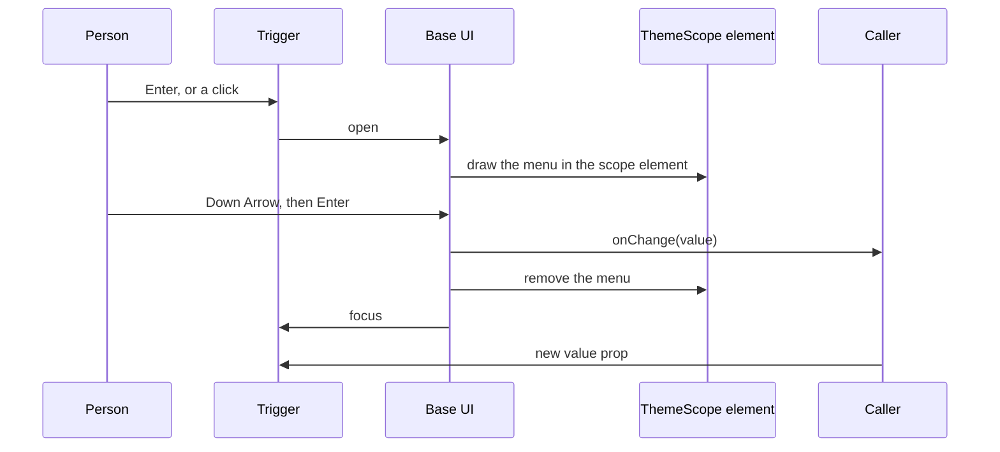
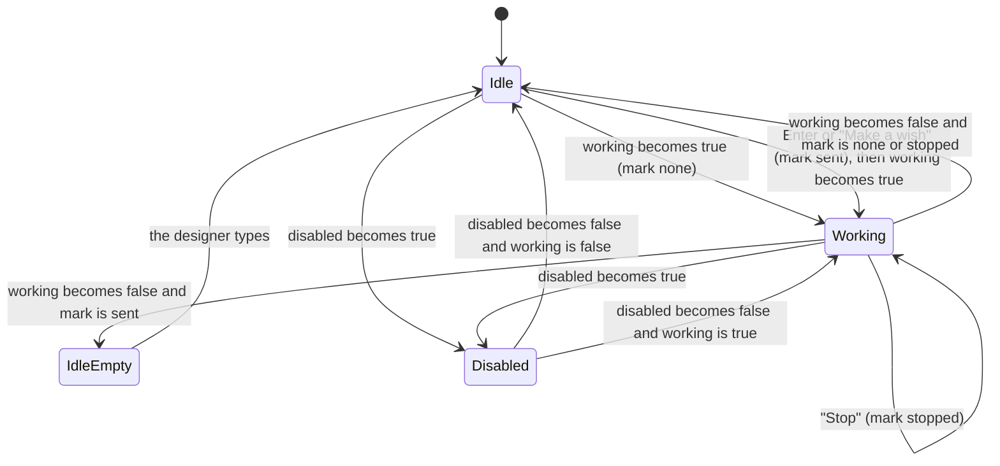

# Design

## Context

See `proposal.md` for the reason for this change. The decisions of the owner are in [Workbench components](https://github.com/twin-digital/opus/issues/497): the issue body, and the answers to questions 1 to 12. `nodejs/wishem/docs/design-system/style-guide-preview.html` shows the agreed look. It is the reference for each value that this document does not give.

Facts that shape the approach:

- `nodejs/wishem/workbench-app/src/components/` holds `AppBar`, `ZeroState`, and `ThemeScope`. Each one is a function with Tailwind classes. The package has no component CSS file.
- `src/styles/theme.css` gives Tailwind the roles only. A class for a palette color does not exist. `src/components/no-raw-colors.test.ts` fails when a component file has a hexadecimal color or the name of a palette color.
- `src/tokens.test.ts` reads `tokens.css` as text, resolves `var()` and `light-dark()`, and checks each contrast rule. Its helper functions are in the test file.
- The style guide draws each section two times: in a light `ThemeScope` and in a dark `ThemeScope`, side by side from a width of 900 pixels. Each scope is in a box that hides overflow.
- `tests/style-guide.spec.ts` takes one screenshot of each scope and runs axe on each scope, with the selector of the scope as the only included element. The viewport is 1280 by 720 pixels. The web browser is Chromium only.
- The package uses React 19. A function component gets `ref` as a prop.
- No view and no page of the workbench uses a component of this change. The first user is [Workbench panels](https://github.com/twin-digital/opus/issues/478).

## Goals / Non-Goals

**Goals:**

- Each component of the issue, with the props that the owner agreed.
- One style rule for a forced state and the real state.
- A select that a keyboard and a screen reader can use, with a menu that stays in its theme scope.
- A failure with no web browser when a state that a person uses has low contrast.

**Non-Goals:**

- A use of the components in the workbench page or in a view.
- A mode of the prompt box in which the parent holds the text, and an `onChange` of the prompt box.
- A second web browser in the tests.
- Base UI for a component that is not the select.

## Decisions

Each decision that the issue does not record is marked "Agent decision". The owner did not confirm it.

### D1. One file for each component, styled with Tailwind classes

Each component is `src/components/<Name>.tsx` with `src/components/<Name>.test.tsx`, as `AppBar` is. The styles are Tailwind classes that use the roles. A value of the preview that the Tailwind scale does not have is an arbitrary value, for example `text-[11px]` for the badge.

A mix of two roles uses `color-mix()` in an arbitrary value with role names only, for example `bg-[color-mix(in_srgb,var(--fg)_8%,var(--surface))]`. The test `no-raw-colors` permits it, because it holds no palette name and no hexadecimal value.

Agent decision. Rejected: a CSS file with a class for each component, as in the preview. The package would have two style systems.

### D2. The role `on-fill`

- `tokens.css`: `--on-fill: var(--ink);`, after `--on-night`.
- `tokens.ts`: `on-fill` in the group "Surfaces and lines", after `on-night`.
- `theme.css`: `--color-on-fill: var(--on-fill);`.
- `tokens.test.ts`: `on-fill` in the table of role values, and the contrast rule for a fill uses `on-fill` in the place of `ink`.

The tokens section of the style guide shows the new swatch with no other edit. Its two baselines change.

### D3. A forced state is a Tailwind variant

`theme.css` declares five variants. Each one matches the state of the web browser, or an element that has the force attribute, or a descendant of such an element:

```css
@custom-variant st-hover (&:is(:hover, [data-force~='hover'], [data-force~='hover'] *));
@custom-variant st-active (&:is(:active, [data-force~='active'], [data-force~='active'] *));
@custom-variant st-focus (&:is(:focus, [data-force~='focus'], [data-force~='focus'] *));
@custom-variant st-focus-visible (&:is(:focus-visible, [data-force~='focus'], [data-force~='focus'] *));
@custom-variant st-focus-within (&:is(:focus-within, [data-force~='focus-within'], [data-force~='focus-within'] *));
```

- A component uses these variants and does not use `hover:`, `active:`, `focus:`, `focus-visible:`, or `focus-within:`. Thus the forced state and the real state are one rule.
- The attribute is `data-force`, with the values `hover`, `active`, `focus`, and `focus-within`. `focus-within` forces the look of a box that holds the element with focus, and does not force the focus look of the elements in the box. The prompt box specimen uses it.
- The style guide has a helper, `Forced`, that draws `<div data-force={state}>` around one specimen. No component has a prop for the force. The descendant part of the selector is necessary because the select and the prompt box do not pass `data-*` to an inner element.
- The text controls use `st-focus`. The button and the checkbox use `st-focus-visible`. The prompt box uses `st-focus-within` on its box.
- The states of a disabled control do not react: a class such as `enabled:st-hover:` keeps a forced hover from a disabled specimen. A loading button is not disabled, so it uses a `data-loading` attribute for the same purpose.

The installed Tailwind accepts these selectors as written. The order of the classes does not decide which rule wins: the selector of a stacked variant does. A state that must win over hover, such as the error border or the open look of the select, has its own class with the hover variant in the stack, for example `aria-invalid:enabled:st-hover:border-danger-text`.

Agent decision for the names and for the descendant part. The issue fixes only that an attribute forces the state and that the rule is shared. Rejected: to replace the built-in `hover` variant of Tailwind. A person who reads a class would not see that it is different.

### D4. The field gives its control an identifier through a context

`Field` makes one identifier with `useId` and gives it to its children through a React context. Each control reads the context with one hook:

- The control gets `id`, `aria-describedby` (the identifier of the error message, when the field has one), and `aria-invalid` (when the field has an error message).
- The label is a `label` element with `htmlFor`. For the select, the trigger is a button, and a `label` names a button also.
- A control with no field uses its own `id` and its `invalid` prop. An `invalid` prop on a control in a field also gives the error state. An `id` from the caller replaces the identifier of the field.
- The error state is `aria-invalid="true"` on the element. The error look is a style on `aria-invalid`, so the look and the announcement cannot be different.

Agent decision. Rejected: `cloneElement` on the child. It breaks when the control is in a wrapper.

### D5. The select is built on Base UI

The select uses the `Select` parts of `@base-ui/react`. The library gives the keyboard behavior, the typeahead, the roles, and the position of the menu. The catalog gives each class.

- `value` and `onChange` go to the root. The select holds no value.
- `open` and `onOpenChange` go to the root. With no `open` prop, the library holds the open state.
- The root is not modal, so an open select does not lock the page and does not hide the other content.
- The menu is next to the trigger and as wide as the trigger. It opens below the trigger when it fits there, and above when the space below is too small. Its maximum height is the available space of the side that it uses, and its list scrolls. It does not move the selected option over the trigger.
- A value that is not in the options: the trigger shows the text of the value. The select looks up the label in `options` and uses the value when it finds none. The menu lists only `options`.
- The trigger shows the placeholder in `fg-muted` when `value` is `undefined`.

Task 1 proved the three facts that the issue names, with an open select in the light scope and in the dark scope of the style guide at the same time: the open state can be controlled, the select does not lock the page, and the portal takes a container. It also proved these items:

- Two open selects on one page stay open together when the page loads.
- A controlled `open={true}` with no `onOpenChange` stays open after a click outside and after Escape, and gives no error.
- axe reports one violation for an open menu, `aria-hidden-focus`, on the focus guard elements that the library draws. The accessibility test excludes `[data-base-ui-focus-guard]`. It excludes no rule.

One item is false: an open menu takes focus when it is drawn, and the web browser scrolls to it. The library has no prop that stops this. The style guide has open selects when it loads, so `src/style-guide/main.tsx` sets the scroll position back to the top after each focus change, until the first input of a person. A page with a hash in its address is not changed. A page of the workbench that opens a select after a click is not affected.

The place of the menu uses the default collision behavior of the library. The open specimens of the style guide have the same behavior as a select in a page of the workbench. The screenshot test makes the viewport as high as the section before it takes the screenshot, so each open specimen has its space below the trigger and the baselines do not depend on the scroll position.

A label activates its button, so a click on the label of a field would open the menu of its select. The select tells its field, through the hook `useFocusOnlyLabel`, that its label gives focus only. The field then stops the default action of the click and moves focus to the trigger. The label keeps its `htmlFor`, so it still names the trigger. The field does not import the select.

### D6. The menu is drawn in the nearest theme scope

`ThemeScope` gives its element to its content through a React context. The select gives that element to the portal of the menu as its container. With no `ThemeScope` above it, the container is `document.body`, which has the theme of the page.



- The menu is a descendant of the scope, so it gets the token values of the scope, the screenshot of the scope shows it, and axe checks it.
- The scope element of the style guide is in a box that hides overflow. The specimen of an open select reserves the height of its menu below the trigger, so the menu is inside the scope.

Agent decision. Rejected: a container element that the select draws next to its trigger. A parent that hides overflow or scrolls would cut the menu in a real panel.

Rejected: the end of `body` in each case. The menu of a select in a forced scope gets the theme of the page, and the screenshot and the accessibility check of the scope do not include it.

### D7. The checkbox is a native input with no native look

The checkbox is `<label><input type="checkbox"> text</label>`. The input has `appearance: none`, and classes draw the box. The check mark is a pseudo-element of the input, in `on-fill`. The input gets the native attributes. `onChange` of the component gets a boolean.

### D8. The button

- `type` defaults to `button`.
- `loading` sets `aria-busy="true"`, `aria-disabled="true"`, and `data-loading`. The button is not `disabled`, so it stays in the focus order. The component does not call `onClick` while `loading` is true.
- The spinner is a ring of 11 pixels in `currentColor` that turns. It does not turn when the system asks for reduced motion. The screenshot tests turn animations off.
- The cursor of a loading button is `progress`. The cursor of a disabled button is `not-allowed`.

### D9. The prompt box

The box is a `div` with `role="group"` and the `label` prop as its `aria-label`. The text area has the same `aria-label`.

- **Height**: the text area has `field-sizing: content`, `min-height` of `minLines` lines, `max-height` of `maxLines` lines, and `resize: none`. The component sets the two numbers as CSS custom properties on the box. A web browser with no `field-sizing` shows the box at the minimum height with a scroll bar.
- **Text**: the component holds the text in React state. The first value is `defaultValue`.
- **Keys**: the `keydown` handler sends on Enter with no Shift, when the trimmed text is not empty, `working` and `disabled` are false, and the event is not a composition event (`isComposing`, or key code 229).
- **Working**: the text area is `readOnly` with `tabIndex={-1}`, and the button is `Stop`.
- **End of the work**: the component holds a mark for the current work in React state, with one of three values: `none`, `sent`, or `stopped`. `onSend` sets `sent`. `onStop` sets `stopped`. When `working` changes from true to false, the box clears its text only if the mark is `sent`, and then the mark goes back to `none`.
- **Focus**: when `working` becomes true and the text area has focus, focus moves to `Stop`. When `working` becomes false and `Stop` had focus, focus moves to the text area. `Make a wish` and `Stop` are one button element with different props, so focus does not drop to the page when the label changes. A layout effect moves focus between the text and that button. In the working state, a click can still put focus in the text, so that a person can select and copy it.
- **Disabled**: `disabled` wins over `working`. The text area and the button are `disabled` and dimmed. The hint line shows `disabledReason` when it has one.
- **Fixed texts**: `Make a wish`, `Stop`, `Wishem is working`, and `Enter to send · Shift+Enter for a new line` are constants in the component file.



`IdleEmpty` is `Idle` with no text. The diagram shows it to make the one clear step visible.

Known limit: when the box reports "send" and the caller never sets `working`, the mark stays `sent` until the next end of a work. Then a later work that this box did not send clears the box. The box sets the mark back to `none` when the designer changes the text while `working` is false, so the limit applies only when the text does not change between the two.

Agent decision for that reset. The issue does not cover a caller that ignores "send".

### D10. The states of the dimmed look and the test of their contrast

The look of each state is in the UI section. A Vitest test, `src/components/state-contrast.test.ts`, has one row for each state that a person uses: the name of the state, the foreground, and the background. A foreground or a background is a role, a mix of two roles with a percentage, or a role with a brightness factor. The test calculates the color for each theme from `tokens.css` and checks a ratio of 4.5 or more. A failure names the state and the theme.

The helper functions of `tokens.test.ts` (read the declarations, resolve a value, luminance, contrast) move to `src/test/token-colors.ts`, and the two tests use them. The new helper adds `mix(a, b, percent)` in sRGB and `brightness(color, factor)`, which multiplies each channel and limits it to 255, as the CSS filter does.

The rows cover at least: the text of each button variant in the default, hover, and active states; the placeholder and the read-only text of a text control; the trigger of the select with a value and with the placeholder; an option of the menu, default and highlighted; the text and the status of the working prompt box; the reason text of a disabled prompt box; the title and the content of each callout variant on `ground` and on `surface`; the signature and the text of the spirit aside on `ground` and on `surface`; and the source of the quote.

The table states the values again, and a class in a component file can differ from it. This is accepted: the accessibility test checks the same states in the web browser where axe can see them, and the review of each task compares the two.

axe reports nothing for a disabled control, a disabled option, a loading button, or the disabled prompt box, so the accessibility test excludes no specimen.

Agent decision for the form of the test. The issue fixes that a test of the package calculates the contrast from the token values.

### D11. The components section of the style guide

- The section shows its two scopes one above the other, each at the full width of the page, and not side by side. `Section` gets a `layout` prop with the values `columns` (the default) and `stacked`. Reason: a state matrix has a label column and six state columns, and a scope of half the page is too narrow for six text inputs.
- `src/style-guide/sections/Components.tsx` becomes a list of groups. Each group is a file in `src/style-guide/sections/components/`: `AppBarAndZeroState.tsx`, `Buttons.tsx`, `Controls.tsx`, `SelectSpecimens.tsx`, `PromptBoxes.tsx`, `Panels.tsx`, `Content.tsx`, and `Narrow.tsx`. Thus two tasks do not edit the same lines.
- `src/style-guide/StateMatrix.tsx` draws a grid with a label for each row and each column. `src/style-guide/Forced.tsx` forces a state (D3). `Specimen` moves from `Components.tsx` to its own file.
- A specimen that the real-state test uses has a `data-testid`, for example `button-maker-default` and `button-maker-hover`.
- The existing baselines `components-light.png` and `components-dark.png` change in each task.

Agent decision. The owner agreed only that the section is a static grid of each state, with one screenshot for each theme.

### D12. The test of the real state

`tests/style-guide.spec.ts` gets one test for each control and theme. The test:

1. Reads the computed style of the forced specimen: the border, the box shadow, the outline, the background color, the text color, the filter, the translation, and the opacity.
2. Puts the default specimen in the real state: `hover()` for hover, and for focus a click on a specimen that cannot get focus and then the Tab key until the target has focus.
3. Reads the same properties of the default specimen and compares.

For the focus ring, the test also clicks the button and checks that it has no outline. For the select, a test opens a closed specimen with the keyboard, selects an option, and checks the roles with the accessibility tree. The highlighted option of the menu has no forced specimen: this test covers its look.

### D13. The merge with `main` (2026-11-28)

`main` added its own `Button`, the product panel, the run controls, and the list control while this change was in work. The merge keeps one button and both sets of requirements in `component-catalog`.

- The button of this change stays. It takes `accessibleName` from the button of `main`.
- A disabled button has `aria-disabled` and not the native `disabled` attribute. It keeps the focus and its place in the tab order, and it ignores a click, Enter, and Space. The run bar and the field row of `main` need this behavior. It replaces the native `disabled` of this change.
- The callers of `main` use `children` for `label`, `onClick` for `onPress`, `loading` for `busy`, and `neutral` for `plain`.
- The look of this change replaces the look of the button of `main`: control text, not UI text; a `maker` fill with `on-fill` text, not a `maker` border with `maker-text`; a focus ring in `maker-text`, not `accent`; a dimmed disabled button, not a label in `fg-muted`.
- The requirement "The button" of `main` keeps the label, the disabled behavior, and `aria-disabled`, and refers to "The button variants" and "The states of a button" for the look. The field row and the list control use neutral buttons.
- `Section` has the boolean prop `stacked` of `main`, not the `layout` prop of D11.
- The specimens of `main` are in the files `ProductPanelSpecimens.tsx` and `RunControls.tsx` of `src/style-guide/sections/components/`. The app bar specimens of `main` are in `AppBarAndZeroState.tsx`.

## Risks / Trade-offs

- [Base UI does not permit one of the three facts] → Task 1 proves them before other work, and stops for the owner if one is false.
- [The components section becomes one tall screenshot, and each small change of a component changes two baselines] → Accepted by the owner in the answer to question 4. The screenshot test already hides the other sections.
- [The state contrast table differs from the classes] → See D10.
- [`field-sizing: content` is not in each web browser] → Accepted by the owner. The fallback is the minimum height with a scroll bar. The tests use Chromium, which supports it.
- [The draft of a locked prompt box looks like the wish in work] → Known cost that the owner accepted in the answer to question 12.
- [The trigger of a select shows a raw value when the value is not in the options] → Known cost that the owner accepted in the answer to question 11.
- [A later popup forgets the theme scope rule] → The specification has the rule, and `ThemeScope` gives the container.

## Interfaces

Owner: `@thrashplay/wishem-workbench-app`. The package is a browser application and has no `exports`. These are the modules that later changes of the same package use. `Native<T>` is the props of the element `T` with no `className` and no `style`.

```ts
// src/components/native.ts
import type { ComponentProps, ReactNode } from 'react'
export type Native<T extends keyof React.JSX.IntrinsicElements> = Omit<ComponentProps<T>, 'className' | 'style'>

// src/components/Panel.tsx
export interface PanelProps {
  /** Drawn as a heading 2. */
  title?: string
  /** Content at the end of the header, for example a badge. */
  headerEnd?: ReactNode
  footer?: ReactNode
  children: ReactNode
}
export const Panel: (props: PanelProps) => React.JSX.Element

// src/components/Field.tsx
export interface FieldProps {
  label: string
  /** Puts the control in the error state. */
  error?: string
  /** One control. */
  children: ReactNode
}
export const Field: (props: FieldProps) => React.JSX.Element
export interface FieldControl {
  id: string | undefined
  'aria-describedby': string | undefined
  'aria-invalid': true | undefined
}
/** Merges the field of the control, if it has one, with its own `id` and `invalid`. */
export const useFieldControl: (own: { id?: string; invalid?: boolean; 'aria-describedby'?: string }) => FieldControl

// src/components/Button.tsx
export type ButtonVariant = 'maker' | 'neutral' | 'quiet' | 'danger'
export interface ButtonProps extends Native<'button'> {
  /** Default: `neutral`. */
  variant?: ButtonVariant
  loading?: boolean
}
export const Button: (props: ButtonProps) => React.JSX.Element

// src/components/TextInput.tsx
export interface TextInputProps extends Native<'input'> {
  invalid?: boolean
}
export const TextInput: (props: TextInputProps) => React.JSX.Element

// src/components/TextArea.tsx
export interface TextAreaProps extends Native<'textarea'> {
  invalid?: boolean
}
export const TextArea: (props: TextAreaProps) => React.JSX.Element

// src/components/Select.tsx
export interface SelectOption {
  value: string
  label: string
  disabled?: boolean
}
type AriaProps = { [K in keyof React.AriaAttributes]?: React.AriaAttributes[K] }
export interface SelectProps extends AriaProps {
  options: readonly SelectOption[]
  value: string | undefined
  onChange: (value: string) => void
  placeholder?: string
  disabled?: boolean
  invalid?: boolean
  open?: boolean
  onOpenChange?: (open: boolean) => void
  id?: string
}
export const Select: (props: SelectProps) => React.JSX.Element

// src/components/Checkbox.tsx
export interface CheckboxProps extends Omit<Native<'input'>, 'type' | 'checked' | 'onChange' | 'children'> {
  checked: boolean
  onChange: (checked: boolean) => void
  /** The label. */
  children: ReactNode
}
export const Checkbox: (props: CheckboxProps) => React.JSX.Element

// src/components/PromptBox.tsx
export interface PromptBoxProps {
  /** The name for a screen reader. */
  label: string
  onSend: (text: string) => void
  onStop: () => void
  /** The text of a new box. Read one time. */
  defaultValue?: string
  working?: boolean
  disabled?: boolean
  /** Shown in the hint line of a disabled box, for example "Not connected". */
  disabledReason?: string
  placeholder?: string
  /** Default: 3. */
  minLines?: number
  /** Default: 8. */
  maxLines?: number
}
export const PromptBox: (props: PromptBoxProps) => React.JSX.Element

// src/components/Quote.tsx
export interface QuoteProps {
  children: ReactNode
  cite?: string
}
export const Quote: (props: QuoteProps) => React.JSX.Element

// src/components/SpiritAside.tsx, MakerLine.tsx, SpiritLine.tsx
export interface TextProps {
  children: ReactNode
}
export const SpiritAside: (props: TextProps) => React.JSX.Element
export const MakerLine: (props: TextProps) => React.JSX.Element
export const SpiritLine: (props: TextProps) => React.JSX.Element

// src/components/Callout.tsx
export type Status = 'success' | 'warning' | 'danger' | 'info'
export interface CalloutProps {
  variant: Status
  title?: string
  children: ReactNode
}
export const Callout: (props: CalloutProps) => React.JSX.Element

// src/components/Badge.tsx
export type BadgeVariant = 'neutral' | 'maker' | 'spirit' | 'accent' | Status
export interface BadgeProps {
  /** Default: `neutral`. */
  variant?: BadgeVariant
  children: ReactNode
}
export const Badge: (props: BadgeProps) => React.JSX.Element

// src/components/Divider.tsx
export interface DividerProps {
  /** Default: `plain`. */
  variant?: 'plain' | 'accent'
}
export const Divider: (props: DividerProps) => React.JSX.Element

// src/components/ThemeScope.tsx (addition)
/** The element of the nearest ThemeScope, or `null` when there is none. */
export const useThemeScopeElement: () => HTMLElement | null
```

`TextProps` is in `src/components/native.ts`, with `defined`, which removes the keys of an object that have no value. `src/components/textControl.ts` holds the classes that the text input, the text area, and the trigger of the select share. `src/components/Spinner.tsx` draws the spinner of the button and of the prompt box. `src/test/render.ts` is the render helper of the unit tests. None of these is a component of the catalog. `Status` is exported from `Callout.tsx`, and `Badge.tsx` imports it.

## Examples

A form, as [Workbench panels](https://github.com/twin-digital/opus/issues/478) can write it:

```tsx
<Panel
  title='Cave bat'
  headerEnd={<Badge variant='accent'>New</Badge>}
  footer={
    <>
      <Button variant='quiet' onClick={reset}>
        Reset
      </Button>
      <Button variant='maker' loading={saving} onClick={apply}>
        Apply
      </Button>
    </>
  }
>
  <Field label='Name'>
    <TextInput value={name} onChange={(event) => setName(event.target.value)} />
  </Field>
  <Field label='Kind' error={kinds.some((k) => k.value === kind) ? undefined : `The kind ${kind} does not exist.`}>
    <Select options={kinds} value={kind} onChange={setKind} placeholder='Select a kind' />
  </Field>
  <Checkbox checked={fleesLight} onChange={setFleesLight}>
    Flees light
  </Checkbox>
</Panel>
```

A view gives a field value to a component with no conversion:

```tsx
<Callout variant='warning' title={title}>
  {message}
</Callout>
```

A caller gives a class name. The type check fails:

```
$ pnpm typecheck --filter @thrashplay/wishem-workbench-app
src/example.tsx:4:11 - error TS2322: Type '{ children: string; className: string; }' is not assignable to type 'ButtonProps'.
  Property 'className' does not exist on type 'ButtonProps'.
```

A state has low contrast. The unit test fails:

```
$ pnpm test --filter @thrashplay/wishem-workbench-app
 FAIL  src/components/state-contrast.test.ts > light: danger button, active
AssertionError: danger button, active in light mode is 4.05: expected 4.05 to be greater than or equal to 4.5
```

The file name, the line numbers, and the exact text of the two messages are illustrations.

## Package Impact

| Package                            | Published or private | Bump  | Why                                                                                  |
| ---------------------------------- | -------------------- | ----- | ------------------------------------------------------------------------------------ |
| `@thrashplay/wishem-workbench-app` | private              | minor | Fifteen new components, the role `on-fill`, the forced states, and a new dependency. |

No other package changes. No package depends on `@thrashplay/wishem-workbench-app`. No published package has a breaking change.

## UI

### The option that the owner selected

The owner selected the look in the brainstorm of [Workbench design system](https://github.com/twin-digital/opus/issues/496), and settled each open detail in the twelve answers of [Workbench components](https://github.com/twin-digital/opus/issues/497). `style-guide-preview.html` shows the result, after [pull request 516](https://github.com/twin-digital/opus/pull/516). This change selects no look. Each decision of the agent in this document is about code or about the layout of the style guide page, and each one is marked.

The main choices, with the alternatives that the owner rejected:

- The select is drawn on Base UI. Rejected: no library, Radix, and the native select with `appearance: base-select`.
- A static grid of states with a force attribute. Rejected: one screenshot for each state, a force through the debugger, and a `state` prop.
- Focus on a text control is a border color and one inner pixel. Rejected: a shadow outside the border, and a border of 2 pixels.
- Text on a bright fill uses the new role `on-fill`. Rejected: `night`, and the palette color `ink` in a component.
- A dimmed look only for a control that is not active. Rejected: the look of the preview with excluded rules, and darker values for each dimmed state.
- The prompt box holds its text. Rejected: the parent holds it, and the two modes together.

### The components section

The section has no new screen. This is its layout in one theme scope. The second scope repeats it in the other theme.

```
COMPONENTS
+--------------------------------------------------------------------------+
| APP BAR            [ wishem.                                           ] |
| ZERO STATE         [           WORKBENCH / Nothing to show yet.        ] |
|                                                                          |
| BUTTON     DEFAULT   HOVER    ACTIVE   FOCUS    DISABLED  LOADING        |
| MAKER      [Apply]   [Apply]  [Apply]  [Apply]  [Apply]   [o Apply]      |
| NEUTRAL    [Cancel]  ...                                                 |
| QUIET      [Reset]   ...                                                 |
| DANGER     [Delete]  ...                                                 |
|                                                                          |
| CONTROL    DEFAULT   HOVER    FOCUS    ERROR    DISABLED  READ-ONLY      |
| TEXT INPUT [Cave bat] ...              [fast]                            |
|                                        Enter a number.                   |
| EMPTY      [Name   ] ...                                                 |
| TEXT AREA  [Flees..] ...                                                 |
| SELECT     [Enemy v] ...                                    (none)       |
|                                                                          |
| ERROR WITH FOCUS  [fast]     FOCUS RING  [Apply] [x]                     |
|                                                                          |
| SELECT, OPEN            SELECT, VALUE NOT IN OPTIONS   SELECT, NO OPTIONS|
| [Enemy            v]    [Goat             v]           [Select a kind v] |
| +------------------+    +------------------+           +---------------+ |
| | / Enemy          |    |   Enemy          |           |               | |
| |   Prop           |    |   Prop           |           +---------------+ |
| |   Pickup         |    |   Pickup         |                             |
| |   Boss (dimmed)  |    +------------------+                             |
| +------------------+                                                     |
|                                                                          |
| CHECKBOX   DEFAULT   HOVER    FOCUS    DISABLED                          |
| OFF        [ ] Flees light  ...                                          |
| ON         [x] Flees light  ...                                          |
|                                                                          |
| PROMPT BOX                                                               |
| EMPTY                              FOCUS, WITH TEXT                      |
| +------------------------------+   +==============================+      |
| | Describe a game, a level ... |   | make the bats flee when ...  |      |
| | Enter to send . Shift+Enter  |   | Enter to send . Shift+Enter  |      |
| |            [Make a wish dim] |   |              [Make a wish]   |      |
| +------------------------------+   +==============================+      |
| WORKING                            DISABLED                              |
| +------------------------------+   +------------------------------+      |
| | make the bats flee (muted)   |   | (dimmed placeholder)         |      |
| | o Wishem is working   [Stop] |   | Not connected [Make a wish]  |      |
| +------------------------------+   +------------------------------+      |
|                                                                          |
| PANEL                                                                    |
| +-- Panel with a header ... [DRAFT] --+   +-- Plain panel -----------+   |
| | UI text ...                         |   | The header and the ...   |   |
| | Name  [Cave bat]                    |   +--------------------------+   |
| | Kind  [Enemy   v]                   |   +--------------------------+   |
| | Speed [fast] Enter a number.        |   | (body only)              |   |
| | [x] Flees light                     |   +--------------------------+   |
| +---------------------[Reset][Apply]--+                                  |
|                                                                          |
| MAKER LINE, SPIRIT LINE   > make the bats flee when the torch is lit     |
|                           Done. Bats now scatter ...                     |
| SPIRIT ASIDE              | Wishem: This is my favourite trick ...       |
| QUOTE                     | A kit is what the first game leaves behind.  |
|                             rules.md, R7                                 |
| CALLOUT                   [success] [warning] [danger] [info]            |
| BADGE                     NEUTRAL MAKER SPIRIT ACCENT PASSED STUCK ...   |
| DIVIDER                   ------------------------   ====                |
|                                                                          |
| NARROW, 260 PIXELS                                                       |
| +-- A long panel ti... --+  +------------------------+  [A long valu.. v]|
| | Name [Cave bat       ] |  | Describe a game ...    |  +--------------+ |
| | Kind [Enemy        v ] |  | Enter to send .        |  | A long option| |
| | [Reset] [Cancel]       |  | Shift+Enter ...        |  | that wraps   | |
| | [Apply]                |  | [Make a wish]          |  +--------------+ |
| +------------------------+  +------------------------+                   |
+--------------------------------------------------------------------------+
```

The specimen of the working prompt box and of the box with text use `defaultValue`. The specimen "focus, with text" forces the focus state.

### Additions to the style guide

Tokens: one role, `on-fill`, in the group "Surfaces and lines".

Components, with the values of the look. Each color is a role.

| Component    | Look                                                                                                                                                                                                                                   |
| ------------ | -------------------------------------------------------------------------------------------------------------------------------------------------------------------------------------------------------------------------------------- |
| Panel        | `surface`, border `line`, radius 8, shadow small. Header and footer: padding 8 by 12, a `line` between them and the body. Title: control text, weight 600. Body: padding 12, gap 10. Footer: content at the end, gap 8.                |
| Field        | A grid with a gap of 4. Label: control text, weight 500. Error message: small text in `danger-text`.                                                                                                                                   |
| Button       | Control text, weight 500 (600 for `maker` and `danger`), radius 4, padding 6 by 12, a border of 1 pixel that is transparent except for `neutral`.                                                                                      |
| Text control | Control text, `fg` on `ground`, border `control-border`, radius 4, padding 5 by 8, the full width.                                                                                                                                     |
| Select       | The trigger is a text control with padding 26 at its end and a chevron of 6 pixels in `fg-muted`. Menu: `surface`, border `line`, radius 8, shadow medium, padding 4, 4 pixels below the trigger. Option: padding 5 by 8, 24 at start. |
| Checkbox     | 16 pixels square, border 1.5 pixels, radius 4.                                                                                                                                                                                         |
| Prompt box   | `ground`, border `control-border`, radius 8, padding 10, 12, 8. Text: mono, 16 pixels, line height 1.55, `maker-text`, caret `maker`. Hint: small text in `fg-muted`.                                                                  |
| Quote        | Italic, a bar of 3 pixels in `accent`, padding 14 at start. Source: 12 pixels, `fg-muted`.                                                                                                                                             |
| Spirit aside | A bar of 3 pixels in `spirit`, a tint of 9 percent `spirit`, padding 8 by 14, radius 8 at the end side.                                                                                                                                |
| Maker line   | Mono, 16 pixels, `maker-text`.                                                                                                                                                                                                         |
| Spirit line  | UI text, `spirit-text`.                                                                                                                                                                                                                |
| Callout      | Radius 8, padding 8 by 12, a bar of 3 pixels in the status fill, a border of 45 percent status fill in `line`, a tint of 10 percent status fill.                                                                                       |
| Badge        | Mono, 11 pixels, weight 500, letter spacing 0.06em, uppercase, padding 2 by 7, a full radius, a border of 50 percent of the text color.                                                                                                |
| Divider      | `plain`: 1 pixel, `line`. `accent`: 2 pixels, `accent`, 56 pixels wide.                                                                                                                                                                |

The app bar and the zero state are reused with no change. No existing component fits a new one: the catalog has no control and no content component.

### States

| Component                | State            | Look                                                                                                                          |
| ------------------------ | ---------------- | ----------------------------------------------------------------------------------------------------------------------------- |
| Button, maker or danger  | Hover            | `brightness(1.08)`                                                                                                            |
| Button, maker            | Active           | `brightness(0.88)`, down 1 pixel                                                                                              |
| Button, danger           | Active           | `brightness(0.96)`, down 1 pixel                                                                                              |
| Button, neutral or quiet | Hover            | A fill of 8 percent `fg` in `surface`                                                                                         |
| Button, neutral or quiet | Active           | A fill of 14 percent `fg` in `surface`, down 1 pixel                                                                          |
| Button                   | Focus (keyboard) | A ring of 2 pixels in `maker-text`, 2 pixels outside                                                                          |
| Button                   | Disabled         | Opacity 0.45, cursor `not-allowed`                                                                                            |
| Button                   | Loading          | Spinner before the label, cursor `progress`, no opacity                                                                       |
| Text control             | Hover            | Border `fg-muted`                                                                                                             |
| Text control             | Focus            | Border `maker-text`, and an inset shadow of 1 pixel in `maker-text`                                                           |
| Text control             | Error            | Border `danger-text`. With focus: border and inset shadow in `danger-text`                                                    |
| Text control             | Disabled         | Opacity 0.5                                                                                                                   |
| Text input, text area    | Read-only        | No fill, a dashed border, `fg-muted` text                                                                                     |
| Text input, text area    | Empty            | Placeholder in `fg-muted`                                                                                                     |
| Select                   | Open             | The trigger has the focus look, and the menu shows                                                                            |
| Select                   | No value         | Placeholder in `fg-muted`                                                                                                     |
| Select option            | Selected         | A check mark in `maker-text` at its start                                                                                     |
| Select option            | Highlighted      | A fill of 9 percent `fg`                                                                                                      |
| Select option            | Disabled         | `fg-muted` at opacity 0.6                                                                                                     |
| Checkbox                 | Off, hover       | Border `fg`                                                                                                                   |
| Checkbox                 | On               | Fill `maker`, border `maker-text`, mark `on-fill`                                                                             |
| Checkbox                 | On, hover        | `brightness(1.1)`                                                                                                             |
| Checkbox                 | Focus (keyboard) | The ring of the button                                                                                                        |
| Checkbox                 | Disabled         | Opacity 0.45                                                                                                                  |
| Prompt box               | Empty            | Placeholder, and `Make a wish` disabled                                                                                       |
| Prompt box               | Focus            | The focus look of a text control, on the box                                                                                  |
| Prompt box               | Working          | Border `spirit`, text `fg-muted` and read-only, a spinner and `Wishem is working` in `spirit-text`, the neutral button `Stop` |
| Prompt box               | Disabled         | Text area at opacity 0.5, button disabled, the reason at full `fg-muted`                                                      |

No component has a loading state, an empty state, or an error state other than those in the table. The panel, the field, and the content components have no state.

### Narrow container

No component reads the width of the window, and the catalog has no breakpoint and no container query. The rule for each component is in the requirements "A component follows the width of its container" and "Text that does not fit" of the `component-catalog` specification. The style guide shows narrow specimens in a box of 260 pixels: the panel with a form and a callout with a long word in the narrow group, and the prompt box, the select with a long value, and a checkbox with a long label in the group of each component. The viewport of the tests stays at 1280 pixels.

### Keyboard and focus

| Component  | Behavior                                                                                                                                                                                |
| ---------- | --------------------------------------------------------------------------------------------------------------------------------------------------------------------------------------- |
| Button     | A native button. Enter and Space activate it. A loading button stays in the focus order and ignores the two keys. The ring shows for keyboard focus only.                               |
| Text input | Native. The focus look shows for each focus.                                                                                                                                            |
| Text area  | Native. The focus look shows for each focus.                                                                                                                                            |
| Select     | Enter, Space, or an arrow key opens the menu. The arrow keys, Home, and End move the highlight. Letters go to an option. Enter selects. Escape closes. Focus returns to the trigger.    |
| Checkbox   | A native checkbox. Space changes it. The ring shows for keyboard focus only.                                                                                                            |
| Field      | A click on the label moves focus to the control. For a select, the menu stays closed.                                                                                                   |
| Prompt box | Enter sends. Shift+Enter makes a new line. In the working state, the text is out of the focus order, and focus moves to `Stop`. At the end of the work, focus returns to the text (D9). |
| The others | No part can get focus.                                                                                                                                                                  |
