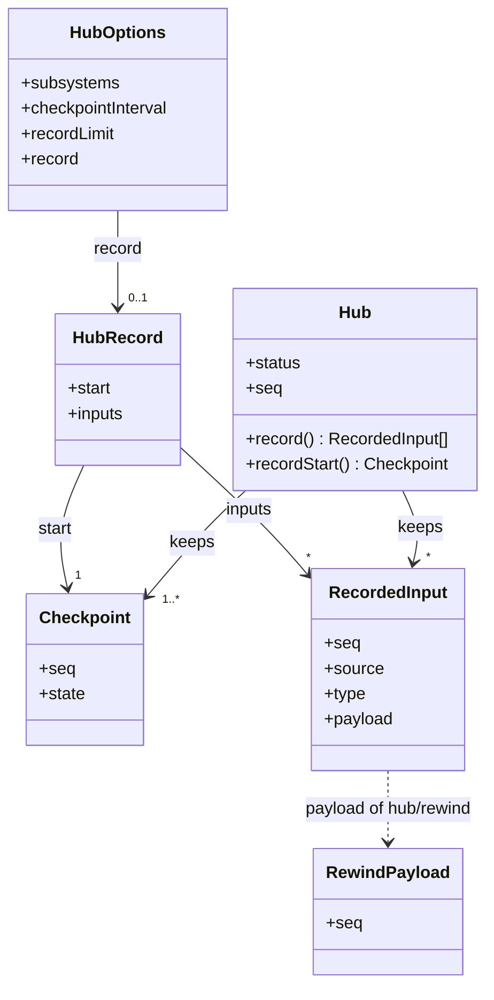
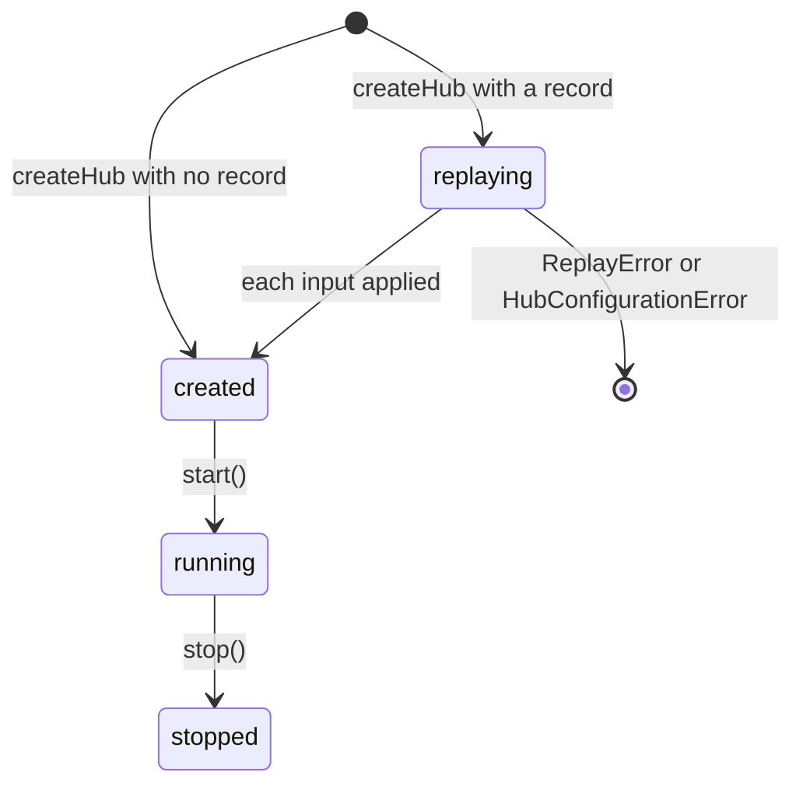
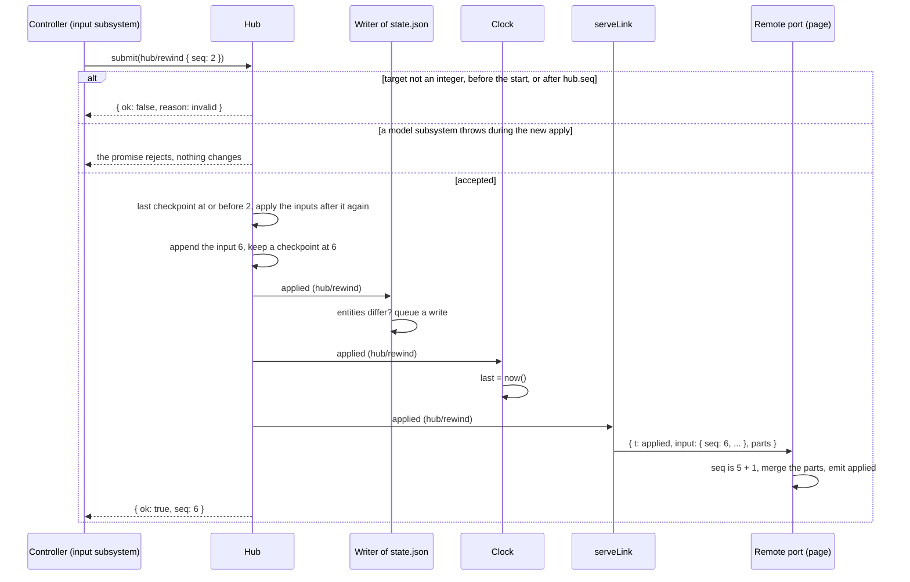

# Design

## Context

See `proposal.md` for the reason of the change. The requirements are in the delta specs, mainly `specs/wishem/hub/record/spec.md`.

The current state:

- `createHub` in `nodejs/wishem/hub/src/hub.ts` holds the joined state in one frozen object and appends each accepted input to an array with no limit. `Hub.record()` copies that array. `serveLink` calls `hub.record().at(-1)` for each `hello` to get the last sequence number.
- The hub events are `started`, `applied`, and `stopping`. `serve-link.ts` treats each event that is not `started` or `applied` as `stopping`.
- Each listener uses `applied` as its only signal of a change: the writer of `state.json` (`model-folder-storage.ts`), the generator of the view types (`workbench-app/scripts/start.ts`), the client of the page (`hub-client.ts`), and the clock (`clock.ts`).
- The writer compares the entities with `isEqual` on each `applied` event. The generator changes all definitions into JSON text on each `applied` event.
- The remote port of a client of version 1 ends its link when a sequence number is not one more than the last one. `LINK.md` says that a later version does not send a new message type that changes the joined state to an older client.
- Each model subsystem is a pure function that returns immutable parts. No model subsystem holds its own state.
- No construct runs a clock in a long process today. The milestone "A2 Time" adds such constructs.

Constraints: rule R3 (the same starting state and the same inputs give the same result), rule R20 (control goes through the hub as inputs), and rule R7 (build nothing before a design needs it). The hub uses no Node.js API.

## Goals / Non-Goals

**Goals:**

- A rewind and a replay for model subsystems that are pure functions.
- One signal of a change for each listener, also after a rewind.
- A record with a limit, and no work on each tick that grows with the size of the model when the model did not change.
- A client of version 1 of the link that stays correct after a rewind, with no change to the client.

**Non-Goals:**

- A snapshot interface for a model library that holds its own state. No such subsystem exists (rule R7). See "Follow-up".
- Bookmarks, a durable form of the record on the disk, and a control of the page or of the agent that sends a rewind.
- A second store with a different ID (#534).
- The other items of #565 (`attach` and `detach` messages, binary frames, the small corrections of the code).

## Approaches

The lead agent did the brainstorm alone, as `docs/autonomous-flow.md` says. Three approaches were considered for the rewind.

1. **A port operation and a `restored` event.** A new operation `rewind(seq)` on the hub or on a port, and a new hub event `restored`. Each listener handles two events. The link needs a new message for the rewind. The section "Unknown messages and reserved types" of `LINK.md` forbids that message to a client of version 1, so the link needs version 2, or a feature in `hello`, or a close of each link of version 1 on each rewind. The rewind is not in the record unless the hub adds a second kind of record entry, so a replay does not see it.
2. **A reserved input `hub/rewind` that truncates the record.** The rewind removes the inputs after the target, and the next input gets the number `target + 1`. The record is the history of the current state only. Sequence numbers go down, so each client of version 1 ends its link on the next input, and a client sees no event while the construct is paused. The rewind removes the inputs that provenance and redo need.
3. **A reserved input `hub/rewind` that is appended to the record (selected).** The rewind is an input with the next sequence number. The hub applies it itself. The hub event is the usual `applied`, and the link message is the usual `applied` with the parts that changed.

Approach 3 is selected. Reasons:

- Each listener that uses `applied` acts after a rewind with no change. This settles the first point of the review of "A1 Construct" with one signal, not with a helper that each listener must call.
- A client of version 1 gets the new state in an `applied` message. The sequence numbers go up by 1. The link stays at version 1, and no client closes its link. This settles the first point of #565.
- The rewind is in the record, so a replay of the record gives the same state (rule R3), and the source of the rewind is recorded.
- No input is lost. A rewind to a point on a path that an earlier rewind left gives that state again, which is a redo.

## Decisions

### D1. A rewind is the reserved input `hub/rewind`, and its event is `applied`

The hub declares `hub/rewind` with the payload `{ seq }`. The hub does not give it to a model subsystem. The joined state after the rewind is equal to the joined state after the input `seq`. The hub has no `restored` event. The blueprint text "the construct was restored to an earlier point" is now the `applied` event of `hub/rewind`. A listener that must know that a rewind happened tests `event.input.type === REWIND_INPUT_TYPE`.

Rejected: a `restored` event. See approach 1. Rejected: a truncated record. See approach 2.

A rewind to the last sequence number is accepted and changes no part. Reason: the rule "the state after the target" stays one rule with no exception, and the cost is one entry in the record.

### D2. The ID `hub` and the input types `hub/<name>` are reserved

`createHub` and `attach` refuse the ID `hub` with a `HubConfigurationError`, so `serveLink` refuses a `hello` with it with the reason `id-in-use`. `LINK.md` already gives that reason for "an ID that is in use by the hub". `createHub` refuses a model subsystem that declares a type that starts with `hub/`. A different type `hub/<name>` gets `unknown-type`, so a later version of the hub can add a type of its own.

### D3. Checkpoints are references, at a fixed interval and after each rewind

A checkpoint is `{ seq, state }`, where `state` is the frozen joined state object. Parts are immutable, so a checkpoint copies nothing. The hub keeps a checkpoint at the start of the record, after each input whose number is a multiple of `checkpointInterval` (default 100), and after each rewind.

The checkpoint after each rewind has a second reason: the range of inputs that a rewind applies again never holds a rewind. A rewind to the target `t` takes the last checkpoint `c` with `c.seq <= t`. Each rewind `r` with `r <= t` has a checkpoint at `r`, so `c.seq >= r`. Thus no recursion is necessary, and a rewind applies at most `checkpointInterval - 1` inputs again.

Rejected: a checkpoint after each input. It is cheap for references, but it keeps each part of each input in memory, and it does not work for a later model library that makes a copy for a snapshot.

### D4. The record has a limit, and its start moves to a checkpoint

`recordLimit` (default 100000) is the largest number of inputs after the start. At 20 ticks each second, the default keeps approximately 83 minutes. After each accepted input, when `seq - start.seq > recordLimit`, the hub moves the start to the first checkpoint `c` with `seq - c.seq <= recordLimit` that is valid. A checkpoint is valid when each rewind in the record after `c` has a target at or after `c.seq`. The checkpoint at the last rewind is always valid, and `recordLimit >= checkpointInterval` makes sure that a checkpoint is in the range. The hub removes the inputs and the checkpoints before the new start.

Reason for the validity rule: a replay of the record must be able to apply each rewind in it. Without the rule, a rewind in the record can have a target that is not in the record.

`createHub` refuses `recordLimit < checkpointInterval`, and each value that is not a positive integer.

Rejected: no limit. A construct with a clock grows with no end. Rejected: a limit in bytes. The hub does not know the size of a part, and a count is enough for the inputs of a clock.

### D5. A replay is an option of `createHub`

`createHub({ subsystems, record })` takes `record: { start, inputs }`. The hub sets the joined state to `start.state`, keeps `start` as the first checkpoint, and applies each input before `createHub` returns. It uses the recorded source and sequence number. It sends no event, because no listener can be attached yet. A `hub/rewind` in the record is applied as in D1.

- A gap in the sequence numbers, or a start whose keys are not the IDs of the model subsystems, throws a `HubConfigurationError`.
- An input that a model subsystem refuses or that throws stops the replay with a `ReplayError` that holds `seq` and `problems`. Reason: a replay with a changed value can make an input fail, and the agent needs to know which one. A replay that skips the input gives a state that the record does not describe.

`Hub.recordStart()` gives the start, and `Hub.record()` gives the inputs after it. `record()` keeps its type, so the tests and the callers that use it do not change. A replay of a live hub is `createHub({ subsystems, record: { start: hub.recordStart(), inputs: hub.record() } })`.

Rejected: a separate `replay()` function. `createHub` already validates the subsystems, and a second entry point repeats it.

### D6. `Hub.seq` gives the last sequence number

`serveLink` reads `hub.seq` for `welcome`, in place of a copy of the record. This settles the second point of the review for `hello`.

### D7. The link stays at version 1

A rewind reaches a client as `applied`. `serveLink` sends the parts whose identity differs from the last state that it sent, as now. `serveLink` tests `event.type === 'stopping'` by name, and a `never` check makes the compiler fail when `HubEvent` gets a type that `serveLink` does not handle. This settles the second point of #565. `LINK.md` gets a section on the reserved ID and the input `hub/rewind`, and one example of a rewind on a link. The example is in `link/examples.ts`, so the test of the examples covers it.

Rejected: version 2, a feature in `hello`, and a close of each link of version 1. Approach 3 makes them unnecessary.

### D8. A rewind writes the entities to `state.json`

The writer writes `state.json` when the entities of the store differ from the last entities that it read or wrote. A rewind is an input, so a rewind that changes the entities writes them. Reason: `state.json` holds the authored state of the store, and in the workbench a rewind is an undo of the authored state. A writer that skips the rewind writes the same entities at the next input of the store anyway, so a skip gives only a period in which the file and the store differ.

The writer compares by identity first: when the `store` part is the same object as at the last check, or `entities` is the same array as the last entities that were read or written, it does nothing. Then it uses `isEqual` as now.

### D9. The generator of the view types compares by identity first

The generator keeps the last `definitions` array. When the array is the same object, it does nothing. Else it compares the JSON text as now. A tick changes only the part `time`, so the store part is the same object and the cost is one comparison.

### D10. The clock measures the real time again after a rewind

The clock sets `last = now()` on the `applied` event of `hub/rewind`, as it does for `time/set-running`. Reason: a rewind can change `running`, and the time of the construct jumps, so time that was due before the rewind must not cause ticks after it.

### D11. The test of the same record and the same state is in the `clock` package

The test needs the store (`core`) and `time` (`clock`). `hub` cannot depend on either package. `clock` gets a development dependency on `@thrashplay/wishem-core`. `core` does not depend on `clock`, so the graph has no cycle. A test in `host-nodejs` would give that package a dependency on `clock`, which is a new relationship at the container level.

### D12. The fixed ID `store` stays

The ID `store` is fixed in `model-folder-storage.ts`, `hub-client.ts`, `start.ts`, and `cli.ts`. Only one store exists. The change that mounts a product model (#534) gives the second store its ID and gives those listeners an option for the ID. Reason: rule R7.

### D13. The snapshot form of a model subsystem is not built

For a pure function, the part is its own snapshot, and a checkpoint refers to it. The interface for a model library that holds its own state waits for the first such library. A checkpoint is one object for each model subsystem, so that interface can add a snapshot to a checkpoint without a change to the record or to the link.

## Interfaces

All in `@thrashplay/wishem-hub` (`nodejs/wishem/hub/src/types.ts`, `names.ts`, `errors.ts`).

```ts
/** The reserved ID of the hub. */
export const HUB_ID = 'hub'
/** The reserved input type of a rewind. */
export const REWIND_INPUT_TYPE = 'hub/rewind'

export interface RewindPayload {
  /** The target. The joined state becomes the state after this input. 0 is the first state. */
  seq: number
}

export const hubInputs: {
  rewind(seq: number): Input
}

export interface Checkpoint {
  readonly seq: number
  readonly state: JoinedState
}

export interface HubRecord {
  readonly start: Checkpoint
  readonly inputs: readonly RecordedInput[]
}

export interface HubOptions {
  subsystems: readonly ModelSubsystem[]
  onError?: (error: unknown) => void
  /** A positive integer. Default 100. */
  checkpointInterval?: number
  /** A positive integer, not smaller than `checkpointInterval`. Default 100000. */
  recordLimit?: number
  /** The hub applies this record before `createHub` returns. */
  record?: HubRecord
}

export interface Hub {
  readonly status: HubStatus
  /** The sequence number of the last accepted input. 0 for none. */
  readonly seq: number
  start(): void
  stop(): void
  attach(subsystem: IoSubsystem): Port
  read(): JoinedState
  /** The inputs after the start of the record. */
  record(): readonly RecordedInput[]
  recordStart(): Checkpoint
}

/** Thrown by `createHub` when an input of the record does not apply. */
export class ReplayError extends Error {
  readonly seq: number
  readonly problems: InputProblem[]
}
```

`HubEvent`, `Port`, `ModelSubsystem`, and the link messages do not change.

## Domain types

New: `Checkpoint`, `HubRecord`, `RewindPayload`, `ReplayError`. Modified: `HubOptions`, `Hub`.



The status of the hub keeps its three values. A replay happens in the status `created`, before `createHub` returns:



`replaying` is not a value of `HubStatus`. It is the time inside `createHub`.

## The flow of a rewind



## Examples of the link

A rewind on a link. The hub accepted four inputs of `counter/add`, and the count is 8. The input subsystem `page-controls` rewinds to the input 2, at which the count was 4.

```json
{
  "t": "submit",
  "request": 5,
  "subsystem": "page-controls",
  "input": { "type": "hub/rewind", "payload": { "seq": 2 } }
}
```

```json
{
  "t": "applied",
  "input": { "seq": 5, "source": "page-controls", "type": "hub/rewind", "payload": { "seq": 2 } },
  "parts": { "counter": { "count": 4 } }
}
```

```json
{ "t": "result", "request": 5, "result": { "ok": true, "seq": 5 } }
```

A rewind that the hub rejects:

```json
{
  "t": "result",
  "request": 6,
  "result": {
    "ok": false,
    "reason": "invalid",
    "problems": [{ "message": "The target 9 is after the last input 5.", "path": ["payload", "seq"] }]
  }
}
```

A client that asks for the ID `hub`:

```json
{ "t": "refused", "reason": "id-in-use", "message": "A subsystem ID is in use." }
```

## Failure Modes

| Failure                                                                    | Behavior                                                                                                                                 | Recovery                                                                                   |
| -------------------------------------------------------------------------- | ---------------------------------------------------------------------------------------------------------------------------------------- | ------------------------------------------------------------------------------------------ |
| A model subsystem throws while the hub applies an input again for a rewind | The hub changes nothing and does not record the rewind. The sender gets the error.                                                       | The subsystem is not a pure function. Correct it.                                          |
| A model subsystem gives a different part when it applies an input again    | The rewind gives a state that differs from the earlier state. The hub cannot detect it.                                                  | The test of D11 covers the store and `time`. Each new model subsystem needs the same test. |
| The connection of a link closes during a rewind                            | The hub continues. The client gets the full state in the next `welcome`.                                                                 | The client opens a new link, as `LINK.md` says.                                            |
| A client of version 1 that does not use the rule of the parts              | The client keeps parts that the rewind changed.                                                                                          | `LINK.md` gives the rule. Such a client is a defect.                                       |
| The write of `state.json` after a rewind fails                             | The writer reports it, as for each other write. The store holds the state after the rewind.                                              | The next change of the entities writes again.                                              |
| Two rewinds in a short time                                                | The hub applies them one at a time in the order of arrival. The writer writes the entities of the last one, because it queues one write. | None needed.                                                                               |
| A replay of a record that a changed subsystem refuses                      | `createHub` throws a `ReplayError` with the sequence number.                                                                             | The caller changes the record or the subsystem.                                            |

A rewind is not idempotent in the record: each one adds an input. Its effect on the state is idempotent: two rewinds to one target give the same state.

## Package Impact

| Package                            | Published | Bump  | Why                                                                                                                                                                                                       |
| ---------------------------------- | --------- | ----- | --------------------------------------------------------------------------------------------------------------------------------------------------------------------------------------------------------- |
| `@thrashplay/wishem-hub`           | private   | minor | `hub/rewind`, checkpoints, the record limit, replay, `Hub.seq`, `Hub.recordStart`, `ReplayError`, the reserved ID. `serveLink` reads `hub.seq` and handles each event by name. `LINK.md` and `README.md`. |
| `@thrashplay/wishem-clock`         | private   | patch | The clock measures the real time again after a rewind. A test of replay with a development dependency on `core`.                                                                                          |
| `@thrashplay/wishem-host-nodejs`   | private   | patch | The writer compares by identity first, and writes after a rewind.                                                                                                                                         |
| `@thrashplay/wishem-workbench-app` | private   | patch | The generator of the view types compares by identity first.                                                                                                                                               |

`@thrashplay/wishem-core` does not change. No change is breaking.

## Risks / Trade-offs

- [A rewind past a read of the definition files leaves the definitions of the store different from the files on the disk. The storage subsystem keeps the definitions of the store until a file changes again.] → The writer does not write definitions (spec `wishem/host-nodejs/model-folder`). A follow-up decides how the workbench shows or resolves the difference.
- [A rewind past a save of `state.json` by the designer writes the older entities over that save.] → The record still holds the input of the save, so a rewind to its sequence number gives it again while it is in the record.
- [The cost of a rewind is up to `checkpointInterval - 1` applies of the store, and the store validates the full model for each write.] → The default interval is 100. The option lets a construct with a large model select a smaller interval.
- [The record keeps the full model of each `replace-model` input, up to `recordLimit` inputs.] → In the workbench these inputs are rare. A limit in bytes waits for a construct that needs it.
- [A rewind in the record can hold the start of the record back until the rewind leaves the record.] → D4 then moves the start to the checkpoint of the rewind, so the record never holds more than `recordLimit` inputs.
- [Each input subsystem can send `hub/rewind`.] → This agrees with rule R20: control is an input. A limit of who can rewind waits for a product that needs it.

## Migration Plan

No data is kept between runs, so no migration is necessary. Each caller of `createHub` keeps working with the defaults. To roll back, revert the commit.

## Blueprint changes

The change updates the blueprint in `nodejs/wishem/docs/`:

- `concepts.md`: the list of hub events has three items, and the restore is the `applied` event of `hub/rewind`. "Inputs and the record" gives the reserved type, the start of the record, and its limit. The text on a model library that holds its own state keeps the status **Open** and links to the follow-up issue in place of #533.
- `glossary.md`: **Hub event** lists three events. **Checkpoint**, **Rewind**, and **Record** give the facts of D3, D1, and D4. The label **Proposed** stays on these items.

## Follow-up

- An issue for the snapshot interface of a model library that holds its own state (D13). The lead agent creates it before the apply step and gives its number to the implementer of Task 2.
- How the workbench shows or resolves definitions of the store that differ from the definition files after a rewind.
- A durable form of a record and a checkpoint, for a replay in a different process.
- A control that sends `hub/rewind` from the page or from the agent, and bookmarks as named targets.
- A limit of the record in bytes, if a construct with large inputs needs it.
